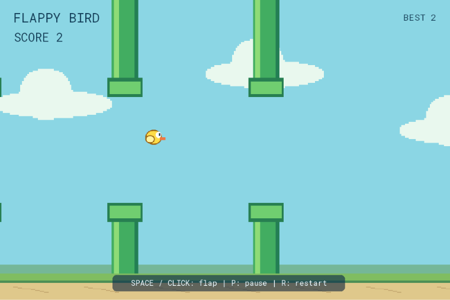

# Flappy Bird — Hướng dẫn dựng game bằng node

Tài liệu lấy từ graph và scene đã lưu, gồm từng node, hằng số và mọi dây nối. Có thể đọc/sửa file này bằng **File > Project Markdown…** trong Node_Engine (Ctrl+Shift+M).



## 1. Mở và thử template

1. Mở Project Manager > Open, chọn `flappy_bird.nen` trong thư mục template.
2. Nhấn F5 và click vùng game để bàn phím vào đúng cửa sổ native.
3. Space hoặc chuột trái: bắt đầu/vỗ cánh; P: pause/resume; R: reset vòng.
4. Nhấn F6 để pause host, Shift+F5 để dừng. Phím P của game chỉ dừng gameplay của template, khác nút Pause của host.
5. Best score giữ qua reset vòng trong cùng phiên chạy; chưa có lưu kỷ lục qua lần mở game mới.

## 2. Chuẩn bị một project mới

1. File > New Project…; chọn Blank 2D cho Flappy hoặc Blank 3D cho Snake, đặt tên/thư mục riêng.
2. Dùng template gốc làm mẫu đối chiếu. Copy các file assets của template vào assets của project mới.
3. Tạo entity/camera và tài nguyên theo bảng dưới. Chọn entity, copy Stable ID trong Inspector; dùng ID mới đó thay cho ID nguồn ở mọi input Entity và mảng body_entities. Tên hiển thị không thay thế Stable ID.
4. Scene > Scene Variables…: khai báo đúng tên, kiểu và giá trị ban đầu.
5. Scene > UI Templates…: tạo asset hud, dán RML bên dưới; id phần tử phải khớp Set Widget Text.
6. Graph > New Function…: tạo TẤT CẢ signature trong bảng function trước, sau đó Graph > Edit Function… để dựng body. Function action giữ ô Pure bỏ chọn.
7. Trong từng body, thêm node theo bảng chi tiết, điền hằng số rồi nối chính xác source.port → target.port. Function Input/Output có sẵn theo signature.
8. Dựng Gameplay sau các function. Graph > Validate; Ctrl+S; F5 và thử lại các tình huống ở cuối tài liệu.

Các nhãn node trong tài liệu như n1 là ID trong graph nguồn, dùng để phân biệt những node cùng tên. Khi dựng bằng UI, ID được cấp mới; có thể đặt nhãn tương ứng để theo dõi dây. Ảnh dây nối dùng renderer thật của editor, bố trí lại một trích đoạn để đọc rõ.

## 3. Scene, assets và camera

Camera đang dùng: `camera`. Flappy hiển thị sprite trên XY, nhưng transform vẫn là vec3. Snake dùng mặt bàn XZ và camera orthographic.

| Entity ID | Position | Rotation | Scale | Tài nguyên / cấu hình |
| --- | --- | --- | --- | --- |
| sky | [0, 0, -2] | [0, 0, 0] | [1, 1, 1] | {"sprite": {"asset": "sky", "flip_x": false, "flip_y": false, "frame": 0}, "sorting_order": -20} |
| ground | [0, -3.9, 0.3] | [0, 0, 0] | [1, 1, 1] | {"sprite": {"asset": "ground", "flip_x": false, "flip_y": false, "frame": 0}, "sorting_order": 20} |
| bird | [-2, 0, 0.1] | [0, 0, 0] | [1, 1, 1] | {"sprite": {"asset": "bird", "flip_x": false, "flip_y": false, "frame": 0}, "sorting_order": 10} |
| pipe_0_top | [4, 5, 0] | [0, 0, 0] | [1, 1, 1] | {"sprite": {"asset": "pipe", "flip_x": false, "flip_y": false, "frame": 0}, "sorting_order": 0} |
| pipe_0_bottom | [4, -5, 0] | [0, 0, 0] | [1, 1, 1] | {"sprite": {"asset": "pipe", "flip_x": false, "flip_y": true, "frame": 0}, "sorting_order": 0} |
| pipe_1_top | [8, 5, 0] | [0, 0, 0] | [1, 1, 1] | {"sprite": {"asset": "pipe", "flip_x": false, "flip_y": false, "frame": 0}, "sorting_order": 0} |
| pipe_1_bottom | [8, -5, 0] | [0, 0, 0] | [1, 1, 1] | {"sprite": {"asset": "pipe", "flip_x": false, "flip_y": true, "frame": 0}, "sorting_order": 0} |
| pipe_2_top | [12, 5, 0] | [0, 0, 0] | [1, 1, 1] | {"sprite": {"asset": "pipe", "flip_x": false, "flip_y": false, "frame": 0}, "sorting_order": 0} |
| pipe_2_bottom | [12, -5, 0] | [0, 0, 0] | [1, 1, 1] | {"sprite": {"asset": "pipe", "flip_x": false, "flip_y": true, "frame": 0}, "sorting_order": 0} |
| camera | [0, 0, 12] | [0, 0, 0] | [1, 1, 1] | {"camera": {"far": 100.0, "fov": 60.0, "near": 0.1, "projection": "orthographic", "size": 8.5}, "sorting_order": 0} |

Các giá trị transform là local; parent của mắt Snake là snake_head. 144 entity thân được tạo trước và Set Entity Active bật/tắt theo chiều dài thân. Có thể Duplicate Entity để tạo pool, rồi chọn đúng các entity trong biến body_entities.

### Thư viện tài nguyên

Scene > Sprites… / Materials… để khai báo những asset tương ứng. Cấu hình chính xác:

```json
{
  "sprite_assets": [
    {
      "columns": 2,
      "filter": "nearest",
      "height": 0.65,
      "id": "bird",
      "name": "Bird",
      "pivot": [
        0.5,
        0.5
      ],
      "rows": 1,
      "texture": "assets/bird.png",
      "type": "sprite",
      "version": 1,
      "width": 0.65
    },
    {
      "columns": 1,
      "filter": "nearest",
      "height": 7.0,
      "id": "pipe",
      "name": "Pipe",
      "pivot": [
        0.5,
        0.5
      ],
      "rows": 1,
      "texture": "assets/pipe.png",
      "type": "sprite",
      "version": 1,
      "width": 1.0
    },
    {
      "columns": 1,
      "filter": "nearest",
      "height": 9.0,
      "id": "sky",
      "name": "Sky",
      "pivot": [
        0.5,
        0.5
      ],
      "rows": 1,
      "texture": "assets/sky.png",
      "type": "sprite",
      "version": 1,
      "width": 16.0
    },
    {
      "columns": 1,
      "filter": "nearest",
      "height": 0.8,
      "id": "ground",
      "name": "Ground",
      "pivot": [
        0.5,
        0.5
      ],
      "rows": 1,
      "texture": "assets/ground.png",
      "type": "sprite",
      "version": 1,
      "width": 16.0
    }
  ]
}
```

## 4. Biến scene

| Tên | Kiểu | Giá trị ban đầu |
| --- | --- | --- |
| alive | bool | true |
| best | int | 0 |
| bird_y | float | 0.0 |
| death_reason | string | "" |
| paused | bool | false |
| pipe_0_gap | float | 0.0 |
| pipe_0_passed | bool | false |
| pipe_0_x | float | 4.0 |
| pipe_1_gap | float | 0.0 |
| pipe_1_passed | bool | false |
| pipe_1_x | float | 8.0 |
| pipe_2_gap | float | 0.0 |
| pipe_2_passed | bool | false |
| pipe_2_x | float | 12.0 |
| restart_count | int | 0 |
| score | int | 0 |
| started | bool | false |
| steps | int | 0 |
| velocity | float | 0.0 |

Get/Set Variable kiểu float có tên ngắn; Integer/Boolean/String/Vector3/Array có node riêng. Biến pure Get đọc trạng thái tại lúc được dùng; Set chỉ ghi khi luồng exec đi qua.

## 5. HUD

Tạo UI Template với id `hud`; instance Widget cũng dùng tên `hud`. Nối Create Widget trước Reset Round/Reset round để không cập nhật một HUD chưa tồn tại.

```html
<rml><head><title>Flappy Bird</title><style>
body { width: 100%; height: 100%; margin: 0px; font-family: node-ui; color: #f9ffff; font-size: 19px; }
div { display: block; }
#title { position: absolute; width: 320px; left: 28px; top: 20px; color: #103d58; font-size: 28px; }
#score { position: absolute; width: 320px; left: 30px; top: 64px; color: #103d58; font-size: 25px; }
#best { position: absolute; width: 180px; right: 30px; top: 26px; color: #103d58; text-align: right; }
#status { position: absolute; left: 25%; top: 37%; width: 50%; text-align: center;
 padding: 15px; background-color: #12394cdd; border-radius: 12px; font-size: 23px; }
#help { position: absolute; bottom: 18px; left: 25%; width: 50%; text-align: center;
 padding: 8px; background-color: #113d50d8; border-radius: 8px; font-size: 16px; }
</style></head><body><div id="title">FLAPPY BIRD</div><div id="score">SCORE 0</div>
<div id="best">BEST 0</div><div id="status">SPACE / CLICK to fly</div>
<div id="help">SPACE / CLICK: flap | P: pause | R: restart</div></body></rml>
```

## 6. Tạo các function

| Function | ID nguồn | Loại | Tham số IN | Tham số OUT |
| --- | --- | --- | --- | --- |
| Refresh HUD | 1000100 | Action | [] | [] |
| Game Over | 1000101 | Action | [{"default": "boundary", "name": "Reason", "type": "string"}] | [] |
| Reset Round | 1000102 | Action | [] | [] |
| Flap | 1000103 | Action | [] | [] |
| Advance Pipe 1 | 1000110 | Action | [] | [] |
| Advance Pipe 2 | 1000111 | Action | [] | [] |
| Advance Pipe 3 | 1000112 | Action | [] | [] |
| Simulate Bird | 1000120 | Action | [] | [] |

Function ID nguồn chỉ phục vụ đối chiếu; UI tự cấp ID và tạo node gọi theo tên. Double-click node gọi hoặc Graph > Edit Function… để vào body. Save trong Function Graphs áp dụng thay đổi về project; Ctrl+S ở cửa sổ chính lưu xuống đĩa.

## 7. Cách đọc từng bước node

Mỗi mục dưới ghi tác dụng, IO và giá trị thực tế. Cổng có dây dùng giá trị từ dây; cổng không có dây dùng hằng số. Dây exec quyết định thứ tự thực thi, không phải vị trí node trên canvas. Các node pure được tính khi đầu ra cần dùng. Nhấn F1 trên node để tra cứu thêm.

## Gameplay — 28 node

On Game Start → Create Widget → Reset Round. Space/Mouse Down → Flap. R tăng restart_count rồi reset. P đảo paused và refresh HUD. On Update chỉ Simulate Bird khi started AND alive AND NOT paused.

### Bước 1: On Game Start · `start`

Chạy Out một lần khi bắt đầu phiên chơi. Tạo HUD trước khi gọi function cập nhật HUD.

| Chiều | Cổng | Kiểu | Mặc định |
| --- | --- | --- | --- |
| OUT | Out | `exec` | — |

Nối đầu ra: `start.Out → n1.In`

### Bước 2: Create Widget · `n1`

Tạo một instance Widget từ UI Template đã khai báo trong Scene > UI Templates. Tên instance phải duy nhất.

| Chiều | Cổng | Kiểu | Mặc định |
| --- | --- | --- | --- |
| IN | In | `exec` | — |
| IN | Template | `string` | `"hud"` |
| IN | Widget | `string` | `"hud"` |
| OUT | Out | `exec` | — |

Cấu hình/nối đầu vào:

| IN | Giá trị hoặc source.port |
| --- | --- |
| In | ← start.Out |
| Template | "hud" |
| Widget | "hud" |

Nối đầu ra: `n1.Out → n2.In`

### Bước 3: Reset Round · `n2`

Gọi function Reset Round của dự án với các tham số bên dưới. Double-click node để xem các bước trong Function Graphs.

| Chiều | Cổng | Kiểu | Mặc định |
| --- | --- | --- | --- |
| IN | In | `exec` | — |
| OUT | Out | `exec` | — |

Cấu hình/nối đầu vào:

| IN | Giá trị hoặc source.port |
| --- | --- |
| In | ← n1.Out |

Nối đầu ra: không có dây đi tiếp (kết thúc nhánh hoặc cổng chưa dùng).

### Bước 4: On Key Pressed · `space`

Chạy một lần khi phím Filter vừa được nhấn. Giữ phím không tự lặp sự kiện này.

| Chiều | Cổng | Kiểu | Mặc định |
| --- | --- | --- | --- |
| IN | Filter | `string` | `"Space"` |
| OUT | Out | `exec` | — |
| OUT | Key | `string` | — |

Cấu hình/nối đầu vào:

| IN | Giá trị hoặc source.port |
| --- | --- |
| Filter | "Space" |

Nối đầu ra: `space.Out → n3.In`

### Bước 5: Flap · `n3`

Gọi function Flap của dự án với các tham số bên dưới. Double-click node để xem các bước trong Function Graphs.

| Chiều | Cổng | Kiểu | Mặc định |
| --- | --- | --- | --- |
| IN | In | `exec` | — |
| OUT | Out | `exec` | — |

Cấu hình/nối đầu vào:

| IN | Giá trị hoặc source.port |
| --- | --- |
| In | ← space.Out |

Nối đầu ra: không có dây đi tiếp (kết thúc nhánh hoặc cổng chưa dùng).

### Bước 6: On Mouse Button · `click`

Phát sự kiện nút chuột khớp Filter. Kiểm tra Down bằng Branch để chỉ xử lý lúc nhấn.

| Chiều | Cổng | Kiểu | Mặc định |
| --- | --- | --- | --- |
| IN | Filter | `string` | `"MouseLeft"` |
| OUT | Out | `exec` | — |
| OUT | Button | `string` | — |
| OUT | Down | `bool` | — |

Cấu hình/nối đầu vào:

| IN | Giá trị hoặc source.port |
| --- | --- |
| Filter | "MouseLeft" |

Nối đầu ra: `click.Down → n4.Condition`; `click.Out → n4.In`

### Bước 7: Branch · `n4`

Nhận luồng In, kiểm tra Condition và chỉ chạy True hoặc False. Không nối cả hai nhánh như Sequence.

| Chiều | Cổng | Kiểu | Mặc định |
| --- | --- | --- | --- |
| IN | In | `exec` | — |
| IN | Condition | `bool` | `true` |
| OUT | True | `exec` | — |
| OUT | False | `exec` | — |

Cấu hình/nối đầu vào:

| IN | Giá trị hoặc source.port |
| --- | --- |
| In | ← click.Out |
| Condition | ← click.Down |

Nối đầu ra: `n4.True → n5.In`

### Bước 8: Flap · `n5`

Gọi function Flap của dự án với các tham số bên dưới. Double-click node để xem các bước trong Function Graphs.

| Chiều | Cổng | Kiểu | Mặc định |
| --- | --- | --- | --- |
| IN | In | `exec` | — |
| OUT | Out | `exec` | — |

Cấu hình/nối đầu vào:

| IN | Giá trị hoặc source.port |
| --- | --- |
| In | ← n4.True |

Nối đầu ra: không có dây đi tiếp (kết thúc nhánh hoặc cổng chưa dùng).

### Bước 9: On Key Pressed · `restart`

Chạy một lần khi phím Filter vừa được nhấn. Giữ phím không tự lặp sự kiện này.

| Chiều | Cổng | Kiểu | Mặc định |
| --- | --- | --- | --- |
| IN | Filter | `string` | `"Space"` |
| OUT | Out | `exec` | — |
| OUT | Key | `string` | — |

Cấu hình/nối đầu vào:

| IN | Giá trị hoặc source.port |
| --- | --- |
| Filter | "R" |

Nối đầu ra: `restart.Out → n8.In`

### Bước 10: Get Integer Variable · `n6`

Ghi biến int trong phạm vi scene. Name phải khớp biến đã khai báo; chọn đúng kiểu.

| Chiều | Cổng | Kiểu | Mặc định |
| --- | --- | --- | --- |
| IN | Name | `string` | `"int_value"` |
| OUT | Value | `int` | — |

Cấu hình/nối đầu vào:

| IN | Giá trị hoặc source.port |
| --- | --- |
| Name | "restart_count" |

Nối đầu ra: `n6.Value → n7.A`

### Bước 11: Integer Add · `n7`

Trả A + B dưới dạng int; thường dùng tăng score hoặc bộ đếm.

| Chiều | Cổng | Kiểu | Mặc định |
| --- | --- | --- | --- |
| IN | A | `int` | `0` |
| IN | B | `int` | `1` |
| OUT | Value | `int` | — |

Cấu hình/nối đầu vào:

| IN | Giá trị hoặc source.port |
| --- | --- |
| A | ← n6.Value |
| B | 1 |

Nối đầu ra: `n7.Value → n8.Value`

### Bước 12: Set Integer Variable · `n8`

Ghi biến int trong phạm vi scene. Name phải khớp biến đã khai báo; chọn đúng kiểu.

| Chiều | Cổng | Kiểu | Mặc định |
| --- | --- | --- | --- |
| IN | In | `exec` | — |
| IN | Name | `string` | `"int_value"` |
| IN | Value | `int` | `0` |
| OUT | Out | `exec` | — |

Cấu hình/nối đầu vào:

| IN | Giá trị hoặc source.port |
| --- | --- |
| In | ← restart.Out |
| Name | "restart_count" |
| Value | ← n7.Value |

Nối đầu ra: `n8.Out → n9.In`

### Bước 13: Reset Round · `n9`

Gọi function Reset Round của dự án với các tham số bên dưới. Double-click node để xem các bước trong Function Graphs.

| Chiều | Cổng | Kiểu | Mặc định |
| --- | --- | --- | --- |
| IN | In | `exec` | — |
| OUT | Out | `exec` | — |

Cấu hình/nối đầu vào:

| IN | Giá trị hoặc source.port |
| --- | --- |
| In | ← n8.Out |

Nối đầu ra: không có dây đi tiếp (kết thúc nhánh hoặc cổng chưa dùng).

### Bước 14: On Key Pressed · `pause`

Chạy một lần khi phím Filter vừa được nhấn. Giữ phím không tự lặp sự kiện này.

| Chiều | Cổng | Kiểu | Mặc định |
| --- | --- | --- | --- |
| IN | Filter | `string` | `"Space"` |
| OUT | Out | `exec` | — |
| OUT | Key | `string` | — |

Cấu hình/nối đầu vào:

| IN | Giá trị hoặc source.port |
| --- | --- |
| Filter | "P" |

Nối đầu ra: `pause.Out → n12.In`

### Bước 15: Get Boolean Variable · `n10`

Ghi biến bool trong phạm vi scene. Name phải khớp biến đã khai báo; chọn đúng kiểu.

| Chiều | Cổng | Kiểu | Mặc định |
| --- | --- | --- | --- |
| IN | Name | `string` | `"bool_value"` |
| OUT | Value | `bool` | — |

Cấu hình/nối đầu vào:

| IN | Giá trị hoặc source.port |
| --- | --- |
| Name | "paused" |

Nối đầu ra: `n10.Value → n11.Value`

### Bước 16: NOT · `n11`

Đảo bool Value: true thành false và ngược lại. Dùng để bật/tắt paused.

| Chiều | Cổng | Kiểu | Mặc định |
| --- | --- | --- | --- |
| IN | Value | `bool` | `false` |
| OUT | Value | `bool` | — |

Cấu hình/nối đầu vào:

| IN | Giá trị hoặc source.port |
| --- | --- |
| Value | ← n10.Value |

Nối đầu ra: `n11.Value → n12.Value`

### Bước 17: Set Boolean Variable · `n12`

Ghi biến bool trong phạm vi scene. Name phải khớp biến đã khai báo; chọn đúng kiểu.

| Chiều | Cổng | Kiểu | Mặc định |
| --- | --- | --- | --- |
| IN | In | `exec` | — |
| IN | Name | `string` | `"bool_value"` |
| IN | Value | `bool` | `false` |
| OUT | Out | `exec` | — |

Cấu hình/nối đầu vào:

| IN | Giá trị hoặc source.port |
| --- | --- |
| In | ← pause.Out |
| Name | "paused" |
| Value | ← n11.Value |

Nối đầu ra: `n12.Out → n13.In`

### Bước 18: Refresh HUD · `n13`

Gọi function Refresh HUD của dự án với các tham số bên dưới. Double-click node để xem các bước trong Function Graphs.

| Chiều | Cổng | Kiểu | Mặc định |
| --- | --- | --- | --- |
| IN | In | `exec` | — |
| OUT | Out | `exec` | — |

Cấu hình/nối đầu vào:

| IN | Giá trị hoặc source.port |
| --- | --- |
| In | ← n12.Out |

Nối đầu ra: không có dây đi tiếp (kết thúc nhánh hoặc cổng chưa dùng).

### Bước 19: On Update · `update`

Chạy mỗi frame. Nhân tốc độ với Get Delta Time để chuyển từ đơn vị/giây sang độ dời của frame.

| Chiều | Cổng | Kiểu | Mặc định |
| --- | --- | --- | --- |
| OUT | Out | `exec` | — |

Nối đầu ra: `update.Out → n20.In`

### Bước 20: Get Boolean Variable · `n14`

Ghi biến bool trong phạm vi scene. Name phải khớp biến đã khai báo; chọn đúng kiểu.

| Chiều | Cổng | Kiểu | Mặc định |
| --- | --- | --- | --- |
| IN | Name | `string` | `"bool_value"` |
| OUT | Value | `bool` | — |

Cấu hình/nối đầu vào:

| IN | Giá trị hoặc source.port |
| --- | --- |
| Name | "started" |

Nối đầu ra: `n14.Value → n16.A`

### Bước 21: Get Boolean Variable · `n15`

Ghi biến bool trong phạm vi scene. Name phải khớp biến đã khai báo; chọn đúng kiểu.

| Chiều | Cổng | Kiểu | Mặc định |
| --- | --- | --- | --- |
| IN | Name | `string` | `"bool_value"` |
| OUT | Value | `bool` | — |

Cấu hình/nối đầu vào:

| IN | Giá trị hoặc source.port |
| --- | --- |
| Name | "alive" |

Nối đầu ra: `n15.Value → n16.B`

### Bước 22: AND · `n16`

Trả true khi A và B đều true. Dùng để gộp alive, started và NOT paused.

| Chiều | Cổng | Kiểu | Mặc định |
| --- | --- | --- | --- |
| IN | A | `bool` | `true` |
| IN | B | `bool` | `true` |
| OUT | Value | `bool` | — |

Cấu hình/nối đầu vào:

| IN | Giá trị hoặc source.port |
| --- | --- |
| A | ← n14.Value |
| B | ← n15.Value |

Nối đầu ra: `n16.Value → n19.A`

### Bước 23: Get Boolean Variable · `n17`

Ghi biến bool trong phạm vi scene. Name phải khớp biến đã khai báo; chọn đúng kiểu.

| Chiều | Cổng | Kiểu | Mặc định |
| --- | --- | --- | --- |
| IN | Name | `string` | `"bool_value"` |
| OUT | Value | `bool` | — |

Cấu hình/nối đầu vào:

| IN | Giá trị hoặc source.port |
| --- | --- |
| Name | "paused" |

Nối đầu ra: `n17.Value → n18.Value`

### Bước 24: NOT · `n18`

Đảo bool Value: true thành false và ngược lại. Dùng để bật/tắt paused.

| Chiều | Cổng | Kiểu | Mặc định |
| --- | --- | --- | --- |
| IN | Value | `bool` | `false` |
| OUT | Value | `bool` | — |

Cấu hình/nối đầu vào:

| IN | Giá trị hoặc source.port |
| --- | --- |
| Value | ← n17.Value |

Nối đầu ra: `n18.Value → n19.B`

### Bước 25: AND · `n19`

Trả true khi A và B đều true. Dùng để gộp alive, started và NOT paused.

| Chiều | Cổng | Kiểu | Mặc định |
| --- | --- | --- | --- |
| IN | A | `bool` | `true` |
| IN | B | `bool` | `true` |
| OUT | Value | `bool` | — |

Cấu hình/nối đầu vào:

| IN | Giá trị hoặc source.port |
| --- | --- |
| A | ← n16.Value |
| B | ← n18.Value |

Nối đầu ra: `n19.Value → n20.Condition`

### Bước 26: Branch · `n20`

Nhận luồng In, kiểm tra Condition và chỉ chạy True hoặc False. Không nối cả hai nhánh như Sequence.

| Chiều | Cổng | Kiểu | Mặc định |
| --- | --- | --- | --- |
| IN | In | `exec` | — |
| IN | Condition | `bool` | `true` |
| OUT | True | `exec` | — |
| OUT | False | `exec` | — |

Cấu hình/nối đầu vào:

| IN | Giá trị hoặc source.port |
| --- | --- |
| In | ← update.Out |
| Condition | ← n19.Value |

Nối đầu ra: `n20.True → n21.In`

### Bước 27: Simulate Bird · `n21`

Gọi function Simulate Bird của dự án với các tham số bên dưới. Double-click node để xem các bước trong Function Graphs.

| Chiều | Cổng | Kiểu | Mặc định |
| --- | --- | --- | --- |
| IN | In | `exec` | — |
| OUT | Out | `exec` | — |

Cấu hình/nối đầu vào:

| IN | Giá trị hoặc source.port |
| --- | --- |
| In | ← n20.True |

Nối đầu ra: `n21.Out → n22.In`

### Bước 28: Refresh HUD · `n22`

Gọi function Refresh HUD của dự án với các tham số bên dưới. Double-click node để xem các bước trong Function Graphs.

| Chiều | Cổng | Kiểu | Mặc định |
| --- | --- | --- | --- |
| IN | In | `exec` | — |
| OUT | Out | `exec` | — |

Cấu hình/nối đầu vào:

| IN | Giá trị hoặc source.port |
| --- | --- |
| In | ← n21.Out |

Nối đầu ra: không có dây đi tiếp (kết thúc nhánh hoặc cổng chưa dùng).

### Danh sách toàn bộ dây nối của Gameplay

| Từ node.cổng | Tới node.cổng |
| --- | --- |
| start.Out | n1.In |
| n1.Out | n2.In |
| space.Out | n3.In |
| click.Down | n4.Condition |
| click.Out | n4.In |
| n4.True | n5.In |
| n6.Value | n7.A |
| n7.Value | n8.Value |
| restart.Out | n8.In |
| n8.Out | n9.In |
| n10.Value | n11.Value |
| n11.Value | n12.Value |
| pause.Out | n12.In |
| n12.Out | n13.In |
| n14.Value | n16.A |
| n15.Value | n16.B |
| n17.Value | n18.Value |
| n16.Value | n19.A |
| n18.Value | n19.B |
| n19.Value | n20.Condition |
| update.Out | n20.In |
| n20.True | n21.In |
| n21.Out | n22.In |

## Refresh HUD — 21 node

Đọc score/best → Format Integer → Concat Strings → Set Widget Text. Chọn thông báo theo alive/started/paused, rồi dùng display=none khi chuỗi rỗng.

### Bước 1: Function Input · `entry`

Điểm vào function. Các tham số của function xuất hiện ở đầu ra; không thêm vào Gameplay.

| Chiều | Cổng | Kiểu | Mặc định |
| --- | --- | --- | --- |
| OUT | Out | `exec` | — |

Nối đầu ra: `entry.Out → n4.In`

### Bước 2: Function Output · `return`

Kết thúc function và trả kết quả về nơi gọi. Function action cần nối In trên các đường kết thúc.

| Chiều | Cổng | Kiểu | Mặc định |
| --- | --- | --- | --- |
| IN | In | `exec` | — |

Cấu hình/nối đầu vào:

| IN | Giá trị hoặc source.port |
| --- | --- |
| In | ← n19.Out |

Nối đầu ra: không có dây đi tiếp (kết thúc nhánh hoặc cổng chưa dùng).

### Bước 3: Get Integer Variable · `n1`

Ghi biến int trong phạm vi scene. Name phải khớp biến đã khai báo; chọn đúng kiểu.

| Chiều | Cổng | Kiểu | Mặc định |
| --- | --- | --- | --- |
| IN | Name | `string` | `"int_value"` |
| OUT | Value | `int` | — |

Cấu hình/nối đầu vào:

| IN | Giá trị hoặc source.port |
| --- | --- |
| Name | "score" |

Nối đầu ra: `n1.Value → n2.Value`

### Bước 4: Format Integer · `n2`

Chuyển int thành string để hiển thị số trên HUD; không thay đổi biến gốc.

| Chiều | Cổng | Kiểu | Mặc định |
| --- | --- | --- | --- |
| IN | Value | `int` | `0` |
| OUT | Value | `string` | — |

Cấu hình/nối đầu vào:

| IN | Giá trị hoặc source.port |
| --- | --- |
| Value | ← n1.Value |

Nối đầu ra: `n2.Value → n3.B`

### Bước 5: Concat Strings · `n3`

Ghép chuỗi A rồi B. Flappy ghép SCORE với kết quả Format Integer.

| Chiều | Cổng | Kiểu | Mặc định |
| --- | --- | --- | --- |
| IN | A | `string` | `""` |
| IN | B | `string` | `""` |
| OUT | Value | `string` | — |

Cấu hình/nối đầu vào:

| IN | Giá trị hoặc source.port |
| --- | --- |
| A | "SCORE " |
| B | ← n2.Value |

Nối đầu ra: `n3.Value → n4.Text`

### Bước 6: Set Widget Text · `n4`

Ghi Text vào phần tử Element của Widget đã tạo. Element là id trong RML; chuyển số thành chuỗi trước.

| Chiều | Cổng | Kiểu | Mặc định |
| --- | --- | --- | --- |
| IN | In | `exec` | — |
| IN | Widget | `string` | `"hud"` |
| IN | Element | `string` | `"score"` |
| IN | Text | `string` | `"Hello"` |
| OUT | Out | `exec` | — |

Cấu hình/nối đầu vào:

| IN | Giá trị hoặc source.port |
| --- | --- |
| In | ← entry.Out |
| Widget | "hud" |
| Element | "score" |
| Text | ← n3.Value |

Nối đầu ra: `n4.Out → n8.In`

### Bước 7: Get Integer Variable · `n5`

Ghi biến int trong phạm vi scene. Name phải khớp biến đã khai báo; chọn đúng kiểu.

| Chiều | Cổng | Kiểu | Mặc định |
| --- | --- | --- | --- |
| IN | Name | `string` | `"int_value"` |
| OUT | Value | `int` | — |

Cấu hình/nối đầu vào:

| IN | Giá trị hoặc source.port |
| --- | --- |
| Name | "best" |

Nối đầu ra: `n5.Value → n6.Value`

### Bước 8: Format Integer · `n6`

Chuyển int thành string để hiển thị số trên HUD; không thay đổi biến gốc.

| Chiều | Cổng | Kiểu | Mặc định |
| --- | --- | --- | --- |
| IN | Value | `int` | `0` |
| OUT | Value | `string` | — |

Cấu hình/nối đầu vào:

| IN | Giá trị hoặc source.port |
| --- | --- |
| Value | ← n5.Value |

Nối đầu ra: `n6.Value → n7.B`

### Bước 9: Concat Strings · `n7`

Ghép chuỗi A rồi B. Flappy ghép SCORE với kết quả Format Integer.

| Chiều | Cổng | Kiểu | Mặc định |
| --- | --- | --- | --- |
| IN | A | `string` | `""` |
| IN | B | `string` | `""` |
| OUT | Value | `string` | — |

Cấu hình/nối đầu vào:

| IN | Giá trị hoặc source.port |
| --- | --- |
| A | "BEST " |
| B | ← n6.Value |

Nối đầu ra: `n7.Value → n8.Text`

### Bước 10: Set Widget Text · `n8`

Ghi Text vào phần tử Element của Widget đã tạo. Element là id trong RML; chuyển số thành chuỗi trước.

| Chiều | Cổng | Kiểu | Mặc định |
| --- | --- | --- | --- |
| IN | In | `exec` | — |
| IN | Widget | `string` | `"hud"` |
| IN | Element | `string` | `"score"` |
| IN | Text | `string` | `"Hello"` |
| OUT | Out | `exec` | — |

Cấu hình/nối đầu vào:

| IN | Giá trị hoặc source.port |
| --- | --- |
| In | ← n4.Out |
| Widget | "hud" |
| Element | "best" |
| Text | ← n7.Value |

Nối đầu ra: `n8.Out → n16.In`

### Bước 11: Get Boolean Variable · `n9`

Ghi biến bool trong phạm vi scene. Name phải khớp biến đã khai báo; chọn đúng kiểu.

| Chiều | Cổng | Kiểu | Mặc định |
| --- | --- | --- | --- |
| IN | Name | `string` | `"bool_value"` |
| OUT | Value | `bool` | — |

Cấu hình/nối đầu vào:

| IN | Giá trị hoặc source.port |
| --- | --- |
| Name | "alive" |

Nối đầu ra: `n9.Value → n10.Value`

### Bước 12: NOT · `n10`

Đảo bool Value: true thành false và ngược lại. Dùng để bật/tắt paused.

| Chiều | Cổng | Kiểu | Mặc định |
| --- | --- | --- | --- |
| IN | Value | `bool` | `false` |
| OUT | Value | `bool` | — |

Cấu hình/nối đầu vào:

| IN | Giá trị hoặc source.port |
| --- | --- |
| Value | ← n9.Value |

Nối đầu ra: `n10.Value → n15.Condition`

### Bước 13: Get Boolean Variable · `n11`

Ghi biến bool trong phạm vi scene. Name phải khớp biến đã khai báo; chọn đúng kiểu.

| Chiều | Cổng | Kiểu | Mặc định |
| --- | --- | --- | --- |
| IN | Name | `string` | `"bool_value"` |
| OUT | Value | `bool` | — |

Cấu hình/nối đầu vào:

| IN | Giá trị hoặc source.port |
| --- | --- |
| Name | "paused" |

Nối đầu ra: `n11.Value → n12.Condition`

### Bước 14: Select String · `n12`

Chọn giá trị ở True hoặc False theo Condition. Đây là lựa chọn dữ liệu, không điều khiển luồng exec.

| Chiều | Cổng | Kiểu | Mặc định |
| --- | --- | --- | --- |
| IN | Condition | `bool` | `false` |
| IN | True | `string` | `""` |
| IN | False | `string` | `""` |
| OUT | Value | `string` | — |

Cấu hình/nối đầu vào:

| IN | Giá trị hoặc source.port |
| --- | --- |
| Condition | ← n11.Value |
| True | "PAUSED - P to resume" |
| False | "" |

Nối đầu ra: `n12.Value → n14.True`

### Bước 15: Get Boolean Variable · `n13`

Ghi biến bool trong phạm vi scene. Name phải khớp biến đã khai báo; chọn đúng kiểu.

| Chiều | Cổng | Kiểu | Mặc định |
| --- | --- | --- | --- |
| IN | Name | `string` | `"bool_value"` |
| OUT | Value | `bool` | — |

Cấu hình/nối đầu vào:

| IN | Giá trị hoặc source.port |
| --- | --- |
| Name | "started" |

Nối đầu ra: `n13.Value → n14.Condition`

### Bước 16: Select String · `n14`

Chọn giá trị ở True hoặc False theo Condition. Đây là lựa chọn dữ liệu, không điều khiển luồng exec.

| Chiều | Cổng | Kiểu | Mặc định |
| --- | --- | --- | --- |
| IN | Condition | `bool` | `false` |
| IN | True | `string` | `""` |
| IN | False | `string` | `""` |
| OUT | Value | `string` | — |

Cấu hình/nối đầu vào:

| IN | Giá trị hoặc source.port |
| --- | --- |
| Condition | ← n13.Value |
| True | ← n12.Value |
| False | "SPACE / CLICK to fly" |

Nối đầu ra: `n14.Value → n15.False`

### Bước 17: Select String · `n15`

Chọn giá trị ở True hoặc False theo Condition. Đây là lựa chọn dữ liệu, không điều khiển luồng exec.

| Chiều | Cổng | Kiểu | Mặc định |
| --- | --- | --- | --- |
| IN | Condition | `bool` | `false` |
| IN | True | `string` | `""` |
| IN | False | `string` | `""` |
| OUT | Value | `string` | — |

Cấu hình/nối đầu vào:

| IN | Giá trị hoặc source.port |
| --- | --- |
| Condition | ← n10.Value |
| True | "GAME OVER - R to restart" |
| False | ← n14.Value |

Nối đầu ra: `n15.Value → n16.Text`; `n15.Value → n17.A`

### Bước 18: Set Widget Text · `n16`

Ghi Text vào phần tử Element của Widget đã tạo. Element là id trong RML; chuyển số thành chuỗi trước.

| Chiều | Cổng | Kiểu | Mặc định |
| --- | --- | --- | --- |
| IN | In | `exec` | — |
| IN | Widget | `string` | `"hud"` |
| IN | Element | `string` | `"score"` |
| IN | Text | `string` | `"Hello"` |
| OUT | Out | `exec` | — |

Cấu hình/nối đầu vào:

| IN | Giá trị hoặc source.port |
| --- | --- |
| In | ← n8.Out |
| Widget | "hud" |
| Element | "status" |
| Text | ← n15.Value |

Nối đầu ra: `n16.Out → n19.In`

### Bước 19: String Equal · `n17`

Trả bool cho phép so sánh hai chuỗi A và B chính xác, phân biệt hoa thường.

| Chiều | Cổng | Kiểu | Mặc định |
| --- | --- | --- | --- |
| IN | A | `string` | `""` |
| IN | B | `string` | `""` |
| OUT | Value | `bool` | — |

Cấu hình/nối đầu vào:

| IN | Giá trị hoặc source.port |
| --- | --- |
| A | ← n15.Value |
| B | "" |

Nối đầu ra: `n17.Value → n18.Condition`

### Bước 20: Select String · `n18`

Chọn giá trị ở True hoặc False theo Condition. Đây là lựa chọn dữ liệu, không điều khiển luồng exec.

| Chiều | Cổng | Kiểu | Mặc định |
| --- | --- | --- | --- |
| IN | Condition | `bool` | `false` |
| IN | True | `string` | `""` |
| IN | False | `string` | `""` |
| OUT | Value | `string` | — |

Cấu hình/nối đầu vào:

| IN | Giá trị hoặc source.port |
| --- | --- |
| Condition | ← n17.Value |
| True | "none" |
| False | "block" |

Nối đầu ra: `n18.Value → n19.Value`

### Bước 21: Set Widget Style · `n19`

Gán Property CSS của Element bằng chuỗi Value. Flappy đặt display=none/block cho bảng trạng thái.

| Chiều | Cổng | Kiểu | Mặc định |
| --- | --- | --- | --- |
| IN | In | `exec` | — |
| IN | Widget | `string` | `"hud"` |
| IN | Element | `string` | `"score"` |
| IN | Property | `string` | `"color"` |
| IN | Value | `string` | `"#ffffff"` |
| OUT | Out | `exec` | — |

Cấu hình/nối đầu vào:

| IN | Giá trị hoặc source.port |
| --- | --- |
| In | ← n16.Out |
| Widget | "hud" |
| Element | "status" |
| Property | "display" |
| Value | ← n18.Value |

Nối đầu ra: `n19.Out → return.In`

### Danh sách toàn bộ dây nối của Refresh HUD

| Từ node.cổng | Tới node.cổng |
| --- | --- |
| n1.Value | n2.Value |
| n2.Value | n3.B |
| n3.Value | n4.Text |
| entry.Out | n4.In |
| n5.Value | n6.Value |
| n6.Value | n7.B |
| n7.Value | n8.Text |
| n4.Out | n8.In |
| n9.Value | n10.Value |
| n11.Value | n12.Condition |
| n13.Value | n14.Condition |
| n12.Value | n14.True |
| n10.Value | n15.Condition |
| n14.Value | n15.False |
| n15.Value | n16.Text |
| n8.Out | n16.In |
| n15.Value | n17.A |
| n17.Value | n18.Condition |
| n18.Value | n19.Value |
| n16.Out | n19.In |
| n19.Out | return.In |

## Game Over — 10 node

Đặt alive=false và velocity=0; lưu Reason, lấy max(best, score), cập nhật HUD rồi Return.

### Bước 1: Function Input · `entry`

Điểm vào function. Các tham số của function xuất hiện ở đầu ra; không thêm vào Gameplay.

| Chiều | Cổng | Kiểu | Mặc định |
| --- | --- | --- | --- |
| OUT | Out | `exec` | — |
| OUT | Reason | `string` | — |

Nối đầu ra: `entry.Out → n1.In`; `entry.Reason → n3.Value`

### Bước 2: Function Output · `return`

Kết thúc function và trả kết quả về nơi gọi. Function action cần nối In trên các đường kết thúc.

| Chiều | Cổng | Kiểu | Mặc định |
| --- | --- | --- | --- |
| IN | In | `exec` | — |

Cấu hình/nối đầu vào:

| IN | Giá trị hoặc source.port |
| --- | --- |
| In | ← n8.Out |

Nối đầu ra: không có dây đi tiếp (kết thúc nhánh hoặc cổng chưa dùng).

### Bước 3: Set Boolean Variable · `n1`

Ghi biến bool trong phạm vi scene. Name phải khớp biến đã khai báo; chọn đúng kiểu.

| Chiều | Cổng | Kiểu | Mặc định |
| --- | --- | --- | --- |
| IN | In | `exec` | — |
| IN | Name | `string` | `"bool_value"` |
| IN | Value | `bool` | `false` |
| OUT | Out | `exec` | — |

Cấu hình/nối đầu vào:

| IN | Giá trị hoặc source.port |
| --- | --- |
| In | ← entry.Out |
| Name | "alive" |
| Value | false |

Nối đầu ra: `n1.Out → n2.In`

### Bước 4: Set Variable · `n2`

Ghi biến float trong phạm vi scene. Name phải khớp biến đã khai báo; chọn đúng kiểu.

| Chiều | Cổng | Kiểu | Mặc định |
| --- | --- | --- | --- |
| IN | In | `exec` | — |
| IN | Name | `string` | `"score"` |
| IN | Value | `float` | `0.0` |
| OUT | Out | `exec` | — |

Cấu hình/nối đầu vào:

| IN | Giá trị hoặc source.port |
| --- | --- |
| In | ← n1.Out |
| Name | "velocity" |
| Value | 0.0 |

Nối đầu ra: `n2.Out → n3.In`

### Bước 5: Set String Variable · `n3`

Ghi biến string trong phạm vi scene. Name phải khớp biến đã khai báo; chọn đúng kiểu.

| Chiều | Cổng | Kiểu | Mặc định |
| --- | --- | --- | --- |
| IN | In | `exec` | — |
| IN | Name | `string` | `"string_value"` |
| IN | Value | `string` | `""` |
| OUT | Out | `exec` | — |

Cấu hình/nối đầu vào:

| IN | Giá trị hoặc source.port |
| --- | --- |
| In | ← n2.Out |
| Name | "death_reason" |
| Value | ← entry.Reason |

Nối đầu ra: `n3.Out → n7.In`

### Bước 6: Get Integer Variable · `n4`

Ghi biến int trong phạm vi scene. Name phải khớp biến đã khai báo; chọn đúng kiểu.

| Chiều | Cổng | Kiểu | Mặc định |
| --- | --- | --- | --- |
| IN | Name | `string` | `"int_value"` |
| OUT | Value | `int` | — |

Cấu hình/nối đầu vào:

| IN | Giá trị hoặc source.port |
| --- | --- |
| Name | "best" |

Nối đầu ra: `n4.Value → n6.A`

### Bước 7: Get Integer Variable · `n5`

Ghi biến int trong phạm vi scene. Name phải khớp biến đã khai báo; chọn đúng kiểu.

| Chiều | Cổng | Kiểu | Mặc định |
| --- | --- | --- | --- |
| IN | Name | `string` | `"int_value"` |
| OUT | Value | `int` | — |

Cấu hình/nối đầu vào:

| IN | Giá trị hoặc source.port |
| --- | --- |
| Name | "score" |

Nối đầu ra: `n5.Value → n6.B`

### Bước 8: Integer Max · `n6`

Trả số lớn hơn giữa A và B; dùng giữ best score.

| Chiều | Cổng | Kiểu | Mặc định |
| --- | --- | --- | --- |
| IN | A | `int` | `0` |
| IN | B | `int` | `1` |
| OUT | Value | `int` | — |

Cấu hình/nối đầu vào:

| IN | Giá trị hoặc source.port |
| --- | --- |
| A | ← n4.Value |
| B | ← n5.Value |

Nối đầu ra: `n6.Value → n7.Value`

### Bước 9: Set Integer Variable · `n7`

Ghi biến int trong phạm vi scene. Name phải khớp biến đã khai báo; chọn đúng kiểu.

| Chiều | Cổng | Kiểu | Mặc định |
| --- | --- | --- | --- |
| IN | In | `exec` | — |
| IN | Name | `string` | `"int_value"` |
| IN | Value | `int` | `0` |
| OUT | Out | `exec` | — |

Cấu hình/nối đầu vào:

| IN | Giá trị hoặc source.port |
| --- | --- |
| In | ← n3.Out |
| Name | "best" |
| Value | ← n6.Value |

Nối đầu ra: `n7.Out → n8.In`

### Bước 10: Refresh HUD · `n8`

Gọi function Refresh HUD của dự án với các tham số bên dưới. Double-click node để xem các bước trong Function Graphs.

| Chiều | Cổng | Kiểu | Mặc định |
| --- | --- | --- | --- |
| IN | In | `exec` | — |
| OUT | Out | `exec` | — |

Cấu hình/nối đầu vào:

| IN | Giá trị hoặc source.port |
| --- | --- |
| In | ← n7.Out |

Nối đầu ra: `n8.Out → return.In`

### Danh sách toàn bộ dây nối của Game Over

| Từ node.cổng | Tới node.cổng |
| --- | --- |
| entry.Out | n1.In |
| n1.Out | n2.In |
| entry.Reason | n3.Value |
| n2.Out | n3.In |
| n4.Value | n6.A |
| n5.Value | n6.B |
| n6.Value | n7.Value |
| n3.Out | n7.In |
| n7.Out | n8.In |
| n8.Out | return.In |

## Reset Round — 29 node

Đặt seed 42017, xóa score/steps/velocity, phục hồi alive và vị trí chim. Đặt lại ba cặp cột tại X=4,8,12, xóa cờ passed và cập nhật HUD; giữ best.

### Bước 1: Function Input · `entry`

Điểm vào function. Các tham số của function xuất hiện ở đầu ra; không thêm vào Gameplay.

| Chiều | Cổng | Kiểu | Mặc định |
| --- | --- | --- | --- |
| OUT | Out | `exec` | — |

Nối đầu ra: `entry.Out → n1.In`

### Bước 2: Function Output · `return`

Kết thúc function và trả kết quả về nơi gọi. Function action cần nối In trên các đường kết thúc.

| Chiều | Cổng | Kiểu | Mặc định |
| --- | --- | --- | --- |
| IN | In | `exec` | — |

Cấu hình/nối đầu vào:

| IN | Giá trị hoặc source.port |
| --- | --- |
| In | ← n27.Out |

Nối đầu ra: không có dây đi tiếp (kết thúc nhánh hoặc cổng chưa dùng).

### Bước 3: Set Random Seed · `n1`

Đặt lại luồng số ngẫu nhiên bằng Seed. Cùng seed và thứ tự gọi tạo cùng kết quả, hữu ích cho replay.

| Chiều | Cổng | Kiểu | Mặc định |
| --- | --- | --- | --- |
| IN | In | `exec` | — |
| IN | Seed | `int` | `0` |
| OUT | Out | `exec` | — |

Cấu hình/nối đầu vào:

| IN | Giá trị hoặc source.port |
| --- | --- |
| In | ← entry.Out |
| Seed | 42017 |

Nối đầu ra: `n1.Out → n2.In`

### Bước 4: Set Integer Variable · `n2`

Ghi biến int trong phạm vi scene. Name phải khớp biến đã khai báo; chọn đúng kiểu.

| Chiều | Cổng | Kiểu | Mặc định |
| --- | --- | --- | --- |
| IN | In | `exec` | — |
| IN | Name | `string` | `"int_value"` |
| IN | Value | `int` | `0` |
| OUT | Out | `exec` | — |

Cấu hình/nối đầu vào:

| IN | Giá trị hoặc source.port |
| --- | --- |
| In | ← n1.Out |
| Name | "score" |
| Value | 0 |

Nối đầu ra: `n2.Out → n3.In`

### Bước 5: Set Variable · `n3`

Ghi biến float trong phạm vi scene. Name phải khớp biến đã khai báo; chọn đúng kiểu.

| Chiều | Cổng | Kiểu | Mặc định |
| --- | --- | --- | --- |
| IN | In | `exec` | — |
| IN | Name | `string` | `"score"` |
| IN | Value | `float` | `0.0` |
| OUT | Out | `exec` | — |

Cấu hình/nối đầu vào:

| IN | Giá trị hoặc source.port |
| --- | --- |
| In | ← n2.Out |
| Name | "bird_y" |
| Value | 0.0 |

Nối đầu ra: `n3.Out → n4.In`

### Bước 6: Set Variable · `n4`

Ghi biến float trong phạm vi scene. Name phải khớp biến đã khai báo; chọn đúng kiểu.

| Chiều | Cổng | Kiểu | Mặc định |
| --- | --- | --- | --- |
| IN | In | `exec` | — |
| IN | Name | `string` | `"score"` |
| IN | Value | `float` | `0.0` |
| OUT | Out | `exec` | — |

Cấu hình/nối đầu vào:

| IN | Giá trị hoặc source.port |
| --- | --- |
| In | ← n3.Out |
| Name | "velocity" |
| Value | 0.0 |

Nối đầu ra: `n4.Out → n5.In`

### Bước 7: Set Boolean Variable · `n5`

Ghi biến bool trong phạm vi scene. Name phải khớp biến đã khai báo; chọn đúng kiểu.

| Chiều | Cổng | Kiểu | Mặc định |
| --- | --- | --- | --- |
| IN | In | `exec` | — |
| IN | Name | `string` | `"bool_value"` |
| IN | Value | `bool` | `false` |
| OUT | Out | `exec` | — |

Cấu hình/nối đầu vào:

| IN | Giá trị hoặc source.port |
| --- | --- |
| In | ← n4.Out |
| Name | "alive" |
| Value | true |

Nối đầu ra: `n5.Out → n6.In`

### Bước 8: Set Boolean Variable · `n6`

Ghi biến bool trong phạm vi scene. Name phải khớp biến đã khai báo; chọn đúng kiểu.

| Chiều | Cổng | Kiểu | Mặc định |
| --- | --- | --- | --- |
| IN | In | `exec` | — |
| IN | Name | `string` | `"bool_value"` |
| IN | Value | `bool` | `false` |
| OUT | Out | `exec` | — |

Cấu hình/nối đầu vào:

| IN | Giá trị hoặc source.port |
| --- | --- |
| In | ← n5.Out |
| Name | "started" |
| Value | false |

Nối đầu ra: `n6.Out → n7.In`

### Bước 9: Set Boolean Variable · `n7`

Ghi biến bool trong phạm vi scene. Name phải khớp biến đã khai báo; chọn đúng kiểu.

| Chiều | Cổng | Kiểu | Mặc định |
| --- | --- | --- | --- |
| IN | In | `exec` | — |
| IN | Name | `string` | `"bool_value"` |
| IN | Value | `bool` | `false` |
| OUT | Out | `exec` | — |

Cấu hình/nối đầu vào:

| IN | Giá trị hoặc source.port |
| --- | --- |
| In | ← n6.Out |
| Name | "paused" |
| Value | false |

Nối đầu ra: `n7.Out → n8.In`

### Bước 10: Set String Variable · `n8`

Ghi biến string trong phạm vi scene. Name phải khớp biến đã khai báo; chọn đúng kiểu.

| Chiều | Cổng | Kiểu | Mặc định |
| --- | --- | --- | --- |
| IN | In | `exec` | — |
| IN | Name | `string` | `"string_value"` |
| IN | Value | `string` | `""` |
| OUT | Out | `exec` | — |

Cấu hình/nối đầu vào:

| IN | Giá trị hoặc source.port |
| --- | --- |
| In | ← n7.Out |
| Name | "death_reason" |
| Value | "" |

Nối đầu ra: `n8.Out → n9.In`

### Bước 11: Set Integer Variable · `n9`

Ghi biến int trong phạm vi scene. Name phải khớp biến đã khai báo; chọn đúng kiểu.

| Chiều | Cổng | Kiểu | Mặc định |
| --- | --- | --- | --- |
| IN | In | `exec` | — |
| IN | Name | `string` | `"int_value"` |
| IN | Value | `int` | `0` |
| OUT | Out | `exec` | — |

Cấu hình/nối đầu vào:

| IN | Giá trị hoặc source.port |
| --- | --- |
| In | ← n8.Out |
| Name | "steps" |
| Value | 0 |

Nối đầu ra: `n9.Out → n10.In`

### Bước 12: Set Position · `n10`

Gán tọa độ local Value cho Entity. Không tự tạo va chạm; entity con chịu transform của cha.

| Chiều | Cổng | Kiểu | Mặc định |
| --- | --- | --- | --- |
| IN | In | `exec` | — |
| IN | Entity | `entity` | `"player"` |
| IN | Value | `vec3` | `[0, 0, 0]` |
| OUT | Out | `exec` | — |

Cấu hình/nối đầu vào:

| IN | Giá trị hoặc source.port |
| --- | --- |
| In | ← n9.Out |
| Entity | "bird" |
| Value | [-2.0, 0.0, 0.1] |

Nối đầu ra: `n10.Out → n11.In`

### Bước 13: Set Sprite State · `n11`

Đổi state của sprite đã gán cho Entity; tên State phải tồn tại trong sprite asset.

| Chiều | Cổng | Kiểu | Mặc định |
| --- | --- | --- | --- |
| IN | In | `exec` | — |
| IN | Entity | `entity` | `"player"` |
| IN | State | `string` | `"idle"` |
| OUT | Out | `exec` | — |

Cấu hình/nối đầu vào:

| IN | Giá trị hoặc source.port |
| --- | --- |
| In | ← n10.Out |
| Entity | "bird" |
| State | "idle" |

Nối đầu ra: `n11.Out → n12.In`

### Bước 14: Set Variable · `n12`

Ghi biến float trong phạm vi scene. Name phải khớp biến đã khai báo; chọn đúng kiểu.

| Chiều | Cổng | Kiểu | Mặc định |
| --- | --- | --- | --- |
| IN | In | `exec` | — |
| IN | Name | `string` | `"score"` |
| IN | Value | `float` | `0.0` |
| OUT | Out | `exec` | — |

Cấu hình/nối đầu vào:

| IN | Giá trị hoặc source.port |
| --- | --- |
| In | ← n11.Out |
| Name | "pipe_0_x" |
| Value | 4.0 |

Nối đầu ra: `n12.Out → n13.In`

### Bước 15: Set Variable · `n13`

Ghi biến float trong phạm vi scene. Name phải khớp biến đã khai báo; chọn đúng kiểu.

| Chiều | Cổng | Kiểu | Mặc định |
| --- | --- | --- | --- |
| IN | In | `exec` | — |
| IN | Name | `string` | `"score"` |
| IN | Value | `float` | `0.0` |
| OUT | Out | `exec` | — |

Cấu hình/nối đầu vào:

| IN | Giá trị hoặc source.port |
| --- | --- |
| In | ← n12.Out |
| Name | "pipe_0_gap" |
| Value | 0.0 |

Nối đầu ra: `n13.Out → n14.In`

### Bước 16: Set Boolean Variable · `n14`

Ghi biến bool trong phạm vi scene. Name phải khớp biến đã khai báo; chọn đúng kiểu.

| Chiều | Cổng | Kiểu | Mặc định |
| --- | --- | --- | --- |
| IN | In | `exec` | — |
| IN | Name | `string` | `"bool_value"` |
| IN | Value | `bool` | `false` |
| OUT | Out | `exec` | — |

Cấu hình/nối đầu vào:

| IN | Giá trị hoặc source.port |
| --- | --- |
| In | ← n13.Out |
| Name | "pipe_0_passed" |
| Value | false |

Nối đầu ra: `n14.Out → n15.In`

### Bước 17: Set Position · `n15`

Gán tọa độ local Value cho Entity. Không tự tạo va chạm; entity con chịu transform của cha.

| Chiều | Cổng | Kiểu | Mặc định |
| --- | --- | --- | --- |
| IN | In | `exec` | — |
| IN | Entity | `entity` | `"player"` |
| IN | Value | `vec3` | `[0, 0, 0]` |
| OUT | Out | `exec` | — |

Cấu hình/nối đầu vào:

| IN | Giá trị hoặc source.port |
| --- | --- |
| In | ← n14.Out |
| Entity | "pipe_0_top" |
| Value | [4.0, 5.0, 0.0] |

Nối đầu ra: `n15.Out → n16.In`

### Bước 18: Set Position · `n16`

Gán tọa độ local Value cho Entity. Không tự tạo va chạm; entity con chịu transform của cha.

| Chiều | Cổng | Kiểu | Mặc định |
| --- | --- | --- | --- |
| IN | In | `exec` | — |
| IN | Entity | `entity` | `"player"` |
| IN | Value | `vec3` | `[0, 0, 0]` |
| OUT | Out | `exec` | — |

Cấu hình/nối đầu vào:

| IN | Giá trị hoặc source.port |
| --- | --- |
| In | ← n15.Out |
| Entity | "pipe_0_bottom" |
| Value | [4.0, -5.0, 0.0] |

Nối đầu ra: `n16.Out → n17.In`

### Bước 19: Set Variable · `n17`

Ghi biến float trong phạm vi scene. Name phải khớp biến đã khai báo; chọn đúng kiểu.

| Chiều | Cổng | Kiểu | Mặc định |
| --- | --- | --- | --- |
| IN | In | `exec` | — |
| IN | Name | `string` | `"score"` |
| IN | Value | `float` | `0.0` |
| OUT | Out | `exec` | — |

Cấu hình/nối đầu vào:

| IN | Giá trị hoặc source.port |
| --- | --- |
| In | ← n16.Out |
| Name | "pipe_1_x" |
| Value | 8.0 |

Nối đầu ra: `n17.Out → n18.In`

### Bước 20: Set Variable · `n18`

Ghi biến float trong phạm vi scene. Name phải khớp biến đã khai báo; chọn đúng kiểu.

| Chiều | Cổng | Kiểu | Mặc định |
| --- | --- | --- | --- |
| IN | In | `exec` | — |
| IN | Name | `string` | `"score"` |
| IN | Value | `float` | `0.0` |
| OUT | Out | `exec` | — |

Cấu hình/nối đầu vào:

| IN | Giá trị hoặc source.port |
| --- | --- |
| In | ← n17.Out |
| Name | "pipe_1_gap" |
| Value | 0.0 |

Nối đầu ra: `n18.Out → n19.In`

### Bước 21: Set Boolean Variable · `n19`

Ghi biến bool trong phạm vi scene. Name phải khớp biến đã khai báo; chọn đúng kiểu.

| Chiều | Cổng | Kiểu | Mặc định |
| --- | --- | --- | --- |
| IN | In | `exec` | — |
| IN | Name | `string` | `"bool_value"` |
| IN | Value | `bool` | `false` |
| OUT | Out | `exec` | — |

Cấu hình/nối đầu vào:

| IN | Giá trị hoặc source.port |
| --- | --- |
| In | ← n18.Out |
| Name | "pipe_1_passed" |
| Value | false |

Nối đầu ra: `n19.Out → n20.In`

### Bước 22: Set Position · `n20`

Gán tọa độ local Value cho Entity. Không tự tạo va chạm; entity con chịu transform của cha.

| Chiều | Cổng | Kiểu | Mặc định |
| --- | --- | --- | --- |
| IN | In | `exec` | — |
| IN | Entity | `entity` | `"player"` |
| IN | Value | `vec3` | `[0, 0, 0]` |
| OUT | Out | `exec` | — |

Cấu hình/nối đầu vào:

| IN | Giá trị hoặc source.port |
| --- | --- |
| In | ← n19.Out |
| Entity | "pipe_1_top" |
| Value | [8.0, 5.0, 0.0] |

Nối đầu ra: `n20.Out → n21.In`

### Bước 23: Set Position · `n21`

Gán tọa độ local Value cho Entity. Không tự tạo va chạm; entity con chịu transform của cha.

| Chiều | Cổng | Kiểu | Mặc định |
| --- | --- | --- | --- |
| IN | In | `exec` | — |
| IN | Entity | `entity` | `"player"` |
| IN | Value | `vec3` | `[0, 0, 0]` |
| OUT | Out | `exec` | — |

Cấu hình/nối đầu vào:

| IN | Giá trị hoặc source.port |
| --- | --- |
| In | ← n20.Out |
| Entity | "pipe_1_bottom" |
| Value | [8.0, -5.0, 0.0] |

Nối đầu ra: `n21.Out → n22.In`

### Bước 24: Set Variable · `n22`

Ghi biến float trong phạm vi scene. Name phải khớp biến đã khai báo; chọn đúng kiểu.

| Chiều | Cổng | Kiểu | Mặc định |
| --- | --- | --- | --- |
| IN | In | `exec` | — |
| IN | Name | `string` | `"score"` |
| IN | Value | `float` | `0.0` |
| OUT | Out | `exec` | — |

Cấu hình/nối đầu vào:

| IN | Giá trị hoặc source.port |
| --- | --- |
| In | ← n21.Out |
| Name | "pipe_2_x" |
| Value | 12.0 |

Nối đầu ra: `n22.Out → n23.In`

### Bước 25: Set Variable · `n23`

Ghi biến float trong phạm vi scene. Name phải khớp biến đã khai báo; chọn đúng kiểu.

| Chiều | Cổng | Kiểu | Mặc định |
| --- | --- | --- | --- |
| IN | In | `exec` | — |
| IN | Name | `string` | `"score"` |
| IN | Value | `float` | `0.0` |
| OUT | Out | `exec` | — |

Cấu hình/nối đầu vào:

| IN | Giá trị hoặc source.port |
| --- | --- |
| In | ← n22.Out |
| Name | "pipe_2_gap" |
| Value | 0.0 |

Nối đầu ra: `n23.Out → n24.In`

### Bước 26: Set Boolean Variable · `n24`

Ghi biến bool trong phạm vi scene. Name phải khớp biến đã khai báo; chọn đúng kiểu.

| Chiều | Cổng | Kiểu | Mặc định |
| --- | --- | --- | --- |
| IN | In | `exec` | — |
| IN | Name | `string` | `"bool_value"` |
| IN | Value | `bool` | `false` |
| OUT | Out | `exec` | — |

Cấu hình/nối đầu vào:

| IN | Giá trị hoặc source.port |
| --- | --- |
| In | ← n23.Out |
| Name | "pipe_2_passed" |
| Value | false |

Nối đầu ra: `n24.Out → n25.In`

### Bước 27: Set Position · `n25`

Gán tọa độ local Value cho Entity. Không tự tạo va chạm; entity con chịu transform của cha.

| Chiều | Cổng | Kiểu | Mặc định |
| --- | --- | --- | --- |
| IN | In | `exec` | — |
| IN | Entity | `entity` | `"player"` |
| IN | Value | `vec3` | `[0, 0, 0]` |
| OUT | Out | `exec` | — |

Cấu hình/nối đầu vào:

| IN | Giá trị hoặc source.port |
| --- | --- |
| In | ← n24.Out |
| Entity | "pipe_2_top" |
| Value | [12.0, 5.0, 0.0] |

Nối đầu ra: `n25.Out → n26.In`

### Bước 28: Set Position · `n26`

Gán tọa độ local Value cho Entity. Không tự tạo va chạm; entity con chịu transform của cha.

| Chiều | Cổng | Kiểu | Mặc định |
| --- | --- | --- | --- |
| IN | In | `exec` | — |
| IN | Entity | `entity` | `"player"` |
| IN | Value | `vec3` | `[0, 0, 0]` |
| OUT | Out | `exec` | — |

Cấu hình/nối đầu vào:

| IN | Giá trị hoặc source.port |
| --- | --- |
| In | ← n25.Out |
| Entity | "pipe_2_bottom" |
| Value | [12.0, -5.0, 0.0] |

Nối đầu ra: `n26.Out → n27.In`

### Bước 29: Refresh HUD · `n27`

Gọi function Refresh HUD của dự án với các tham số bên dưới. Double-click node để xem các bước trong Function Graphs.

| Chiều | Cổng | Kiểu | Mặc định |
| --- | --- | --- | --- |
| IN | In | `exec` | — |
| OUT | Out | `exec` | — |

Cấu hình/nối đầu vào:

| IN | Giá trị hoặc source.port |
| --- | --- |
| In | ← n26.Out |

Nối đầu ra: `n27.Out → return.In`

### Danh sách toàn bộ dây nối của Reset Round

| Từ node.cổng | Tới node.cổng |
| --- | --- |
| entry.Out | n1.In |
| n1.Out | n2.In |
| n2.Out | n3.In |
| n3.Out | n4.In |
| n4.Out | n5.In |
| n5.Out | n6.In |
| n6.Out | n7.In |
| n7.Out | n8.In |
| n8.Out | n9.In |
| n9.Out | n10.In |
| n10.Out | n11.In |
| n11.Out | n12.In |
| n12.Out | n13.In |
| n13.Out | n14.In |
| n14.Out | n15.In |
| n15.Out | n16.In |
| n16.Out | n17.In |
| n17.Out | n18.In |
| n18.Out | n19.In |
| n19.Out | n20.In |
| n20.Out | n21.In |
| n21.Out | n22.In |
| n22.Out | n23.In |
| n23.Out | n24.In |
| n24.Out | n25.In |
| n25.Out | n26.In |
| n26.Out | n27.In |
| n27.Out | return.In |

## Flap — 11 node

Branch chỉ cho qua khi alive AND NOT paused. Đặt started=true và velocity=5.5, chọn sprite state flap rồi cập nhật HUD.

### Bước 1: Function Input · `entry`

Điểm vào function. Các tham số của function xuất hiện ở đầu ra; không thêm vào Gameplay.

| Chiều | Cổng | Kiểu | Mặc định |
| --- | --- | --- | --- |
| OUT | Out | `exec` | — |

Nối đầu ra: `entry.Out → n5.In`

### Bước 2: Function Output · `return`

Kết thúc function và trả kết quả về nơi gọi. Function action cần nối In trên các đường kết thúc.

| Chiều | Cổng | Kiểu | Mặc định |
| --- | --- | --- | --- |
| IN | In | `exec` | — |

Cấu hình/nối đầu vào:

| IN | Giá trị hoặc source.port |
| --- | --- |
| In | ← n9.Out |

Nối đầu ra: không có dây đi tiếp (kết thúc nhánh hoặc cổng chưa dùng).

### Bước 3: Get Boolean Variable · `n1`

Ghi biến bool trong phạm vi scene. Name phải khớp biến đã khai báo; chọn đúng kiểu.

| Chiều | Cổng | Kiểu | Mặc định |
| --- | --- | --- | --- |
| IN | Name | `string` | `"bool_value"` |
| OUT | Value | `bool` | — |

Cấu hình/nối đầu vào:

| IN | Giá trị hoặc source.port |
| --- | --- |
| Name | "alive" |

Nối đầu ra: `n1.Value → n4.A`

### Bước 4: Get Boolean Variable · `n2`

Ghi biến bool trong phạm vi scene. Name phải khớp biến đã khai báo; chọn đúng kiểu.

| Chiều | Cổng | Kiểu | Mặc định |
| --- | --- | --- | --- |
| IN | Name | `string` | `"bool_value"` |
| OUT | Value | `bool` | — |

Cấu hình/nối đầu vào:

| IN | Giá trị hoặc source.port |
| --- | --- |
| Name | "paused" |

Nối đầu ra: `n2.Value → n3.Value`

### Bước 5: NOT · `n3`

Đảo bool Value: true thành false và ngược lại. Dùng để bật/tắt paused.

| Chiều | Cổng | Kiểu | Mặc định |
| --- | --- | --- | --- |
| IN | Value | `bool` | `false` |
| OUT | Value | `bool` | — |

Cấu hình/nối đầu vào:

| IN | Giá trị hoặc source.port |
| --- | --- |
| Value | ← n2.Value |

Nối đầu ra: `n3.Value → n4.B`

### Bước 6: AND · `n4`

Trả true khi A và B đều true. Dùng để gộp alive, started và NOT paused.

| Chiều | Cổng | Kiểu | Mặc định |
| --- | --- | --- | --- |
| IN | A | `bool` | `true` |
| IN | B | `bool` | `true` |
| OUT | Value | `bool` | — |

Cấu hình/nối đầu vào:

| IN | Giá trị hoặc source.port |
| --- | --- |
| A | ← n1.Value |
| B | ← n3.Value |

Nối đầu ra: `n4.Value → n5.Condition`

### Bước 7: Branch · `n5`

Nhận luồng In, kiểm tra Condition và chỉ chạy True hoặc False. Không nối cả hai nhánh như Sequence.

| Chiều | Cổng | Kiểu | Mặc định |
| --- | --- | --- | --- |
| IN | In | `exec` | — |
| IN | Condition | `bool` | `true` |
| OUT | True | `exec` | — |
| OUT | False | `exec` | — |

Cấu hình/nối đầu vào:

| IN | Giá trị hoặc source.port |
| --- | --- |
| In | ← entry.Out |
| Condition | ← n4.Value |

Nối đầu ra: `n5.False → return.In`; `n5.True → n6.In`

### Bước 8: Set Boolean Variable · `n6`

Ghi biến bool trong phạm vi scene. Name phải khớp biến đã khai báo; chọn đúng kiểu.

| Chiều | Cổng | Kiểu | Mặc định |
| --- | --- | --- | --- |
| IN | In | `exec` | — |
| IN | Name | `string` | `"bool_value"` |
| IN | Value | `bool` | `false` |
| OUT | Out | `exec` | — |

Cấu hình/nối đầu vào:

| IN | Giá trị hoặc source.port |
| --- | --- |
| In | ← n5.True |
| Name | "started" |
| Value | true |

Nối đầu ra: `n6.Out → n7.In`

### Bước 9: Set Variable · `n7`

Ghi biến float trong phạm vi scene. Name phải khớp biến đã khai báo; chọn đúng kiểu.

| Chiều | Cổng | Kiểu | Mặc định |
| --- | --- | --- | --- |
| IN | In | `exec` | — |
| IN | Name | `string` | `"score"` |
| IN | Value | `float` | `0.0` |
| OUT | Out | `exec` | — |

Cấu hình/nối đầu vào:

| IN | Giá trị hoặc source.port |
| --- | --- |
| In | ← n6.Out |
| Name | "velocity" |
| Value | 5.5 |

Nối đầu ra: `n7.Out → n8.In`

### Bước 10: Set Sprite State · `n8`

Đổi state của sprite đã gán cho Entity; tên State phải tồn tại trong sprite asset.

| Chiều | Cổng | Kiểu | Mặc định |
| --- | --- | --- | --- |
| IN | In | `exec` | — |
| IN | Entity | `entity` | `"player"` |
| IN | State | `string` | `"idle"` |
| OUT | Out | `exec` | — |

Cấu hình/nối đầu vào:

| IN | Giá trị hoặc source.port |
| --- | --- |
| In | ← n7.Out |
| Entity | "bird" |
| State | "flap" |

Nối đầu ra: `n8.Out → n9.In`

### Bước 11: Refresh HUD · `n9`

Gọi function Refresh HUD của dự án với các tham số bên dưới. Double-click node để xem các bước trong Function Graphs.

| Chiều | Cổng | Kiểu | Mặc định |
| --- | --- | --- | --- |
| IN | In | `exec` | — |
| OUT | Out | `exec` | — |

Cấu hình/nối đầu vào:

| IN | Giá trị hoặc source.port |
| --- | --- |
| In | ← n8.Out |

Nối đầu ra: `n9.Out → return.In`

### Danh sách toàn bộ dây nối của Flap

| Từ node.cổng | Tới node.cổng |
| --- | --- |
| n2.Value | n3.Value |
| n1.Value | n4.A |
| n3.Value | n4.B |
| n4.Value | n5.Condition |
| entry.Out | n5.In |
| n5.False | return.In |
| n5.True | n6.In |
| n6.Out | n7.In |
| n7.Out | n8.In |
| n8.Out | n9.In |
| n9.Out | return.In |

## Advance Pipe 1 — 53 node

Dịch cột bằng 2.6 × delta time. Nếu X < -8, cộng 12 vào X, lấy gap ngẫu nhiên và reset passed. Sequence First tính điểm một lần, Then cập nhật vị trí hai cột và kiểm tra va chạm.

### Bước 1: Function Input · `entry`

Điểm vào function. Các tham số của function xuất hiện ở đầu ra; không thêm vào Gameplay.

| Chiều | Cổng | Kiểu | Mặc định |
| --- | --- | --- | --- |
| OUT | Out | `exec` | — |

Nối đầu ra: `entry.Out → n5.In`

### Bước 2: Function Output · `return`

Kết thúc function và trả kết quả về nơi gọi. Function action cần nối In trên các đường kết thúc.

| Chiều | Cổng | Kiểu | Mặc định |
| --- | --- | --- | --- |
| IN | In | `exec` | — |

Cấu hình/nối đầu vào:

| IN | Giá trị hoặc source.port |
| --- | --- |
| In | ← n50.False |

Nối đầu ra: không có dây đi tiếp (kết thúc nhánh hoặc cổng chưa dùng).

### Bước 3: Get Variable · `n1`

Ghi biến float trong phạm vi scene. Name phải khớp biến đã khai báo; chọn đúng kiểu.

| Chiều | Cổng | Kiểu | Mặc định |
| --- | --- | --- | --- |
| IN | Name | `string` | `"score"` |
| OUT | Value | `float` | — |

Cấu hình/nối đầu vào:

| IN | Giá trị hoặc source.port |
| --- | --- |
| Name | "pipe_0_x" |

Nối đầu ra: `n1.Value → n4.A`

### Bước 4: Get Delta Time · `n2`

Trả số giây của bước game hiện tại sau time scale. Flappy dùng để tích phân vận tốc và vị trí.

| Chiều | Cổng | Kiểu | Mặc định |
| --- | --- | --- | --- |
| OUT | Value | `float` | — |

Nối đầu ra: `n2.Value → n3.B`

### Bước 5: Multiply · `n3`

Trả A × B; tốc độ × delta time cho độ dời trong một frame.

| Chiều | Cổng | Kiểu | Mặc định |
| --- | --- | --- | --- |
| IN | A | `float` | `1.0` |
| IN | B | `float` | `1.0` |
| OUT | Value | `float` | — |

Cấu hình/nối đầu vào:

| IN | Giá trị hoặc source.port |
| --- | --- |
| A | 2.6 |
| B | ← n2.Value |

Nối đầu ra: `n3.Value → n4.B`

### Bước 6: Subtract · `n4`

Trả A - B dưới dạng float.

| Chiều | Cổng | Kiểu | Mặc định |
| --- | --- | --- | --- |
| IN | A | `float` | `0.0` |
| IN | B | `float` | `0.0` |
| OUT | Value | `float` | — |

Cấu hình/nối đầu vào:

| IN | Giá trị hoặc source.port |
| --- | --- |
| A | ← n1.Value |
| B | ← n3.Value |

Nối đầu ra: `n4.Value → n5.Value`

### Bước 7: Set Variable · `n5`

Ghi biến float trong phạm vi scene. Name phải khớp biến đã khai báo; chọn đúng kiểu.

| Chiều | Cổng | Kiểu | Mặc định |
| --- | --- | --- | --- |
| IN | In | `exec` | — |
| IN | Name | `string` | `"score"` |
| IN | Value | `float` | `0.0` |
| OUT | Out | `exec` | — |

Cấu hình/nối đầu vào:

| IN | Giá trị hoặc source.port |
| --- | --- |
| In | ← entry.Out |
| Name | "pipe_0_x" |
| Value | ← n4.Value |

Nối đầu ra: `n5.Out → n8.In`

### Bước 8: Get Variable · `n6`

Ghi biến float trong phạm vi scene. Name phải khớp biến đã khai báo; chọn đúng kiểu.

| Chiều | Cổng | Kiểu | Mặc định |
| --- | --- | --- | --- |
| IN | Name | `string` | `"score"` |
| OUT | Value | `float` | — |

Cấu hình/nối đầu vào:

| IN | Giá trị hoặc source.port |
| --- | --- |
| Name | "pipe_0_x" |

Nối đầu ra: `n6.Value → n7.A`

### Bước 9: Less · `n7`

Trả true khi A < B.

| Chiều | Cổng | Kiểu | Mặc định |
| --- | --- | --- | --- |
| IN | A | `float` | `0.0` |
| IN | B | `float` | `1.0` |
| OUT | Value | `bool` | — |

Cấu hình/nối đầu vào:

| IN | Giá trị hoặc source.port |
| --- | --- |
| A | ← n6.Value |
| B | -8.0 |

Nối đầu ra: `n7.Value → n8.Condition`

### Bước 10: Branch · `n8`

Nhận luồng In, kiểm tra Condition và chỉ chạy True hoặc False. Không nối cả hai nhánh như Sequence.

| Chiều | Cổng | Kiểu | Mặc định |
| --- | --- | --- | --- |
| IN | In | `exec` | — |
| IN | Condition | `bool` | `true` |
| OUT | True | `exec` | — |
| OUT | False | `exec` | — |

Cấu hình/nối đầu vào:

| IN | Giá trị hoặc source.port |
| --- | --- |
| In | ← n5.Out |
| Condition | ← n7.Value |

Nối đầu ra: `n8.True → n11.In`; `n8.False → n15.In`

### Bước 11: Get Variable · `n9`

Ghi biến float trong phạm vi scene. Name phải khớp biến đã khai báo; chọn đúng kiểu.

| Chiều | Cổng | Kiểu | Mặc định |
| --- | --- | --- | --- |
| IN | Name | `string` | `"score"` |
| OUT | Value | `float` | — |

Cấu hình/nối đầu vào:

| IN | Giá trị hoặc source.port |
| --- | --- |
| Name | "pipe_0_x" |

Nối đầu ra: `n9.Value → n10.A`

### Bước 12: Add · `n10`

Trả A + B dưới dạng float.

| Chiều | Cổng | Kiểu | Mặc định |
| --- | --- | --- | --- |
| IN | A | `float` | `0.0` |
| IN | B | `float` | `0.0` |
| OUT | Value | `float` | — |

Cấu hình/nối đầu vào:

| IN | Giá trị hoặc source.port |
| --- | --- |
| A | ← n9.Value |
| B | 12.0 |

Nối đầu ra: `n10.Value → n11.Value`

### Bước 13: Set Variable · `n11`

Ghi biến float trong phạm vi scene. Name phải khớp biến đã khai báo; chọn đúng kiểu.

| Chiều | Cổng | Kiểu | Mặc định |
| --- | --- | --- | --- |
| IN | In | `exec` | — |
| IN | Name | `string` | `"score"` |
| IN | Value | `float` | `0.0` |
| OUT | Out | `exec` | — |

Cấu hình/nối đầu vào:

| IN | Giá trị hoặc source.port |
| --- | --- |
| In | ← n8.True |
| Name | "pipe_0_x" |
| Value | ← n10.Value |

Nối đầu ra: `n11.Out → n12.In`

### Bước 14: Random Float · `n12`

Khi In chạy, lấy một số thực trong khoảng Minimum..Maximum. Đọc Value trong luồng Out của lần gọi đó.

| Chiều | Cổng | Kiểu | Mặc định |
| --- | --- | --- | --- |
| IN | In | `exec` | — |
| IN | Minimum | `float` | `0.0` |
| IN | Maximum | `float` | `1.0` |
| OUT | Out | `exec` | — |
| OUT | Value | `float` | — |

Cấu hình/nối đầu vào:

| IN | Giá trị hoặc source.port |
| --- | --- |
| In | ← n11.Out |
| Minimum | -1.35 |
| Maximum | 1.35 |

Nối đầu ra: `n12.Value → n13.Value`; `n12.Out → n13.In`

### Bước 15: Set Variable · `n13`

Ghi biến float trong phạm vi scene. Name phải khớp biến đã khai báo; chọn đúng kiểu.

| Chiều | Cổng | Kiểu | Mặc định |
| --- | --- | --- | --- |
| IN | In | `exec` | — |
| IN | Name | `string` | `"score"` |
| IN | Value | `float` | `0.0` |
| OUT | Out | `exec` | — |

Cấu hình/nối đầu vào:

| IN | Giá trị hoặc source.port |
| --- | --- |
| In | ← n12.Out |
| Name | "pipe_0_gap" |
| Value | ← n12.Value |

Nối đầu ra: `n13.Out → n14.In`

### Bước 16: Set Boolean Variable · `n14`

Ghi biến bool trong phạm vi scene. Name phải khớp biến đã khai báo; chọn đúng kiểu.

| Chiều | Cổng | Kiểu | Mặc định |
| --- | --- | --- | --- |
| IN | In | `exec` | — |
| IN | Name | `string` | `"bool_value"` |
| IN | Value | `bool` | `false` |
| OUT | Out | `exec` | — |

Cấu hình/nối đầu vào:

| IN | Giá trị hoặc source.port |
| --- | --- |
| In | ← n13.Out |
| Name | "pipe_0_passed" |
| Value | false |

Nối đầu ra: `n14.Out → n15.In`

### Bước 17: Sequence · `n15`

Chạy các đầu ra exec theo thứ tự khai báo. First hoàn tất rồi mới chạy Then.

| Chiều | Cổng | Kiểu | Mặc định |
| --- | --- | --- | --- |
| IN | In | `exec` | — |
| OUT | First | `exec` | — |
| OUT | Then | `exec` | — |

Cấu hình/nối đầu vào:

| IN | Giá trị hoặc source.port |
| --- | --- |
| In | ← n8.False |

Nối đầu ra: `n15.First → n21.In`; `n15.Then → n34.In`

### Bước 18: Get Variable · `n16`

Ghi biến float trong phạm vi scene. Name phải khớp biến đã khai báo; chọn đúng kiểu.

| Chiều | Cổng | Kiểu | Mặc định |
| --- | --- | --- | --- |
| IN | Name | `string` | `"score"` |
| OUT | Value | `float` | — |

Cấu hình/nối đầu vào:

| IN | Giá trị hoặc source.port |
| --- | --- |
| Name | "pipe_0_x" |

Nối đầu ra: `n16.Value → n17.A`

### Bước 19: Less · `n17`

Trả true khi A < B.

| Chiều | Cổng | Kiểu | Mặc định |
| --- | --- | --- | --- |
| IN | A | `float` | `0.0` |
| IN | B | `float` | `1.0` |
| OUT | Value | `bool` | — |

Cấu hình/nối đầu vào:

| IN | Giá trị hoặc source.port |
| --- | --- |
| A | ← n16.Value |
| B | -2.6 |

Nối đầu ra: `n17.Value → n20.A`

### Bước 20: Get Boolean Variable · `n18`

Ghi biến bool trong phạm vi scene. Name phải khớp biến đã khai báo; chọn đúng kiểu.

| Chiều | Cổng | Kiểu | Mặc định |
| --- | --- | --- | --- |
| IN | Name | `string` | `"bool_value"` |
| OUT | Value | `bool` | — |

Cấu hình/nối đầu vào:

| IN | Giá trị hoặc source.port |
| --- | --- |
| Name | "pipe_0_passed" |

Nối đầu ra: `n18.Value → n19.Value`

### Bước 21: NOT · `n19`

Đảo bool Value: true thành false và ngược lại. Dùng để bật/tắt paused.

| Chiều | Cổng | Kiểu | Mặc định |
| --- | --- | --- | --- |
| IN | Value | `bool` | `false` |
| OUT | Value | `bool` | — |

Cấu hình/nối đầu vào:

| IN | Giá trị hoặc source.port |
| --- | --- |
| Value | ← n18.Value |

Nối đầu ra: `n19.Value → n20.B`

### Bước 22: AND · `n20`

Trả true khi A và B đều true. Dùng để gộp alive, started và NOT paused.

| Chiều | Cổng | Kiểu | Mặc định |
| --- | --- | --- | --- |
| IN | A | `bool` | `true` |
| IN | B | `bool` | `true` |
| OUT | Value | `bool` | — |

Cấu hình/nối đầu vào:

| IN | Giá trị hoặc source.port |
| --- | --- |
| A | ← n17.Value |
| B | ← n19.Value |

Nối đầu ra: `n20.Value → n21.Condition`

### Bước 23: Branch · `n21`

Nhận luồng In, kiểm tra Condition và chỉ chạy True hoặc False. Không nối cả hai nhánh như Sequence.

| Chiều | Cổng | Kiểu | Mặc định |
| --- | --- | --- | --- |
| IN | In | `exec` | — |
| IN | Condition | `bool` | `true` |
| OUT | True | `exec` | — |
| OUT | False | `exec` | — |

Cấu hình/nối đầu vào:

| IN | Giá trị hoặc source.port |
| --- | --- |
| In | ← n15.First |
| Condition | ← n20.Value |

Nối đầu ra: `n21.True → n24.In`

### Bước 24: Get Integer Variable · `n22`

Ghi biến int trong phạm vi scene. Name phải khớp biến đã khai báo; chọn đúng kiểu.

| Chiều | Cổng | Kiểu | Mặc định |
| --- | --- | --- | --- |
| IN | Name | `string` | `"int_value"` |
| OUT | Value | `int` | — |

Cấu hình/nối đầu vào:

| IN | Giá trị hoặc source.port |
| --- | --- |
| Name | "score" |

Nối đầu ra: `n22.Value → n23.A`

### Bước 25: Integer Add · `n23`

Trả A + B dưới dạng int; thường dùng tăng score hoặc bộ đếm.

| Chiều | Cổng | Kiểu | Mặc định |
| --- | --- | --- | --- |
| IN | A | `int` | `0` |
| IN | B | `int` | `1` |
| OUT | Value | `int` | — |

Cấu hình/nối đầu vào:

| IN | Giá trị hoặc source.port |
| --- | --- |
| A | ← n22.Value |
| B | 1 |

Nối đầu ra: `n23.Value → n24.Value`

### Bước 26: Set Integer Variable · `n24`

Ghi biến int trong phạm vi scene. Name phải khớp biến đã khai báo; chọn đúng kiểu.

| Chiều | Cổng | Kiểu | Mặc định |
| --- | --- | --- | --- |
| IN | In | `exec` | — |
| IN | Name | `string` | `"int_value"` |
| IN | Value | `int` | `0` |
| OUT | Out | `exec` | — |

Cấu hình/nối đầu vào:

| IN | Giá trị hoặc source.port |
| --- | --- |
| In | ← n21.True |
| Name | "score" |
| Value | ← n23.Value |

Nối đầu ra: `n24.Out → n25.In`

### Bước 27: Set Boolean Variable · `n25`

Ghi biến bool trong phạm vi scene. Name phải khớp biến đã khai báo; chọn đúng kiểu.

| Chiều | Cổng | Kiểu | Mặc định |
| --- | --- | --- | --- |
| IN | In | `exec` | — |
| IN | Name | `string` | `"bool_value"` |
| IN | Value | `bool` | `false` |
| OUT | Out | `exec` | — |

Cấu hình/nối đầu vào:

| IN | Giá trị hoặc source.port |
| --- | --- |
| In | ← n24.Out |
| Name | "pipe_0_passed" |
| Value | true |

Nối đầu ra: `n25.Out → n29.In`

### Bước 28: Get Integer Variable · `n26`

Ghi biến int trong phạm vi scene. Name phải khớp biến đã khai báo; chọn đúng kiểu.

| Chiều | Cổng | Kiểu | Mặc định |
| --- | --- | --- | --- |
| IN | Name | `string` | `"int_value"` |
| OUT | Value | `int` | — |

Cấu hình/nối đầu vào:

| IN | Giá trị hoặc source.port |
| --- | --- |
| Name | "best" |

Nối đầu ra: `n26.Value → n28.A`

### Bước 29: Get Integer Variable · `n27`

Ghi biến int trong phạm vi scene. Name phải khớp biến đã khai báo; chọn đúng kiểu.

| Chiều | Cổng | Kiểu | Mặc định |
| --- | --- | --- | --- |
| IN | Name | `string` | `"int_value"` |
| OUT | Value | `int` | — |

Cấu hình/nối đầu vào:

| IN | Giá trị hoặc source.port |
| --- | --- |
| Name | "score" |

Nối đầu ra: `n27.Value → n28.B`

### Bước 30: Integer Max · `n28`

Trả số lớn hơn giữa A và B; dùng giữ best score.

| Chiều | Cổng | Kiểu | Mặc định |
| --- | --- | --- | --- |
| IN | A | `int` | `0` |
| IN | B | `int` | `1` |
| OUT | Value | `int` | — |

Cấu hình/nối đầu vào:

| IN | Giá trị hoặc source.port |
| --- | --- |
| A | ← n26.Value |
| B | ← n27.Value |

Nối đầu ra: `n28.Value → n29.Value`

### Bước 31: Set Integer Variable · `n29`

Ghi biến int trong phạm vi scene. Name phải khớp biến đã khai báo; chọn đúng kiểu.

| Chiều | Cổng | Kiểu | Mặc định |
| --- | --- | --- | --- |
| IN | In | `exec` | — |
| IN | Name | `string` | `"int_value"` |
| IN | Value | `int` | `0` |
| OUT | Out | `exec` | — |

Cấu hình/nối đầu vào:

| IN | Giá trị hoặc source.port |
| --- | --- |
| In | ← n25.Out |
| Name | "best" |
| Value | ← n28.Value |

Nối đầu ra: không có dây đi tiếp (kết thúc nhánh hoặc cổng chưa dùng).

### Bước 32: Get Variable · `n30`

Ghi biến float trong phạm vi scene. Name phải khớp biến đã khai báo; chọn đúng kiểu.

| Chiều | Cổng | Kiểu | Mặc định |
| --- | --- | --- | --- |
| IN | Name | `string` | `"score"` |
| OUT | Value | `float` | — |

Cấu hình/nối đầu vào:

| IN | Giá trị hoặc source.port |
| --- | --- |
| Name | "pipe_0_x" |

Nối đầu ra: `n30.Value → n33.X`

### Bước 33: Get Variable · `n31`

Ghi biến float trong phạm vi scene. Name phải khớp biến đã khai báo; chọn đúng kiểu.

| Chiều | Cổng | Kiểu | Mặc định |
| --- | --- | --- | --- |
| IN | Name | `string` | `"score"` |
| OUT | Value | `float` | — |

Cấu hình/nối đầu vào:

| IN | Giá trị hoặc source.port |
| --- | --- |
| Name | "pipe_0_gap" |

Nối đầu ra: `n31.Value → n32.A`

### Bước 34: Add · `n32`

Trả A + B dưới dạng float.

| Chiều | Cổng | Kiểu | Mặc định |
| --- | --- | --- | --- |
| IN | A | `float` | `0.0` |
| IN | B | `float` | `0.0` |
| OUT | Value | `float` | — |

Cấu hình/nối đầu vào:

| IN | Giá trị hoặc source.port |
| --- | --- |
| A | ← n31.Value |
| B | 5.0 |

Nối đầu ra: `n32.Value → n33.Y`

### Bước 35: Make Vector3 · `n33`

Ghép X, Y, Z thành vec3. Dùng để tạo vị trí trong cả game 2D và 3D.

| Chiều | Cổng | Kiểu | Mặc định |
| --- | --- | --- | --- |
| IN | X | `float` | `0.0` |
| IN | Y | `float` | `0.0` |
| IN | Z | `float` | `0.0` |
| OUT | Value | `vec3` | — |

Cấu hình/nối đầu vào:

| IN | Giá trị hoặc source.port |
| --- | --- |
| X | ← n30.Value |
| Y | ← n32.Value |
| Z | 0.0 |

Nối đầu ra: `n33.Value → n34.Value`

### Bước 36: Set Position · `n34`

Gán tọa độ local Value cho Entity. Không tự tạo va chạm; entity con chịu transform của cha.

| Chiều | Cổng | Kiểu | Mặc định |
| --- | --- | --- | --- |
| IN | In | `exec` | — |
| IN | Entity | `entity` | `"player"` |
| IN | Value | `vec3` | `[0, 0, 0]` |
| OUT | Out | `exec` | — |

Cấu hình/nối đầu vào:

| IN | Giá trị hoặc source.port |
| --- | --- |
| In | ← n15.Then |
| Entity | "pipe_0_top" |
| Value | ← n33.Value |

Nối đầu ra: `n34.Out → n39.In`

### Bước 37: Get Variable · `n35`

Ghi biến float trong phạm vi scene. Name phải khớp biến đã khai báo; chọn đúng kiểu.

| Chiều | Cổng | Kiểu | Mặc định |
| --- | --- | --- | --- |
| IN | Name | `string` | `"score"` |
| OUT | Value | `float` | — |

Cấu hình/nối đầu vào:

| IN | Giá trị hoặc source.port |
| --- | --- |
| Name | "pipe_0_x" |

Nối đầu ra: `n35.Value → n38.X`

### Bước 38: Get Variable · `n36`

Ghi biến float trong phạm vi scene. Name phải khớp biến đã khai báo; chọn đúng kiểu.

| Chiều | Cổng | Kiểu | Mặc định |
| --- | --- | --- | --- |
| IN | Name | `string` | `"score"` |
| OUT | Value | `float` | — |

Cấu hình/nối đầu vào:

| IN | Giá trị hoặc source.port |
| --- | --- |
| Name | "pipe_0_gap" |

Nối đầu ra: `n36.Value → n37.A`

### Bước 39: Add · `n37`

Trả A + B dưới dạng float.

| Chiều | Cổng | Kiểu | Mặc định |
| --- | --- | --- | --- |
| IN | A | `float` | `0.0` |
| IN | B | `float` | `0.0` |
| OUT | Value | `float` | — |

Cấu hình/nối đầu vào:

| IN | Giá trị hoặc source.port |
| --- | --- |
| A | ← n36.Value |
| B | -5.0 |

Nối đầu ra: `n37.Value → n38.Y`

### Bước 40: Make Vector3 · `n38`

Ghép X, Y, Z thành vec3. Dùng để tạo vị trí trong cả game 2D và 3D.

| Chiều | Cổng | Kiểu | Mặc định |
| --- | --- | --- | --- |
| IN | X | `float` | `0.0` |
| IN | Y | `float` | `0.0` |
| IN | Z | `float` | `0.0` |
| OUT | Value | `vec3` | — |

Cấu hình/nối đầu vào:

| IN | Giá trị hoặc source.port |
| --- | --- |
| X | ← n35.Value |
| Y | ← n37.Value |
| Z | 0.0 |

Nối đầu ra: `n38.Value → n39.Value`

### Bước 41: Set Position · `n39`

Gán tọa độ local Value cho Entity. Không tự tạo va chạm; entity con chịu transform của cha.

| Chiều | Cổng | Kiểu | Mặc định |
| --- | --- | --- | --- |
| IN | In | `exec` | — |
| IN | Entity | `entity` | `"player"` |
| IN | Value | `vec3` | `[0, 0, 0]` |
| OUT | Out | `exec` | — |

Cấu hình/nối đầu vào:

| IN | Giá trị hoặc source.port |
| --- | --- |
| In | ← n34.Out |
| Entity | "pipe_0_bottom" |
| Value | ← n38.Value |

Nối đầu ra: `n39.Out → n50.In`

### Bước 42: Get Variable · `n40`

Ghi biến float trong phạm vi scene. Name phải khớp biến đã khai báo; chọn đúng kiểu.

| Chiều | Cổng | Kiểu | Mặc định |
| --- | --- | --- | --- |
| IN | Name | `string` | `"score"` |
| OUT | Value | `float` | — |

Cấu hình/nối đầu vào:

| IN | Giá trị hoặc source.port |
| --- | --- |
| Name | "pipe_0_x" |

Nối đầu ra: `n40.Value → n41.A`

### Bước 43: Add · `n41`

Trả A + B dưới dạng float.

| Chiều | Cổng | Kiểu | Mặc định |
| --- | --- | --- | --- |
| IN | A | `float` | `0.0` |
| IN | B | `float` | `0.0` |
| OUT | Value | `float` | — |

Cấu hình/nối đầu vào:

| IN | Giá trị hoặc source.port |
| --- | --- |
| A | ← n40.Value |
| B | 2.0 |

Nối đầu ra: `n41.Value → n42.Value`

### Bước 44: Abs · `n42`

Trả trị tuyệt đối của Value. Flappy dùng khoảng cách tuyệt đối tới tâm cột và khe.

| Chiều | Cổng | Kiểu | Mặc định |
| --- | --- | --- | --- |
| IN | Value | `float` | `0.0` |
| OUT | Value | `float` | — |

Cấu hình/nối đầu vào:

| IN | Giá trị hoặc source.port |
| --- | --- |
| Value | ← n41.Value |

Nối đầu ra: `n42.Value → n43.A`

### Bước 45: Less · `n43`

Trả true khi A < B.

| Chiều | Cổng | Kiểu | Mặc định |
| --- | --- | --- | --- |
| IN | A | `float` | `0.0` |
| IN | B | `float` | `1.0` |
| OUT | Value | `bool` | — |

Cấu hình/nối đầu vào:

| IN | Giá trị hoặc source.port |
| --- | --- |
| A | ← n42.Value |
| B | 0.825 |

Nối đầu ra: `n43.Value → n49.A`

### Bước 46: Get Variable · `n44`

Ghi biến float trong phạm vi scene. Name phải khớp biến đã khai báo; chọn đúng kiểu.

| Chiều | Cổng | Kiểu | Mặc định |
| --- | --- | --- | --- |
| IN | Name | `string` | `"score"` |
| OUT | Value | `float` | — |

Cấu hình/nối đầu vào:

| IN | Giá trị hoặc source.port |
| --- | --- |
| Name | "bird_y" |

Nối đầu ra: `n44.Value → n46.A`

### Bước 47: Get Variable · `n45`

Ghi biến float trong phạm vi scene. Name phải khớp biến đã khai báo; chọn đúng kiểu.

| Chiều | Cổng | Kiểu | Mặc định |
| --- | --- | --- | --- |
| IN | Name | `string` | `"score"` |
| OUT | Value | `float` | — |

Cấu hình/nối đầu vào:

| IN | Giá trị hoặc source.port |
| --- | --- |
| Name | "pipe_0_gap" |

Nối đầu ra: `n45.Value → n46.B`

### Bước 48: Subtract · `n46`

Trả A - B dưới dạng float.

| Chiều | Cổng | Kiểu | Mặc định |
| --- | --- | --- | --- |
| IN | A | `float` | `0.0` |
| IN | B | `float` | `0.0` |
| OUT | Value | `float` | — |

Cấu hình/nối đầu vào:

| IN | Giá trị hoặc source.port |
| --- | --- |
| A | ← n44.Value |
| B | ← n45.Value |

Nối đầu ra: `n46.Value → n47.Value`

### Bước 49: Abs · `n47`

Trả trị tuyệt đối của Value. Flappy dùng khoảng cách tuyệt đối tới tâm cột và khe.

| Chiều | Cổng | Kiểu | Mặc định |
| --- | --- | --- | --- |
| IN | Value | `float` | `0.0` |
| OUT | Value | `float` | — |

Cấu hình/nối đầu vào:

| IN | Giá trị hoặc source.port |
| --- | --- |
| Value | ← n46.Value |

Nối đầu ra: `n47.Value → n48.A`

### Bước 50: Greater · `n48`

Trả true khi A > B.

| Chiều | Cổng | Kiểu | Mặc định |
| --- | --- | --- | --- |
| IN | A | `float` | `0.0` |
| IN | B | `float` | `1.0` |
| OUT | Value | `bool` | — |

Cấu hình/nối đầu vào:

| IN | Giá trị hoặc source.port |
| --- | --- |
| A | ← n47.Value |
| B | 1.175 |

Nối đầu ra: `n48.Value → n49.B`

### Bước 51: AND · `n49`

Trả true khi A và B đều true. Dùng để gộp alive, started và NOT paused.

| Chiều | Cổng | Kiểu | Mặc định |
| --- | --- | --- | --- |
| IN | A | `bool` | `true` |
| IN | B | `bool` | `true` |
| OUT | Value | `bool` | — |

Cấu hình/nối đầu vào:

| IN | Giá trị hoặc source.port |
| --- | --- |
| A | ← n43.Value |
| B | ← n48.Value |

Nối đầu ra: `n49.Value → n50.Condition`

### Bước 52: Branch · `n50`

Nhận luồng In, kiểm tra Condition và chỉ chạy True hoặc False. Không nối cả hai nhánh như Sequence.

| Chiều | Cổng | Kiểu | Mặc định |
| --- | --- | --- | --- |
| IN | In | `exec` | — |
| IN | Condition | `bool` | `true` |
| OUT | True | `exec` | — |
| OUT | False | `exec` | — |

Cấu hình/nối đầu vào:

| IN | Giá trị hoặc source.port |
| --- | --- |
| In | ← n39.Out |
| Condition | ← n49.Value |

Nối đầu ra: `n50.True → n51.In`; `n50.False → return.In`

### Bước 53: Game Over · `n51`

Gọi function Game Over của dự án với các tham số bên dưới. Double-click node để xem các bước trong Function Graphs.

| Chiều | Cổng | Kiểu | Mặc định |
| --- | --- | --- | --- |
| IN | In | `exec` | — |
| IN | Reason | `string` | `"boundary"` |
| OUT | Out | `exec` | — |

Cấu hình/nối đầu vào:

| IN | Giá trị hoặc source.port |
| --- | --- |
| In | ← n50.True |
| Reason | "pipe" |

Nối đầu ra: `n51.Out → return.In`

### Danh sách toàn bộ dây nối của Advance Pipe 1

| Từ node.cổng | Tới node.cổng |
| --- | --- |
| n2.Value | n3.B |
| n1.Value | n4.A |
| n3.Value | n4.B |
| n4.Value | n5.Value |
| entry.Out | n5.In |
| n6.Value | n7.A |
| n7.Value | n8.Condition |
| n5.Out | n8.In |
| n9.Value | n10.A |
| n10.Value | n11.Value |
| n8.True | n11.In |
| n11.Out | n12.In |
| n12.Value | n13.Value |
| n12.Out | n13.In |
| n13.Out | n14.In |
| n14.Out | n15.In |
| n8.False | n15.In |
| n16.Value | n17.A |
| n18.Value | n19.Value |
| n17.Value | n20.A |
| n19.Value | n20.B |
| n20.Value | n21.Condition |
| n15.First | n21.In |
| n22.Value | n23.A |
| n23.Value | n24.Value |
| n21.True | n24.In |
| n24.Out | n25.In |
| n26.Value | n28.A |
| n27.Value | n28.B |
| n28.Value | n29.Value |
| n25.Out | n29.In |
| n31.Value | n32.A |
| n30.Value | n33.X |
| n32.Value | n33.Y |
| n33.Value | n34.Value |
| n15.Then | n34.In |
| n36.Value | n37.A |
| n35.Value | n38.X |
| n37.Value | n38.Y |
| n38.Value | n39.Value |
| n34.Out | n39.In |
| n40.Value | n41.A |
| n41.Value | n42.Value |
| n42.Value | n43.A |
| n44.Value | n46.A |
| n45.Value | n46.B |
| n46.Value | n47.Value |
| n47.Value | n48.A |
| n43.Value | n49.A |
| n48.Value | n49.B |
| n49.Value | n50.Condition |
| n39.Out | n50.In |
| n50.True | n51.In |
| n51.Out | return.In |
| n50.False | return.In |

## Advance Pipe 2 — 53 node

Dùng cùng quy tắc Advance Pipe 1 cho nhóm pipe_1; giữ nguyên dây nối nhưng đổi tên biến/entity đúng nhóm.

### Bước 1: Function Input · `entry`

Điểm vào function. Các tham số của function xuất hiện ở đầu ra; không thêm vào Gameplay.

| Chiều | Cổng | Kiểu | Mặc định |
| --- | --- | --- | --- |
| OUT | Out | `exec` | — |

Nối đầu ra: `entry.Out → n5.In`

### Bước 2: Function Output · `return`

Kết thúc function và trả kết quả về nơi gọi. Function action cần nối In trên các đường kết thúc.

| Chiều | Cổng | Kiểu | Mặc định |
| --- | --- | --- | --- |
| IN | In | `exec` | — |

Cấu hình/nối đầu vào:

| IN | Giá trị hoặc source.port |
| --- | --- |
| In | ← n50.False |

Nối đầu ra: không có dây đi tiếp (kết thúc nhánh hoặc cổng chưa dùng).

### Bước 3: Get Variable · `n1`

Ghi biến float trong phạm vi scene. Name phải khớp biến đã khai báo; chọn đúng kiểu.

| Chiều | Cổng | Kiểu | Mặc định |
| --- | --- | --- | --- |
| IN | Name | `string` | `"score"` |
| OUT | Value | `float` | — |

Cấu hình/nối đầu vào:

| IN | Giá trị hoặc source.port |
| --- | --- |
| Name | "pipe_1_x" |

Nối đầu ra: `n1.Value → n4.A`

### Bước 4: Get Delta Time · `n2`

Trả số giây của bước game hiện tại sau time scale. Flappy dùng để tích phân vận tốc và vị trí.

| Chiều | Cổng | Kiểu | Mặc định |
| --- | --- | --- | --- |
| OUT | Value | `float` | — |

Nối đầu ra: `n2.Value → n3.B`

### Bước 5: Multiply · `n3`

Trả A × B; tốc độ × delta time cho độ dời trong một frame.

| Chiều | Cổng | Kiểu | Mặc định |
| --- | --- | --- | --- |
| IN | A | `float` | `1.0` |
| IN | B | `float` | `1.0` |
| OUT | Value | `float` | — |

Cấu hình/nối đầu vào:

| IN | Giá trị hoặc source.port |
| --- | --- |
| A | 2.6 |
| B | ← n2.Value |

Nối đầu ra: `n3.Value → n4.B`

### Bước 6: Subtract · `n4`

Trả A - B dưới dạng float.

| Chiều | Cổng | Kiểu | Mặc định |
| --- | --- | --- | --- |
| IN | A | `float` | `0.0` |
| IN | B | `float` | `0.0` |
| OUT | Value | `float` | — |

Cấu hình/nối đầu vào:

| IN | Giá trị hoặc source.port |
| --- | --- |
| A | ← n1.Value |
| B | ← n3.Value |

Nối đầu ra: `n4.Value → n5.Value`

### Bước 7: Set Variable · `n5`

Ghi biến float trong phạm vi scene. Name phải khớp biến đã khai báo; chọn đúng kiểu.

| Chiều | Cổng | Kiểu | Mặc định |
| --- | --- | --- | --- |
| IN | In | `exec` | — |
| IN | Name | `string` | `"score"` |
| IN | Value | `float` | `0.0` |
| OUT | Out | `exec` | — |

Cấu hình/nối đầu vào:

| IN | Giá trị hoặc source.port |
| --- | --- |
| In | ← entry.Out |
| Name | "pipe_1_x" |
| Value | ← n4.Value |

Nối đầu ra: `n5.Out → n8.In`

### Bước 8: Get Variable · `n6`

Ghi biến float trong phạm vi scene. Name phải khớp biến đã khai báo; chọn đúng kiểu.

| Chiều | Cổng | Kiểu | Mặc định |
| --- | --- | --- | --- |
| IN | Name | `string` | `"score"` |
| OUT | Value | `float` | — |

Cấu hình/nối đầu vào:

| IN | Giá trị hoặc source.port |
| --- | --- |
| Name | "pipe_1_x" |

Nối đầu ra: `n6.Value → n7.A`

### Bước 9: Less · `n7`

Trả true khi A < B.

| Chiều | Cổng | Kiểu | Mặc định |
| --- | --- | --- | --- |
| IN | A | `float` | `0.0` |
| IN | B | `float` | `1.0` |
| OUT | Value | `bool` | — |

Cấu hình/nối đầu vào:

| IN | Giá trị hoặc source.port |
| --- | --- |
| A | ← n6.Value |
| B | -8.0 |

Nối đầu ra: `n7.Value → n8.Condition`

### Bước 10: Branch · `n8`

Nhận luồng In, kiểm tra Condition và chỉ chạy True hoặc False. Không nối cả hai nhánh như Sequence.

| Chiều | Cổng | Kiểu | Mặc định |
| --- | --- | --- | --- |
| IN | In | `exec` | — |
| IN | Condition | `bool` | `true` |
| OUT | True | `exec` | — |
| OUT | False | `exec` | — |

Cấu hình/nối đầu vào:

| IN | Giá trị hoặc source.port |
| --- | --- |
| In | ← n5.Out |
| Condition | ← n7.Value |

Nối đầu ra: `n8.True → n11.In`; `n8.False → n15.In`

### Bước 11: Get Variable · `n9`

Ghi biến float trong phạm vi scene. Name phải khớp biến đã khai báo; chọn đúng kiểu.

| Chiều | Cổng | Kiểu | Mặc định |
| --- | --- | --- | --- |
| IN | Name | `string` | `"score"` |
| OUT | Value | `float` | — |

Cấu hình/nối đầu vào:

| IN | Giá trị hoặc source.port |
| --- | --- |
| Name | "pipe_1_x" |

Nối đầu ra: `n9.Value → n10.A`

### Bước 12: Add · `n10`

Trả A + B dưới dạng float.

| Chiều | Cổng | Kiểu | Mặc định |
| --- | --- | --- | --- |
| IN | A | `float` | `0.0` |
| IN | B | `float` | `0.0` |
| OUT | Value | `float` | — |

Cấu hình/nối đầu vào:

| IN | Giá trị hoặc source.port |
| --- | --- |
| A | ← n9.Value |
| B | 12.0 |

Nối đầu ra: `n10.Value → n11.Value`

### Bước 13: Set Variable · `n11`

Ghi biến float trong phạm vi scene. Name phải khớp biến đã khai báo; chọn đúng kiểu.

| Chiều | Cổng | Kiểu | Mặc định |
| --- | --- | --- | --- |
| IN | In | `exec` | — |
| IN | Name | `string` | `"score"` |
| IN | Value | `float` | `0.0` |
| OUT | Out | `exec` | — |

Cấu hình/nối đầu vào:

| IN | Giá trị hoặc source.port |
| --- | --- |
| In | ← n8.True |
| Name | "pipe_1_x" |
| Value | ← n10.Value |

Nối đầu ra: `n11.Out → n12.In`

### Bước 14: Random Float · `n12`

Khi In chạy, lấy một số thực trong khoảng Minimum..Maximum. Đọc Value trong luồng Out của lần gọi đó.

| Chiều | Cổng | Kiểu | Mặc định |
| --- | --- | --- | --- |
| IN | In | `exec` | — |
| IN | Minimum | `float` | `0.0` |
| IN | Maximum | `float` | `1.0` |
| OUT | Out | `exec` | — |
| OUT | Value | `float` | — |

Cấu hình/nối đầu vào:

| IN | Giá trị hoặc source.port |
| --- | --- |
| In | ← n11.Out |
| Minimum | -1.35 |
| Maximum | 1.35 |

Nối đầu ra: `n12.Value → n13.Value`; `n12.Out → n13.In`

### Bước 15: Set Variable · `n13`

Ghi biến float trong phạm vi scene. Name phải khớp biến đã khai báo; chọn đúng kiểu.

| Chiều | Cổng | Kiểu | Mặc định |
| --- | --- | --- | --- |
| IN | In | `exec` | — |
| IN | Name | `string` | `"score"` |
| IN | Value | `float` | `0.0` |
| OUT | Out | `exec` | — |

Cấu hình/nối đầu vào:

| IN | Giá trị hoặc source.port |
| --- | --- |
| In | ← n12.Out |
| Name | "pipe_1_gap" |
| Value | ← n12.Value |

Nối đầu ra: `n13.Out → n14.In`

### Bước 16: Set Boolean Variable · `n14`

Ghi biến bool trong phạm vi scene. Name phải khớp biến đã khai báo; chọn đúng kiểu.

| Chiều | Cổng | Kiểu | Mặc định |
| --- | --- | --- | --- |
| IN | In | `exec` | — |
| IN | Name | `string` | `"bool_value"` |
| IN | Value | `bool` | `false` |
| OUT | Out | `exec` | — |

Cấu hình/nối đầu vào:

| IN | Giá trị hoặc source.port |
| --- | --- |
| In | ← n13.Out |
| Name | "pipe_1_passed" |
| Value | false |

Nối đầu ra: `n14.Out → n15.In`

### Bước 17: Sequence · `n15`

Chạy các đầu ra exec theo thứ tự khai báo. First hoàn tất rồi mới chạy Then.

| Chiều | Cổng | Kiểu | Mặc định |
| --- | --- | --- | --- |
| IN | In | `exec` | — |
| OUT | First | `exec` | — |
| OUT | Then | `exec` | — |

Cấu hình/nối đầu vào:

| IN | Giá trị hoặc source.port |
| --- | --- |
| In | ← n8.False |

Nối đầu ra: `n15.First → n21.In`; `n15.Then → n34.In`

### Bước 18: Get Variable · `n16`

Ghi biến float trong phạm vi scene. Name phải khớp biến đã khai báo; chọn đúng kiểu.

| Chiều | Cổng | Kiểu | Mặc định |
| --- | --- | --- | --- |
| IN | Name | `string` | `"score"` |
| OUT | Value | `float` | — |

Cấu hình/nối đầu vào:

| IN | Giá trị hoặc source.port |
| --- | --- |
| Name | "pipe_1_x" |

Nối đầu ra: `n16.Value → n17.A`

### Bước 19: Less · `n17`

Trả true khi A < B.

| Chiều | Cổng | Kiểu | Mặc định |
| --- | --- | --- | --- |
| IN | A | `float` | `0.0` |
| IN | B | `float` | `1.0` |
| OUT | Value | `bool` | — |

Cấu hình/nối đầu vào:

| IN | Giá trị hoặc source.port |
| --- | --- |
| A | ← n16.Value |
| B | -2.6 |

Nối đầu ra: `n17.Value → n20.A`

### Bước 20: Get Boolean Variable · `n18`

Ghi biến bool trong phạm vi scene. Name phải khớp biến đã khai báo; chọn đúng kiểu.

| Chiều | Cổng | Kiểu | Mặc định |
| --- | --- | --- | --- |
| IN | Name | `string` | `"bool_value"` |
| OUT | Value | `bool` | — |

Cấu hình/nối đầu vào:

| IN | Giá trị hoặc source.port |
| --- | --- |
| Name | "pipe_1_passed" |

Nối đầu ra: `n18.Value → n19.Value`

### Bước 21: NOT · `n19`

Đảo bool Value: true thành false và ngược lại. Dùng để bật/tắt paused.

| Chiều | Cổng | Kiểu | Mặc định |
| --- | --- | --- | --- |
| IN | Value | `bool` | `false` |
| OUT | Value | `bool` | — |

Cấu hình/nối đầu vào:

| IN | Giá trị hoặc source.port |
| --- | --- |
| Value | ← n18.Value |

Nối đầu ra: `n19.Value → n20.B`

### Bước 22: AND · `n20`

Trả true khi A và B đều true. Dùng để gộp alive, started và NOT paused.

| Chiều | Cổng | Kiểu | Mặc định |
| --- | --- | --- | --- |
| IN | A | `bool` | `true` |
| IN | B | `bool` | `true` |
| OUT | Value | `bool` | — |

Cấu hình/nối đầu vào:

| IN | Giá trị hoặc source.port |
| --- | --- |
| A | ← n17.Value |
| B | ← n19.Value |

Nối đầu ra: `n20.Value → n21.Condition`

### Bước 23: Branch · `n21`

Nhận luồng In, kiểm tra Condition và chỉ chạy True hoặc False. Không nối cả hai nhánh như Sequence.

| Chiều | Cổng | Kiểu | Mặc định |
| --- | --- | --- | --- |
| IN | In | `exec` | — |
| IN | Condition | `bool` | `true` |
| OUT | True | `exec` | — |
| OUT | False | `exec` | — |

Cấu hình/nối đầu vào:

| IN | Giá trị hoặc source.port |
| --- | --- |
| In | ← n15.First |
| Condition | ← n20.Value |

Nối đầu ra: `n21.True → n24.In`

### Bước 24: Get Integer Variable · `n22`

Ghi biến int trong phạm vi scene. Name phải khớp biến đã khai báo; chọn đúng kiểu.

| Chiều | Cổng | Kiểu | Mặc định |
| --- | --- | --- | --- |
| IN | Name | `string` | `"int_value"` |
| OUT | Value | `int` | — |

Cấu hình/nối đầu vào:

| IN | Giá trị hoặc source.port |
| --- | --- |
| Name | "score" |

Nối đầu ra: `n22.Value → n23.A`

### Bước 25: Integer Add · `n23`

Trả A + B dưới dạng int; thường dùng tăng score hoặc bộ đếm.

| Chiều | Cổng | Kiểu | Mặc định |
| --- | --- | --- | --- |
| IN | A | `int` | `0` |
| IN | B | `int` | `1` |
| OUT | Value | `int` | — |

Cấu hình/nối đầu vào:

| IN | Giá trị hoặc source.port |
| --- | --- |
| A | ← n22.Value |
| B | 1 |

Nối đầu ra: `n23.Value → n24.Value`

### Bước 26: Set Integer Variable · `n24`

Ghi biến int trong phạm vi scene. Name phải khớp biến đã khai báo; chọn đúng kiểu.

| Chiều | Cổng | Kiểu | Mặc định |
| --- | --- | --- | --- |
| IN | In | `exec` | — |
| IN | Name | `string` | `"int_value"` |
| IN | Value | `int` | `0` |
| OUT | Out | `exec` | — |

Cấu hình/nối đầu vào:

| IN | Giá trị hoặc source.port |
| --- | --- |
| In | ← n21.True |
| Name | "score" |
| Value | ← n23.Value |

Nối đầu ra: `n24.Out → n25.In`

### Bước 27: Set Boolean Variable · `n25`

Ghi biến bool trong phạm vi scene. Name phải khớp biến đã khai báo; chọn đúng kiểu.

| Chiều | Cổng | Kiểu | Mặc định |
| --- | --- | --- | --- |
| IN | In | `exec` | — |
| IN | Name | `string` | `"bool_value"` |
| IN | Value | `bool` | `false` |
| OUT | Out | `exec` | — |

Cấu hình/nối đầu vào:

| IN | Giá trị hoặc source.port |
| --- | --- |
| In | ← n24.Out |
| Name | "pipe_1_passed" |
| Value | true |

Nối đầu ra: `n25.Out → n29.In`

### Bước 28: Get Integer Variable · `n26`

Ghi biến int trong phạm vi scene. Name phải khớp biến đã khai báo; chọn đúng kiểu.

| Chiều | Cổng | Kiểu | Mặc định |
| --- | --- | --- | --- |
| IN | Name | `string` | `"int_value"` |
| OUT | Value | `int` | — |

Cấu hình/nối đầu vào:

| IN | Giá trị hoặc source.port |
| --- | --- |
| Name | "best" |

Nối đầu ra: `n26.Value → n28.A`

### Bước 29: Get Integer Variable · `n27`

Ghi biến int trong phạm vi scene. Name phải khớp biến đã khai báo; chọn đúng kiểu.

| Chiều | Cổng | Kiểu | Mặc định |
| --- | --- | --- | --- |
| IN | Name | `string` | `"int_value"` |
| OUT | Value | `int` | — |

Cấu hình/nối đầu vào:

| IN | Giá trị hoặc source.port |
| --- | --- |
| Name | "score" |

Nối đầu ra: `n27.Value → n28.B`

### Bước 30: Integer Max · `n28`

Trả số lớn hơn giữa A và B; dùng giữ best score.

| Chiều | Cổng | Kiểu | Mặc định |
| --- | --- | --- | --- |
| IN | A | `int` | `0` |
| IN | B | `int` | `1` |
| OUT | Value | `int` | — |

Cấu hình/nối đầu vào:

| IN | Giá trị hoặc source.port |
| --- | --- |
| A | ← n26.Value |
| B | ← n27.Value |

Nối đầu ra: `n28.Value → n29.Value`

### Bước 31: Set Integer Variable · `n29`

Ghi biến int trong phạm vi scene. Name phải khớp biến đã khai báo; chọn đúng kiểu.

| Chiều | Cổng | Kiểu | Mặc định |
| --- | --- | --- | --- |
| IN | In | `exec` | — |
| IN | Name | `string` | `"int_value"` |
| IN | Value | `int` | `0` |
| OUT | Out | `exec` | — |

Cấu hình/nối đầu vào:

| IN | Giá trị hoặc source.port |
| --- | --- |
| In | ← n25.Out |
| Name | "best" |
| Value | ← n28.Value |

Nối đầu ra: không có dây đi tiếp (kết thúc nhánh hoặc cổng chưa dùng).

### Bước 32: Get Variable · `n30`

Ghi biến float trong phạm vi scene. Name phải khớp biến đã khai báo; chọn đúng kiểu.

| Chiều | Cổng | Kiểu | Mặc định |
| --- | --- | --- | --- |
| IN | Name | `string` | `"score"` |
| OUT | Value | `float` | — |

Cấu hình/nối đầu vào:

| IN | Giá trị hoặc source.port |
| --- | --- |
| Name | "pipe_1_x" |

Nối đầu ra: `n30.Value → n33.X`

### Bước 33: Get Variable · `n31`

Ghi biến float trong phạm vi scene. Name phải khớp biến đã khai báo; chọn đúng kiểu.

| Chiều | Cổng | Kiểu | Mặc định |
| --- | --- | --- | --- |
| IN | Name | `string` | `"score"` |
| OUT | Value | `float` | — |

Cấu hình/nối đầu vào:

| IN | Giá trị hoặc source.port |
| --- | --- |
| Name | "pipe_1_gap" |

Nối đầu ra: `n31.Value → n32.A`

### Bước 34: Add · `n32`

Trả A + B dưới dạng float.

| Chiều | Cổng | Kiểu | Mặc định |
| --- | --- | --- | --- |
| IN | A | `float` | `0.0` |
| IN | B | `float` | `0.0` |
| OUT | Value | `float` | — |

Cấu hình/nối đầu vào:

| IN | Giá trị hoặc source.port |
| --- | --- |
| A | ← n31.Value |
| B | 5.0 |

Nối đầu ra: `n32.Value → n33.Y`

### Bước 35: Make Vector3 · `n33`

Ghép X, Y, Z thành vec3. Dùng để tạo vị trí trong cả game 2D và 3D.

| Chiều | Cổng | Kiểu | Mặc định |
| --- | --- | --- | --- |
| IN | X | `float` | `0.0` |
| IN | Y | `float` | `0.0` |
| IN | Z | `float` | `0.0` |
| OUT | Value | `vec3` | — |

Cấu hình/nối đầu vào:

| IN | Giá trị hoặc source.port |
| --- | --- |
| X | ← n30.Value |
| Y | ← n32.Value |
| Z | 0.0 |

Nối đầu ra: `n33.Value → n34.Value`

### Bước 36: Set Position · `n34`

Gán tọa độ local Value cho Entity. Không tự tạo va chạm; entity con chịu transform của cha.

| Chiều | Cổng | Kiểu | Mặc định |
| --- | --- | --- | --- |
| IN | In | `exec` | — |
| IN | Entity | `entity` | `"player"` |
| IN | Value | `vec3` | `[0, 0, 0]` |
| OUT | Out | `exec` | — |

Cấu hình/nối đầu vào:

| IN | Giá trị hoặc source.port |
| --- | --- |
| In | ← n15.Then |
| Entity | "pipe_1_top" |
| Value | ← n33.Value |

Nối đầu ra: `n34.Out → n39.In`

### Bước 37: Get Variable · `n35`

Ghi biến float trong phạm vi scene. Name phải khớp biến đã khai báo; chọn đúng kiểu.

| Chiều | Cổng | Kiểu | Mặc định |
| --- | --- | --- | --- |
| IN | Name | `string` | `"score"` |
| OUT | Value | `float` | — |

Cấu hình/nối đầu vào:

| IN | Giá trị hoặc source.port |
| --- | --- |
| Name | "pipe_1_x" |

Nối đầu ra: `n35.Value → n38.X`

### Bước 38: Get Variable · `n36`

Ghi biến float trong phạm vi scene. Name phải khớp biến đã khai báo; chọn đúng kiểu.

| Chiều | Cổng | Kiểu | Mặc định |
| --- | --- | --- | --- |
| IN | Name | `string` | `"score"` |
| OUT | Value | `float` | — |

Cấu hình/nối đầu vào:

| IN | Giá trị hoặc source.port |
| --- | --- |
| Name | "pipe_1_gap" |

Nối đầu ra: `n36.Value → n37.A`

### Bước 39: Add · `n37`

Trả A + B dưới dạng float.

| Chiều | Cổng | Kiểu | Mặc định |
| --- | --- | --- | --- |
| IN | A | `float` | `0.0` |
| IN | B | `float` | `0.0` |
| OUT | Value | `float` | — |

Cấu hình/nối đầu vào:

| IN | Giá trị hoặc source.port |
| --- | --- |
| A | ← n36.Value |
| B | -5.0 |

Nối đầu ra: `n37.Value → n38.Y`

### Bước 40: Make Vector3 · `n38`

Ghép X, Y, Z thành vec3. Dùng để tạo vị trí trong cả game 2D và 3D.

| Chiều | Cổng | Kiểu | Mặc định |
| --- | --- | --- | --- |
| IN | X | `float` | `0.0` |
| IN | Y | `float` | `0.0` |
| IN | Z | `float` | `0.0` |
| OUT | Value | `vec3` | — |

Cấu hình/nối đầu vào:

| IN | Giá trị hoặc source.port |
| --- | --- |
| X | ← n35.Value |
| Y | ← n37.Value |
| Z | 0.0 |

Nối đầu ra: `n38.Value → n39.Value`

### Bước 41: Set Position · `n39`

Gán tọa độ local Value cho Entity. Không tự tạo va chạm; entity con chịu transform của cha.

| Chiều | Cổng | Kiểu | Mặc định |
| --- | --- | --- | --- |
| IN | In | `exec` | — |
| IN | Entity | `entity` | `"player"` |
| IN | Value | `vec3` | `[0, 0, 0]` |
| OUT | Out | `exec` | — |

Cấu hình/nối đầu vào:

| IN | Giá trị hoặc source.port |
| --- | --- |
| In | ← n34.Out |
| Entity | "pipe_1_bottom" |
| Value | ← n38.Value |

Nối đầu ra: `n39.Out → n50.In`

### Bước 42: Get Variable · `n40`

Ghi biến float trong phạm vi scene. Name phải khớp biến đã khai báo; chọn đúng kiểu.

| Chiều | Cổng | Kiểu | Mặc định |
| --- | --- | --- | --- |
| IN | Name | `string` | `"score"` |
| OUT | Value | `float` | — |

Cấu hình/nối đầu vào:

| IN | Giá trị hoặc source.port |
| --- | --- |
| Name | "pipe_1_x" |

Nối đầu ra: `n40.Value → n41.A`

### Bước 43: Add · `n41`

Trả A + B dưới dạng float.

| Chiều | Cổng | Kiểu | Mặc định |
| --- | --- | --- | --- |
| IN | A | `float` | `0.0` |
| IN | B | `float` | `0.0` |
| OUT | Value | `float` | — |

Cấu hình/nối đầu vào:

| IN | Giá trị hoặc source.port |
| --- | --- |
| A | ← n40.Value |
| B | 2.0 |

Nối đầu ra: `n41.Value → n42.Value`

### Bước 44: Abs · `n42`

Trả trị tuyệt đối của Value. Flappy dùng khoảng cách tuyệt đối tới tâm cột và khe.

| Chiều | Cổng | Kiểu | Mặc định |
| --- | --- | --- | --- |
| IN | Value | `float` | `0.0` |
| OUT | Value | `float` | — |

Cấu hình/nối đầu vào:

| IN | Giá trị hoặc source.port |
| --- | --- |
| Value | ← n41.Value |

Nối đầu ra: `n42.Value → n43.A`

### Bước 45: Less · `n43`

Trả true khi A < B.

| Chiều | Cổng | Kiểu | Mặc định |
| --- | --- | --- | --- |
| IN | A | `float` | `0.0` |
| IN | B | `float` | `1.0` |
| OUT | Value | `bool` | — |

Cấu hình/nối đầu vào:

| IN | Giá trị hoặc source.port |
| --- | --- |
| A | ← n42.Value |
| B | 0.825 |

Nối đầu ra: `n43.Value → n49.A`

### Bước 46: Get Variable · `n44`

Ghi biến float trong phạm vi scene. Name phải khớp biến đã khai báo; chọn đúng kiểu.

| Chiều | Cổng | Kiểu | Mặc định |
| --- | --- | --- | --- |
| IN | Name | `string` | `"score"` |
| OUT | Value | `float` | — |

Cấu hình/nối đầu vào:

| IN | Giá trị hoặc source.port |
| --- | --- |
| Name | "bird_y" |

Nối đầu ra: `n44.Value → n46.A`

### Bước 47: Get Variable · `n45`

Ghi biến float trong phạm vi scene. Name phải khớp biến đã khai báo; chọn đúng kiểu.

| Chiều | Cổng | Kiểu | Mặc định |
| --- | --- | --- | --- |
| IN | Name | `string` | `"score"` |
| OUT | Value | `float` | — |

Cấu hình/nối đầu vào:

| IN | Giá trị hoặc source.port |
| --- | --- |
| Name | "pipe_1_gap" |

Nối đầu ra: `n45.Value → n46.B`

### Bước 48: Subtract · `n46`

Trả A - B dưới dạng float.

| Chiều | Cổng | Kiểu | Mặc định |
| --- | --- | --- | --- |
| IN | A | `float` | `0.0` |
| IN | B | `float` | `0.0` |
| OUT | Value | `float` | — |

Cấu hình/nối đầu vào:

| IN | Giá trị hoặc source.port |
| --- | --- |
| A | ← n44.Value |
| B | ← n45.Value |

Nối đầu ra: `n46.Value → n47.Value`

### Bước 49: Abs · `n47`

Trả trị tuyệt đối của Value. Flappy dùng khoảng cách tuyệt đối tới tâm cột và khe.

| Chiều | Cổng | Kiểu | Mặc định |
| --- | --- | --- | --- |
| IN | Value | `float` | `0.0` |
| OUT | Value | `float` | — |

Cấu hình/nối đầu vào:

| IN | Giá trị hoặc source.port |
| --- | --- |
| Value | ← n46.Value |

Nối đầu ra: `n47.Value → n48.A`

### Bước 50: Greater · `n48`

Trả true khi A > B.

| Chiều | Cổng | Kiểu | Mặc định |
| --- | --- | --- | --- |
| IN | A | `float` | `0.0` |
| IN | B | `float` | `1.0` |
| OUT | Value | `bool` | — |

Cấu hình/nối đầu vào:

| IN | Giá trị hoặc source.port |
| --- | --- |
| A | ← n47.Value |
| B | 1.175 |

Nối đầu ra: `n48.Value → n49.B`

### Bước 51: AND · `n49`

Trả true khi A và B đều true. Dùng để gộp alive, started và NOT paused.

| Chiều | Cổng | Kiểu | Mặc định |
| --- | --- | --- | --- |
| IN | A | `bool` | `true` |
| IN | B | `bool` | `true` |
| OUT | Value | `bool` | — |

Cấu hình/nối đầu vào:

| IN | Giá trị hoặc source.port |
| --- | --- |
| A | ← n43.Value |
| B | ← n48.Value |

Nối đầu ra: `n49.Value → n50.Condition`

### Bước 52: Branch · `n50`

Nhận luồng In, kiểm tra Condition và chỉ chạy True hoặc False. Không nối cả hai nhánh như Sequence.

| Chiều | Cổng | Kiểu | Mặc định |
| --- | --- | --- | --- |
| IN | In | `exec` | — |
| IN | Condition | `bool` | `true` |
| OUT | True | `exec` | — |
| OUT | False | `exec` | — |

Cấu hình/nối đầu vào:

| IN | Giá trị hoặc source.port |
| --- | --- |
| In | ← n39.Out |
| Condition | ← n49.Value |

Nối đầu ra: `n50.True → n51.In`; `n50.False → return.In`

### Bước 53: Game Over · `n51`

Gọi function Game Over của dự án với các tham số bên dưới. Double-click node để xem các bước trong Function Graphs.

| Chiều | Cổng | Kiểu | Mặc định |
| --- | --- | --- | --- |
| IN | In | `exec` | — |
| IN | Reason | `string` | `"boundary"` |
| OUT | Out | `exec` | — |

Cấu hình/nối đầu vào:

| IN | Giá trị hoặc source.port |
| --- | --- |
| In | ← n50.True |
| Reason | "pipe" |

Nối đầu ra: `n51.Out → return.In`

### Danh sách toàn bộ dây nối của Advance Pipe 2

| Từ node.cổng | Tới node.cổng |
| --- | --- |
| n2.Value | n3.B |
| n1.Value | n4.A |
| n3.Value | n4.B |
| n4.Value | n5.Value |
| entry.Out | n5.In |
| n6.Value | n7.A |
| n7.Value | n8.Condition |
| n5.Out | n8.In |
| n9.Value | n10.A |
| n10.Value | n11.Value |
| n8.True | n11.In |
| n11.Out | n12.In |
| n12.Value | n13.Value |
| n12.Out | n13.In |
| n13.Out | n14.In |
| n14.Out | n15.In |
| n8.False | n15.In |
| n16.Value | n17.A |
| n18.Value | n19.Value |
| n17.Value | n20.A |
| n19.Value | n20.B |
| n20.Value | n21.Condition |
| n15.First | n21.In |
| n22.Value | n23.A |
| n23.Value | n24.Value |
| n21.True | n24.In |
| n24.Out | n25.In |
| n26.Value | n28.A |
| n27.Value | n28.B |
| n28.Value | n29.Value |
| n25.Out | n29.In |
| n31.Value | n32.A |
| n30.Value | n33.X |
| n32.Value | n33.Y |
| n33.Value | n34.Value |
| n15.Then | n34.In |
| n36.Value | n37.A |
| n35.Value | n38.X |
| n37.Value | n38.Y |
| n38.Value | n39.Value |
| n34.Out | n39.In |
| n40.Value | n41.A |
| n41.Value | n42.Value |
| n42.Value | n43.A |
| n44.Value | n46.A |
| n45.Value | n46.B |
| n46.Value | n47.Value |
| n47.Value | n48.A |
| n43.Value | n49.A |
| n48.Value | n49.B |
| n49.Value | n50.Condition |
| n39.Out | n50.In |
| n50.True | n51.In |
| n51.Out | return.In |
| n50.False | return.In |

## Advance Pipe 3 — 53 node

Dùng cùng quy tắc Advance Pipe 1 cho nhóm pipe_2; mỗi nhóm có gap và cờ passed riêng.

### Bước 1: Function Input · `entry`

Điểm vào function. Các tham số của function xuất hiện ở đầu ra; không thêm vào Gameplay.

| Chiều | Cổng | Kiểu | Mặc định |
| --- | --- | --- | --- |
| OUT | Out | `exec` | — |

Nối đầu ra: `entry.Out → n5.In`

### Bước 2: Function Output · `return`

Kết thúc function và trả kết quả về nơi gọi. Function action cần nối In trên các đường kết thúc.

| Chiều | Cổng | Kiểu | Mặc định |
| --- | --- | --- | --- |
| IN | In | `exec` | — |

Cấu hình/nối đầu vào:

| IN | Giá trị hoặc source.port |
| --- | --- |
| In | ← n50.False |

Nối đầu ra: không có dây đi tiếp (kết thúc nhánh hoặc cổng chưa dùng).

### Bước 3: Get Variable · `n1`

Ghi biến float trong phạm vi scene. Name phải khớp biến đã khai báo; chọn đúng kiểu.

| Chiều | Cổng | Kiểu | Mặc định |
| --- | --- | --- | --- |
| IN | Name | `string` | `"score"` |
| OUT | Value | `float` | — |

Cấu hình/nối đầu vào:

| IN | Giá trị hoặc source.port |
| --- | --- |
| Name | "pipe_2_x" |

Nối đầu ra: `n1.Value → n4.A`

### Bước 4: Get Delta Time · `n2`

Trả số giây của bước game hiện tại sau time scale. Flappy dùng để tích phân vận tốc và vị trí.

| Chiều | Cổng | Kiểu | Mặc định |
| --- | --- | --- | --- |
| OUT | Value | `float` | — |

Nối đầu ra: `n2.Value → n3.B`

### Bước 5: Multiply · `n3`

Trả A × B; tốc độ × delta time cho độ dời trong một frame.

| Chiều | Cổng | Kiểu | Mặc định |
| --- | --- | --- | --- |
| IN | A | `float` | `1.0` |
| IN | B | `float` | `1.0` |
| OUT | Value | `float` | — |

Cấu hình/nối đầu vào:

| IN | Giá trị hoặc source.port |
| --- | --- |
| A | 2.6 |
| B | ← n2.Value |

Nối đầu ra: `n3.Value → n4.B`

### Bước 6: Subtract · `n4`

Trả A - B dưới dạng float.

| Chiều | Cổng | Kiểu | Mặc định |
| --- | --- | --- | --- |
| IN | A | `float` | `0.0` |
| IN | B | `float` | `0.0` |
| OUT | Value | `float` | — |

Cấu hình/nối đầu vào:

| IN | Giá trị hoặc source.port |
| --- | --- |
| A | ← n1.Value |
| B | ← n3.Value |

Nối đầu ra: `n4.Value → n5.Value`

### Bước 7: Set Variable · `n5`

Ghi biến float trong phạm vi scene. Name phải khớp biến đã khai báo; chọn đúng kiểu.

| Chiều | Cổng | Kiểu | Mặc định |
| --- | --- | --- | --- |
| IN | In | `exec` | — |
| IN | Name | `string` | `"score"` |
| IN | Value | `float` | `0.0` |
| OUT | Out | `exec` | — |

Cấu hình/nối đầu vào:

| IN | Giá trị hoặc source.port |
| --- | --- |
| In | ← entry.Out |
| Name | "pipe_2_x" |
| Value | ← n4.Value |

Nối đầu ra: `n5.Out → n8.In`

### Bước 8: Get Variable · `n6`

Ghi biến float trong phạm vi scene. Name phải khớp biến đã khai báo; chọn đúng kiểu.

| Chiều | Cổng | Kiểu | Mặc định |
| --- | --- | --- | --- |
| IN | Name | `string` | `"score"` |
| OUT | Value | `float` | — |

Cấu hình/nối đầu vào:

| IN | Giá trị hoặc source.port |
| --- | --- |
| Name | "pipe_2_x" |

Nối đầu ra: `n6.Value → n7.A`

### Bước 9: Less · `n7`

Trả true khi A < B.

| Chiều | Cổng | Kiểu | Mặc định |
| --- | --- | --- | --- |
| IN | A | `float` | `0.0` |
| IN | B | `float` | `1.0` |
| OUT | Value | `bool` | — |

Cấu hình/nối đầu vào:

| IN | Giá trị hoặc source.port |
| --- | --- |
| A | ← n6.Value |
| B | -8.0 |

Nối đầu ra: `n7.Value → n8.Condition`

### Bước 10: Branch · `n8`

Nhận luồng In, kiểm tra Condition và chỉ chạy True hoặc False. Không nối cả hai nhánh như Sequence.

| Chiều | Cổng | Kiểu | Mặc định |
| --- | --- | --- | --- |
| IN | In | `exec` | — |
| IN | Condition | `bool` | `true` |
| OUT | True | `exec` | — |
| OUT | False | `exec` | — |

Cấu hình/nối đầu vào:

| IN | Giá trị hoặc source.port |
| --- | --- |
| In | ← n5.Out |
| Condition | ← n7.Value |

Nối đầu ra: `n8.True → n11.In`; `n8.False → n15.In`

### Bước 11: Get Variable · `n9`

Ghi biến float trong phạm vi scene. Name phải khớp biến đã khai báo; chọn đúng kiểu.

| Chiều | Cổng | Kiểu | Mặc định |
| --- | --- | --- | --- |
| IN | Name | `string` | `"score"` |
| OUT | Value | `float` | — |

Cấu hình/nối đầu vào:

| IN | Giá trị hoặc source.port |
| --- | --- |
| Name | "pipe_2_x" |

Nối đầu ra: `n9.Value → n10.A`

### Bước 12: Add · `n10`

Trả A + B dưới dạng float.

| Chiều | Cổng | Kiểu | Mặc định |
| --- | --- | --- | --- |
| IN | A | `float` | `0.0` |
| IN | B | `float` | `0.0` |
| OUT | Value | `float` | — |

Cấu hình/nối đầu vào:

| IN | Giá trị hoặc source.port |
| --- | --- |
| A | ← n9.Value |
| B | 12.0 |

Nối đầu ra: `n10.Value → n11.Value`

### Bước 13: Set Variable · `n11`

Ghi biến float trong phạm vi scene. Name phải khớp biến đã khai báo; chọn đúng kiểu.

| Chiều | Cổng | Kiểu | Mặc định |
| --- | --- | --- | --- |
| IN | In | `exec` | — |
| IN | Name | `string` | `"score"` |
| IN | Value | `float` | `0.0` |
| OUT | Out | `exec` | — |

Cấu hình/nối đầu vào:

| IN | Giá trị hoặc source.port |
| --- | --- |
| In | ← n8.True |
| Name | "pipe_2_x" |
| Value | ← n10.Value |

Nối đầu ra: `n11.Out → n12.In`

### Bước 14: Random Float · `n12`

Khi In chạy, lấy một số thực trong khoảng Minimum..Maximum. Đọc Value trong luồng Out của lần gọi đó.

| Chiều | Cổng | Kiểu | Mặc định |
| --- | --- | --- | --- |
| IN | In | `exec` | — |
| IN | Minimum | `float` | `0.0` |
| IN | Maximum | `float` | `1.0` |
| OUT | Out | `exec` | — |
| OUT | Value | `float` | — |

Cấu hình/nối đầu vào:

| IN | Giá trị hoặc source.port |
| --- | --- |
| In | ← n11.Out |
| Minimum | -1.35 |
| Maximum | 1.35 |

Nối đầu ra: `n12.Value → n13.Value`; `n12.Out → n13.In`

### Bước 15: Set Variable · `n13`

Ghi biến float trong phạm vi scene. Name phải khớp biến đã khai báo; chọn đúng kiểu.

| Chiều | Cổng | Kiểu | Mặc định |
| --- | --- | --- | --- |
| IN | In | `exec` | — |
| IN | Name | `string` | `"score"` |
| IN | Value | `float` | `0.0` |
| OUT | Out | `exec` | — |

Cấu hình/nối đầu vào:

| IN | Giá trị hoặc source.port |
| --- | --- |
| In | ← n12.Out |
| Name | "pipe_2_gap" |
| Value | ← n12.Value |

Nối đầu ra: `n13.Out → n14.In`

### Bước 16: Set Boolean Variable · `n14`

Ghi biến bool trong phạm vi scene. Name phải khớp biến đã khai báo; chọn đúng kiểu.

| Chiều | Cổng | Kiểu | Mặc định |
| --- | --- | --- | --- |
| IN | In | `exec` | — |
| IN | Name | `string` | `"bool_value"` |
| IN | Value | `bool` | `false` |
| OUT | Out | `exec` | — |

Cấu hình/nối đầu vào:

| IN | Giá trị hoặc source.port |
| --- | --- |
| In | ← n13.Out |
| Name | "pipe_2_passed" |
| Value | false |

Nối đầu ra: `n14.Out → n15.In`

### Bước 17: Sequence · `n15`

Chạy các đầu ra exec theo thứ tự khai báo. First hoàn tất rồi mới chạy Then.

| Chiều | Cổng | Kiểu | Mặc định |
| --- | --- | --- | --- |
| IN | In | `exec` | — |
| OUT | First | `exec` | — |
| OUT | Then | `exec` | — |

Cấu hình/nối đầu vào:

| IN | Giá trị hoặc source.port |
| --- | --- |
| In | ← n8.False |

Nối đầu ra: `n15.First → n21.In`; `n15.Then → n34.In`

### Bước 18: Get Variable · `n16`

Ghi biến float trong phạm vi scene. Name phải khớp biến đã khai báo; chọn đúng kiểu.

| Chiều | Cổng | Kiểu | Mặc định |
| --- | --- | --- | --- |
| IN | Name | `string` | `"score"` |
| OUT | Value | `float` | — |

Cấu hình/nối đầu vào:

| IN | Giá trị hoặc source.port |
| --- | --- |
| Name | "pipe_2_x" |

Nối đầu ra: `n16.Value → n17.A`

### Bước 19: Less · `n17`

Trả true khi A < B.

| Chiều | Cổng | Kiểu | Mặc định |
| --- | --- | --- | --- |
| IN | A | `float` | `0.0` |
| IN | B | `float` | `1.0` |
| OUT | Value | `bool` | — |

Cấu hình/nối đầu vào:

| IN | Giá trị hoặc source.port |
| --- | --- |
| A | ← n16.Value |
| B | -2.6 |

Nối đầu ra: `n17.Value → n20.A`

### Bước 20: Get Boolean Variable · `n18`

Ghi biến bool trong phạm vi scene. Name phải khớp biến đã khai báo; chọn đúng kiểu.

| Chiều | Cổng | Kiểu | Mặc định |
| --- | --- | --- | --- |
| IN | Name | `string` | `"bool_value"` |
| OUT | Value | `bool` | — |

Cấu hình/nối đầu vào:

| IN | Giá trị hoặc source.port |
| --- | --- |
| Name | "pipe_2_passed" |

Nối đầu ra: `n18.Value → n19.Value`

### Bước 21: NOT · `n19`

Đảo bool Value: true thành false và ngược lại. Dùng để bật/tắt paused.

| Chiều | Cổng | Kiểu | Mặc định |
| --- | --- | --- | --- |
| IN | Value | `bool` | `false` |
| OUT | Value | `bool` | — |

Cấu hình/nối đầu vào:

| IN | Giá trị hoặc source.port |
| --- | --- |
| Value | ← n18.Value |

Nối đầu ra: `n19.Value → n20.B`

### Bước 22: AND · `n20`

Trả true khi A và B đều true. Dùng để gộp alive, started và NOT paused.

| Chiều | Cổng | Kiểu | Mặc định |
| --- | --- | --- | --- |
| IN | A | `bool` | `true` |
| IN | B | `bool` | `true` |
| OUT | Value | `bool` | — |

Cấu hình/nối đầu vào:

| IN | Giá trị hoặc source.port |
| --- | --- |
| A | ← n17.Value |
| B | ← n19.Value |

Nối đầu ra: `n20.Value → n21.Condition`

### Bước 23: Branch · `n21`

Nhận luồng In, kiểm tra Condition và chỉ chạy True hoặc False. Không nối cả hai nhánh như Sequence.

| Chiều | Cổng | Kiểu | Mặc định |
| --- | --- | --- | --- |
| IN | In | `exec` | — |
| IN | Condition | `bool` | `true` |
| OUT | True | `exec` | — |
| OUT | False | `exec` | — |

Cấu hình/nối đầu vào:

| IN | Giá trị hoặc source.port |
| --- | --- |
| In | ← n15.First |
| Condition | ← n20.Value |

Nối đầu ra: `n21.True → n24.In`

### Bước 24: Get Integer Variable · `n22`

Ghi biến int trong phạm vi scene. Name phải khớp biến đã khai báo; chọn đúng kiểu.

| Chiều | Cổng | Kiểu | Mặc định |
| --- | --- | --- | --- |
| IN | Name | `string` | `"int_value"` |
| OUT | Value | `int` | — |

Cấu hình/nối đầu vào:

| IN | Giá trị hoặc source.port |
| --- | --- |
| Name | "score" |

Nối đầu ra: `n22.Value → n23.A`

### Bước 25: Integer Add · `n23`

Trả A + B dưới dạng int; thường dùng tăng score hoặc bộ đếm.

| Chiều | Cổng | Kiểu | Mặc định |
| --- | --- | --- | --- |
| IN | A | `int` | `0` |
| IN | B | `int` | `1` |
| OUT | Value | `int` | — |

Cấu hình/nối đầu vào:

| IN | Giá trị hoặc source.port |
| --- | --- |
| A | ← n22.Value |
| B | 1 |

Nối đầu ra: `n23.Value → n24.Value`

### Bước 26: Set Integer Variable · `n24`

Ghi biến int trong phạm vi scene. Name phải khớp biến đã khai báo; chọn đúng kiểu.

| Chiều | Cổng | Kiểu | Mặc định |
| --- | --- | --- | --- |
| IN | In | `exec` | — |
| IN | Name | `string` | `"int_value"` |
| IN | Value | `int` | `0` |
| OUT | Out | `exec` | — |

Cấu hình/nối đầu vào:

| IN | Giá trị hoặc source.port |
| --- | --- |
| In | ← n21.True |
| Name | "score" |
| Value | ← n23.Value |

Nối đầu ra: `n24.Out → n25.In`

### Bước 27: Set Boolean Variable · `n25`

Ghi biến bool trong phạm vi scene. Name phải khớp biến đã khai báo; chọn đúng kiểu.

| Chiều | Cổng | Kiểu | Mặc định |
| --- | --- | --- | --- |
| IN | In | `exec` | — |
| IN | Name | `string` | `"bool_value"` |
| IN | Value | `bool` | `false` |
| OUT | Out | `exec` | — |

Cấu hình/nối đầu vào:

| IN | Giá trị hoặc source.port |
| --- | --- |
| In | ← n24.Out |
| Name | "pipe_2_passed" |
| Value | true |

Nối đầu ra: `n25.Out → n29.In`

### Bước 28: Get Integer Variable · `n26`

Ghi biến int trong phạm vi scene. Name phải khớp biến đã khai báo; chọn đúng kiểu.

| Chiều | Cổng | Kiểu | Mặc định |
| --- | --- | --- | --- |
| IN | Name | `string` | `"int_value"` |
| OUT | Value | `int` | — |

Cấu hình/nối đầu vào:

| IN | Giá trị hoặc source.port |
| --- | --- |
| Name | "best" |

Nối đầu ra: `n26.Value → n28.A`

### Bước 29: Get Integer Variable · `n27`

Ghi biến int trong phạm vi scene. Name phải khớp biến đã khai báo; chọn đúng kiểu.

| Chiều | Cổng | Kiểu | Mặc định |
| --- | --- | --- | --- |
| IN | Name | `string` | `"int_value"` |
| OUT | Value | `int` | — |

Cấu hình/nối đầu vào:

| IN | Giá trị hoặc source.port |
| --- | --- |
| Name | "score" |

Nối đầu ra: `n27.Value → n28.B`

### Bước 30: Integer Max · `n28`

Trả số lớn hơn giữa A và B; dùng giữ best score.

| Chiều | Cổng | Kiểu | Mặc định |
| --- | --- | --- | --- |
| IN | A | `int` | `0` |
| IN | B | `int` | `1` |
| OUT | Value | `int` | — |

Cấu hình/nối đầu vào:

| IN | Giá trị hoặc source.port |
| --- | --- |
| A | ← n26.Value |
| B | ← n27.Value |

Nối đầu ra: `n28.Value → n29.Value`

### Bước 31: Set Integer Variable · `n29`

Ghi biến int trong phạm vi scene. Name phải khớp biến đã khai báo; chọn đúng kiểu.

| Chiều | Cổng | Kiểu | Mặc định |
| --- | --- | --- | --- |
| IN | In | `exec` | — |
| IN | Name | `string` | `"int_value"` |
| IN | Value | `int` | `0` |
| OUT | Out | `exec` | — |

Cấu hình/nối đầu vào:

| IN | Giá trị hoặc source.port |
| --- | --- |
| In | ← n25.Out |
| Name | "best" |
| Value | ← n28.Value |

Nối đầu ra: không có dây đi tiếp (kết thúc nhánh hoặc cổng chưa dùng).

### Bước 32: Get Variable · `n30`

Ghi biến float trong phạm vi scene. Name phải khớp biến đã khai báo; chọn đúng kiểu.

| Chiều | Cổng | Kiểu | Mặc định |
| --- | --- | --- | --- |
| IN | Name | `string` | `"score"` |
| OUT | Value | `float` | — |

Cấu hình/nối đầu vào:

| IN | Giá trị hoặc source.port |
| --- | --- |
| Name | "pipe_2_x" |

Nối đầu ra: `n30.Value → n33.X`

### Bước 33: Get Variable · `n31`

Ghi biến float trong phạm vi scene. Name phải khớp biến đã khai báo; chọn đúng kiểu.

| Chiều | Cổng | Kiểu | Mặc định |
| --- | --- | --- | --- |
| IN | Name | `string` | `"score"` |
| OUT | Value | `float` | — |

Cấu hình/nối đầu vào:

| IN | Giá trị hoặc source.port |
| --- | --- |
| Name | "pipe_2_gap" |

Nối đầu ra: `n31.Value → n32.A`

### Bước 34: Add · `n32`

Trả A + B dưới dạng float.

| Chiều | Cổng | Kiểu | Mặc định |
| --- | --- | --- | --- |
| IN | A | `float` | `0.0` |
| IN | B | `float` | `0.0` |
| OUT | Value | `float` | — |

Cấu hình/nối đầu vào:

| IN | Giá trị hoặc source.port |
| --- | --- |
| A | ← n31.Value |
| B | 5.0 |

Nối đầu ra: `n32.Value → n33.Y`

### Bước 35: Make Vector3 · `n33`

Ghép X, Y, Z thành vec3. Dùng để tạo vị trí trong cả game 2D và 3D.

| Chiều | Cổng | Kiểu | Mặc định |
| --- | --- | --- | --- |
| IN | X | `float` | `0.0` |
| IN | Y | `float` | `0.0` |
| IN | Z | `float` | `0.0` |
| OUT | Value | `vec3` | — |

Cấu hình/nối đầu vào:

| IN | Giá trị hoặc source.port |
| --- | --- |
| X | ← n30.Value |
| Y | ← n32.Value |
| Z | 0.0 |

Nối đầu ra: `n33.Value → n34.Value`

### Bước 36: Set Position · `n34`

Gán tọa độ local Value cho Entity. Không tự tạo va chạm; entity con chịu transform của cha.

| Chiều | Cổng | Kiểu | Mặc định |
| --- | --- | --- | --- |
| IN | In | `exec` | — |
| IN | Entity | `entity` | `"player"` |
| IN | Value | `vec3` | `[0, 0, 0]` |
| OUT | Out | `exec` | — |

Cấu hình/nối đầu vào:

| IN | Giá trị hoặc source.port |
| --- | --- |
| In | ← n15.Then |
| Entity | "pipe_2_top" |
| Value | ← n33.Value |

Nối đầu ra: `n34.Out → n39.In`

### Bước 37: Get Variable · `n35`

Ghi biến float trong phạm vi scene. Name phải khớp biến đã khai báo; chọn đúng kiểu.

| Chiều | Cổng | Kiểu | Mặc định |
| --- | --- | --- | --- |
| IN | Name | `string` | `"score"` |
| OUT | Value | `float` | — |

Cấu hình/nối đầu vào:

| IN | Giá trị hoặc source.port |
| --- | --- |
| Name | "pipe_2_x" |

Nối đầu ra: `n35.Value → n38.X`

### Bước 38: Get Variable · `n36`

Ghi biến float trong phạm vi scene. Name phải khớp biến đã khai báo; chọn đúng kiểu.

| Chiều | Cổng | Kiểu | Mặc định |
| --- | --- | --- | --- |
| IN | Name | `string` | `"score"` |
| OUT | Value | `float` | — |

Cấu hình/nối đầu vào:

| IN | Giá trị hoặc source.port |
| --- | --- |
| Name | "pipe_2_gap" |

Nối đầu ra: `n36.Value → n37.A`

### Bước 39: Add · `n37`

Trả A + B dưới dạng float.

| Chiều | Cổng | Kiểu | Mặc định |
| --- | --- | --- | --- |
| IN | A | `float` | `0.0` |
| IN | B | `float` | `0.0` |
| OUT | Value | `float` | — |

Cấu hình/nối đầu vào:

| IN | Giá trị hoặc source.port |
| --- | --- |
| A | ← n36.Value |
| B | -5.0 |

Nối đầu ra: `n37.Value → n38.Y`

### Bước 40: Make Vector3 · `n38`

Ghép X, Y, Z thành vec3. Dùng để tạo vị trí trong cả game 2D và 3D.

| Chiều | Cổng | Kiểu | Mặc định |
| --- | --- | --- | --- |
| IN | X | `float` | `0.0` |
| IN | Y | `float` | `0.0` |
| IN | Z | `float` | `0.0` |
| OUT | Value | `vec3` | — |

Cấu hình/nối đầu vào:

| IN | Giá trị hoặc source.port |
| --- | --- |
| X | ← n35.Value |
| Y | ← n37.Value |
| Z | 0.0 |

Nối đầu ra: `n38.Value → n39.Value`

### Bước 41: Set Position · `n39`

Gán tọa độ local Value cho Entity. Không tự tạo va chạm; entity con chịu transform của cha.

| Chiều | Cổng | Kiểu | Mặc định |
| --- | --- | --- | --- |
| IN | In | `exec` | — |
| IN | Entity | `entity` | `"player"` |
| IN | Value | `vec3` | `[0, 0, 0]` |
| OUT | Out | `exec` | — |

Cấu hình/nối đầu vào:

| IN | Giá trị hoặc source.port |
| --- | --- |
| In | ← n34.Out |
| Entity | "pipe_2_bottom" |
| Value | ← n38.Value |

Nối đầu ra: `n39.Out → n50.In`

### Bước 42: Get Variable · `n40`

Ghi biến float trong phạm vi scene. Name phải khớp biến đã khai báo; chọn đúng kiểu.

| Chiều | Cổng | Kiểu | Mặc định |
| --- | --- | --- | --- |
| IN | Name | `string` | `"score"` |
| OUT | Value | `float` | — |

Cấu hình/nối đầu vào:

| IN | Giá trị hoặc source.port |
| --- | --- |
| Name | "pipe_2_x" |

Nối đầu ra: `n40.Value → n41.A`

### Bước 43: Add · `n41`

Trả A + B dưới dạng float.

| Chiều | Cổng | Kiểu | Mặc định |
| --- | --- | --- | --- |
| IN | A | `float` | `0.0` |
| IN | B | `float` | `0.0` |
| OUT | Value | `float` | — |

Cấu hình/nối đầu vào:

| IN | Giá trị hoặc source.port |
| --- | --- |
| A | ← n40.Value |
| B | 2.0 |

Nối đầu ra: `n41.Value → n42.Value`

### Bước 44: Abs · `n42`

Trả trị tuyệt đối của Value. Flappy dùng khoảng cách tuyệt đối tới tâm cột và khe.

| Chiều | Cổng | Kiểu | Mặc định |
| --- | --- | --- | --- |
| IN | Value | `float` | `0.0` |
| OUT | Value | `float` | — |

Cấu hình/nối đầu vào:

| IN | Giá trị hoặc source.port |
| --- | --- |
| Value | ← n41.Value |

Nối đầu ra: `n42.Value → n43.A`

### Bước 45: Less · `n43`

Trả true khi A < B.

| Chiều | Cổng | Kiểu | Mặc định |
| --- | --- | --- | --- |
| IN | A | `float` | `0.0` |
| IN | B | `float` | `1.0` |
| OUT | Value | `bool` | — |

Cấu hình/nối đầu vào:

| IN | Giá trị hoặc source.port |
| --- | --- |
| A | ← n42.Value |
| B | 0.825 |

Nối đầu ra: `n43.Value → n49.A`

### Bước 46: Get Variable · `n44`

Ghi biến float trong phạm vi scene. Name phải khớp biến đã khai báo; chọn đúng kiểu.

| Chiều | Cổng | Kiểu | Mặc định |
| --- | --- | --- | --- |
| IN | Name | `string` | `"score"` |
| OUT | Value | `float` | — |

Cấu hình/nối đầu vào:

| IN | Giá trị hoặc source.port |
| --- | --- |
| Name | "bird_y" |

Nối đầu ra: `n44.Value → n46.A`

### Bước 47: Get Variable · `n45`

Ghi biến float trong phạm vi scene. Name phải khớp biến đã khai báo; chọn đúng kiểu.

| Chiều | Cổng | Kiểu | Mặc định |
| --- | --- | --- | --- |
| IN | Name | `string` | `"score"` |
| OUT | Value | `float` | — |

Cấu hình/nối đầu vào:

| IN | Giá trị hoặc source.port |
| --- | --- |
| Name | "pipe_2_gap" |

Nối đầu ra: `n45.Value → n46.B`

### Bước 48: Subtract · `n46`

Trả A - B dưới dạng float.

| Chiều | Cổng | Kiểu | Mặc định |
| --- | --- | --- | --- |
| IN | A | `float` | `0.0` |
| IN | B | `float` | `0.0` |
| OUT | Value | `float` | — |

Cấu hình/nối đầu vào:

| IN | Giá trị hoặc source.port |
| --- | --- |
| A | ← n44.Value |
| B | ← n45.Value |

Nối đầu ra: `n46.Value → n47.Value`

### Bước 49: Abs · `n47`

Trả trị tuyệt đối của Value. Flappy dùng khoảng cách tuyệt đối tới tâm cột và khe.

| Chiều | Cổng | Kiểu | Mặc định |
| --- | --- | --- | --- |
| IN | Value | `float` | `0.0` |
| OUT | Value | `float` | — |

Cấu hình/nối đầu vào:

| IN | Giá trị hoặc source.port |
| --- | --- |
| Value | ← n46.Value |

Nối đầu ra: `n47.Value → n48.A`

### Bước 50: Greater · `n48`

Trả true khi A > B.

| Chiều | Cổng | Kiểu | Mặc định |
| --- | --- | --- | --- |
| IN | A | `float` | `0.0` |
| IN | B | `float` | `1.0` |
| OUT | Value | `bool` | — |

Cấu hình/nối đầu vào:

| IN | Giá trị hoặc source.port |
| --- | --- |
| A | ← n47.Value |
| B | 1.175 |

Nối đầu ra: `n48.Value → n49.B`

### Bước 51: AND · `n49`

Trả true khi A và B đều true. Dùng để gộp alive, started và NOT paused.

| Chiều | Cổng | Kiểu | Mặc định |
| --- | --- | --- | --- |
| IN | A | `bool` | `true` |
| IN | B | `bool` | `true` |
| OUT | Value | `bool` | — |

Cấu hình/nối đầu vào:

| IN | Giá trị hoặc source.port |
| --- | --- |
| A | ← n43.Value |
| B | ← n48.Value |

Nối đầu ra: `n49.Value → n50.Condition`

### Bước 52: Branch · `n50`

Nhận luồng In, kiểm tra Condition và chỉ chạy True hoặc False. Không nối cả hai nhánh như Sequence.

| Chiều | Cổng | Kiểu | Mặc định |
| --- | --- | --- | --- |
| IN | In | `exec` | — |
| IN | Condition | `bool` | `true` |
| OUT | True | `exec` | — |
| OUT | False | `exec` | — |

Cấu hình/nối đầu vào:

| IN | Giá trị hoặc source.port |
| --- | --- |
| In | ← n39.Out |
| Condition | ← n49.Value |

Nối đầu ra: `n50.True → n51.In`; `n50.False → return.In`

### Bước 53: Game Over · `n51`

Gọi function Game Over của dự án với các tham số bên dưới. Double-click node để xem các bước trong Function Graphs.

| Chiều | Cổng | Kiểu | Mặc định |
| --- | --- | --- | --- |
| IN | In | `exec` | — |
| IN | Reason | `string` | `"boundary"` |
| OUT | Out | `exec` | — |

Cấu hình/nối đầu vào:

| IN | Giá trị hoặc source.port |
| --- | --- |
| In | ← n50.True |
| Reason | "pipe" |

Nối đầu ra: `n51.Out → return.In`

### Danh sách toàn bộ dây nối của Advance Pipe 3

| Từ node.cổng | Tới node.cổng |
| --- | --- |
| n2.Value | n3.B |
| n1.Value | n4.A |
| n3.Value | n4.B |
| n4.Value | n5.Value |
| entry.Out | n5.In |
| n6.Value | n7.A |
| n7.Value | n8.Condition |
| n5.Out | n8.In |
| n9.Value | n10.A |
| n10.Value | n11.Value |
| n8.True | n11.In |
| n11.Out | n12.In |
| n12.Value | n13.Value |
| n12.Out | n13.In |
| n13.Out | n14.In |
| n14.Out | n15.In |
| n8.False | n15.In |
| n16.Value | n17.A |
| n18.Value | n19.Value |
| n17.Value | n20.A |
| n19.Value | n20.B |
| n20.Value | n21.Condition |
| n15.First | n21.In |
| n22.Value | n23.A |
| n23.Value | n24.Value |
| n21.True | n24.In |
| n24.Out | n25.In |
| n26.Value | n28.A |
| n27.Value | n28.B |
| n28.Value | n29.Value |
| n25.Out | n29.In |
| n31.Value | n32.A |
| n30.Value | n33.X |
| n32.Value | n33.Y |
| n33.Value | n34.Value |
| n15.Then | n34.In |
| n36.Value | n37.A |
| n35.Value | n38.X |
| n37.Value | n38.Y |
| n38.Value | n39.Value |
| n34.Out | n39.In |
| n40.Value | n41.A |
| n41.Value | n42.Value |
| n42.Value | n43.A |
| n44.Value | n46.A |
| n45.Value | n46.B |
| n46.Value | n47.Value |
| n47.Value | n48.A |
| n43.Value | n49.A |
| n48.Value | n49.B |
| n49.Value | n50.Condition |
| n39.Out | n50.In |
| n50.True | n51.In |
| n51.Out | return.In |
| n50.False | return.In |

## Simulate Bird — 32 node

Tăng steps; tính velocity = velocity - 15 × dt, bird_y = bird_y + velocity × dt. Gán vị trí chim, tiến ba nhóm cột, kiểm tra sàn/trần rồi gọi Game Over nếu vượt biên.

### Bước 1: Function Input · `entry`

Điểm vào function. Các tham số của function xuất hiện ở đầu ra; không thêm vào Gameplay.

| Chiều | Cổng | Kiểu | Mặc định |
| --- | --- | --- | --- |
| OUT | Out | `exec` | — |

Nối đầu ra: `entry.Out → n3.In`

### Bước 2: Function Output · `return`

Kết thúc function và trả kết quả về nơi gọi. Function action cần nối In trên các đường kết thúc.

| Chiều | Cổng | Kiểu | Mặc định |
| --- | --- | --- | --- |
| IN | In | `exec` | — |

Cấu hình/nối đầu vào:

| IN | Giá trị hoặc source.port |
| --- | --- |
| In | ← n26.False |

Nối đầu ra: không có dây đi tiếp (kết thúc nhánh hoặc cổng chưa dùng).

### Bước 3: Get Integer Variable · `n1`

Ghi biến int trong phạm vi scene. Name phải khớp biến đã khai báo; chọn đúng kiểu.

| Chiều | Cổng | Kiểu | Mặc định |
| --- | --- | --- | --- |
| IN | Name | `string` | `"int_value"` |
| OUT | Value | `int` | — |

Cấu hình/nối đầu vào:

| IN | Giá trị hoặc source.port |
| --- | --- |
| Name | "steps" |

Nối đầu ra: `n1.Value → n2.A`

### Bước 4: Integer Add · `n2`

Trả A + B dưới dạng int; thường dùng tăng score hoặc bộ đếm.

| Chiều | Cổng | Kiểu | Mặc định |
| --- | --- | --- | --- |
| IN | A | `int` | `0` |
| IN | B | `int` | `1` |
| OUT | Value | `int` | — |

Cấu hình/nối đầu vào:

| IN | Giá trị hoặc source.port |
| --- | --- |
| A | ← n1.Value |
| B | 1 |

Nối đầu ra: `n2.Value → n3.Value`

### Bước 5: Set Integer Variable · `n3`

Ghi biến int trong phạm vi scene. Name phải khớp biến đã khai báo; chọn đúng kiểu.

| Chiều | Cổng | Kiểu | Mặc định |
| --- | --- | --- | --- |
| IN | In | `exec` | — |
| IN | Name | `string` | `"int_value"` |
| IN | Value | `int` | `0` |
| OUT | Out | `exec` | — |

Cấu hình/nối đầu vào:

| IN | Giá trị hoặc source.port |
| --- | --- |
| In | ← entry.Out |
| Name | "steps" |
| Value | ← n2.Value |

Nối đầu ra: `n3.Out → n8.In`

### Bước 6: Get Variable · `n4`

Ghi biến float trong phạm vi scene. Name phải khớp biến đã khai báo; chọn đúng kiểu.

| Chiều | Cổng | Kiểu | Mặc định |
| --- | --- | --- | --- |
| IN | Name | `string` | `"score"` |
| OUT | Value | `float` | — |

Cấu hình/nối đầu vào:

| IN | Giá trị hoặc source.port |
| --- | --- |
| Name | "velocity" |

Nối đầu ra: `n4.Value → n7.A`

### Bước 7: Get Delta Time · `n5`

Trả số giây của bước game hiện tại sau time scale. Flappy dùng để tích phân vận tốc và vị trí.

| Chiều | Cổng | Kiểu | Mặc định |
| --- | --- | --- | --- |
| OUT | Value | `float` | — |

Nối đầu ra: `n5.Value → n6.B`

### Bước 8: Multiply · `n6`

Trả A × B; tốc độ × delta time cho độ dời trong một frame.

| Chiều | Cổng | Kiểu | Mặc định |
| --- | --- | --- | --- |
| IN | A | `float` | `1.0` |
| IN | B | `float` | `1.0` |
| OUT | Value | `float` | — |

Cấu hình/nối đầu vào:

| IN | Giá trị hoặc source.port |
| --- | --- |
| A | 15.0 |
| B | ← n5.Value |

Nối đầu ra: `n6.Value → n7.B`

### Bước 9: Subtract · `n7`

Trả A - B dưới dạng float.

| Chiều | Cổng | Kiểu | Mặc định |
| --- | --- | --- | --- |
| IN | A | `float` | `0.0` |
| IN | B | `float` | `0.0` |
| OUT | Value | `float` | — |

Cấu hình/nối đầu vào:

| IN | Giá trị hoặc source.port |
| --- | --- |
| A | ← n4.Value |
| B | ← n6.Value |

Nối đầu ra: `n7.Value → n8.Value`

### Bước 10: Set Variable · `n8`

Ghi biến float trong phạm vi scene. Name phải khớp biến đã khai báo; chọn đúng kiểu.

| Chiều | Cổng | Kiểu | Mặc định |
| --- | --- | --- | --- |
| IN | In | `exec` | — |
| IN | Name | `string` | `"score"` |
| IN | Value | `float` | `0.0` |
| OUT | Out | `exec` | — |

Cấu hình/nối đầu vào:

| IN | Giá trị hoặc source.port |
| --- | --- |
| In | ← n3.Out |
| Name | "velocity" |
| Value | ← n7.Value |

Nối đầu ra: `n8.Out → n14.In`

### Bước 11: Get Variable · `n9`

Ghi biến float trong phạm vi scene. Name phải khớp biến đã khai báo; chọn đúng kiểu.

| Chiều | Cổng | Kiểu | Mặc định |
| --- | --- | --- | --- |
| IN | Name | `string` | `"score"` |
| OUT | Value | `float` | — |

Cấu hình/nối đầu vào:

| IN | Giá trị hoặc source.port |
| --- | --- |
| Name | "bird_y" |

Nối đầu ra: `n9.Value → n13.A`

### Bước 12: Get Variable · `n10`

Ghi biến float trong phạm vi scene. Name phải khớp biến đã khai báo; chọn đúng kiểu.

| Chiều | Cổng | Kiểu | Mặc định |
| --- | --- | --- | --- |
| IN | Name | `string` | `"score"` |
| OUT | Value | `float` | — |

Cấu hình/nối đầu vào:

| IN | Giá trị hoặc source.port |
| --- | --- |
| Name | "velocity" |

Nối đầu ra: `n10.Value → n12.A`

### Bước 13: Get Delta Time · `n11`

Trả số giây của bước game hiện tại sau time scale. Flappy dùng để tích phân vận tốc và vị trí.

| Chiều | Cổng | Kiểu | Mặc định |
| --- | --- | --- | --- |
| OUT | Value | `float` | — |

Nối đầu ra: `n11.Value → n12.B`

### Bước 14: Multiply · `n12`

Trả A × B; tốc độ × delta time cho độ dời trong một frame.

| Chiều | Cổng | Kiểu | Mặc định |
| --- | --- | --- | --- |
| IN | A | `float` | `1.0` |
| IN | B | `float` | `1.0` |
| OUT | Value | `float` | — |

Cấu hình/nối đầu vào:

| IN | Giá trị hoặc source.port |
| --- | --- |
| A | ← n10.Value |
| B | ← n11.Value |

Nối đầu ra: `n12.Value → n13.B`

### Bước 15: Add · `n13`

Trả A + B dưới dạng float.

| Chiều | Cổng | Kiểu | Mặc định |
| --- | --- | --- | --- |
| IN | A | `float` | `0.0` |
| IN | B | `float` | `0.0` |
| OUT | Value | `float` | — |

Cấu hình/nối đầu vào:

| IN | Giá trị hoặc source.port |
| --- | --- |
| A | ← n9.Value |
| B | ← n12.Value |

Nối đầu ra: `n13.Value → n14.Value`

### Bước 16: Set Variable · `n14`

Ghi biến float trong phạm vi scene. Name phải khớp biến đã khai báo; chọn đúng kiểu.

| Chiều | Cổng | Kiểu | Mặc định |
| --- | --- | --- | --- |
| IN | In | `exec` | — |
| IN | Name | `string` | `"score"` |
| IN | Value | `float` | `0.0` |
| OUT | Out | `exec` | — |

Cấu hình/nối đầu vào:

| IN | Giá trị hoặc source.port |
| --- | --- |
| In | ← n8.Out |
| Name | "bird_y" |
| Value | ← n13.Value |

Nối đầu ra: `n14.Out → n17.In`

### Bước 17: Get Variable · `n15`

Ghi biến float trong phạm vi scene. Name phải khớp biến đã khai báo; chọn đúng kiểu.

| Chiều | Cổng | Kiểu | Mặc định |
| --- | --- | --- | --- |
| IN | Name | `string` | `"score"` |
| OUT | Value | `float` | — |

Cấu hình/nối đầu vào:

| IN | Giá trị hoặc source.port |
| --- | --- |
| Name | "bird_y" |

Nối đầu ra: `n15.Value → n16.Y`

### Bước 18: Make Vector3 · `n16`

Ghép X, Y, Z thành vec3. Dùng để tạo vị trí trong cả game 2D và 3D.

| Chiều | Cổng | Kiểu | Mặc định |
| --- | --- | --- | --- |
| IN | X | `float` | `0.0` |
| IN | Y | `float` | `0.0` |
| IN | Z | `float` | `0.0` |
| OUT | Value | `vec3` | — |

Cấu hình/nối đầu vào:

| IN | Giá trị hoặc source.port |
| --- | --- |
| X | -2.0 |
| Y | ← n15.Value |
| Z | 0.1 |

Nối đầu ra: `n16.Value → n17.Value`

### Bước 19: Set Position · `n17`

Gán tọa độ local Value cho Entity. Không tự tạo va chạm; entity con chịu transform của cha.

| Chiều | Cổng | Kiểu | Mặc định |
| --- | --- | --- | --- |
| IN | In | `exec` | — |
| IN | Entity | `entity` | `"player"` |
| IN | Value | `vec3` | `[0, 0, 0]` |
| OUT | Out | `exec` | — |

Cấu hình/nối đầu vào:

| IN | Giá trị hoặc source.port |
| --- | --- |
| In | ← n14.Out |
| Entity | "bird" |
| Value | ← n16.Value |

Nối đầu ra: `n17.Out → n18.In`

### Bước 20: Advance Pipe 1 · `n18`

Gọi function Advance Pipe 1 của dự án với các tham số bên dưới. Double-click node để xem các bước trong Function Graphs.

| Chiều | Cổng | Kiểu | Mặc định |
| --- | --- | --- | --- |
| IN | In | `exec` | — |
| OUT | Out | `exec` | — |

Cấu hình/nối đầu vào:

| IN | Giá trị hoặc source.port |
| --- | --- |
| In | ← n17.Out |

Nối đầu ra: `n18.Out → n19.In`

### Bước 21: Advance Pipe 2 · `n19`

Gọi function Advance Pipe 2 của dự án với các tham số bên dưới. Double-click node để xem các bước trong Function Graphs.

| Chiều | Cổng | Kiểu | Mặc định |
| --- | --- | --- | --- |
| IN | In | `exec` | — |
| OUT | Out | `exec` | — |

Cấu hình/nối đầu vào:

| IN | Giá trị hoặc source.port |
| --- | --- |
| In | ← n18.Out |

Nối đầu ra: `n19.Out → n20.In`

### Bước 22: Advance Pipe 3 · `n20`

Gọi function Advance Pipe 3 của dự án với các tham số bên dưới. Double-click node để xem các bước trong Function Graphs.

| Chiều | Cổng | Kiểu | Mặc định |
| --- | --- | --- | --- |
| IN | In | `exec` | — |
| OUT | Out | `exec` | — |

Cấu hình/nối đầu vào:

| IN | Giá trị hoặc source.port |
| --- | --- |
| In | ← n19.Out |

Nối đầu ra: `n20.Out → n26.In`

### Bước 23: Get Variable · `n21`

Ghi biến float trong phạm vi scene. Name phải khớp biến đã khai báo; chọn đúng kiểu.

| Chiều | Cổng | Kiểu | Mặc định |
| --- | --- | --- | --- |
| IN | Name | `string` | `"score"` |
| OUT | Value | `float` | — |

Cấu hình/nối đầu vào:

| IN | Giá trị hoặc source.port |
| --- | --- |
| Name | "bird_y" |

Nối đầu ra: `n21.Value → n22.A`

### Bước 24: Less · `n22`

Trả true khi A < B.

| Chiều | Cổng | Kiểu | Mặc định |
| --- | --- | --- | --- |
| IN | A | `float` | `0.0` |
| IN | B | `float` | `1.0` |
| OUT | Value | `bool` | — |

Cấu hình/nối đầu vào:

| IN | Giá trị hoặc source.port |
| --- | --- |
| A | ← n21.Value |
| B | -3.175 |

Nối đầu ra: `n22.Value → n25.A`

### Bước 25: Get Variable · `n23`

Ghi biến float trong phạm vi scene. Name phải khớp biến đã khai báo; chọn đúng kiểu.

| Chiều | Cổng | Kiểu | Mặc định |
| --- | --- | --- | --- |
| IN | Name | `string` | `"score"` |
| OUT | Value | `float` | — |

Cấu hình/nối đầu vào:

| IN | Giá trị hoặc source.port |
| --- | --- |
| Name | "bird_y" |

Nối đầu ra: `n23.Value → n24.A`

### Bước 26: Greater · `n24`

Trả true khi A > B.

| Chiều | Cổng | Kiểu | Mặc định |
| --- | --- | --- | --- |
| IN | A | `float` | `0.0` |
| IN | B | `float` | `1.0` |
| OUT | Value | `bool` | — |

Cấu hình/nối đầu vào:

| IN | Giá trị hoặc source.port |
| --- | --- |
| A | ← n23.Value |
| B | 3.925 |

Nối đầu ra: `n24.Value → n25.B`

### Bước 27: OR · `n25`

Trả true khi ít nhất một trong A, B là true. Flappy gộp va chạm sàn hoặc trần.

| Chiều | Cổng | Kiểu | Mặc định |
| --- | --- | --- | --- |
| IN | A | `bool` | `false` |
| IN | B | `bool` | `false` |
| OUT | Value | `bool` | — |

Cấu hình/nối đầu vào:

| IN | Giá trị hoặc source.port |
| --- | --- |
| A | ← n22.Value |
| B | ← n24.Value |

Nối đầu ra: `n25.Value → n26.Condition`

### Bước 28: Branch · `n26`

Nhận luồng In, kiểm tra Condition và chỉ chạy True hoặc False. Không nối cả hai nhánh như Sequence.

| Chiều | Cổng | Kiểu | Mặc định |
| --- | --- | --- | --- |
| IN | In | `exec` | — |
| IN | Condition | `bool` | `true` |
| OUT | True | `exec` | — |
| OUT | False | `exec` | — |

Cấu hình/nối đầu vào:

| IN | Giá trị hoặc source.port |
| --- | --- |
| In | ← n20.Out |
| Condition | ← n25.Value |

Nối đầu ra: `n26.True → n30.In`; `n26.False → return.In`

### Bước 29: Get Variable · `n27`

Ghi biến float trong phạm vi scene. Name phải khớp biến đã khai báo; chọn đúng kiểu.

| Chiều | Cổng | Kiểu | Mặc định |
| --- | --- | --- | --- |
| IN | Name | `string` | `"score"` |
| OUT | Value | `float` | — |

Cấu hình/nối đầu vào:

| IN | Giá trị hoặc source.port |
| --- | --- |
| Name | "bird_y" |

Nối đầu ra: `n27.Value → n28.A`

### Bước 30: Less · `n28`

Trả true khi A < B.

| Chiều | Cổng | Kiểu | Mặc định |
| --- | --- | --- | --- |
| IN | A | `float` | `0.0` |
| IN | B | `float` | `1.0` |
| OUT | Value | `bool` | — |

Cấu hình/nối đầu vào:

| IN | Giá trị hoặc source.port |
| --- | --- |
| A | ← n27.Value |
| B | 0.0 |

Nối đầu ra: `n28.Value → n29.Condition`

### Bước 31: Select String · `n29`

Chọn giá trị ở True hoặc False theo Condition. Đây là lựa chọn dữ liệu, không điều khiển luồng exec.

| Chiều | Cổng | Kiểu | Mặc định |
| --- | --- | --- | --- |
| IN | Condition | `bool` | `false` |
| IN | True | `string` | `""` |
| IN | False | `string` | `""` |
| OUT | Value | `string` | — |

Cấu hình/nối đầu vào:

| IN | Giá trị hoặc source.port |
| --- | --- |
| Condition | ← n28.Value |
| True | "ground" |
| False | "ceiling" |

Nối đầu ra: `n29.Value → n30.Reason`

### Bước 32: Game Over · `n30`

Gọi function Game Over của dự án với các tham số bên dưới. Double-click node để xem các bước trong Function Graphs.

| Chiều | Cổng | Kiểu | Mặc định |
| --- | --- | --- | --- |
| IN | In | `exec` | — |
| IN | Reason | `string` | `"boundary"` |
| OUT | Out | `exec` | — |

Cấu hình/nối đầu vào:

| IN | Giá trị hoặc source.port |
| --- | --- |
| In | ← n26.True |
| Reason | ← n29.Value |

Nối đầu ra: `n30.Out → return.In`

### Danh sách toàn bộ dây nối của Simulate Bird

| Từ node.cổng | Tới node.cổng |
| --- | --- |
| n1.Value | n2.A |
| n2.Value | n3.Value |
| entry.Out | n3.In |
| n5.Value | n6.B |
| n4.Value | n7.A |
| n6.Value | n7.B |
| n7.Value | n8.Value |
| n3.Out | n8.In |
| n10.Value | n12.A |
| n11.Value | n12.B |
| n9.Value | n13.A |
| n12.Value | n13.B |
| n13.Value | n14.Value |
| n8.Out | n14.In |
| n15.Value | n16.Y |
| n16.Value | n17.Value |
| n14.Out | n17.In |
| n17.Out | n18.In |
| n18.Out | n19.In |
| n19.Out | n20.In |
| n21.Value | n22.A |
| n23.Value | n24.A |
| n22.Value | n25.A |
| n24.Value | n25.B |
| n25.Value | n26.Condition |
| n20.Out | n26.In |
| n27.Value | n28.A |
| n28.Value | n29.Condition |
| n29.Value | n30.Reason |
| n26.True | n30.In |
| n30.Out | return.In |
| n26.False | return.In |

## 8. Tình huống cần thử

Đối chiếu acceptance.json và replays/*.json của project. Các frame replay dùng input xác định, không phải AI chơi thử.

| Kịch bản | Frame kết thúc | Ý nghĩa | Kết quả phải đạt |
| --- | --- | --- | --- |
| ready | 30 | ready | variables.started eq false; variables.alive eq true; variables.score eq 0 |
| score | 250 | scoring | variables.score ge 1; variables.alive eq true; variables.best ge 1 |
| death | 120 | death | variables.alive eq false; variables.score eq 0; variables.death_reason eq "ground" |
| pipe_death | 170 | death, pipe_collision | variables.alive eq false; variables.death_reason eq "pipe"; variables.bird_y gt -3.0; variables.bird_y lt 3.0 |
| restart | 310 | restart | variables.alive eq true; variables.started eq false; variables.score eq 0; variables.best ge 1; variables.bird_y eq 0.0; variables.restart_count eq 1 |
| pause | 90 | pause | variables.paused eq true; variables.alive eq true; variables.score eq 0; variables.steps eq 15; variables.bird_y eq 0.875 |
| recycle | 300 | pipe_recycling | variables.alive eq true; variables.steps eq 300; variables.pipe_0_gap ne 0.0; variables.pipe_0_x gt 0.0; variables.score eq 2 |

## 9. Lỗi thường gặp

- Không điều khiển được: click vùng game; Esc trả focus về editor.
- Không thấy HUD: kiểm tra Create Widget chạy trước, Template/Widget=hud, id Element đúng RML.
- Dây không nối được: kiểm tra kiểu int/float, vec2/vec3 và input cấu hình event là hằng số.
- Không đọc được Item/Index/random Value: dùng trong nhánh Body/Out của node tạo payload.
- Snake rẽ ngược/đổi hai lần: kiểm tra Dot Product và turn_locked; khóa được xóa mỗi tick.
- Game không chạy: Graph > Validate, xem Problems/Console.
- Chỉnh graph nhưng bản chạy đóng gói chưa đổi: Build lại, verify lại và package vào thư mục mới.
- Ảnh Markdown không hiện: ảnh phải tồn tại bên trong project và đường dẫn tính từ thư mục file .md.

## 10. Build và chia sẻ

Build > Build Game biên dịch graph hiện tại; Build > Run Built Game chạy bản build. Các launcher Play.cmd/Replay.cmd của template dùng dist đã đóng gói. Khi thay đổi gameplay phải kiểm chứng rồi đóng gói lại theo tài liệu docs/template-games.md của engine.

File .nen, graphs/, scenes/, assets/, acceptance.json, replays/ và docs/ là nguồn cần chia sẻ. generated/, build/, dist/, trạng thái save/test là đầu ra cục bộ có thể tạo lại.
