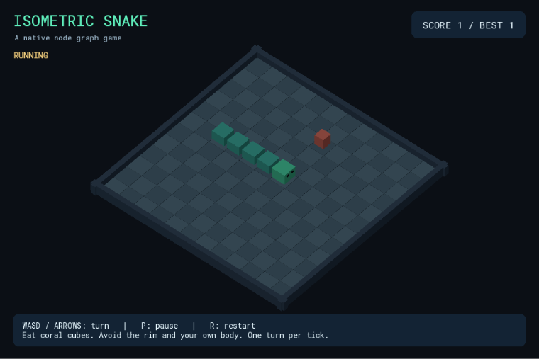

# Isometric Snake 3D — Hướng dẫn dựng game bằng node

Tài liệu lấy từ graph và scene đã lưu, gồm từng node, hằng số và mọi dây nối. Có thể đọc/sửa file này bằng **File > Project Markdown…** trong Node_Engine (Ctrl+Shift+M).



## 1. Mở và thử template

1. Mở Project Manager > Open, chọn `isometric_snake_3d.nen` trong thư mục template.
2. Nhấn F5 và click vùng game để bàn phím vào đúng cửa sổ native.
3. WASD/phím mũi tên: rẽ; P: pause/resume; R: reset vòng. Game chạy ngay khi Play.
4. Nhấn F6 để pause host, Shift+F5 để dừng. Phím P của game chỉ dừng gameplay của template, khác nút Pause của host.
5. Best score giữ qua reset vòng trong cùng phiên chạy; chưa có lưu kỷ lục qua lần mở game mới.

## 2. Chuẩn bị một project mới

1. File > New Project…; chọn Blank 2D cho Flappy hoặc Blank 3D cho Snake, đặt tên/thư mục riêng.
2. Dùng template gốc làm mẫu đối chiếu. Copy các file assets của template vào assets của project mới.
3. Tạo entity/camera và tài nguyên theo bảng dưới. Chọn entity, copy Stable ID trong Inspector; dùng ID mới đó thay cho ID nguồn ở mọi input Entity và mảng body_entities. Tên hiển thị không thay thế Stable ID.
4. Scene > Scene Variables…: khai báo đúng tên, kiểu và giá trị ban đầu.
5. Scene > UI Templates…: tạo asset hud, dán RML bên dưới; id phần tử phải khớp Set Widget Text.
6. Graph > New Function…: tạo TẤT CẢ signature trong bảng function trước, sau đó Graph > Edit Function… để dựng body. Function action giữ ô Pure bỏ chọn.
7. Trong từng body, thêm node theo bảng chi tiết, điền hằng số rồi nối chính xác source.port → target.port. Function Input/Output có sẵn theo signature.
8. Dựng Gameplay sau các function. Graph > Validate; Ctrl+S; F5 và thử lại các tình huống ở cuối tài liệu.

Các nhãn node trong tài liệu như n1 là ID trong graph nguồn, dùng để phân biệt những node cùng tên. Khi dựng bằng UI, ID được cấp mới; có thể đặt nhãn tương ứng để theo dõi dây. Ảnh dây nối dùng renderer thật của editor, bố trí lại một trích đoạn để đọc rõ.

## 3. Scene, assets và camera

Camera đang dùng: `camera`. Flappy hiển thị sprite trên XY, nhưng transform vẫn là vec3. Snake dùng mặt bàn XZ và camera orthographic.

| Entity ID | Position | Rotation | Scale | Tài nguyên / cấu hình |
| --- | --- | --- | --- | --- |
| snake_head | [3, 0.5, 5] | [0, 0, 0] | [0.84, 0.65, 0.84] | {"mesh": "assets/cube.gltf", "material": {"asset": "head", "overrides": {}}} |
| segment_1 | [2, 0.5, 5] | [0, 0, 0] | [0.8, 0.58, 0.8] | {"mesh": "assets/cube.gltf", "material": {"asset": "body", "overrides": {}}, "active": true} |
| segment_2 | [1, 0.5, 5] | [0, 0, 0] | [0.8, 0.58, 0.8] | {"mesh": "assets/cube.gltf", "material": {"asset": "body", "overrides": {}}, "active": true} |
| segment_3 | [0, 0.5, 5] | [0, 0, 0] | [0.8, 0.58, 0.8] | {"mesh": "assets/cube.gltf", "material": {"asset": "body", "overrides": {}}, "active": true} |
| segment_4 | [0, -5, 0] | [0, 0, 0] | [0.8, 0.58, 0.8] | {"mesh": "assets/cube.gltf", "material": {"asset": "body", "overrides": {}}, "active": false} |
| segment_5 | [0, -5, 0] | [0, 0, 0] | [0.8, 0.58, 0.8] | {"mesh": "assets/cube.gltf", "material": {"asset": "body", "overrides": {}}, "active": false} |
| segment_6 | [0, -5, 0] | [0, 0, 0] | [0.8, 0.58, 0.8] | {"mesh": "assets/cube.gltf", "material": {"asset": "body", "overrides": {}}, "active": false} |
| segment_7 | [0, -5, 0] | [0, 0, 0] | [0.8, 0.58, 0.8] | {"mesh": "assets/cube.gltf", "material": {"asset": "body", "overrides": {}}, "active": false} |
| segment_8 | [0, -5, 0] | [0, 0, 0] | [0.8, 0.58, 0.8] | {"mesh": "assets/cube.gltf", "material": {"asset": "body", "overrides": {}}, "active": false} |
| segment_9 | [0, -5, 0] | [0, 0, 0] | [0.8, 0.58, 0.8] | {"mesh": "assets/cube.gltf", "material": {"asset": "body", "overrides": {}}, "active": false} |
| segment_10 | [0, -5, 0] | [0, 0, 0] | [0.8, 0.58, 0.8] | {"mesh": "assets/cube.gltf", "material": {"asset": "body", "overrides": {}}, "active": false} |
| segment_11 | [0, -5, 0] | [0, 0, 0] | [0.8, 0.58, 0.8] | {"mesh": "assets/cube.gltf", "material": {"asset": "body", "overrides": {}}, "active": false} |
| segment_12 | [0, -5, 0] | [0, 0, 0] | [0.8, 0.58, 0.8] | {"mesh": "assets/cube.gltf", "material": {"asset": "body", "overrides": {}}, "active": false} |
| segment_13 | [0, -5, 0] | [0, 0, 0] | [0.8, 0.58, 0.8] | {"mesh": "assets/cube.gltf", "material": {"asset": "body", "overrides": {}}, "active": false} |
| segment_14 | [0, -5, 0] | [0, 0, 0] | [0.8, 0.58, 0.8] | {"mesh": "assets/cube.gltf", "material": {"asset": "body", "overrides": {}}, "active": false} |
| segment_15 | [0, -5, 0] | [0, 0, 0] | [0.8, 0.58, 0.8] | {"mesh": "assets/cube.gltf", "material": {"asset": "body", "overrides": {}}, "active": false} |
| segment_16 | [0, -5, 0] | [0, 0, 0] | [0.8, 0.58, 0.8] | {"mesh": "assets/cube.gltf", "material": {"asset": "body", "overrides": {}}, "active": false} |
| segment_17 | [0, -5, 0] | [0, 0, 0] | [0.8, 0.58, 0.8] | {"mesh": "assets/cube.gltf", "material": {"asset": "body", "overrides": {}}, "active": false} |
| segment_18 | [0, -5, 0] | [0, 0, 0] | [0.8, 0.58, 0.8] | {"mesh": "assets/cube.gltf", "material": {"asset": "body", "overrides": {}}, "active": false} |
| segment_19 | [0, -5, 0] | [0, 0, 0] | [0.8, 0.58, 0.8] | {"mesh": "assets/cube.gltf", "material": {"asset": "body", "overrides": {}}, "active": false} |
| segment_20 | [0, -5, 0] | [0, 0, 0] | [0.8, 0.58, 0.8] | {"mesh": "assets/cube.gltf", "material": {"asset": "body", "overrides": {}}, "active": false} |
| segment_21 | [0, -5, 0] | [0, 0, 0] | [0.8, 0.58, 0.8] | {"mesh": "assets/cube.gltf", "material": {"asset": "body", "overrides": {}}, "active": false} |
| segment_22 | [0, -5, 0] | [0, 0, 0] | [0.8, 0.58, 0.8] | {"mesh": "assets/cube.gltf", "material": {"asset": "body", "overrides": {}}, "active": false} |
| segment_23 | [0, -5, 0] | [0, 0, 0] | [0.8, 0.58, 0.8] | {"mesh": "assets/cube.gltf", "material": {"asset": "body", "overrides": {}}, "active": false} |
| segment_24 | [0, -5, 0] | [0, 0, 0] | [0.8, 0.58, 0.8] | {"mesh": "assets/cube.gltf", "material": {"asset": "body", "overrides": {}}, "active": false} |
| segment_25 | [0, -5, 0] | [0, 0, 0] | [0.8, 0.58, 0.8] | {"mesh": "assets/cube.gltf", "material": {"asset": "body", "overrides": {}}, "active": false} |
| segment_26 | [0, -5, 0] | [0, 0, 0] | [0.8, 0.58, 0.8] | {"mesh": "assets/cube.gltf", "material": {"asset": "body", "overrides": {}}, "active": false} |
| segment_27 | [0, -5, 0] | [0, 0, 0] | [0.8, 0.58, 0.8] | {"mesh": "assets/cube.gltf", "material": {"asset": "body", "overrides": {}}, "active": false} |
| segment_28 | [0, -5, 0] | [0, 0, 0] | [0.8, 0.58, 0.8] | {"mesh": "assets/cube.gltf", "material": {"asset": "body", "overrides": {}}, "active": false} |
| segment_29 | [0, -5, 0] | [0, 0, 0] | [0.8, 0.58, 0.8] | {"mesh": "assets/cube.gltf", "material": {"asset": "body", "overrides": {}}, "active": false} |
| segment_30 | [0, -5, 0] | [0, 0, 0] | [0.8, 0.58, 0.8] | {"mesh": "assets/cube.gltf", "material": {"asset": "body", "overrides": {}}, "active": false} |
| segment_31 | [0, -5, 0] | [0, 0, 0] | [0.8, 0.58, 0.8] | {"mesh": "assets/cube.gltf", "material": {"asset": "body", "overrides": {}}, "active": false} |
| segment_32 | [0, -5, 0] | [0, 0, 0] | [0.8, 0.58, 0.8] | {"mesh": "assets/cube.gltf", "material": {"asset": "body", "overrides": {}}, "active": false} |
| segment_33 | [0, -5, 0] | [0, 0, 0] | [0.8, 0.58, 0.8] | {"mesh": "assets/cube.gltf", "material": {"asset": "body", "overrides": {}}, "active": false} |
| segment_34 | [0, -5, 0] | [0, 0, 0] | [0.8, 0.58, 0.8] | {"mesh": "assets/cube.gltf", "material": {"asset": "body", "overrides": {}}, "active": false} |
| segment_35 | [0, -5, 0] | [0, 0, 0] | [0.8, 0.58, 0.8] | {"mesh": "assets/cube.gltf", "material": {"asset": "body", "overrides": {}}, "active": false} |
| segment_36 | [0, -5, 0] | [0, 0, 0] | [0.8, 0.58, 0.8] | {"mesh": "assets/cube.gltf", "material": {"asset": "body", "overrides": {}}, "active": false} |
| segment_37 | [0, -5, 0] | [0, 0, 0] | [0.8, 0.58, 0.8] | {"mesh": "assets/cube.gltf", "material": {"asset": "body", "overrides": {}}, "active": false} |
| segment_38 | [0, -5, 0] | [0, 0, 0] | [0.8, 0.58, 0.8] | {"mesh": "assets/cube.gltf", "material": {"asset": "body", "overrides": {}}, "active": false} |
| segment_39 | [0, -5, 0] | [0, 0, 0] | [0.8, 0.58, 0.8] | {"mesh": "assets/cube.gltf", "material": {"asset": "body", "overrides": {}}, "active": false} |
| segment_40 | [0, -5, 0] | [0, 0, 0] | [0.8, 0.58, 0.8] | {"mesh": "assets/cube.gltf", "material": {"asset": "body", "overrides": {}}, "active": false} |
| segment_41 | [0, -5, 0] | [0, 0, 0] | [0.8, 0.58, 0.8] | {"mesh": "assets/cube.gltf", "material": {"asset": "body", "overrides": {}}, "active": false} |
| segment_42 | [0, -5, 0] | [0, 0, 0] | [0.8, 0.58, 0.8] | {"mesh": "assets/cube.gltf", "material": {"asset": "body", "overrides": {}}, "active": false} |
| segment_43 | [0, -5, 0] | [0, 0, 0] | [0.8, 0.58, 0.8] | {"mesh": "assets/cube.gltf", "material": {"asset": "body", "overrides": {}}, "active": false} |
| segment_44 | [0, -5, 0] | [0, 0, 0] | [0.8, 0.58, 0.8] | {"mesh": "assets/cube.gltf", "material": {"asset": "body", "overrides": {}}, "active": false} |
| segment_45 | [0, -5, 0] | [0, 0, 0] | [0.8, 0.58, 0.8] | {"mesh": "assets/cube.gltf", "material": {"asset": "body", "overrides": {}}, "active": false} |
| segment_46 | [0, -5, 0] | [0, 0, 0] | [0.8, 0.58, 0.8] | {"mesh": "assets/cube.gltf", "material": {"asset": "body", "overrides": {}}, "active": false} |
| segment_47 | [0, -5, 0] | [0, 0, 0] | [0.8, 0.58, 0.8] | {"mesh": "assets/cube.gltf", "material": {"asset": "body", "overrides": {}}, "active": false} |
| segment_48 | [0, -5, 0] | [0, 0, 0] | [0.8, 0.58, 0.8] | {"mesh": "assets/cube.gltf", "material": {"asset": "body", "overrides": {}}, "active": false} |
| segment_49 | [0, -5, 0] | [0, 0, 0] | [0.8, 0.58, 0.8] | {"mesh": "assets/cube.gltf", "material": {"asset": "body", "overrides": {}}, "active": false} |
| segment_50 | [0, -5, 0] | [0, 0, 0] | [0.8, 0.58, 0.8] | {"mesh": "assets/cube.gltf", "material": {"asset": "body", "overrides": {}}, "active": false} |
| segment_51 | [0, -5, 0] | [0, 0, 0] | [0.8, 0.58, 0.8] | {"mesh": "assets/cube.gltf", "material": {"asset": "body", "overrides": {}}, "active": false} |
| segment_52 | [0, -5, 0] | [0, 0, 0] | [0.8, 0.58, 0.8] | {"mesh": "assets/cube.gltf", "material": {"asset": "body", "overrides": {}}, "active": false} |
| segment_53 | [0, -5, 0] | [0, 0, 0] | [0.8, 0.58, 0.8] | {"mesh": "assets/cube.gltf", "material": {"asset": "body", "overrides": {}}, "active": false} |
| segment_54 | [0, -5, 0] | [0, 0, 0] | [0.8, 0.58, 0.8] | {"mesh": "assets/cube.gltf", "material": {"asset": "body", "overrides": {}}, "active": false} |
| segment_55 | [0, -5, 0] | [0, 0, 0] | [0.8, 0.58, 0.8] | {"mesh": "assets/cube.gltf", "material": {"asset": "body", "overrides": {}}, "active": false} |
| segment_56 | [0, -5, 0] | [0, 0, 0] | [0.8, 0.58, 0.8] | {"mesh": "assets/cube.gltf", "material": {"asset": "body", "overrides": {}}, "active": false} |
| segment_57 | [0, -5, 0] | [0, 0, 0] | [0.8, 0.58, 0.8] | {"mesh": "assets/cube.gltf", "material": {"asset": "body", "overrides": {}}, "active": false} |
| segment_58 | [0, -5, 0] | [0, 0, 0] | [0.8, 0.58, 0.8] | {"mesh": "assets/cube.gltf", "material": {"asset": "body", "overrides": {}}, "active": false} |
| segment_59 | [0, -5, 0] | [0, 0, 0] | [0.8, 0.58, 0.8] | {"mesh": "assets/cube.gltf", "material": {"asset": "body", "overrides": {}}, "active": false} |
| segment_60 | [0, -5, 0] | [0, 0, 0] | [0.8, 0.58, 0.8] | {"mesh": "assets/cube.gltf", "material": {"asset": "body", "overrides": {}}, "active": false} |
| segment_61 | [0, -5, 0] | [0, 0, 0] | [0.8, 0.58, 0.8] | {"mesh": "assets/cube.gltf", "material": {"asset": "body", "overrides": {}}, "active": false} |
| segment_62 | [0, -5, 0] | [0, 0, 0] | [0.8, 0.58, 0.8] | {"mesh": "assets/cube.gltf", "material": {"asset": "body", "overrides": {}}, "active": false} |
| segment_63 | [0, -5, 0] | [0, 0, 0] | [0.8, 0.58, 0.8] | {"mesh": "assets/cube.gltf", "material": {"asset": "body", "overrides": {}}, "active": false} |
| segment_64 | [0, -5, 0] | [0, 0, 0] | [0.8, 0.58, 0.8] | {"mesh": "assets/cube.gltf", "material": {"asset": "body", "overrides": {}}, "active": false} |
| segment_65 | [0, -5, 0] | [0, 0, 0] | [0.8, 0.58, 0.8] | {"mesh": "assets/cube.gltf", "material": {"asset": "body", "overrides": {}}, "active": false} |
| segment_66 | [0, -5, 0] | [0, 0, 0] | [0.8, 0.58, 0.8] | {"mesh": "assets/cube.gltf", "material": {"asset": "body", "overrides": {}}, "active": false} |
| segment_67 | [0, -5, 0] | [0, 0, 0] | [0.8, 0.58, 0.8] | {"mesh": "assets/cube.gltf", "material": {"asset": "body", "overrides": {}}, "active": false} |
| segment_68 | [0, -5, 0] | [0, 0, 0] | [0.8, 0.58, 0.8] | {"mesh": "assets/cube.gltf", "material": {"asset": "body", "overrides": {}}, "active": false} |
| segment_69 | [0, -5, 0] | [0, 0, 0] | [0.8, 0.58, 0.8] | {"mesh": "assets/cube.gltf", "material": {"asset": "body", "overrides": {}}, "active": false} |
| segment_70 | [0, -5, 0] | [0, 0, 0] | [0.8, 0.58, 0.8] | {"mesh": "assets/cube.gltf", "material": {"asset": "body", "overrides": {}}, "active": false} |
| segment_71 | [0, -5, 0] | [0, 0, 0] | [0.8, 0.58, 0.8] | {"mesh": "assets/cube.gltf", "material": {"asset": "body", "overrides": {}}, "active": false} |
| segment_72 | [0, -5, 0] | [0, 0, 0] | [0.8, 0.58, 0.8] | {"mesh": "assets/cube.gltf", "material": {"asset": "body", "overrides": {}}, "active": false} |
| segment_73 | [0, -5, 0] | [0, 0, 0] | [0.8, 0.58, 0.8] | {"mesh": "assets/cube.gltf", "material": {"asset": "body", "overrides": {}}, "active": false} |
| segment_74 | [0, -5, 0] | [0, 0, 0] | [0.8, 0.58, 0.8] | {"mesh": "assets/cube.gltf", "material": {"asset": "body", "overrides": {}}, "active": false} |
| segment_75 | [0, -5, 0] | [0, 0, 0] | [0.8, 0.58, 0.8] | {"mesh": "assets/cube.gltf", "material": {"asset": "body", "overrides": {}}, "active": false} |
| segment_76 | [0, -5, 0] | [0, 0, 0] | [0.8, 0.58, 0.8] | {"mesh": "assets/cube.gltf", "material": {"asset": "body", "overrides": {}}, "active": false} |
| segment_77 | [0, -5, 0] | [0, 0, 0] | [0.8, 0.58, 0.8] | {"mesh": "assets/cube.gltf", "material": {"asset": "body", "overrides": {}}, "active": false} |
| segment_78 | [0, -5, 0] | [0, 0, 0] | [0.8, 0.58, 0.8] | {"mesh": "assets/cube.gltf", "material": {"asset": "body", "overrides": {}}, "active": false} |
| segment_79 | [0, -5, 0] | [0, 0, 0] | [0.8, 0.58, 0.8] | {"mesh": "assets/cube.gltf", "material": {"asset": "body", "overrides": {}}, "active": false} |
| segment_80 | [0, -5, 0] | [0, 0, 0] | [0.8, 0.58, 0.8] | {"mesh": "assets/cube.gltf", "material": {"asset": "body", "overrides": {}}, "active": false} |
| segment_81 | [0, -5, 0] | [0, 0, 0] | [0.8, 0.58, 0.8] | {"mesh": "assets/cube.gltf", "material": {"asset": "body", "overrides": {}}, "active": false} |
| segment_82 | [0, -5, 0] | [0, 0, 0] | [0.8, 0.58, 0.8] | {"mesh": "assets/cube.gltf", "material": {"asset": "body", "overrides": {}}, "active": false} |
| segment_83 | [0, -5, 0] | [0, 0, 0] | [0.8, 0.58, 0.8] | {"mesh": "assets/cube.gltf", "material": {"asset": "body", "overrides": {}}, "active": false} |
| segment_84 | [0, -5, 0] | [0, 0, 0] | [0.8, 0.58, 0.8] | {"mesh": "assets/cube.gltf", "material": {"asset": "body", "overrides": {}}, "active": false} |
| segment_85 | [0, -5, 0] | [0, 0, 0] | [0.8, 0.58, 0.8] | {"mesh": "assets/cube.gltf", "material": {"asset": "body", "overrides": {}}, "active": false} |
| segment_86 | [0, -5, 0] | [0, 0, 0] | [0.8, 0.58, 0.8] | {"mesh": "assets/cube.gltf", "material": {"asset": "body", "overrides": {}}, "active": false} |
| segment_87 | [0, -5, 0] | [0, 0, 0] | [0.8, 0.58, 0.8] | {"mesh": "assets/cube.gltf", "material": {"asset": "body", "overrides": {}}, "active": false} |
| segment_88 | [0, -5, 0] | [0, 0, 0] | [0.8, 0.58, 0.8] | {"mesh": "assets/cube.gltf", "material": {"asset": "body", "overrides": {}}, "active": false} |
| segment_89 | [0, -5, 0] | [0, 0, 0] | [0.8, 0.58, 0.8] | {"mesh": "assets/cube.gltf", "material": {"asset": "body", "overrides": {}}, "active": false} |
| segment_90 | [0, -5, 0] | [0, 0, 0] | [0.8, 0.58, 0.8] | {"mesh": "assets/cube.gltf", "material": {"asset": "body", "overrides": {}}, "active": false} |
| segment_91 | [0, -5, 0] | [0, 0, 0] | [0.8, 0.58, 0.8] | {"mesh": "assets/cube.gltf", "material": {"asset": "body", "overrides": {}}, "active": false} |
| segment_92 | [0, -5, 0] | [0, 0, 0] | [0.8, 0.58, 0.8] | {"mesh": "assets/cube.gltf", "material": {"asset": "body", "overrides": {}}, "active": false} |
| segment_93 | [0, -5, 0] | [0, 0, 0] | [0.8, 0.58, 0.8] | {"mesh": "assets/cube.gltf", "material": {"asset": "body", "overrides": {}}, "active": false} |
| segment_94 | [0, -5, 0] | [0, 0, 0] | [0.8, 0.58, 0.8] | {"mesh": "assets/cube.gltf", "material": {"asset": "body", "overrides": {}}, "active": false} |
| segment_95 | [0, -5, 0] | [0, 0, 0] | [0.8, 0.58, 0.8] | {"mesh": "assets/cube.gltf", "material": {"asset": "body", "overrides": {}}, "active": false} |
| segment_96 | [0, -5, 0] | [0, 0, 0] | [0.8, 0.58, 0.8] | {"mesh": "assets/cube.gltf", "material": {"asset": "body", "overrides": {}}, "active": false} |
| segment_97 | [0, -5, 0] | [0, 0, 0] | [0.8, 0.58, 0.8] | {"mesh": "assets/cube.gltf", "material": {"asset": "body", "overrides": {}}, "active": false} |
| segment_98 | [0, -5, 0] | [0, 0, 0] | [0.8, 0.58, 0.8] | {"mesh": "assets/cube.gltf", "material": {"asset": "body", "overrides": {}}, "active": false} |
| segment_99 | [0, -5, 0] | [0, 0, 0] | [0.8, 0.58, 0.8] | {"mesh": "assets/cube.gltf", "material": {"asset": "body", "overrides": {}}, "active": false} |
| segment_100 | [0, -5, 0] | [0, 0, 0] | [0.8, 0.58, 0.8] | {"mesh": "assets/cube.gltf", "material": {"asset": "body", "overrides": {}}, "active": false} |
| segment_101 | [0, -5, 0] | [0, 0, 0] | [0.8, 0.58, 0.8] | {"mesh": "assets/cube.gltf", "material": {"asset": "body", "overrides": {}}, "active": false} |
| segment_102 | [0, -5, 0] | [0, 0, 0] | [0.8, 0.58, 0.8] | {"mesh": "assets/cube.gltf", "material": {"asset": "body", "overrides": {}}, "active": false} |
| segment_103 | [0, -5, 0] | [0, 0, 0] | [0.8, 0.58, 0.8] | {"mesh": "assets/cube.gltf", "material": {"asset": "body", "overrides": {}}, "active": false} |
| segment_104 | [0, -5, 0] | [0, 0, 0] | [0.8, 0.58, 0.8] | {"mesh": "assets/cube.gltf", "material": {"asset": "body", "overrides": {}}, "active": false} |
| segment_105 | [0, -5, 0] | [0, 0, 0] | [0.8, 0.58, 0.8] | {"mesh": "assets/cube.gltf", "material": {"asset": "body", "overrides": {}}, "active": false} |
| segment_106 | [0, -5, 0] | [0, 0, 0] | [0.8, 0.58, 0.8] | {"mesh": "assets/cube.gltf", "material": {"asset": "body", "overrides": {}}, "active": false} |
| segment_107 | [0, -5, 0] | [0, 0, 0] | [0.8, 0.58, 0.8] | {"mesh": "assets/cube.gltf", "material": {"asset": "body", "overrides": {}}, "active": false} |
| segment_108 | [0, -5, 0] | [0, 0, 0] | [0.8, 0.58, 0.8] | {"mesh": "assets/cube.gltf", "material": {"asset": "body", "overrides": {}}, "active": false} |
| segment_109 | [0, -5, 0] | [0, 0, 0] | [0.8, 0.58, 0.8] | {"mesh": "assets/cube.gltf", "material": {"asset": "body", "overrides": {}}, "active": false} |
| segment_110 | [0, -5, 0] | [0, 0, 0] | [0.8, 0.58, 0.8] | {"mesh": "assets/cube.gltf", "material": {"asset": "body", "overrides": {}}, "active": false} |
| segment_111 | [0, -5, 0] | [0, 0, 0] | [0.8, 0.58, 0.8] | {"mesh": "assets/cube.gltf", "material": {"asset": "body", "overrides": {}}, "active": false} |
| segment_112 | [0, -5, 0] | [0, 0, 0] | [0.8, 0.58, 0.8] | {"mesh": "assets/cube.gltf", "material": {"asset": "body", "overrides": {}}, "active": false} |
| segment_113 | [0, -5, 0] | [0, 0, 0] | [0.8, 0.58, 0.8] | {"mesh": "assets/cube.gltf", "material": {"asset": "body", "overrides": {}}, "active": false} |
| segment_114 | [0, -5, 0] | [0, 0, 0] | [0.8, 0.58, 0.8] | {"mesh": "assets/cube.gltf", "material": {"asset": "body", "overrides": {}}, "active": false} |
| segment_115 | [0, -5, 0] | [0, 0, 0] | [0.8, 0.58, 0.8] | {"mesh": "assets/cube.gltf", "material": {"asset": "body", "overrides": {}}, "active": false} |
| segment_116 | [0, -5, 0] | [0, 0, 0] | [0.8, 0.58, 0.8] | {"mesh": "assets/cube.gltf", "material": {"asset": "body", "overrides": {}}, "active": false} |
| segment_117 | [0, -5, 0] | [0, 0, 0] | [0.8, 0.58, 0.8] | {"mesh": "assets/cube.gltf", "material": {"asset": "body", "overrides": {}}, "active": false} |
| segment_118 | [0, -5, 0] | [0, 0, 0] | [0.8, 0.58, 0.8] | {"mesh": "assets/cube.gltf", "material": {"asset": "body", "overrides": {}}, "active": false} |
| segment_119 | [0, -5, 0] | [0, 0, 0] | [0.8, 0.58, 0.8] | {"mesh": "assets/cube.gltf", "material": {"asset": "body", "overrides": {}}, "active": false} |
| segment_120 | [0, -5, 0] | [0, 0, 0] | [0.8, 0.58, 0.8] | {"mesh": "assets/cube.gltf", "material": {"asset": "body", "overrides": {}}, "active": false} |
| segment_121 | [0, -5, 0] | [0, 0, 0] | [0.8, 0.58, 0.8] | {"mesh": "assets/cube.gltf", "material": {"asset": "body", "overrides": {}}, "active": false} |
| segment_122 | [0, -5, 0] | [0, 0, 0] | [0.8, 0.58, 0.8] | {"mesh": "assets/cube.gltf", "material": {"asset": "body", "overrides": {}}, "active": false} |
| segment_123 | [0, -5, 0] | [0, 0, 0] | [0.8, 0.58, 0.8] | {"mesh": "assets/cube.gltf", "material": {"asset": "body", "overrides": {}}, "active": false} |
| segment_124 | [0, -5, 0] | [0, 0, 0] | [0.8, 0.58, 0.8] | {"mesh": "assets/cube.gltf", "material": {"asset": "body", "overrides": {}}, "active": false} |
| segment_125 | [0, -5, 0] | [0, 0, 0] | [0.8, 0.58, 0.8] | {"mesh": "assets/cube.gltf", "material": {"asset": "body", "overrides": {}}, "active": false} |
| segment_126 | [0, -5, 0] | [0, 0, 0] | [0.8, 0.58, 0.8] | {"mesh": "assets/cube.gltf", "material": {"asset": "body", "overrides": {}}, "active": false} |
| segment_127 | [0, -5, 0] | [0, 0, 0] | [0.8, 0.58, 0.8] | {"mesh": "assets/cube.gltf", "material": {"asset": "body", "overrides": {}}, "active": false} |
| segment_128 | [0, -5, 0] | [0, 0, 0] | [0.8, 0.58, 0.8] | {"mesh": "assets/cube.gltf", "material": {"asset": "body", "overrides": {}}, "active": false} |
| segment_129 | [0, -5, 0] | [0, 0, 0] | [0.8, 0.58, 0.8] | {"mesh": "assets/cube.gltf", "material": {"asset": "body", "overrides": {}}, "active": false} |
| segment_130 | [0, -5, 0] | [0, 0, 0] | [0.8, 0.58, 0.8] | {"mesh": "assets/cube.gltf", "material": {"asset": "body", "overrides": {}}, "active": false} |
| segment_131 | [0, -5, 0] | [0, 0, 0] | [0.8, 0.58, 0.8] | {"mesh": "assets/cube.gltf", "material": {"asset": "body", "overrides": {}}, "active": false} |
| segment_132 | [0, -5, 0] | [0, 0, 0] | [0.8, 0.58, 0.8] | {"mesh": "assets/cube.gltf", "material": {"asset": "body", "overrides": {}}, "active": false} |
| segment_133 | [0, -5, 0] | [0, 0, 0] | [0.8, 0.58, 0.8] | {"mesh": "assets/cube.gltf", "material": {"asset": "body", "overrides": {}}, "active": false} |
| segment_134 | [0, -5, 0] | [0, 0, 0] | [0.8, 0.58, 0.8] | {"mesh": "assets/cube.gltf", "material": {"asset": "body", "overrides": {}}, "active": false} |
| segment_135 | [0, -5, 0] | [0, 0, 0] | [0.8, 0.58, 0.8] | {"mesh": "assets/cube.gltf", "material": {"asset": "body", "overrides": {}}, "active": false} |
| segment_136 | [0, -5, 0] | [0, 0, 0] | [0.8, 0.58, 0.8] | {"mesh": "assets/cube.gltf", "material": {"asset": "body", "overrides": {}}, "active": false} |
| segment_137 | [0, -5, 0] | [0, 0, 0] | [0.8, 0.58, 0.8] | {"mesh": "assets/cube.gltf", "material": {"asset": "body", "overrides": {}}, "active": false} |
| segment_138 | [0, -5, 0] | [0, 0, 0] | [0.8, 0.58, 0.8] | {"mesh": "assets/cube.gltf", "material": {"asset": "body", "overrides": {}}, "active": false} |
| segment_139 | [0, -5, 0] | [0, 0, 0] | [0.8, 0.58, 0.8] | {"mesh": "assets/cube.gltf", "material": {"asset": "body", "overrides": {}}, "active": false} |
| segment_140 | [0, -5, 0] | [0, 0, 0] | [0.8, 0.58, 0.8] | {"mesh": "assets/cube.gltf", "material": {"asset": "body", "overrides": {}}, "active": false} |
| segment_141 | [0, -5, 0] | [0, 0, 0] | [0.8, 0.58, 0.8] | {"mesh": "assets/cube.gltf", "material": {"asset": "body", "overrides": {}}, "active": false} |
| segment_142 | [0, -5, 0] | [0, 0, 0] | [0.8, 0.58, 0.8] | {"mesh": "assets/cube.gltf", "material": {"asset": "body", "overrides": {}}, "active": false} |
| segment_143 | [0, -5, 0] | [0, 0, 0] | [0.8, 0.58, 0.8] | {"mesh": "assets/cube.gltf", "material": {"asset": "body", "overrides": {}}, "active": false} |
| eye_left | [0.51, 0.22, -0.23] | [0, 0, 0] | [0.06, 0.17, 0.16] | {"mesh": "assets/cube.gltf", "material": {"asset": "eye", "overrides": {}}, "parent": "snake_head"} |
| eye_right | [0.51, 0.22, 0.23] | [0, 0, 0] | [0.06, 0.17, 0.16] | {"mesh": "assets/cube.gltf", "material": {"asset": "eye", "overrides": {}}, "parent": "snake_head"} |
| food | [6, 0.5, 5] | [0, 0, 0] | [0.58, 0.65, 0.58] | {"mesh": "assets/cube.gltf", "material": {"asset": "food", "overrides": {}}} |
| tile_0_0 | [0, -0.08, 0] | [0, 0, 0] | [0.98, 0.2, 0.98] | {"mesh": "assets/cube.gltf", "material": {"asset": "tile_a", "overrides": {}}} |
| tile_1_0 | [1, -0.08, 0] | [0, 0, 0] | [0.98, 0.2, 0.98] | {"mesh": "assets/cube.gltf", "material": {"asset": "tile_b", "overrides": {}}} |
| tile_2_0 | [2, -0.08, 0] | [0, 0, 0] | [0.98, 0.2, 0.98] | {"mesh": "assets/cube.gltf", "material": {"asset": "tile_a", "overrides": {}}} |
| tile_3_0 | [3, -0.08, 0] | [0, 0, 0] | [0.98, 0.2, 0.98] | {"mesh": "assets/cube.gltf", "material": {"asset": "tile_b", "overrides": {}}} |
| tile_4_0 | [4, -0.08, 0] | [0, 0, 0] | [0.98, 0.2, 0.98] | {"mesh": "assets/cube.gltf", "material": {"asset": "tile_a", "overrides": {}}} |
| tile_5_0 | [5, -0.08, 0] | [0, 0, 0] | [0.98, 0.2, 0.98] | {"mesh": "assets/cube.gltf", "material": {"asset": "tile_b", "overrides": {}}} |
| tile_6_0 | [6, -0.08, 0] | [0, 0, 0] | [0.98, 0.2, 0.98] | {"mesh": "assets/cube.gltf", "material": {"asset": "tile_a", "overrides": {}}} |
| tile_7_0 | [7, -0.08, 0] | [0, 0, 0] | [0.98, 0.2, 0.98] | {"mesh": "assets/cube.gltf", "material": {"asset": "tile_b", "overrides": {}}} |
| tile_8_0 | [8, -0.08, 0] | [0, 0, 0] | [0.98, 0.2, 0.98] | {"mesh": "assets/cube.gltf", "material": {"asset": "tile_a", "overrides": {}}} |
| tile_9_0 | [9, -0.08, 0] | [0, 0, 0] | [0.98, 0.2, 0.98] | {"mesh": "assets/cube.gltf", "material": {"asset": "tile_b", "overrides": {}}} |
| tile_10_0 | [10, -0.08, 0] | [0, 0, 0] | [0.98, 0.2, 0.98] | {"mesh": "assets/cube.gltf", "material": {"asset": "tile_a", "overrides": {}}} |
| tile_11_0 | [11, -0.08, 0] | [0, 0, 0] | [0.98, 0.2, 0.98] | {"mesh": "assets/cube.gltf", "material": {"asset": "tile_b", "overrides": {}}} |
| tile_0_1 | [0, -0.08, 1] | [0, 0, 0] | [0.98, 0.2, 0.98] | {"mesh": "assets/cube.gltf", "material": {"asset": "tile_b", "overrides": {}}} |
| tile_1_1 | [1, -0.08, 1] | [0, 0, 0] | [0.98, 0.2, 0.98] | {"mesh": "assets/cube.gltf", "material": {"asset": "tile_a", "overrides": {}}} |
| tile_2_1 | [2, -0.08, 1] | [0, 0, 0] | [0.98, 0.2, 0.98] | {"mesh": "assets/cube.gltf", "material": {"asset": "tile_b", "overrides": {}}} |
| tile_3_1 | [3, -0.08, 1] | [0, 0, 0] | [0.98, 0.2, 0.98] | {"mesh": "assets/cube.gltf", "material": {"asset": "tile_a", "overrides": {}}} |
| tile_4_1 | [4, -0.08, 1] | [0, 0, 0] | [0.98, 0.2, 0.98] | {"mesh": "assets/cube.gltf", "material": {"asset": "tile_b", "overrides": {}}} |
| tile_5_1 | [5, -0.08, 1] | [0, 0, 0] | [0.98, 0.2, 0.98] | {"mesh": "assets/cube.gltf", "material": {"asset": "tile_a", "overrides": {}}} |
| tile_6_1 | [6, -0.08, 1] | [0, 0, 0] | [0.98, 0.2, 0.98] | {"mesh": "assets/cube.gltf", "material": {"asset": "tile_b", "overrides": {}}} |
| tile_7_1 | [7, -0.08, 1] | [0, 0, 0] | [0.98, 0.2, 0.98] | {"mesh": "assets/cube.gltf", "material": {"asset": "tile_a", "overrides": {}}} |
| tile_8_1 | [8, -0.08, 1] | [0, 0, 0] | [0.98, 0.2, 0.98] | {"mesh": "assets/cube.gltf", "material": {"asset": "tile_b", "overrides": {}}} |
| tile_9_1 | [9, -0.08, 1] | [0, 0, 0] | [0.98, 0.2, 0.98] | {"mesh": "assets/cube.gltf", "material": {"asset": "tile_a", "overrides": {}}} |
| tile_10_1 | [10, -0.08, 1] | [0, 0, 0] | [0.98, 0.2, 0.98] | {"mesh": "assets/cube.gltf", "material": {"asset": "tile_b", "overrides": {}}} |
| tile_11_1 | [11, -0.08, 1] | [0, 0, 0] | [0.98, 0.2, 0.98] | {"mesh": "assets/cube.gltf", "material": {"asset": "tile_a", "overrides": {}}} |
| tile_0_2 | [0, -0.08, 2] | [0, 0, 0] | [0.98, 0.2, 0.98] | {"mesh": "assets/cube.gltf", "material": {"asset": "tile_a", "overrides": {}}} |
| tile_1_2 | [1, -0.08, 2] | [0, 0, 0] | [0.98, 0.2, 0.98] | {"mesh": "assets/cube.gltf", "material": {"asset": "tile_b", "overrides": {}}} |
| tile_2_2 | [2, -0.08, 2] | [0, 0, 0] | [0.98, 0.2, 0.98] | {"mesh": "assets/cube.gltf", "material": {"asset": "tile_a", "overrides": {}}} |
| tile_3_2 | [3, -0.08, 2] | [0, 0, 0] | [0.98, 0.2, 0.98] | {"mesh": "assets/cube.gltf", "material": {"asset": "tile_b", "overrides": {}}} |
| tile_4_2 | [4, -0.08, 2] | [0, 0, 0] | [0.98, 0.2, 0.98] | {"mesh": "assets/cube.gltf", "material": {"asset": "tile_a", "overrides": {}}} |
| tile_5_2 | [5, -0.08, 2] | [0, 0, 0] | [0.98, 0.2, 0.98] | {"mesh": "assets/cube.gltf", "material": {"asset": "tile_b", "overrides": {}}} |
| tile_6_2 | [6, -0.08, 2] | [0, 0, 0] | [0.98, 0.2, 0.98] | {"mesh": "assets/cube.gltf", "material": {"asset": "tile_a", "overrides": {}}} |
| tile_7_2 | [7, -0.08, 2] | [0, 0, 0] | [0.98, 0.2, 0.98] | {"mesh": "assets/cube.gltf", "material": {"asset": "tile_b", "overrides": {}}} |
| tile_8_2 | [8, -0.08, 2] | [0, 0, 0] | [0.98, 0.2, 0.98] | {"mesh": "assets/cube.gltf", "material": {"asset": "tile_a", "overrides": {}}} |
| tile_9_2 | [9, -0.08, 2] | [0, 0, 0] | [0.98, 0.2, 0.98] | {"mesh": "assets/cube.gltf", "material": {"asset": "tile_b", "overrides": {}}} |
| tile_10_2 | [10, -0.08, 2] | [0, 0, 0] | [0.98, 0.2, 0.98] | {"mesh": "assets/cube.gltf", "material": {"asset": "tile_a", "overrides": {}}} |
| tile_11_2 | [11, -0.08, 2] | [0, 0, 0] | [0.98, 0.2, 0.98] | {"mesh": "assets/cube.gltf", "material": {"asset": "tile_b", "overrides": {}}} |
| tile_0_3 | [0, -0.08, 3] | [0, 0, 0] | [0.98, 0.2, 0.98] | {"mesh": "assets/cube.gltf", "material": {"asset": "tile_b", "overrides": {}}} |
| tile_1_3 | [1, -0.08, 3] | [0, 0, 0] | [0.98, 0.2, 0.98] | {"mesh": "assets/cube.gltf", "material": {"asset": "tile_a", "overrides": {}}} |
| tile_2_3 | [2, -0.08, 3] | [0, 0, 0] | [0.98, 0.2, 0.98] | {"mesh": "assets/cube.gltf", "material": {"asset": "tile_b", "overrides": {}}} |
| tile_3_3 | [3, -0.08, 3] | [0, 0, 0] | [0.98, 0.2, 0.98] | {"mesh": "assets/cube.gltf", "material": {"asset": "tile_a", "overrides": {}}} |
| tile_4_3 | [4, -0.08, 3] | [0, 0, 0] | [0.98, 0.2, 0.98] | {"mesh": "assets/cube.gltf", "material": {"asset": "tile_b", "overrides": {}}} |
| tile_5_3 | [5, -0.08, 3] | [0, 0, 0] | [0.98, 0.2, 0.98] | {"mesh": "assets/cube.gltf", "material": {"asset": "tile_a", "overrides": {}}} |
| tile_6_3 | [6, -0.08, 3] | [0, 0, 0] | [0.98, 0.2, 0.98] | {"mesh": "assets/cube.gltf", "material": {"asset": "tile_b", "overrides": {}}} |
| tile_7_3 | [7, -0.08, 3] | [0, 0, 0] | [0.98, 0.2, 0.98] | {"mesh": "assets/cube.gltf", "material": {"asset": "tile_a", "overrides": {}}} |
| tile_8_3 | [8, -0.08, 3] | [0, 0, 0] | [0.98, 0.2, 0.98] | {"mesh": "assets/cube.gltf", "material": {"asset": "tile_b", "overrides": {}}} |
| tile_9_3 | [9, -0.08, 3] | [0, 0, 0] | [0.98, 0.2, 0.98] | {"mesh": "assets/cube.gltf", "material": {"asset": "tile_a", "overrides": {}}} |
| tile_10_3 | [10, -0.08, 3] | [0, 0, 0] | [0.98, 0.2, 0.98] | {"mesh": "assets/cube.gltf", "material": {"asset": "tile_b", "overrides": {}}} |
| tile_11_3 | [11, -0.08, 3] | [0, 0, 0] | [0.98, 0.2, 0.98] | {"mesh": "assets/cube.gltf", "material": {"asset": "tile_a", "overrides": {}}} |
| tile_0_4 | [0, -0.08, 4] | [0, 0, 0] | [0.98, 0.2, 0.98] | {"mesh": "assets/cube.gltf", "material": {"asset": "tile_a", "overrides": {}}} |
| tile_1_4 | [1, -0.08, 4] | [0, 0, 0] | [0.98, 0.2, 0.98] | {"mesh": "assets/cube.gltf", "material": {"asset": "tile_b", "overrides": {}}} |
| tile_2_4 | [2, -0.08, 4] | [0, 0, 0] | [0.98, 0.2, 0.98] | {"mesh": "assets/cube.gltf", "material": {"asset": "tile_a", "overrides": {}}} |
| tile_3_4 | [3, -0.08, 4] | [0, 0, 0] | [0.98, 0.2, 0.98] | {"mesh": "assets/cube.gltf", "material": {"asset": "tile_b", "overrides": {}}} |
| tile_4_4 | [4, -0.08, 4] | [0, 0, 0] | [0.98, 0.2, 0.98] | {"mesh": "assets/cube.gltf", "material": {"asset": "tile_a", "overrides": {}}} |
| tile_5_4 | [5, -0.08, 4] | [0, 0, 0] | [0.98, 0.2, 0.98] | {"mesh": "assets/cube.gltf", "material": {"asset": "tile_b", "overrides": {}}} |
| tile_6_4 | [6, -0.08, 4] | [0, 0, 0] | [0.98, 0.2, 0.98] | {"mesh": "assets/cube.gltf", "material": {"asset": "tile_a", "overrides": {}}} |
| tile_7_4 | [7, -0.08, 4] | [0, 0, 0] | [0.98, 0.2, 0.98] | {"mesh": "assets/cube.gltf", "material": {"asset": "tile_b", "overrides": {}}} |
| tile_8_4 | [8, -0.08, 4] | [0, 0, 0] | [0.98, 0.2, 0.98] | {"mesh": "assets/cube.gltf", "material": {"asset": "tile_a", "overrides": {}}} |
| tile_9_4 | [9, -0.08, 4] | [0, 0, 0] | [0.98, 0.2, 0.98] | {"mesh": "assets/cube.gltf", "material": {"asset": "tile_b", "overrides": {}}} |
| tile_10_4 | [10, -0.08, 4] | [0, 0, 0] | [0.98, 0.2, 0.98] | {"mesh": "assets/cube.gltf", "material": {"asset": "tile_a", "overrides": {}}} |
| tile_11_4 | [11, -0.08, 4] | [0, 0, 0] | [0.98, 0.2, 0.98] | {"mesh": "assets/cube.gltf", "material": {"asset": "tile_b", "overrides": {}}} |
| tile_0_5 | [0, -0.08, 5] | [0, 0, 0] | [0.98, 0.2, 0.98] | {"mesh": "assets/cube.gltf", "material": {"asset": "tile_b", "overrides": {}}} |
| tile_1_5 | [1, -0.08, 5] | [0, 0, 0] | [0.98, 0.2, 0.98] | {"mesh": "assets/cube.gltf", "material": {"asset": "tile_a", "overrides": {}}} |
| tile_2_5 | [2, -0.08, 5] | [0, 0, 0] | [0.98, 0.2, 0.98] | {"mesh": "assets/cube.gltf", "material": {"asset": "tile_b", "overrides": {}}} |
| tile_3_5 | [3, -0.08, 5] | [0, 0, 0] | [0.98, 0.2, 0.98] | {"mesh": "assets/cube.gltf", "material": {"asset": "tile_a", "overrides": {}}} |
| tile_4_5 | [4, -0.08, 5] | [0, 0, 0] | [0.98, 0.2, 0.98] | {"mesh": "assets/cube.gltf", "material": {"asset": "tile_b", "overrides": {}}} |
| tile_5_5 | [5, -0.08, 5] | [0, 0, 0] | [0.98, 0.2, 0.98] | {"mesh": "assets/cube.gltf", "material": {"asset": "tile_a", "overrides": {}}} |
| tile_6_5 | [6, -0.08, 5] | [0, 0, 0] | [0.98, 0.2, 0.98] | {"mesh": "assets/cube.gltf", "material": {"asset": "tile_b", "overrides": {}}} |
| tile_7_5 | [7, -0.08, 5] | [0, 0, 0] | [0.98, 0.2, 0.98] | {"mesh": "assets/cube.gltf", "material": {"asset": "tile_a", "overrides": {}}} |
| tile_8_5 | [8, -0.08, 5] | [0, 0, 0] | [0.98, 0.2, 0.98] | {"mesh": "assets/cube.gltf", "material": {"asset": "tile_b", "overrides": {}}} |
| tile_9_5 | [9, -0.08, 5] | [0, 0, 0] | [0.98, 0.2, 0.98] | {"mesh": "assets/cube.gltf", "material": {"asset": "tile_a", "overrides": {}}} |
| tile_10_5 | [10, -0.08, 5] | [0, 0, 0] | [0.98, 0.2, 0.98] | {"mesh": "assets/cube.gltf", "material": {"asset": "tile_b", "overrides": {}}} |
| tile_11_5 | [11, -0.08, 5] | [0, 0, 0] | [0.98, 0.2, 0.98] | {"mesh": "assets/cube.gltf", "material": {"asset": "tile_a", "overrides": {}}} |
| tile_0_6 | [0, -0.08, 6] | [0, 0, 0] | [0.98, 0.2, 0.98] | {"mesh": "assets/cube.gltf", "material": {"asset": "tile_a", "overrides": {}}} |
| tile_1_6 | [1, -0.08, 6] | [0, 0, 0] | [0.98, 0.2, 0.98] | {"mesh": "assets/cube.gltf", "material": {"asset": "tile_b", "overrides": {}}} |
| tile_2_6 | [2, -0.08, 6] | [0, 0, 0] | [0.98, 0.2, 0.98] | {"mesh": "assets/cube.gltf", "material": {"asset": "tile_a", "overrides": {}}} |
| tile_3_6 | [3, -0.08, 6] | [0, 0, 0] | [0.98, 0.2, 0.98] | {"mesh": "assets/cube.gltf", "material": {"asset": "tile_b", "overrides": {}}} |
| tile_4_6 | [4, -0.08, 6] | [0, 0, 0] | [0.98, 0.2, 0.98] | {"mesh": "assets/cube.gltf", "material": {"asset": "tile_a", "overrides": {}}} |
| tile_5_6 | [5, -0.08, 6] | [0, 0, 0] | [0.98, 0.2, 0.98] | {"mesh": "assets/cube.gltf", "material": {"asset": "tile_b", "overrides": {}}} |
| tile_6_6 | [6, -0.08, 6] | [0, 0, 0] | [0.98, 0.2, 0.98] | {"mesh": "assets/cube.gltf", "material": {"asset": "tile_a", "overrides": {}}} |
| tile_7_6 | [7, -0.08, 6] | [0, 0, 0] | [0.98, 0.2, 0.98] | {"mesh": "assets/cube.gltf", "material": {"asset": "tile_b", "overrides": {}}} |
| tile_8_6 | [8, -0.08, 6] | [0, 0, 0] | [0.98, 0.2, 0.98] | {"mesh": "assets/cube.gltf", "material": {"asset": "tile_a", "overrides": {}}} |
| tile_9_6 | [9, -0.08, 6] | [0, 0, 0] | [0.98, 0.2, 0.98] | {"mesh": "assets/cube.gltf", "material": {"asset": "tile_b", "overrides": {}}} |
| tile_10_6 | [10, -0.08, 6] | [0, 0, 0] | [0.98, 0.2, 0.98] | {"mesh": "assets/cube.gltf", "material": {"asset": "tile_a", "overrides": {}}} |
| tile_11_6 | [11, -0.08, 6] | [0, 0, 0] | [0.98, 0.2, 0.98] | {"mesh": "assets/cube.gltf", "material": {"asset": "tile_b", "overrides": {}}} |
| tile_0_7 | [0, -0.08, 7] | [0, 0, 0] | [0.98, 0.2, 0.98] | {"mesh": "assets/cube.gltf", "material": {"asset": "tile_b", "overrides": {}}} |
| tile_1_7 | [1, -0.08, 7] | [0, 0, 0] | [0.98, 0.2, 0.98] | {"mesh": "assets/cube.gltf", "material": {"asset": "tile_a", "overrides": {}}} |
| tile_2_7 | [2, -0.08, 7] | [0, 0, 0] | [0.98, 0.2, 0.98] | {"mesh": "assets/cube.gltf", "material": {"asset": "tile_b", "overrides": {}}} |
| tile_3_7 | [3, -0.08, 7] | [0, 0, 0] | [0.98, 0.2, 0.98] | {"mesh": "assets/cube.gltf", "material": {"asset": "tile_a", "overrides": {}}} |
| tile_4_7 | [4, -0.08, 7] | [0, 0, 0] | [0.98, 0.2, 0.98] | {"mesh": "assets/cube.gltf", "material": {"asset": "tile_b", "overrides": {}}} |
| tile_5_7 | [5, -0.08, 7] | [0, 0, 0] | [0.98, 0.2, 0.98] | {"mesh": "assets/cube.gltf", "material": {"asset": "tile_a", "overrides": {}}} |
| tile_6_7 | [6, -0.08, 7] | [0, 0, 0] | [0.98, 0.2, 0.98] | {"mesh": "assets/cube.gltf", "material": {"asset": "tile_b", "overrides": {}}} |
| tile_7_7 | [7, -0.08, 7] | [0, 0, 0] | [0.98, 0.2, 0.98] | {"mesh": "assets/cube.gltf", "material": {"asset": "tile_a", "overrides": {}}} |
| tile_8_7 | [8, -0.08, 7] | [0, 0, 0] | [0.98, 0.2, 0.98] | {"mesh": "assets/cube.gltf", "material": {"asset": "tile_b", "overrides": {}}} |
| tile_9_7 | [9, -0.08, 7] | [0, 0, 0] | [0.98, 0.2, 0.98] | {"mesh": "assets/cube.gltf", "material": {"asset": "tile_a", "overrides": {}}} |
| tile_10_7 | [10, -0.08, 7] | [0, 0, 0] | [0.98, 0.2, 0.98] | {"mesh": "assets/cube.gltf", "material": {"asset": "tile_b", "overrides": {}}} |
| tile_11_7 | [11, -0.08, 7] | [0, 0, 0] | [0.98, 0.2, 0.98] | {"mesh": "assets/cube.gltf", "material": {"asset": "tile_a", "overrides": {}}} |
| tile_0_8 | [0, -0.08, 8] | [0, 0, 0] | [0.98, 0.2, 0.98] | {"mesh": "assets/cube.gltf", "material": {"asset": "tile_a", "overrides": {}}} |
| tile_1_8 | [1, -0.08, 8] | [0, 0, 0] | [0.98, 0.2, 0.98] | {"mesh": "assets/cube.gltf", "material": {"asset": "tile_b", "overrides": {}}} |
| tile_2_8 | [2, -0.08, 8] | [0, 0, 0] | [0.98, 0.2, 0.98] | {"mesh": "assets/cube.gltf", "material": {"asset": "tile_a", "overrides": {}}} |
| tile_3_8 | [3, -0.08, 8] | [0, 0, 0] | [0.98, 0.2, 0.98] | {"mesh": "assets/cube.gltf", "material": {"asset": "tile_b", "overrides": {}}} |
| tile_4_8 | [4, -0.08, 8] | [0, 0, 0] | [0.98, 0.2, 0.98] | {"mesh": "assets/cube.gltf", "material": {"asset": "tile_a", "overrides": {}}} |
| tile_5_8 | [5, -0.08, 8] | [0, 0, 0] | [0.98, 0.2, 0.98] | {"mesh": "assets/cube.gltf", "material": {"asset": "tile_b", "overrides": {}}} |
| tile_6_8 | [6, -0.08, 8] | [0, 0, 0] | [0.98, 0.2, 0.98] | {"mesh": "assets/cube.gltf", "material": {"asset": "tile_a", "overrides": {}}} |
| tile_7_8 | [7, -0.08, 8] | [0, 0, 0] | [0.98, 0.2, 0.98] | {"mesh": "assets/cube.gltf", "material": {"asset": "tile_b", "overrides": {}}} |
| tile_8_8 | [8, -0.08, 8] | [0, 0, 0] | [0.98, 0.2, 0.98] | {"mesh": "assets/cube.gltf", "material": {"asset": "tile_a", "overrides": {}}} |
| tile_9_8 | [9, -0.08, 8] | [0, 0, 0] | [0.98, 0.2, 0.98] | {"mesh": "assets/cube.gltf", "material": {"asset": "tile_b", "overrides": {}}} |
| tile_10_8 | [10, -0.08, 8] | [0, 0, 0] | [0.98, 0.2, 0.98] | {"mesh": "assets/cube.gltf", "material": {"asset": "tile_a", "overrides": {}}} |
| tile_11_8 | [11, -0.08, 8] | [0, 0, 0] | [0.98, 0.2, 0.98] | {"mesh": "assets/cube.gltf", "material": {"asset": "tile_b", "overrides": {}}} |
| tile_0_9 | [0, -0.08, 9] | [0, 0, 0] | [0.98, 0.2, 0.98] | {"mesh": "assets/cube.gltf", "material": {"asset": "tile_b", "overrides": {}}} |
| tile_1_9 | [1, -0.08, 9] | [0, 0, 0] | [0.98, 0.2, 0.98] | {"mesh": "assets/cube.gltf", "material": {"asset": "tile_a", "overrides": {}}} |
| tile_2_9 | [2, -0.08, 9] | [0, 0, 0] | [0.98, 0.2, 0.98] | {"mesh": "assets/cube.gltf", "material": {"asset": "tile_b", "overrides": {}}} |
| tile_3_9 | [3, -0.08, 9] | [0, 0, 0] | [0.98, 0.2, 0.98] | {"mesh": "assets/cube.gltf", "material": {"asset": "tile_a", "overrides": {}}} |
| tile_4_9 | [4, -0.08, 9] | [0, 0, 0] | [0.98, 0.2, 0.98] | {"mesh": "assets/cube.gltf", "material": {"asset": "tile_b", "overrides": {}}} |
| tile_5_9 | [5, -0.08, 9] | [0, 0, 0] | [0.98, 0.2, 0.98] | {"mesh": "assets/cube.gltf", "material": {"asset": "tile_a", "overrides": {}}} |
| tile_6_9 | [6, -0.08, 9] | [0, 0, 0] | [0.98, 0.2, 0.98] | {"mesh": "assets/cube.gltf", "material": {"asset": "tile_b", "overrides": {}}} |
| tile_7_9 | [7, -0.08, 9] | [0, 0, 0] | [0.98, 0.2, 0.98] | {"mesh": "assets/cube.gltf", "material": {"asset": "tile_a", "overrides": {}}} |
| tile_8_9 | [8, -0.08, 9] | [0, 0, 0] | [0.98, 0.2, 0.98] | {"mesh": "assets/cube.gltf", "material": {"asset": "tile_b", "overrides": {}}} |
| tile_9_9 | [9, -0.08, 9] | [0, 0, 0] | [0.98, 0.2, 0.98] | {"mesh": "assets/cube.gltf", "material": {"asset": "tile_a", "overrides": {}}} |
| tile_10_9 | [10, -0.08, 9] | [0, 0, 0] | [0.98, 0.2, 0.98] | {"mesh": "assets/cube.gltf", "material": {"asset": "tile_b", "overrides": {}}} |
| tile_11_9 | [11, -0.08, 9] | [0, 0, 0] | [0.98, 0.2, 0.98] | {"mesh": "assets/cube.gltf", "material": {"asset": "tile_a", "overrides": {}}} |
| tile_0_10 | [0, -0.08, 10] | [0, 0, 0] | [0.98, 0.2, 0.98] | {"mesh": "assets/cube.gltf", "material": {"asset": "tile_a", "overrides": {}}} |
| tile_1_10 | [1, -0.08, 10] | [0, 0, 0] | [0.98, 0.2, 0.98] | {"mesh": "assets/cube.gltf", "material": {"asset": "tile_b", "overrides": {}}} |
| tile_2_10 | [2, -0.08, 10] | [0, 0, 0] | [0.98, 0.2, 0.98] | {"mesh": "assets/cube.gltf", "material": {"asset": "tile_a", "overrides": {}}} |
| tile_3_10 | [3, -0.08, 10] | [0, 0, 0] | [0.98, 0.2, 0.98] | {"mesh": "assets/cube.gltf", "material": {"asset": "tile_b", "overrides": {}}} |
| tile_4_10 | [4, -0.08, 10] | [0, 0, 0] | [0.98, 0.2, 0.98] | {"mesh": "assets/cube.gltf", "material": {"asset": "tile_a", "overrides": {}}} |
| tile_5_10 | [5, -0.08, 10] | [0, 0, 0] | [0.98, 0.2, 0.98] | {"mesh": "assets/cube.gltf", "material": {"asset": "tile_b", "overrides": {}}} |
| tile_6_10 | [6, -0.08, 10] | [0, 0, 0] | [0.98, 0.2, 0.98] | {"mesh": "assets/cube.gltf", "material": {"asset": "tile_a", "overrides": {}}} |
| tile_7_10 | [7, -0.08, 10] | [0, 0, 0] | [0.98, 0.2, 0.98] | {"mesh": "assets/cube.gltf", "material": {"asset": "tile_b", "overrides": {}}} |
| tile_8_10 | [8, -0.08, 10] | [0, 0, 0] | [0.98, 0.2, 0.98] | {"mesh": "assets/cube.gltf", "material": {"asset": "tile_a", "overrides": {}}} |
| tile_9_10 | [9, -0.08, 10] | [0, 0, 0] | [0.98, 0.2, 0.98] | {"mesh": "assets/cube.gltf", "material": {"asset": "tile_b", "overrides": {}}} |
| tile_10_10 | [10, -0.08, 10] | [0, 0, 0] | [0.98, 0.2, 0.98] | {"mesh": "assets/cube.gltf", "material": {"asset": "tile_a", "overrides": {}}} |
| tile_11_10 | [11, -0.08, 10] | [0, 0, 0] | [0.98, 0.2, 0.98] | {"mesh": "assets/cube.gltf", "material": {"asset": "tile_b", "overrides": {}}} |
| tile_0_11 | [0, -0.08, 11] | [0, 0, 0] | [0.98, 0.2, 0.98] | {"mesh": "assets/cube.gltf", "material": {"asset": "tile_b", "overrides": {}}} |
| tile_1_11 | [1, -0.08, 11] | [0, 0, 0] | [0.98, 0.2, 0.98] | {"mesh": "assets/cube.gltf", "material": {"asset": "tile_a", "overrides": {}}} |
| tile_2_11 | [2, -0.08, 11] | [0, 0, 0] | [0.98, 0.2, 0.98] | {"mesh": "assets/cube.gltf", "material": {"asset": "tile_b", "overrides": {}}} |
| tile_3_11 | [3, -0.08, 11] | [0, 0, 0] | [0.98, 0.2, 0.98] | {"mesh": "assets/cube.gltf", "material": {"asset": "tile_a", "overrides": {}}} |
| tile_4_11 | [4, -0.08, 11] | [0, 0, 0] | [0.98, 0.2, 0.98] | {"mesh": "assets/cube.gltf", "material": {"asset": "tile_b", "overrides": {}}} |
| tile_5_11 | [5, -0.08, 11] | [0, 0, 0] | [0.98, 0.2, 0.98] | {"mesh": "assets/cube.gltf", "material": {"asset": "tile_a", "overrides": {}}} |
| tile_6_11 | [6, -0.08, 11] | [0, 0, 0] | [0.98, 0.2, 0.98] | {"mesh": "assets/cube.gltf", "material": {"asset": "tile_b", "overrides": {}}} |
| tile_7_11 | [7, -0.08, 11] | [0, 0, 0] | [0.98, 0.2, 0.98] | {"mesh": "assets/cube.gltf", "material": {"asset": "tile_a", "overrides": {}}} |
| tile_8_11 | [8, -0.08, 11] | [0, 0, 0] | [0.98, 0.2, 0.98] | {"mesh": "assets/cube.gltf", "material": {"asset": "tile_b", "overrides": {}}} |
| tile_9_11 | [9, -0.08, 11] | [0, 0, 0] | [0.98, 0.2, 0.98] | {"mesh": "assets/cube.gltf", "material": {"asset": "tile_a", "overrides": {}}} |
| tile_10_11 | [10, -0.08, 11] | [0, 0, 0] | [0.98, 0.2, 0.98] | {"mesh": "assets/cube.gltf", "material": {"asset": "tile_b", "overrides": {}}} |
| tile_11_11 | [11, -0.08, 11] | [0, 0, 0] | [0.98, 0.2, 0.98] | {"mesh": "assets/cube.gltf", "material": {"asset": "tile_a", "overrides": {}}} |
| north | [5.5, 0.1, -0.65] | [0, 0, 0] | [12.8, 0.6, 0.3] | {"mesh": "assets/cube.gltf", "material": {"asset": "rim", "overrides": {}}} |
| south | [5.5, 0.1, 11.65] | [0, 0, 0] | [12.8, 0.6, 0.3] | {"mesh": "assets/cube.gltf", "material": {"asset": "rim", "overrides": {}}} |
| west | [-0.65, 0.1, 5.5] | [0, 0, 0] | [0.3, 0.6, 12.8] | {"mesh": "assets/cube.gltf", "material": {"asset": "rim", "overrides": {}}} |
| east | [11.65, 0.1, 5.5] | [0, 0, 0] | [0.3, 0.6, 12.8] | {"mesh": "assets/cube.gltf", "material": {"asset": "rim", "overrides": {}}} |
| camera | [18, 20, 20] | [0, 0, 0] | [1, 1, 1] | {"camera": {"far": 1000, "fov": 60, "near": 0.1, "projection": "orthographic", "size": 18}} |

Các giá trị transform là local; parent của mắt Snake là snake_head. 144 entity thân được tạo trước và Set Entity Active bật/tắt theo chiều dài thân. Có thể Duplicate Entity để tạo pool, rồi chọn đúng các entity trong biến body_entities.

### Thư viện tài nguyên

Scene > Sprites… / Materials… để khai báo những asset tương ứng. Cấu hình chính xác:

```json
{
  "material_assets": [
    {
      "alpha_cutoff": 0.5,
      "alpha_mode": "opaque",
      "color": [
        0.1,
        0.95,
        0.52
      ],
      "id": "head",
      "name": "Head",
      "opacity": 1.0,
      "type": "material",
      "unlit": false,
      "version": 1
    },
    {
      "alpha_cutoff": 0.5,
      "alpha_mode": "opaque",
      "color": [
        0.07,
        0.6,
        0.48
      ],
      "id": "body",
      "name": "Body",
      "opacity": 1.0,
      "type": "material",
      "unlit": false,
      "version": 1
    },
    {
      "alpha_cutoff": 0.5,
      "alpha_mode": "opaque",
      "color": [
        1,
        0.22,
        0.16
      ],
      "id": "food",
      "name": "Food",
      "opacity": 1.0,
      "type": "material",
      "unlit": false,
      "version": 1
    },
    {
      "alpha_cutoff": 0.5,
      "alpha_mode": "opaque",
      "color": [
        0.1,
        0.18,
        0.25
      ],
      "id": "tile_a",
      "name": "Tile_A",
      "opacity": 1.0,
      "type": "material",
      "unlit": false,
      "version": 1
    },
    {
      "alpha_cutoff": 0.5,
      "alpha_mode": "opaque",
      "color": [
        0.13,
        0.23,
        0.3
      ],
      "id": "tile_b",
      "name": "Tile_B",
      "opacity": 1.0,
      "type": "material",
      "unlit": false,
      "version": 1
    },
    {
      "alpha_cutoff": 0.5,
      "alpha_mode": "opaque",
      "color": [
        0.05,
        0.09,
        0.15
      ],
      "id": "rim",
      "name": "Rim",
      "opacity": 1.0,
      "type": "material",
      "unlit": false,
      "version": 1
    },
    {
      "alpha_cutoff": 0.5,
      "alpha_mode": "opaque",
      "color": [
        0.01,
        0.02,
        0.025
      ],
      "id": "eye",
      "name": "Eye",
      "opacity": 1.0,
      "type": "material",
      "unlit": false,
      "version": 1
    }
  ],
  "features": {
    "3d": {
      "lights": [
        {
          "color": [
            0.93,
            0.97,
            1
          ],
          "intensity": 1.1,
          "kind": "directional"
        }
      ],
      "pbr": {
        "metallic": 0.05,
        "roughness": 0.7
      }
    }
  }
}
```

## 4. Biến scene

| Tên | Kiểu | Giá trị ban đầu |
| --- | --- | --- |
| alive | bool | true |
| ate | bool | false |
| best | int | 0 |
| body_entities | array<entity> | ["snake_head", "segment_1", "segment_2", "segment_3", "segment_4", "segment_5", "segment_6", "segment_7", "segment_8", "segment_9", "segment_10", "segment_11", "segment_12", "segment_13", "segment_14", "segment_15", "segment_16", "segment_17", "segment_18", "segment_19", "segment_20", "segment_21", "segment_22", "segment_23", "segment_24", "segment_25", "segment_26", "segment_27", "segment_28", "segment_29", "segment_30", "segment_31", "segment_32", "segment_33", "segment_34", "segment_35", "segment_36", "segment_37", "segment_38", "segment_39", "segment_40", "segment_41", "segment_42", "segment_43", "segment_44", "segment_45", "segment_46", "segment_47", "segment_48", "segment_49", "segment_50", "segment_51", "segment_52", "segment_53", "segment_54", "segment_55", "segment_56", "segment_57", "segment_58", "segment_59", "segment_60", "segment_61", "segment_62", "segment_63", "segment_64", "segment_65", "segment_66", "segment_67", "segment_68", "segment_69", "segment_70", "segment_71", "segment_72", "segment_73", "segment_74", "segment_75", "segment_76", "segment_77", "segment_78", "segment_79", "segment_80", "segment_81", "segment_82", "segment_83", "segment_84", "segment_85", "segment_86", "segment_87", "segment_88", "segment_89", "segment_90", "segment_91", "segment_92", "segment_93", "segment_94", "segment_95", "segment_96", "segment_97", "segment_98", "segment_99", "segment_100", "segment_101", "segment_102", "segment_103", "segment_104", "segment_105", "segment_106", "segment_107", "segment_108", "segment_109", "segment_110", "segment_111", "segment_112", "segment_113", "segment_114", "segment_115", "segment_116", "segment_117", "segment_118", "segment_119", "segment_120", "segment_121", "segment_122", "segment_123", "segment_124", "segment_125", "segment_126", "segment_127", "segment_128", "segment_129", "segment_130", "segment_131", "segment_132", "segment_133", "segment_134", "segment_135", "segment_136", "segment_137", "segment_138", "segment_139", "segment_140", "segment_141", "segment_142", "segment_143"] |
| death_reason | string | "" |
| direction | vec3 | [1, 0, 0] |
| food | vec3 | [6, 0.5, 5] |
| food_found | bool | false |
| next_head | vec3 | [3, 0.5, 5] |
| paused | bool | false |
| restart_count | int | 0 |
| score | int | 0 |
| snake | array<vec3> | [[3, 0.5, 5], [2, 0.5, 5], [1, 0.5, 5], [0, 0.5, 5]] |
| status | string | "RUNNING" |
| steps | int | 0 |
| trimmed | array<vec3> | [] |
| turn_locked | bool | false |

Get/Set Variable kiểu float có tên ngắn; Integer/Boolean/String/Vector3/Array có node riêng. Biến pure Get đọc trạng thái tại lúc được dùng; Set chỉ ghi khi luồng exec đi qua.

## 5. HUD

Tạo UI Template với id `hud`; instance Widget cũng dùng tên `hud`. Nối Create Widget trước Reset Round/Reset round để không cập nhật một HUD chưa tồn tại.

```html
<rml><head><title>Isometric Snake</title><style>
body{width:100%;height:100%;font-family:node-ui;color:#e8f8ff;pointer-events:none;font-size:17px;}
#title{position:absolute;left:24px;top:20px;font-size:27px;color:#60efbd;}
#sub{position:absolute;left:26px;top:59px;font-size:13px;color:#9bb5c8;}
#points{position:absolute;right:24px;top:20px;padding:14px 20px;background-color:#142536e8;border-radius:10px;}
#state{position:absolute;left:24px;top:89px;color:#f1cf81;font-size:15px;}
#help{position:absolute;left:24px;bottom:22px;right:24px;background-color:#142536ed;padding:12px 16px;border-radius:8px;font-size:14px;}
@media (max-width:600px){
#title{left:16px;top:16px;font-size:23px;}
#sub{display:none;}
#points{left:16px;right:auto;top:54px;padding:8px 12px;font-size:14px;}
#state{left:16px;top:99px;right:12px;font-size:13px;}
#help{left:12px;right:12px;bottom:12px;padding:10px 12px;font-size:12px;}
}
@media (max-width:400px){
#title{left:12px;top:12px;font-size:20px;}
#points{left:12px;top:46px;padding:7px 10px;font-size:13px;}
#state{left:12px;top:87px;font-size:12px;}
#help{left:8px;right:8px;bottom:8px;padding:8px 10px;font-size:11px;}
}
</style></head><body><div id="title">ISOMETRIC SNAKE</div><div id="sub">A native node graph game</div>
<div id="points">SCORE <span id="score">0</span>   /   BEST <span id="best">0</span></div>
<div id="state"><span id="status">RUNNING</span></div>
<div id="help">WASD / ARROWS: turn &nbsp; | &nbsp; P: pause &nbsp; | &nbsp; R: restart<br/>Eat coral cubes. Avoid the rim and your own body. One turn per tick.</div></body></rml>
```

## 6. Tạo các function

| Function | ID nguồn | Loại | Tham số IN | Tham số OUT |
| --- | --- | --- | --- | --- |
| Refresh board | 1100100 | Action | [] | [] |
| Spawn food | 1100101 | Action | [] | [] |
| End round | 1100102 | Action | [{"name": "Reason", "type": "string"}] | [] |
| Reset round | 1100103 | Action | [] | [] |
| Advance snake | 1100104 | Action | [] | [] |
| Request turn | 1100105 | Action | [{"name": "Direction", "type": "vec3"}, {"name": "Yaw", "type": "float"}] | [] |

Function ID nguồn chỉ phục vụ đối chiếu; UI tự cấp ID và tạo node gọi theo tên. Double-click node gọi hoặc Graph > Edit Function… để vào body. Save trong Function Graphs áp dụng thay đổi về project; Ctrl+S ở cửa sổ chính lưu xuống đĩa.

## 7. Cách đọc từng bước node

Mỗi mục dưới ghi tác dụng, IO và giá trị thực tế. Cổng có dây dùng giá trị từ dây; cổng không có dây dùng hằng số. Dây exec quyết định thứ tự thực thi, không phải vị trí node trên canvas. Các node pure được tính khi đầu ra cần dùng. Nhấn F1 trên node để tra cứu thêm.

## Gameplay — 37 node

On Game Start → Create Widget → Camera Look At → Reset round. On Timer Finished snake-tick → Advance snake. Phím hướng → Request turn(Direction,Yaw). R tăng restart_count rồi reset. P đổi paused/status rồi Refresh board.

### Bước 1: On Game Start · `n1`

Chạy Out một lần khi bắt đầu phiên chơi. Tạo HUD trước khi gọi function cập nhật HUD.

| Chiều | Cổng | Kiểu | Mặc định |
| --- | --- | --- | --- |
| OUT | Out | `exec` | — |

Nối đầu ra: `n1.Out → n2.In`

### Bước 2: Create Widget · `n2`

Tạo một instance Widget từ UI Template đã khai báo trong Scene > UI Templates. Tên instance phải duy nhất.

| Chiều | Cổng | Kiểu | Mặc định |
| --- | --- | --- | --- |
| IN | In | `exec` | — |
| IN | Template | `string` | `"hud"` |
| IN | Widget | `string` | `"hud"` |
| OUT | Out | `exec` | — |

Cấu hình/nối đầu vào:

| IN | Giá trị hoặc source.port |
| --- | --- |
| In | ← n1.Out |
| Template | "hud" |
| Widget | "hud" |

Nối đầu ra: `n2.Out → n3.In`

### Bước 3: Camera Look At · `n3`

Xoay camera nhìn về Target. Snake nhìn tâm bàn [5.5,0,5.5] từ camera orthographic.

| Chiều | Cổng | Kiểu | Mặc định |
| --- | --- | --- | --- |
| IN | In | `exec` | — |
| IN | Camera | `entity` | `"camera"` |
| IN | Target | `vec3` | `[0, 0, 0]` |
| IN | Up | `vec3` | `[0, 1, 0]` |
| OUT | Out | `exec` | — |

Cấu hình/nối đầu vào:

| IN | Giá trị hoặc source.port |
| --- | --- |
| In | ← n2.Out |
| Camera | "camera" |
| Target | [5.5, 0, 5.5] |
| Up | [0, 1, 0] |

Nối đầu ra: `n3.Out → n4.In`

### Bước 4: Reset round · `n4`

Gọi function Reset round của dự án với các tham số bên dưới. Double-click node để xem các bước trong Function Graphs.

| Chiều | Cổng | Kiểu | Mặc định |
| --- | --- | --- | --- |
| IN | In | `exec` | — |
| OUT | Out | `exec` | — |

Cấu hình/nối đầu vào:

| IN | Giá trị hoặc source.port |
| --- | --- |
| In | ← n3.Out |

Nối đầu ra: không có dây đi tiếp (kết thúc nhánh hoặc cổng chưa dùng).

### Bước 5: On Timer Finished · `n5`

Chạy khi timer có tên khớp Filter đến hạn. Snake dùng snake-tick lặp mỗi 0.18 giây.

| Chiều | Cổng | Kiểu | Mặc định |
| --- | --- | --- | --- |
| IN | Filter | `string` | `""` |
| IN | Receiver | `entity` | `""` |
| OUT | Out | `exec` | — |
| OUT | Name | `string` | — |
| OUT | Owner | `entity` | — |

Cấu hình/nối đầu vào:

| IN | Giá trị hoặc source.port |
| --- | --- |
| Filter | "snake-tick" |
| Receiver | "" |

Nối đầu ra: `n5.Out → n6.In`

### Bước 6: Advance snake · `n6`

Gọi function Advance snake của dự án với các tham số bên dưới. Double-click node để xem các bước trong Function Graphs.

| Chiều | Cổng | Kiểu | Mặc định |
| --- | --- | --- | --- |
| IN | In | `exec` | — |
| OUT | Out | `exec` | — |

Cấu hình/nối đầu vào:

| IN | Giá trị hoặc source.port |
| --- | --- |
| In | ← n5.Out |

Nối đầu ra: không có dây đi tiếp (kết thúc nhánh hoặc cổng chưa dùng).

### Bước 7: On Key Pressed · `n7`

Chạy một lần khi phím Filter vừa được nhấn. Giữ phím không tự lặp sự kiện này.

| Chiều | Cổng | Kiểu | Mặc định |
| --- | --- | --- | --- |
| IN | Filter | `string` | `"Space"` |
| OUT | Out | `exec` | — |
| OUT | Key | `string` | — |

Cấu hình/nối đầu vào:

| IN | Giá trị hoặc source.port |
| --- | --- |
| Filter | "Right" |

Nối đầu ra: `n7.Out → n8.In`

### Bước 8: Request turn · `n8`

Gọi function Request turn của dự án với các tham số bên dưới. Double-click node để xem các bước trong Function Graphs.

| Chiều | Cổng | Kiểu | Mặc định |
| --- | --- | --- | --- |
| IN | In | `exec` | — |
| IN | Direction | `vec3` | `[0.0, 0.0, 0.0]` |
| IN | Yaw | `float` | `0.0` |
| OUT | Out | `exec` | — |

Cấu hình/nối đầu vào:

| IN | Giá trị hoặc source.port |
| --- | --- |
| In | ← n7.Out |
| Direction | [1, 0, 0] |
| Yaw | 0 |

Nối đầu ra: không có dây đi tiếp (kết thúc nhánh hoặc cổng chưa dùng).

### Bước 9: On Key Pressed · `n9`

Chạy một lần khi phím Filter vừa được nhấn. Giữ phím không tự lặp sự kiện này.

| Chiều | Cổng | Kiểu | Mặc định |
| --- | --- | --- | --- |
| IN | Filter | `string` | `"Space"` |
| OUT | Out | `exec` | — |
| OUT | Key | `string` | — |

Cấu hình/nối đầu vào:

| IN | Giá trị hoặc source.port |
| --- | --- |
| Filter | "D" |

Nối đầu ra: `n9.Out → n10.In`

### Bước 10: Request turn · `n10`

Gọi function Request turn của dự án với các tham số bên dưới. Double-click node để xem các bước trong Function Graphs.

| Chiều | Cổng | Kiểu | Mặc định |
| --- | --- | --- | --- |
| IN | In | `exec` | — |
| IN | Direction | `vec3` | `[0.0, 0.0, 0.0]` |
| IN | Yaw | `float` | `0.0` |
| OUT | Out | `exec` | — |

Cấu hình/nối đầu vào:

| IN | Giá trị hoặc source.port |
| --- | --- |
| In | ← n9.Out |
| Direction | [1, 0, 0] |
| Yaw | 0 |

Nối đầu ra: không có dây đi tiếp (kết thúc nhánh hoặc cổng chưa dùng).

### Bước 11: On Key Pressed · `n11`

Chạy một lần khi phím Filter vừa được nhấn. Giữ phím không tự lặp sự kiện này.

| Chiều | Cổng | Kiểu | Mặc định |
| --- | --- | --- | --- |
| IN | Filter | `string` | `"Space"` |
| OUT | Out | `exec` | — |
| OUT | Key | `string` | — |

Cấu hình/nối đầu vào:

| IN | Giá trị hoặc source.port |
| --- | --- |
| Filter | "Left" |

Nối đầu ra: `n11.Out → n12.In`

### Bước 12: Request turn · `n12`

Gọi function Request turn của dự án với các tham số bên dưới. Double-click node để xem các bước trong Function Graphs.

| Chiều | Cổng | Kiểu | Mặc định |
| --- | --- | --- | --- |
| IN | In | `exec` | — |
| IN | Direction | `vec3` | `[0.0, 0.0, 0.0]` |
| IN | Yaw | `float` | `0.0` |
| OUT | Out | `exec` | — |

Cấu hình/nối đầu vào:

| IN | Giá trị hoặc source.port |
| --- | --- |
| In | ← n11.Out |
| Direction | [-1, 0, 0] |
| Yaw | 180 |

Nối đầu ra: không có dây đi tiếp (kết thúc nhánh hoặc cổng chưa dùng).

### Bước 13: On Key Pressed · `n13`

Chạy một lần khi phím Filter vừa được nhấn. Giữ phím không tự lặp sự kiện này.

| Chiều | Cổng | Kiểu | Mặc định |
| --- | --- | --- | --- |
| IN | Filter | `string` | `"Space"` |
| OUT | Out | `exec` | — |
| OUT | Key | `string` | — |

Cấu hình/nối đầu vào:

| IN | Giá trị hoặc source.port |
| --- | --- |
| Filter | "A" |

Nối đầu ra: `n13.Out → n14.In`

### Bước 14: Request turn · `n14`

Gọi function Request turn của dự án với các tham số bên dưới. Double-click node để xem các bước trong Function Graphs.

| Chiều | Cổng | Kiểu | Mặc định |
| --- | --- | --- | --- |
| IN | In | `exec` | — |
| IN | Direction | `vec3` | `[0.0, 0.0, 0.0]` |
| IN | Yaw | `float` | `0.0` |
| OUT | Out | `exec` | — |

Cấu hình/nối đầu vào:

| IN | Giá trị hoặc source.port |
| --- | --- |
| In | ← n13.Out |
| Direction | [-1, 0, 0] |
| Yaw | 180 |

Nối đầu ra: không có dây đi tiếp (kết thúc nhánh hoặc cổng chưa dùng).

### Bước 15: On Key Pressed · `n15`

Chạy một lần khi phím Filter vừa được nhấn. Giữ phím không tự lặp sự kiện này.

| Chiều | Cổng | Kiểu | Mặc định |
| --- | --- | --- | --- |
| IN | Filter | `string` | `"Space"` |
| OUT | Out | `exec` | — |
| OUT | Key | `string` | — |

Cấu hình/nối đầu vào:

| IN | Giá trị hoặc source.port |
| --- | --- |
| Filter | "Up" |

Nối đầu ra: `n15.Out → n16.In`

### Bước 16: Request turn · `n16`

Gọi function Request turn của dự án với các tham số bên dưới. Double-click node để xem các bước trong Function Graphs.

| Chiều | Cổng | Kiểu | Mặc định |
| --- | --- | --- | --- |
| IN | In | `exec` | — |
| IN | Direction | `vec3` | `[0.0, 0.0, 0.0]` |
| IN | Yaw | `float` | `0.0` |
| OUT | Out | `exec` | — |

Cấu hình/nối đầu vào:

| IN | Giá trị hoặc source.port |
| --- | --- |
| In | ← n15.Out |
| Direction | [0, 0, -1] |
| Yaw | 90 |

Nối đầu ra: không có dây đi tiếp (kết thúc nhánh hoặc cổng chưa dùng).

### Bước 17: On Key Pressed · `n17`

Chạy một lần khi phím Filter vừa được nhấn. Giữ phím không tự lặp sự kiện này.

| Chiều | Cổng | Kiểu | Mặc định |
| --- | --- | --- | --- |
| IN | Filter | `string` | `"Space"` |
| OUT | Out | `exec` | — |
| OUT | Key | `string` | — |

Cấu hình/nối đầu vào:

| IN | Giá trị hoặc source.port |
| --- | --- |
| Filter | "W" |

Nối đầu ra: `n17.Out → n18.In`

### Bước 18: Request turn · `n18`

Gọi function Request turn của dự án với các tham số bên dưới. Double-click node để xem các bước trong Function Graphs.

| Chiều | Cổng | Kiểu | Mặc định |
| --- | --- | --- | --- |
| IN | In | `exec` | — |
| IN | Direction | `vec3` | `[0.0, 0.0, 0.0]` |
| IN | Yaw | `float` | `0.0` |
| OUT | Out | `exec` | — |

Cấu hình/nối đầu vào:

| IN | Giá trị hoặc source.port |
| --- | --- |
| In | ← n17.Out |
| Direction | [0, 0, -1] |
| Yaw | 90 |

Nối đầu ra: không có dây đi tiếp (kết thúc nhánh hoặc cổng chưa dùng).

### Bước 19: On Key Pressed · `n19`

Chạy một lần khi phím Filter vừa được nhấn. Giữ phím không tự lặp sự kiện này.

| Chiều | Cổng | Kiểu | Mặc định |
| --- | --- | --- | --- |
| IN | Filter | `string` | `"Space"` |
| OUT | Out | `exec` | — |
| OUT | Key | `string` | — |

Cấu hình/nối đầu vào:

| IN | Giá trị hoặc source.port |
| --- | --- |
| Filter | "Down" |

Nối đầu ra: `n19.Out → n20.In`

### Bước 20: Request turn · `n20`

Gọi function Request turn của dự án với các tham số bên dưới. Double-click node để xem các bước trong Function Graphs.

| Chiều | Cổng | Kiểu | Mặc định |
| --- | --- | --- | --- |
| IN | In | `exec` | — |
| IN | Direction | `vec3` | `[0.0, 0.0, 0.0]` |
| IN | Yaw | `float` | `0.0` |
| OUT | Out | `exec` | — |

Cấu hình/nối đầu vào:

| IN | Giá trị hoặc source.port |
| --- | --- |
| In | ← n19.Out |
| Direction | [0, 0, 1] |
| Yaw | -90 |

Nối đầu ra: không có dây đi tiếp (kết thúc nhánh hoặc cổng chưa dùng).

### Bước 21: On Key Pressed · `n21`

Chạy một lần khi phím Filter vừa được nhấn. Giữ phím không tự lặp sự kiện này.

| Chiều | Cổng | Kiểu | Mặc định |
| --- | --- | --- | --- |
| IN | Filter | `string` | `"Space"` |
| OUT | Out | `exec` | — |
| OUT | Key | `string` | — |

Cấu hình/nối đầu vào:

| IN | Giá trị hoặc source.port |
| --- | --- |
| Filter | "S" |

Nối đầu ra: `n21.Out → n22.In`

### Bước 22: Request turn · `n22`

Gọi function Request turn của dự án với các tham số bên dưới. Double-click node để xem các bước trong Function Graphs.

| Chiều | Cổng | Kiểu | Mặc định |
| --- | --- | --- | --- |
| IN | In | `exec` | — |
| IN | Direction | `vec3` | `[0.0, 0.0, 0.0]` |
| IN | Yaw | `float` | `0.0` |
| OUT | Out | `exec` | — |

Cấu hình/nối đầu vào:

| IN | Giá trị hoặc source.port |
| --- | --- |
| In | ← n21.Out |
| Direction | [0, 0, 1] |
| Yaw | -90 |

Nối đầu ra: không có dây đi tiếp (kết thúc nhánh hoặc cổng chưa dùng).

### Bước 23: On Key Pressed · `n23`

Chạy một lần khi phím Filter vừa được nhấn. Giữ phím không tự lặp sự kiện này.

| Chiều | Cổng | Kiểu | Mặc định |
| --- | --- | --- | --- |
| IN | Filter | `string` | `"Space"` |
| OUT | Out | `exec` | — |
| OUT | Key | `string` | — |

Cấu hình/nối đầu vào:

| IN | Giá trị hoặc source.port |
| --- | --- |
| Filter | "R" |

Nối đầu ra: `n23.Out → n26.In`

### Bước 24: Get Integer Variable · `n24`

Ghi biến int trong phạm vi scene. Name phải khớp biến đã khai báo; chọn đúng kiểu.

| Chiều | Cổng | Kiểu | Mặc định |
| --- | --- | --- | --- |
| IN | Name | `string` | `"int_value"` |
| OUT | Value | `int` | — |

Cấu hình/nối đầu vào:

| IN | Giá trị hoặc source.port |
| --- | --- |
| Name | "restart_count" |

Nối đầu ra: `n24.Value → n25.A`

### Bước 25: Integer Add · `n25`

Trả A + B dưới dạng int; thường dùng tăng score hoặc bộ đếm.

| Chiều | Cổng | Kiểu | Mặc định |
| --- | --- | --- | --- |
| IN | A | `int` | `0` |
| IN | B | `int` | `1` |
| OUT | Value | `int` | — |

Cấu hình/nối đầu vào:

| IN | Giá trị hoặc source.port |
| --- | --- |
| A | ← n24.Value |
| B | 1 |

Nối đầu ra: `n25.Value → n26.Value`

### Bước 26: Set Integer Variable · `n26`

Ghi biến int trong phạm vi scene. Name phải khớp biến đã khai báo; chọn đúng kiểu.

| Chiều | Cổng | Kiểu | Mặc định |
| --- | --- | --- | --- |
| IN | In | `exec` | — |
| IN | Name | `string` | `"int_value"` |
| IN | Value | `int` | `0` |
| OUT | Out | `exec` | — |

Cấu hình/nối đầu vào:

| IN | Giá trị hoặc source.port |
| --- | --- |
| In | ← n23.Out |
| Name | "restart_count" |
| Value | ← n25.Value |

Nối đầu ra: `n26.Out → n27.In`

### Bước 27: Reset round · `n27`

Gọi function Reset round của dự án với các tham số bên dưới. Double-click node để xem các bước trong Function Graphs.

| Chiều | Cổng | Kiểu | Mặc định |
| --- | --- | --- | --- |
| IN | In | `exec` | — |
| OUT | Out | `exec` | — |

Cấu hình/nối đầu vào:

| IN | Giá trị hoặc source.port |
| --- | --- |
| In | ← n26.Out |

Nối đầu ra: không có dây đi tiếp (kết thúc nhánh hoặc cổng chưa dùng).

### Bước 28: On Key Pressed · `n28`

Chạy một lần khi phím Filter vừa được nhấn. Giữ phím không tự lặp sự kiện này.

| Chiều | Cổng | Kiểu | Mặc định |
| --- | --- | --- | --- |
| IN | Filter | `string` | `"Space"` |
| OUT | Out | `exec` | — |
| OUT | Key | `string` | — |

Cấu hình/nối đầu vào:

| IN | Giá trị hoặc source.port |
| --- | --- |
| Filter | "P" |

Nối đầu ra: `n28.Out → n30.In`

### Bước 29: Get Boolean Variable · `n29`

Ghi biến bool trong phạm vi scene. Name phải khớp biến đã khai báo; chọn đúng kiểu.

| Chiều | Cổng | Kiểu | Mặc định |
| --- | --- | --- | --- |
| IN | Name | `string` | `"bool_value"` |
| OUT | Value | `bool` | — |

Cấu hình/nối đầu vào:

| IN | Giá trị hoặc source.port |
| --- | --- |
| Name | "alive" |

Nối đầu ra: `n29.Value → n30.Condition`

### Bước 30: Branch · `n30`

Nhận luồng In, kiểm tra Condition và chỉ chạy True hoặc False. Không nối cả hai nhánh như Sequence.

| Chiều | Cổng | Kiểu | Mặc định |
| --- | --- | --- | --- |
| IN | In | `exec` | — |
| IN | Condition | `bool` | `true` |
| OUT | True | `exec` | — |
| OUT | False | `exec` | — |

Cấu hình/nối đầu vào:

| IN | Giá trị hoặc source.port |
| --- | --- |
| In | ← n28.Out |
| Condition | ← n29.Value |

Nối đầu ra: `n30.True → n33.In`

### Bước 31: Get Boolean Variable · `n31`

Ghi biến bool trong phạm vi scene. Name phải khớp biến đã khai báo; chọn đúng kiểu.

| Chiều | Cổng | Kiểu | Mặc định |
| --- | --- | --- | --- |
| IN | Name | `string` | `"bool_value"` |
| OUT | Value | `bool` | — |

Cấu hình/nối đầu vào:

| IN | Giá trị hoặc source.port |
| --- | --- |
| Name | "paused" |

Nối đầu ra: `n31.Value → n32.Value`

### Bước 32: NOT · `n32`

Đảo bool Value: true thành false và ngược lại. Dùng để bật/tắt paused.

| Chiều | Cổng | Kiểu | Mặc định |
| --- | --- | --- | --- |
| IN | Value | `bool` | `false` |
| OUT | Value | `bool` | — |

Cấu hình/nối đầu vào:

| IN | Giá trị hoặc source.port |
| --- | --- |
| Value | ← n31.Value |

Nối đầu ra: `n32.Value → n33.Value`

### Bước 33: Set Boolean Variable · `n33`

Ghi biến bool trong phạm vi scene. Name phải khớp biến đã khai báo; chọn đúng kiểu.

| Chiều | Cổng | Kiểu | Mặc định |
| --- | --- | --- | --- |
| IN | In | `exec` | — |
| IN | Name | `string` | `"bool_value"` |
| IN | Value | `bool` | `false` |
| OUT | Out | `exec` | — |

Cấu hình/nối đầu vào:

| IN | Giá trị hoặc source.port |
| --- | --- |
| In | ← n30.True |
| Name | "paused" |
| Value | ← n32.Value |

Nối đầu ra: `n33.Out → n36.In`

### Bước 34: Get Boolean Variable · `n34`

Ghi biến bool trong phạm vi scene. Name phải khớp biến đã khai báo; chọn đúng kiểu.

| Chiều | Cổng | Kiểu | Mặc định |
| --- | --- | --- | --- |
| IN | Name | `string` | `"bool_value"` |
| OUT | Value | `bool` | — |

Cấu hình/nối đầu vào:

| IN | Giá trị hoặc source.port |
| --- | --- |
| Name | "paused" |

Nối đầu ra: `n34.Value → n35.Condition`

### Bước 35: Select String · `n35`

Chọn giá trị ở True hoặc False theo Condition. Đây là lựa chọn dữ liệu, không điều khiển luồng exec.

| Chiều | Cổng | Kiểu | Mặc định |
| --- | --- | --- | --- |
| IN | Condition | `bool` | `false` |
| IN | True | `string` | `""` |
| IN | False | `string` | `""` |
| OUT | Value | `string` | — |

Cấu hình/nối đầu vào:

| IN | Giá trị hoặc source.port |
| --- | --- |
| Condition | ← n34.Value |
| True | "PAUSED  /  P TO RESUME" |
| False | "RUNNING" |

Nối đầu ra: `n35.Value → n36.Value`

### Bước 36: Set String Variable · `n36`

Ghi biến string trong phạm vi scene. Name phải khớp biến đã khai báo; chọn đúng kiểu.

| Chiều | Cổng | Kiểu | Mặc định |
| --- | --- | --- | --- |
| IN | In | `exec` | — |
| IN | Name | `string` | `"string_value"` |
| IN | Value | `string` | `""` |
| OUT | Out | `exec` | — |

Cấu hình/nối đầu vào:

| IN | Giá trị hoặc source.port |
| --- | --- |
| In | ← n33.Out |
| Name | "status" |
| Value | ← n35.Value |

Nối đầu ra: `n36.Out → n37.In`

### Bước 37: Refresh board · `n37`

Gọi function Refresh board của dự án với các tham số bên dưới. Double-click node để xem các bước trong Function Graphs.

| Chiều | Cổng | Kiểu | Mặc định |
| --- | --- | --- | --- |
| IN | In | `exec` | — |
| OUT | Out | `exec` | — |

Cấu hình/nối đầu vào:

| IN | Giá trị hoặc source.port |
| --- | --- |
| In | ← n36.Out |

Nối đầu ra: không có dây đi tiếp (kết thúc nhánh hoặc cổng chưa dùng).

### Danh sách toàn bộ dây nối của Gameplay

| Từ node.cổng | Tới node.cổng |
| --- | --- |
| n1.Out | n2.In |
| n2.Out | n3.In |
| n3.Out | n4.In |
| n5.Out | n6.In |
| n7.Out | n8.In |
| n9.Out | n10.In |
| n11.Out | n12.In |
| n13.Out | n14.In |
| n15.Out | n16.In |
| n17.Out | n18.In |
| n19.Out | n20.In |
| n21.Out | n22.In |
| n24.Value | n25.A |
| n23.Out | n26.In |
| n25.Value | n26.Value |
| n26.Out | n27.In |
| n28.Out | n30.In |
| n29.Value | n30.Condition |
| n31.Value | n32.Value |
| n30.True | n33.In |
| n32.Value | n33.Value |
| n34.Value | n35.Condition |
| n33.Out | n36.In |
| n35.Value | n36.Value |
| n36.Out | n37.In |

## Refresh board — 22 node

For Each Entity duyệt pool body_entities. Bật entity khi Index < length(snake); trong nhánh True lấy snake[Index] và gán vị trí. Done dời food, ghi score/best/status vào HUD.

### Bước 1: Function Input · `n1`

Điểm vào function. Các tham số của function xuất hiện ở đầu ra; không thêm vào Gameplay.

| Chiều | Cổng | Kiểu | Mặc định |
| --- | --- | --- | --- |
| OUT | Out | `exec` | — |

Nối đầu ra: `n1.Out → n4.In`

### Bước 2: Function Output · `n2`

Kết thúc function và trả kết quả về nơi gọi. Function action cần nối In trên các đường kết thúc.

| Chiều | Cổng | Kiểu | Mặc định |
| --- | --- | --- | --- |
| IN | In | `exec` | — |

Cấu hình/nối đầu vào:

| IN | Giá trị hoặc source.port |
| --- | --- |
| In | ← n22.Out |

Nối đầu ra: không có dây đi tiếp (kết thúc nhánh hoặc cổng chưa dùng).

### Bước 3: Get Entity Array Variable · `n3`

Ghi biến array<entity> trong phạm vi scene. Name phải khớp biến đã khai báo; chọn đúng kiểu.

| Chiều | Cổng | Kiểu | Mặc định |
| --- | --- | --- | --- |
| IN | Name | `string` | `"entity_items"` |
| OUT | Value | `array<entity>` | — |

Cấu hình/nối đầu vào:

| IN | Giá trị hoặc source.port |
| --- | --- |
| Name | "body_entities" |

Nối đầu ra: `n3.Value → n4.Array`

### Bước 4: For Each Entity · `n4`

Chụp tập dữ liệu đầu vào rồi chạy Body cho từng phần tử. Item/Index/Key chỉ có hiệu lực trong Body; Done chạy khi kết thúc. Map duyệt khóa theo thứ tự.

| Chiều | Cổng | Kiểu | Mặc định |
| --- | --- | --- | --- |
| IN | In | `exec` | — |
| IN | Array | `array<entity>` | `[]` |
| OUT | Body | `exec` | — |
| OUT | Done | `exec` | — |
| OUT | Item | `entity` | — |
| OUT | Index | `int` | — |

Cấu hình/nối đầu vào:

| IN | Giá trị hoặc source.port |
| --- | --- |
| In | ← n1.Out |
| Array | ← n3.Value |

Nối đầu ra: `n4.Index → n7.A`; `n4.Body → n8.In`; `n4.Item → n8.Entity`; `n4.Index → n11.Index`; `n4.Item → n12.Entity`; `n4.Done → n14.In`

### Bước 5: Get Vector3 Array Variable · `n5`

Ghi biến array<vec3> trong phạm vi scene. Name phải khớp biến đã khai báo; chọn đúng kiểu.

| Chiều | Cổng | Kiểu | Mặc định |
| --- | --- | --- | --- |
| IN | Name | `string` | `"vec3_items"` |
| OUT | Value | `array<vec3>` | — |

Cấu hình/nối đầu vào:

| IN | Giá trị hoặc source.port |
| --- | --- |
| Name | "snake" |

Nối đầu ra: `n5.Value → n6.Array`

### Bước 6: Vector3 Array Length · `n6`

Trả số phần tử hiện có dưới dạng int. Mảng rỗng có độ dài 0; chỉ số hợp lệ nhỏ hơn độ dài.

| Chiều | Cổng | Kiểu | Mặc định |
| --- | --- | --- | --- |
| IN | Array | `array<vec3>` | `[]` |
| OUT | Value | `int` | — |

Cấu hình/nối đầu vào:

| IN | Giá trị hoặc source.port |
| --- | --- |
| Array | ← n5.Value |

Nối đầu ra: `n6.Value → n7.B`

### Bước 7: Integer Less · `n7`

Trả true khi số nguyên A < B.

| Chiều | Cổng | Kiểu | Mặc định |
| --- | --- | --- | --- |
| IN | A | `int` | `0` |
| IN | B | `int` | `1` |
| OUT | Value | `bool` | — |

Cấu hình/nối đầu vào:

| IN | Giá trị hoặc source.port |
| --- | --- |
| A | ← n4.Index |
| B | ← n6.Value |

Nối đầu ra: `n7.Value → n8.Active`; `n7.Value → n9.Condition`

### Bước 8: Set Entity Active · `n8`

Bật/tắt hoạt động Entity. Snake dùng để hiện đúng số đoạn thân trong pool 144 entity.

| Chiều | Cổng | Kiểu | Mặc định |
| --- | --- | --- | --- |
| IN | In | `exec` | — |
| IN | Entity | `entity` | `"player"` |
| IN | Active | `bool` | `true` |
| OUT | Out | `exec` | — |

Cấu hình/nối đầu vào:

| IN | Giá trị hoặc source.port |
| --- | --- |
| In | ← n4.Body |
| Entity | ← n4.Item |
| Active | ← n7.Value |

Nối đầu ra: `n8.Out → n9.In`

### Bước 9: Branch · `n9`

Nhận luồng In, kiểm tra Condition và chỉ chạy True hoặc False. Không nối cả hai nhánh như Sequence.

| Chiều | Cổng | Kiểu | Mặc định |
| --- | --- | --- | --- |
| IN | In | `exec` | — |
| IN | Condition | `bool` | `true` |
| OUT | True | `exec` | — |
| OUT | False | `exec` | — |

Cấu hình/nối đầu vào:

| IN | Giá trị hoặc source.port |
| --- | --- |
| In | ← n8.Out |
| Condition | ← n7.Value |

Nối đầu ra: `n9.True → n12.In`

### Bước 10: Get Vector3 Array Variable · `n10`

Ghi biến array<vec3> trong phạm vi scene. Name phải khớp biến đã khai báo; chọn đúng kiểu.

| Chiều | Cổng | Kiểu | Mặc định |
| --- | --- | --- | --- |
| IN | Name | `string` | `"vec3_items"` |
| OUT | Value | `array<vec3>` | — |

Cấu hình/nối đầu vào:

| IN | Giá trị hoặc source.port |
| --- | --- |
| Name | "snake" |

Nối đầu ra: `n10.Value → n11.Array`

### Bước 11: Get Vector3 Item · `n11`

Đọc phần tử tại Index của mảng, đánh số từ 0. Chỉ số phải nằm trong mảng.

| Chiều | Cổng | Kiểu | Mặc định |
| --- | --- | --- | --- |
| IN | Array | `array<vec3>` | `[]` |
| IN | Index | `int` | `0` |
| OUT | Value | `vec3` | — |

Cấu hình/nối đầu vào:

| IN | Giá trị hoặc source.port |
| --- | --- |
| Array | ← n10.Value |
| Index | ← n4.Index |

Nối đầu ra: `n11.Value → n12.Value`

### Bước 12: Set Position · `n12`

Gán tọa độ local Value cho Entity. Không tự tạo va chạm; entity con chịu transform của cha.

| Chiều | Cổng | Kiểu | Mặc định |
| --- | --- | --- | --- |
| IN | In | `exec` | — |
| IN | Entity | `entity` | `"player"` |
| IN | Value | `vec3` | `[0, 0, 0]` |
| OUT | Out | `exec` | — |

Cấu hình/nối đầu vào:

| IN | Giá trị hoặc source.port |
| --- | --- |
| In | ← n9.True |
| Entity | ← n4.Item |
| Value | ← n11.Value |

Nối đầu ra: không có dây đi tiếp (kết thúc nhánh hoặc cổng chưa dùng).

### Bước 13: Get Vector3 Variable · `n13`

Ghi biến vec3 trong phạm vi scene. Name phải khớp biến đã khai báo; chọn đúng kiểu.

| Chiều | Cổng | Kiểu | Mặc định |
| --- | --- | --- | --- |
| IN | Name | `string` | `"vec3_value"` |
| OUT | Value | `vec3` | — |

Cấu hình/nối đầu vào:

| IN | Giá trị hoặc source.port |
| --- | --- |
| Name | "food" |

Nối đầu ra: `n13.Value → n14.Value`

### Bước 14: Set Position · `n14`

Gán tọa độ local Value cho Entity. Không tự tạo va chạm; entity con chịu transform của cha.

| Chiều | Cổng | Kiểu | Mặc định |
| --- | --- | --- | --- |
| IN | In | `exec` | — |
| IN | Entity | `entity` | `"player"` |
| IN | Value | `vec3` | `[0, 0, 0]` |
| OUT | Out | `exec` | — |

Cấu hình/nối đầu vào:

| IN | Giá trị hoặc source.port |
| --- | --- |
| In | ← n4.Done |
| Entity | "food" |
| Value | ← n13.Value |

Nối đầu ra: `n14.Out → n17.In`

### Bước 15: Get Integer Variable · `n15`

Ghi biến int trong phạm vi scene. Name phải khớp biến đã khai báo; chọn đúng kiểu.

| Chiều | Cổng | Kiểu | Mặc định |
| --- | --- | --- | --- |
| IN | Name | `string` | `"int_value"` |
| OUT | Value | `int` | — |

Cấu hình/nối đầu vào:

| IN | Giá trị hoặc source.port |
| --- | --- |
| Name | "score" |

Nối đầu ra: `n15.Value → n16.Value`

### Bước 16: Format Integer · `n16`

Chuyển int thành string để hiển thị số trên HUD; không thay đổi biến gốc.

| Chiều | Cổng | Kiểu | Mặc định |
| --- | --- | --- | --- |
| IN | Value | `int` | `0` |
| OUT | Value | `string` | — |

Cấu hình/nối đầu vào:

| IN | Giá trị hoặc source.port |
| --- | --- |
| Value | ← n15.Value |

Nối đầu ra: `n16.Value → n17.Text`

### Bước 17: Set Widget Text · `n17`

Ghi Text vào phần tử Element của Widget đã tạo. Element là id trong RML; chuyển số thành chuỗi trước.

| Chiều | Cổng | Kiểu | Mặc định |
| --- | --- | --- | --- |
| IN | In | `exec` | — |
| IN | Widget | `string` | `"hud"` |
| IN | Element | `string` | `"score"` |
| IN | Text | `string` | `"Hello"` |
| OUT | Out | `exec` | — |

Cấu hình/nối đầu vào:

| IN | Giá trị hoặc source.port |
| --- | --- |
| In | ← n14.Out |
| Widget | "hud" |
| Element | "score" |
| Text | ← n16.Value |

Nối đầu ra: `n17.Out → n20.In`

### Bước 18: Get Integer Variable · `n18`

Ghi biến int trong phạm vi scene. Name phải khớp biến đã khai báo; chọn đúng kiểu.

| Chiều | Cổng | Kiểu | Mặc định |
| --- | --- | --- | --- |
| IN | Name | `string` | `"int_value"` |
| OUT | Value | `int` | — |

Cấu hình/nối đầu vào:

| IN | Giá trị hoặc source.port |
| --- | --- |
| Name | "best" |

Nối đầu ra: `n18.Value → n19.Value`

### Bước 19: Format Integer · `n19`

Chuyển int thành string để hiển thị số trên HUD; không thay đổi biến gốc.

| Chiều | Cổng | Kiểu | Mặc định |
| --- | --- | --- | --- |
| IN | Value | `int` | `0` |
| OUT | Value | `string` | — |

Cấu hình/nối đầu vào:

| IN | Giá trị hoặc source.port |
| --- | --- |
| Value | ← n18.Value |

Nối đầu ra: `n19.Value → n20.Text`

### Bước 20: Set Widget Text · `n20`

Ghi Text vào phần tử Element của Widget đã tạo. Element là id trong RML; chuyển số thành chuỗi trước.

| Chiều | Cổng | Kiểu | Mặc định |
| --- | --- | --- | --- |
| IN | In | `exec` | — |
| IN | Widget | `string` | `"hud"` |
| IN | Element | `string` | `"score"` |
| IN | Text | `string` | `"Hello"` |
| OUT | Out | `exec` | — |

Cấu hình/nối đầu vào:

| IN | Giá trị hoặc source.port |
| --- | --- |
| In | ← n17.Out |
| Widget | "hud" |
| Element | "best" |
| Text | ← n19.Value |

Nối đầu ra: `n20.Out → n22.In`

### Bước 21: Get String Variable · `n21`

Ghi biến string trong phạm vi scene. Name phải khớp biến đã khai báo; chọn đúng kiểu.

| Chiều | Cổng | Kiểu | Mặc định |
| --- | --- | --- | --- |
| IN | Name | `string` | `"string_value"` |
| OUT | Value | `string` | — |

Cấu hình/nối đầu vào:

| IN | Giá trị hoặc source.port |
| --- | --- |
| Name | "status" |

Nối đầu ra: `n21.Value → n22.Text`

### Bước 22: Set Widget Text · `n22`

Ghi Text vào phần tử Element của Widget đã tạo. Element là id trong RML; chuyển số thành chuỗi trước.

| Chiều | Cổng | Kiểu | Mặc định |
| --- | --- | --- | --- |
| IN | In | `exec` | — |
| IN | Widget | `string` | `"hud"` |
| IN | Element | `string` | `"score"` |
| IN | Text | `string` | `"Hello"` |
| OUT | Out | `exec` | — |

Cấu hình/nối đầu vào:

| IN | Giá trị hoặc source.port |
| --- | --- |
| In | ← n20.Out |
| Widget | "hud" |
| Element | "status" |
| Text | ← n21.Value |

Nối đầu ra: `n22.Out → n2.In`

### Danh sách toàn bộ dây nối của Refresh board

| Từ node.cổng | Tới node.cổng |
| --- | --- |
| n1.Out | n4.In |
| n3.Value | n4.Array |
| n5.Value | n6.Array |
| n4.Index | n7.A |
| n6.Value | n7.B |
| n4.Body | n8.In |
| n4.Item | n8.Entity |
| n7.Value | n8.Active |
| n8.Out | n9.In |
| n7.Value | n9.Condition |
| n10.Value | n11.Array |
| n4.Index | n11.Index |
| n9.True | n12.In |
| n4.Item | n12.Entity |
| n11.Value | n12.Value |
| n4.Done | n14.In |
| n13.Value | n14.Value |
| n15.Value | n16.Value |
| n14.Out | n17.In |
| n16.Value | n17.Text |
| n18.Value | n19.Value |
| n17.Out | n20.In |
| n19.Value | n20.Text |
| n20.Out | n22.In |
| n21.Value | n22.Text |
| n22.Out | n2.In |

## Spawn food — 22 node

Random Integer chọn một ô bắt đầu. Duyệt tối đa 144 ô với phép modulo; quy đổi chỉ số sang X/Z. Bỏ ô đã có thân, chọn ô trống đầu tiên và Break. Không có ô trống thì End round với thông báo thắng.

### Bước 1: Function Input · `n1`

Điểm vào function. Các tham số của function xuất hiện ở đầu ra; không thêm vào Gameplay.

| Chiều | Cổng | Kiểu | Mặc định |
| --- | --- | --- | --- |
| OUT | Out | `exec` | — |

Nối đầu ra: `n1.Out → n3.In`

### Bước 2: Function Output · `n2`

Kết thúc function và trả kết quả về nơi gọi. Function action cần nối In trên các đường kết thúc.

| Chiều | Cổng | Kiểu | Mặc định |
| --- | --- | --- | --- |
| IN | In | `exec` | — |

Cấu hình/nối đầu vào:

| IN | Giá trị hoặc source.port |
| --- | --- |
| In | ← n22.Out |

Nối đầu ra: không có dây đi tiếp (kết thúc nhánh hoặc cổng chưa dùng).

### Bước 3: Set Boolean Variable · `n3`

Ghi biến bool trong phạm vi scene. Name phải khớp biến đã khai báo; chọn đúng kiểu.

| Chiều | Cổng | Kiểu | Mặc định |
| --- | --- | --- | --- |
| IN | In | `exec` | — |
| IN | Name | `string` | `"bool_value"` |
| IN | Value | `bool` | `false` |
| OUT | Out | `exec` | — |

Cấu hình/nối đầu vào:

| IN | Giá trị hoặc source.port |
| --- | --- |
| In | ← n1.Out |
| Name | "food_found" |
| Value | false |

Nối đầu ra: `n3.Out → n4.In`

### Bước 4: Random Integer · `n4`

Khi In chạy, lấy một số nguyên từ Minimum đến Maximum, gồm hai đầu. Đọc Value trong luồng Out.

| Chiều | Cổng | Kiểu | Mặc định |
| --- | --- | --- | --- |
| IN | In | `exec` | — |
| IN | Minimum | `int` | `0` |
| IN | Maximum | `int` | `100` |
| OUT | Out | `exec` | — |
| OUT | Value | `int` | — |

Cấu hình/nối đầu vào:

| IN | Giá trị hoặc source.port |
| --- | --- |
| In | ← n3.Out |
| Minimum | 0 |
| Maximum | 143 |

Nối đầu ra: `n4.Out → n5.In`; `n4.Value → n6.B`

### Bước 5: For Each Integer · `n5`

Chụp tập dữ liệu đầu vào rồi chạy Body cho từng phần tử. Item/Index/Key chỉ có hiệu lực trong Body; Done chạy khi kết thúc. Map duyệt khóa theo thứ tự.

| Chiều | Cổng | Kiểu | Mặc định |
| --- | --- | --- | --- |
| IN | In | `exec` | — |
| IN | Array | `array<int>` | `[]` |
| OUT | Body | `exec` | — |
| OUT | Done | `exec` | — |
| OUT | Item | `int` | — |
| OUT | Index | `int` | — |

Cấu hình/nối đầu vào:

| IN | Giá trị hoặc source.port |
| --- | --- |
| In | ← n4.Out |
| Array | [0, 1, 2, 3, 4, 5, 6, 7, 8, 9, 10, 11, 12, 13, 14, 15, 16, 17, 18, 19, 20, 21, 22, 23, 24, 25, 26, 27, 28, 29, 30, 31, 32, 33, 34, 35, 36, 37, 38, 39, 40, 41, 42, 43, 44, 45, 46, 47, 48, 49, 50, 51, 52, 53, 54, 55, 56, 57, 58, 59, 60, 61, 62, 63, 64, 65, 66, 67, 68, 69, 70, 71, 72, 73, 74, 75, 76, 77, 78, 79, 80, 81, 82, 83, 84, 85, 86, 87, 88, 89, 90, 91, 92, 93, 94, 95, 96, 97, 98, 99, 100, 101, 102, 103, 104, 105, 106, 107, 108, 109, 110, 111, 112, 113, 114, 115, 116, 117, 118, 119, 120, 121, 122, 123, 124, 125, 126, 127, 128, 129, 130, 131, 132, 133, 134, 135, 136, 137, 138, 139, 140, 141, 142, 143] |

Nối đầu ra: `n5.Item → n6.A`; `n5.Body → n16.In`; `n5.Done → n21.In`

### Bước 6: Integer Add · `n6`

Trả A + B dưới dạng int; thường dùng tăng score hoặc bộ đếm.

| Chiều | Cổng | Kiểu | Mặc định |
| --- | --- | --- | --- |
| IN | A | `int` | `0` |
| IN | B | `int` | `1` |
| OUT | Value | `int` | — |

Cấu hình/nối đầu vào:

| IN | Giá trị hoặc source.port |
| --- | --- |
| A | ← n5.Item |
| B | ← n4.Value |

Nối đầu ra: `n6.Value → n7.A`

### Bước 7: Integer Modulo · `n7`

Lấy phần dư của phép chia A cho B. B không được bằng 0; Snake dùng để quy đổi chỉ số ô.

| Chiều | Cổng | Kiểu | Mặc định |
| --- | --- | --- | --- |
| IN | A | `int` | `0` |
| IN | B | `int` | `1` |
| OUT | Value | `int` | — |

Cấu hình/nối đầu vào:

| IN | Giá trị hoặc source.port |
| --- | --- |
| A | ← n6.Value |
| B | 144 |

Nối đầu ra: `n7.Value → n8.A`; `n7.Value → n10.A`

### Bước 8: Integer Modulo · `n8`

Lấy phần dư của phép chia A cho B. B không được bằng 0; Snake dùng để quy đổi chỉ số ô.

| Chiều | Cổng | Kiểu | Mặc định |
| --- | --- | --- | --- |
| IN | A | `int` | `0` |
| IN | B | `int` | `1` |
| OUT | Value | `int` | — |

Cấu hình/nối đầu vào:

| IN | Giá trị hoặc source.port |
| --- | --- |
| A | ← n7.Value |
| B | 12 |

Nối đầu ra: `n8.Value → n9.Value`

### Bước 9: Integer to Float · `n9`

Chuyển số nguyên thành số thực. Cần khi nối chỉ số ô bàn vào thành phần vec3.

| Chiều | Cổng | Kiểu | Mặc định |
| --- | --- | --- | --- |
| IN | Value | `int` | `0` |
| OUT | Value | `float` | — |

Cấu hình/nối đầu vào:

| IN | Giá trị hoặc source.port |
| --- | --- |
| Value | ← n8.Value |

Nối đầu ra: `n9.Value → n12.X`

### Bước 10: Integer Divide · `n10`

Chia số nguyên A cho B, bỏ phần thập phân. B không được bằng 0.

| Chiều | Cổng | Kiểu | Mặc định |
| --- | --- | --- | --- |
| IN | A | `int` | `0` |
| IN | B | `int` | `1` |
| OUT | Value | `int` | — |

Cấu hình/nối đầu vào:

| IN | Giá trị hoặc source.port |
| --- | --- |
| A | ← n7.Value |
| B | 12 |

Nối đầu ra: `n10.Value → n11.Value`

### Bước 11: Integer to Float · `n11`

Chuyển số nguyên thành số thực. Cần khi nối chỉ số ô bàn vào thành phần vec3.

| Chiều | Cổng | Kiểu | Mặc định |
| --- | --- | --- | --- |
| IN | Value | `int` | `0` |
| OUT | Value | `float` | — |

Cấu hình/nối đầu vào:

| IN | Giá trị hoặc source.port |
| --- | --- |
| Value | ← n10.Value |

Nối đầu ra: `n11.Value → n12.Z`

### Bước 12: Make Vector3 · `n12`

Ghép X, Y, Z thành vec3. Dùng để tạo vị trí trong cả game 2D và 3D.

| Chiều | Cổng | Kiểu | Mặc định |
| --- | --- | --- | --- |
| IN | X | `float` | `0.0` |
| IN | Y | `float` | `0.0` |
| IN | Z | `float` | `0.0` |
| OUT | Value | `vec3` | — |

Cấu hình/nối đầu vào:

| IN | Giá trị hoặc source.port |
| --- | --- |
| X | ← n9.Value |
| Y | 0.5 |
| Z | ← n11.Value |

Nối đầu ra: `n12.Value → n14.Item`; `n12.Value → n17.Value`

### Bước 13: Get Vector3 Array Variable · `n13`

Ghi biến array<vec3> trong phạm vi scene. Name phải khớp biến đã khai báo; chọn đúng kiểu.

| Chiều | Cổng | Kiểu | Mặc định |
| --- | --- | --- | --- |
| IN | Name | `string` | `"vec3_items"` |
| OUT | Value | `array<vec3>` | — |

Cấu hình/nối đầu vào:

| IN | Giá trị hoặc source.port |
| --- | --- |
| Name | "snake" |

Nối đầu ra: `n13.Value → n14.Array`

### Bước 14: Vector3 Array Contains · `n14`

Trả bool cho biết tập dữ liệu có chứa Item bằng phép so sánh giá trị hay không. Không sửa tập gốc.

| Chiều | Cổng | Kiểu | Mặc định |
| --- | --- | --- | --- |
| IN | Array | `array<vec3>` | `[]` |
| IN | Item | `vec3` | `[0, 0, 0]` |
| OUT | Value | `bool` | — |

Cấu hình/nối đầu vào:

| IN | Giá trị hoặc source.port |
| --- | --- |
| Array | ← n13.Value |
| Item | ← n12.Value |

Nối đầu ra: `n14.Value → n15.Value`

### Bước 15: NOT · `n15`

Đảo bool Value: true thành false và ngược lại. Dùng để bật/tắt paused.

| Chiều | Cổng | Kiểu | Mặc định |
| --- | --- | --- | --- |
| IN | Value | `bool` | `false` |
| OUT | Value | `bool` | — |

Cấu hình/nối đầu vào:

| IN | Giá trị hoặc source.port |
| --- | --- |
| Value | ← n14.Value |

Nối đầu ra: `n15.Value → n16.Condition`

### Bước 16: Branch · `n16`

Nhận luồng In, kiểm tra Condition và chỉ chạy True hoặc False. Không nối cả hai nhánh như Sequence.

| Chiều | Cổng | Kiểu | Mặc định |
| --- | --- | --- | --- |
| IN | In | `exec` | — |
| IN | Condition | `bool` | `true` |
| OUT | True | `exec` | — |
| OUT | False | `exec` | — |

Cấu hình/nối đầu vào:

| IN | Giá trị hoặc source.port |
| --- | --- |
| In | ← n5.Body |
| Condition | ← n15.Value |

Nối đầu ra: `n16.True → n17.In`

### Bước 17: Set Vector3 Variable · `n17`

Ghi biến vec3 trong phạm vi scene. Name phải khớp biến đã khai báo; chọn đúng kiểu.

| Chiều | Cổng | Kiểu | Mặc định |
| --- | --- | --- | --- |
| IN | In | `exec` | — |
| IN | Name | `string` | `"vec3_value"` |
| IN | Value | `vec3` | `[0, 0, 0]` |
| OUT | Out | `exec` | — |

Cấu hình/nối đầu vào:

| IN | Giá trị hoặc source.port |
| --- | --- |
| In | ← n16.True |
| Name | "food" |
| Value | ← n12.Value |

Nối đầu ra: `n17.Out → n18.In`

### Bước 18: Set Boolean Variable · `n18`

Ghi biến bool trong phạm vi scene. Name phải khớp biến đã khai báo; chọn đúng kiểu.

| Chiều | Cổng | Kiểu | Mặc định |
| --- | --- | --- | --- |
| IN | In | `exec` | — |
| IN | Name | `string` | `"bool_value"` |
| IN | Value | `bool` | `false` |
| OUT | Out | `exec` | — |

Cấu hình/nối đầu vào:

| IN | Giá trị hoặc source.port |
| --- | --- |
| In | ← n17.Out |
| Name | "food_found" |
| Value | true |

Nối đầu ra: `n18.Out → n19.In`

### Bước 19: Break Loop · `n19`

Thoát vòng lặp gần nhất và chuyển sang Done. Chỉ đặt trong Body của một vòng lặp.

| Chiều | Cổng | Kiểu | Mặc định |
| --- | --- | --- | --- |
| IN | In | `exec` | — |

Cấu hình/nối đầu vào:

| IN | Giá trị hoặc source.port |
| --- | --- |
| In | ← n18.Out |

Nối đầu ra: không có dây đi tiếp (kết thúc nhánh hoặc cổng chưa dùng).

### Bước 20: Get Boolean Variable · `n20`

Ghi biến bool trong phạm vi scene. Name phải khớp biến đã khai báo; chọn đúng kiểu.

| Chiều | Cổng | Kiểu | Mặc định |
| --- | --- | --- | --- |
| IN | Name | `string` | `"bool_value"` |
| OUT | Value | `bool` | — |

Cấu hình/nối đầu vào:

| IN | Giá trị hoặc source.port |
| --- | --- |
| Name | "food_found" |

Nối đầu ra: `n20.Value → n21.Condition`

### Bước 21: Branch · `n21`

Nhận luồng In, kiểm tra Condition và chỉ chạy True hoặc False. Không nối cả hai nhánh như Sequence.

| Chiều | Cổng | Kiểu | Mặc định |
| --- | --- | --- | --- |
| IN | In | `exec` | — |
| IN | Condition | `bool` | `true` |
| OUT | True | `exec` | — |
| OUT | False | `exec` | — |

Cấu hình/nối đầu vào:

| IN | Giá trị hoặc source.port |
| --- | --- |
| In | ← n5.Done |
| Condition | ← n20.Value |

Nối đầu ra: `n21.True → n2.In`; `n21.False → n22.In`

### Bước 22: End round · `n22`

Gọi function End round của dự án với các tham số bên dưới. Double-click node để xem các bước trong Function Graphs.

| Chiều | Cổng | Kiểu | Mặc định |
| --- | --- | --- | --- |
| IN | In | `exec` | — |
| IN | Reason | `string` | `""` |
| OUT | Out | `exec` | — |

Cấu hình/nối đầu vào:

| IN | Giá trị hoặc source.port |
| --- | --- |
| In | ← n21.False |
| Reason | "BOARD CLEARED!  R TO RESTART" |

Nối đầu ra: `n22.Out → n2.In`

### Danh sách toàn bộ dây nối của Spawn food

| Từ node.cổng | Tới node.cổng |
| --- | --- |
| n1.Out | n3.In |
| n3.Out | n4.In |
| n4.Out | n5.In |
| n5.Item | n6.A |
| n4.Value | n6.B |
| n6.Value | n7.A |
| n7.Value | n8.A |
| n8.Value | n9.Value |
| n7.Value | n10.A |
| n10.Value | n11.Value |
| n9.Value | n12.X |
| n11.Value | n12.Z |
| n13.Value | n14.Array |
| n12.Value | n14.Item |
| n14.Value | n15.Value |
| n5.Body | n16.In |
| n15.Value | n16.Condition |
| n16.True | n17.In |
| n12.Value | n17.Value |
| n17.Out | n18.In |
| n18.Out | n19.In |
| n5.Done | n21.In |
| n20.Value | n21.Condition |
| n21.True | n2.In |
| n21.False | n22.In |
| n22.Out | n2.In |

## End round — 6 node

Đặt alive=false; ghi Reason vào status và death_reason; cập nhật bảng và Return.

### Bước 1: Function Input · `n1`

Điểm vào function. Các tham số của function xuất hiện ở đầu ra; không thêm vào Gameplay.

| Chiều | Cổng | Kiểu | Mặc định |
| --- | --- | --- | --- |
| OUT | Out | `exec` | — |
| OUT | Reason | `string` | — |

Nối đầu ra: `n1.Out → n3.In`; `n1.Reason → n4.Value`; `n1.Reason → n5.Value`

### Bước 2: Function Output · `n2`

Kết thúc function và trả kết quả về nơi gọi. Function action cần nối In trên các đường kết thúc.

| Chiều | Cổng | Kiểu | Mặc định |
| --- | --- | --- | --- |
| IN | In | `exec` | — |

Cấu hình/nối đầu vào:

| IN | Giá trị hoặc source.port |
| --- | --- |
| In | ← n6.Out |

Nối đầu ra: không có dây đi tiếp (kết thúc nhánh hoặc cổng chưa dùng).

### Bước 3: Set Boolean Variable · `n3`

Ghi biến bool trong phạm vi scene. Name phải khớp biến đã khai báo; chọn đúng kiểu.

| Chiều | Cổng | Kiểu | Mặc định |
| --- | --- | --- | --- |
| IN | In | `exec` | — |
| IN | Name | `string` | `"bool_value"` |
| IN | Value | `bool` | `false` |
| OUT | Out | `exec` | — |

Cấu hình/nối đầu vào:

| IN | Giá trị hoặc source.port |
| --- | --- |
| In | ← n1.Out |
| Name | "alive" |
| Value | false |

Nối đầu ra: `n3.Out → n4.In`

### Bước 4: Set String Variable · `n4`

Ghi biến string trong phạm vi scene. Name phải khớp biến đã khai báo; chọn đúng kiểu.

| Chiều | Cổng | Kiểu | Mặc định |
| --- | --- | --- | --- |
| IN | In | `exec` | — |
| IN | Name | `string` | `"string_value"` |
| IN | Value | `string` | `""` |
| OUT | Out | `exec` | — |

Cấu hình/nối đầu vào:

| IN | Giá trị hoặc source.port |
| --- | --- |
| In | ← n3.Out |
| Name | "status" |
| Value | ← n1.Reason |

Nối đầu ra: `n4.Out → n5.In`

### Bước 5: Set String Variable · `n5`

Ghi biến string trong phạm vi scene. Name phải khớp biến đã khai báo; chọn đúng kiểu.

| Chiều | Cổng | Kiểu | Mặc định |
| --- | --- | --- | --- |
| IN | In | `exec` | — |
| IN | Name | `string` | `"string_value"` |
| IN | Value | `string` | `""` |
| OUT | Out | `exec` | — |

Cấu hình/nối đầu vào:

| IN | Giá trị hoặc source.port |
| --- | --- |
| In | ← n4.Out |
| Name | "death_reason" |
| Value | ← n1.Reason |

Nối đầu ra: `n5.Out → n6.In`

### Bước 6: Refresh board · `n6`

Gọi function Refresh board của dự án với các tham số bên dưới. Double-click node để xem các bước trong Function Graphs.

| Chiều | Cổng | Kiểu | Mặc định |
| --- | --- | --- | --- |
| IN | In | `exec` | — |
| OUT | Out | `exec` | — |

Cấu hình/nối đầu vào:

| IN | Giá trị hoặc source.port |
| --- | --- |
| In | ← n5.Out |

Nối đầu ra: `n6.Out → n2.In`

### Danh sách toàn bộ dây nối của End round

| Từ node.cổng | Tới node.cổng |
| --- | --- |
| n1.Out | n3.In |
| n3.Out | n4.In |
| n1.Reason | n4.Value |
| n4.Out | n5.In |
| n1.Reason | n5.Value |
| n5.Out | n6.In |
| n6.Out | n2.In |

## Reset round — 16 node

Khôi phục bốn ô thân ban đầu, hướng +X, food=[6,0.5,5], score/steps=0, alive=true. Xóa pause/turn lock/lý do chết, reset seed, Start Timer snake-tick 0.18 giây lặp và Refresh board; giữ best.

### Bước 1: Function Input · `n1`

Điểm vào function. Các tham số của function xuất hiện ở đầu ra; không thêm vào Gameplay.

| Chiều | Cổng | Kiểu | Mặc định |
| --- | --- | --- | --- |
| OUT | Out | `exec` | — |

Nối đầu ra: `n1.Out → n3.In`

### Bước 2: Function Output · `n2`

Kết thúc function và trả kết quả về nơi gọi. Function action cần nối In trên các đường kết thúc.

| Chiều | Cổng | Kiểu | Mặc định |
| --- | --- | --- | --- |
| IN | In | `exec` | — |

Cấu hình/nối đầu vào:

| IN | Giá trị hoặc source.port |
| --- | --- |
| In | ← n16.Out |

Nối đầu ra: không có dây đi tiếp (kết thúc nhánh hoặc cổng chưa dùng).

### Bước 3: Set Vector3 Array Variable · `n3`

Ghi biến array<vec3> trong phạm vi scene. Name phải khớp biến đã khai báo; chọn đúng kiểu.

| Chiều | Cổng | Kiểu | Mặc định |
| --- | --- | --- | --- |
| IN | In | `exec` | — |
| IN | Name | `string` | `"vec3_items"` |
| IN | Value | `array<vec3>` | `[]` |
| OUT | Out | `exec` | — |

Cấu hình/nối đầu vào:

| IN | Giá trị hoặc source.port |
| --- | --- |
| In | ← n1.Out |
| Name | "snake" |
| Value | [[3, 0.5, 5], [2, 0.5, 5], [1, 0.5, 5], [0, 0.5, 5]] |

Nối đầu ra: `n3.Out → n4.In`

### Bước 4: Set Vector3 Variable · `n4`

Ghi biến vec3 trong phạm vi scene. Name phải khớp biến đã khai báo; chọn đúng kiểu.

| Chiều | Cổng | Kiểu | Mặc định |
| --- | --- | --- | --- |
| IN | In | `exec` | — |
| IN | Name | `string` | `"vec3_value"` |
| IN | Value | `vec3` | `[0, 0, 0]` |
| OUT | Out | `exec` | — |

Cấu hình/nối đầu vào:

| IN | Giá trị hoặc source.port |
| --- | --- |
| In | ← n3.Out |
| Name | "direction" |
| Value | [1, 0, 0] |

Nối đầu ra: `n4.Out → n5.In`

### Bước 5: Set Vector3 Variable · `n5`

Ghi biến vec3 trong phạm vi scene. Name phải khớp biến đã khai báo; chọn đúng kiểu.

| Chiều | Cổng | Kiểu | Mặc định |
| --- | --- | --- | --- |
| IN | In | `exec` | — |
| IN | Name | `string` | `"vec3_value"` |
| IN | Value | `vec3` | `[0, 0, 0]` |
| OUT | Out | `exec` | — |

Cấu hình/nối đầu vào:

| IN | Giá trị hoặc source.port |
| --- | --- |
| In | ← n4.Out |
| Name | "food" |
| Value | [6, 0.5, 5] |

Nối đầu ra: `n5.Out → n6.In`

### Bước 6: Set Integer Variable · `n6`

Ghi biến int trong phạm vi scene. Name phải khớp biến đã khai báo; chọn đúng kiểu.

| Chiều | Cổng | Kiểu | Mặc định |
| --- | --- | --- | --- |
| IN | In | `exec` | — |
| IN | Name | `string` | `"int_value"` |
| IN | Value | `int` | `0` |
| OUT | Out | `exec` | — |

Cấu hình/nối đầu vào:

| IN | Giá trị hoặc source.port |
| --- | --- |
| In | ← n5.Out |
| Name | "score" |
| Value | 0 |

Nối đầu ra: `n6.Out → n7.In`

### Bước 7: Set Integer Variable · `n7`

Ghi biến int trong phạm vi scene. Name phải khớp biến đã khai báo; chọn đúng kiểu.

| Chiều | Cổng | Kiểu | Mặc định |
| --- | --- | --- | --- |
| IN | In | `exec` | — |
| IN | Name | `string` | `"int_value"` |
| IN | Value | `int` | `0` |
| OUT | Out | `exec` | — |

Cấu hình/nối đầu vào:

| IN | Giá trị hoặc source.port |
| --- | --- |
| In | ← n6.Out |
| Name | "steps" |
| Value | 0 |

Nối đầu ra: `n7.Out → n8.In`

### Bước 8: Set Boolean Variable · `n8`

Ghi biến bool trong phạm vi scene. Name phải khớp biến đã khai báo; chọn đúng kiểu.

| Chiều | Cổng | Kiểu | Mặc định |
| --- | --- | --- | --- |
| IN | In | `exec` | — |
| IN | Name | `string` | `"bool_value"` |
| IN | Value | `bool` | `false` |
| OUT | Out | `exec` | — |

Cấu hình/nối đầu vào:

| IN | Giá trị hoặc source.port |
| --- | --- |
| In | ← n7.Out |
| Name | "alive" |
| Value | true |

Nối đầu ra: `n8.Out → n9.In`

### Bước 9: Set Boolean Variable · `n9`

Ghi biến bool trong phạm vi scene. Name phải khớp biến đã khai báo; chọn đúng kiểu.

| Chiều | Cổng | Kiểu | Mặc định |
| --- | --- | --- | --- |
| IN | In | `exec` | — |
| IN | Name | `string` | `"bool_value"` |
| IN | Value | `bool` | `false` |
| OUT | Out | `exec` | — |

Cấu hình/nối đầu vào:

| IN | Giá trị hoặc source.port |
| --- | --- |
| In | ← n8.Out |
| Name | "paused" |
| Value | false |

Nối đầu ra: `n9.Out → n10.In`

### Bước 10: Set Boolean Variable · `n10`

Ghi biến bool trong phạm vi scene. Name phải khớp biến đã khai báo; chọn đúng kiểu.

| Chiều | Cổng | Kiểu | Mặc định |
| --- | --- | --- | --- |
| IN | In | `exec` | — |
| IN | Name | `string` | `"bool_value"` |
| IN | Value | `bool` | `false` |
| OUT | Out | `exec` | — |

Cấu hình/nối đầu vào:

| IN | Giá trị hoặc source.port |
| --- | --- |
| In | ← n9.Out |
| Name | "turn_locked" |
| Value | false |

Nối đầu ra: `n10.Out → n11.In`

### Bước 11: Set String Variable · `n11`

Ghi biến string trong phạm vi scene. Name phải khớp biến đã khai báo; chọn đúng kiểu.

| Chiều | Cổng | Kiểu | Mặc định |
| --- | --- | --- | --- |
| IN | In | `exec` | — |
| IN | Name | `string` | `"string_value"` |
| IN | Value | `string` | `""` |
| OUT | Out | `exec` | — |

Cấu hình/nối đầu vào:

| IN | Giá trị hoặc source.port |
| --- | --- |
| In | ← n10.Out |
| Name | "status" |
| Value | "RUNNING" |

Nối đầu ra: `n11.Out → n12.In`

### Bước 12: Set String Variable · `n12`

Ghi biến string trong phạm vi scene. Name phải khớp biến đã khai báo; chọn đúng kiểu.

| Chiều | Cổng | Kiểu | Mặc định |
| --- | --- | --- | --- |
| IN | In | `exec` | — |
| IN | Name | `string` | `"string_value"` |
| IN | Value | `string` | `""` |
| OUT | Out | `exec` | — |

Cấu hình/nối đầu vào:

| IN | Giá trị hoặc source.port |
| --- | --- |
| In | ← n11.Out |
| Name | "death_reason" |
| Value | "" |

Nối đầu ra: `n12.Out → n13.In`

### Bước 13: Set Rotation · `n13`

Gán góc Euler local tính bằng độ cho Entity. Snake đổi hướng đầu bằng thành phần Y.

| Chiều | Cổng | Kiểu | Mặc định |
| --- | --- | --- | --- |
| IN | In | `exec` | — |
| IN | Entity | `entity` | `"player"` |
| IN | Value | `vec3` | `[0, 0, 0]` |
| OUT | Out | `exec` | — |

Cấu hình/nối đầu vào:

| IN | Giá trị hoặc source.port |
| --- | --- |
| In | ← n12.Out |
| Entity | "snake_head" |
| Value | [0, 0, 0] |

Nối đầu ra: `n13.Out → n14.In`

### Bước 14: Set Random Seed · `n14`

Đặt lại luồng số ngẫu nhiên bằng Seed. Cùng seed và thứ tự gọi tạo cùng kết quả, hữu ích cho replay.

| Chiều | Cổng | Kiểu | Mặc định |
| --- | --- | --- | --- |
| IN | In | `exec` | — |
| IN | Seed | `int` | `0` |
| OUT | Out | `exec` | — |

Cấu hình/nối đầu vào:

| IN | Giá trị hoặc source.port |
| --- | --- |
| In | ← n13.Out |
| Seed | 20261030 |

Nối đầu ra: `n14.Out → n15.In`

### Bước 15: Start Timer · `n15`

Tạo/thay timer Name với chu kỳ Seconds. Repeat=true lặp lại; Unscaled chọn đồng hồ không chịu time scale.

| Chiều | Cổng | Kiểu | Mặc định |
| --- | --- | --- | --- |
| IN | In | `exec` | — |
| IN | Name | `string` | `"timer"` |
| IN | Seconds | `float` | `1.0` |
| IN | Repeat | `bool` | `false` |
| IN | Owner | `entity` | `""` |
| IN | Unscaled | `bool` | `false` |
| OUT | Out | `exec` | — |

Cấu hình/nối đầu vào:

| IN | Giá trị hoặc source.port |
| --- | --- |
| In | ← n14.Out |
| Name | "snake-tick" |
| Seconds | 0.18 |
| Repeat | true |
| Owner | "" |
| Unscaled | false |

Nối đầu ra: `n15.Out → n16.In`

### Bước 16: Refresh board · `n16`

Gọi function Refresh board của dự án với các tham số bên dưới. Double-click node để xem các bước trong Function Graphs.

| Chiều | Cổng | Kiểu | Mặc định |
| --- | --- | --- | --- |
| IN | In | `exec` | — |
| OUT | Out | `exec` | — |

Cấu hình/nối đầu vào:

| IN | Giá trị hoặc source.port |
| --- | --- |
| In | ← n15.Out |

Nối đầu ra: `n16.Out → n2.In`

### Danh sách toàn bộ dây nối của Reset round

| Từ node.cổng | Tới node.cổng |
| --- | --- |
| n1.Out | n3.In |
| n3.Out | n4.In |
| n4.Out | n5.In |
| n5.Out | n6.In |
| n6.Out | n7.In |
| n7.Out | n8.In |
| n8.Out | n9.In |
| n9.Out | n10.In |
| n10.Out | n11.In |
| n11.Out | n12.In |
| n12.Out | n13.In |
| n13.Out | n14.In |
| n14.Out | n15.In |
| n15.Out | n16.In |
| n16.Out | n2.In |

## Advance snake — 51 node

Chỉ chạy khi alive AND NOT paused. Tính đầu mới, kiểm tra biên bàn. Nếu không ăn thì bỏ đuôi trước khi kiểm tra tự cắn; nếu ăn thì giữ đuôi. Chèn đầu mới, tăng score/best nếu ăn, Spawn food và Refresh board.

### Bước 1: Function Input · `n1`

Điểm vào function. Các tham số của function xuất hiện ở đầu ra; không thêm vào Gameplay.

| Chiều | Cổng | Kiểu | Mặc định |
| --- | --- | --- | --- |
| OUT | Out | `exec` | — |

Nối đầu ra: `n1.Out → n7.In`

### Bước 2: Function Output · `n2`

Kết thúc function và trả kết quả về nơi gọi. Function action cần nối In trên các đường kết thúc.

| Chiều | Cổng | Kiểu | Mặc định |
| --- | --- | --- | --- |
| IN | In | `exec` | — |

Cấu hình/nối đầu vào:

| IN | Giá trị hoặc source.port |
| --- | --- |
| In | ← n51.Out |

Nối đầu ra: không có dây đi tiếp (kết thúc nhánh hoặc cổng chưa dùng).

### Bước 3: Get Boolean Variable · `n3`

Ghi biến bool trong phạm vi scene. Name phải khớp biến đã khai báo; chọn đúng kiểu.

| Chiều | Cổng | Kiểu | Mặc định |
| --- | --- | --- | --- |
| IN | Name | `string` | `"bool_value"` |
| OUT | Value | `bool` | — |

Cấu hình/nối đầu vào:

| IN | Giá trị hoặc source.port |
| --- | --- |
| Name | "alive" |

Nối đầu ra: `n3.Value → n6.A`

### Bước 4: Get Boolean Variable · `n4`

Ghi biến bool trong phạm vi scene. Name phải khớp biến đã khai báo; chọn đúng kiểu.

| Chiều | Cổng | Kiểu | Mặc định |
| --- | --- | --- | --- |
| IN | Name | `string` | `"bool_value"` |
| OUT | Value | `bool` | — |

Cấu hình/nối đầu vào:

| IN | Giá trị hoặc source.port |
| --- | --- |
| Name | "paused" |

Nối đầu ra: `n4.Value → n5.Value`

### Bước 5: NOT · `n5`

Đảo bool Value: true thành false và ngược lại. Dùng để bật/tắt paused.

| Chiều | Cổng | Kiểu | Mặc định |
| --- | --- | --- | --- |
| IN | Value | `bool` | `false` |
| OUT | Value | `bool` | — |

Cấu hình/nối đầu vào:

| IN | Giá trị hoặc source.port |
| --- | --- |
| Value | ← n4.Value |

Nối đầu ra: `n5.Value → n6.B`

### Bước 6: AND · `n6`

Trả true khi A và B đều true. Dùng để gộp alive, started và NOT paused.

| Chiều | Cổng | Kiểu | Mặc định |
| --- | --- | --- | --- |
| IN | A | `bool` | `true` |
| IN | B | `bool` | `true` |
| OUT | Value | `bool` | — |

Cấu hình/nối đầu vào:

| IN | Giá trị hoặc source.port |
| --- | --- |
| A | ← n3.Value |
| B | ← n5.Value |

Nối đầu ra: `n6.Value → n7.Condition`

### Bước 7: Branch · `n7`

Nhận luồng In, kiểm tra Condition và chỉ chạy True hoặc False. Không nối cả hai nhánh như Sequence.

| Chiều | Cổng | Kiểu | Mặc định |
| --- | --- | --- | --- |
| IN | In | `exec` | — |
| IN | Condition | `bool` | `true` |
| OUT | True | `exec` | — |
| OUT | False | `exec` | — |

Cấu hình/nối đầu vào:

| IN | Giá trị hoặc source.port |
| --- | --- |
| In | ← n1.Out |
| Condition | ← n6.Value |

Nối đầu ra: `n7.False → n2.In`; `n7.True → n8.In`

### Bước 8: Set Boolean Variable · `n8`

Ghi biến bool trong phạm vi scene. Name phải khớp biến đã khai báo; chọn đúng kiểu.

| Chiều | Cổng | Kiểu | Mặc định |
| --- | --- | --- | --- |
| IN | In | `exec` | — |
| IN | Name | `string` | `"bool_value"` |
| IN | Value | `bool` | `false` |
| OUT | Out | `exec` | — |

Cấu hình/nối đầu vào:

| IN | Giá trị hoặc source.port |
| --- | --- |
| In | ← n7.True |
| Name | "turn_locked" |
| Value | false |

Nối đầu ra: `n8.Out → n11.In`

### Bước 9: Get Integer Variable · `n9`

Ghi biến int trong phạm vi scene. Name phải khớp biến đã khai báo; chọn đúng kiểu.

| Chiều | Cổng | Kiểu | Mặc định |
| --- | --- | --- | --- |
| IN | Name | `string` | `"int_value"` |
| OUT | Value | `int` | — |

Cấu hình/nối đầu vào:

| IN | Giá trị hoặc source.port |
| --- | --- |
| Name | "steps" |

Nối đầu ra: `n9.Value → n10.A`

### Bước 10: Integer Add · `n10`

Trả A + B dưới dạng int; thường dùng tăng score hoặc bộ đếm.

| Chiều | Cổng | Kiểu | Mặc định |
| --- | --- | --- | --- |
| IN | A | `int` | `0` |
| IN | B | `int` | `1` |
| OUT | Value | `int` | — |

Cấu hình/nối đầu vào:

| IN | Giá trị hoặc source.port |
| --- | --- |
| A | ← n9.Value |
| B | 1 |

Nối đầu ra: `n10.Value → n11.Value`

### Bước 11: Set Integer Variable · `n11`

Ghi biến int trong phạm vi scene. Name phải khớp biến đã khai báo; chọn đúng kiểu.

| Chiều | Cổng | Kiểu | Mặc định |
| --- | --- | --- | --- |
| IN | In | `exec` | — |
| IN | Name | `string` | `"int_value"` |
| IN | Value | `int` | `0` |
| OUT | Out | `exec` | — |

Cấu hình/nối đầu vào:

| IN | Giá trị hoặc source.port |
| --- | --- |
| In | ← n8.Out |
| Name | "steps" |
| Value | ← n10.Value |

Nối đầu ra: `n11.Out → n16.In`

### Bước 12: Get Vector3 Array Variable · `n12`

Ghi biến array<vec3> trong phạm vi scene. Name phải khớp biến đã khai báo; chọn đúng kiểu.

| Chiều | Cổng | Kiểu | Mặc định |
| --- | --- | --- | --- |
| IN | Name | `string` | `"vec3_items"` |
| OUT | Value | `array<vec3>` | — |

Cấu hình/nối đầu vào:

| IN | Giá trị hoặc source.port |
| --- | --- |
| Name | "snake" |

Nối đầu ra: `n12.Value → n13.Array`

### Bước 13: Get Vector3 Item · `n13`

Đọc phần tử tại Index của mảng, đánh số từ 0. Chỉ số phải nằm trong mảng.

| Chiều | Cổng | Kiểu | Mặc định |
| --- | --- | --- | --- |
| IN | Array | `array<vec3>` | `[]` |
| IN | Index | `int` | `0` |
| OUT | Value | `vec3` | — |

Cấu hình/nối đầu vào:

| IN | Giá trị hoặc source.port |
| --- | --- |
| Array | ← n12.Value |
| Index | 0 |

Nối đầu ra: `n13.Value → n15.A`

### Bước 14: Get Vector3 Variable · `n14`

Ghi biến vec3 trong phạm vi scene. Name phải khớp biến đã khai báo; chọn đúng kiểu.

| Chiều | Cổng | Kiểu | Mặc định |
| --- | --- | --- | --- |
| IN | Name | `string` | `"vec3_value"` |
| OUT | Value | `vec3` | — |

Cấu hình/nối đầu vào:

| IN | Giá trị hoặc source.port |
| --- | --- |
| Name | "direction" |

Nối đầu ra: `n14.Value → n15.B`

### Bước 15: Vector Add · `n15`

Cộng từng thành phần của hai vec3 A, B. Snake tính đầu mới = đầu cũ + direction.

| Chiều | Cổng | Kiểu | Mặc định |
| --- | --- | --- | --- |
| IN | A | `vec3` | `[0, 0, 0]` |
| IN | B | `vec3` | `[0, 0, 0]` |
| OUT | Value | `vec3` | — |

Cấu hình/nối đầu vào:

| IN | Giá trị hoặc source.port |
| --- | --- |
| A | ← n13.Value |
| B | ← n14.Value |

Nối đầu ra: `n15.Value → n16.Value`

### Bước 16: Set Vector3 Variable · `n16`

Ghi biến vec3 trong phạm vi scene. Name phải khớp biến đã khai báo; chọn đúng kiểu.

| Chiều | Cổng | Kiểu | Mặc định |
| --- | --- | --- | --- |
| IN | In | `exec` | — |
| IN | Name | `string` | `"vec3_value"` |
| IN | Value | `vec3` | `[0, 0, 0]` |
| OUT | Out | `exec` | — |

Cấu hình/nối đầu vào:

| IN | Giá trị hoặc source.port |
| --- | --- |
| In | ← n11.Out |
| Name | "next_head" |
| Value | ← n15.Value |

Nối đầu ra: `n16.Out → n19.In`

### Bước 17: Get Vector3 Variable · `n17`

Ghi biến vec3 trong phạm vi scene. Name phải khớp biến đã khai báo; chọn đúng kiểu.

| Chiều | Cổng | Kiểu | Mặc định |
| --- | --- | --- | --- |
| IN | Name | `string` | `"vec3_value"` |
| OUT | Value | `vec3` | — |

Cấu hình/nối đầu vào:

| IN | Giá trị hoặc source.port |
| --- | --- |
| Name | "next_head" |

Nối đầu ra: `n17.Value → n18.Point`; `n17.Value → n22.A`; `n17.Value → n34.Item`; `n17.Value → n38.Item`

### Bước 18: Point In Bounds · `n18`

Trả bool cho biết Point nằm trong hộp Min..Max, gồm biên. Snake giới hạn X/Z từ 0 đến 11.

| Chiều | Cổng | Kiểu | Mặc định |
| --- | --- | --- | --- |
| IN | Point | `vec3` | `[0, 0, 0]` |
| IN | Min | `vec3` | `[-1, -1, -1]` |
| IN | Max | `vec3` | `[1, 1, 1]` |
| OUT | Value | `bool` | — |

Cấu hình/nối đầu vào:

| IN | Giá trị hoặc source.port |
| --- | --- |
| Point | ← n17.Value |
| Min | [0, 0, 0] |
| Max | [11, 1, 11] |

Nối đầu ra: `n18.Value → n19.Condition`

### Bước 19: Branch · `n19`

Nhận luồng In, kiểm tra Condition và chỉ chạy True hoặc False. Không nối cả hai nhánh như Sequence.

| Chiều | Cổng | Kiểu | Mặc định |
| --- | --- | --- | --- |
| IN | In | `exec` | — |
| IN | Condition | `bool` | `true` |
| OUT | True | `exec` | — |
| OUT | False | `exec` | — |

Cấu hình/nối đầu vào:

| IN | Giá trị hoặc source.port |
| --- | --- |
| In | ← n16.Out |
| Condition | ← n18.Value |

Nối đầu ra: `n19.False → n20.In`; `n19.True → n24.In`

### Bước 20: End round · `n20`

Gọi function End round của dự án với các tham số bên dưới. Double-click node để xem các bước trong Function Graphs.

| Chiều | Cổng | Kiểu | Mặc định |
| --- | --- | --- | --- |
| IN | In | `exec` | — |
| IN | Reason | `string` | `""` |
| OUT | Out | `exec` | — |

Cấu hình/nối đầu vào:

| IN | Giá trị hoặc source.port |
| --- | --- |
| In | ← n19.False |
| Reason | "WALL HIT  /  R TO RESTART" |

Nối đầu ra: `n20.Out → n2.In`

### Bước 21: Get Vector3 Variable · `n21`

Ghi biến vec3 trong phạm vi scene. Name phải khớp biến đã khai báo; chọn đúng kiểu.

| Chiều | Cổng | Kiểu | Mặc định |
| --- | --- | --- | --- |
| IN | Name | `string` | `"vec3_value"` |
| OUT | Value | `vec3` | — |

Cấu hình/nối đầu vào:

| IN | Giá trị hoặc source.port |
| --- | --- |
| Name | "food" |

Nối đầu ra: `n21.Value → n22.B`

### Bước 22: Distance · `n22`

Trả khoảng cách Euclid giữa hai điểm A và B. Snake coi khoảng cách tới food < 0.1 là ăn được.

| Chiều | Cổng | Kiểu | Mặc định |
| --- | --- | --- | --- |
| IN | A | `vec3` | `[0, 0, 0]` |
| IN | B | `vec3` | `[1, 0, 0]` |
| OUT | Value | `float` | — |

Cấu hình/nối đầu vào:

| IN | Giá trị hoặc source.port |
| --- | --- |
| A | ← n17.Value |
| B | ← n21.Value |

Nối đầu ra: `n22.Value → n23.A`

### Bước 23: Less · `n23`

Trả true khi A < B.

| Chiều | Cổng | Kiểu | Mặc định |
| --- | --- | --- | --- |
| IN | A | `float` | `0.0` |
| IN | B | `float` | `1.0` |
| OUT | Value | `bool` | — |

Cấu hình/nối đầu vào:

| IN | Giá trị hoặc source.port |
| --- | --- |
| A | ← n22.Value |
| B | 0.1 |

Nối đầu ra: `n23.Value → n24.Value`

### Bước 24: Set Boolean Variable · `n24`

Ghi biến bool trong phạm vi scene. Name phải khớp biến đã khai báo; chọn đúng kiểu.

| Chiều | Cổng | Kiểu | Mặc định |
| --- | --- | --- | --- |
| IN | In | `exec` | — |
| IN | Name | `string` | `"bool_value"` |
| IN | Value | `bool` | `false` |
| OUT | Out | `exec` | — |

Cấu hình/nối đầu vào:

| IN | Giá trị hoặc source.port |
| --- | --- |
| In | ← n19.True |
| Name | "ate" |
| Value | ← n23.Value |

Nối đầu ra: `n24.Out → n32.In`

### Bước 25: Get Vector3 Array Variable · `n25`

Ghi biến array<vec3> trong phạm vi scene. Name phải khớp biến đã khai báo; chọn đúng kiểu.

| Chiều | Cổng | Kiểu | Mặc định |
| --- | --- | --- | --- |
| IN | Name | `string` | `"vec3_items"` |
| OUT | Value | `array<vec3>` | — |

Cấu hình/nối đầu vào:

| IN | Giá trị hoặc source.port |
| --- | --- |
| Name | "snake" |

Nối đầu ra: `n25.Value → n26.Array`

### Bước 26: Vector3 Array Length · `n26`

Trả số phần tử hiện có dưới dạng int. Mảng rỗng có độ dài 0; chỉ số hợp lệ nhỏ hơn độ dài.

| Chiều | Cổng | Kiểu | Mặc định |
| --- | --- | --- | --- |
| IN | Array | `array<vec3>` | `[]` |
| OUT | Value | `int` | — |

Cấu hình/nối đầu vào:

| IN | Giá trị hoặc source.port |
| --- | --- |
| Array | ← n25.Value |

Nối đầu ra: `n26.Value → n29.A`

### Bước 27: Get Boolean Variable · `n27`

Ghi biến bool trong phạm vi scene. Name phải khớp biến đã khai báo; chọn đúng kiểu.

| Chiều | Cổng | Kiểu | Mặc định |
| --- | --- | --- | --- |
| IN | Name | `string` | `"bool_value"` |
| OUT | Value | `bool` | — |

Cấu hình/nối đầu vào:

| IN | Giá trị hoặc source.port |
| --- | --- |
| Name | "ate" |

Nối đầu ra: `n27.Value → n28.Condition`

### Bước 28: Select Integer · `n28`

Chọn giá trị ở True hoặc False theo Condition. Đây là lựa chọn dữ liệu, không điều khiển luồng exec.

| Chiều | Cổng | Kiểu | Mặc định |
| --- | --- | --- | --- |
| IN | Condition | `bool` | `false` |
| IN | True | `int` | `0` |
| IN | False | `int` | `0` |
| OUT | Value | `int` | — |

Cấu hình/nối đầu vào:

| IN | Giá trị hoặc source.port |
| --- | --- |
| Condition | ← n27.Value |
| True | 0 |
| False | 1 |

Nối đầu ra: `n28.Value → n29.B`

### Bước 29: Integer Subtract · `n29`

Trả A - B dưới dạng int.

| Chiều | Cổng | Kiểu | Mặc định |
| --- | --- | --- | --- |
| IN | A | `int` | `0` |
| IN | B | `int` | `1` |
| OUT | Value | `int` | — |

Cấu hình/nối đầu vào:

| IN | Giá trị hoặc source.port |
| --- | --- |
| A | ← n26.Value |
| B | ← n28.Value |

Nối đầu ra: `n29.Value → n31.End`

### Bước 30: Get Vector3 Array Variable · `n30`

Ghi biến array<vec3> trong phạm vi scene. Name phải khớp biến đã khai báo; chọn đúng kiểu.

| Chiều | Cổng | Kiểu | Mặc định |
| --- | --- | --- | --- |
| IN | Name | `string` | `"vec3_items"` |
| OUT | Value | `array<vec3>` | — |

Cấu hình/nối đầu vào:

| IN | Giá trị hoặc source.port |
| --- | --- |
| Name | "snake" |

Nối đầu ra: `n30.Value → n31.Array`

### Bước 31: Slice Vector3 Array · `n31`

Trả mảng con từ Start (gồm) tới End (không gồm), đánh số từ 0. Không ghi lại biến gốc; dùng Set Variable nếu cần lưu.

| Chiều | Cổng | Kiểu | Mặc định |
| --- | --- | --- | --- |
| IN | Array | `array<vec3>` | `[]` |
| IN | Start | `int` | `0` |
| IN | End | `int` | `0` |
| OUT | Value | `array<vec3>` | — |

Cấu hình/nối đầu vào:

| IN | Giá trị hoặc source.port |
| --- | --- |
| Array | ← n30.Value |
| Start | 0 |
| End | ← n29.Value |

Nối đầu ra: `n31.Value → n32.Value`

### Bước 32: Set Vector3 Array Variable · `n32`

Ghi biến array<vec3> trong phạm vi scene. Name phải khớp biến đã khai báo; chọn đúng kiểu.

| Chiều | Cổng | Kiểu | Mặc định |
| --- | --- | --- | --- |
| IN | In | `exec` | — |
| IN | Name | `string` | `"vec3_items"` |
| IN | Value | `array<vec3>` | `[]` |
| OUT | Out | `exec` | — |

Cấu hình/nối đầu vào:

| IN | Giá trị hoặc source.port |
| --- | --- |
| In | ← n24.Out |
| Name | "trimmed" |
| Value | ← n31.Value |

Nối đầu ra: `n32.Out → n35.In`

### Bước 33: Get Vector3 Array Variable · `n33`

Ghi biến array<vec3> trong phạm vi scene. Name phải khớp biến đã khai báo; chọn đúng kiểu.

| Chiều | Cổng | Kiểu | Mặc định |
| --- | --- | --- | --- |
| IN | Name | `string` | `"vec3_items"` |
| OUT | Value | `array<vec3>` | — |

Cấu hình/nối đầu vào:

| IN | Giá trị hoặc source.port |
| --- | --- |
| Name | "trimmed" |

Nối đầu ra: `n33.Value → n34.Array`

### Bước 34: Vector3 Array Contains · `n34`

Trả bool cho biết tập dữ liệu có chứa Item bằng phép so sánh giá trị hay không. Không sửa tập gốc.

| Chiều | Cổng | Kiểu | Mặc định |
| --- | --- | --- | --- |
| IN | Array | `array<vec3>` | `[]` |
| IN | Item | `vec3` | `[0, 0, 0]` |
| OUT | Value | `bool` | — |

Cấu hình/nối đầu vào:

| IN | Giá trị hoặc source.port |
| --- | --- |
| Array | ← n33.Value |
| Item | ← n17.Value |

Nối đầu ra: `n34.Value → n35.Condition`

### Bước 35: Branch · `n35`

Nhận luồng In, kiểm tra Condition và chỉ chạy True hoặc False. Không nối cả hai nhánh như Sequence.

| Chiều | Cổng | Kiểu | Mặc định |
| --- | --- | --- | --- |
| IN | In | `exec` | — |
| IN | Condition | `bool` | `true` |
| OUT | True | `exec` | — |
| OUT | False | `exec` | — |

Cấu hình/nối đầu vào:

| IN | Giá trị hoặc source.port |
| --- | --- |
| In | ← n32.Out |
| Condition | ← n34.Value |

Nối đầu ra: `n35.True → n36.In`; `n35.False → n39.In`

### Bước 36: End round · `n36`

Gọi function End round của dự án với các tham số bên dưới. Double-click node để xem các bước trong Function Graphs.

| Chiều | Cổng | Kiểu | Mặc định |
| --- | --- | --- | --- |
| IN | In | `exec` | — |
| IN | Reason | `string` | `""` |
| OUT | Out | `exec` | — |

Cấu hình/nối đầu vào:

| IN | Giá trị hoặc source.port |
| --- | --- |
| In | ← n35.True |
| Reason | "SELF COLLISION  /  R TO RESTART" |

Nối đầu ra: `n36.Out → n2.In`

### Bước 37: Get Vector3 Array Variable · `n37`

Ghi biến array<vec3> trong phạm vi scene. Name phải khớp biến đã khai báo; chọn đúng kiểu.

| Chiều | Cổng | Kiểu | Mặc định |
| --- | --- | --- | --- |
| IN | Name | `string` | `"vec3_items"` |
| OUT | Value | `array<vec3>` | — |

Cấu hình/nối đầu vào:

| IN | Giá trị hoặc source.port |
| --- | --- |
| Name | "trimmed" |

Nối đầu ra: `n37.Value → n38.Array`

### Bước 38: Insert Vector3 Item · `n38`

Trả bản sao mảng có Item chèn tại Index; các phần tử phía sau dịch sang phải. Ghi kết quả về biến nếu cần lưu.

| Chiều | Cổng | Kiểu | Mặc định |
| --- | --- | --- | --- |
| IN | Array | `array<vec3>` | `[]` |
| IN | Index | `int` | `0` |
| IN | Item | `vec3` | `[0, 0, 0]` |
| OUT | Value | `array<vec3>` | — |

Cấu hình/nối đầu vào:

| IN | Giá trị hoặc source.port |
| --- | --- |
| Array | ← n37.Value |
| Index | 0 |
| Item | ← n17.Value |

Nối đầu ra: `n38.Value → n39.Value`

### Bước 39: Set Vector3 Array Variable · `n39`

Ghi biến array<vec3> trong phạm vi scene. Name phải khớp biến đã khai báo; chọn đúng kiểu.

| Chiều | Cổng | Kiểu | Mặc định |
| --- | --- | --- | --- |
| IN | In | `exec` | — |
| IN | Name | `string` | `"vec3_items"` |
| IN | Value | `array<vec3>` | `[]` |
| OUT | Out | `exec` | — |

Cấu hình/nối đầu vào:

| IN | Giá trị hoặc source.port |
| --- | --- |
| In | ← n35.False |
| Name | "snake" |
| Value | ← n38.Value |

Nối đầu ra: `n39.Out → n41.In`

### Bước 40: Get Boolean Variable · `n40`

Ghi biến bool trong phạm vi scene. Name phải khớp biến đã khai báo; chọn đúng kiểu.

| Chiều | Cổng | Kiểu | Mặc định |
| --- | --- | --- | --- |
| IN | Name | `string` | `"bool_value"` |
| OUT | Value | `bool` | — |

Cấu hình/nối đầu vào:

| IN | Giá trị hoặc source.port |
| --- | --- |
| Name | "ate" |

Nối đầu ra: `n40.Value → n41.Condition`

### Bước 41: Branch · `n41`

Nhận luồng In, kiểm tra Condition và chỉ chạy True hoặc False. Không nối cả hai nhánh như Sequence.

| Chiều | Cổng | Kiểu | Mặc định |
| --- | --- | --- | --- |
| IN | In | `exec` | — |
| IN | Condition | `bool` | `true` |
| OUT | True | `exec` | — |
| OUT | False | `exec` | — |

Cấu hình/nối đầu vào:

| IN | Giá trị hoặc source.port |
| --- | --- |
| In | ← n39.Out |
| Condition | ← n40.Value |

Nối đầu ra: `n41.True → n44.In`; `n41.False → n51.In`

### Bước 42: Get Integer Variable · `n42`

Ghi biến int trong phạm vi scene. Name phải khớp biến đã khai báo; chọn đúng kiểu.

| Chiều | Cổng | Kiểu | Mặc định |
| --- | --- | --- | --- |
| IN | Name | `string` | `"int_value"` |
| OUT | Value | `int` | — |

Cấu hình/nối đầu vào:

| IN | Giá trị hoặc source.port |
| --- | --- |
| Name | "score" |

Nối đầu ra: `n42.Value → n43.A`

### Bước 43: Integer Add · `n43`

Trả A + B dưới dạng int; thường dùng tăng score hoặc bộ đếm.

| Chiều | Cổng | Kiểu | Mặc định |
| --- | --- | --- | --- |
| IN | A | `int` | `0` |
| IN | B | `int` | `1` |
| OUT | Value | `int` | — |

Cấu hình/nối đầu vào:

| IN | Giá trị hoặc source.port |
| --- | --- |
| A | ← n42.Value |
| B | 1 |

Nối đầu ra: `n43.Value → n44.Value`

### Bước 44: Set Integer Variable · `n44`

Ghi biến int trong phạm vi scene. Name phải khớp biến đã khai báo; chọn đúng kiểu.

| Chiều | Cổng | Kiểu | Mặc định |
| --- | --- | --- | --- |
| IN | In | `exec` | — |
| IN | Name | `string` | `"int_value"` |
| IN | Value | `int` | `0` |
| OUT | Out | `exec` | — |

Cấu hình/nối đầu vào:

| IN | Giá trị hoặc source.port |
| --- | --- |
| In | ← n41.True |
| Name | "score" |
| Value | ← n43.Value |

Nối đầu ra: `n44.Out → n48.In`

### Bước 45: Get Integer Variable · `n45`

Ghi biến int trong phạm vi scene. Name phải khớp biến đã khai báo; chọn đúng kiểu.

| Chiều | Cổng | Kiểu | Mặc định |
| --- | --- | --- | --- |
| IN | Name | `string` | `"int_value"` |
| OUT | Value | `int` | — |

Cấu hình/nối đầu vào:

| IN | Giá trị hoặc source.port |
| --- | --- |
| Name | "score" |

Nối đầu ra: `n45.Value → n47.A`

### Bước 46: Get Integer Variable · `n46`

Ghi biến int trong phạm vi scene. Name phải khớp biến đã khai báo; chọn đúng kiểu.

| Chiều | Cổng | Kiểu | Mặc định |
| --- | --- | --- | --- |
| IN | Name | `string` | `"int_value"` |
| OUT | Value | `int` | — |

Cấu hình/nối đầu vào:

| IN | Giá trị hoặc source.port |
| --- | --- |
| Name | "best" |

Nối đầu ra: `n46.Value → n47.B`

### Bước 47: Integer Max · `n47`

Trả số lớn hơn giữa A và B; dùng giữ best score.

| Chiều | Cổng | Kiểu | Mặc định |
| --- | --- | --- | --- |
| IN | A | `int` | `0` |
| IN | B | `int` | `1` |
| OUT | Value | `int` | — |

Cấu hình/nối đầu vào:

| IN | Giá trị hoặc source.port |
| --- | --- |
| A | ← n45.Value |
| B | ← n46.Value |

Nối đầu ra: `n47.Value → n48.Value`

### Bước 48: Set Integer Variable · `n48`

Ghi biến int trong phạm vi scene. Name phải khớp biến đã khai báo; chọn đúng kiểu.

| Chiều | Cổng | Kiểu | Mặc định |
| --- | --- | --- | --- |
| IN | In | `exec` | — |
| IN | Name | `string` | `"int_value"` |
| IN | Value | `int` | `0` |
| OUT | Out | `exec` | — |

Cấu hình/nối đầu vào:

| IN | Giá trị hoặc source.port |
| --- | --- |
| In | ← n44.Out |
| Name | "best" |
| Value | ← n47.Value |

Nối đầu ra: `n48.Out → n49.In`

### Bước 49: Spawn food · `n49`

Gọi function Spawn food của dự án với các tham số bên dưới. Double-click node để xem các bước trong Function Graphs.

| Chiều | Cổng | Kiểu | Mặc định |
| --- | --- | --- | --- |
| IN | In | `exec` | — |
| OUT | Out | `exec` | — |

Cấu hình/nối đầu vào:

| IN | Giá trị hoặc source.port |
| --- | --- |
| In | ← n48.Out |

Nối đầu ra: `n49.Out → n50.In`

### Bước 50: Refresh board · `n50`

Gọi function Refresh board của dự án với các tham số bên dưới. Double-click node để xem các bước trong Function Graphs.

| Chiều | Cổng | Kiểu | Mặc định |
| --- | --- | --- | --- |
| IN | In | `exec` | — |
| OUT | Out | `exec` | — |

Cấu hình/nối đầu vào:

| IN | Giá trị hoặc source.port |
| --- | --- |
| In | ← n49.Out |

Nối đầu ra: `n50.Out → n2.In`

### Bước 51: Refresh board · `n51`

Gọi function Refresh board của dự án với các tham số bên dưới. Double-click node để xem các bước trong Function Graphs.

| Chiều | Cổng | Kiểu | Mặc định |
| --- | --- | --- | --- |
| IN | In | `exec` | — |
| OUT | Out | `exec` | — |

Cấu hình/nối đầu vào:

| IN | Giá trị hoặc source.port |
| --- | --- |
| In | ← n41.False |

Nối đầu ra: `n51.Out → n2.In`

### Danh sách toàn bộ dây nối của Advance snake

| Từ node.cổng | Tới node.cổng |
| --- | --- |
| n4.Value | n5.Value |
| n3.Value | n6.A |
| n5.Value | n6.B |
| n1.Out | n7.In |
| n6.Value | n7.Condition |
| n7.False | n2.In |
| n7.True | n8.In |
| n9.Value | n10.A |
| n8.Out | n11.In |
| n10.Value | n11.Value |
| n12.Value | n13.Array |
| n13.Value | n15.A |
| n14.Value | n15.B |
| n11.Out | n16.In |
| n15.Value | n16.Value |
| n17.Value | n18.Point |
| n16.Out | n19.In |
| n18.Value | n19.Condition |
| n19.False | n20.In |
| n20.Out | n2.In |
| n17.Value | n22.A |
| n21.Value | n22.B |
| n22.Value | n23.A |
| n19.True | n24.In |
| n23.Value | n24.Value |
| n25.Value | n26.Array |
| n27.Value | n28.Condition |
| n26.Value | n29.A |
| n28.Value | n29.B |
| n30.Value | n31.Array |
| n29.Value | n31.End |
| n24.Out | n32.In |
| n31.Value | n32.Value |
| n33.Value | n34.Array |
| n17.Value | n34.Item |
| n32.Out | n35.In |
| n34.Value | n35.Condition |
| n35.True | n36.In |
| n36.Out | n2.In |
| n37.Value | n38.Array |
| n17.Value | n38.Item |
| n35.False | n39.In |
| n38.Value | n39.Value |
| n39.Out | n41.In |
| n40.Value | n41.Condition |
| n42.Value | n43.A |
| n41.True | n44.In |
| n43.Value | n44.Value |
| n45.Value | n47.A |
| n46.Value | n47.B |
| n44.Out | n48.In |
| n47.Value | n48.Value |
| n48.Out | n49.In |
| n49.Out | n50.In |
| n50.Out | n2.In |
| n41.False | n51.In |
| n51.Out | n2.In |

## Request turn — 18 node

Cho đổi hướng khi còn sống, không pause, chưa đổi hướng trong tick. Dot Product > -0.5 chặn quay ngược; đặt direction, khóa lượt quay và xoay đầu theo Yaw.

### Bước 1: Function Input · `n1`

Điểm vào function. Các tham số của function xuất hiện ở đầu ra; không thêm vào Gameplay.

| Chiều | Cổng | Kiểu | Mặc định |
| --- | --- | --- | --- |
| OUT | Out | `exec` | — |
| OUT | Direction | `vec3` | — |
| OUT | Yaw | `float` | — |

Nối đầu ra: `n1.Direction → n11.B`; `n1.Out → n14.In`; `n1.Direction → n15.Value`; `n1.Yaw → n17.Y`

### Bước 2: Function Output · `n2`

Kết thúc function và trả kết quả về nơi gọi. Function action cần nối In trên các đường kết thúc.

| Chiều | Cổng | Kiểu | Mặc định |
| --- | --- | --- | --- |
| IN | In | `exec` | — |

Cấu hình/nối đầu vào:

| IN | Giá trị hoặc source.port |
| --- | --- |
| In | ← n18.Out |

Nối đầu ra: không có dây đi tiếp (kết thúc nhánh hoặc cổng chưa dùng).

### Bước 3: Get Boolean Variable · `n3`

Ghi biến bool trong phạm vi scene. Name phải khớp biến đã khai báo; chọn đúng kiểu.

| Chiều | Cổng | Kiểu | Mặc định |
| --- | --- | --- | --- |
| IN | Name | `string` | `"bool_value"` |
| OUT | Value | `bool` | — |

Cấu hình/nối đầu vào:

| IN | Giá trị hoặc source.port |
| --- | --- |
| Name | "alive" |

Nối đầu ra: `n3.Value → n6.A`

### Bước 4: Get Boolean Variable · `n4`

Ghi biến bool trong phạm vi scene. Name phải khớp biến đã khai báo; chọn đúng kiểu.

| Chiều | Cổng | Kiểu | Mặc định |
| --- | --- | --- | --- |
| IN | Name | `string` | `"bool_value"` |
| OUT | Value | `bool` | — |

Cấu hình/nối đầu vào:

| IN | Giá trị hoặc source.port |
| --- | --- |
| Name | "paused" |

Nối đầu ra: `n4.Value → n5.Value`

### Bước 5: NOT · `n5`

Đảo bool Value: true thành false và ngược lại. Dùng để bật/tắt paused.

| Chiều | Cổng | Kiểu | Mặc định |
| --- | --- | --- | --- |
| IN | Value | `bool` | `false` |
| OUT | Value | `bool` | — |

Cấu hình/nối đầu vào:

| IN | Giá trị hoặc source.port |
| --- | --- |
| Value | ← n4.Value |

Nối đầu ra: `n5.Value → n6.B`

### Bước 6: AND · `n6`

Trả true khi A và B đều true. Dùng để gộp alive, started và NOT paused.

| Chiều | Cổng | Kiểu | Mặc định |
| --- | --- | --- | --- |
| IN | A | `bool` | `true` |
| IN | B | `bool` | `true` |
| OUT | Value | `bool` | — |

Cấu hình/nối đầu vào:

| IN | Giá trị hoặc source.port |
| --- | --- |
| A | ← n3.Value |
| B | ← n5.Value |

Nối đầu ra: `n6.Value → n9.A`

### Bước 7: Get Boolean Variable · `n7`

Ghi biến bool trong phạm vi scene. Name phải khớp biến đã khai báo; chọn đúng kiểu.

| Chiều | Cổng | Kiểu | Mặc định |
| --- | --- | --- | --- |
| IN | Name | `string` | `"bool_value"` |
| OUT | Value | `bool` | — |

Cấu hình/nối đầu vào:

| IN | Giá trị hoặc source.port |
| --- | --- |
| Name | "turn_locked" |

Nối đầu ra: `n7.Value → n8.Value`

### Bước 8: NOT · `n8`

Đảo bool Value: true thành false và ngược lại. Dùng để bật/tắt paused.

| Chiều | Cổng | Kiểu | Mặc định |
| --- | --- | --- | --- |
| IN | Value | `bool` | `false` |
| OUT | Value | `bool` | — |

Cấu hình/nối đầu vào:

| IN | Giá trị hoặc source.port |
| --- | --- |
| Value | ← n7.Value |

Nối đầu ra: `n8.Value → n9.B`

### Bước 9: AND · `n9`

Trả true khi A và B đều true. Dùng để gộp alive, started và NOT paused.

| Chiều | Cổng | Kiểu | Mặc định |
| --- | --- | --- | --- |
| IN | A | `bool` | `true` |
| IN | B | `bool` | `true` |
| OUT | Value | `bool` | — |

Cấu hình/nối đầu vào:

| IN | Giá trị hoặc source.port |
| --- | --- |
| A | ← n6.Value |
| B | ← n8.Value |

Nối đầu ra: `n9.Value → n13.A`

### Bước 10: Get Vector3 Variable · `n10`

Ghi biến vec3 trong phạm vi scene. Name phải khớp biến đã khai báo; chọn đúng kiểu.

| Chiều | Cổng | Kiểu | Mặc định |
| --- | --- | --- | --- |
| IN | Name | `string` | `"vec3_value"` |
| OUT | Value | `vec3` | — |

Cấu hình/nối đầu vào:

| IN | Giá trị hoặc source.port |
| --- | --- |
| Name | "direction" |

Nối đầu ra: `n10.Value → n11.A`

### Bước 11: Dot Product · `n11`

Trả tích vô hướng A·B. Với hai hướng đơn vị đối nhau, kết quả -1; Snake dùng để chặn quay ngược.

| Chiều | Cổng | Kiểu | Mặc định |
| --- | --- | --- | --- |
| IN | A | `vec3` | `[1, 0, 0]` |
| IN | B | `vec3` | `[1, 0, 0]` |
| OUT | Value | `float` | — |

Cấu hình/nối đầu vào:

| IN | Giá trị hoặc source.port |
| --- | --- |
| A | ← n10.Value |
| B | ← n1.Direction |

Nối đầu ra: `n11.Value → n12.A`

### Bước 12: Greater · `n12`

Trả true khi A > B.

| Chiều | Cổng | Kiểu | Mặc định |
| --- | --- | --- | --- |
| IN | A | `float` | `0.0` |
| IN | B | `float` | `1.0` |
| OUT | Value | `bool` | — |

Cấu hình/nối đầu vào:

| IN | Giá trị hoặc source.port |
| --- | --- |
| A | ← n11.Value |
| B | -0.5 |

Nối đầu ra: `n12.Value → n13.B`

### Bước 13: AND · `n13`

Trả true khi A và B đều true. Dùng để gộp alive, started và NOT paused.

| Chiều | Cổng | Kiểu | Mặc định |
| --- | --- | --- | --- |
| IN | A | `bool` | `true` |
| IN | B | `bool` | `true` |
| OUT | Value | `bool` | — |

Cấu hình/nối đầu vào:

| IN | Giá trị hoặc source.port |
| --- | --- |
| A | ← n9.Value |
| B | ← n12.Value |

Nối đầu ra: `n13.Value → n14.Condition`

### Bước 14: Branch · `n14`

Nhận luồng In, kiểm tra Condition và chỉ chạy True hoặc False. Không nối cả hai nhánh như Sequence.

| Chiều | Cổng | Kiểu | Mặc định |
| --- | --- | --- | --- |
| IN | In | `exec` | — |
| IN | Condition | `bool` | `true` |
| OUT | True | `exec` | — |
| OUT | False | `exec` | — |

Cấu hình/nối đầu vào:

| IN | Giá trị hoặc source.port |
| --- | --- |
| In | ← n1.Out |
| Condition | ← n13.Value |

Nối đầu ra: `n14.False → n2.In`; `n14.True → n15.In`

### Bước 15: Set Vector3 Variable · `n15`

Ghi biến vec3 trong phạm vi scene. Name phải khớp biến đã khai báo; chọn đúng kiểu.

| Chiều | Cổng | Kiểu | Mặc định |
| --- | --- | --- | --- |
| IN | In | `exec` | — |
| IN | Name | `string` | `"vec3_value"` |
| IN | Value | `vec3` | `[0, 0, 0]` |
| OUT | Out | `exec` | — |

Cấu hình/nối đầu vào:

| IN | Giá trị hoặc source.port |
| --- | --- |
| In | ← n14.True |
| Name | "direction" |
| Value | ← n1.Direction |

Nối đầu ra: `n15.Out → n16.In`

### Bước 16: Set Boolean Variable · `n16`

Ghi biến bool trong phạm vi scene. Name phải khớp biến đã khai báo; chọn đúng kiểu.

| Chiều | Cổng | Kiểu | Mặc định |
| --- | --- | --- | --- |
| IN | In | `exec` | — |
| IN | Name | `string` | `"bool_value"` |
| IN | Value | `bool` | `false` |
| OUT | Out | `exec` | — |

Cấu hình/nối đầu vào:

| IN | Giá trị hoặc source.port |
| --- | --- |
| In | ← n15.Out |
| Name | "turn_locked" |
| Value | true |

Nối đầu ra: `n16.Out → n18.In`

### Bước 17: Make Vector3 · `n17`

Ghép X, Y, Z thành vec3. Dùng để tạo vị trí trong cả game 2D và 3D.

| Chiều | Cổng | Kiểu | Mặc định |
| --- | --- | --- | --- |
| IN | X | `float` | `0.0` |
| IN | Y | `float` | `0.0` |
| IN | Z | `float` | `0.0` |
| OUT | Value | `vec3` | — |

Cấu hình/nối đầu vào:

| IN | Giá trị hoặc source.port |
| --- | --- |
| X | 0.0 |
| Y | ← n1.Yaw |
| Z | 0.0 |

Nối đầu ra: `n17.Value → n18.Value`

### Bước 18: Set Rotation · `n18`

Gán góc Euler local tính bằng độ cho Entity. Snake đổi hướng đầu bằng thành phần Y.

| Chiều | Cổng | Kiểu | Mặc định |
| --- | --- | --- | --- |
| IN | In | `exec` | — |
| IN | Entity | `entity` | `"player"` |
| IN | Value | `vec3` | `[0, 0, 0]` |
| OUT | Out | `exec` | — |

Cấu hình/nối đầu vào:

| IN | Giá trị hoặc source.port |
| --- | --- |
| In | ← n16.Out |
| Entity | "snake_head" |
| Value | ← n17.Value |

Nối đầu ra: `n18.Out → n2.In`

### Danh sách toàn bộ dây nối của Request turn

| Từ node.cổng | Tới node.cổng |
| --- | --- |
| n4.Value | n5.Value |
| n3.Value | n6.A |
| n5.Value | n6.B |
| n7.Value | n8.Value |
| n6.Value | n9.A |
| n8.Value | n9.B |
| n10.Value | n11.A |
| n1.Direction | n11.B |
| n11.Value | n12.A |
| n9.Value | n13.A |
| n12.Value | n13.B |
| n1.Out | n14.In |
| n13.Value | n14.Condition |
| n14.False | n2.In |
| n14.True | n15.In |
| n1.Direction | n15.Value |
| n15.Out | n16.In |
| n1.Yaw | n17.Y |
| n16.Out | n18.In |
| n17.Value | n18.Value |
| n18.Out | n2.In |

## 8. Tình huống cần thử

Đối chiếu acceptance.json và replays/*.json của project. Các frame replay dùng input xác định, không phải AI chơi thử.

| Kịch bản | Frame kết thúc | Ý nghĩa | Kết quả phải đạt |
| --- | --- | --- | --- |
| start | 1 |  | variables.score eq 0; variables.alive eq true; variables.steps eq 0 |
| eat | 34 | scoring, growth | variables.score eq 1; variables.alive eq true; variables.snake len_eq 5 |
| wall | 110 | wall_collision | variables.score eq 1; variables.alive eq false; variables.status eq "WALL HIT  /  R TO RESTART" |
| restart | 112 | restart | variables.score eq 0; variables.alive eq true; variables.steps eq 0; variables.best eq 1 |
| reverse_rejected | 12 |  | variables.alive eq true; variables.direction eq [1, 0, 0]; variables.steps eq 1 |
| pause | 90 |  | variables.paused eq true; variables.steps eq 0; variables.score eq 0; variables.alive eq true |
| self_collision | 70 | self_collision | variables.score eq 1; variables.alive eq false; variables.status eq "SELF COLLISION  /  R TO RESTART" |

## 9. Lỗi thường gặp

- Không điều khiển được: click vùng game; Esc trả focus về editor.
- Không thấy HUD: kiểm tra Create Widget chạy trước, Template/Widget=hud, id Element đúng RML.
- Dây không nối được: kiểm tra kiểu int/float, vec2/vec3 và input cấu hình event là hằng số.
- Không đọc được Item/Index/random Value: dùng trong nhánh Body/Out của node tạo payload.
- Snake rẽ ngược/đổi hai lần: kiểm tra Dot Product và turn_locked; khóa được xóa mỗi tick.
- Game không chạy: Graph > Validate, xem Problems/Console.
- Chỉnh graph nhưng bản chạy đóng gói chưa đổi: Build lại, verify lại và package vào thư mục mới.
- Ảnh Markdown không hiện: ảnh phải tồn tại bên trong project và đường dẫn tính từ thư mục file .md.

## 10. Build và chia sẻ

Build > Build Game biên dịch graph hiện tại; Build > Run Built Game chạy bản build. Các launcher Play.cmd/Replay.cmd của template dùng dist đã đóng gói. Khi thay đổi gameplay phải kiểm chứng rồi đóng gói lại theo tài liệu docs/template-games.md của engine.

File .nen, graphs/, scenes/, assets/, acceptance.json, replays/ và docs/ là nguồn cần chia sẻ. generated/, build/, dist/, trạng thái save/test là đầu ra cục bộ có thể tạo lại.
