# Tham chiếu toàn bộ node

1175 loại node builtin lấy từ nodes/registry.yaml. IO mặc định là của registry; function, event, struct/component của project có signature riêng được Help đọc trực tiếp khi mở project.

Tra cứu trong editor: Help > Node Help… hoặc chọn node và F1. Ảnh node đơn được render theo signature hiện tại; các ví dụ có dây nối là trích đoạn từ hai game native đã kiểm chứng. Chỉ các game template có ảnh gameplay được kiểm chứng trong lần bàn giao này.

## 01. Events & Signals

### On Game Start

ID `1001` · `event` · Workflow `shared`

Chạy Out một lần khi bắt đầu phiên chơi. Tạo HUD trước khi gọi function cập nhật HUD.

### IO

| Chiều | Cổng | Kiểu | Mặc định |
| --- | --- | --- | --- |
| OUT | Out | `exec` | — |

Cổng `exec` điều khiển thứ tự. Cổng dữ liệu phải khớp kiểu; `vec2` không tự chuyển sang `vec3`.

### Cách dùng

1. Tìm **On Game Start** trong Node Library hoặc nhấn Tab trong graph để thêm node.
2. Có thể kéo dây từ OUT dữ liệu vào IN có cùng kiểu; giá trị từ dây thay thế hằng số của cổng.
3. Nối Out tới In của action đầu tiên. Sự kiện là điểm bắt đầu, không cần nối exec từ node khác.
4. Dùng kết quả dữ liệu trong nhánh exec phát ra từ chính node; không lấy payload sang một sự kiện khác.
5. Nhấn F5, thử tình huống, kiểm tra Console/Diagnostics; Shift+F5 dừng. Ctrl+S lưu thay đổi graph.

### Ví dụ từ graph thật

Trích đoạn Gameplay của flappy_bird: node start. Đây là các node và dây nối thật từ graph đã chạy; vị trí được sắp lại để dễ đọc.

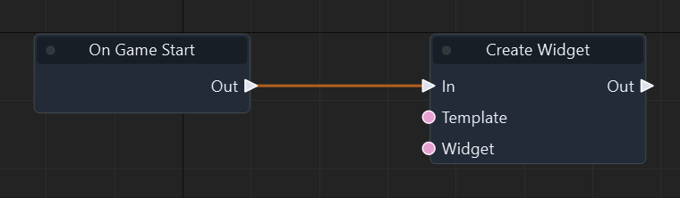

Graph: `templates/games/flappy_bird/graphs/gameplay.json` · Function: **Gameplay** · Node: `start`.

[Mở hướng dẫn game](games/flappy-bird.md)

### Đọc thêm

[Tài liệu hệ thống: events.md](events.md)

### On Update

ID `1002` · `event` · Workflow `shared`

Chạy mỗi frame. Nhân tốc độ với Get Delta Time để chuyển từ đơn vị/giây sang độ dời của frame.

### IO

| Chiều | Cổng | Kiểu | Mặc định |
| --- | --- | --- | --- |
| OUT | Out | `exec` | — |

Cổng `exec` điều khiển thứ tự. Cổng dữ liệu phải khớp kiểu; `vec2` không tự chuyển sang `vec3`.

### Cách dùng

1. Tìm **On Update** trong Node Library hoặc nhấn Tab trong graph để thêm node.
2. Có thể kéo dây từ OUT dữ liệu vào IN có cùng kiểu; giá trị từ dây thay thế hằng số của cổng.
3. Nối Out tới In của action đầu tiên. Sự kiện là điểm bắt đầu, không cần nối exec từ node khác.
4. Dùng kết quả dữ liệu trong nhánh exec phát ra từ chính node; không lấy payload sang một sự kiện khác.
5. Nhấn F5, thử tình huống, kiểm tra Console/Diagnostics; Shift+F5 dừng. Ctrl+S lưu thay đổi graph.

### Ví dụ từ graph thật

Trích đoạn Gameplay của flappy_bird: node update. Đây là các node và dây nối thật từ graph đã chạy; vị trí được sắp lại để dễ đọc.

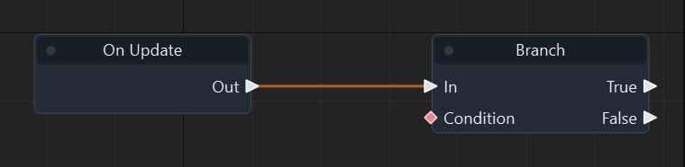

Graph: `templates/games/flappy_bird/graphs/gameplay.json` · Function: **Gameplay** · Node: `update`.

[Mở hướng dẫn game](games/flappy-bird.md)

### Đọc thêm

[Tài liệu hệ thống: events.md](events.md)

### On Timer Finished

ID `1003` · `event` · Workflow `shared`

Chạy khi timer có tên khớp Filter đến hạn. Snake dùng snake-tick lặp mỗi 0.18 giây.

### IO

| Chiều | Cổng | Kiểu | Mặc định |
| --- | --- | --- | --- |
| IN | Filter | `string` | `""` |
| IN | Receiver | `entity` | `""` |
| OUT | Out | `exec` | — |
| OUT | Name | `string` | — |
| OUT | Owner | `entity` | — |

Cổng `exec` điều khiển thứ tự. Cổng dữ liệu phải khớp kiểu; `vec2` không tự chuyển sang `vec3`.

### Cách dùng

1. Tìm **On Timer Finished** trong Node Library hoặc nhấn Tab trong graph để thêm node.
2. Chọn node, nhập hằng số ở Inspector theo bảng IN. Chuỗi nhập trực tiếp; vector/mảng nhập theo JSON, ví dụ `[1, 0, 0]`. Khai báo biến qua Scene > Scene Variables… trước khi dùng Get/Set Variable.
3. Các đầu vào sự kiện là cấu hình hằng số: đặt ở Inspector, không kéo dây dữ liệu vào chúng.
4. Nối Out tới In của action đầu tiên. Sự kiện là điểm bắt đầu, không cần nối exec từ node khác.
5. Dùng kết quả dữ liệu trong nhánh exec phát ra từ chính node; không lấy payload sang một sự kiện khác.
6. Nhấn F5, thử tình huống, kiểm tra Console/Diagnostics; Shift+F5 dừng. Ctrl+S lưu thay đổi graph.

### Ví dụ từ graph thật

Trích đoạn Gameplay của isometric_snake_3d: node n5. Đây là các node và dây nối thật từ graph đã chạy; vị trí được sắp lại để dễ đọc.

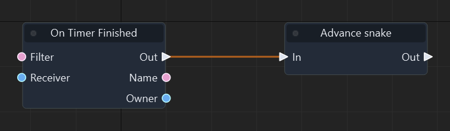

Graph: `templates/games/isometric_snake_3d/graphs/gameplay.json` · Function: **Gameplay** · Node: `n5`.

[Mở hướng dẫn game](games/isometric-snake.md)

### Đọc thêm

[Tài liệu hệ thống: timers.md](timers.md)

### On Fixed Update

ID `1004` · `event` · Workflow `shared`

Mỗi bước mô phỏng vật lý.

### IO

| Chiều | Cổng | Kiểu | Mặc định |
| --- | --- | --- | --- |
| OUT | Out | `exec` | — |

Cổng `exec` điều khiển thứ tự. Cổng dữ liệu phải khớp kiểu; `vec2` không tự chuyển sang `vec3`.

### Cách dùng

1. Tìm **On Fixed Update** trong Node Library hoặc nhấn Tab trong graph để thêm node.
2. Có thể kéo dây từ OUT dữ liệu vào IN có cùng kiểu; giá trị từ dây thay thế hằng số của cổng.
3. Nối Out tới In của action đầu tiên. Sự kiện là điểm bắt đầu, không cần nối exec từ node khác.
4. Dùng kết quả dữ liệu trong nhánh exec phát ra từ chính node; không lấy payload sang một sự kiện khác.
5. Nhấn F5, thử tình huống, kiểm tra Console/Diagnostics; Shift+F5 dừng. Ctrl+S lưu thay đổi graph.

### Đọc thêm

[Tài liệu hệ thống: events.md](events.md)

### On Late Update

ID `1005` · `event` · Workflow `shared`

Sau bước cập nhật logic thông thường.

### IO

| Chiều | Cổng | Kiểu | Mặc định |
| --- | --- | --- | --- |
| OUT | Out | `exec` | — |

Cổng `exec` điều khiển thứ tự. Cổng dữ liệu phải khớp kiểu; `vec2` không tự chuyển sang `vec3`.

### Cách dùng

1. Tìm **On Late Update** trong Node Library hoặc nhấn Tab trong graph để thêm node.
2. Có thể kéo dây từ OUT dữ liệu vào IN có cùng kiểu; giá trị từ dây thay thế hằng số của cổng.
3. Nối Out tới In của action đầu tiên. Sự kiện là điểm bắt đầu, không cần nối exec từ node khác.
4. Dùng kết quả dữ liệu trong nhánh exec phát ra từ chính node; không lấy payload sang một sự kiện khác.
5. Nhấn F5, thử tình huống, kiểm tra Console/Diagnostics; Shift+F5 dừng. Ctrl+S lưu thay đổi graph.

### Đọc thêm

[Tài liệu hệ thống: events.md](events.md)

### On Object Created

ID `1006` · `event` · Workflow `shared`

Khi Entity được tạo.

### IO

| Chiều | Cổng | Kiểu | Mặc định |
| --- | --- | --- | --- |
| IN | Receiver | `entity` | `""` |
| OUT | Out | `exec` | — |
| OUT | Entity | `entity` | — |
| OUT | Active | `bool` | — |

Cổng `exec` điều khiển thứ tự. Cổng dữ liệu phải khớp kiểu; `vec2` không tự chuyển sang `vec3`.

### Cách dùng

1. Tìm **On Object Created** trong Node Library hoặc nhấn Tab trong graph để thêm node.
2. Chọn node, nhập hằng số ở Inspector theo bảng IN. Chuỗi nhập trực tiếp; vector/mảng nhập theo JSON, ví dụ `[1, 0, 0]`. Khai báo biến qua Scene > Scene Variables… trước khi dùng Get/Set Variable.
3. Các đầu vào sự kiện là cấu hình hằng số: đặt ở Inspector, không kéo dây dữ liệu vào chúng.
4. Nối Out tới In của action đầu tiên. Sự kiện là điểm bắt đầu, không cần nối exec từ node khác.
5. Dùng kết quả dữ liệu trong nhánh exec phát ra từ chính node; không lấy payload sang một sự kiện khác.
6. Nhấn F5, thử tình huống, kiểm tra Console/Diagnostics; Shift+F5 dừng. Ctrl+S lưu thay đổi graph.

### Đọc thêm

[Tài liệu hệ thống: events.md](events.md)

### On Object Enabled

ID `1007` · `event` · Workflow `shared`

Khi Entity được kích hoạt.

### IO

| Chiều | Cổng | Kiểu | Mặc định |
| --- | --- | --- | --- |
| IN | Receiver | `entity` | `""` |
| OUT | Out | `exec` | — |
| OUT | Entity | `entity` | — |
| OUT | Active | `bool` | — |

Cổng `exec` điều khiển thứ tự. Cổng dữ liệu phải khớp kiểu; `vec2` không tự chuyển sang `vec3`.

### Cách dùng

1. Tìm **On Object Enabled** trong Node Library hoặc nhấn Tab trong graph để thêm node.
2. Chọn node, nhập hằng số ở Inspector theo bảng IN. Chuỗi nhập trực tiếp; vector/mảng nhập theo JSON, ví dụ `[1, 0, 0]`. Khai báo biến qua Scene > Scene Variables… trước khi dùng Get/Set Variable.
3. Các đầu vào sự kiện là cấu hình hằng số: đặt ở Inspector, không kéo dây dữ liệu vào chúng.
4. Nối Out tới In của action đầu tiên. Sự kiện là điểm bắt đầu, không cần nối exec từ node khác.
5. Dùng kết quả dữ liệu trong nhánh exec phát ra từ chính node; không lấy payload sang một sự kiện khác.
6. Nhấn F5, thử tình huống, kiểm tra Console/Diagnostics; Shift+F5 dừng. Ctrl+S lưu thay đổi graph.

### Đọc thêm

[Tài liệu hệ thống: events.md](events.md)

### On Object Disabled

ID `1008` · `event` · Workflow `shared`

Khi Entity bị vô hiệu hóa.

### IO

| Chiều | Cổng | Kiểu | Mặc định |
| --- | --- | --- | --- |
| IN | Receiver | `entity` | `""` |
| OUT | Out | `exec` | — |
| OUT | Entity | `entity` | — |
| OUT | Active | `bool` | — |

Cổng `exec` điều khiển thứ tự. Cổng dữ liệu phải khớp kiểu; `vec2` không tự chuyển sang `vec3`.

### Cách dùng

1. Tìm **On Object Disabled** trong Node Library hoặc nhấn Tab trong graph để thêm node.
2. Chọn node, nhập hằng số ở Inspector theo bảng IN. Chuỗi nhập trực tiếp; vector/mảng nhập theo JSON, ví dụ `[1, 0, 0]`. Khai báo biến qua Scene > Scene Variables… trước khi dùng Get/Set Variable.
3. Các đầu vào sự kiện là cấu hình hằng số: đặt ở Inspector, không kéo dây dữ liệu vào chúng.
4. Nối Out tới In của action đầu tiên. Sự kiện là điểm bắt đầu, không cần nối exec từ node khác.
5. Dùng kết quả dữ liệu trong nhánh exec phát ra từ chính node; không lấy payload sang một sự kiện khác.
6. Nhấn F5, thử tình huống, kiểm tra Console/Diagnostics; Shift+F5 dừng. Ctrl+S lưu thay đổi graph.

### Đọc thêm

[Tài liệu hệ thống: events.md](events.md)

### On Object Destroyed

ID `1009` · `event` · Workflow `shared`

Trước khi Entity bị hủy.

### IO

| Chiều | Cổng | Kiểu | Mặc định |
| --- | --- | --- | --- |
| IN | Receiver | `entity` | `""` |
| OUT | Out | `exec` | — |
| OUT | Entity | `entity` | — |
| OUT | Active | `bool` | — |

Cổng `exec` điều khiển thứ tự. Cổng dữ liệu phải khớp kiểu; `vec2` không tự chuyển sang `vec3`.

### Cách dùng

1. Tìm **On Object Destroyed** trong Node Library hoặc nhấn Tab trong graph để thêm node.
2. Chọn node, nhập hằng số ở Inspector theo bảng IN. Chuỗi nhập trực tiếp; vector/mảng nhập theo JSON, ví dụ `[1, 0, 0]`. Khai báo biến qua Scene > Scene Variables… trước khi dùng Get/Set Variable.
3. Các đầu vào sự kiện là cấu hình hằng số: đặt ở Inspector, không kéo dây dữ liệu vào chúng.
4. Nối Out tới In của action đầu tiên. Sự kiện là điểm bắt đầu, không cần nối exec từ node khác.
5. Dùng kết quả dữ liệu trong nhánh exec phát ra từ chính node; không lấy payload sang một sự kiện khác.
6. Nhấn F5, thử tình huống, kiểm tra Console/Diagnostics; Shift+F5 dừng. Ctrl+S lưu thay đổi graph.

### Đọc thêm

[Tài liệu hệ thống: events.md](events.md)

### On Application Quit

ID `1010` · `event` · Workflow `shared`

Khi ứng dụng chuẩn bị thoát.

### IO

| Chiều | Cổng | Kiểu | Mặc định |
| --- | --- | --- | --- |
| OUT | Out | `exec` | — |

Cổng `exec` điều khiển thứ tự. Cổng dữ liệu phải khớp kiểu; `vec2` không tự chuyển sang `vec3`.

### Cách dùng

1. Tìm **On Application Quit** trong Node Library hoặc nhấn Tab trong graph để thêm node.
2. Có thể kéo dây từ OUT dữ liệu vào IN có cùng kiểu; giá trị từ dây thay thế hằng số của cổng.
3. Nối Out tới In của action đầu tiên. Sự kiện là điểm bắt đầu, không cần nối exec từ node khác.
4. Dùng kết quả dữ liệu trong nhánh exec phát ra từ chính node; không lấy payload sang một sự kiện khác.
5. Nhấn F5, thử tình huống, kiểm tra Console/Diagnostics; Shift+F5 dừng. Ctrl+S lưu thay đổi graph.

### Đọc thêm

[Tài liệu hệ thống: events.md](events.md)

### On Collision Enter

ID `1011` · `event` · Workflow `shared`

Nhận sự kiện Collision Enter khớp cấu hình đầu vào và bắt đầu luồng Out. Dùng payload trong luồng phát ra từ sự kiện; xem tài liệu hệ thống để thiết lập đối tượng nhận.

### IO

| Chiều | Cổng | Kiểu | Mặc định |
| --- | --- | --- | --- |
| IN | Receiver | `entity` | `""` |
| OUT | Out | `exec` | — |
| OUT | Entity | `entity` | — |
| OUT | Other | `entity` | — |
| OUT | Point | `vec3` | — |
| OUT | Normal | `vec3` | — |

Cổng `exec` điều khiển thứ tự. Cổng dữ liệu phải khớp kiểu; `vec2` không tự chuyển sang `vec3`.

### Cách dùng

1. Tìm **On Collision Enter** trong Node Library hoặc nhấn Tab trong graph để thêm node.
2. Chọn node, nhập hằng số ở Inspector theo bảng IN. Chuỗi nhập trực tiếp; vector/mảng nhập theo JSON, ví dụ `[1, 0, 0]`. Khai báo biến qua Scene > Scene Variables… trước khi dùng Get/Set Variable.
3. Các đầu vào sự kiện là cấu hình hằng số: đặt ở Inspector, không kéo dây dữ liệu vào chúng.
4. Nối Out tới In của action đầu tiên. Sự kiện là điểm bắt đầu, không cần nối exec từ node khác.
5. Dùng kết quả dữ liệu trong nhánh exec phát ra từ chính node; không lấy payload sang một sự kiện khác.
6. Nhấn F5, thử tình huống, kiểm tra Console/Diagnostics; Shift+F5 dừng. Ctrl+S lưu thay đổi graph.

### Đọc thêm

[Tài liệu hệ thống: events.md](events.md)

### On Collision Stay

ID `1012` · `event` · Workflow `shared`

Nhận sự kiện Collision Stay khớp cấu hình đầu vào và bắt đầu luồng Out. Dùng payload trong luồng phát ra từ sự kiện; xem tài liệu hệ thống để thiết lập đối tượng nhận.

### IO

| Chiều | Cổng | Kiểu | Mặc định |
| --- | --- | --- | --- |
| IN | Receiver | `entity` | `""` |
| OUT | Out | `exec` | — |
| OUT | Entity | `entity` | — |
| OUT | Other | `entity` | — |
| OUT | Point | `vec3` | — |
| OUT | Normal | `vec3` | — |

Cổng `exec` điều khiển thứ tự. Cổng dữ liệu phải khớp kiểu; `vec2` không tự chuyển sang `vec3`.

### Cách dùng

1. Tìm **On Collision Stay** trong Node Library hoặc nhấn Tab trong graph để thêm node.
2. Chọn node, nhập hằng số ở Inspector theo bảng IN. Chuỗi nhập trực tiếp; vector/mảng nhập theo JSON, ví dụ `[1, 0, 0]`. Khai báo biến qua Scene > Scene Variables… trước khi dùng Get/Set Variable.
3. Các đầu vào sự kiện là cấu hình hằng số: đặt ở Inspector, không kéo dây dữ liệu vào chúng.
4. Nối Out tới In của action đầu tiên. Sự kiện là điểm bắt đầu, không cần nối exec từ node khác.
5. Dùng kết quả dữ liệu trong nhánh exec phát ra từ chính node; không lấy payload sang một sự kiện khác.
6. Nhấn F5, thử tình huống, kiểm tra Console/Diagnostics; Shift+F5 dừng. Ctrl+S lưu thay đổi graph.

### Đọc thêm

[Tài liệu hệ thống: events.md](events.md)

### On Collision Exit

ID `1013` · `event` · Workflow `shared`

Nhận sự kiện Collision Exit khớp cấu hình đầu vào và bắt đầu luồng Out. Dùng payload trong luồng phát ra từ sự kiện; xem tài liệu hệ thống để thiết lập đối tượng nhận.

### IO

| Chiều | Cổng | Kiểu | Mặc định |
| --- | --- | --- | --- |
| IN | Receiver | `entity` | `""` |
| OUT | Out | `exec` | — |
| OUT | Entity | `entity` | — |
| OUT | Other | `entity` | — |
| OUT | Point | `vec3` | — |
| OUT | Normal | `vec3` | — |

Cổng `exec` điều khiển thứ tự. Cổng dữ liệu phải khớp kiểu; `vec2` không tự chuyển sang `vec3`.

### Cách dùng

1. Tìm **On Collision Exit** trong Node Library hoặc nhấn Tab trong graph để thêm node.
2. Chọn node, nhập hằng số ở Inspector theo bảng IN. Chuỗi nhập trực tiếp; vector/mảng nhập theo JSON, ví dụ `[1, 0, 0]`. Khai báo biến qua Scene > Scene Variables… trước khi dùng Get/Set Variable.
3. Các đầu vào sự kiện là cấu hình hằng số: đặt ở Inspector, không kéo dây dữ liệu vào chúng.
4. Nối Out tới In của action đầu tiên. Sự kiện là điểm bắt đầu, không cần nối exec từ node khác.
5. Dùng kết quả dữ liệu trong nhánh exec phát ra từ chính node; không lấy payload sang một sự kiện khác.
6. Nhấn F5, thử tình huống, kiểm tra Console/Diagnostics; Shift+F5 dừng. Ctrl+S lưu thay đổi graph.

### Đọc thêm

[Tài liệu hệ thống: events.md](events.md)

### On Trigger Enter

ID `1014` · `event` · Workflow `shared`

Nhận sự kiện Trigger Enter khớp cấu hình đầu vào và bắt đầu luồng Out. Dùng payload trong luồng phát ra từ sự kiện; xem tài liệu hệ thống để thiết lập đối tượng nhận.

### IO

| Chiều | Cổng | Kiểu | Mặc định |
| --- | --- | --- | --- |
| IN | Receiver | `entity` | `""` |
| OUT | Out | `exec` | — |
| OUT | Entity | `entity` | — |
| OUT | Other | `entity` | — |
| OUT | Point | `vec3` | — |
| OUT | Normal | `vec3` | — |

Cổng `exec` điều khiển thứ tự. Cổng dữ liệu phải khớp kiểu; `vec2` không tự chuyển sang `vec3`.

### Cách dùng

1. Tìm **On Trigger Enter** trong Node Library hoặc nhấn Tab trong graph để thêm node.
2. Chọn node, nhập hằng số ở Inspector theo bảng IN. Chuỗi nhập trực tiếp; vector/mảng nhập theo JSON, ví dụ `[1, 0, 0]`. Khai báo biến qua Scene > Scene Variables… trước khi dùng Get/Set Variable.
3. Các đầu vào sự kiện là cấu hình hằng số: đặt ở Inspector, không kéo dây dữ liệu vào chúng.
4. Nối Out tới In của action đầu tiên. Sự kiện là điểm bắt đầu, không cần nối exec từ node khác.
5. Dùng kết quả dữ liệu trong nhánh exec phát ra từ chính node; không lấy payload sang một sự kiện khác.
6. Nhấn F5, thử tình huống, kiểm tra Console/Diagnostics; Shift+F5 dừng. Ctrl+S lưu thay đổi graph.

### Đọc thêm

[Tài liệu hệ thống: events.md](events.md)

### On Trigger Stay

ID `1015` · `event` · Workflow `shared`

Nhận sự kiện Trigger Stay khớp cấu hình đầu vào và bắt đầu luồng Out. Dùng payload trong luồng phát ra từ sự kiện; xem tài liệu hệ thống để thiết lập đối tượng nhận.

### IO

| Chiều | Cổng | Kiểu | Mặc định |
| --- | --- | --- | --- |
| IN | Receiver | `entity` | `""` |
| OUT | Out | `exec` | — |
| OUT | Entity | `entity` | — |
| OUT | Other | `entity` | — |
| OUT | Point | `vec3` | — |
| OUT | Normal | `vec3` | — |

Cổng `exec` điều khiển thứ tự. Cổng dữ liệu phải khớp kiểu; `vec2` không tự chuyển sang `vec3`.

### Cách dùng

1. Tìm **On Trigger Stay** trong Node Library hoặc nhấn Tab trong graph để thêm node.
2. Chọn node, nhập hằng số ở Inspector theo bảng IN. Chuỗi nhập trực tiếp; vector/mảng nhập theo JSON, ví dụ `[1, 0, 0]`. Khai báo biến qua Scene > Scene Variables… trước khi dùng Get/Set Variable.
3. Các đầu vào sự kiện là cấu hình hằng số: đặt ở Inspector, không kéo dây dữ liệu vào chúng.
4. Nối Out tới In của action đầu tiên. Sự kiện là điểm bắt đầu, không cần nối exec từ node khác.
5. Dùng kết quả dữ liệu trong nhánh exec phát ra từ chính node; không lấy payload sang một sự kiện khác.
6. Nhấn F5, thử tình huống, kiểm tra Console/Diagnostics; Shift+F5 dừng. Ctrl+S lưu thay đổi graph.

### Đọc thêm

[Tài liệu hệ thống: events.md](events.md)

### On Trigger Exit

ID `1016` · `event` · Workflow `shared`

Nhận sự kiện Trigger Exit khớp cấu hình đầu vào và bắt đầu luồng Out. Dùng payload trong luồng phát ra từ sự kiện; xem tài liệu hệ thống để thiết lập đối tượng nhận.

### IO

| Chiều | Cổng | Kiểu | Mặc định |
| --- | --- | --- | --- |
| IN | Receiver | `entity` | `""` |
| OUT | Out | `exec` | — |
| OUT | Entity | `entity` | — |
| OUT | Other | `entity` | — |
| OUT | Point | `vec3` | — |
| OUT | Normal | `vec3` | — |

Cổng `exec` điều khiển thứ tự. Cổng dữ liệu phải khớp kiểu; `vec2` không tự chuyển sang `vec3`.

### Cách dùng

1. Tìm **On Trigger Exit** trong Node Library hoặc nhấn Tab trong graph để thêm node.
2. Chọn node, nhập hằng số ở Inspector theo bảng IN. Chuỗi nhập trực tiếp; vector/mảng nhập theo JSON, ví dụ `[1, 0, 0]`. Khai báo biến qua Scene > Scene Variables… trước khi dùng Get/Set Variable.
3. Các đầu vào sự kiện là cấu hình hằng số: đặt ở Inspector, không kéo dây dữ liệu vào chúng.
4. Nối Out tới In của action đầu tiên. Sự kiện là điểm bắt đầu, không cần nối exec từ node khác.
5. Dùng kết quả dữ liệu trong nhánh exec phát ra từ chính node; không lấy payload sang một sự kiện khác.
6. Nhấn F5, thử tình huống, kiểm tra Console/Diagnostics; Shift+F5 dừng. Ctrl+S lưu thay đổi graph.

### Đọc thêm

[Tài liệu hệ thống: events.md](events.md)

### On Game Pause

ID `1017` · `event` · Workflow `shared`

Phát Out khi world được Pause World; biến paused của từng game không tự phát sự kiện này.

### IO

| Chiều | Cổng | Kiểu | Mặc định |
| --- | --- | --- | --- |
| OUT | Out | `exec` | — |

Cổng `exec` điều khiển thứ tự. Cổng dữ liệu phải khớp kiểu; `vec2` không tự chuyển sang `vec3`.

### Cách dùng

1. Tìm **On Game Pause** trong Node Library hoặc nhấn Tab trong graph để thêm node.
2. Có thể kéo dây từ OUT dữ liệu vào IN có cùng kiểu; giá trị từ dây thay thế hằng số của cổng.
3. Nối Out tới In của action đầu tiên. Sự kiện là điểm bắt đầu, không cần nối exec từ node khác.
4. Dùng kết quả dữ liệu trong nhánh exec phát ra từ chính node; không lấy payload sang một sự kiện khác.
5. Nhấn F5, thử tình huống, kiểm tra Console/Diagnostics; Shift+F5 dừng. Ctrl+S lưu thay đổi graph.

### Đọc thêm

[Tài liệu hệ thống: events.md](events.md)

### On Game Resume

ID `1018` · `event` · Workflow `shared`

Phát Out khi world được Resume World.

### IO

| Chiều | Cổng | Kiểu | Mặc định |
| --- | --- | --- | --- |
| OUT | Out | `exec` | — |

Cổng `exec` điều khiển thứ tự. Cổng dữ liệu phải khớp kiểu; `vec2` không tự chuyển sang `vec3`.

### Cách dùng

1. Tìm **On Game Resume** trong Node Library hoặc nhấn Tab trong graph để thêm node.
2. Có thể kéo dây từ OUT dữ liệu vào IN có cùng kiểu; giá trị từ dây thay thế hằng số của cổng.
3. Nối Out tới In của action đầu tiên. Sự kiện là điểm bắt đầu, không cần nối exec từ node khác.
4. Dùng kết quả dữ liệu trong nhánh exec phát ra từ chính node; không lấy payload sang một sự kiện khác.
5. Nhấn F5, thử tình huống, kiểm tra Console/Diagnostics; Shift+F5 dừng. Ctrl+S lưu thay đổi graph.

### Đọc thêm

[Tài liệu hệ thống: events.md](events.md)

### On Scene Loaded

ID `1019` · `event` · Workflow `shared`

Khi Scene tải hoàn tất.

### IO

| Chiều | Cổng | Kiểu | Mặc định |
| --- | --- | --- | --- |
| OUT | Out | `exec` | — |

Cổng `exec` điều khiển thứ tự. Cổng dữ liệu phải khớp kiểu; `vec2` không tự chuyển sang `vec3`.

### Cách dùng

1. Tìm **On Scene Loaded** trong Node Library hoặc nhấn Tab trong graph để thêm node.
2. Có thể kéo dây từ OUT dữ liệu vào IN có cùng kiểu; giá trị từ dây thay thế hằng số của cổng.
3. Nối Out tới In của action đầu tiên. Sự kiện là điểm bắt đầu, không cần nối exec từ node khác.
4. Dùng kết quả dữ liệu trong nhánh exec phát ra từ chính node; không lấy payload sang một sự kiện khác.
5. Nhấn F5, thử tình huống, kiểm tra Console/Diagnostics; Shift+F5 dừng. Ctrl+S lưu thay đổi graph.

### Đọc thêm

[Tài liệu hệ thống: events.md](events.md)

### On Scene Load Failed

ID `1020` · `event` · Workflow `shared`

Nhận yêu cầu tải scene thất bại. Đọc payload lỗi trong luồng Out của sự kiện.

### IO

| Chiều | Cổng | Kiểu | Mặc định |
| --- | --- | --- | --- |
| OUT | Out | `exec` | — |
| OUT | Scene | `string` | — |
| OUT | Error | `string` | — |

Cổng `exec` điều khiển thứ tự. Cổng dữ liệu phải khớp kiểu; `vec2` không tự chuyển sang `vec3`.

### Cách dùng

1. Tìm **On Scene Load Failed** trong Node Library hoặc nhấn Tab trong graph để thêm node.
2. Các đầu vào sự kiện là cấu hình hằng số: đặt ở Inspector, không kéo dây dữ liệu vào chúng.
3. Nối Out tới In của action đầu tiên. Sự kiện là điểm bắt đầu, không cần nối exec từ node khác.
4. Dùng kết quả dữ liệu trong nhánh exec phát ra từ chính node; không lấy payload sang một sự kiện khác.
5. Nhấn F5, thử tình huống, kiểm tra Console/Diagnostics; Shift+F5 dừng. Ctrl+S lưu thay đổi graph.

### Đọc thêm

[Tài liệu hệ thống: events.md](events.md)

## 02. Flow Control & Async

### Branch

ID `2001` · `branch` · Workflow `shared`

Nhận luồng In, kiểm tra Condition và chỉ chạy True hoặc False. Không nối cả hai nhánh như Sequence.

### IO

| Chiều | Cổng | Kiểu | Mặc định |
| --- | --- | --- | --- |
| IN | In | `exec` | — |
| IN | Condition | `bool` | `true` |
| OUT | True | `exec` | — |
| OUT | False | `exec` | — |

Cổng `exec` điều khiển thứ tự. Cổng dữ liệu phải khớp kiểu; `vec2` không tự chuyển sang `vec3`.

### Cách dùng

1. Tìm **Branch** trong Node Library hoặc nhấn Tab trong graph để thêm node.
2. Chọn node, nhập hằng số ở Inspector theo bảng IN. Chuỗi nhập trực tiếp; vector/mảng nhập theo JSON, ví dụ `[1, 0, 0]`. Khai báo biến qua Scene > Scene Variables… trước khi dùng Get/Set Variable.
3. Có thể kéo dây từ OUT dữ liệu vào IN có cùng kiểu; giá trị từ dây thay thế hằng số của cổng.
4. Nối OUT exec của sự kiện/node trước vào IN exec; nối tiếp các OUT exec phù hợp tới bước sau.
5. Nhấn F5, thử tình huống, kiểm tra Console/Diagnostics; Shift+F5 dừng. Ctrl+S lưu thay đổi graph.

### Ví dụ từ graph thật

Trích đoạn Flap của flappy_bird: node n5. Đây là các node và dây nối thật từ graph đã chạy; vị trí được sắp lại để dễ đọc.

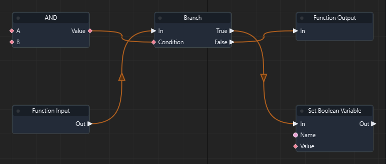

Graph: `templates/games/flappy_bird/graphs/gameplay.json` · Function: **Flap** · Node: `n5`.

[Mở hướng dẫn game](games/flappy-bird.md)

### Đọc thêm

[Tài liệu hệ thống: flow-control.md](flow-control.md)

### Sequence

ID `2002` · `sequence` · Workflow `shared`

Chạy các đầu ra exec theo thứ tự khai báo. First hoàn tất rồi mới chạy Then.

### IO

| Chiều | Cổng | Kiểu | Mặc định |
| --- | --- | --- | --- |
| IN | In | `exec` | — |
| OUT | First | `exec` | — |
| OUT | Then | `exec` | — |

Cổng `exec` điều khiển thứ tự. Cổng dữ liệu phải khớp kiểu; `vec2` không tự chuyển sang `vec3`.

### Cách dùng

1. Tìm **Sequence** trong Node Library hoặc nhấn Tab trong graph để thêm node.
2. Có thể kéo dây từ OUT dữ liệu vào IN có cùng kiểu; giá trị từ dây thay thế hằng số của cổng.
3. Nối OUT exec của sự kiện/node trước vào IN exec; nối tiếp các OUT exec phù hợp tới bước sau.
4. Nhấn F5, thử tình huống, kiểm tra Console/Diagnostics; Shift+F5 dừng. Ctrl+S lưu thay đổi graph.

### Ví dụ từ graph thật

Trích đoạn Advance Pipe 1 của flappy_bird: node n15. Đây là các node và dây nối thật từ graph đã chạy; vị trí được sắp lại để dễ đọc.

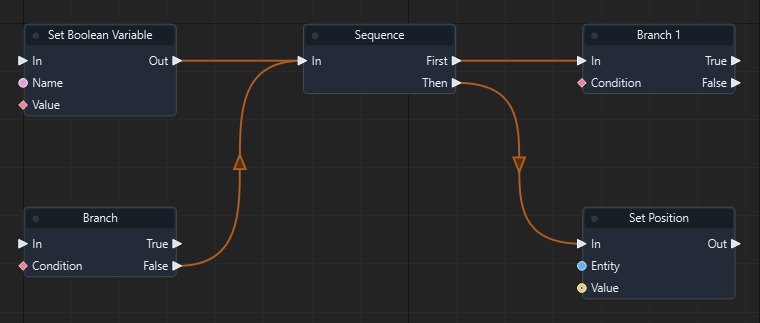

Graph: `templates/games/flappy_bird/graphs/gameplay.json` · Function: **Advance Pipe 1** · Node: `n15`.

[Mở hướng dẫn game](games/flappy-bird.md)

### Đọc thêm

[Tài liệu hệ thống: flow-control.md](flow-control.md)

### For Loop

ID `2003` · `for` · Workflow `shared`

Lặp theo số lần.

### IO

| Chiều | Cổng | Kiểu | Mặc định |
| --- | --- | --- | --- |
| IN | In | `exec` | — |
| IN | Count | `float` | `3.0` |
| OUT | Body | `exec` | — |
| OUT | Done | `exec` | — |

Cổng `exec` điều khiển thứ tự. Cổng dữ liệu phải khớp kiểu; `vec2` không tự chuyển sang `vec3`.

### Cách dùng

1. Tìm **For Loop** trong Node Library hoặc nhấn Tab trong graph để thêm node.
2. Chọn node, nhập hằng số ở Inspector theo bảng IN. Chuỗi nhập trực tiếp; vector/mảng nhập theo JSON, ví dụ `[1, 0, 0]`. Khai báo biến qua Scene > Scene Variables… trước khi dùng Get/Set Variable.
3. Có thể kéo dây từ OUT dữ liệu vào IN có cùng kiểu; giá trị từ dây thay thế hằng số của cổng.
4. Nối OUT exec của sự kiện/node trước vào IN exec; nối tiếp các OUT exec phù hợp tới bước sau.
5. Nhấn F5, thử tình huống, kiểm tra Console/Diagnostics; Shift+F5 dừng. Ctrl+S lưu thay đổi graph.

### Đọc thêm

[Tài liệu hệ thống: flow-control.md](flow-control.md)

### While Loop

ID `2004` · `while` · Workflow `shared`

Lặp khi điều kiện đúng.

### IO

| Chiều | Cổng | Kiểu | Mặc định |
| --- | --- | --- | --- |
| IN | In | `exec` | — |
| IN | Condition | `bool` | `false` |
| OUT | Body | `exec` | — |
| OUT | Done | `exec` | — |

Cổng `exec` điều khiển thứ tự. Cổng dữ liệu phải khớp kiểu; `vec2` không tự chuyển sang `vec3`.

### Cách dùng

1. Tìm **While Loop** trong Node Library hoặc nhấn Tab trong graph để thêm node.
2. Chọn node, nhập hằng số ở Inspector theo bảng IN. Chuỗi nhập trực tiếp; vector/mảng nhập theo JSON, ví dụ `[1, 0, 0]`. Khai báo biến qua Scene > Scene Variables… trước khi dùng Get/Set Variable.
3. Có thể kéo dây từ OUT dữ liệu vào IN có cùng kiểu; giá trị từ dây thay thế hằng số của cổng.
4. Nối OUT exec của sự kiện/node trước vào IN exec; nối tiếp các OUT exec phù hợp tới bước sau.
5. Nhấn F5, thử tình huống, kiểm tra Console/Diagnostics; Shift+F5 dừng. Ctrl+S lưu thay đổi graph.

### Đọc thêm

[Tài liệu hệ thống: flow-control.md](flow-control.md)

### Break Loop

ID `2005` · `break` · Workflow `shared`

Thoát vòng lặp gần nhất và chuyển sang Done. Chỉ đặt trong Body của một vòng lặp.

### IO

| Chiều | Cổng | Kiểu | Mặc định |
| --- | --- | --- | --- |
| IN | In | `exec` | — |

Cổng `exec` điều khiển thứ tự. Cổng dữ liệu phải khớp kiểu; `vec2` không tự chuyển sang `vec3`.

### Cách dùng

1. Tìm **Break Loop** trong Node Library hoặc nhấn Tab trong graph để thêm node.
2. Có thể kéo dây từ OUT dữ liệu vào IN có cùng kiểu; giá trị từ dây thay thế hằng số của cổng.
3. Nối OUT exec của sự kiện/node trước vào IN exec; nối tiếp các OUT exec phù hợp tới bước sau.
4. Nhấn F5, thử tình huống, kiểm tra Console/Diagnostics; Shift+F5 dừng. Ctrl+S lưu thay đổi graph.

### Ví dụ từ graph thật

Trích đoạn Spawn food của isometric_snake_3d: node n19. Đây là các node và dây nối thật từ graph đã chạy; vị trí được sắp lại để dễ đọc.

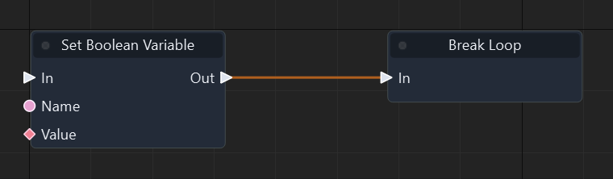

Graph: `templates/games/isometric_snake_3d/graphs/gameplay.json` · Function: **Spawn food** · Node: `n19`.

[Mở hướng dẫn game](games/isometric-snake.md)

### Đọc thêm

[Tài liệu hệ thống: flow-control.md](flow-control.md)

### Continue Loop

ID `2006` · `continue` · Workflow `shared`

Bỏ phần còn lại của lượt lặp hiện tại rồi sang lượt kế tiếp. Chỉ dùng trong Body.

### IO

| Chiều | Cổng | Kiểu | Mặc định |
| --- | --- | --- | --- |
| IN | In | `exec` | — |

Cổng `exec` điều khiển thứ tự. Cổng dữ liệu phải khớp kiểu; `vec2` không tự chuyển sang `vec3`.

### Cách dùng

1. Tìm **Continue Loop** trong Node Library hoặc nhấn Tab trong graph để thêm node.
2. Có thể kéo dây từ OUT dữ liệu vào IN có cùng kiểu; giá trị từ dây thay thế hằng số của cổng.
3. Nối OUT exec của sự kiện/node trước vào IN exec; nối tiếp các OUT exec phù hợp tới bước sau.
4. Nhấn F5, thử tình huống, kiểm tra Console/Diagnostics; Shift+F5 dừng. Ctrl+S lưu thay đổi graph.

### Đọc thêm

[Tài liệu hệ thống: flow-control.md](flow-control.md)

### Do Once

ID `2007` · `flow` · Workflow `shared`

Chỉ thực thi một lần cho đến khi reset.

### IO

| Chiều | Cổng | Kiểu | Mặc định |
| --- | --- | --- | --- |
| IN | In | `exec` | — |
| IN | Reset | `exec` | — |
| IN | Owner | `entity` | `""` |
| OUT | Out | `exec` | — |

Cổng `exec` điều khiển thứ tự. Cổng dữ liệu phải khớp kiểu; `vec2` không tự chuyển sang `vec3`.

### Cách dùng

1. Tìm **Do Once** trong Node Library hoặc nhấn Tab trong graph để thêm node.
2. Chọn node, nhập hằng số ở Inspector theo bảng IN. Chuỗi nhập trực tiếp; vector/mảng nhập theo JSON, ví dụ `[1, 0, 0]`. Khai báo biến qua Scene > Scene Variables… trước khi dùng Get/Set Variable.
3. Có thể kéo dây từ OUT dữ liệu vào IN có cùng kiểu; giá trị từ dây thay thế hằng số của cổng.
4. Nối OUT exec của sự kiện/node trước vào IN exec; nối tiếp các OUT exec phù hợp tới bước sau.
5. Nhấn F5, thử tình huống, kiểm tra Console/Diagnostics; Shift+F5 dừng. Ctrl+S lưu thay đổi graph.

### Đọc thêm

[Tài liệu hệ thống: flow-control.md](flow-control.md)

### Do N

ID `2008` · `flow` · Workflow `shared`

Thực thi tối đa N lần.

### IO

| Chiều | Cổng | Kiểu | Mặc định |
| --- | --- | --- | --- |
| IN | In | `exec` | — |
| IN | Reset | `exec` | — |
| IN | Owner | `entity` | `""` |
| IN | N | `int` | `1` |
| OUT | Out | `exec` | — |
| OUT | Counter | `int` | — |

Cổng `exec` điều khiển thứ tự. Cổng dữ liệu phải khớp kiểu; `vec2` không tự chuyển sang `vec3`.

### Cách dùng

1. Tìm **Do N** trong Node Library hoặc nhấn Tab trong graph để thêm node.
2. Chọn node, nhập hằng số ở Inspector theo bảng IN. Chuỗi nhập trực tiếp; vector/mảng nhập theo JSON, ví dụ `[1, 0, 0]`. Khai báo biến qua Scene > Scene Variables… trước khi dùng Get/Set Variable.
3. Có thể kéo dây từ OUT dữ liệu vào IN có cùng kiểu; giá trị từ dây thay thế hằng số của cổng.
4. Nối OUT exec của sự kiện/node trước vào IN exec; nối tiếp các OUT exec phù hợp tới bước sau.
5. Nhấn F5, thử tình huống, kiểm tra Console/Diagnostics; Shift+F5 dừng. Ctrl+S lưu thay đổi graph.

### Đọc thêm

[Tài liệu hệ thống: flow-control.md](flow-control.md)

### Gate

ID `2009` · `flow` · Workflow `shared`

Cho phép hoặc chặn luồng thực thi.

### IO

| Chiều | Cổng | Kiểu | Mặc định |
| --- | --- | --- | --- |
| IN | In | `exec` | — |
| IN | Open | `exec` | — |
| IN | Close | `exec` | — |
| IN | Toggle | `exec` | — |
| IN | Owner | `entity` | `""` |
| IN | Start Closed | `bool` | `false` |
| OUT | Out | `exec` | — |

Cổng `exec` điều khiển thứ tự. Cổng dữ liệu phải khớp kiểu; `vec2` không tự chuyển sang `vec3`.

### Cách dùng

1. Tìm **Gate** trong Node Library hoặc nhấn Tab trong graph để thêm node.
2. Chọn node, nhập hằng số ở Inspector theo bảng IN. Chuỗi nhập trực tiếp; vector/mảng nhập theo JSON, ví dụ `[1, 0, 0]`. Khai báo biến qua Scene > Scene Variables… trước khi dùng Get/Set Variable.
3. Có thể kéo dây từ OUT dữ liệu vào IN có cùng kiểu; giá trị từ dây thay thế hằng số của cổng.
4. Nối OUT exec của sự kiện/node trước vào IN exec; nối tiếp các OUT exec phù hợp tới bước sau.
5. Nhấn F5, thử tình huống, kiểm tra Console/Diagnostics; Shift+F5 dừng. Ctrl+S lưu thay đổi graph.

### Đọc thêm

[Tài liệu hệ thống: flow-control.md](flow-control.md)

### Flip Flop

ID `2010` · `flow` · Workflow `shared`

Luân phiên hai nhánh.

### IO

| Chiều | Cổng | Kiểu | Mặc định |
| --- | --- | --- | --- |
| IN | In | `exec` | — |
| IN | Reset | `exec` | — |
| IN | Owner | `entity` | `""` |
| OUT | A | `exec` | — |
| OUT | B | `exec` | — |
| OUT | Is A | `bool` | — |

Cổng `exec` điều khiển thứ tự. Cổng dữ liệu phải khớp kiểu; `vec2` không tự chuyển sang `vec3`.

### Cách dùng

1. Tìm **Flip Flop** trong Node Library hoặc nhấn Tab trong graph để thêm node.
2. Chọn node, nhập hằng số ở Inspector theo bảng IN. Chuỗi nhập trực tiếp; vector/mảng nhập theo JSON, ví dụ `[1, 0, 0]`. Khai báo biến qua Scene > Scene Variables… trước khi dùng Get/Set Variable.
3. Có thể kéo dây từ OUT dữ liệu vào IN có cùng kiểu; giá trị từ dây thay thế hằng số của cổng.
4. Nối OUT exec của sự kiện/node trước vào IN exec; nối tiếp các OUT exec phù hợp tới bước sau.
5. Nhấn F5, thử tình huống, kiểm tra Console/Diagnostics; Shift+F5 dừng. Ctrl+S lưu thay đổi graph.

### Đọc thêm

[Tài liệu hệ thống: flow-control.md](flow-control.md)

### Multi Gate

ID `2011` · `flow` · Workflow `shared`

Luân phiên hoặc chọn nhiều nhánh.

### IO

| Chiều | Cổng | Kiểu | Mặc định |
| --- | --- | --- | --- |
| IN | In | `exec` | — |
| IN | Reset | `exec` | — |
| IN | Owner | `entity` | `""` |
| IN | Branches | `int` | `2` |
| IN | Random | `bool` | `false` |
| IN | Loop | `bool` | `false` |
| IN | Start Index | `int` | `-1` |
| OUT | Out 0 | `exec` | — |
| OUT | Out 1 | `exec` | — |
| OUT | Out 2 | `exec` | — |
| OUT | Out 3 | `exec` | — |
| OUT | Out 4 | `exec` | — |
| OUT | Out 5 | `exec` | — |
| OUT | Out 6 | `exec` | — |
| OUT | Out 7 | `exec` | — |
| OUT | Index | `int` | — |

Cổng `exec` điều khiển thứ tự. Cổng dữ liệu phải khớp kiểu; `vec2` không tự chuyển sang `vec3`.

### Cách dùng

1. Tìm **Multi Gate** trong Node Library hoặc nhấn Tab trong graph để thêm node.
2. Chọn node, nhập hằng số ở Inspector theo bảng IN. Chuỗi nhập trực tiếp; vector/mảng nhập theo JSON, ví dụ `[1, 0, 0]`. Khai báo biến qua Scene > Scene Variables… trước khi dùng Get/Set Variable.
3. Có thể kéo dây từ OUT dữ liệu vào IN có cùng kiểu; giá trị từ dây thay thế hằng số của cổng.
4. Nối OUT exec của sự kiện/node trước vào IN exec; nối tiếp các OUT exec phù hợp tới bước sau.
5. Nhấn F5, thử tình huống, kiểm tra Console/Diagnostics; Shift+F5 dừng. Ctrl+S lưu thay đổi graph.

### Đọc thêm

[Tài liệu hệ thống: flow-control.md](flow-control.md)

### Delay

ID `2012` · `latent` · Workflow `shared`

Chờ một khoảng thời gian game.

### IO

| Chiều | Cổng | Kiểu | Mặc định |
| --- | --- | --- | --- |
| IN | In | `exec` | — |
| IN | Owner | `entity` | `""` |
| IN | Seconds | `float` | `1.0` |
| IN | Unscaled | `bool` | `false` |
| OUT | Out | `exec` | — |

Cổng `exec` điều khiển thứ tự. Cổng dữ liệu phải khớp kiểu; `vec2` không tự chuyển sang `vec3`.

### Cách dùng

1. Tìm **Delay** trong Node Library hoặc nhấn Tab trong graph để thêm node.
2. Chọn node, nhập hằng số ở Inspector theo bảng IN. Chuỗi nhập trực tiếp; vector/mảng nhập theo JSON, ví dụ `[1, 0, 0]`. Khai báo biến qua Scene > Scene Variables… trước khi dùng Get/Set Variable.
3. Có thể kéo dây từ OUT dữ liệu vào IN có cùng kiểu; giá trị từ dây thay thế hằng số của cổng.
4. Nối OUT exec của sự kiện/node trước vào IN exec; nối tiếp các OUT exec phù hợp tới bước sau.
5. Nhấn F5, thử tình huống, kiểm tra Console/Diagnostics; Shift+F5 dừng. Ctrl+S lưu thay đổi graph.

### Đọc thêm

[Tài liệu hệ thống: flow-control.md](flow-control.md)

### Wait Until

ID `2013` · `latent` · Workflow `shared`

Chờ đến khi điều kiện được thỏa mãn.

### IO

| Chiều | Cổng | Kiểu | Mặc định |
| --- | --- | --- | --- |
| IN | In | `exec` | — |
| IN | Owner | `entity` | `""` |
| IN | Condition | `bool` | `false` |
| OUT | Out | `exec` | — |

Cổng `exec` điều khiển thứ tự. Cổng dữ liệu phải khớp kiểu; `vec2` không tự chuyển sang `vec3`.

### Cách dùng

1. Tìm **Wait Until** trong Node Library hoặc nhấn Tab trong graph để thêm node.
2. Chọn node, nhập hằng số ở Inspector theo bảng IN. Chuỗi nhập trực tiếp; vector/mảng nhập theo JSON, ví dụ `[1, 0, 0]`. Khai báo biến qua Scene > Scene Variables… trước khi dùng Get/Set Variable.
3. Có thể kéo dây từ OUT dữ liệu vào IN có cùng kiểu; giá trị từ dây thay thế hằng số của cổng.
4. Nối OUT exec của sự kiện/node trước vào IN exec; nối tiếp các OUT exec phù hợp tới bước sau.
5. Nhấn F5, thử tình huống, kiểm tra Console/Diagnostics; Shift+F5 dừng. Ctrl+S lưu thay đổi graph.

### Đọc thêm

[Tài liệu hệ thống: flow-control.md](flow-control.md)

### Retriggerable Delay

ID `2014` · `latent` · Workflow `shared`

Chờ lại từ đầu nếu được kích hoạt thêm.

### IO

| Chiều | Cổng | Kiểu | Mặc định |
| --- | --- | --- | --- |
| IN | In | `exec` | — |
| IN | Owner | `entity` | `""` |
| IN | Seconds | `float` | `1.0` |
| IN | Unscaled | `bool` | `false` |
| OUT | Out | `exec` | — |

Cổng `exec` điều khiển thứ tự. Cổng dữ liệu phải khớp kiểu; `vec2` không tự chuyển sang `vec3`.

### Cách dùng

1. Tìm **Retriggerable Delay** trong Node Library hoặc nhấn Tab trong graph để thêm node.
2. Chọn node, nhập hằng số ở Inspector theo bảng IN. Chuỗi nhập trực tiếp; vector/mảng nhập theo JSON, ví dụ `[1, 0, 0]`. Khai báo biến qua Scene > Scene Variables… trước khi dùng Get/Set Variable.
3. Có thể kéo dây từ OUT dữ liệu vào IN có cùng kiểu; giá trị từ dây thay thế hằng số của cổng.
4. Nối OUT exec của sự kiện/node trước vào IN exec; nối tiếp các OUT exec phù hợp tới bước sau.
5. Nhấn F5, thử tình huống, kiểm tra Console/Diagnostics; Shift+F5 dừng. Ctrl+S lưu thay đổi graph.

### Đọc thêm

[Tài liệu hệ thống: flow-control.md](flow-control.md)

### Switch Integer

ID `2015` · `switch` · Workflow `shared`

So sánh số nguyên Value với các case của instance; chạy case khớp, hoặc Default khi không khớp.

### IO

| Chiều | Cổng | Kiểu | Mặc định |
| --- | --- | --- | --- |
| IN | In | `exec` | — |
| IN | Value | `int` | `0` |
| OUT | Case case_0 | `exec` | — |
| OUT | Case case_1 | `exec` | — |
| OUT | Default | `exec` | — |

Cổng `exec` điều khiển thứ tự. Cổng dữ liệu phải khớp kiểu; `vec2` không tự chuyển sang `vec3`.

### Cách dùng

1. Tìm **Switch Integer** trong Node Library hoặc nhấn Tab trong graph để thêm node.
2. Chọn node, nhập hằng số ở Inspector theo bảng IN. Chuỗi nhập trực tiếp; vector/mảng nhập theo JSON, ví dụ `[1, 0, 0]`. Khai báo biến qua Scene > Scene Variables… trước khi dùng Get/Set Variable.
3. Có thể kéo dây từ OUT dữ liệu vào IN có cùng kiểu; giá trị từ dây thay thế hằng số của cổng.
4. Nối OUT exec của sự kiện/node trước vào IN exec; nối tiếp các OUT exec phù hợp tới bước sau.
5. Nhấn F5, thử tình huống, kiểm tra Console/Diagnostics; Shift+F5 dừng. Ctrl+S lưu thay đổi graph.

### Đọc thêm

[Tài liệu hệ thống: flow-control.md](flow-control.md)

### Switch String

ID `2016` · `switch` · Workflow `shared`

So sánh chuỗi Value với các case của instance; chạy case khớp, hoặc Default khi không khớp.

### IO

| Chiều | Cổng | Kiểu | Mặc định |
| --- | --- | --- | --- |
| IN | In | `exec` | — |
| IN | Value | `string` | `""` |
| OUT | Case case_0 | `exec` | — |
| OUT | Case case_1 | `exec` | — |
| OUT | Default | `exec` | — |

Cổng `exec` điều khiển thứ tự. Cổng dữ liệu phải khớp kiểu; `vec2` không tự chuyển sang `vec3`.

### Cách dùng

1. Tìm **Switch String** trong Node Library hoặc nhấn Tab trong graph để thêm node.
2. Chọn node, nhập hằng số ở Inspector theo bảng IN. Chuỗi nhập trực tiếp; vector/mảng nhập theo JSON, ví dụ `[1, 0, 0]`. Khai báo biến qua Scene > Scene Variables… trước khi dùng Get/Set Variable.
3. Có thể kéo dây từ OUT dữ liệu vào IN có cùng kiểu; giá trị từ dây thay thế hằng số của cổng.
4. Nối OUT exec của sự kiện/node trước vào IN exec; nối tiếp các OUT exec phù hợp tới bước sau.
5. Nhấn F5, thử tình huống, kiểm tra Console/Diagnostics; Shift+F5 dừng. Ctrl+S lưu thay đổi graph.

### Đọc thêm

[Tài liệu hệ thống: flow-control.md](flow-control.md)

### Select Float

ID `2100` · `select` · Workflow `shared`

Chọn giá trị ở True hoặc False theo Condition. Đây là lựa chọn dữ liệu, không điều khiển luồng exec.

### IO

| Chiều | Cổng | Kiểu | Mặc định |
| --- | --- | --- | --- |
| IN | Condition | `bool` | `false` |
| IN | True | `float` | `0.0` |
| IN | False | `float` | `0.0` |
| OUT | Value | `float` | — |

Cổng `exec` điều khiển thứ tự. Cổng dữ liệu phải khớp kiểu; `vec2` không tự chuyển sang `vec3`.

### Cách dùng

1. Tìm **Select Float** trong Node Library hoặc nhấn Tab trong graph để thêm node.
2. Chọn node, nhập hằng số ở Inspector theo bảng IN. Chuỗi nhập trực tiếp; vector/mảng nhập theo JSON, ví dụ `[1, 0, 0]`. Khai báo biến qua Scene > Scene Variables… trước khi dùng Get/Set Variable.
3. Có thể kéo dây từ OUT dữ liệu vào IN có cùng kiểu; giá trị từ dây thay thế hằng số của cổng.
4. Nối OUT dữ liệu tới node dùng kết quả. Node pure không cần dây exec.
5. Nhấn F5, thử tình huống, kiểm tra Console/Diagnostics; Shift+F5 dừng. Ctrl+S lưu thay đổi graph.

### Đọc thêm

[Tài liệu hệ thống: flow-control.md](flow-control.md)

### Select Integer

ID `2101` · `select` · Workflow `shared`

Chọn giá trị ở True hoặc False theo Condition. Đây là lựa chọn dữ liệu, không điều khiển luồng exec.

### IO

| Chiều | Cổng | Kiểu | Mặc định |
| --- | --- | --- | --- |
| IN | Condition | `bool` | `false` |
| IN | True | `int` | `0` |
| IN | False | `int` | `0` |
| OUT | Value | `int` | — |

Cổng `exec` điều khiển thứ tự. Cổng dữ liệu phải khớp kiểu; `vec2` không tự chuyển sang `vec3`.

### Cách dùng

1. Tìm **Select Integer** trong Node Library hoặc nhấn Tab trong graph để thêm node.
2. Chọn node, nhập hằng số ở Inspector theo bảng IN. Chuỗi nhập trực tiếp; vector/mảng nhập theo JSON, ví dụ `[1, 0, 0]`. Khai báo biến qua Scene > Scene Variables… trước khi dùng Get/Set Variable.
3. Có thể kéo dây từ OUT dữ liệu vào IN có cùng kiểu; giá trị từ dây thay thế hằng số của cổng.
4. Nối OUT dữ liệu tới node dùng kết quả. Node pure không cần dây exec.
5. Nhấn F5, thử tình huống, kiểm tra Console/Diagnostics; Shift+F5 dừng. Ctrl+S lưu thay đổi graph.

### Ví dụ từ graph thật

Trích đoạn Advance snake của isometric_snake_3d: node n28. Đây là các node và dây nối thật từ graph đã chạy; vị trí được sắp lại để dễ đọc.

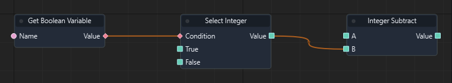

Graph: `templates/games/isometric_snake_3d/graphs/gameplay.json` · Function: **Advance snake** · Node: `n28`.

[Mở hướng dẫn game](games/isometric-snake.md)

### Đọc thêm

[Tài liệu hệ thống: flow-control.md](flow-control.md)

### Select Boolean

ID `2102` · `select` · Workflow `shared`

Chọn giá trị ở True hoặc False theo Condition. Đây là lựa chọn dữ liệu, không điều khiển luồng exec.

### IO

| Chiều | Cổng | Kiểu | Mặc định |
| --- | --- | --- | --- |
| IN | Condition | `bool` | `false` |
| IN | True | `bool` | `false` |
| IN | False | `bool` | `false` |
| OUT | Value | `bool` | — |

Cổng `exec` điều khiển thứ tự. Cổng dữ liệu phải khớp kiểu; `vec2` không tự chuyển sang `vec3`.

### Cách dùng

1. Tìm **Select Boolean** trong Node Library hoặc nhấn Tab trong graph để thêm node.
2. Chọn node, nhập hằng số ở Inspector theo bảng IN. Chuỗi nhập trực tiếp; vector/mảng nhập theo JSON, ví dụ `[1, 0, 0]`. Khai báo biến qua Scene > Scene Variables… trước khi dùng Get/Set Variable.
3. Có thể kéo dây từ OUT dữ liệu vào IN có cùng kiểu; giá trị từ dây thay thế hằng số của cổng.
4. Nối OUT dữ liệu tới node dùng kết quả. Node pure không cần dây exec.
5. Nhấn F5, thử tình huống, kiểm tra Console/Diagnostics; Shift+F5 dừng. Ctrl+S lưu thay đổi graph.

### Đọc thêm

[Tài liệu hệ thống: flow-control.md](flow-control.md)

### Select String

ID `2103` · `select` · Workflow `shared`

Chọn giá trị ở True hoặc False theo Condition. Đây là lựa chọn dữ liệu, không điều khiển luồng exec.

### IO

| Chiều | Cổng | Kiểu | Mặc định |
| --- | --- | --- | --- |
| IN | Condition | `bool` | `false` |
| IN | True | `string` | `""` |
| IN | False | `string` | `""` |
| OUT | Value | `string` | — |

Cổng `exec` điều khiển thứ tự. Cổng dữ liệu phải khớp kiểu; `vec2` không tự chuyển sang `vec3`.

### Cách dùng

1. Tìm **Select String** trong Node Library hoặc nhấn Tab trong graph để thêm node.
2. Chọn node, nhập hằng số ở Inspector theo bảng IN. Chuỗi nhập trực tiếp; vector/mảng nhập theo JSON, ví dụ `[1, 0, 0]`. Khai báo biến qua Scene > Scene Variables… trước khi dùng Get/Set Variable.
3. Có thể kéo dây từ OUT dữ liệu vào IN có cùng kiểu; giá trị từ dây thay thế hằng số của cổng.
4. Nối OUT dữ liệu tới node dùng kết quả. Node pure không cần dây exec.
5. Nhấn F5, thử tình huống, kiểm tra Console/Diagnostics; Shift+F5 dừng. Ctrl+S lưu thay đổi graph.

### Ví dụ từ graph thật

Trích đoạn Refresh HUD của flappy_bird: node n15. Đây là các node và dây nối thật từ graph đã chạy; vị trí được sắp lại để dễ đọc.

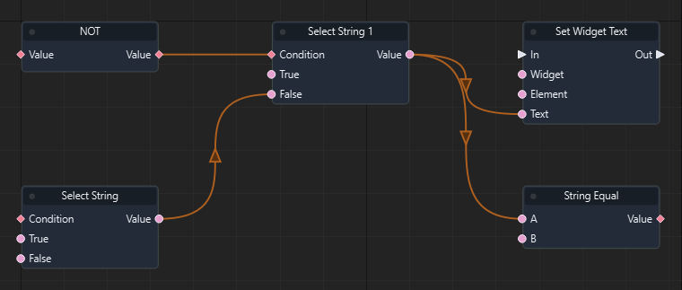

Graph: `templates/games/flappy_bird/graphs/gameplay.json` · Function: **Refresh HUD** · Node: `n15`.

[Mở hướng dẫn game](games/flappy-bird.md)

### Đọc thêm

[Tài liệu hệ thống: flow-control.md](flow-control.md)

### Select Vector3

ID `2104` · `select` · Workflow `shared`

Chọn giá trị ở True hoặc False theo Condition. Đây là lựa chọn dữ liệu, không điều khiển luồng exec.

### IO

| Chiều | Cổng | Kiểu | Mặc định |
| --- | --- | --- | --- |
| IN | Condition | `bool` | `false` |
| IN | True | `vec3` | `[0, 0, 0]` |
| IN | False | `vec3` | `[0, 0, 0]` |
| OUT | Value | `vec3` | — |

Cổng `exec` điều khiển thứ tự. Cổng dữ liệu phải khớp kiểu; `vec2` không tự chuyển sang `vec3`.

### Cách dùng

1. Tìm **Select Vector3** trong Node Library hoặc nhấn Tab trong graph để thêm node.
2. Chọn node, nhập hằng số ở Inspector theo bảng IN. Chuỗi nhập trực tiếp; vector/mảng nhập theo JSON, ví dụ `[1, 0, 0]`. Khai báo biến qua Scene > Scene Variables… trước khi dùng Get/Set Variable.
3. Có thể kéo dây từ OUT dữ liệu vào IN có cùng kiểu; giá trị từ dây thay thế hằng số của cổng.
4. Nối OUT dữ liệu tới node dùng kết quả. Node pure không cần dây exec.
5. Nhấn F5, thử tình huống, kiểm tra Console/Diagnostics; Shift+F5 dừng. Ctrl+S lưu thay đổi graph.

### Đọc thêm

[Tài liệu hệ thống: flow-control.md](flow-control.md)

### Select Entity

ID `2105` · `select` · Workflow `shared`

Chọn giá trị ở True hoặc False theo Condition. Đây là lựa chọn dữ liệu, không điều khiển luồng exec.

### IO

| Chiều | Cổng | Kiểu | Mặc định |
| --- | --- | --- | --- |
| IN | Condition | `bool` | `false` |
| IN | True | `entity` | `""` |
| IN | False | `entity` | `""` |
| OUT | Value | `entity` | — |

Cổng `exec` điều khiển thứ tự. Cổng dữ liệu phải khớp kiểu; `vec2` không tự chuyển sang `vec3`.

### Cách dùng

1. Tìm **Select Entity** trong Node Library hoặc nhấn Tab trong graph để thêm node.
2. Chọn node, nhập hằng số ở Inspector theo bảng IN. Chuỗi nhập trực tiếp; vector/mảng nhập theo JSON, ví dụ `[1, 0, 0]`. Khai báo biến qua Scene > Scene Variables… trước khi dùng Get/Set Variable.
3. Có thể kéo dây từ OUT dữ liệu vào IN có cùng kiểu; giá trị từ dây thay thế hằng số của cổng.
4. Nối OUT dữ liệu tới node dùng kết quả. Node pure không cần dây exec.
5. Nhấn F5, thử tình huống, kiểm tra Console/Diagnostics; Shift+F5 dừng. Ctrl+S lưu thay đổi graph.

### Đọc thêm

[Tài liệu hệ thống: flow-control.md](flow-control.md)

### Select Vector2

ID `2106` · `select` · Workflow `shared`

Chọn giá trị ở True hoặc False theo Condition. Đây là lựa chọn dữ liệu, không điều khiển luồng exec.

### IO

| Chiều | Cổng | Kiểu | Mặc định |
| --- | --- | --- | --- |
| IN | Condition | `bool` | `false` |
| IN | True | `vec2` | `[0, 0]` |
| IN | False | `vec2` | `[0, 0]` |
| OUT | Value | `vec2` | — |

Cổng `exec` điều khiển thứ tự. Cổng dữ liệu phải khớp kiểu; `vec2` không tự chuyển sang `vec3`.

### Cách dùng

1. Tìm **Select Vector2** trong Node Library hoặc nhấn Tab trong graph để thêm node.
2. Chọn node, nhập hằng số ở Inspector theo bảng IN. Chuỗi nhập trực tiếp; vector/mảng nhập theo JSON, ví dụ `[1, 0, 0]`. Khai báo biến qua Scene > Scene Variables… trước khi dùng Get/Set Variable.
3. Có thể kéo dây từ OUT dữ liệu vào IN có cùng kiểu; giá trị từ dây thay thế hằng số của cổng.
4. Nối OUT dữ liệu tới node dùng kết quả. Node pure không cần dây exec.
5. Nhấn F5, thử tình huống, kiểm tra Console/Diagnostics; Shift+F5 dừng. Ctrl+S lưu thay đổi graph.

### Đọc thêm

[Tài liệu hệ thống: flow-control.md](flow-control.md)

### Select Vector4

ID `2107` · `select` · Workflow `shared`

Chọn giá trị ở True hoặc False theo Condition. Đây là lựa chọn dữ liệu, không điều khiển luồng exec.

### IO

| Chiều | Cổng | Kiểu | Mặc định |
| --- | --- | --- | --- |
| IN | Condition | `bool` | `false` |
| IN | True | `vec4` | `[0, 0, 0, 0]` |
| IN | False | `vec4` | `[0, 0, 0, 0]` |
| OUT | Value | `vec4` | — |

Cổng `exec` điều khiển thứ tự. Cổng dữ liệu phải khớp kiểu; `vec2` không tự chuyển sang `vec3`.

### Cách dùng

1. Tìm **Select Vector4** trong Node Library hoặc nhấn Tab trong graph để thêm node.
2. Chọn node, nhập hằng số ở Inspector theo bảng IN. Chuỗi nhập trực tiếp; vector/mảng nhập theo JSON, ví dụ `[1, 0, 0]`. Khai báo biến qua Scene > Scene Variables… trước khi dùng Get/Set Variable.
3. Có thể kéo dây từ OUT dữ liệu vào IN có cùng kiểu; giá trị từ dây thay thế hằng số của cổng.
4. Nối OUT dữ liệu tới node dùng kết quả. Node pure không cần dây exec.
5. Nhấn F5, thử tình huống, kiểm tra Console/Diagnostics; Shift+F5 dừng. Ctrl+S lưu thay đổi graph.

### Đọc thêm

[Tài liệu hệ thống: flow-control.md](flow-control.md)

### Select Quaternion

ID `2108` · `select` · Workflow `shared`

Chọn giá trị ở True hoặc False theo Condition. Đây là lựa chọn dữ liệu, không điều khiển luồng exec.

### IO

| Chiều | Cổng | Kiểu | Mặc định |
| --- | --- | --- | --- |
| IN | Condition | `bool` | `false` |
| IN | True | `quat` | `[0, 0, 0, 1]` |
| IN | False | `quat` | `[0, 0, 0, 1]` |
| OUT | Value | `quat` | — |

Cổng `exec` điều khiển thứ tự. Cổng dữ liệu phải khớp kiểu; `vec2` không tự chuyển sang `vec3`.

### Cách dùng

1. Tìm **Select Quaternion** trong Node Library hoặc nhấn Tab trong graph để thêm node.
2. Chọn node, nhập hằng số ở Inspector theo bảng IN. Chuỗi nhập trực tiếp; vector/mảng nhập theo JSON, ví dụ `[1, 0, 0]`. Khai báo biến qua Scene > Scene Variables… trước khi dùng Get/Set Variable.
3. Có thể kéo dây từ OUT dữ liệu vào IN có cùng kiểu; giá trị từ dây thay thế hằng số của cổng.
4. Nối OUT dữ liệu tới node dùng kết quả. Node pure không cần dây exec.
5. Nhấn F5, thử tình huống, kiểm tra Console/Diagnostics; Shift+F5 dừng. Ctrl+S lưu thay đổi graph.

### Đọc thêm

[Tài liệu hệ thống: flow-control.md](flow-control.md)

### Select Matrix4

ID `2109` · `select` · Workflow `shared`

Chọn giá trị ở True hoặc False theo Condition. Đây là lựa chọn dữ liệu, không điều khiển luồng exec.

### IO

| Chiều | Cổng | Kiểu | Mặc định |
| --- | --- | --- | --- |
| IN | Condition | `bool` | `false` |
| IN | True | `mat4` | `[1, 0, 0, 0, 0, 1, 0, 0, 0, 0, 1, 0, 0, 0, 0, 1]` |
| IN | False | `mat4` | `[1, 0, 0, 0, 0, 1, 0, 0, 0, 0, 1, 0, 0, 0, 0, 1]` |
| OUT | Value | `mat4` | — |

Cổng `exec` điều khiển thứ tự. Cổng dữ liệu phải khớp kiểu; `vec2` không tự chuyển sang `vec3`.

### Cách dùng

1. Tìm **Select Matrix4** trong Node Library hoặc nhấn Tab trong graph để thêm node.
2. Chọn node, nhập hằng số ở Inspector theo bảng IN. Chuỗi nhập trực tiếp; vector/mảng nhập theo JSON, ví dụ `[1, 0, 0]`. Khai báo biến qua Scene > Scene Variables… trước khi dùng Get/Set Variable.
3. Có thể kéo dây từ OUT dữ liệu vào IN có cùng kiểu; giá trị từ dây thay thế hằng số của cổng.
4. Nối OUT dữ liệu tới node dùng kết quả. Node pure không cần dây exec.
5. Nhấn F5, thử tình huống, kiểm tra Console/Diagnostics; Shift+F5 dừng. Ctrl+S lưu thay đổi graph.

### Đọc thêm

[Tài liệu hệ thống: flow-control.md](flow-control.md)

### Select Float Array

ID `2110` · `select` · Workflow `shared`

Chọn giá trị ở True hoặc False theo Condition. Đây là lựa chọn dữ liệu, không điều khiển luồng exec.

### IO

| Chiều | Cổng | Kiểu | Mặc định |
| --- | --- | --- | --- |
| IN | Condition | `bool` | `false` |
| IN | True | `array<float>` | `[]` |
| IN | False | `array<float>` | `[]` |
| OUT | Value | `array<float>` | — |

Cổng `exec` điều khiển thứ tự. Cổng dữ liệu phải khớp kiểu; `vec2` không tự chuyển sang `vec3`.

### Cách dùng

1. Tìm **Select Float Array** trong Node Library hoặc nhấn Tab trong graph để thêm node.
2. Chọn node, nhập hằng số ở Inspector theo bảng IN. Chuỗi nhập trực tiếp; vector/mảng nhập theo JSON, ví dụ `[1, 0, 0]`. Khai báo biến qua Scene > Scene Variables… trước khi dùng Get/Set Variable.
3. Có thể kéo dây từ OUT dữ liệu vào IN có cùng kiểu; giá trị từ dây thay thế hằng số của cổng.
4. Nối OUT dữ liệu tới node dùng kết quả. Node pure không cần dây exec.
5. Nhấn F5, thử tình huống, kiểm tra Console/Diagnostics; Shift+F5 dừng. Ctrl+S lưu thay đổi graph.

### Đọc thêm

[Tài liệu hệ thống: flow-control.md](flow-control.md)

### Select Integer Array

ID `2111` · `select` · Workflow `shared`

Chọn giá trị ở True hoặc False theo Condition. Đây là lựa chọn dữ liệu, không điều khiển luồng exec.

### IO

| Chiều | Cổng | Kiểu | Mặc định |
| --- | --- | --- | --- |
| IN | Condition | `bool` | `false` |
| IN | True | `array<int>` | `[]` |
| IN | False | `array<int>` | `[]` |
| OUT | Value | `array<int>` | — |

Cổng `exec` điều khiển thứ tự. Cổng dữ liệu phải khớp kiểu; `vec2` không tự chuyển sang `vec3`.

### Cách dùng

1. Tìm **Select Integer Array** trong Node Library hoặc nhấn Tab trong graph để thêm node.
2. Chọn node, nhập hằng số ở Inspector theo bảng IN. Chuỗi nhập trực tiếp; vector/mảng nhập theo JSON, ví dụ `[1, 0, 0]`. Khai báo biến qua Scene > Scene Variables… trước khi dùng Get/Set Variable.
3. Có thể kéo dây từ OUT dữ liệu vào IN có cùng kiểu; giá trị từ dây thay thế hằng số của cổng.
4. Nối OUT dữ liệu tới node dùng kết quả. Node pure không cần dây exec.
5. Nhấn F5, thử tình huống, kiểm tra Console/Diagnostics; Shift+F5 dừng. Ctrl+S lưu thay đổi graph.

### Đọc thêm

[Tài liệu hệ thống: flow-control.md](flow-control.md)

### Select Boolean Array

ID `2112` · `select` · Workflow `shared`

Chọn giá trị ở True hoặc False theo Condition. Đây là lựa chọn dữ liệu, không điều khiển luồng exec.

### IO

| Chiều | Cổng | Kiểu | Mặc định |
| --- | --- | --- | --- |
| IN | Condition | `bool` | `false` |
| IN | True | `array<bool>` | `[]` |
| IN | False | `array<bool>` | `[]` |
| OUT | Value | `array<bool>` | — |

Cổng `exec` điều khiển thứ tự. Cổng dữ liệu phải khớp kiểu; `vec2` không tự chuyển sang `vec3`.

### Cách dùng

1. Tìm **Select Boolean Array** trong Node Library hoặc nhấn Tab trong graph để thêm node.
2. Chọn node, nhập hằng số ở Inspector theo bảng IN. Chuỗi nhập trực tiếp; vector/mảng nhập theo JSON, ví dụ `[1, 0, 0]`. Khai báo biến qua Scene > Scene Variables… trước khi dùng Get/Set Variable.
3. Có thể kéo dây từ OUT dữ liệu vào IN có cùng kiểu; giá trị từ dây thay thế hằng số của cổng.
4. Nối OUT dữ liệu tới node dùng kết quả. Node pure không cần dây exec.
5. Nhấn F5, thử tình huống, kiểm tra Console/Diagnostics; Shift+F5 dừng. Ctrl+S lưu thay đổi graph.

### Đọc thêm

[Tài liệu hệ thống: flow-control.md](flow-control.md)

### Select String Array

ID `2113` · `select` · Workflow `shared`

Chọn giá trị ở True hoặc False theo Condition. Đây là lựa chọn dữ liệu, không điều khiển luồng exec.

### IO

| Chiều | Cổng | Kiểu | Mặc định |
| --- | --- | --- | --- |
| IN | Condition | `bool` | `false` |
| IN | True | `array<string>` | `[]` |
| IN | False | `array<string>` | `[]` |
| OUT | Value | `array<string>` | — |

Cổng `exec` điều khiển thứ tự. Cổng dữ liệu phải khớp kiểu; `vec2` không tự chuyển sang `vec3`.

### Cách dùng

1. Tìm **Select String Array** trong Node Library hoặc nhấn Tab trong graph để thêm node.
2. Chọn node, nhập hằng số ở Inspector theo bảng IN. Chuỗi nhập trực tiếp; vector/mảng nhập theo JSON, ví dụ `[1, 0, 0]`. Khai báo biến qua Scene > Scene Variables… trước khi dùng Get/Set Variable.
3. Có thể kéo dây từ OUT dữ liệu vào IN có cùng kiểu; giá trị từ dây thay thế hằng số của cổng.
4. Nối OUT dữ liệu tới node dùng kết quả. Node pure không cần dây exec.
5. Nhấn F5, thử tình huống, kiểm tra Console/Diagnostics; Shift+F5 dừng. Ctrl+S lưu thay đổi graph.

### Đọc thêm

[Tài liệu hệ thống: flow-control.md](flow-control.md)

### Select Vector3 Array

ID `2114` · `select` · Workflow `shared`

Chọn giá trị ở True hoặc False theo Condition. Đây là lựa chọn dữ liệu, không điều khiển luồng exec.

### IO

| Chiều | Cổng | Kiểu | Mặc định |
| --- | --- | --- | --- |
| IN | Condition | `bool` | `false` |
| IN | True | `array<vec3>` | `[]` |
| IN | False | `array<vec3>` | `[]` |
| OUT | Value | `array<vec3>` | — |

Cổng `exec` điều khiển thứ tự. Cổng dữ liệu phải khớp kiểu; `vec2` không tự chuyển sang `vec3`.

### Cách dùng

1. Tìm **Select Vector3 Array** trong Node Library hoặc nhấn Tab trong graph để thêm node.
2. Chọn node, nhập hằng số ở Inspector theo bảng IN. Chuỗi nhập trực tiếp; vector/mảng nhập theo JSON, ví dụ `[1, 0, 0]`. Khai báo biến qua Scene > Scene Variables… trước khi dùng Get/Set Variable.
3. Có thể kéo dây từ OUT dữ liệu vào IN có cùng kiểu; giá trị từ dây thay thế hằng số của cổng.
4. Nối OUT dữ liệu tới node dùng kết quả. Node pure không cần dây exec.
5. Nhấn F5, thử tình huống, kiểm tra Console/Diagnostics; Shift+F5 dừng. Ctrl+S lưu thay đổi graph.

### Đọc thêm

[Tài liệu hệ thống: flow-control.md](flow-control.md)

### Select Entity Array

ID `2115` · `select` · Workflow `shared`

Chọn giá trị ở True hoặc False theo Condition. Đây là lựa chọn dữ liệu, không điều khiển luồng exec.

### IO

| Chiều | Cổng | Kiểu | Mặc định |
| --- | --- | --- | --- |
| IN | Condition | `bool` | `false` |
| IN | True | `array<entity>` | `[]` |
| IN | False | `array<entity>` | `[]` |
| OUT | Value | `array<entity>` | — |

Cổng `exec` điều khiển thứ tự. Cổng dữ liệu phải khớp kiểu; `vec2` không tự chuyển sang `vec3`.

### Cách dùng

1. Tìm **Select Entity Array** trong Node Library hoặc nhấn Tab trong graph để thêm node.
2. Chọn node, nhập hằng số ở Inspector theo bảng IN. Chuỗi nhập trực tiếp; vector/mảng nhập theo JSON, ví dụ `[1, 0, 0]`. Khai báo biến qua Scene > Scene Variables… trước khi dùng Get/Set Variable.
3. Có thể kéo dây từ OUT dữ liệu vào IN có cùng kiểu; giá trị từ dây thay thế hằng số của cổng.
4. Nối OUT dữ liệu tới node dùng kết quả. Node pure không cần dây exec.
5. Nhấn F5, thử tình huống, kiểm tra Console/Diagnostics; Shift+F5 dừng. Ctrl+S lưu thay đổi graph.

### Đọc thêm

[Tài liệu hệ thống: flow-control.md](flow-control.md)

### Select Vector2 Array

ID `2116` · `select` · Workflow `shared`

Chọn giá trị ở True hoặc False theo Condition. Đây là lựa chọn dữ liệu, không điều khiển luồng exec.

### IO

| Chiều | Cổng | Kiểu | Mặc định |
| --- | --- | --- | --- |
| IN | Condition | `bool` | `false` |
| IN | True | `array<vec2>` | `[]` |
| IN | False | `array<vec2>` | `[]` |
| OUT | Value | `array<vec2>` | — |

Cổng `exec` điều khiển thứ tự. Cổng dữ liệu phải khớp kiểu; `vec2` không tự chuyển sang `vec3`.

### Cách dùng

1. Tìm **Select Vector2 Array** trong Node Library hoặc nhấn Tab trong graph để thêm node.
2. Chọn node, nhập hằng số ở Inspector theo bảng IN. Chuỗi nhập trực tiếp; vector/mảng nhập theo JSON, ví dụ `[1, 0, 0]`. Khai báo biến qua Scene > Scene Variables… trước khi dùng Get/Set Variable.
3. Có thể kéo dây từ OUT dữ liệu vào IN có cùng kiểu; giá trị từ dây thay thế hằng số của cổng.
4. Nối OUT dữ liệu tới node dùng kết quả. Node pure không cần dây exec.
5. Nhấn F5, thử tình huống, kiểm tra Console/Diagnostics; Shift+F5 dừng. Ctrl+S lưu thay đổi graph.

### Đọc thêm

[Tài liệu hệ thống: flow-control.md](flow-control.md)

### Select Vector4 Array

ID `2117` · `select` · Workflow `shared`

Chọn giá trị ở True hoặc False theo Condition. Đây là lựa chọn dữ liệu, không điều khiển luồng exec.

### IO

| Chiều | Cổng | Kiểu | Mặc định |
| --- | --- | --- | --- |
| IN | Condition | `bool` | `false` |
| IN | True | `array<vec4>` | `[]` |
| IN | False | `array<vec4>` | `[]` |
| OUT | Value | `array<vec4>` | — |

Cổng `exec` điều khiển thứ tự. Cổng dữ liệu phải khớp kiểu; `vec2` không tự chuyển sang `vec3`.

### Cách dùng

1. Tìm **Select Vector4 Array** trong Node Library hoặc nhấn Tab trong graph để thêm node.
2. Chọn node, nhập hằng số ở Inspector theo bảng IN. Chuỗi nhập trực tiếp; vector/mảng nhập theo JSON, ví dụ `[1, 0, 0]`. Khai báo biến qua Scene > Scene Variables… trước khi dùng Get/Set Variable.
3. Có thể kéo dây từ OUT dữ liệu vào IN có cùng kiểu; giá trị từ dây thay thế hằng số của cổng.
4. Nối OUT dữ liệu tới node dùng kết quả. Node pure không cần dây exec.
5. Nhấn F5, thử tình huống, kiểm tra Console/Diagnostics; Shift+F5 dừng. Ctrl+S lưu thay đổi graph.

### Đọc thêm

[Tài liệu hệ thống: flow-control.md](flow-control.md)

### Select Quaternion Array

ID `2118` · `select` · Workflow `shared`

Chọn giá trị ở True hoặc False theo Condition. Đây là lựa chọn dữ liệu, không điều khiển luồng exec.

### IO

| Chiều | Cổng | Kiểu | Mặc định |
| --- | --- | --- | --- |
| IN | Condition | `bool` | `false` |
| IN | True | `array<quat>` | `[]` |
| IN | False | `array<quat>` | `[]` |
| OUT | Value | `array<quat>` | — |

Cổng `exec` điều khiển thứ tự. Cổng dữ liệu phải khớp kiểu; `vec2` không tự chuyển sang `vec3`.

### Cách dùng

1. Tìm **Select Quaternion Array** trong Node Library hoặc nhấn Tab trong graph để thêm node.
2. Chọn node, nhập hằng số ở Inspector theo bảng IN. Chuỗi nhập trực tiếp; vector/mảng nhập theo JSON, ví dụ `[1, 0, 0]`. Khai báo biến qua Scene > Scene Variables… trước khi dùng Get/Set Variable.
3. Có thể kéo dây từ OUT dữ liệu vào IN có cùng kiểu; giá trị từ dây thay thế hằng số của cổng.
4. Nối OUT dữ liệu tới node dùng kết quả. Node pure không cần dây exec.
5. Nhấn F5, thử tình huống, kiểm tra Console/Diagnostics; Shift+F5 dừng. Ctrl+S lưu thay đổi graph.

### Đọc thêm

[Tài liệu hệ thống: flow-control.md](flow-control.md)

### Select Matrix4 Array

ID `2119` · `select` · Workflow `shared`

Chọn giá trị ở True hoặc False theo Condition. Đây là lựa chọn dữ liệu, không điều khiển luồng exec.

### IO

| Chiều | Cổng | Kiểu | Mặc định |
| --- | --- | --- | --- |
| IN | Condition | `bool` | `false` |
| IN | True | `array<mat4>` | `[]` |
| IN | False | `array<mat4>` | `[]` |
| OUT | Value | `array<mat4>` | — |

Cổng `exec` điều khiển thứ tự. Cổng dữ liệu phải khớp kiểu; `vec2` không tự chuyển sang `vec3`.

### Cách dùng

1. Tìm **Select Matrix4 Array** trong Node Library hoặc nhấn Tab trong graph để thêm node.
2. Chọn node, nhập hằng số ở Inspector theo bảng IN. Chuỗi nhập trực tiếp; vector/mảng nhập theo JSON, ví dụ `[1, 0, 0]`. Khai báo biến qua Scene > Scene Variables… trước khi dùng Get/Set Variable.
3. Có thể kéo dây từ OUT dữ liệu vào IN có cùng kiểu; giá trị từ dây thay thế hằng số của cổng.
4. Nối OUT dữ liệu tới node dùng kết quả. Node pure không cần dây exec.
5. Nhấn F5, thử tình huống, kiểm tra Console/Diagnostics; Shift+F5 dừng. Ctrl+S lưu thay đổi graph.

### Đọc thêm

[Tài liệu hệ thống: flow-control.md](flow-control.md)

### Select Float Map

ID `2120` · `select` · Workflow `shared`

Chọn giá trị ở True hoặc False theo Condition. Đây là lựa chọn dữ liệu, không điều khiển luồng exec.

### IO

| Chiều | Cổng | Kiểu | Mặc định |
| --- | --- | --- | --- |
| IN | Condition | `bool` | `false` |
| IN | True | `map<float>` | `{}` |
| IN | False | `map<float>` | `{}` |
| OUT | Value | `map<float>` | — |

Cổng `exec` điều khiển thứ tự. Cổng dữ liệu phải khớp kiểu; `vec2` không tự chuyển sang `vec3`.

### Cách dùng

1. Tìm **Select Float Map** trong Node Library hoặc nhấn Tab trong graph để thêm node.
2. Chọn node, nhập hằng số ở Inspector theo bảng IN. Chuỗi nhập trực tiếp; vector/mảng nhập theo JSON, ví dụ `[1, 0, 0]`. Khai báo biến qua Scene > Scene Variables… trước khi dùng Get/Set Variable.
3. Có thể kéo dây từ OUT dữ liệu vào IN có cùng kiểu; giá trị từ dây thay thế hằng số của cổng.
4. Nối OUT dữ liệu tới node dùng kết quả. Node pure không cần dây exec.
5. Nhấn F5, thử tình huống, kiểm tra Console/Diagnostics; Shift+F5 dừng. Ctrl+S lưu thay đổi graph.

### Đọc thêm

[Tài liệu hệ thống: flow-control.md](flow-control.md)

### Select Integer Map

ID `2121` · `select` · Workflow `shared`

Chọn giá trị ở True hoặc False theo Condition. Đây là lựa chọn dữ liệu, không điều khiển luồng exec.

### IO

| Chiều | Cổng | Kiểu | Mặc định |
| --- | --- | --- | --- |
| IN | Condition | `bool` | `false` |
| IN | True | `map<int>` | `{}` |
| IN | False | `map<int>` | `{}` |
| OUT | Value | `map<int>` | — |

Cổng `exec` điều khiển thứ tự. Cổng dữ liệu phải khớp kiểu; `vec2` không tự chuyển sang `vec3`.

### Cách dùng

1. Tìm **Select Integer Map** trong Node Library hoặc nhấn Tab trong graph để thêm node.
2. Chọn node, nhập hằng số ở Inspector theo bảng IN. Chuỗi nhập trực tiếp; vector/mảng nhập theo JSON, ví dụ `[1, 0, 0]`. Khai báo biến qua Scene > Scene Variables… trước khi dùng Get/Set Variable.
3. Có thể kéo dây từ OUT dữ liệu vào IN có cùng kiểu; giá trị từ dây thay thế hằng số của cổng.
4. Nối OUT dữ liệu tới node dùng kết quả. Node pure không cần dây exec.
5. Nhấn F5, thử tình huống, kiểm tra Console/Diagnostics; Shift+F5 dừng. Ctrl+S lưu thay đổi graph.

### Đọc thêm

[Tài liệu hệ thống: flow-control.md](flow-control.md)

### Select Boolean Map

ID `2122` · `select` · Workflow `shared`

Chọn giá trị ở True hoặc False theo Condition. Đây là lựa chọn dữ liệu, không điều khiển luồng exec.

### IO

| Chiều | Cổng | Kiểu | Mặc định |
| --- | --- | --- | --- |
| IN | Condition | `bool` | `false` |
| IN | True | `map<bool>` | `{}` |
| IN | False | `map<bool>` | `{}` |
| OUT | Value | `map<bool>` | — |

Cổng `exec` điều khiển thứ tự. Cổng dữ liệu phải khớp kiểu; `vec2` không tự chuyển sang `vec3`.

### Cách dùng

1. Tìm **Select Boolean Map** trong Node Library hoặc nhấn Tab trong graph để thêm node.
2. Chọn node, nhập hằng số ở Inspector theo bảng IN. Chuỗi nhập trực tiếp; vector/mảng nhập theo JSON, ví dụ `[1, 0, 0]`. Khai báo biến qua Scene > Scene Variables… trước khi dùng Get/Set Variable.
3. Có thể kéo dây từ OUT dữ liệu vào IN có cùng kiểu; giá trị từ dây thay thế hằng số của cổng.
4. Nối OUT dữ liệu tới node dùng kết quả. Node pure không cần dây exec.
5. Nhấn F5, thử tình huống, kiểm tra Console/Diagnostics; Shift+F5 dừng. Ctrl+S lưu thay đổi graph.

### Đọc thêm

[Tài liệu hệ thống: flow-control.md](flow-control.md)

### Select String Map

ID `2123` · `select` · Workflow `shared`

Chọn giá trị ở True hoặc False theo Condition. Đây là lựa chọn dữ liệu, không điều khiển luồng exec.

### IO

| Chiều | Cổng | Kiểu | Mặc định |
| --- | --- | --- | --- |
| IN | Condition | `bool` | `false` |
| IN | True | `map<string>` | `{}` |
| IN | False | `map<string>` | `{}` |
| OUT | Value | `map<string>` | — |

Cổng `exec` điều khiển thứ tự. Cổng dữ liệu phải khớp kiểu; `vec2` không tự chuyển sang `vec3`.

### Cách dùng

1. Tìm **Select String Map** trong Node Library hoặc nhấn Tab trong graph để thêm node.
2. Chọn node, nhập hằng số ở Inspector theo bảng IN. Chuỗi nhập trực tiếp; vector/mảng nhập theo JSON, ví dụ `[1, 0, 0]`. Khai báo biến qua Scene > Scene Variables… trước khi dùng Get/Set Variable.
3. Có thể kéo dây từ OUT dữ liệu vào IN có cùng kiểu; giá trị từ dây thay thế hằng số của cổng.
4. Nối OUT dữ liệu tới node dùng kết quả. Node pure không cần dây exec.
5. Nhấn F5, thử tình huống, kiểm tra Console/Diagnostics; Shift+F5 dừng. Ctrl+S lưu thay đổi graph.

### Đọc thêm

[Tài liệu hệ thống: flow-control.md](flow-control.md)

### Select Vector3 Map

ID `2124` · `select` · Workflow `shared`

Chọn giá trị ở True hoặc False theo Condition. Đây là lựa chọn dữ liệu, không điều khiển luồng exec.

### IO

| Chiều | Cổng | Kiểu | Mặc định |
| --- | --- | --- | --- |
| IN | Condition | `bool` | `false` |
| IN | True | `map<vec3>` | `{}` |
| IN | False | `map<vec3>` | `{}` |
| OUT | Value | `map<vec3>` | — |

Cổng `exec` điều khiển thứ tự. Cổng dữ liệu phải khớp kiểu; `vec2` không tự chuyển sang `vec3`.

### Cách dùng

1. Tìm **Select Vector3 Map** trong Node Library hoặc nhấn Tab trong graph để thêm node.
2. Chọn node, nhập hằng số ở Inspector theo bảng IN. Chuỗi nhập trực tiếp; vector/mảng nhập theo JSON, ví dụ `[1, 0, 0]`. Khai báo biến qua Scene > Scene Variables… trước khi dùng Get/Set Variable.
3. Có thể kéo dây từ OUT dữ liệu vào IN có cùng kiểu; giá trị từ dây thay thế hằng số của cổng.
4. Nối OUT dữ liệu tới node dùng kết quả. Node pure không cần dây exec.
5. Nhấn F5, thử tình huống, kiểm tra Console/Diagnostics; Shift+F5 dừng. Ctrl+S lưu thay đổi graph.

### Đọc thêm

[Tài liệu hệ thống: flow-control.md](flow-control.md)

### Select Entity Map

ID `2125` · `select` · Workflow `shared`

Chọn giá trị ở True hoặc False theo Condition. Đây là lựa chọn dữ liệu, không điều khiển luồng exec.

### IO

| Chiều | Cổng | Kiểu | Mặc định |
| --- | --- | --- | --- |
| IN | Condition | `bool` | `false` |
| IN | True | `map<entity>` | `{}` |
| IN | False | `map<entity>` | `{}` |
| OUT | Value | `map<entity>` | — |

Cổng `exec` điều khiển thứ tự. Cổng dữ liệu phải khớp kiểu; `vec2` không tự chuyển sang `vec3`.

### Cách dùng

1. Tìm **Select Entity Map** trong Node Library hoặc nhấn Tab trong graph để thêm node.
2. Chọn node, nhập hằng số ở Inspector theo bảng IN. Chuỗi nhập trực tiếp; vector/mảng nhập theo JSON, ví dụ `[1, 0, 0]`. Khai báo biến qua Scene > Scene Variables… trước khi dùng Get/Set Variable.
3. Có thể kéo dây từ OUT dữ liệu vào IN có cùng kiểu; giá trị từ dây thay thế hằng số của cổng.
4. Nối OUT dữ liệu tới node dùng kết quả. Node pure không cần dây exec.
5. Nhấn F5, thử tình huống, kiểm tra Console/Diagnostics; Shift+F5 dừng. Ctrl+S lưu thay đổi graph.

### Đọc thêm

[Tài liệu hệ thống: flow-control.md](flow-control.md)

### Select Vector2 Map

ID `2126` · `select` · Workflow `shared`

Chọn giá trị ở True hoặc False theo Condition. Đây là lựa chọn dữ liệu, không điều khiển luồng exec.

### IO

| Chiều | Cổng | Kiểu | Mặc định |
| --- | --- | --- | --- |
| IN | Condition | `bool` | `false` |
| IN | True | `map<vec2>` | `{}` |
| IN | False | `map<vec2>` | `{}` |
| OUT | Value | `map<vec2>` | — |

Cổng `exec` điều khiển thứ tự. Cổng dữ liệu phải khớp kiểu; `vec2` không tự chuyển sang `vec3`.

### Cách dùng

1. Tìm **Select Vector2 Map** trong Node Library hoặc nhấn Tab trong graph để thêm node.
2. Chọn node, nhập hằng số ở Inspector theo bảng IN. Chuỗi nhập trực tiếp; vector/mảng nhập theo JSON, ví dụ `[1, 0, 0]`. Khai báo biến qua Scene > Scene Variables… trước khi dùng Get/Set Variable.
3. Có thể kéo dây từ OUT dữ liệu vào IN có cùng kiểu; giá trị từ dây thay thế hằng số của cổng.
4. Nối OUT dữ liệu tới node dùng kết quả. Node pure không cần dây exec.
5. Nhấn F5, thử tình huống, kiểm tra Console/Diagnostics; Shift+F5 dừng. Ctrl+S lưu thay đổi graph.

### Đọc thêm

[Tài liệu hệ thống: flow-control.md](flow-control.md)

### Select Vector4 Map

ID `2127` · `select` · Workflow `shared`

Chọn giá trị ở True hoặc False theo Condition. Đây là lựa chọn dữ liệu, không điều khiển luồng exec.

### IO

| Chiều | Cổng | Kiểu | Mặc định |
| --- | --- | --- | --- |
| IN | Condition | `bool` | `false` |
| IN | True | `map<vec4>` | `{}` |
| IN | False | `map<vec4>` | `{}` |
| OUT | Value | `map<vec4>` | — |

Cổng `exec` điều khiển thứ tự. Cổng dữ liệu phải khớp kiểu; `vec2` không tự chuyển sang `vec3`.

### Cách dùng

1. Tìm **Select Vector4 Map** trong Node Library hoặc nhấn Tab trong graph để thêm node.
2. Chọn node, nhập hằng số ở Inspector theo bảng IN. Chuỗi nhập trực tiếp; vector/mảng nhập theo JSON, ví dụ `[1, 0, 0]`. Khai báo biến qua Scene > Scene Variables… trước khi dùng Get/Set Variable.
3. Có thể kéo dây từ OUT dữ liệu vào IN có cùng kiểu; giá trị từ dây thay thế hằng số của cổng.
4. Nối OUT dữ liệu tới node dùng kết quả. Node pure không cần dây exec.
5. Nhấn F5, thử tình huống, kiểm tra Console/Diagnostics; Shift+F5 dừng. Ctrl+S lưu thay đổi graph.

### Đọc thêm

[Tài liệu hệ thống: flow-control.md](flow-control.md)

### Select Quaternion Map

ID `2128` · `select` · Workflow `shared`

Chọn giá trị ở True hoặc False theo Condition. Đây là lựa chọn dữ liệu, không điều khiển luồng exec.

### IO

| Chiều | Cổng | Kiểu | Mặc định |
| --- | --- | --- | --- |
| IN | Condition | `bool` | `false` |
| IN | True | `map<quat>` | `{}` |
| IN | False | `map<quat>` | `{}` |
| OUT | Value | `map<quat>` | — |

Cổng `exec` điều khiển thứ tự. Cổng dữ liệu phải khớp kiểu; `vec2` không tự chuyển sang `vec3`.

### Cách dùng

1. Tìm **Select Quaternion Map** trong Node Library hoặc nhấn Tab trong graph để thêm node.
2. Chọn node, nhập hằng số ở Inspector theo bảng IN. Chuỗi nhập trực tiếp; vector/mảng nhập theo JSON, ví dụ `[1, 0, 0]`. Khai báo biến qua Scene > Scene Variables… trước khi dùng Get/Set Variable.
3. Có thể kéo dây từ OUT dữ liệu vào IN có cùng kiểu; giá trị từ dây thay thế hằng số của cổng.
4. Nối OUT dữ liệu tới node dùng kết quả. Node pure không cần dây exec.
5. Nhấn F5, thử tình huống, kiểm tra Console/Diagnostics; Shift+F5 dừng. Ctrl+S lưu thay đổi graph.

### Đọc thêm

[Tài liệu hệ thống: flow-control.md](flow-control.md)

### Select Matrix4 Map

ID `2129` · `select` · Workflow `shared`

Chọn giá trị ở True hoặc False theo Condition. Đây là lựa chọn dữ liệu, không điều khiển luồng exec.

### IO

| Chiều | Cổng | Kiểu | Mặc định |
| --- | --- | --- | --- |
| IN | Condition | `bool` | `false` |
| IN | True | `map<mat4>` | `{}` |
| IN | False | `map<mat4>` | `{}` |
| OUT | Value | `map<mat4>` | — |

Cổng `exec` điều khiển thứ tự. Cổng dữ liệu phải khớp kiểu; `vec2` không tự chuyển sang `vec3`.

### Cách dùng

1. Tìm **Select Matrix4 Map** trong Node Library hoặc nhấn Tab trong graph để thêm node.
2. Chọn node, nhập hằng số ở Inspector theo bảng IN. Chuỗi nhập trực tiếp; vector/mảng nhập theo JSON, ví dụ `[1, 0, 0]`. Khai báo biến qua Scene > Scene Variables… trước khi dùng Get/Set Variable.
3. Có thể kéo dây từ OUT dữ liệu vào IN có cùng kiểu; giá trị từ dây thay thế hằng số của cổng.
4. Nối OUT dữ liệu tới node dùng kết quả. Node pure không cần dây exec.
5. Nhấn F5, thử tình huống, kiểm tra Console/Diagnostics; Shift+F5 dừng. Ctrl+S lưu thay đổi graph.

### Đọc thêm

[Tài liệu hệ thống: flow-control.md](flow-control.md)

### Select Float Set

ID `2130` · `select` · Workflow `shared`

Chọn giá trị ở True hoặc False theo Condition. Đây là lựa chọn dữ liệu, không điều khiển luồng exec.

### IO

| Chiều | Cổng | Kiểu | Mặc định |
| --- | --- | --- | --- |
| IN | Condition | `bool` | `false` |
| IN | True | `set<float>` | `[]` |
| IN | False | `set<float>` | `[]` |
| OUT | Value | `set<float>` | — |

Cổng `exec` điều khiển thứ tự. Cổng dữ liệu phải khớp kiểu; `vec2` không tự chuyển sang `vec3`.

### Cách dùng

1. Tìm **Select Float Set** trong Node Library hoặc nhấn Tab trong graph để thêm node.
2. Chọn node, nhập hằng số ở Inspector theo bảng IN. Chuỗi nhập trực tiếp; vector/mảng nhập theo JSON, ví dụ `[1, 0, 0]`. Khai báo biến qua Scene > Scene Variables… trước khi dùng Get/Set Variable.
3. Có thể kéo dây từ OUT dữ liệu vào IN có cùng kiểu; giá trị từ dây thay thế hằng số của cổng.
4. Nối OUT dữ liệu tới node dùng kết quả. Node pure không cần dây exec.
5. Nhấn F5, thử tình huống, kiểm tra Console/Diagnostics; Shift+F5 dừng. Ctrl+S lưu thay đổi graph.

### Đọc thêm

[Tài liệu hệ thống: flow-control.md](flow-control.md)

### Select Integer Set

ID `2131` · `select` · Workflow `shared`

Chọn giá trị ở True hoặc False theo Condition. Đây là lựa chọn dữ liệu, không điều khiển luồng exec.

### IO

| Chiều | Cổng | Kiểu | Mặc định |
| --- | --- | --- | --- |
| IN | Condition | `bool` | `false` |
| IN | True | `set<int>` | `[]` |
| IN | False | `set<int>` | `[]` |
| OUT | Value | `set<int>` | — |

Cổng `exec` điều khiển thứ tự. Cổng dữ liệu phải khớp kiểu; `vec2` không tự chuyển sang `vec3`.

### Cách dùng

1. Tìm **Select Integer Set** trong Node Library hoặc nhấn Tab trong graph để thêm node.
2. Chọn node, nhập hằng số ở Inspector theo bảng IN. Chuỗi nhập trực tiếp; vector/mảng nhập theo JSON, ví dụ `[1, 0, 0]`. Khai báo biến qua Scene > Scene Variables… trước khi dùng Get/Set Variable.
3. Có thể kéo dây từ OUT dữ liệu vào IN có cùng kiểu; giá trị từ dây thay thế hằng số của cổng.
4. Nối OUT dữ liệu tới node dùng kết quả. Node pure không cần dây exec.
5. Nhấn F5, thử tình huống, kiểm tra Console/Diagnostics; Shift+F5 dừng. Ctrl+S lưu thay đổi graph.

### Đọc thêm

[Tài liệu hệ thống: flow-control.md](flow-control.md)

### Select Boolean Set

ID `2132` · `select` · Workflow `shared`

Chọn giá trị ở True hoặc False theo Condition. Đây là lựa chọn dữ liệu, không điều khiển luồng exec.

### IO

| Chiều | Cổng | Kiểu | Mặc định |
| --- | --- | --- | --- |
| IN | Condition | `bool` | `false` |
| IN | True | `set<bool>` | `[]` |
| IN | False | `set<bool>` | `[]` |
| OUT | Value | `set<bool>` | — |

Cổng `exec` điều khiển thứ tự. Cổng dữ liệu phải khớp kiểu; `vec2` không tự chuyển sang `vec3`.

### Cách dùng

1. Tìm **Select Boolean Set** trong Node Library hoặc nhấn Tab trong graph để thêm node.
2. Chọn node, nhập hằng số ở Inspector theo bảng IN. Chuỗi nhập trực tiếp; vector/mảng nhập theo JSON, ví dụ `[1, 0, 0]`. Khai báo biến qua Scene > Scene Variables… trước khi dùng Get/Set Variable.
3. Có thể kéo dây từ OUT dữ liệu vào IN có cùng kiểu; giá trị từ dây thay thế hằng số của cổng.
4. Nối OUT dữ liệu tới node dùng kết quả. Node pure không cần dây exec.
5. Nhấn F5, thử tình huống, kiểm tra Console/Diagnostics; Shift+F5 dừng. Ctrl+S lưu thay đổi graph.

### Đọc thêm

[Tài liệu hệ thống: flow-control.md](flow-control.md)

### Select String Set

ID `2133` · `select` · Workflow `shared`

Chọn giá trị ở True hoặc False theo Condition. Đây là lựa chọn dữ liệu, không điều khiển luồng exec.

### IO

| Chiều | Cổng | Kiểu | Mặc định |
| --- | --- | --- | --- |
| IN | Condition | `bool` | `false` |
| IN | True | `set<string>` | `[]` |
| IN | False | `set<string>` | `[]` |
| OUT | Value | `set<string>` | — |

Cổng `exec` điều khiển thứ tự. Cổng dữ liệu phải khớp kiểu; `vec2` không tự chuyển sang `vec3`.

### Cách dùng

1. Tìm **Select String Set** trong Node Library hoặc nhấn Tab trong graph để thêm node.
2. Chọn node, nhập hằng số ở Inspector theo bảng IN. Chuỗi nhập trực tiếp; vector/mảng nhập theo JSON, ví dụ `[1, 0, 0]`. Khai báo biến qua Scene > Scene Variables… trước khi dùng Get/Set Variable.
3. Có thể kéo dây từ OUT dữ liệu vào IN có cùng kiểu; giá trị từ dây thay thế hằng số của cổng.
4. Nối OUT dữ liệu tới node dùng kết quả. Node pure không cần dây exec.
5. Nhấn F5, thử tình huống, kiểm tra Console/Diagnostics; Shift+F5 dừng. Ctrl+S lưu thay đổi graph.

### Đọc thêm

[Tài liệu hệ thống: flow-control.md](flow-control.md)

### Select Vector3 Set

ID `2134` · `select` · Workflow `shared`

Chọn giá trị ở True hoặc False theo Condition. Đây là lựa chọn dữ liệu, không điều khiển luồng exec.

### IO

| Chiều | Cổng | Kiểu | Mặc định |
| --- | --- | --- | --- |
| IN | Condition | `bool` | `false` |
| IN | True | `set<vec3>` | `[]` |
| IN | False | `set<vec3>` | `[]` |
| OUT | Value | `set<vec3>` | — |

Cổng `exec` điều khiển thứ tự. Cổng dữ liệu phải khớp kiểu; `vec2` không tự chuyển sang `vec3`.

### Cách dùng

1. Tìm **Select Vector3 Set** trong Node Library hoặc nhấn Tab trong graph để thêm node.
2. Chọn node, nhập hằng số ở Inspector theo bảng IN. Chuỗi nhập trực tiếp; vector/mảng nhập theo JSON, ví dụ `[1, 0, 0]`. Khai báo biến qua Scene > Scene Variables… trước khi dùng Get/Set Variable.
3. Có thể kéo dây từ OUT dữ liệu vào IN có cùng kiểu; giá trị từ dây thay thế hằng số của cổng.
4. Nối OUT dữ liệu tới node dùng kết quả. Node pure không cần dây exec.
5. Nhấn F5, thử tình huống, kiểm tra Console/Diagnostics; Shift+F5 dừng. Ctrl+S lưu thay đổi graph.

### Đọc thêm

[Tài liệu hệ thống: flow-control.md](flow-control.md)

### Select Entity Set

ID `2135` · `select` · Workflow `shared`

Chọn giá trị ở True hoặc False theo Condition. Đây là lựa chọn dữ liệu, không điều khiển luồng exec.

### IO

| Chiều | Cổng | Kiểu | Mặc định |
| --- | --- | --- | --- |
| IN | Condition | `bool` | `false` |
| IN | True | `set<entity>` | `[]` |
| IN | False | `set<entity>` | `[]` |
| OUT | Value | `set<entity>` | — |

Cổng `exec` điều khiển thứ tự. Cổng dữ liệu phải khớp kiểu; `vec2` không tự chuyển sang `vec3`.

### Cách dùng

1. Tìm **Select Entity Set** trong Node Library hoặc nhấn Tab trong graph để thêm node.
2. Chọn node, nhập hằng số ở Inspector theo bảng IN. Chuỗi nhập trực tiếp; vector/mảng nhập theo JSON, ví dụ `[1, 0, 0]`. Khai báo biến qua Scene > Scene Variables… trước khi dùng Get/Set Variable.
3. Có thể kéo dây từ OUT dữ liệu vào IN có cùng kiểu; giá trị từ dây thay thế hằng số của cổng.
4. Nối OUT dữ liệu tới node dùng kết quả. Node pure không cần dây exec.
5. Nhấn F5, thử tình huống, kiểm tra Console/Diagnostics; Shift+F5 dừng. Ctrl+S lưu thay đổi graph.

### Đọc thêm

[Tài liệu hệ thống: flow-control.md](flow-control.md)

### Select Vector2 Set

ID `2136` · `select` · Workflow `shared`

Chọn giá trị ở True hoặc False theo Condition. Đây là lựa chọn dữ liệu, không điều khiển luồng exec.

### IO

| Chiều | Cổng | Kiểu | Mặc định |
| --- | --- | --- | --- |
| IN | Condition | `bool` | `false` |
| IN | True | `set<vec2>` | `[]` |
| IN | False | `set<vec2>` | `[]` |
| OUT | Value | `set<vec2>` | — |

Cổng `exec` điều khiển thứ tự. Cổng dữ liệu phải khớp kiểu; `vec2` không tự chuyển sang `vec3`.

### Cách dùng

1. Tìm **Select Vector2 Set** trong Node Library hoặc nhấn Tab trong graph để thêm node.
2. Chọn node, nhập hằng số ở Inspector theo bảng IN. Chuỗi nhập trực tiếp; vector/mảng nhập theo JSON, ví dụ `[1, 0, 0]`. Khai báo biến qua Scene > Scene Variables… trước khi dùng Get/Set Variable.
3. Có thể kéo dây từ OUT dữ liệu vào IN có cùng kiểu; giá trị từ dây thay thế hằng số của cổng.
4. Nối OUT dữ liệu tới node dùng kết quả. Node pure không cần dây exec.
5. Nhấn F5, thử tình huống, kiểm tra Console/Diagnostics; Shift+F5 dừng. Ctrl+S lưu thay đổi graph.

### Đọc thêm

[Tài liệu hệ thống: flow-control.md](flow-control.md)

### Select Vector4 Set

ID `2137` · `select` · Workflow `shared`

Chọn giá trị ở True hoặc False theo Condition. Đây là lựa chọn dữ liệu, không điều khiển luồng exec.

### IO

| Chiều | Cổng | Kiểu | Mặc định |
| --- | --- | --- | --- |
| IN | Condition | `bool` | `false` |
| IN | True | `set<vec4>` | `[]` |
| IN | False | `set<vec4>` | `[]` |
| OUT | Value | `set<vec4>` | — |

Cổng `exec` điều khiển thứ tự. Cổng dữ liệu phải khớp kiểu; `vec2` không tự chuyển sang `vec3`.

### Cách dùng

1. Tìm **Select Vector4 Set** trong Node Library hoặc nhấn Tab trong graph để thêm node.
2. Chọn node, nhập hằng số ở Inspector theo bảng IN. Chuỗi nhập trực tiếp; vector/mảng nhập theo JSON, ví dụ `[1, 0, 0]`. Khai báo biến qua Scene > Scene Variables… trước khi dùng Get/Set Variable.
3. Có thể kéo dây từ OUT dữ liệu vào IN có cùng kiểu; giá trị từ dây thay thế hằng số của cổng.
4. Nối OUT dữ liệu tới node dùng kết quả. Node pure không cần dây exec.
5. Nhấn F5, thử tình huống, kiểm tra Console/Diagnostics; Shift+F5 dừng. Ctrl+S lưu thay đổi graph.

### Đọc thêm

[Tài liệu hệ thống: flow-control.md](flow-control.md)

### Select Quaternion Set

ID `2138` · `select` · Workflow `shared`

Chọn giá trị ở True hoặc False theo Condition. Đây là lựa chọn dữ liệu, không điều khiển luồng exec.

### IO

| Chiều | Cổng | Kiểu | Mặc định |
| --- | --- | --- | --- |
| IN | Condition | `bool` | `false` |
| IN | True | `set<quat>` | `[]` |
| IN | False | `set<quat>` | `[]` |
| OUT | Value | `set<quat>` | — |

Cổng `exec` điều khiển thứ tự. Cổng dữ liệu phải khớp kiểu; `vec2` không tự chuyển sang `vec3`.

### Cách dùng

1. Tìm **Select Quaternion Set** trong Node Library hoặc nhấn Tab trong graph để thêm node.
2. Chọn node, nhập hằng số ở Inspector theo bảng IN. Chuỗi nhập trực tiếp; vector/mảng nhập theo JSON, ví dụ `[1, 0, 0]`. Khai báo biến qua Scene > Scene Variables… trước khi dùng Get/Set Variable.
3. Có thể kéo dây từ OUT dữ liệu vào IN có cùng kiểu; giá trị từ dây thay thế hằng số của cổng.
4. Nối OUT dữ liệu tới node dùng kết quả. Node pure không cần dây exec.
5. Nhấn F5, thử tình huống, kiểm tra Console/Diagnostics; Shift+F5 dừng. Ctrl+S lưu thay đổi graph.

### Đọc thêm

[Tài liệu hệ thống: flow-control.md](flow-control.md)

### Select Matrix4 Set

ID `2139` · `select` · Workflow `shared`

Chọn giá trị ở True hoặc False theo Condition. Đây là lựa chọn dữ liệu, không điều khiển luồng exec.

### IO

| Chiều | Cổng | Kiểu | Mặc định |
| --- | --- | --- | --- |
| IN | Condition | `bool` | `false` |
| IN | True | `set<mat4>` | `[]` |
| IN | False | `set<mat4>` | `[]` |
| OUT | Value | `set<mat4>` | — |

Cổng `exec` điều khiển thứ tự. Cổng dữ liệu phải khớp kiểu; `vec2` không tự chuyển sang `vec3`.

### Cách dùng

1. Tìm **Select Matrix4 Set** trong Node Library hoặc nhấn Tab trong graph để thêm node.
2. Chọn node, nhập hằng số ở Inspector theo bảng IN. Chuỗi nhập trực tiếp; vector/mảng nhập theo JSON, ví dụ `[1, 0, 0]`. Khai báo biến qua Scene > Scene Variables… trước khi dùng Get/Set Variable.
3. Có thể kéo dây từ OUT dữ liệu vào IN có cùng kiểu; giá trị từ dây thay thế hằng số của cổng.
4. Nối OUT dữ liệu tới node dùng kết quả. Node pure không cần dây exec.
5. Nhấn F5, thử tình huống, kiểm tra Console/Diagnostics; Shift+F5 dừng. Ctrl+S lưu thay đổi graph.

### Đọc thêm

[Tài liệu hệ thống: flow-control.md](flow-control.md)

### For Each Float

ID `2300` · `foreach` · Workflow `shared`

Chụp tập dữ liệu đầu vào rồi chạy Body cho từng phần tử. Item/Index/Key chỉ có hiệu lực trong Body; Done chạy khi kết thúc. Map duyệt khóa theo thứ tự.

### IO

| Chiều | Cổng | Kiểu | Mặc định |
| --- | --- | --- | --- |
| IN | In | `exec` | — |
| IN | Array | `array<float>` | `[]` |
| OUT | Body | `exec` | — |
| OUT | Done | `exec` | — |
| OUT | Item | `float` | — |
| OUT | Index | `int` | — |

Cổng `exec` điều khiển thứ tự. Cổng dữ liệu phải khớp kiểu; `vec2` không tự chuyển sang `vec3`.

### Cách dùng

1. Tìm **For Each Float** trong Node Library hoặc nhấn Tab trong graph để thêm node.
2. Chọn node, nhập hằng số ở Inspector theo bảng IN. Chuỗi nhập trực tiếp; vector/mảng nhập theo JSON, ví dụ `[1, 0, 0]`. Khai báo biến qua Scene > Scene Variables… trước khi dùng Get/Set Variable.
3. Có thể kéo dây từ OUT dữ liệu vào IN có cùng kiểu; giá trị từ dây thay thế hằng số của cổng.
4. Nối OUT exec của sự kiện/node trước vào IN exec; nối tiếp các OUT exec phù hợp tới bước sau.
5. Dùng kết quả dữ liệu trong nhánh exec phát ra từ chính node; không lấy payload sang một sự kiện khác.
6. Nhấn F5, thử tình huống, kiểm tra Console/Diagnostics; Shift+F5 dừng. Ctrl+S lưu thay đổi graph.

### Đọc thêm

[Tài liệu hệ thống: flow-control.md](flow-control.md)

### For Each Integer

ID `2301` · `foreach` · Workflow `shared`

Chụp tập dữ liệu đầu vào rồi chạy Body cho từng phần tử. Item/Index/Key chỉ có hiệu lực trong Body; Done chạy khi kết thúc. Map duyệt khóa theo thứ tự.

### IO

| Chiều | Cổng | Kiểu | Mặc định |
| --- | --- | --- | --- |
| IN | In | `exec` | — |
| IN | Array | `array<int>` | `[]` |
| OUT | Body | `exec` | — |
| OUT | Done | `exec` | — |
| OUT | Item | `int` | — |
| OUT | Index | `int` | — |

Cổng `exec` điều khiển thứ tự. Cổng dữ liệu phải khớp kiểu; `vec2` không tự chuyển sang `vec3`.

### Cách dùng

1. Tìm **For Each Integer** trong Node Library hoặc nhấn Tab trong graph để thêm node.
2. Chọn node, nhập hằng số ở Inspector theo bảng IN. Chuỗi nhập trực tiếp; vector/mảng nhập theo JSON, ví dụ `[1, 0, 0]`. Khai báo biến qua Scene > Scene Variables… trước khi dùng Get/Set Variable.
3. Có thể kéo dây từ OUT dữ liệu vào IN có cùng kiểu; giá trị từ dây thay thế hằng số của cổng.
4. Nối OUT exec của sự kiện/node trước vào IN exec; nối tiếp các OUT exec phù hợp tới bước sau.
5. Dùng kết quả dữ liệu trong nhánh exec phát ra từ chính node; không lấy payload sang một sự kiện khác.
6. Nhấn F5, thử tình huống, kiểm tra Console/Diagnostics; Shift+F5 dừng. Ctrl+S lưu thay đổi graph.

### Ví dụ từ graph thật

Trích đoạn Spawn food của isometric_snake_3d: node n5. Đây là các node và dây nối thật từ graph đã chạy; vị trí được sắp lại để dễ đọc.

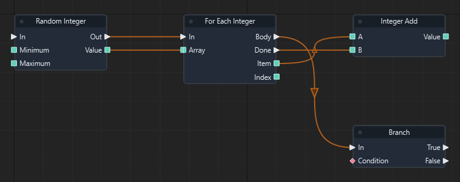

Graph: `templates/games/isometric_snake_3d/graphs/gameplay.json` · Function: **Spawn food** · Node: `n5`.

[Mở hướng dẫn game](games/isometric-snake.md)

### Đọc thêm

[Tài liệu hệ thống: flow-control.md](flow-control.md)

### For Each Boolean

ID `2302` · `foreach` · Workflow `shared`

Chụp tập dữ liệu đầu vào rồi chạy Body cho từng phần tử. Item/Index/Key chỉ có hiệu lực trong Body; Done chạy khi kết thúc. Map duyệt khóa theo thứ tự.

### IO

| Chiều | Cổng | Kiểu | Mặc định |
| --- | --- | --- | --- |
| IN | In | `exec` | — |
| IN | Array | `array<bool>` | `[]` |
| OUT | Body | `exec` | — |
| OUT | Done | `exec` | — |
| OUT | Item | `bool` | — |
| OUT | Index | `int` | — |

Cổng `exec` điều khiển thứ tự. Cổng dữ liệu phải khớp kiểu; `vec2` không tự chuyển sang `vec3`.

### Cách dùng

1. Tìm **For Each Boolean** trong Node Library hoặc nhấn Tab trong graph để thêm node.
2. Chọn node, nhập hằng số ở Inspector theo bảng IN. Chuỗi nhập trực tiếp; vector/mảng nhập theo JSON, ví dụ `[1, 0, 0]`. Khai báo biến qua Scene > Scene Variables… trước khi dùng Get/Set Variable.
3. Có thể kéo dây từ OUT dữ liệu vào IN có cùng kiểu; giá trị từ dây thay thế hằng số của cổng.
4. Nối OUT exec của sự kiện/node trước vào IN exec; nối tiếp các OUT exec phù hợp tới bước sau.
5. Dùng kết quả dữ liệu trong nhánh exec phát ra từ chính node; không lấy payload sang một sự kiện khác.
6. Nhấn F5, thử tình huống, kiểm tra Console/Diagnostics; Shift+F5 dừng. Ctrl+S lưu thay đổi graph.

### Đọc thêm

[Tài liệu hệ thống: flow-control.md](flow-control.md)

### For Each String

ID `2303` · `foreach` · Workflow `shared`

Chụp tập dữ liệu đầu vào rồi chạy Body cho từng phần tử. Item/Index/Key chỉ có hiệu lực trong Body; Done chạy khi kết thúc. Map duyệt khóa theo thứ tự.

### IO

| Chiều | Cổng | Kiểu | Mặc định |
| --- | --- | --- | --- |
| IN | In | `exec` | — |
| IN | Array | `array<string>` | `[]` |
| OUT | Body | `exec` | — |
| OUT | Done | `exec` | — |
| OUT | Item | `string` | — |
| OUT | Index | `int` | — |

Cổng `exec` điều khiển thứ tự. Cổng dữ liệu phải khớp kiểu; `vec2` không tự chuyển sang `vec3`.

### Cách dùng

1. Tìm **For Each String** trong Node Library hoặc nhấn Tab trong graph để thêm node.
2. Chọn node, nhập hằng số ở Inspector theo bảng IN. Chuỗi nhập trực tiếp; vector/mảng nhập theo JSON, ví dụ `[1, 0, 0]`. Khai báo biến qua Scene > Scene Variables… trước khi dùng Get/Set Variable.
3. Có thể kéo dây từ OUT dữ liệu vào IN có cùng kiểu; giá trị từ dây thay thế hằng số của cổng.
4. Nối OUT exec của sự kiện/node trước vào IN exec; nối tiếp các OUT exec phù hợp tới bước sau.
5. Dùng kết quả dữ liệu trong nhánh exec phát ra từ chính node; không lấy payload sang một sự kiện khác.
6. Nhấn F5, thử tình huống, kiểm tra Console/Diagnostics; Shift+F5 dừng. Ctrl+S lưu thay đổi graph.

### Đọc thêm

[Tài liệu hệ thống: flow-control.md](flow-control.md)

### For Each Vector3

ID `2304` · `foreach` · Workflow `shared`

Chụp tập dữ liệu đầu vào rồi chạy Body cho từng phần tử. Item/Index/Key chỉ có hiệu lực trong Body; Done chạy khi kết thúc. Map duyệt khóa theo thứ tự.

### IO

| Chiều | Cổng | Kiểu | Mặc định |
| --- | --- | --- | --- |
| IN | In | `exec` | — |
| IN | Array | `array<vec3>` | `[]` |
| OUT | Body | `exec` | — |
| OUT | Done | `exec` | — |
| OUT | Item | `vec3` | — |
| OUT | Index | `int` | — |

Cổng `exec` điều khiển thứ tự. Cổng dữ liệu phải khớp kiểu; `vec2` không tự chuyển sang `vec3`.

### Cách dùng

1. Tìm **For Each Vector3** trong Node Library hoặc nhấn Tab trong graph để thêm node.
2. Chọn node, nhập hằng số ở Inspector theo bảng IN. Chuỗi nhập trực tiếp; vector/mảng nhập theo JSON, ví dụ `[1, 0, 0]`. Khai báo biến qua Scene > Scene Variables… trước khi dùng Get/Set Variable.
3. Có thể kéo dây từ OUT dữ liệu vào IN có cùng kiểu; giá trị từ dây thay thế hằng số của cổng.
4. Nối OUT exec của sự kiện/node trước vào IN exec; nối tiếp các OUT exec phù hợp tới bước sau.
5. Dùng kết quả dữ liệu trong nhánh exec phát ra từ chính node; không lấy payload sang một sự kiện khác.
6. Nhấn F5, thử tình huống, kiểm tra Console/Diagnostics; Shift+F5 dừng. Ctrl+S lưu thay đổi graph.

### Đọc thêm

[Tài liệu hệ thống: flow-control.md](flow-control.md)

### For Each Entity

ID `2305` · `foreach` · Workflow `shared`

Chụp tập dữ liệu đầu vào rồi chạy Body cho từng phần tử. Item/Index/Key chỉ có hiệu lực trong Body; Done chạy khi kết thúc. Map duyệt khóa theo thứ tự.

### IO

| Chiều | Cổng | Kiểu | Mặc định |
| --- | --- | --- | --- |
| IN | In | `exec` | — |
| IN | Array | `array<entity>` | `[]` |
| OUT | Body | `exec` | — |
| OUT | Done | `exec` | — |
| OUT | Item | `entity` | — |
| OUT | Index | `int` | — |

Cổng `exec` điều khiển thứ tự. Cổng dữ liệu phải khớp kiểu; `vec2` không tự chuyển sang `vec3`.

### Cách dùng

1. Tìm **For Each Entity** trong Node Library hoặc nhấn Tab trong graph để thêm node.
2. Chọn node, nhập hằng số ở Inspector theo bảng IN. Chuỗi nhập trực tiếp; vector/mảng nhập theo JSON, ví dụ `[1, 0, 0]`. Khai báo biến qua Scene > Scene Variables… trước khi dùng Get/Set Variable.
3. Có thể kéo dây từ OUT dữ liệu vào IN có cùng kiểu; giá trị từ dây thay thế hằng số của cổng.
4. Nối OUT exec của sự kiện/node trước vào IN exec; nối tiếp các OUT exec phù hợp tới bước sau.
5. Dùng kết quả dữ liệu trong nhánh exec phát ra từ chính node; không lấy payload sang một sự kiện khác.
6. Nhấn F5, thử tình huống, kiểm tra Console/Diagnostics; Shift+F5 dừng. Ctrl+S lưu thay đổi graph.

### Ví dụ từ graph thật

Trích đoạn Refresh board của isometric_snake_3d: node n4. Đây là các node và dây nối thật từ graph đã chạy; vị trí được sắp lại để dễ đọc.

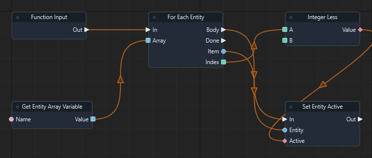

Graph: `templates/games/isometric_snake_3d/graphs/gameplay.json` · Function: **Refresh board** · Node: `n4`.

[Mở hướng dẫn game](games/isometric-snake.md)

### Đọc thêm

[Tài liệu hệ thống: flow-control.md](flow-control.md)

### For Each Vector2

ID `2306` · `foreach` · Workflow `shared`

Chụp tập dữ liệu đầu vào rồi chạy Body cho từng phần tử. Item/Index/Key chỉ có hiệu lực trong Body; Done chạy khi kết thúc. Map duyệt khóa theo thứ tự.

### IO

| Chiều | Cổng | Kiểu | Mặc định |
| --- | --- | --- | --- |
| IN | In | `exec` | — |
| IN | Array | `array<vec2>` | `[]` |
| OUT | Body | `exec` | — |
| OUT | Done | `exec` | — |
| OUT | Item | `vec2` | — |
| OUT | Index | `int` | — |

Cổng `exec` điều khiển thứ tự. Cổng dữ liệu phải khớp kiểu; `vec2` không tự chuyển sang `vec3`.

### Cách dùng

1. Tìm **For Each Vector2** trong Node Library hoặc nhấn Tab trong graph để thêm node.
2. Chọn node, nhập hằng số ở Inspector theo bảng IN. Chuỗi nhập trực tiếp; vector/mảng nhập theo JSON, ví dụ `[1, 0, 0]`. Khai báo biến qua Scene > Scene Variables… trước khi dùng Get/Set Variable.
3. Có thể kéo dây từ OUT dữ liệu vào IN có cùng kiểu; giá trị từ dây thay thế hằng số của cổng.
4. Nối OUT exec của sự kiện/node trước vào IN exec; nối tiếp các OUT exec phù hợp tới bước sau.
5. Dùng kết quả dữ liệu trong nhánh exec phát ra từ chính node; không lấy payload sang một sự kiện khác.
6. Nhấn F5, thử tình huống, kiểm tra Console/Diagnostics; Shift+F5 dừng. Ctrl+S lưu thay đổi graph.

### Đọc thêm

[Tài liệu hệ thống: flow-control.md](flow-control.md)

### For Each Vector4

ID `2307` · `foreach` · Workflow `shared`

Chụp tập dữ liệu đầu vào rồi chạy Body cho từng phần tử. Item/Index/Key chỉ có hiệu lực trong Body; Done chạy khi kết thúc. Map duyệt khóa theo thứ tự.

### IO

| Chiều | Cổng | Kiểu | Mặc định |
| --- | --- | --- | --- |
| IN | In | `exec` | — |
| IN | Array | `array<vec4>` | `[]` |
| OUT | Body | `exec` | — |
| OUT | Done | `exec` | — |
| OUT | Item | `vec4` | — |
| OUT | Index | `int` | — |

Cổng `exec` điều khiển thứ tự. Cổng dữ liệu phải khớp kiểu; `vec2` không tự chuyển sang `vec3`.

### Cách dùng

1. Tìm **For Each Vector4** trong Node Library hoặc nhấn Tab trong graph để thêm node.
2. Chọn node, nhập hằng số ở Inspector theo bảng IN. Chuỗi nhập trực tiếp; vector/mảng nhập theo JSON, ví dụ `[1, 0, 0]`. Khai báo biến qua Scene > Scene Variables… trước khi dùng Get/Set Variable.
3. Có thể kéo dây từ OUT dữ liệu vào IN có cùng kiểu; giá trị từ dây thay thế hằng số của cổng.
4. Nối OUT exec của sự kiện/node trước vào IN exec; nối tiếp các OUT exec phù hợp tới bước sau.
5. Dùng kết quả dữ liệu trong nhánh exec phát ra từ chính node; không lấy payload sang một sự kiện khác.
6. Nhấn F5, thử tình huống, kiểm tra Console/Diagnostics; Shift+F5 dừng. Ctrl+S lưu thay đổi graph.

### Đọc thêm

[Tài liệu hệ thống: flow-control.md](flow-control.md)

### For Each Quaternion

ID `2308` · `foreach` · Workflow `shared`

Chụp tập dữ liệu đầu vào rồi chạy Body cho từng phần tử. Item/Index/Key chỉ có hiệu lực trong Body; Done chạy khi kết thúc. Map duyệt khóa theo thứ tự.

### IO

| Chiều | Cổng | Kiểu | Mặc định |
| --- | --- | --- | --- |
| IN | In | `exec` | — |
| IN | Array | `array<quat>` | `[]` |
| OUT | Body | `exec` | — |
| OUT | Done | `exec` | — |
| OUT | Item | `quat` | — |
| OUT | Index | `int` | — |

Cổng `exec` điều khiển thứ tự. Cổng dữ liệu phải khớp kiểu; `vec2` không tự chuyển sang `vec3`.

### Cách dùng

1. Tìm **For Each Quaternion** trong Node Library hoặc nhấn Tab trong graph để thêm node.
2. Chọn node, nhập hằng số ở Inspector theo bảng IN. Chuỗi nhập trực tiếp; vector/mảng nhập theo JSON, ví dụ `[1, 0, 0]`. Khai báo biến qua Scene > Scene Variables… trước khi dùng Get/Set Variable.
3. Có thể kéo dây từ OUT dữ liệu vào IN có cùng kiểu; giá trị từ dây thay thế hằng số của cổng.
4. Nối OUT exec của sự kiện/node trước vào IN exec; nối tiếp các OUT exec phù hợp tới bước sau.
5. Dùng kết quả dữ liệu trong nhánh exec phát ra từ chính node; không lấy payload sang một sự kiện khác.
6. Nhấn F5, thử tình huống, kiểm tra Console/Diagnostics; Shift+F5 dừng. Ctrl+S lưu thay đổi graph.

### Đọc thêm

[Tài liệu hệ thống: flow-control.md](flow-control.md)

### For Each Matrix4

ID `2309` · `foreach` · Workflow `shared`

Chụp tập dữ liệu đầu vào rồi chạy Body cho từng phần tử. Item/Index/Key chỉ có hiệu lực trong Body; Done chạy khi kết thúc. Map duyệt khóa theo thứ tự.

### IO

| Chiều | Cổng | Kiểu | Mặc định |
| --- | --- | --- | --- |
| IN | In | `exec` | — |
| IN | Array | `array<mat4>` | `[]` |
| OUT | Body | `exec` | — |
| OUT | Done | `exec` | — |
| OUT | Item | `mat4` | — |
| OUT | Index | `int` | — |

Cổng `exec` điều khiển thứ tự. Cổng dữ liệu phải khớp kiểu; `vec2` không tự chuyển sang `vec3`.

### Cách dùng

1. Tìm **For Each Matrix4** trong Node Library hoặc nhấn Tab trong graph để thêm node.
2. Chọn node, nhập hằng số ở Inspector theo bảng IN. Chuỗi nhập trực tiếp; vector/mảng nhập theo JSON, ví dụ `[1, 0, 0]`. Khai báo biến qua Scene > Scene Variables… trước khi dùng Get/Set Variable.
3. Có thể kéo dây từ OUT dữ liệu vào IN có cùng kiểu; giá trị từ dây thay thế hằng số của cổng.
4. Nối OUT exec của sự kiện/node trước vào IN exec; nối tiếp các OUT exec phù hợp tới bước sau.
5. Dùng kết quả dữ liệu trong nhánh exec phát ra từ chính node; không lấy payload sang một sự kiện khác.
6. Nhấn F5, thử tình huống, kiểm tra Console/Diagnostics; Shift+F5 dừng. Ctrl+S lưu thay đổi graph.

### Đọc thêm

[Tài liệu hệ thống: flow-control.md](flow-control.md)

### For Each Float Set

ID `2350` · `foreach` · Workflow `shared`

Chụp tập dữ liệu đầu vào rồi chạy Body cho từng phần tử. Item/Index/Key chỉ có hiệu lực trong Body; Done chạy khi kết thúc. Map duyệt khóa theo thứ tự.

### IO

| Chiều | Cổng | Kiểu | Mặc định |
| --- | --- | --- | --- |
| IN | In | `exec` | — |
| IN | Set | `set<float>` | `[]` |
| OUT | Body | `exec` | — |
| OUT | Done | `exec` | — |
| OUT | Item | `float` | — |
| OUT | Index | `int` | — |

Cổng `exec` điều khiển thứ tự. Cổng dữ liệu phải khớp kiểu; `vec2` không tự chuyển sang `vec3`.

### Cách dùng

1. Tìm **For Each Float Set** trong Node Library hoặc nhấn Tab trong graph để thêm node.
2. Chọn node, nhập hằng số ở Inspector theo bảng IN. Chuỗi nhập trực tiếp; vector/mảng nhập theo JSON, ví dụ `[1, 0, 0]`. Khai báo biến qua Scene > Scene Variables… trước khi dùng Get/Set Variable.
3. Có thể kéo dây từ OUT dữ liệu vào IN có cùng kiểu; giá trị từ dây thay thế hằng số của cổng.
4. Nối OUT exec của sự kiện/node trước vào IN exec; nối tiếp các OUT exec phù hợp tới bước sau.
5. Dùng kết quả dữ liệu trong nhánh exec phát ra từ chính node; không lấy payload sang một sự kiện khác.
6. Nhấn F5, thử tình huống, kiểm tra Console/Diagnostics; Shift+F5 dừng. Ctrl+S lưu thay đổi graph.

### Đọc thêm

[Tài liệu hệ thống: flow-control.md](flow-control.md)

### For Each Integer Set

ID `2351` · `foreach` · Workflow `shared`

Chụp tập dữ liệu đầu vào rồi chạy Body cho từng phần tử. Item/Index/Key chỉ có hiệu lực trong Body; Done chạy khi kết thúc. Map duyệt khóa theo thứ tự.

### IO

| Chiều | Cổng | Kiểu | Mặc định |
| --- | --- | --- | --- |
| IN | In | `exec` | — |
| IN | Set | `set<int>` | `[]` |
| OUT | Body | `exec` | — |
| OUT | Done | `exec` | — |
| OUT | Item | `int` | — |
| OUT | Index | `int` | — |

Cổng `exec` điều khiển thứ tự. Cổng dữ liệu phải khớp kiểu; `vec2` không tự chuyển sang `vec3`.

### Cách dùng

1. Tìm **For Each Integer Set** trong Node Library hoặc nhấn Tab trong graph để thêm node.
2. Chọn node, nhập hằng số ở Inspector theo bảng IN. Chuỗi nhập trực tiếp; vector/mảng nhập theo JSON, ví dụ `[1, 0, 0]`. Khai báo biến qua Scene > Scene Variables… trước khi dùng Get/Set Variable.
3. Có thể kéo dây từ OUT dữ liệu vào IN có cùng kiểu; giá trị từ dây thay thế hằng số của cổng.
4. Nối OUT exec của sự kiện/node trước vào IN exec; nối tiếp các OUT exec phù hợp tới bước sau.
5. Dùng kết quả dữ liệu trong nhánh exec phát ra từ chính node; không lấy payload sang một sự kiện khác.
6. Nhấn F5, thử tình huống, kiểm tra Console/Diagnostics; Shift+F5 dừng. Ctrl+S lưu thay đổi graph.

### Đọc thêm

[Tài liệu hệ thống: flow-control.md](flow-control.md)

### For Each Boolean Set

ID `2352` · `foreach` · Workflow `shared`

Chụp tập dữ liệu đầu vào rồi chạy Body cho từng phần tử. Item/Index/Key chỉ có hiệu lực trong Body; Done chạy khi kết thúc. Map duyệt khóa theo thứ tự.

### IO

| Chiều | Cổng | Kiểu | Mặc định |
| --- | --- | --- | --- |
| IN | In | `exec` | — |
| IN | Set | `set<bool>` | `[]` |
| OUT | Body | `exec` | — |
| OUT | Done | `exec` | — |
| OUT | Item | `bool` | — |
| OUT | Index | `int` | — |

Cổng `exec` điều khiển thứ tự. Cổng dữ liệu phải khớp kiểu; `vec2` không tự chuyển sang `vec3`.

### Cách dùng

1. Tìm **For Each Boolean Set** trong Node Library hoặc nhấn Tab trong graph để thêm node.
2. Chọn node, nhập hằng số ở Inspector theo bảng IN. Chuỗi nhập trực tiếp; vector/mảng nhập theo JSON, ví dụ `[1, 0, 0]`. Khai báo biến qua Scene > Scene Variables… trước khi dùng Get/Set Variable.
3. Có thể kéo dây từ OUT dữ liệu vào IN có cùng kiểu; giá trị từ dây thay thế hằng số của cổng.
4. Nối OUT exec của sự kiện/node trước vào IN exec; nối tiếp các OUT exec phù hợp tới bước sau.
5. Dùng kết quả dữ liệu trong nhánh exec phát ra từ chính node; không lấy payload sang một sự kiện khác.
6. Nhấn F5, thử tình huống, kiểm tra Console/Diagnostics; Shift+F5 dừng. Ctrl+S lưu thay đổi graph.

### Đọc thêm

[Tài liệu hệ thống: flow-control.md](flow-control.md)

### For Each String Set

ID `2353` · `foreach` · Workflow `shared`

Chụp tập dữ liệu đầu vào rồi chạy Body cho từng phần tử. Item/Index/Key chỉ có hiệu lực trong Body; Done chạy khi kết thúc. Map duyệt khóa theo thứ tự.

### IO

| Chiều | Cổng | Kiểu | Mặc định |
| --- | --- | --- | --- |
| IN | In | `exec` | — |
| IN | Set | `set<string>` | `[]` |
| OUT | Body | `exec` | — |
| OUT | Done | `exec` | — |
| OUT | Item | `string` | — |
| OUT | Index | `int` | — |

Cổng `exec` điều khiển thứ tự. Cổng dữ liệu phải khớp kiểu; `vec2` không tự chuyển sang `vec3`.

### Cách dùng

1. Tìm **For Each String Set** trong Node Library hoặc nhấn Tab trong graph để thêm node.
2. Chọn node, nhập hằng số ở Inspector theo bảng IN. Chuỗi nhập trực tiếp; vector/mảng nhập theo JSON, ví dụ `[1, 0, 0]`. Khai báo biến qua Scene > Scene Variables… trước khi dùng Get/Set Variable.
3. Có thể kéo dây từ OUT dữ liệu vào IN có cùng kiểu; giá trị từ dây thay thế hằng số của cổng.
4. Nối OUT exec của sự kiện/node trước vào IN exec; nối tiếp các OUT exec phù hợp tới bước sau.
5. Dùng kết quả dữ liệu trong nhánh exec phát ra từ chính node; không lấy payload sang một sự kiện khác.
6. Nhấn F5, thử tình huống, kiểm tra Console/Diagnostics; Shift+F5 dừng. Ctrl+S lưu thay đổi graph.

### Đọc thêm

[Tài liệu hệ thống: flow-control.md](flow-control.md)

### For Each Vector3 Set

ID `2354` · `foreach` · Workflow `shared`

Chụp tập dữ liệu đầu vào rồi chạy Body cho từng phần tử. Item/Index/Key chỉ có hiệu lực trong Body; Done chạy khi kết thúc. Map duyệt khóa theo thứ tự.

### IO

| Chiều | Cổng | Kiểu | Mặc định |
| --- | --- | --- | --- |
| IN | In | `exec` | — |
| IN | Set | `set<vec3>` | `[]` |
| OUT | Body | `exec` | — |
| OUT | Done | `exec` | — |
| OUT | Item | `vec3` | — |
| OUT | Index | `int` | — |

Cổng `exec` điều khiển thứ tự. Cổng dữ liệu phải khớp kiểu; `vec2` không tự chuyển sang `vec3`.

### Cách dùng

1. Tìm **For Each Vector3 Set** trong Node Library hoặc nhấn Tab trong graph để thêm node.
2. Chọn node, nhập hằng số ở Inspector theo bảng IN. Chuỗi nhập trực tiếp; vector/mảng nhập theo JSON, ví dụ `[1, 0, 0]`. Khai báo biến qua Scene > Scene Variables… trước khi dùng Get/Set Variable.
3. Có thể kéo dây từ OUT dữ liệu vào IN có cùng kiểu; giá trị từ dây thay thế hằng số của cổng.
4. Nối OUT exec của sự kiện/node trước vào IN exec; nối tiếp các OUT exec phù hợp tới bước sau.
5. Dùng kết quả dữ liệu trong nhánh exec phát ra từ chính node; không lấy payload sang một sự kiện khác.
6. Nhấn F5, thử tình huống, kiểm tra Console/Diagnostics; Shift+F5 dừng. Ctrl+S lưu thay đổi graph.

### Đọc thêm

[Tài liệu hệ thống: flow-control.md](flow-control.md)

### For Each Entity Set

ID `2355` · `foreach` · Workflow `shared`

Chụp tập dữ liệu đầu vào rồi chạy Body cho từng phần tử. Item/Index/Key chỉ có hiệu lực trong Body; Done chạy khi kết thúc. Map duyệt khóa theo thứ tự.

### IO

| Chiều | Cổng | Kiểu | Mặc định |
| --- | --- | --- | --- |
| IN | In | `exec` | — |
| IN | Set | `set<entity>` | `[]` |
| OUT | Body | `exec` | — |
| OUT | Done | `exec` | — |
| OUT | Item | `entity` | — |
| OUT | Index | `int` | — |

Cổng `exec` điều khiển thứ tự. Cổng dữ liệu phải khớp kiểu; `vec2` không tự chuyển sang `vec3`.

### Cách dùng

1. Tìm **For Each Entity Set** trong Node Library hoặc nhấn Tab trong graph để thêm node.
2. Chọn node, nhập hằng số ở Inspector theo bảng IN. Chuỗi nhập trực tiếp; vector/mảng nhập theo JSON, ví dụ `[1, 0, 0]`. Khai báo biến qua Scene > Scene Variables… trước khi dùng Get/Set Variable.
3. Có thể kéo dây từ OUT dữ liệu vào IN có cùng kiểu; giá trị từ dây thay thế hằng số của cổng.
4. Nối OUT exec của sự kiện/node trước vào IN exec; nối tiếp các OUT exec phù hợp tới bước sau.
5. Dùng kết quả dữ liệu trong nhánh exec phát ra từ chính node; không lấy payload sang một sự kiện khác.
6. Nhấn F5, thử tình huống, kiểm tra Console/Diagnostics; Shift+F5 dừng. Ctrl+S lưu thay đổi graph.

### Đọc thêm

[Tài liệu hệ thống: flow-control.md](flow-control.md)

### For Each Vector2 Set

ID `2356` · `foreach` · Workflow `shared`

Chụp tập dữ liệu đầu vào rồi chạy Body cho từng phần tử. Item/Index/Key chỉ có hiệu lực trong Body; Done chạy khi kết thúc. Map duyệt khóa theo thứ tự.

### IO

| Chiều | Cổng | Kiểu | Mặc định |
| --- | --- | --- | --- |
| IN | In | `exec` | — |
| IN | Set | `set<vec2>` | `[]` |
| OUT | Body | `exec` | — |
| OUT | Done | `exec` | — |
| OUT | Item | `vec2` | — |
| OUT | Index | `int` | — |

Cổng `exec` điều khiển thứ tự. Cổng dữ liệu phải khớp kiểu; `vec2` không tự chuyển sang `vec3`.

### Cách dùng

1. Tìm **For Each Vector2 Set** trong Node Library hoặc nhấn Tab trong graph để thêm node.
2. Chọn node, nhập hằng số ở Inspector theo bảng IN. Chuỗi nhập trực tiếp; vector/mảng nhập theo JSON, ví dụ `[1, 0, 0]`. Khai báo biến qua Scene > Scene Variables… trước khi dùng Get/Set Variable.
3. Có thể kéo dây từ OUT dữ liệu vào IN có cùng kiểu; giá trị từ dây thay thế hằng số của cổng.
4. Nối OUT exec của sự kiện/node trước vào IN exec; nối tiếp các OUT exec phù hợp tới bước sau.
5. Dùng kết quả dữ liệu trong nhánh exec phát ra từ chính node; không lấy payload sang một sự kiện khác.
6. Nhấn F5, thử tình huống, kiểm tra Console/Diagnostics; Shift+F5 dừng. Ctrl+S lưu thay đổi graph.

### Đọc thêm

[Tài liệu hệ thống: flow-control.md](flow-control.md)

### For Each Vector4 Set

ID `2357` · `foreach` · Workflow `shared`

Chụp tập dữ liệu đầu vào rồi chạy Body cho từng phần tử. Item/Index/Key chỉ có hiệu lực trong Body; Done chạy khi kết thúc. Map duyệt khóa theo thứ tự.

### IO

| Chiều | Cổng | Kiểu | Mặc định |
| --- | --- | --- | --- |
| IN | In | `exec` | — |
| IN | Set | `set<vec4>` | `[]` |
| OUT | Body | `exec` | — |
| OUT | Done | `exec` | — |
| OUT | Item | `vec4` | — |
| OUT | Index | `int` | — |

Cổng `exec` điều khiển thứ tự. Cổng dữ liệu phải khớp kiểu; `vec2` không tự chuyển sang `vec3`.

### Cách dùng

1. Tìm **For Each Vector4 Set** trong Node Library hoặc nhấn Tab trong graph để thêm node.
2. Chọn node, nhập hằng số ở Inspector theo bảng IN. Chuỗi nhập trực tiếp; vector/mảng nhập theo JSON, ví dụ `[1, 0, 0]`. Khai báo biến qua Scene > Scene Variables… trước khi dùng Get/Set Variable.
3. Có thể kéo dây từ OUT dữ liệu vào IN có cùng kiểu; giá trị từ dây thay thế hằng số của cổng.
4. Nối OUT exec của sự kiện/node trước vào IN exec; nối tiếp các OUT exec phù hợp tới bước sau.
5. Dùng kết quả dữ liệu trong nhánh exec phát ra từ chính node; không lấy payload sang một sự kiện khác.
6. Nhấn F5, thử tình huống, kiểm tra Console/Diagnostics; Shift+F5 dừng. Ctrl+S lưu thay đổi graph.

### Đọc thêm

[Tài liệu hệ thống: flow-control.md](flow-control.md)

### For Each Quaternion Set

ID `2358` · `foreach` · Workflow `shared`

Chụp tập dữ liệu đầu vào rồi chạy Body cho từng phần tử. Item/Index/Key chỉ có hiệu lực trong Body; Done chạy khi kết thúc. Map duyệt khóa theo thứ tự.

### IO

| Chiều | Cổng | Kiểu | Mặc định |
| --- | --- | --- | --- |
| IN | In | `exec` | — |
| IN | Set | `set<quat>` | `[]` |
| OUT | Body | `exec` | — |
| OUT | Done | `exec` | — |
| OUT | Item | `quat` | — |
| OUT | Index | `int` | — |

Cổng `exec` điều khiển thứ tự. Cổng dữ liệu phải khớp kiểu; `vec2` không tự chuyển sang `vec3`.

### Cách dùng

1. Tìm **For Each Quaternion Set** trong Node Library hoặc nhấn Tab trong graph để thêm node.
2. Chọn node, nhập hằng số ở Inspector theo bảng IN. Chuỗi nhập trực tiếp; vector/mảng nhập theo JSON, ví dụ `[1, 0, 0]`. Khai báo biến qua Scene > Scene Variables… trước khi dùng Get/Set Variable.
3. Có thể kéo dây từ OUT dữ liệu vào IN có cùng kiểu; giá trị từ dây thay thế hằng số của cổng.
4. Nối OUT exec của sự kiện/node trước vào IN exec; nối tiếp các OUT exec phù hợp tới bước sau.
5. Dùng kết quả dữ liệu trong nhánh exec phát ra từ chính node; không lấy payload sang một sự kiện khác.
6. Nhấn F5, thử tình huống, kiểm tra Console/Diagnostics; Shift+F5 dừng. Ctrl+S lưu thay đổi graph.

### Đọc thêm

[Tài liệu hệ thống: flow-control.md](flow-control.md)

### For Each Matrix4 Set

ID `2359` · `foreach` · Workflow `shared`

Chụp tập dữ liệu đầu vào rồi chạy Body cho từng phần tử. Item/Index/Key chỉ có hiệu lực trong Body; Done chạy khi kết thúc. Map duyệt khóa theo thứ tự.

### IO

| Chiều | Cổng | Kiểu | Mặc định |
| --- | --- | --- | --- |
| IN | In | `exec` | — |
| IN | Set | `set<mat4>` | `[]` |
| OUT | Body | `exec` | — |
| OUT | Done | `exec` | — |
| OUT | Item | `mat4` | — |
| OUT | Index | `int` | — |

Cổng `exec` điều khiển thứ tự. Cổng dữ liệu phải khớp kiểu; `vec2` không tự chuyển sang `vec3`.

### Cách dùng

1. Tìm **For Each Matrix4 Set** trong Node Library hoặc nhấn Tab trong graph để thêm node.
2. Chọn node, nhập hằng số ở Inspector theo bảng IN. Chuỗi nhập trực tiếp; vector/mảng nhập theo JSON, ví dụ `[1, 0, 0]`. Khai báo biến qua Scene > Scene Variables… trước khi dùng Get/Set Variable.
3. Có thể kéo dây từ OUT dữ liệu vào IN có cùng kiểu; giá trị từ dây thay thế hằng số của cổng.
4. Nối OUT exec của sự kiện/node trước vào IN exec; nối tiếp các OUT exec phù hợp tới bước sau.
5. Dùng kết quả dữ liệu trong nhánh exec phát ra từ chính node; không lấy payload sang một sự kiện khác.
6. Nhấn F5, thử tình huống, kiểm tra Console/Diagnostics; Shift+F5 dừng. Ctrl+S lưu thay đổi graph.

### Đọc thêm

[Tài liệu hệ thống: flow-control.md](flow-control.md)

### For Each Float Map

ID `2360` · `foreach` · Workflow `shared`

Chụp tập dữ liệu đầu vào rồi chạy Body cho từng phần tử. Item/Index/Key chỉ có hiệu lực trong Body; Done chạy khi kết thúc. Map duyệt khóa theo thứ tự.

### IO

| Chiều | Cổng | Kiểu | Mặc định |
| --- | --- | --- | --- |
| IN | In | `exec` | — |
| IN | Map | `map<float>` | `{}` |
| OUT | Body | `exec` | — |
| OUT | Done | `exec` | — |
| OUT | Key | `string` | — |
| OUT | Item | `float` | — |
| OUT | Index | `int` | — |

Cổng `exec` điều khiển thứ tự. Cổng dữ liệu phải khớp kiểu; `vec2` không tự chuyển sang `vec3`.

### Cách dùng

1. Tìm **For Each Float Map** trong Node Library hoặc nhấn Tab trong graph để thêm node.
2. Chọn node, nhập hằng số ở Inspector theo bảng IN. Chuỗi nhập trực tiếp; vector/mảng nhập theo JSON, ví dụ `[1, 0, 0]`. Khai báo biến qua Scene > Scene Variables… trước khi dùng Get/Set Variable.
3. Có thể kéo dây từ OUT dữ liệu vào IN có cùng kiểu; giá trị từ dây thay thế hằng số của cổng.
4. Nối OUT exec của sự kiện/node trước vào IN exec; nối tiếp các OUT exec phù hợp tới bước sau.
5. Dùng kết quả dữ liệu trong nhánh exec phát ra từ chính node; không lấy payload sang một sự kiện khác.
6. Nhấn F5, thử tình huống, kiểm tra Console/Diagnostics; Shift+F5 dừng. Ctrl+S lưu thay đổi graph.

### Đọc thêm

[Tài liệu hệ thống: flow-control.md](flow-control.md)

### For Each Integer Map

ID `2361` · `foreach` · Workflow `shared`

Chụp tập dữ liệu đầu vào rồi chạy Body cho từng phần tử. Item/Index/Key chỉ có hiệu lực trong Body; Done chạy khi kết thúc. Map duyệt khóa theo thứ tự.

### IO

| Chiều | Cổng | Kiểu | Mặc định |
| --- | --- | --- | --- |
| IN | In | `exec` | — |
| IN | Map | `map<int>` | `{}` |
| OUT | Body | `exec` | — |
| OUT | Done | `exec` | — |
| OUT | Key | `string` | — |
| OUT | Item | `int` | — |
| OUT | Index | `int` | — |

Cổng `exec` điều khiển thứ tự. Cổng dữ liệu phải khớp kiểu; `vec2` không tự chuyển sang `vec3`.

### Cách dùng

1. Tìm **For Each Integer Map** trong Node Library hoặc nhấn Tab trong graph để thêm node.
2. Chọn node, nhập hằng số ở Inspector theo bảng IN. Chuỗi nhập trực tiếp; vector/mảng nhập theo JSON, ví dụ `[1, 0, 0]`. Khai báo biến qua Scene > Scene Variables… trước khi dùng Get/Set Variable.
3. Có thể kéo dây từ OUT dữ liệu vào IN có cùng kiểu; giá trị từ dây thay thế hằng số của cổng.
4. Nối OUT exec của sự kiện/node trước vào IN exec; nối tiếp các OUT exec phù hợp tới bước sau.
5. Dùng kết quả dữ liệu trong nhánh exec phát ra từ chính node; không lấy payload sang một sự kiện khác.
6. Nhấn F5, thử tình huống, kiểm tra Console/Diagnostics; Shift+F5 dừng. Ctrl+S lưu thay đổi graph.

### Đọc thêm

[Tài liệu hệ thống: flow-control.md](flow-control.md)

### For Each Boolean Map

ID `2362` · `foreach` · Workflow `shared`

Chụp tập dữ liệu đầu vào rồi chạy Body cho từng phần tử. Item/Index/Key chỉ có hiệu lực trong Body; Done chạy khi kết thúc. Map duyệt khóa theo thứ tự.

### IO

| Chiều | Cổng | Kiểu | Mặc định |
| --- | --- | --- | --- |
| IN | In | `exec` | — |
| IN | Map | `map<bool>` | `{}` |
| OUT | Body | `exec` | — |
| OUT | Done | `exec` | — |
| OUT | Key | `string` | — |
| OUT | Item | `bool` | — |
| OUT | Index | `int` | — |

Cổng `exec` điều khiển thứ tự. Cổng dữ liệu phải khớp kiểu; `vec2` không tự chuyển sang `vec3`.

### Cách dùng

1. Tìm **For Each Boolean Map** trong Node Library hoặc nhấn Tab trong graph để thêm node.
2. Chọn node, nhập hằng số ở Inspector theo bảng IN. Chuỗi nhập trực tiếp; vector/mảng nhập theo JSON, ví dụ `[1, 0, 0]`. Khai báo biến qua Scene > Scene Variables… trước khi dùng Get/Set Variable.
3. Có thể kéo dây từ OUT dữ liệu vào IN có cùng kiểu; giá trị từ dây thay thế hằng số của cổng.
4. Nối OUT exec của sự kiện/node trước vào IN exec; nối tiếp các OUT exec phù hợp tới bước sau.
5. Dùng kết quả dữ liệu trong nhánh exec phát ra từ chính node; không lấy payload sang một sự kiện khác.
6. Nhấn F5, thử tình huống, kiểm tra Console/Diagnostics; Shift+F5 dừng. Ctrl+S lưu thay đổi graph.

### Đọc thêm

[Tài liệu hệ thống: flow-control.md](flow-control.md)

### For Each String Map

ID `2363` · `foreach` · Workflow `shared`

Chụp tập dữ liệu đầu vào rồi chạy Body cho từng phần tử. Item/Index/Key chỉ có hiệu lực trong Body; Done chạy khi kết thúc. Map duyệt khóa theo thứ tự.

### IO

| Chiều | Cổng | Kiểu | Mặc định |
| --- | --- | --- | --- |
| IN | In | `exec` | — |
| IN | Map | `map<string>` | `{}` |
| OUT | Body | `exec` | — |
| OUT | Done | `exec` | — |
| OUT | Key | `string` | — |
| OUT | Item | `string` | — |
| OUT | Index | `int` | — |

Cổng `exec` điều khiển thứ tự. Cổng dữ liệu phải khớp kiểu; `vec2` không tự chuyển sang `vec3`.

### Cách dùng

1. Tìm **For Each String Map** trong Node Library hoặc nhấn Tab trong graph để thêm node.
2. Chọn node, nhập hằng số ở Inspector theo bảng IN. Chuỗi nhập trực tiếp; vector/mảng nhập theo JSON, ví dụ `[1, 0, 0]`. Khai báo biến qua Scene > Scene Variables… trước khi dùng Get/Set Variable.
3. Có thể kéo dây từ OUT dữ liệu vào IN có cùng kiểu; giá trị từ dây thay thế hằng số của cổng.
4. Nối OUT exec của sự kiện/node trước vào IN exec; nối tiếp các OUT exec phù hợp tới bước sau.
5. Dùng kết quả dữ liệu trong nhánh exec phát ra từ chính node; không lấy payload sang một sự kiện khác.
6. Nhấn F5, thử tình huống, kiểm tra Console/Diagnostics; Shift+F5 dừng. Ctrl+S lưu thay đổi graph.

### Đọc thêm

[Tài liệu hệ thống: flow-control.md](flow-control.md)

### For Each Vector3 Map

ID `2364` · `foreach` · Workflow `shared`

Chụp tập dữ liệu đầu vào rồi chạy Body cho từng phần tử. Item/Index/Key chỉ có hiệu lực trong Body; Done chạy khi kết thúc. Map duyệt khóa theo thứ tự.

### IO

| Chiều | Cổng | Kiểu | Mặc định |
| --- | --- | --- | --- |
| IN | In | `exec` | — |
| IN | Map | `map<vec3>` | `{}` |
| OUT | Body | `exec` | — |
| OUT | Done | `exec` | — |
| OUT | Key | `string` | — |
| OUT | Item | `vec3` | — |
| OUT | Index | `int` | — |

Cổng `exec` điều khiển thứ tự. Cổng dữ liệu phải khớp kiểu; `vec2` không tự chuyển sang `vec3`.

### Cách dùng

1. Tìm **For Each Vector3 Map** trong Node Library hoặc nhấn Tab trong graph để thêm node.
2. Chọn node, nhập hằng số ở Inspector theo bảng IN. Chuỗi nhập trực tiếp; vector/mảng nhập theo JSON, ví dụ `[1, 0, 0]`. Khai báo biến qua Scene > Scene Variables… trước khi dùng Get/Set Variable.
3. Có thể kéo dây từ OUT dữ liệu vào IN có cùng kiểu; giá trị từ dây thay thế hằng số của cổng.
4. Nối OUT exec của sự kiện/node trước vào IN exec; nối tiếp các OUT exec phù hợp tới bước sau.
5. Dùng kết quả dữ liệu trong nhánh exec phát ra từ chính node; không lấy payload sang một sự kiện khác.
6. Nhấn F5, thử tình huống, kiểm tra Console/Diagnostics; Shift+F5 dừng. Ctrl+S lưu thay đổi graph.

### Đọc thêm

[Tài liệu hệ thống: flow-control.md](flow-control.md)

### For Each Entity Map

ID `2365` · `foreach` · Workflow `shared`

Chụp tập dữ liệu đầu vào rồi chạy Body cho từng phần tử. Item/Index/Key chỉ có hiệu lực trong Body; Done chạy khi kết thúc. Map duyệt khóa theo thứ tự.

### IO

| Chiều | Cổng | Kiểu | Mặc định |
| --- | --- | --- | --- |
| IN | In | `exec` | — |
| IN | Map | `map<entity>` | `{}` |
| OUT | Body | `exec` | — |
| OUT | Done | `exec` | — |
| OUT | Key | `string` | — |
| OUT | Item | `entity` | — |
| OUT | Index | `int` | — |

Cổng `exec` điều khiển thứ tự. Cổng dữ liệu phải khớp kiểu; `vec2` không tự chuyển sang `vec3`.

### Cách dùng

1. Tìm **For Each Entity Map** trong Node Library hoặc nhấn Tab trong graph để thêm node.
2. Chọn node, nhập hằng số ở Inspector theo bảng IN. Chuỗi nhập trực tiếp; vector/mảng nhập theo JSON, ví dụ `[1, 0, 0]`. Khai báo biến qua Scene > Scene Variables… trước khi dùng Get/Set Variable.
3. Có thể kéo dây từ OUT dữ liệu vào IN có cùng kiểu; giá trị từ dây thay thế hằng số của cổng.
4. Nối OUT exec của sự kiện/node trước vào IN exec; nối tiếp các OUT exec phù hợp tới bước sau.
5. Dùng kết quả dữ liệu trong nhánh exec phát ra từ chính node; không lấy payload sang một sự kiện khác.
6. Nhấn F5, thử tình huống, kiểm tra Console/Diagnostics; Shift+F5 dừng. Ctrl+S lưu thay đổi graph.

### Đọc thêm

[Tài liệu hệ thống: flow-control.md](flow-control.md)

### For Each Vector2 Map

ID `2366` · `foreach` · Workflow `shared`

Chụp tập dữ liệu đầu vào rồi chạy Body cho từng phần tử. Item/Index/Key chỉ có hiệu lực trong Body; Done chạy khi kết thúc. Map duyệt khóa theo thứ tự.

### IO

| Chiều | Cổng | Kiểu | Mặc định |
| --- | --- | --- | --- |
| IN | In | `exec` | — |
| IN | Map | `map<vec2>` | `{}` |
| OUT | Body | `exec` | — |
| OUT | Done | `exec` | — |
| OUT | Key | `string` | — |
| OUT | Item | `vec2` | — |
| OUT | Index | `int` | — |

Cổng `exec` điều khiển thứ tự. Cổng dữ liệu phải khớp kiểu; `vec2` không tự chuyển sang `vec3`.

### Cách dùng

1. Tìm **For Each Vector2 Map** trong Node Library hoặc nhấn Tab trong graph để thêm node.
2. Chọn node, nhập hằng số ở Inspector theo bảng IN. Chuỗi nhập trực tiếp; vector/mảng nhập theo JSON, ví dụ `[1, 0, 0]`. Khai báo biến qua Scene > Scene Variables… trước khi dùng Get/Set Variable.
3. Có thể kéo dây từ OUT dữ liệu vào IN có cùng kiểu; giá trị từ dây thay thế hằng số của cổng.
4. Nối OUT exec của sự kiện/node trước vào IN exec; nối tiếp các OUT exec phù hợp tới bước sau.
5. Dùng kết quả dữ liệu trong nhánh exec phát ra từ chính node; không lấy payload sang một sự kiện khác.
6. Nhấn F5, thử tình huống, kiểm tra Console/Diagnostics; Shift+F5 dừng. Ctrl+S lưu thay đổi graph.

### Đọc thêm

[Tài liệu hệ thống: flow-control.md](flow-control.md)

### For Each Vector4 Map

ID `2367` · `foreach` · Workflow `shared`

Chụp tập dữ liệu đầu vào rồi chạy Body cho từng phần tử. Item/Index/Key chỉ có hiệu lực trong Body; Done chạy khi kết thúc. Map duyệt khóa theo thứ tự.

### IO

| Chiều | Cổng | Kiểu | Mặc định |
| --- | --- | --- | --- |
| IN | In | `exec` | — |
| IN | Map | `map<vec4>` | `{}` |
| OUT | Body | `exec` | — |
| OUT | Done | `exec` | — |
| OUT | Key | `string` | — |
| OUT | Item | `vec4` | — |
| OUT | Index | `int` | — |

Cổng `exec` điều khiển thứ tự. Cổng dữ liệu phải khớp kiểu; `vec2` không tự chuyển sang `vec3`.

### Cách dùng

1. Tìm **For Each Vector4 Map** trong Node Library hoặc nhấn Tab trong graph để thêm node.
2. Chọn node, nhập hằng số ở Inspector theo bảng IN. Chuỗi nhập trực tiếp; vector/mảng nhập theo JSON, ví dụ `[1, 0, 0]`. Khai báo biến qua Scene > Scene Variables… trước khi dùng Get/Set Variable.
3. Có thể kéo dây từ OUT dữ liệu vào IN có cùng kiểu; giá trị từ dây thay thế hằng số của cổng.
4. Nối OUT exec của sự kiện/node trước vào IN exec; nối tiếp các OUT exec phù hợp tới bước sau.
5. Dùng kết quả dữ liệu trong nhánh exec phát ra từ chính node; không lấy payload sang một sự kiện khác.
6. Nhấn F5, thử tình huống, kiểm tra Console/Diagnostics; Shift+F5 dừng. Ctrl+S lưu thay đổi graph.

### Đọc thêm

[Tài liệu hệ thống: flow-control.md](flow-control.md)

### For Each Quaternion Map

ID `2368` · `foreach` · Workflow `shared`

Chụp tập dữ liệu đầu vào rồi chạy Body cho từng phần tử. Item/Index/Key chỉ có hiệu lực trong Body; Done chạy khi kết thúc. Map duyệt khóa theo thứ tự.

### IO

| Chiều | Cổng | Kiểu | Mặc định |
| --- | --- | --- | --- |
| IN | In | `exec` | — |
| IN | Map | `map<quat>` | `{}` |
| OUT | Body | `exec` | — |
| OUT | Done | `exec` | — |
| OUT | Key | `string` | — |
| OUT | Item | `quat` | — |
| OUT | Index | `int` | — |

Cổng `exec` điều khiển thứ tự. Cổng dữ liệu phải khớp kiểu; `vec2` không tự chuyển sang `vec3`.

### Cách dùng

1. Tìm **For Each Quaternion Map** trong Node Library hoặc nhấn Tab trong graph để thêm node.
2. Chọn node, nhập hằng số ở Inspector theo bảng IN. Chuỗi nhập trực tiếp; vector/mảng nhập theo JSON, ví dụ `[1, 0, 0]`. Khai báo biến qua Scene > Scene Variables… trước khi dùng Get/Set Variable.
3. Có thể kéo dây từ OUT dữ liệu vào IN có cùng kiểu; giá trị từ dây thay thế hằng số của cổng.
4. Nối OUT exec của sự kiện/node trước vào IN exec; nối tiếp các OUT exec phù hợp tới bước sau.
5. Dùng kết quả dữ liệu trong nhánh exec phát ra từ chính node; không lấy payload sang một sự kiện khác.
6. Nhấn F5, thử tình huống, kiểm tra Console/Diagnostics; Shift+F5 dừng. Ctrl+S lưu thay đổi graph.

### Đọc thêm

[Tài liệu hệ thống: flow-control.md](flow-control.md)

### For Each Matrix4 Map

ID `2369` · `foreach` · Workflow `shared`

Chụp tập dữ liệu đầu vào rồi chạy Body cho từng phần tử. Item/Index/Key chỉ có hiệu lực trong Body; Done chạy khi kết thúc. Map duyệt khóa theo thứ tự.

### IO

| Chiều | Cổng | Kiểu | Mặc định |
| --- | --- | --- | --- |
| IN | In | `exec` | — |
| IN | Map | `map<mat4>` | `{}` |
| OUT | Body | `exec` | — |
| OUT | Done | `exec` | — |
| OUT | Key | `string` | — |
| OUT | Item | `mat4` | — |
| OUT | Index | `int` | — |

Cổng `exec` điều khiển thứ tự. Cổng dữ liệu phải khớp kiểu; `vec2` không tự chuyển sang `vec3`.

### Cách dùng

1. Tìm **For Each Matrix4 Map** trong Node Library hoặc nhấn Tab trong graph để thêm node.
2. Chọn node, nhập hằng số ở Inspector theo bảng IN. Chuỗi nhập trực tiếp; vector/mảng nhập theo JSON, ví dụ `[1, 0, 0]`. Khai báo biến qua Scene > Scene Variables… trước khi dùng Get/Set Variable.
3. Có thể kéo dây từ OUT dữ liệu vào IN có cùng kiểu; giá trị từ dây thay thế hằng số của cổng.
4. Nối OUT exec của sự kiện/node trước vào IN exec; nối tiếp các OUT exec phù hợp tới bước sau.
5. Dùng kết quả dữ liệu trong nhánh exec phát ra từ chính node; không lấy payload sang một sự kiện khác.
6. Nhấn F5, thử tình huống, kiểm tra Console/Diagnostics; Shift+F5 dừng. Ctrl+S lưu thay đổi graph.

### Đọc thêm

[Tài liệu hệ thống: flow-control.md](flow-control.md)

## 03. Variables & Collections

### Float

ID `3001` · `pure` · Workflow `shared`

Tạo hằng số float từ Value.

### IO

| Chiều | Cổng | Kiểu | Mặc định |
| --- | --- | --- | --- |
| IN | Value | `float` | `1.0` |
| OUT | Value | `float` | — |

Cổng `exec` điều khiển thứ tự. Cổng dữ liệu phải khớp kiểu; `vec2` không tự chuyển sang `vec3`.

### Cách dùng

1. Tìm **Float** trong Node Library hoặc nhấn Tab trong graph để thêm node.
2. Chọn node, nhập hằng số ở Inspector theo bảng IN. Chuỗi nhập trực tiếp; vector/mảng nhập theo JSON, ví dụ `[1, 0, 0]`. Khai báo biến qua Scene > Scene Variables… trước khi dùng Get/Set Variable.
3. Có thể kéo dây từ OUT dữ liệu vào IN có cùng kiểu; giá trị từ dây thay thế hằng số của cổng.
4. Nối OUT dữ liệu tới node dùng kết quả. Node pure không cần dây exec.
5. Nhấn F5, thử tình huống, kiểm tra Console/Diagnostics; Shift+F5 dừng. Ctrl+S lưu thay đổi graph.

### Đọc thêm

[Tài liệu hệ thống: typed-data.md](typed-data.md)

### Boolean

ID `3002` · `pure` · Workflow `shared`

Tạo hằng số bool từ Value.

### IO

| Chiều | Cổng | Kiểu | Mặc định |
| --- | --- | --- | --- |
| IN | Value | `bool` | `true` |
| OUT | Value | `bool` | — |

Cổng `exec` điều khiển thứ tự. Cổng dữ liệu phải khớp kiểu; `vec2` không tự chuyển sang `vec3`.

### Cách dùng

1. Tìm **Boolean** trong Node Library hoặc nhấn Tab trong graph để thêm node.
2. Chọn node, nhập hằng số ở Inspector theo bảng IN. Chuỗi nhập trực tiếp; vector/mảng nhập theo JSON, ví dụ `[1, 0, 0]`. Khai báo biến qua Scene > Scene Variables… trước khi dùng Get/Set Variable.
3. Có thể kéo dây từ OUT dữ liệu vào IN có cùng kiểu; giá trị từ dây thay thế hằng số của cổng.
4. Nối OUT dữ liệu tới node dùng kết quả. Node pure không cần dây exec.
5. Nhấn F5, thử tình huống, kiểm tra Console/Diagnostics; Shift+F5 dừng. Ctrl+S lưu thay đổi graph.

### Đọc thêm

[Tài liệu hệ thống: typed-data.md](typed-data.md)

### String

ID `3003` · `pure` · Workflow `shared`

Tạo hằng số string từ Value.

### IO

| Chiều | Cổng | Kiểu | Mặc định |
| --- | --- | --- | --- |
| IN | Value | `string` | `"Hello"` |
| OUT | Value | `string` | — |

Cổng `exec` điều khiển thứ tự. Cổng dữ liệu phải khớp kiểu; `vec2` không tự chuyển sang `vec3`.

### Cách dùng

1. Tìm **String** trong Node Library hoặc nhấn Tab trong graph để thêm node.
2. Chọn node, nhập hằng số ở Inspector theo bảng IN. Chuỗi nhập trực tiếp; vector/mảng nhập theo JSON, ví dụ `[1, 0, 0]`. Khai báo biến qua Scene > Scene Variables… trước khi dùng Get/Set Variable.
3. Có thể kéo dây từ OUT dữ liệu vào IN có cùng kiểu; giá trị từ dây thay thế hằng số của cổng.
4. Nối OUT dữ liệu tới node dùng kết quả. Node pure không cần dây exec.
5. Nhấn F5, thử tình huống, kiểm tra Console/Diagnostics; Shift+F5 dừng. Ctrl+S lưu thay đổi graph.

### Đọc thêm

[Tài liệu hệ thống: typed-data.md](typed-data.md)

### Get Variable

ID `3004` · `pure` · Workflow `shared`

Ghi biến float trong phạm vi scene. Name phải khớp biến đã khai báo; chọn đúng kiểu.

### IO

| Chiều | Cổng | Kiểu | Mặc định |
| --- | --- | --- | --- |
| IN | Name | `string` | `"score"` |
| OUT | Value | `float` | — |

Cổng `exec` điều khiển thứ tự. Cổng dữ liệu phải khớp kiểu; `vec2` không tự chuyển sang `vec3`.

### Cách dùng

1. Tìm **Get Variable** trong Node Library hoặc nhấn Tab trong graph để thêm node.
2. Chọn node, nhập hằng số ở Inspector theo bảng IN. Chuỗi nhập trực tiếp; vector/mảng nhập theo JSON, ví dụ `[1, 0, 0]`. Khai báo biến qua Scene > Scene Variables… trước khi dùng Get/Set Variable.
3. Có thể kéo dây từ OUT dữ liệu vào IN có cùng kiểu; giá trị từ dây thay thế hằng số của cổng.
4. Nối OUT dữ liệu tới node dùng kết quả. Node pure không cần dây exec.
5. Nhấn F5, thử tình huống, kiểm tra Console/Diagnostics; Shift+F5 dừng. Ctrl+S lưu thay đổi graph.

### Ví dụ từ graph thật

Trích đoạn Advance Pipe 1 của flappy_bird: node n1. Đây là các node và dây nối thật từ graph đã chạy; vị trí được sắp lại để dễ đọc.

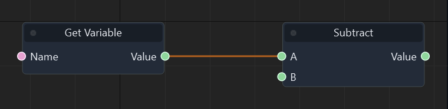

Graph: `templates/games/flappy_bird/graphs/gameplay.json` · Function: **Advance Pipe 1** · Node: `n1`.

[Mở hướng dẫn game](games/flappy-bird.md)

### Đọc thêm

[Tài liệu hệ thống: typed-data.md](typed-data.md)

### Set Variable

ID `3005` · `action` · Workflow `shared`

Ghi biến float trong phạm vi scene. Name phải khớp biến đã khai báo; chọn đúng kiểu.

### IO

| Chiều | Cổng | Kiểu | Mặc định |
| --- | --- | --- | --- |
| IN | In | `exec` | — |
| IN | Name | `string` | `"score"` |
| IN | Value | `float` | `0.0` |
| OUT | Out | `exec` | — |

Cổng `exec` điều khiển thứ tự. Cổng dữ liệu phải khớp kiểu; `vec2` không tự chuyển sang `vec3`.

### Cách dùng

1. Tìm **Set Variable** trong Node Library hoặc nhấn Tab trong graph để thêm node.
2. Chọn node, nhập hằng số ở Inspector theo bảng IN. Chuỗi nhập trực tiếp; vector/mảng nhập theo JSON, ví dụ `[1, 0, 0]`. Khai báo biến qua Scene > Scene Variables… trước khi dùng Get/Set Variable.
3. Có thể kéo dây từ OUT dữ liệu vào IN có cùng kiểu; giá trị từ dây thay thế hằng số của cổng.
4. Nối OUT exec của sự kiện/node trước vào IN exec; nối tiếp các OUT exec phù hợp tới bước sau.
5. Nhấn F5, thử tình huống, kiểm tra Console/Diagnostics; Shift+F5 dừng. Ctrl+S lưu thay đổi graph.

### Ví dụ từ graph thật

Trích đoạn Advance Pipe 1 của flappy_bird: node n5. Đây là các node và dây nối thật từ graph đã chạy; vị trí được sắp lại để dễ đọc.

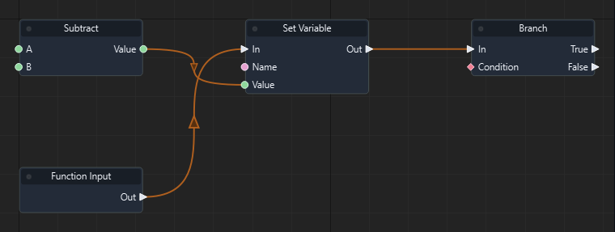

Graph: `templates/games/flappy_bird/graphs/gameplay.json` · Function: **Advance Pipe 1** · Node: `n5`.

[Mở hướng dẫn game](games/flappy-bird.md)

### Đọc thêm

[Tài liệu hệ thống: typed-data.md](typed-data.md)

### Format Float

ID `3050` · `pure` · Workflow `shared`

Chuyển float thành string theo độ chính xác đã chọn.

### IO

| Chiều | Cổng | Kiểu | Mặc định |
| --- | --- | --- | --- |
| IN | Value | `float` | `0` |
| OUT | Value | `string` | — |

Cổng `exec` điều khiển thứ tự. Cổng dữ liệu phải khớp kiểu; `vec2` không tự chuyển sang `vec3`.

### Cách dùng

1. Tìm **Format Float** trong Node Library hoặc nhấn Tab trong graph để thêm node.
2. Chọn node, nhập hằng số ở Inspector theo bảng IN. Chuỗi nhập trực tiếp; vector/mảng nhập theo JSON, ví dụ `[1, 0, 0]`. Khai báo biến qua Scene > Scene Variables… trước khi dùng Get/Set Variable.
3. Có thể kéo dây từ OUT dữ liệu vào IN có cùng kiểu; giá trị từ dây thay thế hằng số của cổng.
4. Nối OUT dữ liệu tới node dùng kết quả. Node pure không cần dây exec.
5. Nhấn F5, thử tình huống, kiểm tra Console/Diagnostics; Shift+F5 dừng. Ctrl+S lưu thay đổi graph.

### Đọc thêm

[Tài liệu hệ thống: typed-data.md](typed-data.md)

### Format Integer

ID `3051` · `pure` · Workflow `shared`

Chuyển int thành string để hiển thị số trên HUD; không thay đổi biến gốc.

### IO

| Chiều | Cổng | Kiểu | Mặc định |
| --- | --- | --- | --- |
| IN | Value | `int` | `0` |
| OUT | Value | `string` | — |

Cổng `exec` điều khiển thứ tự. Cổng dữ liệu phải khớp kiểu; `vec2` không tự chuyển sang `vec3`.

### Cách dùng

1. Tìm **Format Integer** trong Node Library hoặc nhấn Tab trong graph để thêm node.
2. Chọn node, nhập hằng số ở Inspector theo bảng IN. Chuỗi nhập trực tiếp; vector/mảng nhập theo JSON, ví dụ `[1, 0, 0]`. Khai báo biến qua Scene > Scene Variables… trước khi dùng Get/Set Variable.
3. Có thể kéo dây từ OUT dữ liệu vào IN có cùng kiểu; giá trị từ dây thay thế hằng số của cổng.
4. Nối OUT dữ liệu tới node dùng kết quả. Node pure không cần dây exec.
5. Nhấn F5, thử tình huống, kiểm tra Console/Diagnostics; Shift+F5 dừng. Ctrl+S lưu thay đổi graph.

### Ví dụ từ graph thật

Trích đoạn Refresh HUD của flappy_bird: node n2. Đây là các node và dây nối thật từ graph đã chạy; vị trí được sắp lại để dễ đọc.

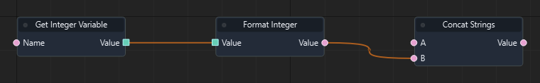

Graph: `templates/games/flappy_bird/graphs/gameplay.json` · Function: **Refresh HUD** · Node: `n2`.

[Mở hướng dẫn game](games/flappy-bird.md)

### Đọc thêm

[Tài liệu hệ thống: typed-data.md](typed-data.md)

### Concat Strings

ID `3052` · `pure` · Workflow `shared`

Ghép chuỗi A rồi B. Flappy ghép SCORE với kết quả Format Integer.

### IO

| Chiều | Cổng | Kiểu | Mặc định |
| --- | --- | --- | --- |
| IN | A | `string` | `""` |
| IN | B | `string` | `""` |
| OUT | Value | `string` | — |

Cổng `exec` điều khiển thứ tự. Cổng dữ liệu phải khớp kiểu; `vec2` không tự chuyển sang `vec3`.

### Cách dùng

1. Tìm **Concat Strings** trong Node Library hoặc nhấn Tab trong graph để thêm node.
2. Chọn node, nhập hằng số ở Inspector theo bảng IN. Chuỗi nhập trực tiếp; vector/mảng nhập theo JSON, ví dụ `[1, 0, 0]`. Khai báo biến qua Scene > Scene Variables… trước khi dùng Get/Set Variable.
3. Có thể kéo dây từ OUT dữ liệu vào IN có cùng kiểu; giá trị từ dây thay thế hằng số của cổng.
4. Nối OUT dữ liệu tới node dùng kết quả. Node pure không cần dây exec.
5. Nhấn F5, thử tình huống, kiểm tra Console/Diagnostics; Shift+F5 dừng. Ctrl+S lưu thay đổi graph.

### Ví dụ từ graph thật

Trích đoạn Refresh HUD của flappy_bird: node n3. Đây là các node và dây nối thật từ graph đã chạy; vị trí được sắp lại để dễ đọc.

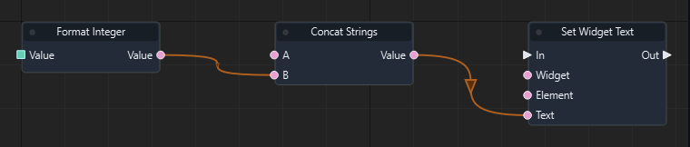

Graph: `templates/games/flappy_bird/graphs/gameplay.json` · Function: **Refresh HUD** · Node: `n3`.

[Mở hướng dẫn game](games/flappy-bird.md)

### Đọc thêm

[Tài liệu hệ thống: typed-data.md](typed-data.md)

### String Equal

ID `3053` · `pure` · Workflow `shared`

Trả bool cho phép so sánh hai chuỗi A và B chính xác, phân biệt hoa thường.

### IO

| Chiều | Cổng | Kiểu | Mặc định |
| --- | --- | --- | --- |
| IN | A | `string` | `""` |
| IN | B | `string` | `""` |
| OUT | Value | `bool` | — |

Cổng `exec` điều khiển thứ tự. Cổng dữ liệu phải khớp kiểu; `vec2` không tự chuyển sang `vec3`.

### Cách dùng

1. Tìm **String Equal** trong Node Library hoặc nhấn Tab trong graph để thêm node.
2. Chọn node, nhập hằng số ở Inspector theo bảng IN. Chuỗi nhập trực tiếp; vector/mảng nhập theo JSON, ví dụ `[1, 0, 0]`. Khai báo biến qua Scene > Scene Variables… trước khi dùng Get/Set Variable.
3. Có thể kéo dây từ OUT dữ liệu vào IN có cùng kiểu; giá trị từ dây thay thế hằng số của cổng.
4. Nối OUT dữ liệu tới node dùng kết quả. Node pure không cần dây exec.
5. Nhấn F5, thử tình huống, kiểm tra Console/Diagnostics; Shift+F5 dừng. Ctrl+S lưu thay đổi graph.

### Ví dụ từ graph thật

Trích đoạn Refresh HUD của flappy_bird: node n17. Đây là các node và dây nối thật từ graph đã chạy; vị trí được sắp lại để dễ đọc.

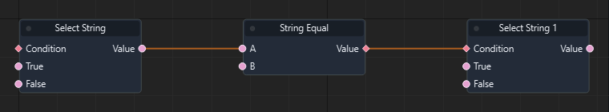

Graph: `templates/games/flappy_bird/graphs/gameplay.json` · Function: **Refresh HUD** · Node: `n17`.

[Mở hướng dẫn game](games/flappy-bird.md)

### Đọc thêm

[Tài liệu hệ thống: typed-data.md](typed-data.md)

### Format Boolean

ID `3054` · `pure` · Workflow `shared`

Chuyển bool thành string để hiển thị.

### IO

| Chiều | Cổng | Kiểu | Mặc định |
| --- | --- | --- | --- |
| IN | Value | `bool` | `false` |
| OUT | Value | `string` | — |

Cổng `exec` điều khiển thứ tự. Cổng dữ liệu phải khớp kiểu; `vec2` không tự chuyển sang `vec3`.

### Cách dùng

1. Tìm **Format Boolean** trong Node Library hoặc nhấn Tab trong graph để thêm node.
2. Chọn node, nhập hằng số ở Inspector theo bảng IN. Chuỗi nhập trực tiếp; vector/mảng nhập theo JSON, ví dụ `[1, 0, 0]`. Khai báo biến qua Scene > Scene Variables… trước khi dùng Get/Set Variable.
3. Có thể kéo dây từ OUT dữ liệu vào IN có cùng kiểu; giá trị từ dây thay thế hằng số của cổng.
4. Nối OUT dữ liệu tới node dùng kết quả. Node pure không cần dây exec.
5. Nhấn F5, thử tình huống, kiểm tra Console/Diagnostics; Shift+F5 dừng. Ctrl+S lưu thay đổi graph.

### Đọc thêm

[Tài liệu hệ thống: typed-data.md](typed-data.md)

### String Split

ID `3055` · `pure` · Workflow `shared`

Tách chuỗi theo delimiter thành mảng string.

### IO

| Chiều | Cổng | Kiểu | Mặc định |
| --- | --- | --- | --- |
| IN | Text | `string` | `""` |
| IN | Separator | `string` | `","` |
| OUT | Value | `array<string>` | — |

Cổng `exec` điều khiển thứ tự. Cổng dữ liệu phải khớp kiểu; `vec2` không tự chuyển sang `vec3`.

### Cách dùng

1. Tìm **String Split** trong Node Library hoặc nhấn Tab trong graph để thêm node.
2. Chọn node, nhập hằng số ở Inspector theo bảng IN. Chuỗi nhập trực tiếp; vector/mảng nhập theo JSON, ví dụ `[1, 0, 0]`. Khai báo biến qua Scene > Scene Variables… trước khi dùng Get/Set Variable.
3. Có thể kéo dây từ OUT dữ liệu vào IN có cùng kiểu; giá trị từ dây thay thế hằng số của cổng.
4. Nối OUT dữ liệu tới node dùng kết quả. Node pure không cần dây exec.
5. Nhấn F5, thử tình huống, kiểm tra Console/Diagnostics; Shift+F5 dừng. Ctrl+S lưu thay đổi graph.

### Đọc thêm

[Tài liệu hệ thống: typed-data.md](typed-data.md)

### String Replace

ID `3056` · `pure` · Workflow `shared`

Thay các đoạn khớp chuỗi tìm kiếm bằng chuỗi thay thế.

### IO

| Chiều | Cổng | Kiểu | Mặc định |
| --- | --- | --- | --- |
| IN | Text | `string` | `""` |
| IN | Find | `string` | `"old"` |
| IN | Replacement | `string` | `"new"` |
| OUT | Value | `string` | — |

Cổng `exec` điều khiển thứ tự. Cổng dữ liệu phải khớp kiểu; `vec2` không tự chuyển sang `vec3`.

### Cách dùng

1. Tìm **String Replace** trong Node Library hoặc nhấn Tab trong graph để thêm node.
2. Chọn node, nhập hằng số ở Inspector theo bảng IN. Chuỗi nhập trực tiếp; vector/mảng nhập theo JSON, ví dụ `[1, 0, 0]`. Khai báo biến qua Scene > Scene Variables… trước khi dùng Get/Set Variable.
3. Có thể kéo dây từ OUT dữ liệu vào IN có cùng kiểu; giá trị từ dây thay thế hằng số của cổng.
4. Nối OUT dữ liệu tới node dùng kết quả. Node pure không cần dây exec.
5. Nhấn F5, thử tình huống, kiểm tra Console/Diagnostics; Shift+F5 dừng. Ctrl+S lưu thay đổi graph.

### Đọc thêm

[Tài liệu hệ thống: typed-data.md](typed-data.md)

### String Join

ID `3057` · `pure` · Workflow `shared`

Ghép mảng string bằng separator.

### IO

| Chiều | Cổng | Kiểu | Mặc định |
| --- | --- | --- | --- |
| IN | Items | `array<string>` | `[]` |
| IN | Separator | `string` | `","` |
| OUT | Value | `string` | — |

Cổng `exec` điều khiển thứ tự. Cổng dữ liệu phải khớp kiểu; `vec2` không tự chuyển sang `vec3`.

### Cách dùng

1. Tìm **String Join** trong Node Library hoặc nhấn Tab trong graph để thêm node.
2. Chọn node, nhập hằng số ở Inspector theo bảng IN. Chuỗi nhập trực tiếp; vector/mảng nhập theo JSON, ví dụ `[1, 0, 0]`. Khai báo biến qua Scene > Scene Variables… trước khi dùng Get/Set Variable.
3. Có thể kéo dây từ OUT dữ liệu vào IN có cùng kiểu; giá trị từ dây thay thế hằng số của cổng.
4. Nối OUT dữ liệu tới node dùng kết quả. Node pure không cần dây exec.
5. Nhấn F5, thử tình huống, kiểm tra Console/Diagnostics; Shift+F5 dừng. Ctrl+S lưu thay đổi graph.

### Đọc thêm

[Tài liệu hệ thống: typed-data.md](typed-data.md)

### Entity ID

ID `3058` · `pure` · Workflow `shared`

Trả stable ID của tham chiếu entity dưới dạng string.

### IO

| Chiều | Cổng | Kiểu | Mặc định |
| --- | --- | --- | --- |
| IN | Entity | `entity` | `"player"` |
| OUT | Value | `string` | — |

Cổng `exec` điều khiển thứ tự. Cổng dữ liệu phải khớp kiểu; `vec2` không tự chuyển sang `vec3`.

### Cách dùng

1. Tìm **Entity ID** trong Node Library hoặc nhấn Tab trong graph để thêm node.
2. Chọn node, nhập hằng số ở Inspector theo bảng IN. Chuỗi nhập trực tiếp; vector/mảng nhập theo JSON, ví dụ `[1, 0, 0]`. Khai báo biến qua Scene > Scene Variables… trước khi dùng Get/Set Variable.
3. Có thể kéo dây từ OUT dữ liệu vào IN có cùng kiểu; giá trị từ dây thay thế hằng số của cổng.
4. Nối OUT dữ liệu tới node dùng kết quả. Node pure không cần dây exec.
5. Nhấn F5, thử tình huống, kiểm tra Console/Diagnostics; Shift+F5 dừng. Ctrl+S lưu thay đổi graph.

### Đọc thêm

[Tài liệu hệ thống: typed-data.md](typed-data.md)

### Compare References

ID `3059` · `pure` · Workflow `shared`

So sánh hai tham chiếu entity có cùng danh tính hay không.

### IO

| Chiều | Cổng | Kiểu | Mặc định |
| --- | --- | --- | --- |
| IN | A | `entity` | `"player"` |
| IN | B | `entity` | `"player"` |
| OUT | Value | `bool` | — |

Cổng `exec` điều khiển thứ tự. Cổng dữ liệu phải khớp kiểu; `vec2` không tự chuyển sang `vec3`.

### Cách dùng

1. Tìm **Compare References** trong Node Library hoặc nhấn Tab trong graph để thêm node.
2. Chọn node, nhập hằng số ở Inspector theo bảng IN. Chuỗi nhập trực tiếp; vector/mảng nhập theo JSON, ví dụ `[1, 0, 0]`. Khai báo biến qua Scene > Scene Variables… trước khi dùng Get/Set Variable.
3. Có thể kéo dây từ OUT dữ liệu vào IN có cùng kiểu; giá trị từ dây thay thế hằng số của cổng.
4. Nối OUT dữ liệu tới node dùng kết quả. Node pure không cần dây exec.
5. Nhấn F5, thử tình huống, kiểm tra Console/Diagnostics; Shift+F5 dừng. Ctrl+S lưu thay đổi graph.

### Đọc thêm

[Tài liệu hệ thống: typed-data.md](typed-data.md)

### Integer

ID `3090` · `pure` · Workflow `shared`

Tạo hằng số int từ Value.

### IO

| Chiều | Cổng | Kiểu | Mặc định |
| --- | --- | --- | --- |
| IN | Value | `int` | `0` |
| OUT | Value | `int` | — |

Cổng `exec` điều khiển thứ tự. Cổng dữ liệu phải khớp kiểu; `vec2` không tự chuyển sang `vec3`.

### Cách dùng

1. Tìm **Integer** trong Node Library hoặc nhấn Tab trong graph để thêm node.
2. Chọn node, nhập hằng số ở Inspector theo bảng IN. Chuỗi nhập trực tiếp; vector/mảng nhập theo JSON, ví dụ `[1, 0, 0]`. Khai báo biến qua Scene > Scene Variables… trước khi dùng Get/Set Variable.
3. Có thể kéo dây từ OUT dữ liệu vào IN có cùng kiểu; giá trị từ dây thay thế hằng số của cổng.
4. Nối OUT dữ liệu tới node dùng kết quả. Node pure không cần dây exec.
5. Nhấn F5, thử tình huống, kiểm tra Console/Diagnostics; Shift+F5 dừng. Ctrl+S lưu thay đổi graph.

### Đọc thêm

[Tài liệu hệ thống: typed-data.md](typed-data.md)

### Get Integer Variable

ID `3101` · `pure` · Workflow `shared`

Ghi biến int trong phạm vi scene. Name phải khớp biến đã khai báo; chọn đúng kiểu.

### IO

| Chiều | Cổng | Kiểu | Mặc định |
| --- | --- | --- | --- |
| IN | Name | `string` | `"int_value"` |
| OUT | Value | `int` | — |

Cổng `exec` điều khiển thứ tự. Cổng dữ liệu phải khớp kiểu; `vec2` không tự chuyển sang `vec3`.

### Cách dùng

1. Tìm **Get Integer Variable** trong Node Library hoặc nhấn Tab trong graph để thêm node.
2. Chọn node, nhập hằng số ở Inspector theo bảng IN. Chuỗi nhập trực tiếp; vector/mảng nhập theo JSON, ví dụ `[1, 0, 0]`. Khai báo biến qua Scene > Scene Variables… trước khi dùng Get/Set Variable.
3. Có thể kéo dây từ OUT dữ liệu vào IN có cùng kiểu; giá trị từ dây thay thế hằng số của cổng.
4. Nối OUT dữ liệu tới node dùng kết quả. Node pure không cần dây exec.
5. Nhấn F5, thử tình huống, kiểm tra Console/Diagnostics; Shift+F5 dừng. Ctrl+S lưu thay đổi graph.

### Ví dụ từ graph thật

Trích đoạn Gameplay của flappy_bird: node n6. Đây là các node và dây nối thật từ graph đã chạy; vị trí được sắp lại để dễ đọc.

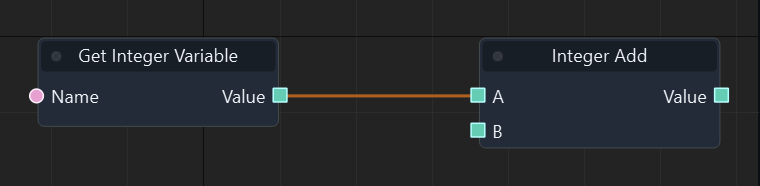

Graph: `templates/games/flappy_bird/graphs/gameplay.json` · Function: **Gameplay** · Node: `n6`.

[Mở hướng dẫn game](games/flappy-bird.md)

### Đọc thêm

[Tài liệu hệ thống: typed-data.md](typed-data.md)

### Get Boolean Variable

ID `3102` · `pure` · Workflow `shared`

Ghi biến bool trong phạm vi scene. Name phải khớp biến đã khai báo; chọn đúng kiểu.

### IO

| Chiều | Cổng | Kiểu | Mặc định |
| --- | --- | --- | --- |
| IN | Name | `string` | `"bool_value"` |
| OUT | Value | `bool` | — |

Cổng `exec` điều khiển thứ tự. Cổng dữ liệu phải khớp kiểu; `vec2` không tự chuyển sang `vec3`.

### Cách dùng

1. Tìm **Get Boolean Variable** trong Node Library hoặc nhấn Tab trong graph để thêm node.
2. Chọn node, nhập hằng số ở Inspector theo bảng IN. Chuỗi nhập trực tiếp; vector/mảng nhập theo JSON, ví dụ `[1, 0, 0]`. Khai báo biến qua Scene > Scene Variables… trước khi dùng Get/Set Variable.
3. Có thể kéo dây từ OUT dữ liệu vào IN có cùng kiểu; giá trị từ dây thay thế hằng số của cổng.
4. Nối OUT dữ liệu tới node dùng kết quả. Node pure không cần dây exec.
5. Nhấn F5, thử tình huống, kiểm tra Console/Diagnostics; Shift+F5 dừng. Ctrl+S lưu thay đổi graph.

### Ví dụ từ graph thật

Trích đoạn Gameplay của flappy_bird: node n10. Đây là các node và dây nối thật từ graph đã chạy; vị trí được sắp lại để dễ đọc.

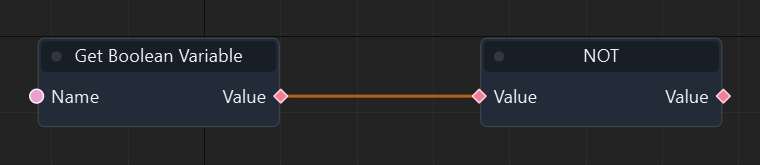

Graph: `templates/games/flappy_bird/graphs/gameplay.json` · Function: **Gameplay** · Node: `n10`.

[Mở hướng dẫn game](games/flappy-bird.md)

### Đọc thêm

[Tài liệu hệ thống: typed-data.md](typed-data.md)

### Get String Variable

ID `3103` · `pure` · Workflow `shared`

Ghi biến string trong phạm vi scene. Name phải khớp biến đã khai báo; chọn đúng kiểu.

### IO

| Chiều | Cổng | Kiểu | Mặc định |
| --- | --- | --- | --- |
| IN | Name | `string` | `"string_value"` |
| OUT | Value | `string` | — |

Cổng `exec` điều khiển thứ tự. Cổng dữ liệu phải khớp kiểu; `vec2` không tự chuyển sang `vec3`.

### Cách dùng

1. Tìm **Get String Variable** trong Node Library hoặc nhấn Tab trong graph để thêm node.
2. Chọn node, nhập hằng số ở Inspector theo bảng IN. Chuỗi nhập trực tiếp; vector/mảng nhập theo JSON, ví dụ `[1, 0, 0]`. Khai báo biến qua Scene > Scene Variables… trước khi dùng Get/Set Variable.
3. Có thể kéo dây từ OUT dữ liệu vào IN có cùng kiểu; giá trị từ dây thay thế hằng số của cổng.
4. Nối OUT dữ liệu tới node dùng kết quả. Node pure không cần dây exec.
5. Nhấn F5, thử tình huống, kiểm tra Console/Diagnostics; Shift+F5 dừng. Ctrl+S lưu thay đổi graph.

### Ví dụ từ graph thật

Trích đoạn Refresh board của isometric_snake_3d: node n21. Đây là các node và dây nối thật từ graph đã chạy; vị trí được sắp lại để dễ đọc.

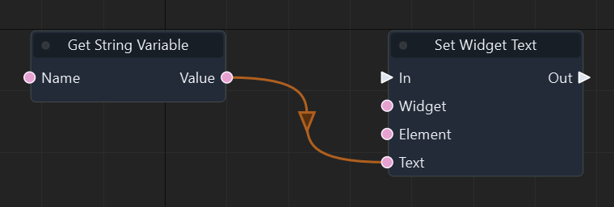

Graph: `templates/games/isometric_snake_3d/graphs/gameplay.json` · Function: **Refresh board** · Node: `n21`.

[Mở hướng dẫn game](games/isometric-snake.md)

### Đọc thêm

[Tài liệu hệ thống: typed-data.md](typed-data.md)

### Get Vector3 Variable

ID `3104` · `pure` · Workflow `shared`

Ghi biến vec3 trong phạm vi scene. Name phải khớp biến đã khai báo; chọn đúng kiểu.

### IO

| Chiều | Cổng | Kiểu | Mặc định |
| --- | --- | --- | --- |
| IN | Name | `string` | `"vec3_value"` |
| OUT | Value | `vec3` | — |

Cổng `exec` điều khiển thứ tự. Cổng dữ liệu phải khớp kiểu; `vec2` không tự chuyển sang `vec3`.

### Cách dùng

1. Tìm **Get Vector3 Variable** trong Node Library hoặc nhấn Tab trong graph để thêm node.
2. Chọn node, nhập hằng số ở Inspector theo bảng IN. Chuỗi nhập trực tiếp; vector/mảng nhập theo JSON, ví dụ `[1, 0, 0]`. Khai báo biến qua Scene > Scene Variables… trước khi dùng Get/Set Variable.
3. Có thể kéo dây từ OUT dữ liệu vào IN có cùng kiểu; giá trị từ dây thay thế hằng số của cổng.
4. Nối OUT dữ liệu tới node dùng kết quả. Node pure không cần dây exec.
5. Nhấn F5, thử tình huống, kiểm tra Console/Diagnostics; Shift+F5 dừng. Ctrl+S lưu thay đổi graph.

### Ví dụ từ graph thật

Trích đoạn Advance snake của isometric_snake_3d: node n17. Đây là các node và dây nối thật từ graph đã chạy; vị trí được sắp lại để dễ đọc.

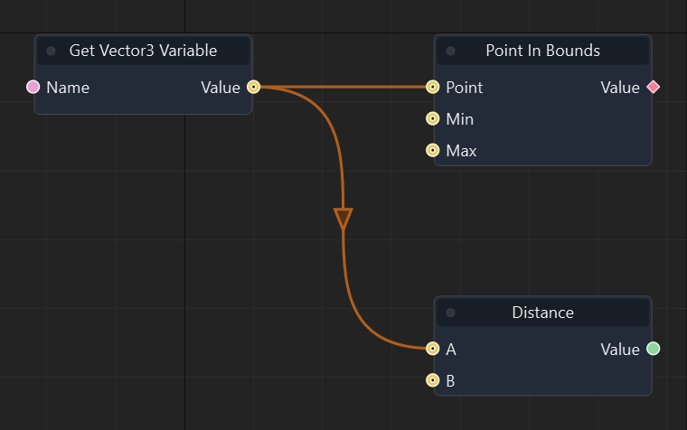

Graph: `templates/games/isometric_snake_3d/graphs/gameplay.json` · Function: **Advance snake** · Node: `n17`.

[Mở hướng dẫn game](games/isometric-snake.md)

### Đọc thêm

[Tài liệu hệ thống: typed-data.md](typed-data.md)

### Get Entity Variable

ID `3105` · `pure` · Workflow `shared`

Ghi biến entity trong phạm vi scene. Name phải khớp biến đã khai báo; chọn đúng kiểu.

### IO

| Chiều | Cổng | Kiểu | Mặc định |
| --- | --- | --- | --- |
| IN | Name | `string` | `"entity_value"` |
| OUT | Value | `entity` | — |

Cổng `exec` điều khiển thứ tự. Cổng dữ liệu phải khớp kiểu; `vec2` không tự chuyển sang `vec3`.

### Cách dùng

1. Tìm **Get Entity Variable** trong Node Library hoặc nhấn Tab trong graph để thêm node.
2. Chọn node, nhập hằng số ở Inspector theo bảng IN. Chuỗi nhập trực tiếp; vector/mảng nhập theo JSON, ví dụ `[1, 0, 0]`. Khai báo biến qua Scene > Scene Variables… trước khi dùng Get/Set Variable.
3. Có thể kéo dây từ OUT dữ liệu vào IN có cùng kiểu; giá trị từ dây thay thế hằng số của cổng.
4. Nối OUT dữ liệu tới node dùng kết quả. Node pure không cần dây exec.
5. Nhấn F5, thử tình huống, kiểm tra Console/Diagnostics; Shift+F5 dừng. Ctrl+S lưu thay đổi graph.

### Đọc thêm

[Tài liệu hệ thống: typed-data.md](typed-data.md)

### Get Vector2 Variable

ID `3106` · `pure` · Workflow `shared`

Ghi biến vec2 trong phạm vi scene. Name phải khớp biến đã khai báo; chọn đúng kiểu.

### IO

| Chiều | Cổng | Kiểu | Mặc định |
| --- | --- | --- | --- |
| IN | Name | `string` | `"vec2_value"` |
| OUT | Value | `vec2` | — |

Cổng `exec` điều khiển thứ tự. Cổng dữ liệu phải khớp kiểu; `vec2` không tự chuyển sang `vec3`.

### Cách dùng

1. Tìm **Get Vector2 Variable** trong Node Library hoặc nhấn Tab trong graph để thêm node.
2. Chọn node, nhập hằng số ở Inspector theo bảng IN. Chuỗi nhập trực tiếp; vector/mảng nhập theo JSON, ví dụ `[1, 0, 0]`. Khai báo biến qua Scene > Scene Variables… trước khi dùng Get/Set Variable.
3. Có thể kéo dây từ OUT dữ liệu vào IN có cùng kiểu; giá trị từ dây thay thế hằng số của cổng.
4. Nối OUT dữ liệu tới node dùng kết quả. Node pure không cần dây exec.
5. Nhấn F5, thử tình huống, kiểm tra Console/Diagnostics; Shift+F5 dừng. Ctrl+S lưu thay đổi graph.

### Đọc thêm

[Tài liệu hệ thống: typed-data.md](typed-data.md)

### Get Vector4 Variable

ID `3107` · `pure` · Workflow `shared`

Ghi biến vec4 trong phạm vi scene. Name phải khớp biến đã khai báo; chọn đúng kiểu.

### IO

| Chiều | Cổng | Kiểu | Mặc định |
| --- | --- | --- | --- |
| IN | Name | `string` | `"vec4_value"` |
| OUT | Value | `vec4` | — |

Cổng `exec` điều khiển thứ tự. Cổng dữ liệu phải khớp kiểu; `vec2` không tự chuyển sang `vec3`.

### Cách dùng

1. Tìm **Get Vector4 Variable** trong Node Library hoặc nhấn Tab trong graph để thêm node.
2. Chọn node, nhập hằng số ở Inspector theo bảng IN. Chuỗi nhập trực tiếp; vector/mảng nhập theo JSON, ví dụ `[1, 0, 0]`. Khai báo biến qua Scene > Scene Variables… trước khi dùng Get/Set Variable.
3. Có thể kéo dây từ OUT dữ liệu vào IN có cùng kiểu; giá trị từ dây thay thế hằng số của cổng.
4. Nối OUT dữ liệu tới node dùng kết quả. Node pure không cần dây exec.
5. Nhấn F5, thử tình huống, kiểm tra Console/Diagnostics; Shift+F5 dừng. Ctrl+S lưu thay đổi graph.

### Đọc thêm

[Tài liệu hệ thống: typed-data.md](typed-data.md)

### Get Quaternion Variable

ID `3108` · `pure` · Workflow `shared`

Ghi biến quat trong phạm vi scene. Name phải khớp biến đã khai báo; chọn đúng kiểu.

### IO

| Chiều | Cổng | Kiểu | Mặc định |
| --- | --- | --- | --- |
| IN | Name | `string` | `"quat_value"` |
| OUT | Value | `quat` | — |

Cổng `exec` điều khiển thứ tự. Cổng dữ liệu phải khớp kiểu; `vec2` không tự chuyển sang `vec3`.

### Cách dùng

1. Tìm **Get Quaternion Variable** trong Node Library hoặc nhấn Tab trong graph để thêm node.
2. Chọn node, nhập hằng số ở Inspector theo bảng IN. Chuỗi nhập trực tiếp; vector/mảng nhập theo JSON, ví dụ `[1, 0, 0]`. Khai báo biến qua Scene > Scene Variables… trước khi dùng Get/Set Variable.
3. Có thể kéo dây từ OUT dữ liệu vào IN có cùng kiểu; giá trị từ dây thay thế hằng số của cổng.
4. Nối OUT dữ liệu tới node dùng kết quả. Node pure không cần dây exec.
5. Nhấn F5, thử tình huống, kiểm tra Console/Diagnostics; Shift+F5 dừng. Ctrl+S lưu thay đổi graph.

### Đọc thêm

[Tài liệu hệ thống: typed-data.md](typed-data.md)

### Get Matrix4 Variable

ID `3109` · `pure` · Workflow `shared`

Ghi biến mat4 trong phạm vi scene. Name phải khớp biến đã khai báo; chọn đúng kiểu.

### IO

| Chiều | Cổng | Kiểu | Mặc định |
| --- | --- | --- | --- |
| IN | Name | `string` | `"mat4_value"` |
| OUT | Value | `mat4` | — |

Cổng `exec` điều khiển thứ tự. Cổng dữ liệu phải khớp kiểu; `vec2` không tự chuyển sang `vec3`.

### Cách dùng

1. Tìm **Get Matrix4 Variable** trong Node Library hoặc nhấn Tab trong graph để thêm node.
2. Chọn node, nhập hằng số ở Inspector theo bảng IN. Chuỗi nhập trực tiếp; vector/mảng nhập theo JSON, ví dụ `[1, 0, 0]`. Khai báo biến qua Scene > Scene Variables… trước khi dùng Get/Set Variable.
3. Có thể kéo dây từ OUT dữ liệu vào IN có cùng kiểu; giá trị từ dây thay thế hằng số của cổng.
4. Nối OUT dữ liệu tới node dùng kết quả. Node pure không cần dây exec.
5. Nhấn F5, thử tình huống, kiểm tra Console/Diagnostics; Shift+F5 dừng. Ctrl+S lưu thay đổi graph.

### Đọc thêm

[Tài liệu hệ thống: typed-data.md](typed-data.md)

### Set Integer Variable

ID `3111` · `action` · Workflow `shared`

Ghi biến int trong phạm vi scene. Name phải khớp biến đã khai báo; chọn đúng kiểu.

### IO

| Chiều | Cổng | Kiểu | Mặc định |
| --- | --- | --- | --- |
| IN | In | `exec` | — |
| IN | Name | `string` | `"int_value"` |
| IN | Value | `int` | `0` |
| OUT | Out | `exec` | — |

Cổng `exec` điều khiển thứ tự. Cổng dữ liệu phải khớp kiểu; `vec2` không tự chuyển sang `vec3`.

### Cách dùng

1. Tìm **Set Integer Variable** trong Node Library hoặc nhấn Tab trong graph để thêm node.
2. Chọn node, nhập hằng số ở Inspector theo bảng IN. Chuỗi nhập trực tiếp; vector/mảng nhập theo JSON, ví dụ `[1, 0, 0]`. Khai báo biến qua Scene > Scene Variables… trước khi dùng Get/Set Variable.
3. Có thể kéo dây từ OUT dữ liệu vào IN có cùng kiểu; giá trị từ dây thay thế hằng số của cổng.
4. Nối OUT exec của sự kiện/node trước vào IN exec; nối tiếp các OUT exec phù hợp tới bước sau.
5. Nhấn F5, thử tình huống, kiểm tra Console/Diagnostics; Shift+F5 dừng. Ctrl+S lưu thay đổi graph.

### Ví dụ từ graph thật

Trích đoạn Gameplay của flappy_bird: node n8. Đây là các node và dây nối thật từ graph đã chạy; vị trí được sắp lại để dễ đọc.

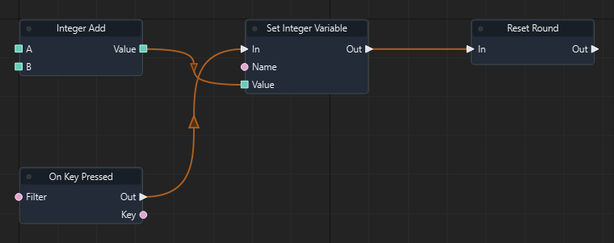

Graph: `templates/games/flappy_bird/graphs/gameplay.json` · Function: **Gameplay** · Node: `n8`.

[Mở hướng dẫn game](games/flappy-bird.md)

### Đọc thêm

[Tài liệu hệ thống: typed-data.md](typed-data.md)

### Set Boolean Variable

ID `3112` · `action` · Workflow `shared`

Ghi biến bool trong phạm vi scene. Name phải khớp biến đã khai báo; chọn đúng kiểu.

### IO

| Chiều | Cổng | Kiểu | Mặc định |
| --- | --- | --- | --- |
| IN | In | `exec` | — |
| IN | Name | `string` | `"bool_value"` |
| IN | Value | `bool` | `false` |
| OUT | Out | `exec` | — |

Cổng `exec` điều khiển thứ tự. Cổng dữ liệu phải khớp kiểu; `vec2` không tự chuyển sang `vec3`.

### Cách dùng

1. Tìm **Set Boolean Variable** trong Node Library hoặc nhấn Tab trong graph để thêm node.
2. Chọn node, nhập hằng số ở Inspector theo bảng IN. Chuỗi nhập trực tiếp; vector/mảng nhập theo JSON, ví dụ `[1, 0, 0]`. Khai báo biến qua Scene > Scene Variables… trước khi dùng Get/Set Variable.
3. Có thể kéo dây từ OUT dữ liệu vào IN có cùng kiểu; giá trị từ dây thay thế hằng số của cổng.
4. Nối OUT exec của sự kiện/node trước vào IN exec; nối tiếp các OUT exec phù hợp tới bước sau.
5. Nhấn F5, thử tình huống, kiểm tra Console/Diagnostics; Shift+F5 dừng. Ctrl+S lưu thay đổi graph.

### Ví dụ từ graph thật

Trích đoạn Gameplay của flappy_bird: node n12. Đây là các node và dây nối thật từ graph đã chạy; vị trí được sắp lại để dễ đọc.

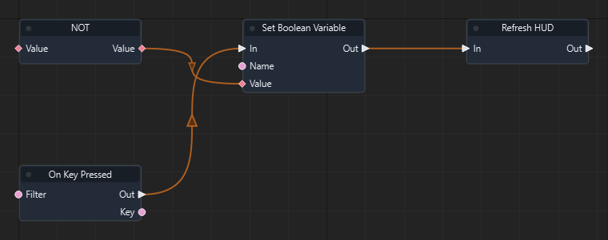

Graph: `templates/games/flappy_bird/graphs/gameplay.json` · Function: **Gameplay** · Node: `n12`.

[Mở hướng dẫn game](games/flappy-bird.md)

### Đọc thêm

[Tài liệu hệ thống: typed-data.md](typed-data.md)

### Set String Variable

ID `3113` · `action` · Workflow `shared`

Ghi biến string trong phạm vi scene. Name phải khớp biến đã khai báo; chọn đúng kiểu.

### IO

| Chiều | Cổng | Kiểu | Mặc định |
| --- | --- | --- | --- |
| IN | In | `exec` | — |
| IN | Name | `string` | `"string_value"` |
| IN | Value | `string` | `""` |
| OUT | Out | `exec` | — |

Cổng `exec` điều khiển thứ tự. Cổng dữ liệu phải khớp kiểu; `vec2` không tự chuyển sang `vec3`.

### Cách dùng

1. Tìm **Set String Variable** trong Node Library hoặc nhấn Tab trong graph để thêm node.
2. Chọn node, nhập hằng số ở Inspector theo bảng IN. Chuỗi nhập trực tiếp; vector/mảng nhập theo JSON, ví dụ `[1, 0, 0]`. Khai báo biến qua Scene > Scene Variables… trước khi dùng Get/Set Variable.
3. Có thể kéo dây từ OUT dữ liệu vào IN có cùng kiểu; giá trị từ dây thay thế hằng số của cổng.
4. Nối OUT exec của sự kiện/node trước vào IN exec; nối tiếp các OUT exec phù hợp tới bước sau.
5. Nhấn F5, thử tình huống, kiểm tra Console/Diagnostics; Shift+F5 dừng. Ctrl+S lưu thay đổi graph.

### Ví dụ từ graph thật

Trích đoạn Game Over của flappy_bird: node n3. Đây là các node và dây nối thật từ graph đã chạy; vị trí được sắp lại để dễ đọc.

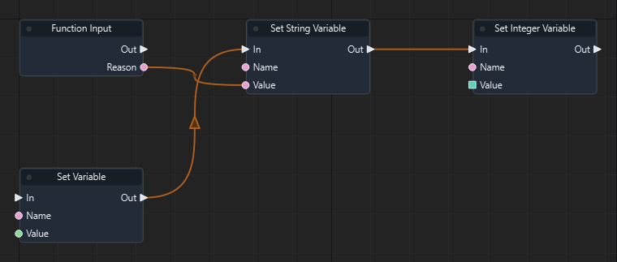

Graph: `templates/games/flappy_bird/graphs/gameplay.json` · Function: **Game Over** · Node: `n3`.

[Mở hướng dẫn game](games/flappy-bird.md)

### Đọc thêm

[Tài liệu hệ thống: typed-data.md](typed-data.md)

### Set Vector3 Variable

ID `3114` · `action` · Workflow `shared`

Ghi biến vec3 trong phạm vi scene. Name phải khớp biến đã khai báo; chọn đúng kiểu.

### IO

| Chiều | Cổng | Kiểu | Mặc định |
| --- | --- | --- | --- |
| IN | In | `exec` | — |
| IN | Name | `string` | `"vec3_value"` |
| IN | Value | `vec3` | `[0, 0, 0]` |
| OUT | Out | `exec` | — |

Cổng `exec` điều khiển thứ tự. Cổng dữ liệu phải khớp kiểu; `vec2` không tự chuyển sang `vec3`.

### Cách dùng

1. Tìm **Set Vector3 Variable** trong Node Library hoặc nhấn Tab trong graph để thêm node.
2. Chọn node, nhập hằng số ở Inspector theo bảng IN. Chuỗi nhập trực tiếp; vector/mảng nhập theo JSON, ví dụ `[1, 0, 0]`. Khai báo biến qua Scene > Scene Variables… trước khi dùng Get/Set Variable.
3. Có thể kéo dây từ OUT dữ liệu vào IN có cùng kiểu; giá trị từ dây thay thế hằng số của cổng.
4. Nối OUT exec của sự kiện/node trước vào IN exec; nối tiếp các OUT exec phù hợp tới bước sau.
5. Nhấn F5, thử tình huống, kiểm tra Console/Diagnostics; Shift+F5 dừng. Ctrl+S lưu thay đổi graph.

### Ví dụ từ graph thật

Trích đoạn Spawn food của isometric_snake_3d: node n17. Đây là các node và dây nối thật từ graph đã chạy; vị trí được sắp lại để dễ đọc.

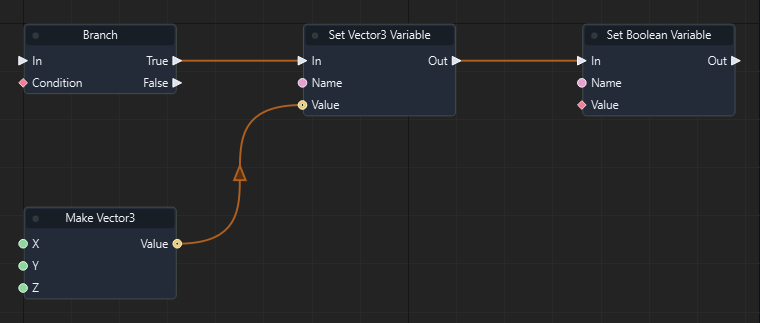

Graph: `templates/games/isometric_snake_3d/graphs/gameplay.json` · Function: **Spawn food** · Node: `n17`.

[Mở hướng dẫn game](games/isometric-snake.md)

### Đọc thêm

[Tài liệu hệ thống: typed-data.md](typed-data.md)

### Set Entity Variable

ID `3115` · `action` · Workflow `shared`

Ghi biến entity trong phạm vi scene. Name phải khớp biến đã khai báo; chọn đúng kiểu.

### IO

| Chiều | Cổng | Kiểu | Mặc định |
| --- | --- | --- | --- |
| IN | In | `exec` | — |
| IN | Name | `string` | `"entity_value"` |
| IN | Value | `entity` | `""` |
| OUT | Out | `exec` | — |

Cổng `exec` điều khiển thứ tự. Cổng dữ liệu phải khớp kiểu; `vec2` không tự chuyển sang `vec3`.

### Cách dùng

1. Tìm **Set Entity Variable** trong Node Library hoặc nhấn Tab trong graph để thêm node.
2. Chọn node, nhập hằng số ở Inspector theo bảng IN. Chuỗi nhập trực tiếp; vector/mảng nhập theo JSON, ví dụ `[1, 0, 0]`. Khai báo biến qua Scene > Scene Variables… trước khi dùng Get/Set Variable.
3. Có thể kéo dây từ OUT dữ liệu vào IN có cùng kiểu; giá trị từ dây thay thế hằng số của cổng.
4. Nối OUT exec của sự kiện/node trước vào IN exec; nối tiếp các OUT exec phù hợp tới bước sau.
5. Nhấn F5, thử tình huống, kiểm tra Console/Diagnostics; Shift+F5 dừng. Ctrl+S lưu thay đổi graph.

### Đọc thêm

[Tài liệu hệ thống: typed-data.md](typed-data.md)

### Set Vector2 Variable

ID `3116` · `action` · Workflow `shared`

Ghi biến vec2 trong phạm vi scene. Name phải khớp biến đã khai báo; chọn đúng kiểu.

### IO

| Chiều | Cổng | Kiểu | Mặc định |
| --- | --- | --- | --- |
| IN | In | `exec` | — |
| IN | Name | `string` | `"vec2_value"` |
| IN | Value | `vec2` | `[0, 0]` |
| OUT | Out | `exec` | — |

Cổng `exec` điều khiển thứ tự. Cổng dữ liệu phải khớp kiểu; `vec2` không tự chuyển sang `vec3`.

### Cách dùng

1. Tìm **Set Vector2 Variable** trong Node Library hoặc nhấn Tab trong graph để thêm node.
2. Chọn node, nhập hằng số ở Inspector theo bảng IN. Chuỗi nhập trực tiếp; vector/mảng nhập theo JSON, ví dụ `[1, 0, 0]`. Khai báo biến qua Scene > Scene Variables… trước khi dùng Get/Set Variable.
3. Có thể kéo dây từ OUT dữ liệu vào IN có cùng kiểu; giá trị từ dây thay thế hằng số của cổng.
4. Nối OUT exec của sự kiện/node trước vào IN exec; nối tiếp các OUT exec phù hợp tới bước sau.
5. Nhấn F5, thử tình huống, kiểm tra Console/Diagnostics; Shift+F5 dừng. Ctrl+S lưu thay đổi graph.

### Đọc thêm

[Tài liệu hệ thống: typed-data.md](typed-data.md)

### Set Vector4 Variable

ID `3117` · `action` · Workflow `shared`

Ghi biến vec4 trong phạm vi scene. Name phải khớp biến đã khai báo; chọn đúng kiểu.

### IO

| Chiều | Cổng | Kiểu | Mặc định |
| --- | --- | --- | --- |
| IN | In | `exec` | — |
| IN | Name | `string` | `"vec4_value"` |
| IN | Value | `vec4` | `[0, 0, 0, 0]` |
| OUT | Out | `exec` | — |

Cổng `exec` điều khiển thứ tự. Cổng dữ liệu phải khớp kiểu; `vec2` không tự chuyển sang `vec3`.

### Cách dùng

1. Tìm **Set Vector4 Variable** trong Node Library hoặc nhấn Tab trong graph để thêm node.
2. Chọn node, nhập hằng số ở Inspector theo bảng IN. Chuỗi nhập trực tiếp; vector/mảng nhập theo JSON, ví dụ `[1, 0, 0]`. Khai báo biến qua Scene > Scene Variables… trước khi dùng Get/Set Variable.
3. Có thể kéo dây từ OUT dữ liệu vào IN có cùng kiểu; giá trị từ dây thay thế hằng số của cổng.
4. Nối OUT exec của sự kiện/node trước vào IN exec; nối tiếp các OUT exec phù hợp tới bước sau.
5. Nhấn F5, thử tình huống, kiểm tra Console/Diagnostics; Shift+F5 dừng. Ctrl+S lưu thay đổi graph.

### Đọc thêm

[Tài liệu hệ thống: typed-data.md](typed-data.md)

### Set Quaternion Variable

ID `3118` · `action` · Workflow `shared`

Ghi biến quat trong phạm vi scene. Name phải khớp biến đã khai báo; chọn đúng kiểu.

### IO

| Chiều | Cổng | Kiểu | Mặc định |
| --- | --- | --- | --- |
| IN | In | `exec` | — |
| IN | Name | `string` | `"quat_value"` |
| IN | Value | `quat` | `[0, 0, 0, 1]` |
| OUT | Out | `exec` | — |

Cổng `exec` điều khiển thứ tự. Cổng dữ liệu phải khớp kiểu; `vec2` không tự chuyển sang `vec3`.

### Cách dùng

1. Tìm **Set Quaternion Variable** trong Node Library hoặc nhấn Tab trong graph để thêm node.
2. Chọn node, nhập hằng số ở Inspector theo bảng IN. Chuỗi nhập trực tiếp; vector/mảng nhập theo JSON, ví dụ `[1, 0, 0]`. Khai báo biến qua Scene > Scene Variables… trước khi dùng Get/Set Variable.
3. Có thể kéo dây từ OUT dữ liệu vào IN có cùng kiểu; giá trị từ dây thay thế hằng số của cổng.
4. Nối OUT exec của sự kiện/node trước vào IN exec; nối tiếp các OUT exec phù hợp tới bước sau.
5. Nhấn F5, thử tình huống, kiểm tra Console/Diagnostics; Shift+F5 dừng. Ctrl+S lưu thay đổi graph.

### Đọc thêm

[Tài liệu hệ thống: typed-data.md](typed-data.md)

### Set Matrix4 Variable

ID `3119` · `action` · Workflow `shared`

Ghi biến mat4 trong phạm vi scene. Name phải khớp biến đã khai báo; chọn đúng kiểu.

### IO

| Chiều | Cổng | Kiểu | Mặc định |
| --- | --- | --- | --- |
| IN | In | `exec` | — |
| IN | Name | `string` | `"mat4_value"` |
| IN | Value | `mat4` | `[1, 0, 0, 0, 0, 1, 0, 0, 0, 0, 1, 0, 0, 0, 0, 1]` |
| OUT | Out | `exec` | — |

Cổng `exec` điều khiển thứ tự. Cổng dữ liệu phải khớp kiểu; `vec2` không tự chuyển sang `vec3`.

### Cách dùng

1. Tìm **Set Matrix4 Variable** trong Node Library hoặc nhấn Tab trong graph để thêm node.
2. Chọn node, nhập hằng số ở Inspector theo bảng IN. Chuỗi nhập trực tiếp; vector/mảng nhập theo JSON, ví dụ `[1, 0, 0]`. Khai báo biến qua Scene > Scene Variables… trước khi dùng Get/Set Variable.
3. Có thể kéo dây từ OUT dữ liệu vào IN có cùng kiểu; giá trị từ dây thay thế hằng số của cổng.
4. Nối OUT exec của sự kiện/node trước vào IN exec; nối tiếp các OUT exec phù hợp tới bước sau.
5. Nhấn F5, thử tình huống, kiểm tra Console/Diagnostics; Shift+F5 dừng. Ctrl+S lưu thay đổi graph.

### Đọc thêm

[Tài liệu hệ thống: typed-data.md](typed-data.md)

### Get Float Array Variable

ID `3200` · `pure` · Workflow `shared`

Ghi biến array<float> trong phạm vi scene. Name phải khớp biến đã khai báo; chọn đúng kiểu.

### IO

| Chiều | Cổng | Kiểu | Mặc định |
| --- | --- | --- | --- |
| IN | Name | `string` | `"float_items"` |
| OUT | Value | `array<float>` | — |

Cổng `exec` điều khiển thứ tự. Cổng dữ liệu phải khớp kiểu; `vec2` không tự chuyển sang `vec3`.

### Cách dùng

1. Tìm **Get Float Array Variable** trong Node Library hoặc nhấn Tab trong graph để thêm node.
2. Chọn node, nhập hằng số ở Inspector theo bảng IN. Chuỗi nhập trực tiếp; vector/mảng nhập theo JSON, ví dụ `[1, 0, 0]`. Khai báo biến qua Scene > Scene Variables… trước khi dùng Get/Set Variable.
3. Có thể kéo dây từ OUT dữ liệu vào IN có cùng kiểu; giá trị từ dây thay thế hằng số của cổng.
4. Nối OUT dữ liệu tới node dùng kết quả. Node pure không cần dây exec.
5. Nhấn F5, thử tình huống, kiểm tra Console/Diagnostics; Shift+F5 dừng. Ctrl+S lưu thay đổi graph.

### Đọc thêm

[Tài liệu hệ thống: typed-data.md](typed-data.md)

### Get Integer Array Variable

ID `3201` · `pure` · Workflow `shared`

Ghi biến array<int> trong phạm vi scene. Name phải khớp biến đã khai báo; chọn đúng kiểu.

### IO

| Chiều | Cổng | Kiểu | Mặc định |
| --- | --- | --- | --- |
| IN | Name | `string` | `"int_items"` |
| OUT | Value | `array<int>` | — |

Cổng `exec` điều khiển thứ tự. Cổng dữ liệu phải khớp kiểu; `vec2` không tự chuyển sang `vec3`.

### Cách dùng

1. Tìm **Get Integer Array Variable** trong Node Library hoặc nhấn Tab trong graph để thêm node.
2. Chọn node, nhập hằng số ở Inspector theo bảng IN. Chuỗi nhập trực tiếp; vector/mảng nhập theo JSON, ví dụ `[1, 0, 0]`. Khai báo biến qua Scene > Scene Variables… trước khi dùng Get/Set Variable.
3. Có thể kéo dây từ OUT dữ liệu vào IN có cùng kiểu; giá trị từ dây thay thế hằng số của cổng.
4. Nối OUT dữ liệu tới node dùng kết quả. Node pure không cần dây exec.
5. Nhấn F5, thử tình huống, kiểm tra Console/Diagnostics; Shift+F5 dừng. Ctrl+S lưu thay đổi graph.

### Đọc thêm

[Tài liệu hệ thống: typed-data.md](typed-data.md)

### Get Boolean Array Variable

ID `3202` · `pure` · Workflow `shared`

Ghi biến array<bool> trong phạm vi scene. Name phải khớp biến đã khai báo; chọn đúng kiểu.

### IO

| Chiều | Cổng | Kiểu | Mặc định |
| --- | --- | --- | --- |
| IN | Name | `string` | `"bool_items"` |
| OUT | Value | `array<bool>` | — |

Cổng `exec` điều khiển thứ tự. Cổng dữ liệu phải khớp kiểu; `vec2` không tự chuyển sang `vec3`.

### Cách dùng

1. Tìm **Get Boolean Array Variable** trong Node Library hoặc nhấn Tab trong graph để thêm node.
2. Chọn node, nhập hằng số ở Inspector theo bảng IN. Chuỗi nhập trực tiếp; vector/mảng nhập theo JSON, ví dụ `[1, 0, 0]`. Khai báo biến qua Scene > Scene Variables… trước khi dùng Get/Set Variable.
3. Có thể kéo dây từ OUT dữ liệu vào IN có cùng kiểu; giá trị từ dây thay thế hằng số của cổng.
4. Nối OUT dữ liệu tới node dùng kết quả. Node pure không cần dây exec.
5. Nhấn F5, thử tình huống, kiểm tra Console/Diagnostics; Shift+F5 dừng. Ctrl+S lưu thay đổi graph.

### Đọc thêm

[Tài liệu hệ thống: typed-data.md](typed-data.md)

### Get String Array Variable

ID `3203` · `pure` · Workflow `shared`

Ghi biến array<string> trong phạm vi scene. Name phải khớp biến đã khai báo; chọn đúng kiểu.

### IO

| Chiều | Cổng | Kiểu | Mặc định |
| --- | --- | --- | --- |
| IN | Name | `string` | `"string_items"` |
| OUT | Value | `array<string>` | — |

Cổng `exec` điều khiển thứ tự. Cổng dữ liệu phải khớp kiểu; `vec2` không tự chuyển sang `vec3`.

### Cách dùng

1. Tìm **Get String Array Variable** trong Node Library hoặc nhấn Tab trong graph để thêm node.
2. Chọn node, nhập hằng số ở Inspector theo bảng IN. Chuỗi nhập trực tiếp; vector/mảng nhập theo JSON, ví dụ `[1, 0, 0]`. Khai báo biến qua Scene > Scene Variables… trước khi dùng Get/Set Variable.
3. Có thể kéo dây từ OUT dữ liệu vào IN có cùng kiểu; giá trị từ dây thay thế hằng số của cổng.
4. Nối OUT dữ liệu tới node dùng kết quả. Node pure không cần dây exec.
5. Nhấn F5, thử tình huống, kiểm tra Console/Diagnostics; Shift+F5 dừng. Ctrl+S lưu thay đổi graph.

### Đọc thêm

[Tài liệu hệ thống: typed-data.md](typed-data.md)

### Get Vector3 Array Variable

ID `3204` · `pure` · Workflow `shared`

Ghi biến array<vec3> trong phạm vi scene. Name phải khớp biến đã khai báo; chọn đúng kiểu.

### IO

| Chiều | Cổng | Kiểu | Mặc định |
| --- | --- | --- | --- |
| IN | Name | `string` | `"vec3_items"` |
| OUT | Value | `array<vec3>` | — |

Cổng `exec` điều khiển thứ tự. Cổng dữ liệu phải khớp kiểu; `vec2` không tự chuyển sang `vec3`.

### Cách dùng

1. Tìm **Get Vector3 Array Variable** trong Node Library hoặc nhấn Tab trong graph để thêm node.
2. Chọn node, nhập hằng số ở Inspector theo bảng IN. Chuỗi nhập trực tiếp; vector/mảng nhập theo JSON, ví dụ `[1, 0, 0]`. Khai báo biến qua Scene > Scene Variables… trước khi dùng Get/Set Variable.
3. Có thể kéo dây từ OUT dữ liệu vào IN có cùng kiểu; giá trị từ dây thay thế hằng số của cổng.
4. Nối OUT dữ liệu tới node dùng kết quả. Node pure không cần dây exec.
5. Nhấn F5, thử tình huống, kiểm tra Console/Diagnostics; Shift+F5 dừng. Ctrl+S lưu thay đổi graph.

### Ví dụ từ graph thật

Trích đoạn Refresh board của isometric_snake_3d: node n5. Đây là các node và dây nối thật từ graph đã chạy; vị trí được sắp lại để dễ đọc.

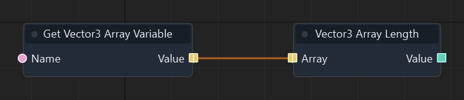

Graph: `templates/games/isometric_snake_3d/graphs/gameplay.json` · Function: **Refresh board** · Node: `n5`.

[Mở hướng dẫn game](games/isometric-snake.md)

### Đọc thêm

[Tài liệu hệ thống: typed-data.md](typed-data.md)

### Get Entity Array Variable

ID `3205` · `pure` · Workflow `shared`

Ghi biến array<entity> trong phạm vi scene. Name phải khớp biến đã khai báo; chọn đúng kiểu.

### IO

| Chiều | Cổng | Kiểu | Mặc định |
| --- | --- | --- | --- |
| IN | Name | `string` | `"entity_items"` |
| OUT | Value | `array<entity>` | — |

Cổng `exec` điều khiển thứ tự. Cổng dữ liệu phải khớp kiểu; `vec2` không tự chuyển sang `vec3`.

### Cách dùng

1. Tìm **Get Entity Array Variable** trong Node Library hoặc nhấn Tab trong graph để thêm node.
2. Chọn node, nhập hằng số ở Inspector theo bảng IN. Chuỗi nhập trực tiếp; vector/mảng nhập theo JSON, ví dụ `[1, 0, 0]`. Khai báo biến qua Scene > Scene Variables… trước khi dùng Get/Set Variable.
3. Có thể kéo dây từ OUT dữ liệu vào IN có cùng kiểu; giá trị từ dây thay thế hằng số của cổng.
4. Nối OUT dữ liệu tới node dùng kết quả. Node pure không cần dây exec.
5. Nhấn F5, thử tình huống, kiểm tra Console/Diagnostics; Shift+F5 dừng. Ctrl+S lưu thay đổi graph.

### Ví dụ từ graph thật

Trích đoạn Refresh board của isometric_snake_3d: node n3. Đây là các node và dây nối thật từ graph đã chạy; vị trí được sắp lại để dễ đọc.

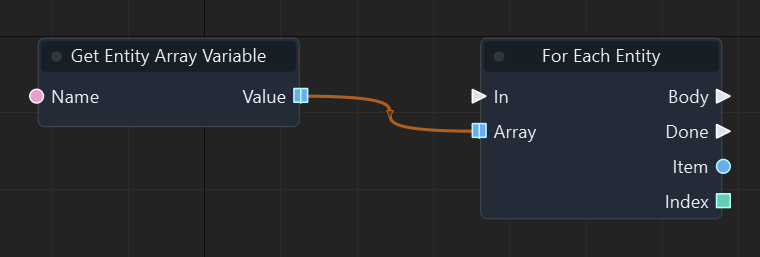

Graph: `templates/games/isometric_snake_3d/graphs/gameplay.json` · Function: **Refresh board** · Node: `n3`.

[Mở hướng dẫn game](games/isometric-snake.md)

### Đọc thêm

[Tài liệu hệ thống: typed-data.md](typed-data.md)

### Get Vector2 Array Variable

ID `3206` · `pure` · Workflow `shared`

Ghi biến array<vec2> trong phạm vi scene. Name phải khớp biến đã khai báo; chọn đúng kiểu.

### IO

| Chiều | Cổng | Kiểu | Mặc định |
| --- | --- | --- | --- |
| IN | Name | `string` | `"vec2_items"` |
| OUT | Value | `array<vec2>` | — |

Cổng `exec` điều khiển thứ tự. Cổng dữ liệu phải khớp kiểu; `vec2` không tự chuyển sang `vec3`.

### Cách dùng

1. Tìm **Get Vector2 Array Variable** trong Node Library hoặc nhấn Tab trong graph để thêm node.
2. Chọn node, nhập hằng số ở Inspector theo bảng IN. Chuỗi nhập trực tiếp; vector/mảng nhập theo JSON, ví dụ `[1, 0, 0]`. Khai báo biến qua Scene > Scene Variables… trước khi dùng Get/Set Variable.
3. Có thể kéo dây từ OUT dữ liệu vào IN có cùng kiểu; giá trị từ dây thay thế hằng số của cổng.
4. Nối OUT dữ liệu tới node dùng kết quả. Node pure không cần dây exec.
5. Nhấn F5, thử tình huống, kiểm tra Console/Diagnostics; Shift+F5 dừng. Ctrl+S lưu thay đổi graph.

### Đọc thêm

[Tài liệu hệ thống: typed-data.md](typed-data.md)

### Get Vector4 Array Variable

ID `3207` · `pure` · Workflow `shared`

Ghi biến array<vec4> trong phạm vi scene. Name phải khớp biến đã khai báo; chọn đúng kiểu.

### IO

| Chiều | Cổng | Kiểu | Mặc định |
| --- | --- | --- | --- |
| IN | Name | `string` | `"vec4_items"` |
| OUT | Value | `array<vec4>` | — |

Cổng `exec` điều khiển thứ tự. Cổng dữ liệu phải khớp kiểu; `vec2` không tự chuyển sang `vec3`.

### Cách dùng

1. Tìm **Get Vector4 Array Variable** trong Node Library hoặc nhấn Tab trong graph để thêm node.
2. Chọn node, nhập hằng số ở Inspector theo bảng IN. Chuỗi nhập trực tiếp; vector/mảng nhập theo JSON, ví dụ `[1, 0, 0]`. Khai báo biến qua Scene > Scene Variables… trước khi dùng Get/Set Variable.
3. Có thể kéo dây từ OUT dữ liệu vào IN có cùng kiểu; giá trị từ dây thay thế hằng số của cổng.
4. Nối OUT dữ liệu tới node dùng kết quả. Node pure không cần dây exec.
5. Nhấn F5, thử tình huống, kiểm tra Console/Diagnostics; Shift+F5 dừng. Ctrl+S lưu thay đổi graph.

### Đọc thêm

[Tài liệu hệ thống: typed-data.md](typed-data.md)

### Get Quaternion Array Variable

ID `3208` · `pure` · Workflow `shared`

Ghi biến array<quat> trong phạm vi scene. Name phải khớp biến đã khai báo; chọn đúng kiểu.

### IO

| Chiều | Cổng | Kiểu | Mặc định |
| --- | --- | --- | --- |
| IN | Name | `string` | `"quat_items"` |
| OUT | Value | `array<quat>` | — |

Cổng `exec` điều khiển thứ tự. Cổng dữ liệu phải khớp kiểu; `vec2` không tự chuyển sang `vec3`.

### Cách dùng

1. Tìm **Get Quaternion Array Variable** trong Node Library hoặc nhấn Tab trong graph để thêm node.
2. Chọn node, nhập hằng số ở Inspector theo bảng IN. Chuỗi nhập trực tiếp; vector/mảng nhập theo JSON, ví dụ `[1, 0, 0]`. Khai báo biến qua Scene > Scene Variables… trước khi dùng Get/Set Variable.
3. Có thể kéo dây từ OUT dữ liệu vào IN có cùng kiểu; giá trị từ dây thay thế hằng số của cổng.
4. Nối OUT dữ liệu tới node dùng kết quả. Node pure không cần dây exec.
5. Nhấn F5, thử tình huống, kiểm tra Console/Diagnostics; Shift+F5 dừng. Ctrl+S lưu thay đổi graph.

### Đọc thêm

[Tài liệu hệ thống: typed-data.md](typed-data.md)

### Get Matrix4 Array Variable

ID `3209` · `pure` · Workflow `shared`

Ghi biến array<mat4> trong phạm vi scene. Name phải khớp biến đã khai báo; chọn đúng kiểu.

### IO

| Chiều | Cổng | Kiểu | Mặc định |
| --- | --- | --- | --- |
| IN | Name | `string` | `"mat4_items"` |
| OUT | Value | `array<mat4>` | — |

Cổng `exec` điều khiển thứ tự. Cổng dữ liệu phải khớp kiểu; `vec2` không tự chuyển sang `vec3`.

### Cách dùng

1. Tìm **Get Matrix4 Array Variable** trong Node Library hoặc nhấn Tab trong graph để thêm node.
2. Chọn node, nhập hằng số ở Inspector theo bảng IN. Chuỗi nhập trực tiếp; vector/mảng nhập theo JSON, ví dụ `[1, 0, 0]`. Khai báo biến qua Scene > Scene Variables… trước khi dùng Get/Set Variable.
3. Có thể kéo dây từ OUT dữ liệu vào IN có cùng kiểu; giá trị từ dây thay thế hằng số của cổng.
4. Nối OUT dữ liệu tới node dùng kết quả. Node pure không cần dây exec.
5. Nhấn F5, thử tình huống, kiểm tra Console/Diagnostics; Shift+F5 dừng. Ctrl+S lưu thay đổi graph.

### Đọc thêm

[Tài liệu hệ thống: typed-data.md](typed-data.md)

### Set Float Array Variable

ID `3210` · `action` · Workflow `shared`

Ghi biến array<float> trong phạm vi scene. Name phải khớp biến đã khai báo; chọn đúng kiểu.

### IO

| Chiều | Cổng | Kiểu | Mặc định |
| --- | --- | --- | --- |
| IN | In | `exec` | — |
| IN | Name | `string` | `"float_items"` |
| IN | Value | `array<float>` | `[]` |
| OUT | Out | `exec` | — |

Cổng `exec` điều khiển thứ tự. Cổng dữ liệu phải khớp kiểu; `vec2` không tự chuyển sang `vec3`.

### Cách dùng

1. Tìm **Set Float Array Variable** trong Node Library hoặc nhấn Tab trong graph để thêm node.
2. Chọn node, nhập hằng số ở Inspector theo bảng IN. Chuỗi nhập trực tiếp; vector/mảng nhập theo JSON, ví dụ `[1, 0, 0]`. Khai báo biến qua Scene > Scene Variables… trước khi dùng Get/Set Variable.
3. Có thể kéo dây từ OUT dữ liệu vào IN có cùng kiểu; giá trị từ dây thay thế hằng số của cổng.
4. Nối OUT exec của sự kiện/node trước vào IN exec; nối tiếp các OUT exec phù hợp tới bước sau.
5. Nhấn F5, thử tình huống, kiểm tra Console/Diagnostics; Shift+F5 dừng. Ctrl+S lưu thay đổi graph.

### Đọc thêm

[Tài liệu hệ thống: typed-data.md](typed-data.md)

### Set Integer Array Variable

ID `3211` · `action` · Workflow `shared`

Ghi biến array<int> trong phạm vi scene. Name phải khớp biến đã khai báo; chọn đúng kiểu.

### IO

| Chiều | Cổng | Kiểu | Mặc định |
| --- | --- | --- | --- |
| IN | In | `exec` | — |
| IN | Name | `string` | `"int_items"` |
| IN | Value | `array<int>` | `[]` |
| OUT | Out | `exec` | — |

Cổng `exec` điều khiển thứ tự. Cổng dữ liệu phải khớp kiểu; `vec2` không tự chuyển sang `vec3`.

### Cách dùng

1. Tìm **Set Integer Array Variable** trong Node Library hoặc nhấn Tab trong graph để thêm node.
2. Chọn node, nhập hằng số ở Inspector theo bảng IN. Chuỗi nhập trực tiếp; vector/mảng nhập theo JSON, ví dụ `[1, 0, 0]`. Khai báo biến qua Scene > Scene Variables… trước khi dùng Get/Set Variable.
3. Có thể kéo dây từ OUT dữ liệu vào IN có cùng kiểu; giá trị từ dây thay thế hằng số của cổng.
4. Nối OUT exec của sự kiện/node trước vào IN exec; nối tiếp các OUT exec phù hợp tới bước sau.
5. Nhấn F5, thử tình huống, kiểm tra Console/Diagnostics; Shift+F5 dừng. Ctrl+S lưu thay đổi graph.

### Đọc thêm

[Tài liệu hệ thống: typed-data.md](typed-data.md)

### Set Boolean Array Variable

ID `3212` · `action` · Workflow `shared`

Ghi biến array<bool> trong phạm vi scene. Name phải khớp biến đã khai báo; chọn đúng kiểu.

### IO

| Chiều | Cổng | Kiểu | Mặc định |
| --- | --- | --- | --- |
| IN | In | `exec` | — |
| IN | Name | `string` | `"bool_items"` |
| IN | Value | `array<bool>` | `[]` |
| OUT | Out | `exec` | — |

Cổng `exec` điều khiển thứ tự. Cổng dữ liệu phải khớp kiểu; `vec2` không tự chuyển sang `vec3`.

### Cách dùng

1. Tìm **Set Boolean Array Variable** trong Node Library hoặc nhấn Tab trong graph để thêm node.
2. Chọn node, nhập hằng số ở Inspector theo bảng IN. Chuỗi nhập trực tiếp; vector/mảng nhập theo JSON, ví dụ `[1, 0, 0]`. Khai báo biến qua Scene > Scene Variables… trước khi dùng Get/Set Variable.
3. Có thể kéo dây từ OUT dữ liệu vào IN có cùng kiểu; giá trị từ dây thay thế hằng số của cổng.
4. Nối OUT exec của sự kiện/node trước vào IN exec; nối tiếp các OUT exec phù hợp tới bước sau.
5. Nhấn F5, thử tình huống, kiểm tra Console/Diagnostics; Shift+F5 dừng. Ctrl+S lưu thay đổi graph.

### Đọc thêm

[Tài liệu hệ thống: typed-data.md](typed-data.md)

### Set String Array Variable

ID `3213` · `action` · Workflow `shared`

Ghi biến array<string> trong phạm vi scene. Name phải khớp biến đã khai báo; chọn đúng kiểu.

### IO

| Chiều | Cổng | Kiểu | Mặc định |
| --- | --- | --- | --- |
| IN | In | `exec` | — |
| IN | Name | `string` | `"string_items"` |
| IN | Value | `array<string>` | `[]` |
| OUT | Out | `exec` | — |

Cổng `exec` điều khiển thứ tự. Cổng dữ liệu phải khớp kiểu; `vec2` không tự chuyển sang `vec3`.

### Cách dùng

1. Tìm **Set String Array Variable** trong Node Library hoặc nhấn Tab trong graph để thêm node.
2. Chọn node, nhập hằng số ở Inspector theo bảng IN. Chuỗi nhập trực tiếp; vector/mảng nhập theo JSON, ví dụ `[1, 0, 0]`. Khai báo biến qua Scene > Scene Variables… trước khi dùng Get/Set Variable.
3. Có thể kéo dây từ OUT dữ liệu vào IN có cùng kiểu; giá trị từ dây thay thế hằng số của cổng.
4. Nối OUT exec của sự kiện/node trước vào IN exec; nối tiếp các OUT exec phù hợp tới bước sau.
5. Nhấn F5, thử tình huống, kiểm tra Console/Diagnostics; Shift+F5 dừng. Ctrl+S lưu thay đổi graph.

### Đọc thêm

[Tài liệu hệ thống: typed-data.md](typed-data.md)

### Set Vector3 Array Variable

ID `3214` · `action` · Workflow `shared`

Ghi biến array<vec3> trong phạm vi scene. Name phải khớp biến đã khai báo; chọn đúng kiểu.

### IO

| Chiều | Cổng | Kiểu | Mặc định |
| --- | --- | --- | --- |
| IN | In | `exec` | — |
| IN | Name | `string` | `"vec3_items"` |
| IN | Value | `array<vec3>` | `[]` |
| OUT | Out | `exec` | — |

Cổng `exec` điều khiển thứ tự. Cổng dữ liệu phải khớp kiểu; `vec2` không tự chuyển sang `vec3`.

### Cách dùng

1. Tìm **Set Vector3 Array Variable** trong Node Library hoặc nhấn Tab trong graph để thêm node.
2. Chọn node, nhập hằng số ở Inspector theo bảng IN. Chuỗi nhập trực tiếp; vector/mảng nhập theo JSON, ví dụ `[1, 0, 0]`. Khai báo biến qua Scene > Scene Variables… trước khi dùng Get/Set Variable.
3. Có thể kéo dây từ OUT dữ liệu vào IN có cùng kiểu; giá trị từ dây thay thế hằng số của cổng.
4. Nối OUT exec của sự kiện/node trước vào IN exec; nối tiếp các OUT exec phù hợp tới bước sau.
5. Nhấn F5, thử tình huống, kiểm tra Console/Diagnostics; Shift+F5 dừng. Ctrl+S lưu thay đổi graph.

### Ví dụ từ graph thật

Trích đoạn Advance snake của isometric_snake_3d: node n32. Đây là các node và dây nối thật từ graph đã chạy; vị trí được sắp lại để dễ đọc.

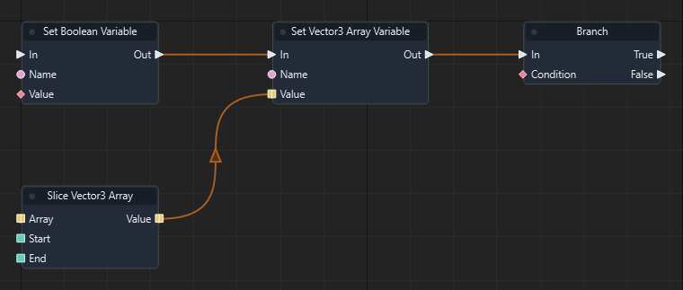

Graph: `templates/games/isometric_snake_3d/graphs/gameplay.json` · Function: **Advance snake** · Node: `n32`.

[Mở hướng dẫn game](games/isometric-snake.md)

### Đọc thêm

[Tài liệu hệ thống: typed-data.md](typed-data.md)

### Set Entity Array Variable

ID `3215` · `action` · Workflow `shared`

Ghi biến array<entity> trong phạm vi scene. Name phải khớp biến đã khai báo; chọn đúng kiểu.

### IO

| Chiều | Cổng | Kiểu | Mặc định |
| --- | --- | --- | --- |
| IN | In | `exec` | — |
| IN | Name | `string` | `"entity_items"` |
| IN | Value | `array<entity>` | `[]` |
| OUT | Out | `exec` | — |

Cổng `exec` điều khiển thứ tự. Cổng dữ liệu phải khớp kiểu; `vec2` không tự chuyển sang `vec3`.

### Cách dùng

1. Tìm **Set Entity Array Variable** trong Node Library hoặc nhấn Tab trong graph để thêm node.
2. Chọn node, nhập hằng số ở Inspector theo bảng IN. Chuỗi nhập trực tiếp; vector/mảng nhập theo JSON, ví dụ `[1, 0, 0]`. Khai báo biến qua Scene > Scene Variables… trước khi dùng Get/Set Variable.
3. Có thể kéo dây từ OUT dữ liệu vào IN có cùng kiểu; giá trị từ dây thay thế hằng số của cổng.
4. Nối OUT exec của sự kiện/node trước vào IN exec; nối tiếp các OUT exec phù hợp tới bước sau.
5. Nhấn F5, thử tình huống, kiểm tra Console/Diagnostics; Shift+F5 dừng. Ctrl+S lưu thay đổi graph.

### Đọc thêm

[Tài liệu hệ thống: typed-data.md](typed-data.md)

### Set Vector2 Array Variable

ID `3216` · `action` · Workflow `shared`

Ghi biến array<vec2> trong phạm vi scene. Name phải khớp biến đã khai báo; chọn đúng kiểu.

### IO

| Chiều | Cổng | Kiểu | Mặc định |
| --- | --- | --- | --- |
| IN | In | `exec` | — |
| IN | Name | `string` | `"vec2_items"` |
| IN | Value | `array<vec2>` | `[]` |
| OUT | Out | `exec` | — |

Cổng `exec` điều khiển thứ tự. Cổng dữ liệu phải khớp kiểu; `vec2` không tự chuyển sang `vec3`.

### Cách dùng

1. Tìm **Set Vector2 Array Variable** trong Node Library hoặc nhấn Tab trong graph để thêm node.
2. Chọn node, nhập hằng số ở Inspector theo bảng IN. Chuỗi nhập trực tiếp; vector/mảng nhập theo JSON, ví dụ `[1, 0, 0]`. Khai báo biến qua Scene > Scene Variables… trước khi dùng Get/Set Variable.
3. Có thể kéo dây từ OUT dữ liệu vào IN có cùng kiểu; giá trị từ dây thay thế hằng số của cổng.
4. Nối OUT exec của sự kiện/node trước vào IN exec; nối tiếp các OUT exec phù hợp tới bước sau.
5. Nhấn F5, thử tình huống, kiểm tra Console/Diagnostics; Shift+F5 dừng. Ctrl+S lưu thay đổi graph.

### Đọc thêm

[Tài liệu hệ thống: typed-data.md](typed-data.md)

### Set Vector4 Array Variable

ID `3217` · `action` · Workflow `shared`

Ghi biến array<vec4> trong phạm vi scene. Name phải khớp biến đã khai báo; chọn đúng kiểu.

### IO

| Chiều | Cổng | Kiểu | Mặc định |
| --- | --- | --- | --- |
| IN | In | `exec` | — |
| IN | Name | `string` | `"vec4_items"` |
| IN | Value | `array<vec4>` | `[]` |
| OUT | Out | `exec` | — |

Cổng `exec` điều khiển thứ tự. Cổng dữ liệu phải khớp kiểu; `vec2` không tự chuyển sang `vec3`.

### Cách dùng

1. Tìm **Set Vector4 Array Variable** trong Node Library hoặc nhấn Tab trong graph để thêm node.
2. Chọn node, nhập hằng số ở Inspector theo bảng IN. Chuỗi nhập trực tiếp; vector/mảng nhập theo JSON, ví dụ `[1, 0, 0]`. Khai báo biến qua Scene > Scene Variables… trước khi dùng Get/Set Variable.
3. Có thể kéo dây từ OUT dữ liệu vào IN có cùng kiểu; giá trị từ dây thay thế hằng số của cổng.
4. Nối OUT exec của sự kiện/node trước vào IN exec; nối tiếp các OUT exec phù hợp tới bước sau.
5. Nhấn F5, thử tình huống, kiểm tra Console/Diagnostics; Shift+F5 dừng. Ctrl+S lưu thay đổi graph.

### Đọc thêm

[Tài liệu hệ thống: typed-data.md](typed-data.md)

### Set Quaternion Array Variable

ID `3218` · `action` · Workflow `shared`

Ghi biến array<quat> trong phạm vi scene. Name phải khớp biến đã khai báo; chọn đúng kiểu.

### IO

| Chiều | Cổng | Kiểu | Mặc định |
| --- | --- | --- | --- |
| IN | In | `exec` | — |
| IN | Name | `string` | `"quat_items"` |
| IN | Value | `array<quat>` | `[]` |
| OUT | Out | `exec` | — |

Cổng `exec` điều khiển thứ tự. Cổng dữ liệu phải khớp kiểu; `vec2` không tự chuyển sang `vec3`.

### Cách dùng

1. Tìm **Set Quaternion Array Variable** trong Node Library hoặc nhấn Tab trong graph để thêm node.
2. Chọn node, nhập hằng số ở Inspector theo bảng IN. Chuỗi nhập trực tiếp; vector/mảng nhập theo JSON, ví dụ `[1, 0, 0]`. Khai báo biến qua Scene > Scene Variables… trước khi dùng Get/Set Variable.
3. Có thể kéo dây từ OUT dữ liệu vào IN có cùng kiểu; giá trị từ dây thay thế hằng số của cổng.
4. Nối OUT exec của sự kiện/node trước vào IN exec; nối tiếp các OUT exec phù hợp tới bước sau.
5. Nhấn F5, thử tình huống, kiểm tra Console/Diagnostics; Shift+F5 dừng. Ctrl+S lưu thay đổi graph.

### Đọc thêm

[Tài liệu hệ thống: typed-data.md](typed-data.md)

### Set Matrix4 Array Variable

ID `3219` · `action` · Workflow `shared`

Ghi biến array<mat4> trong phạm vi scene. Name phải khớp biến đã khai báo; chọn đúng kiểu.

### IO

| Chiều | Cổng | Kiểu | Mặc định |
| --- | --- | --- | --- |
| IN | In | `exec` | — |
| IN | Name | `string` | `"mat4_items"` |
| IN | Value | `array<mat4>` | `[]` |
| OUT | Out | `exec` | — |

Cổng `exec` điều khiển thứ tự. Cổng dữ liệu phải khớp kiểu; `vec2` không tự chuyển sang `vec3`.

### Cách dùng

1. Tìm **Set Matrix4 Array Variable** trong Node Library hoặc nhấn Tab trong graph để thêm node.
2. Chọn node, nhập hằng số ở Inspector theo bảng IN. Chuỗi nhập trực tiếp; vector/mảng nhập theo JSON, ví dụ `[1, 0, 0]`. Khai báo biến qua Scene > Scene Variables… trước khi dùng Get/Set Variable.
3. Có thể kéo dây từ OUT dữ liệu vào IN có cùng kiểu; giá trị từ dây thay thế hằng số của cổng.
4. Nối OUT exec của sự kiện/node trước vào IN exec; nối tiếp các OUT exec phù hợp tới bước sau.
5. Nhấn F5, thử tình huống, kiểm tra Console/Diagnostics; Shift+F5 dừng. Ctrl+S lưu thay đổi graph.

### Đọc thêm

[Tài liệu hệ thống: typed-data.md](typed-data.md)

### Create Float Array

ID `3220` · `pure` · Workflow `shared`

Tạo một mảng đúng kiểu từ giá trị đầu vào. Các phép pure trả bản sao; muốn lưu thay đổi qua frame, nối kết quả vào Set Variable cùng kiểu.

### IO

| Chiều | Cổng | Kiểu | Mặc định |
| --- | --- | --- | --- |
| IN | Items | `array<float>` | `[]` |
| OUT | Value | `array<float>` | — |

Cổng `exec` điều khiển thứ tự. Cổng dữ liệu phải khớp kiểu; `vec2` không tự chuyển sang `vec3`.

### Cách dùng

1. Tìm **Create Float Array** trong Node Library hoặc nhấn Tab trong graph để thêm node.
2. Chọn node, nhập hằng số ở Inspector theo bảng IN. Chuỗi nhập trực tiếp; vector/mảng nhập theo JSON, ví dụ `[1, 0, 0]`. Khai báo biến qua Scene > Scene Variables… trước khi dùng Get/Set Variable.
3. Có thể kéo dây từ OUT dữ liệu vào IN có cùng kiểu; giá trị từ dây thay thế hằng số của cổng.
4. Nối OUT dữ liệu tới node dùng kết quả. Node pure không cần dây exec.
5. Nhấn F5, thử tình huống, kiểm tra Console/Diagnostics; Shift+F5 dừng. Ctrl+S lưu thay đổi graph.

### Đọc thêm

[Tài liệu hệ thống: typed-data.md](typed-data.md)

### Create Integer Array

ID `3221` · `pure` · Workflow `shared`

Tạo một mảng đúng kiểu từ giá trị đầu vào. Các phép pure trả bản sao; muốn lưu thay đổi qua frame, nối kết quả vào Set Variable cùng kiểu.

### IO

| Chiều | Cổng | Kiểu | Mặc định |
| --- | --- | --- | --- |
| IN | Items | `array<int>` | `[]` |
| OUT | Value | `array<int>` | — |

Cổng `exec` điều khiển thứ tự. Cổng dữ liệu phải khớp kiểu; `vec2` không tự chuyển sang `vec3`.

### Cách dùng

1. Tìm **Create Integer Array** trong Node Library hoặc nhấn Tab trong graph để thêm node.
2. Chọn node, nhập hằng số ở Inspector theo bảng IN. Chuỗi nhập trực tiếp; vector/mảng nhập theo JSON, ví dụ `[1, 0, 0]`. Khai báo biến qua Scene > Scene Variables… trước khi dùng Get/Set Variable.
3. Có thể kéo dây từ OUT dữ liệu vào IN có cùng kiểu; giá trị từ dây thay thế hằng số của cổng.
4. Nối OUT dữ liệu tới node dùng kết quả. Node pure không cần dây exec.
5. Nhấn F5, thử tình huống, kiểm tra Console/Diagnostics; Shift+F5 dừng. Ctrl+S lưu thay đổi graph.

### Đọc thêm

[Tài liệu hệ thống: typed-data.md](typed-data.md)

### Create Boolean Array

ID `3222` · `pure` · Workflow `shared`

Tạo một mảng đúng kiểu từ giá trị đầu vào. Các phép pure trả bản sao; muốn lưu thay đổi qua frame, nối kết quả vào Set Variable cùng kiểu.

### IO

| Chiều | Cổng | Kiểu | Mặc định |
| --- | --- | --- | --- |
| IN | Items | `array<bool>` | `[]` |
| OUT | Value | `array<bool>` | — |

Cổng `exec` điều khiển thứ tự. Cổng dữ liệu phải khớp kiểu; `vec2` không tự chuyển sang `vec3`.

### Cách dùng

1. Tìm **Create Boolean Array** trong Node Library hoặc nhấn Tab trong graph để thêm node.
2. Chọn node, nhập hằng số ở Inspector theo bảng IN. Chuỗi nhập trực tiếp; vector/mảng nhập theo JSON, ví dụ `[1, 0, 0]`. Khai báo biến qua Scene > Scene Variables… trước khi dùng Get/Set Variable.
3. Có thể kéo dây từ OUT dữ liệu vào IN có cùng kiểu; giá trị từ dây thay thế hằng số của cổng.
4. Nối OUT dữ liệu tới node dùng kết quả. Node pure không cần dây exec.
5. Nhấn F5, thử tình huống, kiểm tra Console/Diagnostics; Shift+F5 dừng. Ctrl+S lưu thay đổi graph.

### Đọc thêm

[Tài liệu hệ thống: typed-data.md](typed-data.md)

### Create String Array

ID `3223` · `pure` · Workflow `shared`

Tạo một mảng đúng kiểu từ giá trị đầu vào. Các phép pure trả bản sao; muốn lưu thay đổi qua frame, nối kết quả vào Set Variable cùng kiểu.

### IO

| Chiều | Cổng | Kiểu | Mặc định |
| --- | --- | --- | --- |
| IN | Items | `array<string>` | `[]` |
| OUT | Value | `array<string>` | — |

Cổng `exec` điều khiển thứ tự. Cổng dữ liệu phải khớp kiểu; `vec2` không tự chuyển sang `vec3`.

### Cách dùng

1. Tìm **Create String Array** trong Node Library hoặc nhấn Tab trong graph để thêm node.
2. Chọn node, nhập hằng số ở Inspector theo bảng IN. Chuỗi nhập trực tiếp; vector/mảng nhập theo JSON, ví dụ `[1, 0, 0]`. Khai báo biến qua Scene > Scene Variables… trước khi dùng Get/Set Variable.
3. Có thể kéo dây từ OUT dữ liệu vào IN có cùng kiểu; giá trị từ dây thay thế hằng số của cổng.
4. Nối OUT dữ liệu tới node dùng kết quả. Node pure không cần dây exec.
5. Nhấn F5, thử tình huống, kiểm tra Console/Diagnostics; Shift+F5 dừng. Ctrl+S lưu thay đổi graph.

### Đọc thêm

[Tài liệu hệ thống: typed-data.md](typed-data.md)

### Create Vector3 Array

ID `3224` · `pure` · Workflow `shared`

Tạo một mảng đúng kiểu từ giá trị đầu vào. Các phép pure trả bản sao; muốn lưu thay đổi qua frame, nối kết quả vào Set Variable cùng kiểu.

### IO

| Chiều | Cổng | Kiểu | Mặc định |
| --- | --- | --- | --- |
| IN | Items | `array<vec3>` | `[]` |
| OUT | Value | `array<vec3>` | — |

Cổng `exec` điều khiển thứ tự. Cổng dữ liệu phải khớp kiểu; `vec2` không tự chuyển sang `vec3`.

### Cách dùng

1. Tìm **Create Vector3 Array** trong Node Library hoặc nhấn Tab trong graph để thêm node.
2. Chọn node, nhập hằng số ở Inspector theo bảng IN. Chuỗi nhập trực tiếp; vector/mảng nhập theo JSON, ví dụ `[1, 0, 0]`. Khai báo biến qua Scene > Scene Variables… trước khi dùng Get/Set Variable.
3. Có thể kéo dây từ OUT dữ liệu vào IN có cùng kiểu; giá trị từ dây thay thế hằng số của cổng.
4. Nối OUT dữ liệu tới node dùng kết quả. Node pure không cần dây exec.
5. Nhấn F5, thử tình huống, kiểm tra Console/Diagnostics; Shift+F5 dừng. Ctrl+S lưu thay đổi graph.

### Đọc thêm

[Tài liệu hệ thống: typed-data.md](typed-data.md)

### Create Entity Array

ID `3225` · `pure` · Workflow `shared`

Tạo một mảng đúng kiểu từ giá trị đầu vào. Các phép pure trả bản sao; muốn lưu thay đổi qua frame, nối kết quả vào Set Variable cùng kiểu.

### IO

| Chiều | Cổng | Kiểu | Mặc định |
| --- | --- | --- | --- |
| IN | Items | `array<entity>` | `[]` |
| OUT | Value | `array<entity>` | — |

Cổng `exec` điều khiển thứ tự. Cổng dữ liệu phải khớp kiểu; `vec2` không tự chuyển sang `vec3`.

### Cách dùng

1. Tìm **Create Entity Array** trong Node Library hoặc nhấn Tab trong graph để thêm node.
2. Chọn node, nhập hằng số ở Inspector theo bảng IN. Chuỗi nhập trực tiếp; vector/mảng nhập theo JSON, ví dụ `[1, 0, 0]`. Khai báo biến qua Scene > Scene Variables… trước khi dùng Get/Set Variable.
3. Có thể kéo dây từ OUT dữ liệu vào IN có cùng kiểu; giá trị từ dây thay thế hằng số của cổng.
4. Nối OUT dữ liệu tới node dùng kết quả. Node pure không cần dây exec.
5. Nhấn F5, thử tình huống, kiểm tra Console/Diagnostics; Shift+F5 dừng. Ctrl+S lưu thay đổi graph.

### Đọc thêm

[Tài liệu hệ thống: typed-data.md](typed-data.md)

### Create Vector2 Array

ID `3226` · `pure` · Workflow `shared`

Tạo một mảng đúng kiểu từ giá trị đầu vào. Các phép pure trả bản sao; muốn lưu thay đổi qua frame, nối kết quả vào Set Variable cùng kiểu.

### IO

| Chiều | Cổng | Kiểu | Mặc định |
| --- | --- | --- | --- |
| IN | Items | `array<vec2>` | `[]` |
| OUT | Value | `array<vec2>` | — |

Cổng `exec` điều khiển thứ tự. Cổng dữ liệu phải khớp kiểu; `vec2` không tự chuyển sang `vec3`.

### Cách dùng

1. Tìm **Create Vector2 Array** trong Node Library hoặc nhấn Tab trong graph để thêm node.
2. Chọn node, nhập hằng số ở Inspector theo bảng IN. Chuỗi nhập trực tiếp; vector/mảng nhập theo JSON, ví dụ `[1, 0, 0]`. Khai báo biến qua Scene > Scene Variables… trước khi dùng Get/Set Variable.
3. Có thể kéo dây từ OUT dữ liệu vào IN có cùng kiểu; giá trị từ dây thay thế hằng số của cổng.
4. Nối OUT dữ liệu tới node dùng kết quả. Node pure không cần dây exec.
5. Nhấn F5, thử tình huống, kiểm tra Console/Diagnostics; Shift+F5 dừng. Ctrl+S lưu thay đổi graph.

### Đọc thêm

[Tài liệu hệ thống: typed-data.md](typed-data.md)

### Create Vector4 Array

ID `3227` · `pure` · Workflow `shared`

Tạo một mảng đúng kiểu từ giá trị đầu vào. Các phép pure trả bản sao; muốn lưu thay đổi qua frame, nối kết quả vào Set Variable cùng kiểu.

### IO

| Chiều | Cổng | Kiểu | Mặc định |
| --- | --- | --- | --- |
| IN | Items | `array<vec4>` | `[]` |
| OUT | Value | `array<vec4>` | — |

Cổng `exec` điều khiển thứ tự. Cổng dữ liệu phải khớp kiểu; `vec2` không tự chuyển sang `vec3`.

### Cách dùng

1. Tìm **Create Vector4 Array** trong Node Library hoặc nhấn Tab trong graph để thêm node.
2. Chọn node, nhập hằng số ở Inspector theo bảng IN. Chuỗi nhập trực tiếp; vector/mảng nhập theo JSON, ví dụ `[1, 0, 0]`. Khai báo biến qua Scene > Scene Variables… trước khi dùng Get/Set Variable.
3. Có thể kéo dây từ OUT dữ liệu vào IN có cùng kiểu; giá trị từ dây thay thế hằng số của cổng.
4. Nối OUT dữ liệu tới node dùng kết quả. Node pure không cần dây exec.
5. Nhấn F5, thử tình huống, kiểm tra Console/Diagnostics; Shift+F5 dừng. Ctrl+S lưu thay đổi graph.

### Đọc thêm

[Tài liệu hệ thống: typed-data.md](typed-data.md)

### Create Quaternion Array

ID `3228` · `pure` · Workflow `shared`

Tạo một mảng đúng kiểu từ giá trị đầu vào. Các phép pure trả bản sao; muốn lưu thay đổi qua frame, nối kết quả vào Set Variable cùng kiểu.

### IO

| Chiều | Cổng | Kiểu | Mặc định |
| --- | --- | --- | --- |
| IN | Items | `array<quat>` | `[]` |
| OUT | Value | `array<quat>` | — |

Cổng `exec` điều khiển thứ tự. Cổng dữ liệu phải khớp kiểu; `vec2` không tự chuyển sang `vec3`.

### Cách dùng

1. Tìm **Create Quaternion Array** trong Node Library hoặc nhấn Tab trong graph để thêm node.
2. Chọn node, nhập hằng số ở Inspector theo bảng IN. Chuỗi nhập trực tiếp; vector/mảng nhập theo JSON, ví dụ `[1, 0, 0]`. Khai báo biến qua Scene > Scene Variables… trước khi dùng Get/Set Variable.
3. Có thể kéo dây từ OUT dữ liệu vào IN có cùng kiểu; giá trị từ dây thay thế hằng số của cổng.
4. Nối OUT dữ liệu tới node dùng kết quả. Node pure không cần dây exec.
5. Nhấn F5, thử tình huống, kiểm tra Console/Diagnostics; Shift+F5 dừng. Ctrl+S lưu thay đổi graph.

### Đọc thêm

[Tài liệu hệ thống: typed-data.md](typed-data.md)

### Create Matrix4 Array

ID `3229` · `pure` · Workflow `shared`

Tạo một mảng đúng kiểu từ giá trị đầu vào. Các phép pure trả bản sao; muốn lưu thay đổi qua frame, nối kết quả vào Set Variable cùng kiểu.

### IO

| Chiều | Cổng | Kiểu | Mặc định |
| --- | --- | --- | --- |
| IN | Items | `array<mat4>` | `[]` |
| OUT | Value | `array<mat4>` | — |

Cổng `exec` điều khiển thứ tự. Cổng dữ liệu phải khớp kiểu; `vec2` không tự chuyển sang `vec3`.

### Cách dùng

1. Tìm **Create Matrix4 Array** trong Node Library hoặc nhấn Tab trong graph để thêm node.
2. Chọn node, nhập hằng số ở Inspector theo bảng IN. Chuỗi nhập trực tiếp; vector/mảng nhập theo JSON, ví dụ `[1, 0, 0]`. Khai báo biến qua Scene > Scene Variables… trước khi dùng Get/Set Variable.
3. Có thể kéo dây từ OUT dữ liệu vào IN có cùng kiểu; giá trị từ dây thay thế hằng số của cổng.
4. Nối OUT dữ liệu tới node dùng kết quả. Node pure không cần dây exec.
5. Nhấn F5, thử tình huống, kiểm tra Console/Diagnostics; Shift+F5 dừng. Ctrl+S lưu thay đổi graph.

### Đọc thêm

[Tài liệu hệ thống: typed-data.md](typed-data.md)

### Append Float Item

ID `3230` · `pure` · Workflow `shared`

Trả mảng mới có Item thêm ở cuối. Các phép pure trả bản sao; muốn lưu thay đổi qua frame, nối kết quả vào Set Variable cùng kiểu.

### IO

| Chiều | Cổng | Kiểu | Mặc định |
| --- | --- | --- | --- |
| IN | Array | `array<float>` | `[]` |
| IN | Item | `float` | `0.0` |
| OUT | Value | `array<float>` | — |

Cổng `exec` điều khiển thứ tự. Cổng dữ liệu phải khớp kiểu; `vec2` không tự chuyển sang `vec3`.

### Cách dùng

1. Tìm **Append Float Item** trong Node Library hoặc nhấn Tab trong graph để thêm node.
2. Chọn node, nhập hằng số ở Inspector theo bảng IN. Chuỗi nhập trực tiếp; vector/mảng nhập theo JSON, ví dụ `[1, 0, 0]`. Khai báo biến qua Scene > Scene Variables… trước khi dùng Get/Set Variable.
3. Có thể kéo dây từ OUT dữ liệu vào IN có cùng kiểu; giá trị từ dây thay thế hằng số của cổng.
4. Nối OUT dữ liệu tới node dùng kết quả. Node pure không cần dây exec.
5. Nhấn F5, thử tình huống, kiểm tra Console/Diagnostics; Shift+F5 dừng. Ctrl+S lưu thay đổi graph.

### Đọc thêm

[Tài liệu hệ thống: typed-data.md](typed-data.md)

### Append Integer Item

ID `3231` · `pure` · Workflow `shared`

Trả mảng mới có Item thêm ở cuối. Các phép pure trả bản sao; muốn lưu thay đổi qua frame, nối kết quả vào Set Variable cùng kiểu.

### IO

| Chiều | Cổng | Kiểu | Mặc định |
| --- | --- | --- | --- |
| IN | Array | `array<int>` | `[]` |
| IN | Item | `int` | `0` |
| OUT | Value | `array<int>` | — |

Cổng `exec` điều khiển thứ tự. Cổng dữ liệu phải khớp kiểu; `vec2` không tự chuyển sang `vec3`.

### Cách dùng

1. Tìm **Append Integer Item** trong Node Library hoặc nhấn Tab trong graph để thêm node.
2. Chọn node, nhập hằng số ở Inspector theo bảng IN. Chuỗi nhập trực tiếp; vector/mảng nhập theo JSON, ví dụ `[1, 0, 0]`. Khai báo biến qua Scene > Scene Variables… trước khi dùng Get/Set Variable.
3. Có thể kéo dây từ OUT dữ liệu vào IN có cùng kiểu; giá trị từ dây thay thế hằng số của cổng.
4. Nối OUT dữ liệu tới node dùng kết quả. Node pure không cần dây exec.
5. Nhấn F5, thử tình huống, kiểm tra Console/Diagnostics; Shift+F5 dừng. Ctrl+S lưu thay đổi graph.

### Đọc thêm

[Tài liệu hệ thống: typed-data.md](typed-data.md)

### Append Boolean Item

ID `3232` · `pure` · Workflow `shared`

Trả mảng mới có Item thêm ở cuối. Các phép pure trả bản sao; muốn lưu thay đổi qua frame, nối kết quả vào Set Variable cùng kiểu.

### IO

| Chiều | Cổng | Kiểu | Mặc định |
| --- | --- | --- | --- |
| IN | Array | `array<bool>` | `[]` |
| IN | Item | `bool` | `false` |
| OUT | Value | `array<bool>` | — |

Cổng `exec` điều khiển thứ tự. Cổng dữ liệu phải khớp kiểu; `vec2` không tự chuyển sang `vec3`.

### Cách dùng

1. Tìm **Append Boolean Item** trong Node Library hoặc nhấn Tab trong graph để thêm node.
2. Chọn node, nhập hằng số ở Inspector theo bảng IN. Chuỗi nhập trực tiếp; vector/mảng nhập theo JSON, ví dụ `[1, 0, 0]`. Khai báo biến qua Scene > Scene Variables… trước khi dùng Get/Set Variable.
3. Có thể kéo dây từ OUT dữ liệu vào IN có cùng kiểu; giá trị từ dây thay thế hằng số của cổng.
4. Nối OUT dữ liệu tới node dùng kết quả. Node pure không cần dây exec.
5. Nhấn F5, thử tình huống, kiểm tra Console/Diagnostics; Shift+F5 dừng. Ctrl+S lưu thay đổi graph.

### Đọc thêm

[Tài liệu hệ thống: typed-data.md](typed-data.md)

### Append String Item

ID `3233` · `pure` · Workflow `shared`

Trả mảng mới có Item thêm ở cuối. Các phép pure trả bản sao; muốn lưu thay đổi qua frame, nối kết quả vào Set Variable cùng kiểu.

### IO

| Chiều | Cổng | Kiểu | Mặc định |
| --- | --- | --- | --- |
| IN | Array | `array<string>` | `[]` |
| IN | Item | `string` | `""` |
| OUT | Value | `array<string>` | — |

Cổng `exec` điều khiển thứ tự. Cổng dữ liệu phải khớp kiểu; `vec2` không tự chuyển sang `vec3`.

### Cách dùng

1. Tìm **Append String Item** trong Node Library hoặc nhấn Tab trong graph để thêm node.
2. Chọn node, nhập hằng số ở Inspector theo bảng IN. Chuỗi nhập trực tiếp; vector/mảng nhập theo JSON, ví dụ `[1, 0, 0]`. Khai báo biến qua Scene > Scene Variables… trước khi dùng Get/Set Variable.
3. Có thể kéo dây từ OUT dữ liệu vào IN có cùng kiểu; giá trị từ dây thay thế hằng số của cổng.
4. Nối OUT dữ liệu tới node dùng kết quả. Node pure không cần dây exec.
5. Nhấn F5, thử tình huống, kiểm tra Console/Diagnostics; Shift+F5 dừng. Ctrl+S lưu thay đổi graph.

### Đọc thêm

[Tài liệu hệ thống: typed-data.md](typed-data.md)

### Append Vector3 Item

ID `3234` · `pure` · Workflow `shared`

Trả mảng mới có Item thêm ở cuối. Các phép pure trả bản sao; muốn lưu thay đổi qua frame, nối kết quả vào Set Variable cùng kiểu.

### IO

| Chiều | Cổng | Kiểu | Mặc định |
| --- | --- | --- | --- |
| IN | Array | `array<vec3>` | `[]` |
| IN | Item | `vec3` | `[0, 0, 0]` |
| OUT | Value | `array<vec3>` | — |

Cổng `exec` điều khiển thứ tự. Cổng dữ liệu phải khớp kiểu; `vec2` không tự chuyển sang `vec3`.

### Cách dùng

1. Tìm **Append Vector3 Item** trong Node Library hoặc nhấn Tab trong graph để thêm node.
2. Chọn node, nhập hằng số ở Inspector theo bảng IN. Chuỗi nhập trực tiếp; vector/mảng nhập theo JSON, ví dụ `[1, 0, 0]`. Khai báo biến qua Scene > Scene Variables… trước khi dùng Get/Set Variable.
3. Có thể kéo dây từ OUT dữ liệu vào IN có cùng kiểu; giá trị từ dây thay thế hằng số của cổng.
4. Nối OUT dữ liệu tới node dùng kết quả. Node pure không cần dây exec.
5. Nhấn F5, thử tình huống, kiểm tra Console/Diagnostics; Shift+F5 dừng. Ctrl+S lưu thay đổi graph.

### Đọc thêm

[Tài liệu hệ thống: typed-data.md](typed-data.md)

### Append Entity Item

ID `3235` · `pure` · Workflow `shared`

Trả mảng mới có Item thêm ở cuối. Các phép pure trả bản sao; muốn lưu thay đổi qua frame, nối kết quả vào Set Variable cùng kiểu.

### IO

| Chiều | Cổng | Kiểu | Mặc định |
| --- | --- | --- | --- |
| IN | Array | `array<entity>` | `[]` |
| IN | Item | `entity` | `""` |
| OUT | Value | `array<entity>` | — |

Cổng `exec` điều khiển thứ tự. Cổng dữ liệu phải khớp kiểu; `vec2` không tự chuyển sang `vec3`.

### Cách dùng

1. Tìm **Append Entity Item** trong Node Library hoặc nhấn Tab trong graph để thêm node.
2. Chọn node, nhập hằng số ở Inspector theo bảng IN. Chuỗi nhập trực tiếp; vector/mảng nhập theo JSON, ví dụ `[1, 0, 0]`. Khai báo biến qua Scene > Scene Variables… trước khi dùng Get/Set Variable.
3. Có thể kéo dây từ OUT dữ liệu vào IN có cùng kiểu; giá trị từ dây thay thế hằng số của cổng.
4. Nối OUT dữ liệu tới node dùng kết quả. Node pure không cần dây exec.
5. Nhấn F5, thử tình huống, kiểm tra Console/Diagnostics; Shift+F5 dừng. Ctrl+S lưu thay đổi graph.

### Đọc thêm

[Tài liệu hệ thống: typed-data.md](typed-data.md)

### Append Vector2 Item

ID `3236` · `pure` · Workflow `shared`

Trả mảng mới có Item thêm ở cuối. Các phép pure trả bản sao; muốn lưu thay đổi qua frame, nối kết quả vào Set Variable cùng kiểu.

### IO

| Chiều | Cổng | Kiểu | Mặc định |
| --- | --- | --- | --- |
| IN | Array | `array<vec2>` | `[]` |
| IN | Item | `vec2` | `[0, 0]` |
| OUT | Value | `array<vec2>` | — |

Cổng `exec` điều khiển thứ tự. Cổng dữ liệu phải khớp kiểu; `vec2` không tự chuyển sang `vec3`.

### Cách dùng

1. Tìm **Append Vector2 Item** trong Node Library hoặc nhấn Tab trong graph để thêm node.
2. Chọn node, nhập hằng số ở Inspector theo bảng IN. Chuỗi nhập trực tiếp; vector/mảng nhập theo JSON, ví dụ `[1, 0, 0]`. Khai báo biến qua Scene > Scene Variables… trước khi dùng Get/Set Variable.
3. Có thể kéo dây từ OUT dữ liệu vào IN có cùng kiểu; giá trị từ dây thay thế hằng số của cổng.
4. Nối OUT dữ liệu tới node dùng kết quả. Node pure không cần dây exec.
5. Nhấn F5, thử tình huống, kiểm tra Console/Diagnostics; Shift+F5 dừng. Ctrl+S lưu thay đổi graph.

### Đọc thêm

[Tài liệu hệ thống: typed-data.md](typed-data.md)

### Append Vector4 Item

ID `3237` · `pure` · Workflow `shared`

Trả mảng mới có Item thêm ở cuối. Các phép pure trả bản sao; muốn lưu thay đổi qua frame, nối kết quả vào Set Variable cùng kiểu.

### IO

| Chiều | Cổng | Kiểu | Mặc định |
| --- | --- | --- | --- |
| IN | Array | `array<vec4>` | `[]` |
| IN | Item | `vec4` | `[0, 0, 0, 0]` |
| OUT | Value | `array<vec4>` | — |

Cổng `exec` điều khiển thứ tự. Cổng dữ liệu phải khớp kiểu; `vec2` không tự chuyển sang `vec3`.

### Cách dùng

1. Tìm **Append Vector4 Item** trong Node Library hoặc nhấn Tab trong graph để thêm node.
2. Chọn node, nhập hằng số ở Inspector theo bảng IN. Chuỗi nhập trực tiếp; vector/mảng nhập theo JSON, ví dụ `[1, 0, 0]`. Khai báo biến qua Scene > Scene Variables… trước khi dùng Get/Set Variable.
3. Có thể kéo dây từ OUT dữ liệu vào IN có cùng kiểu; giá trị từ dây thay thế hằng số của cổng.
4. Nối OUT dữ liệu tới node dùng kết quả. Node pure không cần dây exec.
5. Nhấn F5, thử tình huống, kiểm tra Console/Diagnostics; Shift+F5 dừng. Ctrl+S lưu thay đổi graph.

### Đọc thêm

[Tài liệu hệ thống: typed-data.md](typed-data.md)

### Append Quaternion Item

ID `3238` · `pure` · Workflow `shared`

Trả mảng mới có Item thêm ở cuối. Các phép pure trả bản sao; muốn lưu thay đổi qua frame, nối kết quả vào Set Variable cùng kiểu.

### IO

| Chiều | Cổng | Kiểu | Mặc định |
| --- | --- | --- | --- |
| IN | Array | `array<quat>` | `[]` |
| IN | Item | `quat` | `[0, 0, 0, 1]` |
| OUT | Value | `array<quat>` | — |

Cổng `exec` điều khiển thứ tự. Cổng dữ liệu phải khớp kiểu; `vec2` không tự chuyển sang `vec3`.

### Cách dùng

1. Tìm **Append Quaternion Item** trong Node Library hoặc nhấn Tab trong graph để thêm node.
2. Chọn node, nhập hằng số ở Inspector theo bảng IN. Chuỗi nhập trực tiếp; vector/mảng nhập theo JSON, ví dụ `[1, 0, 0]`. Khai báo biến qua Scene > Scene Variables… trước khi dùng Get/Set Variable.
3. Có thể kéo dây từ OUT dữ liệu vào IN có cùng kiểu; giá trị từ dây thay thế hằng số của cổng.
4. Nối OUT dữ liệu tới node dùng kết quả. Node pure không cần dây exec.
5. Nhấn F5, thử tình huống, kiểm tra Console/Diagnostics; Shift+F5 dừng. Ctrl+S lưu thay đổi graph.

### Đọc thêm

[Tài liệu hệ thống: typed-data.md](typed-data.md)

### Append Matrix4 Item

ID `3239` · `pure` · Workflow `shared`

Trả mảng mới có Item thêm ở cuối. Các phép pure trả bản sao; muốn lưu thay đổi qua frame, nối kết quả vào Set Variable cùng kiểu.

### IO

| Chiều | Cổng | Kiểu | Mặc định |
| --- | --- | --- | --- |
| IN | Array | `array<mat4>` | `[]` |
| IN | Item | `mat4` | `[1, 0, 0, 0, 0, 1, 0, 0, 0, 0, 1, 0, 0, 0, 0, 1]` |
| OUT | Value | `array<mat4>` | — |

Cổng `exec` điều khiển thứ tự. Cổng dữ liệu phải khớp kiểu; `vec2` không tự chuyển sang `vec3`.

### Cách dùng

1. Tìm **Append Matrix4 Item** trong Node Library hoặc nhấn Tab trong graph để thêm node.
2. Chọn node, nhập hằng số ở Inspector theo bảng IN. Chuỗi nhập trực tiếp; vector/mảng nhập theo JSON, ví dụ `[1, 0, 0]`. Khai báo biến qua Scene > Scene Variables… trước khi dùng Get/Set Variable.
3. Có thể kéo dây từ OUT dữ liệu vào IN có cùng kiểu; giá trị từ dây thay thế hằng số của cổng.
4. Nối OUT dữ liệu tới node dùng kết quả. Node pure không cần dây exec.
5. Nhấn F5, thử tình huống, kiểm tra Console/Diagnostics; Shift+F5 dừng. Ctrl+S lưu thay đổi graph.

### Đọc thêm

[Tài liệu hệ thống: typed-data.md](typed-data.md)

### Insert Float Item

ID `3240` · `pure` · Workflow `shared`

Trả bản sao mảng có Item chèn tại Index; các phần tử phía sau dịch sang phải. Ghi kết quả về biến nếu cần lưu.

### IO

| Chiều | Cổng | Kiểu | Mặc định |
| --- | --- | --- | --- |
| IN | Array | `array<float>` | `[]` |
| IN | Index | `int` | `0` |
| IN | Item | `float` | `0.0` |
| OUT | Value | `array<float>` | — |

Cổng `exec` điều khiển thứ tự. Cổng dữ liệu phải khớp kiểu; `vec2` không tự chuyển sang `vec3`.

### Cách dùng

1. Tìm **Insert Float Item** trong Node Library hoặc nhấn Tab trong graph để thêm node.
2. Chọn node, nhập hằng số ở Inspector theo bảng IN. Chuỗi nhập trực tiếp; vector/mảng nhập theo JSON, ví dụ `[1, 0, 0]`. Khai báo biến qua Scene > Scene Variables… trước khi dùng Get/Set Variable.
3. Có thể kéo dây từ OUT dữ liệu vào IN có cùng kiểu; giá trị từ dây thay thế hằng số của cổng.
4. Nối OUT dữ liệu tới node dùng kết quả. Node pure không cần dây exec.
5. Nhấn F5, thử tình huống, kiểm tra Console/Diagnostics; Shift+F5 dừng. Ctrl+S lưu thay đổi graph.

### Đọc thêm

[Tài liệu hệ thống: typed-data.md](typed-data.md)

### Insert Integer Item

ID `3241` · `pure` · Workflow `shared`

Trả bản sao mảng có Item chèn tại Index; các phần tử phía sau dịch sang phải. Ghi kết quả về biến nếu cần lưu.

### IO

| Chiều | Cổng | Kiểu | Mặc định |
| --- | --- | --- | --- |
| IN | Array | `array<int>` | `[]` |
| IN | Index | `int` | `0` |
| IN | Item | `int` | `0` |
| OUT | Value | `array<int>` | — |

Cổng `exec` điều khiển thứ tự. Cổng dữ liệu phải khớp kiểu; `vec2` không tự chuyển sang `vec3`.

### Cách dùng

1. Tìm **Insert Integer Item** trong Node Library hoặc nhấn Tab trong graph để thêm node.
2. Chọn node, nhập hằng số ở Inspector theo bảng IN. Chuỗi nhập trực tiếp; vector/mảng nhập theo JSON, ví dụ `[1, 0, 0]`. Khai báo biến qua Scene > Scene Variables… trước khi dùng Get/Set Variable.
3. Có thể kéo dây từ OUT dữ liệu vào IN có cùng kiểu; giá trị từ dây thay thế hằng số của cổng.
4. Nối OUT dữ liệu tới node dùng kết quả. Node pure không cần dây exec.
5. Nhấn F5, thử tình huống, kiểm tra Console/Diagnostics; Shift+F5 dừng. Ctrl+S lưu thay đổi graph.

### Đọc thêm

[Tài liệu hệ thống: typed-data.md](typed-data.md)

### Insert Boolean Item

ID `3242` · `pure` · Workflow `shared`

Trả bản sao mảng có Item chèn tại Index; các phần tử phía sau dịch sang phải. Ghi kết quả về biến nếu cần lưu.

### IO

| Chiều | Cổng | Kiểu | Mặc định |
| --- | --- | --- | --- |
| IN | Array | `array<bool>` | `[]` |
| IN | Index | `int` | `0` |
| IN | Item | `bool` | `false` |
| OUT | Value | `array<bool>` | — |

Cổng `exec` điều khiển thứ tự. Cổng dữ liệu phải khớp kiểu; `vec2` không tự chuyển sang `vec3`.

### Cách dùng

1. Tìm **Insert Boolean Item** trong Node Library hoặc nhấn Tab trong graph để thêm node.
2. Chọn node, nhập hằng số ở Inspector theo bảng IN. Chuỗi nhập trực tiếp; vector/mảng nhập theo JSON, ví dụ `[1, 0, 0]`. Khai báo biến qua Scene > Scene Variables… trước khi dùng Get/Set Variable.
3. Có thể kéo dây từ OUT dữ liệu vào IN có cùng kiểu; giá trị từ dây thay thế hằng số của cổng.
4. Nối OUT dữ liệu tới node dùng kết quả. Node pure không cần dây exec.
5. Nhấn F5, thử tình huống, kiểm tra Console/Diagnostics; Shift+F5 dừng. Ctrl+S lưu thay đổi graph.

### Đọc thêm

[Tài liệu hệ thống: typed-data.md](typed-data.md)

### Insert String Item

ID `3243` · `pure` · Workflow `shared`

Trả bản sao mảng có Item chèn tại Index; các phần tử phía sau dịch sang phải. Ghi kết quả về biến nếu cần lưu.

### IO

| Chiều | Cổng | Kiểu | Mặc định |
| --- | --- | --- | --- |
| IN | Array | `array<string>` | `[]` |
| IN | Index | `int` | `0` |
| IN | Item | `string` | `""` |
| OUT | Value | `array<string>` | — |

Cổng `exec` điều khiển thứ tự. Cổng dữ liệu phải khớp kiểu; `vec2` không tự chuyển sang `vec3`.

### Cách dùng

1. Tìm **Insert String Item** trong Node Library hoặc nhấn Tab trong graph để thêm node.
2. Chọn node, nhập hằng số ở Inspector theo bảng IN. Chuỗi nhập trực tiếp; vector/mảng nhập theo JSON, ví dụ `[1, 0, 0]`. Khai báo biến qua Scene > Scene Variables… trước khi dùng Get/Set Variable.
3. Có thể kéo dây từ OUT dữ liệu vào IN có cùng kiểu; giá trị từ dây thay thế hằng số của cổng.
4. Nối OUT dữ liệu tới node dùng kết quả. Node pure không cần dây exec.
5. Nhấn F5, thử tình huống, kiểm tra Console/Diagnostics; Shift+F5 dừng. Ctrl+S lưu thay đổi graph.

### Đọc thêm

[Tài liệu hệ thống: typed-data.md](typed-data.md)

### Insert Vector3 Item

ID `3244` · `pure` · Workflow `shared`

Trả bản sao mảng có Item chèn tại Index; các phần tử phía sau dịch sang phải. Ghi kết quả về biến nếu cần lưu.

### IO

| Chiều | Cổng | Kiểu | Mặc định |
| --- | --- | --- | --- |
| IN | Array | `array<vec3>` | `[]` |
| IN | Index | `int` | `0` |
| IN | Item | `vec3` | `[0, 0, 0]` |
| OUT | Value | `array<vec3>` | — |

Cổng `exec` điều khiển thứ tự. Cổng dữ liệu phải khớp kiểu; `vec2` không tự chuyển sang `vec3`.

### Cách dùng

1. Tìm **Insert Vector3 Item** trong Node Library hoặc nhấn Tab trong graph để thêm node.
2. Chọn node, nhập hằng số ở Inspector theo bảng IN. Chuỗi nhập trực tiếp; vector/mảng nhập theo JSON, ví dụ `[1, 0, 0]`. Khai báo biến qua Scene > Scene Variables… trước khi dùng Get/Set Variable.
3. Có thể kéo dây từ OUT dữ liệu vào IN có cùng kiểu; giá trị từ dây thay thế hằng số của cổng.
4. Nối OUT dữ liệu tới node dùng kết quả. Node pure không cần dây exec.
5. Nhấn F5, thử tình huống, kiểm tra Console/Diagnostics; Shift+F5 dừng. Ctrl+S lưu thay đổi graph.

### Ví dụ từ graph thật

Trích đoạn Advance snake của isometric_snake_3d: node n38. Đây là các node và dây nối thật từ graph đã chạy; vị trí được sắp lại để dễ đọc.

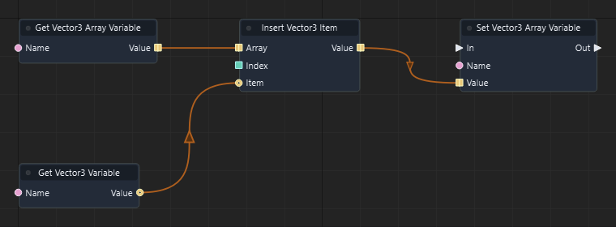

Graph: `templates/games/isometric_snake_3d/graphs/gameplay.json` · Function: **Advance snake** · Node: `n38`.

[Mở hướng dẫn game](games/isometric-snake.md)

### Đọc thêm

[Tài liệu hệ thống: typed-data.md](typed-data.md)

### Insert Entity Item

ID `3245` · `pure` · Workflow `shared`

Trả bản sao mảng có Item chèn tại Index; các phần tử phía sau dịch sang phải. Ghi kết quả về biến nếu cần lưu.

### IO

| Chiều | Cổng | Kiểu | Mặc định |
| --- | --- | --- | --- |
| IN | Array | `array<entity>` | `[]` |
| IN | Index | `int` | `0` |
| IN | Item | `entity` | `""` |
| OUT | Value | `array<entity>` | — |

Cổng `exec` điều khiển thứ tự. Cổng dữ liệu phải khớp kiểu; `vec2` không tự chuyển sang `vec3`.

### Cách dùng

1. Tìm **Insert Entity Item** trong Node Library hoặc nhấn Tab trong graph để thêm node.
2. Chọn node, nhập hằng số ở Inspector theo bảng IN. Chuỗi nhập trực tiếp; vector/mảng nhập theo JSON, ví dụ `[1, 0, 0]`. Khai báo biến qua Scene > Scene Variables… trước khi dùng Get/Set Variable.
3. Có thể kéo dây từ OUT dữ liệu vào IN có cùng kiểu; giá trị từ dây thay thế hằng số của cổng.
4. Nối OUT dữ liệu tới node dùng kết quả. Node pure không cần dây exec.
5. Nhấn F5, thử tình huống, kiểm tra Console/Diagnostics; Shift+F5 dừng. Ctrl+S lưu thay đổi graph.

### Đọc thêm

[Tài liệu hệ thống: typed-data.md](typed-data.md)

### Insert Vector2 Item

ID `3246` · `pure` · Workflow `shared`

Trả bản sao mảng có Item chèn tại Index; các phần tử phía sau dịch sang phải. Ghi kết quả về biến nếu cần lưu.

### IO

| Chiều | Cổng | Kiểu | Mặc định |
| --- | --- | --- | --- |
| IN | Array | `array<vec2>` | `[]` |
| IN | Index | `int` | `0` |
| IN | Item | `vec2` | `[0, 0]` |
| OUT | Value | `array<vec2>` | — |

Cổng `exec` điều khiển thứ tự. Cổng dữ liệu phải khớp kiểu; `vec2` không tự chuyển sang `vec3`.

### Cách dùng

1. Tìm **Insert Vector2 Item** trong Node Library hoặc nhấn Tab trong graph để thêm node.
2. Chọn node, nhập hằng số ở Inspector theo bảng IN. Chuỗi nhập trực tiếp; vector/mảng nhập theo JSON, ví dụ `[1, 0, 0]`. Khai báo biến qua Scene > Scene Variables… trước khi dùng Get/Set Variable.
3. Có thể kéo dây từ OUT dữ liệu vào IN có cùng kiểu; giá trị từ dây thay thế hằng số của cổng.
4. Nối OUT dữ liệu tới node dùng kết quả. Node pure không cần dây exec.
5. Nhấn F5, thử tình huống, kiểm tra Console/Diagnostics; Shift+F5 dừng. Ctrl+S lưu thay đổi graph.

### Đọc thêm

[Tài liệu hệ thống: typed-data.md](typed-data.md)

### Insert Vector4 Item

ID `3247` · `pure` · Workflow `shared`

Trả bản sao mảng có Item chèn tại Index; các phần tử phía sau dịch sang phải. Ghi kết quả về biến nếu cần lưu.

### IO

| Chiều | Cổng | Kiểu | Mặc định |
| --- | --- | --- | --- |
| IN | Array | `array<vec4>` | `[]` |
| IN | Index | `int` | `0` |
| IN | Item | `vec4` | `[0, 0, 0, 0]` |
| OUT | Value | `array<vec4>` | — |

Cổng `exec` điều khiển thứ tự. Cổng dữ liệu phải khớp kiểu; `vec2` không tự chuyển sang `vec3`.

### Cách dùng

1. Tìm **Insert Vector4 Item** trong Node Library hoặc nhấn Tab trong graph để thêm node.
2. Chọn node, nhập hằng số ở Inspector theo bảng IN. Chuỗi nhập trực tiếp; vector/mảng nhập theo JSON, ví dụ `[1, 0, 0]`. Khai báo biến qua Scene > Scene Variables… trước khi dùng Get/Set Variable.
3. Có thể kéo dây từ OUT dữ liệu vào IN có cùng kiểu; giá trị từ dây thay thế hằng số của cổng.
4. Nối OUT dữ liệu tới node dùng kết quả. Node pure không cần dây exec.
5. Nhấn F5, thử tình huống, kiểm tra Console/Diagnostics; Shift+F5 dừng. Ctrl+S lưu thay đổi graph.

### Đọc thêm

[Tài liệu hệ thống: typed-data.md](typed-data.md)

### Insert Quaternion Item

ID `3248` · `pure` · Workflow `shared`

Trả bản sao mảng có Item chèn tại Index; các phần tử phía sau dịch sang phải. Ghi kết quả về biến nếu cần lưu.

### IO

| Chiều | Cổng | Kiểu | Mặc định |
| --- | --- | --- | --- |
| IN | Array | `array<quat>` | `[]` |
| IN | Index | `int` | `0` |
| IN | Item | `quat` | `[0, 0, 0, 1]` |
| OUT | Value | `array<quat>` | — |

Cổng `exec` điều khiển thứ tự. Cổng dữ liệu phải khớp kiểu; `vec2` không tự chuyển sang `vec3`.

### Cách dùng

1. Tìm **Insert Quaternion Item** trong Node Library hoặc nhấn Tab trong graph để thêm node.
2. Chọn node, nhập hằng số ở Inspector theo bảng IN. Chuỗi nhập trực tiếp; vector/mảng nhập theo JSON, ví dụ `[1, 0, 0]`. Khai báo biến qua Scene > Scene Variables… trước khi dùng Get/Set Variable.
3. Có thể kéo dây từ OUT dữ liệu vào IN có cùng kiểu; giá trị từ dây thay thế hằng số của cổng.
4. Nối OUT dữ liệu tới node dùng kết quả. Node pure không cần dây exec.
5. Nhấn F5, thử tình huống, kiểm tra Console/Diagnostics; Shift+F5 dừng. Ctrl+S lưu thay đổi graph.

### Đọc thêm

[Tài liệu hệ thống: typed-data.md](typed-data.md)

### Insert Matrix4 Item

ID `3249` · `pure` · Workflow `shared`

Trả bản sao mảng có Item chèn tại Index; các phần tử phía sau dịch sang phải. Ghi kết quả về biến nếu cần lưu.

### IO

| Chiều | Cổng | Kiểu | Mặc định |
| --- | --- | --- | --- |
| IN | Array | `array<mat4>` | `[]` |
| IN | Index | `int` | `0` |
| IN | Item | `mat4` | `[1, 0, 0, 0, 0, 1, 0, 0, 0, 0, 1, 0, 0, 0, 0, 1]` |
| OUT | Value | `array<mat4>` | — |

Cổng `exec` điều khiển thứ tự. Cổng dữ liệu phải khớp kiểu; `vec2` không tự chuyển sang `vec3`.

### Cách dùng

1. Tìm **Insert Matrix4 Item** trong Node Library hoặc nhấn Tab trong graph để thêm node.
2. Chọn node, nhập hằng số ở Inspector theo bảng IN. Chuỗi nhập trực tiếp; vector/mảng nhập theo JSON, ví dụ `[1, 0, 0]`. Khai báo biến qua Scene > Scene Variables… trước khi dùng Get/Set Variable.
3. Có thể kéo dây từ OUT dữ liệu vào IN có cùng kiểu; giá trị từ dây thay thế hằng số của cổng.
4. Nối OUT dữ liệu tới node dùng kết quả. Node pure không cần dây exec.
5. Nhấn F5, thử tình huống, kiểm tra Console/Diagnostics; Shift+F5 dừng. Ctrl+S lưu thay đổi graph.

### Đọc thêm

[Tài liệu hệ thống: typed-data.md](typed-data.md)

### Remove Float Item At

ID `3250` · `pure` · Workflow `shared`

Trả mảng mới bỏ phần tử tại Index. Các phép pure trả bản sao; muốn lưu thay đổi qua frame, nối kết quả vào Set Variable cùng kiểu.

### IO

| Chiều | Cổng | Kiểu | Mặc định |
| --- | --- | --- | --- |
| IN | Array | `array<float>` | `[]` |
| IN | Index | `int` | `0` |
| OUT | Value | `array<float>` | — |

Cổng `exec` điều khiển thứ tự. Cổng dữ liệu phải khớp kiểu; `vec2` không tự chuyển sang `vec3`.

### Cách dùng

1. Tìm **Remove Float Item At** trong Node Library hoặc nhấn Tab trong graph để thêm node.
2. Chọn node, nhập hằng số ở Inspector theo bảng IN. Chuỗi nhập trực tiếp; vector/mảng nhập theo JSON, ví dụ `[1, 0, 0]`. Khai báo biến qua Scene > Scene Variables… trước khi dùng Get/Set Variable.
3. Có thể kéo dây từ OUT dữ liệu vào IN có cùng kiểu; giá trị từ dây thay thế hằng số của cổng.
4. Nối OUT dữ liệu tới node dùng kết quả. Node pure không cần dây exec.
5. Nhấn F5, thử tình huống, kiểm tra Console/Diagnostics; Shift+F5 dừng. Ctrl+S lưu thay đổi graph.

### Đọc thêm

[Tài liệu hệ thống: typed-data.md](typed-data.md)

### Remove Integer Item At

ID `3251` · `pure` · Workflow `shared`

Trả mảng mới bỏ phần tử tại Index. Các phép pure trả bản sao; muốn lưu thay đổi qua frame, nối kết quả vào Set Variable cùng kiểu.

### IO

| Chiều | Cổng | Kiểu | Mặc định |
| --- | --- | --- | --- |
| IN | Array | `array<int>` | `[]` |
| IN | Index | `int` | `0` |
| OUT | Value | `array<int>` | — |

Cổng `exec` điều khiển thứ tự. Cổng dữ liệu phải khớp kiểu; `vec2` không tự chuyển sang `vec3`.

### Cách dùng

1. Tìm **Remove Integer Item At** trong Node Library hoặc nhấn Tab trong graph để thêm node.
2. Chọn node, nhập hằng số ở Inspector theo bảng IN. Chuỗi nhập trực tiếp; vector/mảng nhập theo JSON, ví dụ `[1, 0, 0]`. Khai báo biến qua Scene > Scene Variables… trước khi dùng Get/Set Variable.
3. Có thể kéo dây từ OUT dữ liệu vào IN có cùng kiểu; giá trị từ dây thay thế hằng số của cổng.
4. Nối OUT dữ liệu tới node dùng kết quả. Node pure không cần dây exec.
5. Nhấn F5, thử tình huống, kiểm tra Console/Diagnostics; Shift+F5 dừng. Ctrl+S lưu thay đổi graph.

### Đọc thêm

[Tài liệu hệ thống: typed-data.md](typed-data.md)

### Remove Boolean Item At

ID `3252` · `pure` · Workflow `shared`

Trả mảng mới bỏ phần tử tại Index. Các phép pure trả bản sao; muốn lưu thay đổi qua frame, nối kết quả vào Set Variable cùng kiểu.

### IO

| Chiều | Cổng | Kiểu | Mặc định |
| --- | --- | --- | --- |
| IN | Array | `array<bool>` | `[]` |
| IN | Index | `int` | `0` |
| OUT | Value | `array<bool>` | — |

Cổng `exec` điều khiển thứ tự. Cổng dữ liệu phải khớp kiểu; `vec2` không tự chuyển sang `vec3`.

### Cách dùng

1. Tìm **Remove Boolean Item At** trong Node Library hoặc nhấn Tab trong graph để thêm node.
2. Chọn node, nhập hằng số ở Inspector theo bảng IN. Chuỗi nhập trực tiếp; vector/mảng nhập theo JSON, ví dụ `[1, 0, 0]`. Khai báo biến qua Scene > Scene Variables… trước khi dùng Get/Set Variable.
3. Có thể kéo dây từ OUT dữ liệu vào IN có cùng kiểu; giá trị từ dây thay thế hằng số của cổng.
4. Nối OUT dữ liệu tới node dùng kết quả. Node pure không cần dây exec.
5. Nhấn F5, thử tình huống, kiểm tra Console/Diagnostics; Shift+F5 dừng. Ctrl+S lưu thay đổi graph.

### Đọc thêm

[Tài liệu hệ thống: typed-data.md](typed-data.md)

### Remove String Item At

ID `3253` · `pure` · Workflow `shared`

Trả mảng mới bỏ phần tử tại Index. Các phép pure trả bản sao; muốn lưu thay đổi qua frame, nối kết quả vào Set Variable cùng kiểu.

### IO

| Chiều | Cổng | Kiểu | Mặc định |
| --- | --- | --- | --- |
| IN | Array | `array<string>` | `[]` |
| IN | Index | `int` | `0` |
| OUT | Value | `array<string>` | — |

Cổng `exec` điều khiển thứ tự. Cổng dữ liệu phải khớp kiểu; `vec2` không tự chuyển sang `vec3`.

### Cách dùng

1. Tìm **Remove String Item At** trong Node Library hoặc nhấn Tab trong graph để thêm node.
2. Chọn node, nhập hằng số ở Inspector theo bảng IN. Chuỗi nhập trực tiếp; vector/mảng nhập theo JSON, ví dụ `[1, 0, 0]`. Khai báo biến qua Scene > Scene Variables… trước khi dùng Get/Set Variable.
3. Có thể kéo dây từ OUT dữ liệu vào IN có cùng kiểu; giá trị từ dây thay thế hằng số của cổng.
4. Nối OUT dữ liệu tới node dùng kết quả. Node pure không cần dây exec.
5. Nhấn F5, thử tình huống, kiểm tra Console/Diagnostics; Shift+F5 dừng. Ctrl+S lưu thay đổi graph.

### Đọc thêm

[Tài liệu hệ thống: typed-data.md](typed-data.md)

### Remove Vector3 Item At

ID `3254` · `pure` · Workflow `shared`

Trả mảng mới bỏ phần tử tại Index. Các phép pure trả bản sao; muốn lưu thay đổi qua frame, nối kết quả vào Set Variable cùng kiểu.

### IO

| Chiều | Cổng | Kiểu | Mặc định |
| --- | --- | --- | --- |
| IN | Array | `array<vec3>` | `[]` |
| IN | Index | `int` | `0` |
| OUT | Value | `array<vec3>` | — |

Cổng `exec` điều khiển thứ tự. Cổng dữ liệu phải khớp kiểu; `vec2` không tự chuyển sang `vec3`.

### Cách dùng

1. Tìm **Remove Vector3 Item At** trong Node Library hoặc nhấn Tab trong graph để thêm node.
2. Chọn node, nhập hằng số ở Inspector theo bảng IN. Chuỗi nhập trực tiếp; vector/mảng nhập theo JSON, ví dụ `[1, 0, 0]`. Khai báo biến qua Scene > Scene Variables… trước khi dùng Get/Set Variable.
3. Có thể kéo dây từ OUT dữ liệu vào IN có cùng kiểu; giá trị từ dây thay thế hằng số của cổng.
4. Nối OUT dữ liệu tới node dùng kết quả. Node pure không cần dây exec.
5. Nhấn F5, thử tình huống, kiểm tra Console/Diagnostics; Shift+F5 dừng. Ctrl+S lưu thay đổi graph.

### Đọc thêm

[Tài liệu hệ thống: typed-data.md](typed-data.md)

### Remove Entity Item At

ID `3255` · `pure` · Workflow `shared`

Trả mảng mới bỏ phần tử tại Index. Các phép pure trả bản sao; muốn lưu thay đổi qua frame, nối kết quả vào Set Variable cùng kiểu.

### IO

| Chiều | Cổng | Kiểu | Mặc định |
| --- | --- | --- | --- |
| IN | Array | `array<entity>` | `[]` |
| IN | Index | `int` | `0` |
| OUT | Value | `array<entity>` | — |

Cổng `exec` điều khiển thứ tự. Cổng dữ liệu phải khớp kiểu; `vec2` không tự chuyển sang `vec3`.

### Cách dùng

1. Tìm **Remove Entity Item At** trong Node Library hoặc nhấn Tab trong graph để thêm node.
2. Chọn node, nhập hằng số ở Inspector theo bảng IN. Chuỗi nhập trực tiếp; vector/mảng nhập theo JSON, ví dụ `[1, 0, 0]`. Khai báo biến qua Scene > Scene Variables… trước khi dùng Get/Set Variable.
3. Có thể kéo dây từ OUT dữ liệu vào IN có cùng kiểu; giá trị từ dây thay thế hằng số của cổng.
4. Nối OUT dữ liệu tới node dùng kết quả. Node pure không cần dây exec.
5. Nhấn F5, thử tình huống, kiểm tra Console/Diagnostics; Shift+F5 dừng. Ctrl+S lưu thay đổi graph.

### Đọc thêm

[Tài liệu hệ thống: typed-data.md](typed-data.md)

### Remove Vector2 Item At

ID `3256` · `pure` · Workflow `shared`

Trả mảng mới bỏ phần tử tại Index. Các phép pure trả bản sao; muốn lưu thay đổi qua frame, nối kết quả vào Set Variable cùng kiểu.

### IO

| Chiều | Cổng | Kiểu | Mặc định |
| --- | --- | --- | --- |
| IN | Array | `array<vec2>` | `[]` |
| IN | Index | `int` | `0` |
| OUT | Value | `array<vec2>` | — |

Cổng `exec` điều khiển thứ tự. Cổng dữ liệu phải khớp kiểu; `vec2` không tự chuyển sang `vec3`.

### Cách dùng

1. Tìm **Remove Vector2 Item At** trong Node Library hoặc nhấn Tab trong graph để thêm node.
2. Chọn node, nhập hằng số ở Inspector theo bảng IN. Chuỗi nhập trực tiếp; vector/mảng nhập theo JSON, ví dụ `[1, 0, 0]`. Khai báo biến qua Scene > Scene Variables… trước khi dùng Get/Set Variable.
3. Có thể kéo dây từ OUT dữ liệu vào IN có cùng kiểu; giá trị từ dây thay thế hằng số của cổng.
4. Nối OUT dữ liệu tới node dùng kết quả. Node pure không cần dây exec.
5. Nhấn F5, thử tình huống, kiểm tra Console/Diagnostics; Shift+F5 dừng. Ctrl+S lưu thay đổi graph.

### Đọc thêm

[Tài liệu hệ thống: typed-data.md](typed-data.md)

### Remove Vector4 Item At

ID `3257` · `pure` · Workflow `shared`

Trả mảng mới bỏ phần tử tại Index. Các phép pure trả bản sao; muốn lưu thay đổi qua frame, nối kết quả vào Set Variable cùng kiểu.

### IO

| Chiều | Cổng | Kiểu | Mặc định |
| --- | --- | --- | --- |
| IN | Array | `array<vec4>` | `[]` |
| IN | Index | `int` | `0` |
| OUT | Value | `array<vec4>` | — |

Cổng `exec` điều khiển thứ tự. Cổng dữ liệu phải khớp kiểu; `vec2` không tự chuyển sang `vec3`.

### Cách dùng

1. Tìm **Remove Vector4 Item At** trong Node Library hoặc nhấn Tab trong graph để thêm node.
2. Chọn node, nhập hằng số ở Inspector theo bảng IN. Chuỗi nhập trực tiếp; vector/mảng nhập theo JSON, ví dụ `[1, 0, 0]`. Khai báo biến qua Scene > Scene Variables… trước khi dùng Get/Set Variable.
3. Có thể kéo dây từ OUT dữ liệu vào IN có cùng kiểu; giá trị từ dây thay thế hằng số của cổng.
4. Nối OUT dữ liệu tới node dùng kết quả. Node pure không cần dây exec.
5. Nhấn F5, thử tình huống, kiểm tra Console/Diagnostics; Shift+F5 dừng. Ctrl+S lưu thay đổi graph.

### Đọc thêm

[Tài liệu hệ thống: typed-data.md](typed-data.md)

### Remove Quaternion Item At

ID `3258` · `pure` · Workflow `shared`

Trả mảng mới bỏ phần tử tại Index. Các phép pure trả bản sao; muốn lưu thay đổi qua frame, nối kết quả vào Set Variable cùng kiểu.

### IO

| Chiều | Cổng | Kiểu | Mặc định |
| --- | --- | --- | --- |
| IN | Array | `array<quat>` | `[]` |
| IN | Index | `int` | `0` |
| OUT | Value | `array<quat>` | — |

Cổng `exec` điều khiển thứ tự. Cổng dữ liệu phải khớp kiểu; `vec2` không tự chuyển sang `vec3`.

### Cách dùng

1. Tìm **Remove Quaternion Item At** trong Node Library hoặc nhấn Tab trong graph để thêm node.
2. Chọn node, nhập hằng số ở Inspector theo bảng IN. Chuỗi nhập trực tiếp; vector/mảng nhập theo JSON, ví dụ `[1, 0, 0]`. Khai báo biến qua Scene > Scene Variables… trước khi dùng Get/Set Variable.
3. Có thể kéo dây từ OUT dữ liệu vào IN có cùng kiểu; giá trị từ dây thay thế hằng số của cổng.
4. Nối OUT dữ liệu tới node dùng kết quả. Node pure không cần dây exec.
5. Nhấn F5, thử tình huống, kiểm tra Console/Diagnostics; Shift+F5 dừng. Ctrl+S lưu thay đổi graph.

### Đọc thêm

[Tài liệu hệ thống: typed-data.md](typed-data.md)

### Remove Matrix4 Item At

ID `3259` · `pure` · Workflow `shared`

Trả mảng mới bỏ phần tử tại Index. Các phép pure trả bản sao; muốn lưu thay đổi qua frame, nối kết quả vào Set Variable cùng kiểu.

### IO

| Chiều | Cổng | Kiểu | Mặc định |
| --- | --- | --- | --- |
| IN | Array | `array<mat4>` | `[]` |
| IN | Index | `int` | `0` |
| OUT | Value | `array<mat4>` | — |

Cổng `exec` điều khiển thứ tự. Cổng dữ liệu phải khớp kiểu; `vec2` không tự chuyển sang `vec3`.

### Cách dùng

1. Tìm **Remove Matrix4 Item At** trong Node Library hoặc nhấn Tab trong graph để thêm node.
2. Chọn node, nhập hằng số ở Inspector theo bảng IN. Chuỗi nhập trực tiếp; vector/mảng nhập theo JSON, ví dụ `[1, 0, 0]`. Khai báo biến qua Scene > Scene Variables… trước khi dùng Get/Set Variable.
3. Có thể kéo dây từ OUT dữ liệu vào IN có cùng kiểu; giá trị từ dây thay thế hằng số của cổng.
4. Nối OUT dữ liệu tới node dùng kết quả. Node pure không cần dây exec.
5. Nhấn F5, thử tình huống, kiểm tra Console/Diagnostics; Shift+F5 dừng. Ctrl+S lưu thay đổi graph.

### Đọc thêm

[Tài liệu hệ thống: typed-data.md](typed-data.md)

### Get Float Item

ID `3260` · `pure` · Workflow `shared`

Đọc phần tử tại Index của mảng, đánh số từ 0. Chỉ số phải nằm trong mảng.

### IO

| Chiều | Cổng | Kiểu | Mặc định |
| --- | --- | --- | --- |
| IN | Array | `array<float>` | `[]` |
| IN | Index | `int` | `0` |
| OUT | Value | `float` | — |

Cổng `exec` điều khiển thứ tự. Cổng dữ liệu phải khớp kiểu; `vec2` không tự chuyển sang `vec3`.

### Cách dùng

1. Tìm **Get Float Item** trong Node Library hoặc nhấn Tab trong graph để thêm node.
2. Chọn node, nhập hằng số ở Inspector theo bảng IN. Chuỗi nhập trực tiếp; vector/mảng nhập theo JSON, ví dụ `[1, 0, 0]`. Khai báo biến qua Scene > Scene Variables… trước khi dùng Get/Set Variable.
3. Có thể kéo dây từ OUT dữ liệu vào IN có cùng kiểu; giá trị từ dây thay thế hằng số của cổng.
4. Nối OUT dữ liệu tới node dùng kết quả. Node pure không cần dây exec.
5. Nhấn F5, thử tình huống, kiểm tra Console/Diagnostics; Shift+F5 dừng. Ctrl+S lưu thay đổi graph.

### Đọc thêm

[Tài liệu hệ thống: typed-data.md](typed-data.md)

### Get Integer Item

ID `3261` · `pure` · Workflow `shared`

Đọc phần tử tại Index của mảng, đánh số từ 0. Chỉ số phải nằm trong mảng.

### IO

| Chiều | Cổng | Kiểu | Mặc định |
| --- | --- | --- | --- |
| IN | Array | `array<int>` | `[]` |
| IN | Index | `int` | `0` |
| OUT | Value | `int` | — |

Cổng `exec` điều khiển thứ tự. Cổng dữ liệu phải khớp kiểu; `vec2` không tự chuyển sang `vec3`.

### Cách dùng

1. Tìm **Get Integer Item** trong Node Library hoặc nhấn Tab trong graph để thêm node.
2. Chọn node, nhập hằng số ở Inspector theo bảng IN. Chuỗi nhập trực tiếp; vector/mảng nhập theo JSON, ví dụ `[1, 0, 0]`. Khai báo biến qua Scene > Scene Variables… trước khi dùng Get/Set Variable.
3. Có thể kéo dây từ OUT dữ liệu vào IN có cùng kiểu; giá trị từ dây thay thế hằng số của cổng.
4. Nối OUT dữ liệu tới node dùng kết quả. Node pure không cần dây exec.
5. Nhấn F5, thử tình huống, kiểm tra Console/Diagnostics; Shift+F5 dừng. Ctrl+S lưu thay đổi graph.

### Đọc thêm

[Tài liệu hệ thống: typed-data.md](typed-data.md)

### Get Boolean Item

ID `3262` · `pure` · Workflow `shared`

Đọc phần tử tại Index của mảng, đánh số từ 0. Chỉ số phải nằm trong mảng.

### IO

| Chiều | Cổng | Kiểu | Mặc định |
| --- | --- | --- | --- |
| IN | Array | `array<bool>` | `[]` |
| IN | Index | `int` | `0` |
| OUT | Value | `bool` | — |

Cổng `exec` điều khiển thứ tự. Cổng dữ liệu phải khớp kiểu; `vec2` không tự chuyển sang `vec3`.

### Cách dùng

1. Tìm **Get Boolean Item** trong Node Library hoặc nhấn Tab trong graph để thêm node.
2. Chọn node, nhập hằng số ở Inspector theo bảng IN. Chuỗi nhập trực tiếp; vector/mảng nhập theo JSON, ví dụ `[1, 0, 0]`. Khai báo biến qua Scene > Scene Variables… trước khi dùng Get/Set Variable.
3. Có thể kéo dây từ OUT dữ liệu vào IN có cùng kiểu; giá trị từ dây thay thế hằng số của cổng.
4. Nối OUT dữ liệu tới node dùng kết quả. Node pure không cần dây exec.
5. Nhấn F5, thử tình huống, kiểm tra Console/Diagnostics; Shift+F5 dừng. Ctrl+S lưu thay đổi graph.

### Đọc thêm

[Tài liệu hệ thống: typed-data.md](typed-data.md)

### Get String Item

ID `3263` · `pure` · Workflow `shared`

Đọc phần tử tại Index của mảng, đánh số từ 0. Chỉ số phải nằm trong mảng.

### IO

| Chiều | Cổng | Kiểu | Mặc định |
| --- | --- | --- | --- |
| IN | Array | `array<string>` | `[]` |
| IN | Index | `int` | `0` |
| OUT | Value | `string` | — |

Cổng `exec` điều khiển thứ tự. Cổng dữ liệu phải khớp kiểu; `vec2` không tự chuyển sang `vec3`.

### Cách dùng

1. Tìm **Get String Item** trong Node Library hoặc nhấn Tab trong graph để thêm node.
2. Chọn node, nhập hằng số ở Inspector theo bảng IN. Chuỗi nhập trực tiếp; vector/mảng nhập theo JSON, ví dụ `[1, 0, 0]`. Khai báo biến qua Scene > Scene Variables… trước khi dùng Get/Set Variable.
3. Có thể kéo dây từ OUT dữ liệu vào IN có cùng kiểu; giá trị từ dây thay thế hằng số của cổng.
4. Nối OUT dữ liệu tới node dùng kết quả. Node pure không cần dây exec.
5. Nhấn F5, thử tình huống, kiểm tra Console/Diagnostics; Shift+F5 dừng. Ctrl+S lưu thay đổi graph.

### Đọc thêm

[Tài liệu hệ thống: typed-data.md](typed-data.md)

### Get Vector3 Item

ID `3264` · `pure` · Workflow `shared`

Đọc phần tử tại Index của mảng, đánh số từ 0. Chỉ số phải nằm trong mảng.

### IO

| Chiều | Cổng | Kiểu | Mặc định |
| --- | --- | --- | --- |
| IN | Array | `array<vec3>` | `[]` |
| IN | Index | `int` | `0` |
| OUT | Value | `vec3` | — |

Cổng `exec` điều khiển thứ tự. Cổng dữ liệu phải khớp kiểu; `vec2` không tự chuyển sang `vec3`.

### Cách dùng

1. Tìm **Get Vector3 Item** trong Node Library hoặc nhấn Tab trong graph để thêm node.
2. Chọn node, nhập hằng số ở Inspector theo bảng IN. Chuỗi nhập trực tiếp; vector/mảng nhập theo JSON, ví dụ `[1, 0, 0]`. Khai báo biến qua Scene > Scene Variables… trước khi dùng Get/Set Variable.
3. Có thể kéo dây từ OUT dữ liệu vào IN có cùng kiểu; giá trị từ dây thay thế hằng số của cổng.
4. Nối OUT dữ liệu tới node dùng kết quả. Node pure không cần dây exec.
5. Nhấn F5, thử tình huống, kiểm tra Console/Diagnostics; Shift+F5 dừng. Ctrl+S lưu thay đổi graph.

### Ví dụ từ graph thật

Trích đoạn Refresh board của isometric_snake_3d: node n11. Đây là các node và dây nối thật từ graph đã chạy; vị trí được sắp lại để dễ đọc.

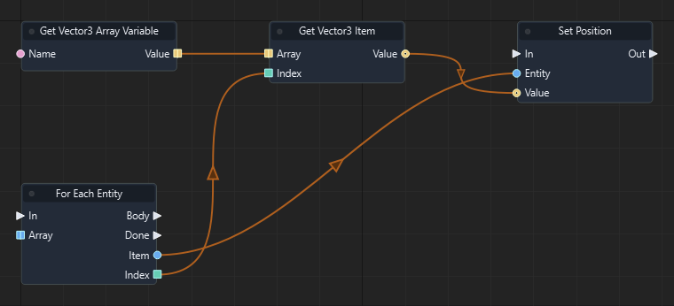

Graph: `templates/games/isometric_snake_3d/graphs/gameplay.json` · Function: **Refresh board** · Node: `n11`.

[Mở hướng dẫn game](games/isometric-snake.md)

### Đọc thêm

[Tài liệu hệ thống: typed-data.md](typed-data.md)

### Get Entity Item

ID `3265` · `pure` · Workflow `shared`

Đọc phần tử tại Index của mảng, đánh số từ 0. Chỉ số phải nằm trong mảng.

### IO

| Chiều | Cổng | Kiểu | Mặc định |
| --- | --- | --- | --- |
| IN | Array | `array<entity>` | `[]` |
| IN | Index | `int` | `0` |
| OUT | Value | `entity` | — |

Cổng `exec` điều khiển thứ tự. Cổng dữ liệu phải khớp kiểu; `vec2` không tự chuyển sang `vec3`.

### Cách dùng

1. Tìm **Get Entity Item** trong Node Library hoặc nhấn Tab trong graph để thêm node.
2. Chọn node, nhập hằng số ở Inspector theo bảng IN. Chuỗi nhập trực tiếp; vector/mảng nhập theo JSON, ví dụ `[1, 0, 0]`. Khai báo biến qua Scene > Scene Variables… trước khi dùng Get/Set Variable.
3. Có thể kéo dây từ OUT dữ liệu vào IN có cùng kiểu; giá trị từ dây thay thế hằng số của cổng.
4. Nối OUT dữ liệu tới node dùng kết quả. Node pure không cần dây exec.
5. Nhấn F5, thử tình huống, kiểm tra Console/Diagnostics; Shift+F5 dừng. Ctrl+S lưu thay đổi graph.

### Đọc thêm

[Tài liệu hệ thống: typed-data.md](typed-data.md)

### Get Vector2 Item

ID `3266` · `pure` · Workflow `shared`

Đọc phần tử tại Index của mảng, đánh số từ 0. Chỉ số phải nằm trong mảng.

### IO

| Chiều | Cổng | Kiểu | Mặc định |
| --- | --- | --- | --- |
| IN | Array | `array<vec2>` | `[]` |
| IN | Index | `int` | `0` |
| OUT | Value | `vec2` | — |

Cổng `exec` điều khiển thứ tự. Cổng dữ liệu phải khớp kiểu; `vec2` không tự chuyển sang `vec3`.

### Cách dùng

1. Tìm **Get Vector2 Item** trong Node Library hoặc nhấn Tab trong graph để thêm node.
2. Chọn node, nhập hằng số ở Inspector theo bảng IN. Chuỗi nhập trực tiếp; vector/mảng nhập theo JSON, ví dụ `[1, 0, 0]`. Khai báo biến qua Scene > Scene Variables… trước khi dùng Get/Set Variable.
3. Có thể kéo dây từ OUT dữ liệu vào IN có cùng kiểu; giá trị từ dây thay thế hằng số của cổng.
4. Nối OUT dữ liệu tới node dùng kết quả. Node pure không cần dây exec.
5. Nhấn F5, thử tình huống, kiểm tra Console/Diagnostics; Shift+F5 dừng. Ctrl+S lưu thay đổi graph.

### Đọc thêm

[Tài liệu hệ thống: typed-data.md](typed-data.md)

### Get Vector4 Item

ID `3267` · `pure` · Workflow `shared`

Đọc phần tử tại Index của mảng, đánh số từ 0. Chỉ số phải nằm trong mảng.

### IO

| Chiều | Cổng | Kiểu | Mặc định |
| --- | --- | --- | --- |
| IN | Array | `array<vec4>` | `[]` |
| IN | Index | `int` | `0` |
| OUT | Value | `vec4` | — |

Cổng `exec` điều khiển thứ tự. Cổng dữ liệu phải khớp kiểu; `vec2` không tự chuyển sang `vec3`.

### Cách dùng

1. Tìm **Get Vector4 Item** trong Node Library hoặc nhấn Tab trong graph để thêm node.
2. Chọn node, nhập hằng số ở Inspector theo bảng IN. Chuỗi nhập trực tiếp; vector/mảng nhập theo JSON, ví dụ `[1, 0, 0]`. Khai báo biến qua Scene > Scene Variables… trước khi dùng Get/Set Variable.
3. Có thể kéo dây từ OUT dữ liệu vào IN có cùng kiểu; giá trị từ dây thay thế hằng số của cổng.
4. Nối OUT dữ liệu tới node dùng kết quả. Node pure không cần dây exec.
5. Nhấn F5, thử tình huống, kiểm tra Console/Diagnostics; Shift+F5 dừng. Ctrl+S lưu thay đổi graph.

### Đọc thêm

[Tài liệu hệ thống: typed-data.md](typed-data.md)

### Get Quaternion Item

ID `3268` · `pure` · Workflow `shared`

Đọc phần tử tại Index của mảng, đánh số từ 0. Chỉ số phải nằm trong mảng.

### IO

| Chiều | Cổng | Kiểu | Mặc định |
| --- | --- | --- | --- |
| IN | Array | `array<quat>` | `[]` |
| IN | Index | `int` | `0` |
| OUT | Value | `quat` | — |

Cổng `exec` điều khiển thứ tự. Cổng dữ liệu phải khớp kiểu; `vec2` không tự chuyển sang `vec3`.

### Cách dùng

1. Tìm **Get Quaternion Item** trong Node Library hoặc nhấn Tab trong graph để thêm node.
2. Chọn node, nhập hằng số ở Inspector theo bảng IN. Chuỗi nhập trực tiếp; vector/mảng nhập theo JSON, ví dụ `[1, 0, 0]`. Khai báo biến qua Scene > Scene Variables… trước khi dùng Get/Set Variable.
3. Có thể kéo dây từ OUT dữ liệu vào IN có cùng kiểu; giá trị từ dây thay thế hằng số của cổng.
4. Nối OUT dữ liệu tới node dùng kết quả. Node pure không cần dây exec.
5. Nhấn F5, thử tình huống, kiểm tra Console/Diagnostics; Shift+F5 dừng. Ctrl+S lưu thay đổi graph.

### Đọc thêm

[Tài liệu hệ thống: typed-data.md](typed-data.md)

### Get Matrix4 Item

ID `3269` · `pure` · Workflow `shared`

Đọc phần tử tại Index của mảng, đánh số từ 0. Chỉ số phải nằm trong mảng.

### IO

| Chiều | Cổng | Kiểu | Mặc định |
| --- | --- | --- | --- |
| IN | Array | `array<mat4>` | `[]` |
| IN | Index | `int` | `0` |
| OUT | Value | `mat4` | — |

Cổng `exec` điều khiển thứ tự. Cổng dữ liệu phải khớp kiểu; `vec2` không tự chuyển sang `vec3`.

### Cách dùng

1. Tìm **Get Matrix4 Item** trong Node Library hoặc nhấn Tab trong graph để thêm node.
2. Chọn node, nhập hằng số ở Inspector theo bảng IN. Chuỗi nhập trực tiếp; vector/mảng nhập theo JSON, ví dụ `[1, 0, 0]`. Khai báo biến qua Scene > Scene Variables… trước khi dùng Get/Set Variable.
3. Có thể kéo dây từ OUT dữ liệu vào IN có cùng kiểu; giá trị từ dây thay thế hằng số của cổng.
4. Nối OUT dữ liệu tới node dùng kết quả. Node pure không cần dây exec.
5. Nhấn F5, thử tình huống, kiểm tra Console/Diagnostics; Shift+F5 dừng. Ctrl+S lưu thay đổi graph.

### Đọc thêm

[Tài liệu hệ thống: typed-data.md](typed-data.md)

### Set Float Item

ID `3270` · `pure` · Workflow `shared`

Trả mảng mới thay phần tử tại Index bằng Item. Các phép pure trả bản sao; muốn lưu thay đổi qua frame, nối kết quả vào Set Variable cùng kiểu.

### IO

| Chiều | Cổng | Kiểu | Mặc định |
| --- | --- | --- | --- |
| IN | Array | `array<float>` | `[]` |
| IN | Index | `int` | `0` |
| IN | Item | `float` | `0.0` |
| OUT | Value | `array<float>` | — |

Cổng `exec` điều khiển thứ tự. Cổng dữ liệu phải khớp kiểu; `vec2` không tự chuyển sang `vec3`.

### Cách dùng

1. Tìm **Set Float Item** trong Node Library hoặc nhấn Tab trong graph để thêm node.
2. Chọn node, nhập hằng số ở Inspector theo bảng IN. Chuỗi nhập trực tiếp; vector/mảng nhập theo JSON, ví dụ `[1, 0, 0]`. Khai báo biến qua Scene > Scene Variables… trước khi dùng Get/Set Variable.
3. Có thể kéo dây từ OUT dữ liệu vào IN có cùng kiểu; giá trị từ dây thay thế hằng số của cổng.
4. Nối OUT dữ liệu tới node dùng kết quả. Node pure không cần dây exec.
5. Nhấn F5, thử tình huống, kiểm tra Console/Diagnostics; Shift+F5 dừng. Ctrl+S lưu thay đổi graph.

### Đọc thêm

[Tài liệu hệ thống: typed-data.md](typed-data.md)

### Set Integer Item

ID `3271` · `pure` · Workflow `shared`

Trả mảng mới thay phần tử tại Index bằng Item. Các phép pure trả bản sao; muốn lưu thay đổi qua frame, nối kết quả vào Set Variable cùng kiểu.

### IO

| Chiều | Cổng | Kiểu | Mặc định |
| --- | --- | --- | --- |
| IN | Array | `array<int>` | `[]` |
| IN | Index | `int` | `0` |
| IN | Item | `int` | `0` |
| OUT | Value | `array<int>` | — |

Cổng `exec` điều khiển thứ tự. Cổng dữ liệu phải khớp kiểu; `vec2` không tự chuyển sang `vec3`.

### Cách dùng

1. Tìm **Set Integer Item** trong Node Library hoặc nhấn Tab trong graph để thêm node.
2. Chọn node, nhập hằng số ở Inspector theo bảng IN. Chuỗi nhập trực tiếp; vector/mảng nhập theo JSON, ví dụ `[1, 0, 0]`. Khai báo biến qua Scene > Scene Variables… trước khi dùng Get/Set Variable.
3. Có thể kéo dây từ OUT dữ liệu vào IN có cùng kiểu; giá trị từ dây thay thế hằng số của cổng.
4. Nối OUT dữ liệu tới node dùng kết quả. Node pure không cần dây exec.
5. Nhấn F5, thử tình huống, kiểm tra Console/Diagnostics; Shift+F5 dừng. Ctrl+S lưu thay đổi graph.

### Đọc thêm

[Tài liệu hệ thống: typed-data.md](typed-data.md)

### Set Boolean Item

ID `3272` · `pure` · Workflow `shared`

Trả mảng mới thay phần tử tại Index bằng Item. Các phép pure trả bản sao; muốn lưu thay đổi qua frame, nối kết quả vào Set Variable cùng kiểu.

### IO

| Chiều | Cổng | Kiểu | Mặc định |
| --- | --- | --- | --- |
| IN | Array | `array<bool>` | `[]` |
| IN | Index | `int` | `0` |
| IN | Item | `bool` | `false` |
| OUT | Value | `array<bool>` | — |

Cổng `exec` điều khiển thứ tự. Cổng dữ liệu phải khớp kiểu; `vec2` không tự chuyển sang `vec3`.

### Cách dùng

1. Tìm **Set Boolean Item** trong Node Library hoặc nhấn Tab trong graph để thêm node.
2. Chọn node, nhập hằng số ở Inspector theo bảng IN. Chuỗi nhập trực tiếp; vector/mảng nhập theo JSON, ví dụ `[1, 0, 0]`. Khai báo biến qua Scene > Scene Variables… trước khi dùng Get/Set Variable.
3. Có thể kéo dây từ OUT dữ liệu vào IN có cùng kiểu; giá trị từ dây thay thế hằng số của cổng.
4. Nối OUT dữ liệu tới node dùng kết quả. Node pure không cần dây exec.
5. Nhấn F5, thử tình huống, kiểm tra Console/Diagnostics; Shift+F5 dừng. Ctrl+S lưu thay đổi graph.

### Đọc thêm

[Tài liệu hệ thống: typed-data.md](typed-data.md)

### Set String Item

ID `3273` · `pure` · Workflow `shared`

Trả mảng mới thay phần tử tại Index bằng Item. Các phép pure trả bản sao; muốn lưu thay đổi qua frame, nối kết quả vào Set Variable cùng kiểu.

### IO

| Chiều | Cổng | Kiểu | Mặc định |
| --- | --- | --- | --- |
| IN | Array | `array<string>` | `[]` |
| IN | Index | `int` | `0` |
| IN | Item | `string` | `""` |
| OUT | Value | `array<string>` | — |

Cổng `exec` điều khiển thứ tự. Cổng dữ liệu phải khớp kiểu; `vec2` không tự chuyển sang `vec3`.

### Cách dùng

1. Tìm **Set String Item** trong Node Library hoặc nhấn Tab trong graph để thêm node.
2. Chọn node, nhập hằng số ở Inspector theo bảng IN. Chuỗi nhập trực tiếp; vector/mảng nhập theo JSON, ví dụ `[1, 0, 0]`. Khai báo biến qua Scene > Scene Variables… trước khi dùng Get/Set Variable.
3. Có thể kéo dây từ OUT dữ liệu vào IN có cùng kiểu; giá trị từ dây thay thế hằng số của cổng.
4. Nối OUT dữ liệu tới node dùng kết quả. Node pure không cần dây exec.
5. Nhấn F5, thử tình huống, kiểm tra Console/Diagnostics; Shift+F5 dừng. Ctrl+S lưu thay đổi graph.

### Đọc thêm

[Tài liệu hệ thống: typed-data.md](typed-data.md)

### Set Vector3 Item

ID `3274` · `pure` · Workflow `shared`

Trả mảng mới thay phần tử tại Index bằng Item. Các phép pure trả bản sao; muốn lưu thay đổi qua frame, nối kết quả vào Set Variable cùng kiểu.

### IO

| Chiều | Cổng | Kiểu | Mặc định |
| --- | --- | --- | --- |
| IN | Array | `array<vec3>` | `[]` |
| IN | Index | `int` | `0` |
| IN | Item | `vec3` | `[0, 0, 0]` |
| OUT | Value | `array<vec3>` | — |

Cổng `exec` điều khiển thứ tự. Cổng dữ liệu phải khớp kiểu; `vec2` không tự chuyển sang `vec3`.

### Cách dùng

1. Tìm **Set Vector3 Item** trong Node Library hoặc nhấn Tab trong graph để thêm node.
2. Chọn node, nhập hằng số ở Inspector theo bảng IN. Chuỗi nhập trực tiếp; vector/mảng nhập theo JSON, ví dụ `[1, 0, 0]`. Khai báo biến qua Scene > Scene Variables… trước khi dùng Get/Set Variable.
3. Có thể kéo dây từ OUT dữ liệu vào IN có cùng kiểu; giá trị từ dây thay thế hằng số của cổng.
4. Nối OUT dữ liệu tới node dùng kết quả. Node pure không cần dây exec.
5. Nhấn F5, thử tình huống, kiểm tra Console/Diagnostics; Shift+F5 dừng. Ctrl+S lưu thay đổi graph.

### Đọc thêm

[Tài liệu hệ thống: typed-data.md](typed-data.md)

### Set Entity Item

ID `3275` · `pure` · Workflow `shared`

Trả mảng mới thay phần tử tại Index bằng Item. Các phép pure trả bản sao; muốn lưu thay đổi qua frame, nối kết quả vào Set Variable cùng kiểu.

### IO

| Chiều | Cổng | Kiểu | Mặc định |
| --- | --- | --- | --- |
| IN | Array | `array<entity>` | `[]` |
| IN | Index | `int` | `0` |
| IN | Item | `entity` | `""` |
| OUT | Value | `array<entity>` | — |

Cổng `exec` điều khiển thứ tự. Cổng dữ liệu phải khớp kiểu; `vec2` không tự chuyển sang `vec3`.

### Cách dùng

1. Tìm **Set Entity Item** trong Node Library hoặc nhấn Tab trong graph để thêm node.
2. Chọn node, nhập hằng số ở Inspector theo bảng IN. Chuỗi nhập trực tiếp; vector/mảng nhập theo JSON, ví dụ `[1, 0, 0]`. Khai báo biến qua Scene > Scene Variables… trước khi dùng Get/Set Variable.
3. Có thể kéo dây từ OUT dữ liệu vào IN có cùng kiểu; giá trị từ dây thay thế hằng số của cổng.
4. Nối OUT dữ liệu tới node dùng kết quả. Node pure không cần dây exec.
5. Nhấn F5, thử tình huống, kiểm tra Console/Diagnostics; Shift+F5 dừng. Ctrl+S lưu thay đổi graph.

### Đọc thêm

[Tài liệu hệ thống: typed-data.md](typed-data.md)

### Set Vector2 Item

ID `3276` · `pure` · Workflow `shared`

Trả mảng mới thay phần tử tại Index bằng Item. Các phép pure trả bản sao; muốn lưu thay đổi qua frame, nối kết quả vào Set Variable cùng kiểu.

### IO

| Chiều | Cổng | Kiểu | Mặc định |
| --- | --- | --- | --- |
| IN | Array | `array<vec2>` | `[]` |
| IN | Index | `int` | `0` |
| IN | Item | `vec2` | `[0, 0]` |
| OUT | Value | `array<vec2>` | — |

Cổng `exec` điều khiển thứ tự. Cổng dữ liệu phải khớp kiểu; `vec2` không tự chuyển sang `vec3`.

### Cách dùng

1. Tìm **Set Vector2 Item** trong Node Library hoặc nhấn Tab trong graph để thêm node.
2. Chọn node, nhập hằng số ở Inspector theo bảng IN. Chuỗi nhập trực tiếp; vector/mảng nhập theo JSON, ví dụ `[1, 0, 0]`. Khai báo biến qua Scene > Scene Variables… trước khi dùng Get/Set Variable.
3. Có thể kéo dây từ OUT dữ liệu vào IN có cùng kiểu; giá trị từ dây thay thế hằng số của cổng.
4. Nối OUT dữ liệu tới node dùng kết quả. Node pure không cần dây exec.
5. Nhấn F5, thử tình huống, kiểm tra Console/Diagnostics; Shift+F5 dừng. Ctrl+S lưu thay đổi graph.

### Đọc thêm

[Tài liệu hệ thống: typed-data.md](typed-data.md)

### Set Vector4 Item

ID `3277` · `pure` · Workflow `shared`

Trả mảng mới thay phần tử tại Index bằng Item. Các phép pure trả bản sao; muốn lưu thay đổi qua frame, nối kết quả vào Set Variable cùng kiểu.

### IO

| Chiều | Cổng | Kiểu | Mặc định |
| --- | --- | --- | --- |
| IN | Array | `array<vec4>` | `[]` |
| IN | Index | `int` | `0` |
| IN | Item | `vec4` | `[0, 0, 0, 0]` |
| OUT | Value | `array<vec4>` | — |

Cổng `exec` điều khiển thứ tự. Cổng dữ liệu phải khớp kiểu; `vec2` không tự chuyển sang `vec3`.

### Cách dùng

1. Tìm **Set Vector4 Item** trong Node Library hoặc nhấn Tab trong graph để thêm node.
2. Chọn node, nhập hằng số ở Inspector theo bảng IN. Chuỗi nhập trực tiếp; vector/mảng nhập theo JSON, ví dụ `[1, 0, 0]`. Khai báo biến qua Scene > Scene Variables… trước khi dùng Get/Set Variable.
3. Có thể kéo dây từ OUT dữ liệu vào IN có cùng kiểu; giá trị từ dây thay thế hằng số của cổng.
4. Nối OUT dữ liệu tới node dùng kết quả. Node pure không cần dây exec.
5. Nhấn F5, thử tình huống, kiểm tra Console/Diagnostics; Shift+F5 dừng. Ctrl+S lưu thay đổi graph.

### Đọc thêm

[Tài liệu hệ thống: typed-data.md](typed-data.md)

### Set Quaternion Item

ID `3278` · `pure` · Workflow `shared`

Trả mảng mới thay phần tử tại Index bằng Item. Các phép pure trả bản sao; muốn lưu thay đổi qua frame, nối kết quả vào Set Variable cùng kiểu.

### IO

| Chiều | Cổng | Kiểu | Mặc định |
| --- | --- | --- | --- |
| IN | Array | `array<quat>` | `[]` |
| IN | Index | `int` | `0` |
| IN | Item | `quat` | `[0, 0, 0, 1]` |
| OUT | Value | `array<quat>` | — |

Cổng `exec` điều khiển thứ tự. Cổng dữ liệu phải khớp kiểu; `vec2` không tự chuyển sang `vec3`.

### Cách dùng

1. Tìm **Set Quaternion Item** trong Node Library hoặc nhấn Tab trong graph để thêm node.
2. Chọn node, nhập hằng số ở Inspector theo bảng IN. Chuỗi nhập trực tiếp; vector/mảng nhập theo JSON, ví dụ `[1, 0, 0]`. Khai báo biến qua Scene > Scene Variables… trước khi dùng Get/Set Variable.
3. Có thể kéo dây từ OUT dữ liệu vào IN có cùng kiểu; giá trị từ dây thay thế hằng số của cổng.
4. Nối OUT dữ liệu tới node dùng kết quả. Node pure không cần dây exec.
5. Nhấn F5, thử tình huống, kiểm tra Console/Diagnostics; Shift+F5 dừng. Ctrl+S lưu thay đổi graph.

### Đọc thêm

[Tài liệu hệ thống: typed-data.md](typed-data.md)

### Set Matrix4 Item

ID `3279` · `pure` · Workflow `shared`

Trả mảng mới thay phần tử tại Index bằng Item. Các phép pure trả bản sao; muốn lưu thay đổi qua frame, nối kết quả vào Set Variable cùng kiểu.

### IO

| Chiều | Cổng | Kiểu | Mặc định |
| --- | --- | --- | --- |
| IN | Array | `array<mat4>` | `[]` |
| IN | Index | `int` | `0` |
| IN | Item | `mat4` | `[1, 0, 0, 0, 0, 1, 0, 0, 0, 0, 1, 0, 0, 0, 0, 1]` |
| OUT | Value | `array<mat4>` | — |

Cổng `exec` điều khiển thứ tự. Cổng dữ liệu phải khớp kiểu; `vec2` không tự chuyển sang `vec3`.

### Cách dùng

1. Tìm **Set Matrix4 Item** trong Node Library hoặc nhấn Tab trong graph để thêm node.
2. Chọn node, nhập hằng số ở Inspector theo bảng IN. Chuỗi nhập trực tiếp; vector/mảng nhập theo JSON, ví dụ `[1, 0, 0]`. Khai báo biến qua Scene > Scene Variables… trước khi dùng Get/Set Variable.
3. Có thể kéo dây từ OUT dữ liệu vào IN có cùng kiểu; giá trị từ dây thay thế hằng số của cổng.
4. Nối OUT dữ liệu tới node dùng kết quả. Node pure không cần dây exec.
5. Nhấn F5, thử tình huống, kiểm tra Console/Diagnostics; Shift+F5 dừng. Ctrl+S lưu thay đổi graph.

### Đọc thêm

[Tài liệu hệ thống: typed-data.md](typed-data.md)

### Float Array Length

ID `3280` · `pure` · Workflow `shared`

Trả số phần tử hiện có dưới dạng int. Mảng rỗng có độ dài 0; chỉ số hợp lệ nhỏ hơn độ dài.

### IO

| Chiều | Cổng | Kiểu | Mặc định |
| --- | --- | --- | --- |
| IN | Array | `array<float>` | `[]` |
| OUT | Value | `int` | — |

Cổng `exec` điều khiển thứ tự. Cổng dữ liệu phải khớp kiểu; `vec2` không tự chuyển sang `vec3`.

### Cách dùng

1. Tìm **Float Array Length** trong Node Library hoặc nhấn Tab trong graph để thêm node.
2. Chọn node, nhập hằng số ở Inspector theo bảng IN. Chuỗi nhập trực tiếp; vector/mảng nhập theo JSON, ví dụ `[1, 0, 0]`. Khai báo biến qua Scene > Scene Variables… trước khi dùng Get/Set Variable.
3. Có thể kéo dây từ OUT dữ liệu vào IN có cùng kiểu; giá trị từ dây thay thế hằng số của cổng.
4. Nối OUT dữ liệu tới node dùng kết quả. Node pure không cần dây exec.
5. Nhấn F5, thử tình huống, kiểm tra Console/Diagnostics; Shift+F5 dừng. Ctrl+S lưu thay đổi graph.

### Đọc thêm

[Tài liệu hệ thống: typed-data.md](typed-data.md)

### Integer Array Length

ID `3281` · `pure` · Workflow `shared`

Trả số phần tử hiện có dưới dạng int. Mảng rỗng có độ dài 0; chỉ số hợp lệ nhỏ hơn độ dài.

### IO

| Chiều | Cổng | Kiểu | Mặc định |
| --- | --- | --- | --- |
| IN | Array | `array<int>` | `[]` |
| OUT | Value | `int` | — |

Cổng `exec` điều khiển thứ tự. Cổng dữ liệu phải khớp kiểu; `vec2` không tự chuyển sang `vec3`.

### Cách dùng

1. Tìm **Integer Array Length** trong Node Library hoặc nhấn Tab trong graph để thêm node.
2. Chọn node, nhập hằng số ở Inspector theo bảng IN. Chuỗi nhập trực tiếp; vector/mảng nhập theo JSON, ví dụ `[1, 0, 0]`. Khai báo biến qua Scene > Scene Variables… trước khi dùng Get/Set Variable.
3. Có thể kéo dây từ OUT dữ liệu vào IN có cùng kiểu; giá trị từ dây thay thế hằng số của cổng.
4. Nối OUT dữ liệu tới node dùng kết quả. Node pure không cần dây exec.
5. Nhấn F5, thử tình huống, kiểm tra Console/Diagnostics; Shift+F5 dừng. Ctrl+S lưu thay đổi graph.

### Đọc thêm

[Tài liệu hệ thống: typed-data.md](typed-data.md)

### Boolean Array Length

ID `3282` · `pure` · Workflow `shared`

Trả số phần tử hiện có dưới dạng int. Mảng rỗng có độ dài 0; chỉ số hợp lệ nhỏ hơn độ dài.

### IO

| Chiều | Cổng | Kiểu | Mặc định |
| --- | --- | --- | --- |
| IN | Array | `array<bool>` | `[]` |
| OUT | Value | `int` | — |

Cổng `exec` điều khiển thứ tự. Cổng dữ liệu phải khớp kiểu; `vec2` không tự chuyển sang `vec3`.

### Cách dùng

1. Tìm **Boolean Array Length** trong Node Library hoặc nhấn Tab trong graph để thêm node.
2. Chọn node, nhập hằng số ở Inspector theo bảng IN. Chuỗi nhập trực tiếp; vector/mảng nhập theo JSON, ví dụ `[1, 0, 0]`. Khai báo biến qua Scene > Scene Variables… trước khi dùng Get/Set Variable.
3. Có thể kéo dây từ OUT dữ liệu vào IN có cùng kiểu; giá trị từ dây thay thế hằng số của cổng.
4. Nối OUT dữ liệu tới node dùng kết quả. Node pure không cần dây exec.
5. Nhấn F5, thử tình huống, kiểm tra Console/Diagnostics; Shift+F5 dừng. Ctrl+S lưu thay đổi graph.

### Đọc thêm

[Tài liệu hệ thống: typed-data.md](typed-data.md)

### String Array Length

ID `3283` · `pure` · Workflow `shared`

Trả số phần tử hiện có dưới dạng int. Mảng rỗng có độ dài 0; chỉ số hợp lệ nhỏ hơn độ dài.

### IO

| Chiều | Cổng | Kiểu | Mặc định |
| --- | --- | --- | --- |
| IN | Array | `array<string>` | `[]` |
| OUT | Value | `int` | — |

Cổng `exec` điều khiển thứ tự. Cổng dữ liệu phải khớp kiểu; `vec2` không tự chuyển sang `vec3`.

### Cách dùng

1. Tìm **String Array Length** trong Node Library hoặc nhấn Tab trong graph để thêm node.
2. Chọn node, nhập hằng số ở Inspector theo bảng IN. Chuỗi nhập trực tiếp; vector/mảng nhập theo JSON, ví dụ `[1, 0, 0]`. Khai báo biến qua Scene > Scene Variables… trước khi dùng Get/Set Variable.
3. Có thể kéo dây từ OUT dữ liệu vào IN có cùng kiểu; giá trị từ dây thay thế hằng số của cổng.
4. Nối OUT dữ liệu tới node dùng kết quả. Node pure không cần dây exec.
5. Nhấn F5, thử tình huống, kiểm tra Console/Diagnostics; Shift+F5 dừng. Ctrl+S lưu thay đổi graph.

### Đọc thêm

[Tài liệu hệ thống: typed-data.md](typed-data.md)

### Vector3 Array Length

ID `3284` · `pure` · Workflow `shared`

Trả số phần tử hiện có dưới dạng int. Mảng rỗng có độ dài 0; chỉ số hợp lệ nhỏ hơn độ dài.

### IO

| Chiều | Cổng | Kiểu | Mặc định |
| --- | --- | --- | --- |
| IN | Array | `array<vec3>` | `[]` |
| OUT | Value | `int` | — |

Cổng `exec` điều khiển thứ tự. Cổng dữ liệu phải khớp kiểu; `vec2` không tự chuyển sang `vec3`.

### Cách dùng

1. Tìm **Vector3 Array Length** trong Node Library hoặc nhấn Tab trong graph để thêm node.
2. Chọn node, nhập hằng số ở Inspector theo bảng IN. Chuỗi nhập trực tiếp; vector/mảng nhập theo JSON, ví dụ `[1, 0, 0]`. Khai báo biến qua Scene > Scene Variables… trước khi dùng Get/Set Variable.
3. Có thể kéo dây từ OUT dữ liệu vào IN có cùng kiểu; giá trị từ dây thay thế hằng số của cổng.
4. Nối OUT dữ liệu tới node dùng kết quả. Node pure không cần dây exec.
5. Nhấn F5, thử tình huống, kiểm tra Console/Diagnostics; Shift+F5 dừng. Ctrl+S lưu thay đổi graph.

### Ví dụ từ graph thật

Trích đoạn Refresh board của isometric_snake_3d: node n6. Đây là các node và dây nối thật từ graph đã chạy; vị trí được sắp lại để dễ đọc.

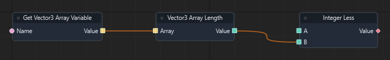

Graph: `templates/games/isometric_snake_3d/graphs/gameplay.json` · Function: **Refresh board** · Node: `n6`.

[Mở hướng dẫn game](games/isometric-snake.md)

### Đọc thêm

[Tài liệu hệ thống: typed-data.md](typed-data.md)

### Entity Array Length

ID `3285` · `pure` · Workflow `shared`

Trả số phần tử hiện có dưới dạng int. Mảng rỗng có độ dài 0; chỉ số hợp lệ nhỏ hơn độ dài.

### IO

| Chiều | Cổng | Kiểu | Mặc định |
| --- | --- | --- | --- |
| IN | Array | `array<entity>` | `[]` |
| OUT | Value | `int` | — |

Cổng `exec` điều khiển thứ tự. Cổng dữ liệu phải khớp kiểu; `vec2` không tự chuyển sang `vec3`.

### Cách dùng

1. Tìm **Entity Array Length** trong Node Library hoặc nhấn Tab trong graph để thêm node.
2. Chọn node, nhập hằng số ở Inspector theo bảng IN. Chuỗi nhập trực tiếp; vector/mảng nhập theo JSON, ví dụ `[1, 0, 0]`. Khai báo biến qua Scene > Scene Variables… trước khi dùng Get/Set Variable.
3. Có thể kéo dây từ OUT dữ liệu vào IN có cùng kiểu; giá trị từ dây thay thế hằng số của cổng.
4. Nối OUT dữ liệu tới node dùng kết quả. Node pure không cần dây exec.
5. Nhấn F5, thử tình huống, kiểm tra Console/Diagnostics; Shift+F5 dừng. Ctrl+S lưu thay đổi graph.

### Đọc thêm

[Tài liệu hệ thống: typed-data.md](typed-data.md)

### Vector2 Array Length

ID `3286` · `pure` · Workflow `shared`

Trả số phần tử hiện có dưới dạng int. Mảng rỗng có độ dài 0; chỉ số hợp lệ nhỏ hơn độ dài.

### IO

| Chiều | Cổng | Kiểu | Mặc định |
| --- | --- | --- | --- |
| IN | Array | `array<vec2>` | `[]` |
| OUT | Value | `int` | — |

Cổng `exec` điều khiển thứ tự. Cổng dữ liệu phải khớp kiểu; `vec2` không tự chuyển sang `vec3`.

### Cách dùng

1. Tìm **Vector2 Array Length** trong Node Library hoặc nhấn Tab trong graph để thêm node.
2. Chọn node, nhập hằng số ở Inspector theo bảng IN. Chuỗi nhập trực tiếp; vector/mảng nhập theo JSON, ví dụ `[1, 0, 0]`. Khai báo biến qua Scene > Scene Variables… trước khi dùng Get/Set Variable.
3. Có thể kéo dây từ OUT dữ liệu vào IN có cùng kiểu; giá trị từ dây thay thế hằng số của cổng.
4. Nối OUT dữ liệu tới node dùng kết quả. Node pure không cần dây exec.
5. Nhấn F5, thử tình huống, kiểm tra Console/Diagnostics; Shift+F5 dừng. Ctrl+S lưu thay đổi graph.

### Đọc thêm

[Tài liệu hệ thống: typed-data.md](typed-data.md)

### Vector4 Array Length

ID `3287` · `pure` · Workflow `shared`

Trả số phần tử hiện có dưới dạng int. Mảng rỗng có độ dài 0; chỉ số hợp lệ nhỏ hơn độ dài.

### IO

| Chiều | Cổng | Kiểu | Mặc định |
| --- | --- | --- | --- |
| IN | Array | `array<vec4>` | `[]` |
| OUT | Value | `int` | — |

Cổng `exec` điều khiển thứ tự. Cổng dữ liệu phải khớp kiểu; `vec2` không tự chuyển sang `vec3`.

### Cách dùng

1. Tìm **Vector4 Array Length** trong Node Library hoặc nhấn Tab trong graph để thêm node.
2. Chọn node, nhập hằng số ở Inspector theo bảng IN. Chuỗi nhập trực tiếp; vector/mảng nhập theo JSON, ví dụ `[1, 0, 0]`. Khai báo biến qua Scene > Scene Variables… trước khi dùng Get/Set Variable.
3. Có thể kéo dây từ OUT dữ liệu vào IN có cùng kiểu; giá trị từ dây thay thế hằng số của cổng.
4. Nối OUT dữ liệu tới node dùng kết quả. Node pure không cần dây exec.
5. Nhấn F5, thử tình huống, kiểm tra Console/Diagnostics; Shift+F5 dừng. Ctrl+S lưu thay đổi graph.

### Đọc thêm

[Tài liệu hệ thống: typed-data.md](typed-data.md)

### Quaternion Array Length

ID `3288` · `pure` · Workflow `shared`

Trả số phần tử hiện có dưới dạng int. Mảng rỗng có độ dài 0; chỉ số hợp lệ nhỏ hơn độ dài.

### IO

| Chiều | Cổng | Kiểu | Mặc định |
| --- | --- | --- | --- |
| IN | Array | `array<quat>` | `[]` |
| OUT | Value | `int` | — |

Cổng `exec` điều khiển thứ tự. Cổng dữ liệu phải khớp kiểu; `vec2` không tự chuyển sang `vec3`.

### Cách dùng

1. Tìm **Quaternion Array Length** trong Node Library hoặc nhấn Tab trong graph để thêm node.
2. Chọn node, nhập hằng số ở Inspector theo bảng IN. Chuỗi nhập trực tiếp; vector/mảng nhập theo JSON, ví dụ `[1, 0, 0]`. Khai báo biến qua Scene > Scene Variables… trước khi dùng Get/Set Variable.
3. Có thể kéo dây từ OUT dữ liệu vào IN có cùng kiểu; giá trị từ dây thay thế hằng số của cổng.
4. Nối OUT dữ liệu tới node dùng kết quả. Node pure không cần dây exec.
5. Nhấn F5, thử tình huống, kiểm tra Console/Diagnostics; Shift+F5 dừng. Ctrl+S lưu thay đổi graph.

### Đọc thêm

[Tài liệu hệ thống: typed-data.md](typed-data.md)

### Matrix4 Array Length

ID `3289` · `pure` · Workflow `shared`

Trả số phần tử hiện có dưới dạng int. Mảng rỗng có độ dài 0; chỉ số hợp lệ nhỏ hơn độ dài.

### IO

| Chiều | Cổng | Kiểu | Mặc định |
| --- | --- | --- | --- |
| IN | Array | `array<mat4>` | `[]` |
| OUT | Value | `int` | — |

Cổng `exec` điều khiển thứ tự. Cổng dữ liệu phải khớp kiểu; `vec2` không tự chuyển sang `vec3`.

### Cách dùng

1. Tìm **Matrix4 Array Length** trong Node Library hoặc nhấn Tab trong graph để thêm node.
2. Chọn node, nhập hằng số ở Inspector theo bảng IN. Chuỗi nhập trực tiếp; vector/mảng nhập theo JSON, ví dụ `[1, 0, 0]`. Khai báo biến qua Scene > Scene Variables… trước khi dùng Get/Set Variable.
3. Có thể kéo dây từ OUT dữ liệu vào IN có cùng kiểu; giá trị từ dây thay thế hằng số của cổng.
4. Nối OUT dữ liệu tới node dùng kết quả. Node pure không cần dây exec.
5. Nhấn F5, thử tình huống, kiểm tra Console/Diagnostics; Shift+F5 dừng. Ctrl+S lưu thay đổi graph.

### Đọc thêm

[Tài liệu hệ thống: typed-data.md](typed-data.md)

### Float Array Contains

ID `3290` · `pure` · Workflow `shared`

Trả bool cho biết tập dữ liệu có chứa Item bằng phép so sánh giá trị hay không. Không sửa tập gốc.

### IO

| Chiều | Cổng | Kiểu | Mặc định |
| --- | --- | --- | --- |
| IN | Array | `array<float>` | `[]` |
| IN | Item | `float` | `0.0` |
| OUT | Value | `bool` | — |

Cổng `exec` điều khiển thứ tự. Cổng dữ liệu phải khớp kiểu; `vec2` không tự chuyển sang `vec3`.

### Cách dùng

1. Tìm **Float Array Contains** trong Node Library hoặc nhấn Tab trong graph để thêm node.
2. Chọn node, nhập hằng số ở Inspector theo bảng IN. Chuỗi nhập trực tiếp; vector/mảng nhập theo JSON, ví dụ `[1, 0, 0]`. Khai báo biến qua Scene > Scene Variables… trước khi dùng Get/Set Variable.
3. Có thể kéo dây từ OUT dữ liệu vào IN có cùng kiểu; giá trị từ dây thay thế hằng số của cổng.
4. Nối OUT dữ liệu tới node dùng kết quả. Node pure không cần dây exec.
5. Nhấn F5, thử tình huống, kiểm tra Console/Diagnostics; Shift+F5 dừng. Ctrl+S lưu thay đổi graph.

### Đọc thêm

[Tài liệu hệ thống: typed-data.md](typed-data.md)

### Integer Array Contains

ID `3291` · `pure` · Workflow `shared`

Trả bool cho biết tập dữ liệu có chứa Item bằng phép so sánh giá trị hay không. Không sửa tập gốc.

### IO

| Chiều | Cổng | Kiểu | Mặc định |
| --- | --- | --- | --- |
| IN | Array | `array<int>` | `[]` |
| IN | Item | `int` | `0` |
| OUT | Value | `bool` | — |

Cổng `exec` điều khiển thứ tự. Cổng dữ liệu phải khớp kiểu; `vec2` không tự chuyển sang `vec3`.

### Cách dùng

1. Tìm **Integer Array Contains** trong Node Library hoặc nhấn Tab trong graph để thêm node.
2. Chọn node, nhập hằng số ở Inspector theo bảng IN. Chuỗi nhập trực tiếp; vector/mảng nhập theo JSON, ví dụ `[1, 0, 0]`. Khai báo biến qua Scene > Scene Variables… trước khi dùng Get/Set Variable.
3. Có thể kéo dây từ OUT dữ liệu vào IN có cùng kiểu; giá trị từ dây thay thế hằng số của cổng.
4. Nối OUT dữ liệu tới node dùng kết quả. Node pure không cần dây exec.
5. Nhấn F5, thử tình huống, kiểm tra Console/Diagnostics; Shift+F5 dừng. Ctrl+S lưu thay đổi graph.

### Đọc thêm

[Tài liệu hệ thống: typed-data.md](typed-data.md)

### Boolean Array Contains

ID `3292` · `pure` · Workflow `shared`

Trả bool cho biết tập dữ liệu có chứa Item bằng phép so sánh giá trị hay không. Không sửa tập gốc.

### IO

| Chiều | Cổng | Kiểu | Mặc định |
| --- | --- | --- | --- |
| IN | Array | `array<bool>` | `[]` |
| IN | Item | `bool` | `false` |
| OUT | Value | `bool` | — |

Cổng `exec` điều khiển thứ tự. Cổng dữ liệu phải khớp kiểu; `vec2` không tự chuyển sang `vec3`.

### Cách dùng

1. Tìm **Boolean Array Contains** trong Node Library hoặc nhấn Tab trong graph để thêm node.
2. Chọn node, nhập hằng số ở Inspector theo bảng IN. Chuỗi nhập trực tiếp; vector/mảng nhập theo JSON, ví dụ `[1, 0, 0]`. Khai báo biến qua Scene > Scene Variables… trước khi dùng Get/Set Variable.
3. Có thể kéo dây từ OUT dữ liệu vào IN có cùng kiểu; giá trị từ dây thay thế hằng số của cổng.
4. Nối OUT dữ liệu tới node dùng kết quả. Node pure không cần dây exec.
5. Nhấn F5, thử tình huống, kiểm tra Console/Diagnostics; Shift+F5 dừng. Ctrl+S lưu thay đổi graph.

### Đọc thêm

[Tài liệu hệ thống: typed-data.md](typed-data.md)

### String Array Contains

ID `3293` · `pure` · Workflow `shared`

Trả bool cho biết tập dữ liệu có chứa Item bằng phép so sánh giá trị hay không. Không sửa tập gốc.

### IO

| Chiều | Cổng | Kiểu | Mặc định |
| --- | --- | --- | --- |
| IN | Array | `array<string>` | `[]` |
| IN | Item | `string` | `""` |
| OUT | Value | `bool` | — |

Cổng `exec` điều khiển thứ tự. Cổng dữ liệu phải khớp kiểu; `vec2` không tự chuyển sang `vec3`.

### Cách dùng

1. Tìm **String Array Contains** trong Node Library hoặc nhấn Tab trong graph để thêm node.
2. Chọn node, nhập hằng số ở Inspector theo bảng IN. Chuỗi nhập trực tiếp; vector/mảng nhập theo JSON, ví dụ `[1, 0, 0]`. Khai báo biến qua Scene > Scene Variables… trước khi dùng Get/Set Variable.
3. Có thể kéo dây từ OUT dữ liệu vào IN có cùng kiểu; giá trị từ dây thay thế hằng số của cổng.
4. Nối OUT dữ liệu tới node dùng kết quả. Node pure không cần dây exec.
5. Nhấn F5, thử tình huống, kiểm tra Console/Diagnostics; Shift+F5 dừng. Ctrl+S lưu thay đổi graph.

### Đọc thêm

[Tài liệu hệ thống: typed-data.md](typed-data.md)

### Vector3 Array Contains

ID `3294` · `pure` · Workflow `shared`

Trả bool cho biết tập dữ liệu có chứa Item bằng phép so sánh giá trị hay không. Không sửa tập gốc.

### IO

| Chiều | Cổng | Kiểu | Mặc định |
| --- | --- | --- | --- |
| IN | Array | `array<vec3>` | `[]` |
| IN | Item | `vec3` | `[0, 0, 0]` |
| OUT | Value | `bool` | — |

Cổng `exec` điều khiển thứ tự. Cổng dữ liệu phải khớp kiểu; `vec2` không tự chuyển sang `vec3`.

### Cách dùng

1. Tìm **Vector3 Array Contains** trong Node Library hoặc nhấn Tab trong graph để thêm node.
2. Chọn node, nhập hằng số ở Inspector theo bảng IN. Chuỗi nhập trực tiếp; vector/mảng nhập theo JSON, ví dụ `[1, 0, 0]`. Khai báo biến qua Scene > Scene Variables… trước khi dùng Get/Set Variable.
3. Có thể kéo dây từ OUT dữ liệu vào IN có cùng kiểu; giá trị từ dây thay thế hằng số của cổng.
4. Nối OUT dữ liệu tới node dùng kết quả. Node pure không cần dây exec.
5. Nhấn F5, thử tình huống, kiểm tra Console/Diagnostics; Shift+F5 dừng. Ctrl+S lưu thay đổi graph.

### Ví dụ từ graph thật

Trích đoạn Spawn food của isometric_snake_3d: node n14. Đây là các node và dây nối thật từ graph đã chạy; vị trí được sắp lại để dễ đọc.

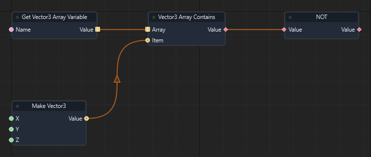

Graph: `templates/games/isometric_snake_3d/graphs/gameplay.json` · Function: **Spawn food** · Node: `n14`.

[Mở hướng dẫn game](games/isometric-snake.md)

### Đọc thêm

[Tài liệu hệ thống: typed-data.md](typed-data.md)

### Entity Array Contains

ID `3295` · `pure` · Workflow `shared`

Trả bool cho biết tập dữ liệu có chứa Item bằng phép so sánh giá trị hay không. Không sửa tập gốc.

### IO

| Chiều | Cổng | Kiểu | Mặc định |
| --- | --- | --- | --- |
| IN | Array | `array<entity>` | `[]` |
| IN | Item | `entity` | `""` |
| OUT | Value | `bool` | — |

Cổng `exec` điều khiển thứ tự. Cổng dữ liệu phải khớp kiểu; `vec2` không tự chuyển sang `vec3`.

### Cách dùng

1. Tìm **Entity Array Contains** trong Node Library hoặc nhấn Tab trong graph để thêm node.
2. Chọn node, nhập hằng số ở Inspector theo bảng IN. Chuỗi nhập trực tiếp; vector/mảng nhập theo JSON, ví dụ `[1, 0, 0]`. Khai báo biến qua Scene > Scene Variables… trước khi dùng Get/Set Variable.
3. Có thể kéo dây từ OUT dữ liệu vào IN có cùng kiểu; giá trị từ dây thay thế hằng số của cổng.
4. Nối OUT dữ liệu tới node dùng kết quả. Node pure không cần dây exec.
5. Nhấn F5, thử tình huống, kiểm tra Console/Diagnostics; Shift+F5 dừng. Ctrl+S lưu thay đổi graph.

### Đọc thêm

[Tài liệu hệ thống: typed-data.md](typed-data.md)

### Vector2 Array Contains

ID `3296` · `pure` · Workflow `shared`

Trả bool cho biết tập dữ liệu có chứa Item bằng phép so sánh giá trị hay không. Không sửa tập gốc.

### IO

| Chiều | Cổng | Kiểu | Mặc định |
| --- | --- | --- | --- |
| IN | Array | `array<vec2>` | `[]` |
| IN | Item | `vec2` | `[0, 0]` |
| OUT | Value | `bool` | — |

Cổng `exec` điều khiển thứ tự. Cổng dữ liệu phải khớp kiểu; `vec2` không tự chuyển sang `vec3`.

### Cách dùng

1. Tìm **Vector2 Array Contains** trong Node Library hoặc nhấn Tab trong graph để thêm node.
2. Chọn node, nhập hằng số ở Inspector theo bảng IN. Chuỗi nhập trực tiếp; vector/mảng nhập theo JSON, ví dụ `[1, 0, 0]`. Khai báo biến qua Scene > Scene Variables… trước khi dùng Get/Set Variable.
3. Có thể kéo dây từ OUT dữ liệu vào IN có cùng kiểu; giá trị từ dây thay thế hằng số của cổng.
4. Nối OUT dữ liệu tới node dùng kết quả. Node pure không cần dây exec.
5. Nhấn F5, thử tình huống, kiểm tra Console/Diagnostics; Shift+F5 dừng. Ctrl+S lưu thay đổi graph.

### Đọc thêm

[Tài liệu hệ thống: typed-data.md](typed-data.md)

### Vector4 Array Contains

ID `3297` · `pure` · Workflow `shared`

Trả bool cho biết tập dữ liệu có chứa Item bằng phép so sánh giá trị hay không. Không sửa tập gốc.

### IO

| Chiều | Cổng | Kiểu | Mặc định |
| --- | --- | --- | --- |
| IN | Array | `array<vec4>` | `[]` |
| IN | Item | `vec4` | `[0, 0, 0, 0]` |
| OUT | Value | `bool` | — |

Cổng `exec` điều khiển thứ tự. Cổng dữ liệu phải khớp kiểu; `vec2` không tự chuyển sang `vec3`.

### Cách dùng

1. Tìm **Vector4 Array Contains** trong Node Library hoặc nhấn Tab trong graph để thêm node.
2. Chọn node, nhập hằng số ở Inspector theo bảng IN. Chuỗi nhập trực tiếp; vector/mảng nhập theo JSON, ví dụ `[1, 0, 0]`. Khai báo biến qua Scene > Scene Variables… trước khi dùng Get/Set Variable.
3. Có thể kéo dây từ OUT dữ liệu vào IN có cùng kiểu; giá trị từ dây thay thế hằng số của cổng.
4. Nối OUT dữ liệu tới node dùng kết quả. Node pure không cần dây exec.
5. Nhấn F5, thử tình huống, kiểm tra Console/Diagnostics; Shift+F5 dừng. Ctrl+S lưu thay đổi graph.

### Đọc thêm

[Tài liệu hệ thống: typed-data.md](typed-data.md)

### Quaternion Array Contains

ID `3298` · `pure` · Workflow `shared`

Trả bool cho biết tập dữ liệu có chứa Item bằng phép so sánh giá trị hay không. Không sửa tập gốc.

### IO

| Chiều | Cổng | Kiểu | Mặc định |
| --- | --- | --- | --- |
| IN | Array | `array<quat>` | `[]` |
| IN | Item | `quat` | `[0, 0, 0, 1]` |
| OUT | Value | `bool` | — |

Cổng `exec` điều khiển thứ tự. Cổng dữ liệu phải khớp kiểu; `vec2` không tự chuyển sang `vec3`.

### Cách dùng

1. Tìm **Quaternion Array Contains** trong Node Library hoặc nhấn Tab trong graph để thêm node.
2. Chọn node, nhập hằng số ở Inspector theo bảng IN. Chuỗi nhập trực tiếp; vector/mảng nhập theo JSON, ví dụ `[1, 0, 0]`. Khai báo biến qua Scene > Scene Variables… trước khi dùng Get/Set Variable.
3. Có thể kéo dây từ OUT dữ liệu vào IN có cùng kiểu; giá trị từ dây thay thế hằng số của cổng.
4. Nối OUT dữ liệu tới node dùng kết quả. Node pure không cần dây exec.
5. Nhấn F5, thử tình huống, kiểm tra Console/Diagnostics; Shift+F5 dừng. Ctrl+S lưu thay đổi graph.

### Đọc thêm

[Tài liệu hệ thống: typed-data.md](typed-data.md)

### Matrix4 Array Contains

ID `3299` · `pure` · Workflow `shared`

Trả bool cho biết tập dữ liệu có chứa Item bằng phép so sánh giá trị hay không. Không sửa tập gốc.

### IO

| Chiều | Cổng | Kiểu | Mặc định |
| --- | --- | --- | --- |
| IN | Array | `array<mat4>` | `[]` |
| IN | Item | `mat4` | `[1, 0, 0, 0, 0, 1, 0, 0, 0, 0, 1, 0, 0, 0, 0, 1]` |
| OUT | Value | `bool` | — |

Cổng `exec` điều khiển thứ tự. Cổng dữ liệu phải khớp kiểu; `vec2` không tự chuyển sang `vec3`.

### Cách dùng

1. Tìm **Matrix4 Array Contains** trong Node Library hoặc nhấn Tab trong graph để thêm node.
2. Chọn node, nhập hằng số ở Inspector theo bảng IN. Chuỗi nhập trực tiếp; vector/mảng nhập theo JSON, ví dụ `[1, 0, 0]`. Khai báo biến qua Scene > Scene Variables… trước khi dùng Get/Set Variable.
3. Có thể kéo dây từ OUT dữ liệu vào IN có cùng kiểu; giá trị từ dây thay thế hằng số của cổng.
4. Nối OUT dữ liệu tới node dùng kết quả. Node pure không cần dây exec.
5. Nhấn F5, thử tình huống, kiểm tra Console/Diagnostics; Shift+F5 dừng. Ctrl+S lưu thay đổi graph.

### Đọc thêm

[Tài liệu hệ thống: typed-data.md](typed-data.md)

### Find Float Item

ID `3300` · `pure` · Workflow `shared`

Tìm vị trí Item trong mảng; đọc kết quả chỉ số để kiểm tra có tìm thấy. Các phép pure trả bản sao; muốn lưu thay đổi qua frame, nối kết quả vào Set Variable cùng kiểu.

### IO

| Chiều | Cổng | Kiểu | Mặc định |
| --- | --- | --- | --- |
| IN | Array | `array<float>` | `[]` |
| IN | Item | `float` | `0.0` |
| OUT | Value | `int` | — |

Cổng `exec` điều khiển thứ tự. Cổng dữ liệu phải khớp kiểu; `vec2` không tự chuyển sang `vec3`.

### Cách dùng

1. Tìm **Find Float Item** trong Node Library hoặc nhấn Tab trong graph để thêm node.
2. Chọn node, nhập hằng số ở Inspector theo bảng IN. Chuỗi nhập trực tiếp; vector/mảng nhập theo JSON, ví dụ `[1, 0, 0]`. Khai báo biến qua Scene > Scene Variables… trước khi dùng Get/Set Variable.
3. Có thể kéo dây từ OUT dữ liệu vào IN có cùng kiểu; giá trị từ dây thay thế hằng số của cổng.
4. Nối OUT dữ liệu tới node dùng kết quả. Node pure không cần dây exec.
5. Nhấn F5, thử tình huống, kiểm tra Console/Diagnostics; Shift+F5 dừng. Ctrl+S lưu thay đổi graph.

### Đọc thêm

[Tài liệu hệ thống: typed-data.md](typed-data.md)

### Find Integer Item

ID `3301` · `pure` · Workflow `shared`

Tìm vị trí Item trong mảng; đọc kết quả chỉ số để kiểm tra có tìm thấy. Các phép pure trả bản sao; muốn lưu thay đổi qua frame, nối kết quả vào Set Variable cùng kiểu.

### IO

| Chiều | Cổng | Kiểu | Mặc định |
| --- | --- | --- | --- |
| IN | Array | `array<int>` | `[]` |
| IN | Item | `int` | `0` |
| OUT | Value | `int` | — |

Cổng `exec` điều khiển thứ tự. Cổng dữ liệu phải khớp kiểu; `vec2` không tự chuyển sang `vec3`.

### Cách dùng

1. Tìm **Find Integer Item** trong Node Library hoặc nhấn Tab trong graph để thêm node.
2. Chọn node, nhập hằng số ở Inspector theo bảng IN. Chuỗi nhập trực tiếp; vector/mảng nhập theo JSON, ví dụ `[1, 0, 0]`. Khai báo biến qua Scene > Scene Variables… trước khi dùng Get/Set Variable.
3. Có thể kéo dây từ OUT dữ liệu vào IN có cùng kiểu; giá trị từ dây thay thế hằng số của cổng.
4. Nối OUT dữ liệu tới node dùng kết quả. Node pure không cần dây exec.
5. Nhấn F5, thử tình huống, kiểm tra Console/Diagnostics; Shift+F5 dừng. Ctrl+S lưu thay đổi graph.

### Đọc thêm

[Tài liệu hệ thống: typed-data.md](typed-data.md)

### Find Boolean Item

ID `3302` · `pure` · Workflow `shared`

Tìm vị trí Item trong mảng; đọc kết quả chỉ số để kiểm tra có tìm thấy. Các phép pure trả bản sao; muốn lưu thay đổi qua frame, nối kết quả vào Set Variable cùng kiểu.

### IO

| Chiều | Cổng | Kiểu | Mặc định |
| --- | --- | --- | --- |
| IN | Array | `array<bool>` | `[]` |
| IN | Item | `bool` | `false` |
| OUT | Value | `int` | — |

Cổng `exec` điều khiển thứ tự. Cổng dữ liệu phải khớp kiểu; `vec2` không tự chuyển sang `vec3`.

### Cách dùng

1. Tìm **Find Boolean Item** trong Node Library hoặc nhấn Tab trong graph để thêm node.
2. Chọn node, nhập hằng số ở Inspector theo bảng IN. Chuỗi nhập trực tiếp; vector/mảng nhập theo JSON, ví dụ `[1, 0, 0]`. Khai báo biến qua Scene > Scene Variables… trước khi dùng Get/Set Variable.
3. Có thể kéo dây từ OUT dữ liệu vào IN có cùng kiểu; giá trị từ dây thay thế hằng số của cổng.
4. Nối OUT dữ liệu tới node dùng kết quả. Node pure không cần dây exec.
5. Nhấn F5, thử tình huống, kiểm tra Console/Diagnostics; Shift+F5 dừng. Ctrl+S lưu thay đổi graph.

### Đọc thêm

[Tài liệu hệ thống: typed-data.md](typed-data.md)

### Find String Item

ID `3303` · `pure` · Workflow `shared`

Tìm vị trí Item trong mảng; đọc kết quả chỉ số để kiểm tra có tìm thấy. Các phép pure trả bản sao; muốn lưu thay đổi qua frame, nối kết quả vào Set Variable cùng kiểu.

### IO

| Chiều | Cổng | Kiểu | Mặc định |
| --- | --- | --- | --- |
| IN | Array | `array<string>` | `[]` |
| IN | Item | `string` | `""` |
| OUT | Value | `int` | — |

Cổng `exec` điều khiển thứ tự. Cổng dữ liệu phải khớp kiểu; `vec2` không tự chuyển sang `vec3`.

### Cách dùng

1. Tìm **Find String Item** trong Node Library hoặc nhấn Tab trong graph để thêm node.
2. Chọn node, nhập hằng số ở Inspector theo bảng IN. Chuỗi nhập trực tiếp; vector/mảng nhập theo JSON, ví dụ `[1, 0, 0]`. Khai báo biến qua Scene > Scene Variables… trước khi dùng Get/Set Variable.
3. Có thể kéo dây từ OUT dữ liệu vào IN có cùng kiểu; giá trị từ dây thay thế hằng số của cổng.
4. Nối OUT dữ liệu tới node dùng kết quả. Node pure không cần dây exec.
5. Nhấn F5, thử tình huống, kiểm tra Console/Diagnostics; Shift+F5 dừng. Ctrl+S lưu thay đổi graph.

### Đọc thêm

[Tài liệu hệ thống: typed-data.md](typed-data.md)

### Find Vector3 Item

ID `3304` · `pure` · Workflow `shared`

Tìm vị trí Item trong mảng; đọc kết quả chỉ số để kiểm tra có tìm thấy. Các phép pure trả bản sao; muốn lưu thay đổi qua frame, nối kết quả vào Set Variable cùng kiểu.

### IO

| Chiều | Cổng | Kiểu | Mặc định |
| --- | --- | --- | --- |
| IN | Array | `array<vec3>` | `[]` |
| IN | Item | `vec3` | `[0, 0, 0]` |
| OUT | Value | `int` | — |

Cổng `exec` điều khiển thứ tự. Cổng dữ liệu phải khớp kiểu; `vec2` không tự chuyển sang `vec3`.

### Cách dùng

1. Tìm **Find Vector3 Item** trong Node Library hoặc nhấn Tab trong graph để thêm node.
2. Chọn node, nhập hằng số ở Inspector theo bảng IN. Chuỗi nhập trực tiếp; vector/mảng nhập theo JSON, ví dụ `[1, 0, 0]`. Khai báo biến qua Scene > Scene Variables… trước khi dùng Get/Set Variable.
3. Có thể kéo dây từ OUT dữ liệu vào IN có cùng kiểu; giá trị từ dây thay thế hằng số của cổng.
4. Nối OUT dữ liệu tới node dùng kết quả. Node pure không cần dây exec.
5. Nhấn F5, thử tình huống, kiểm tra Console/Diagnostics; Shift+F5 dừng. Ctrl+S lưu thay đổi graph.

### Đọc thêm

[Tài liệu hệ thống: typed-data.md](typed-data.md)

### Find Entity Item

ID `3305` · `pure` · Workflow `shared`

Tìm vị trí Item trong mảng; đọc kết quả chỉ số để kiểm tra có tìm thấy. Các phép pure trả bản sao; muốn lưu thay đổi qua frame, nối kết quả vào Set Variable cùng kiểu.

### IO

| Chiều | Cổng | Kiểu | Mặc định |
| --- | --- | --- | --- |
| IN | Array | `array<entity>` | `[]` |
| IN | Item | `entity` | `""` |
| OUT | Value | `int` | — |

Cổng `exec` điều khiển thứ tự. Cổng dữ liệu phải khớp kiểu; `vec2` không tự chuyển sang `vec3`.

### Cách dùng

1. Tìm **Find Entity Item** trong Node Library hoặc nhấn Tab trong graph để thêm node.
2. Chọn node, nhập hằng số ở Inspector theo bảng IN. Chuỗi nhập trực tiếp; vector/mảng nhập theo JSON, ví dụ `[1, 0, 0]`. Khai báo biến qua Scene > Scene Variables… trước khi dùng Get/Set Variable.
3. Có thể kéo dây từ OUT dữ liệu vào IN có cùng kiểu; giá trị từ dây thay thế hằng số của cổng.
4. Nối OUT dữ liệu tới node dùng kết quả. Node pure không cần dây exec.
5. Nhấn F5, thử tình huống, kiểm tra Console/Diagnostics; Shift+F5 dừng. Ctrl+S lưu thay đổi graph.

### Đọc thêm

[Tài liệu hệ thống: typed-data.md](typed-data.md)

### Find Vector2 Item

ID `3306` · `pure` · Workflow `shared`

Tìm vị trí Item trong mảng; đọc kết quả chỉ số để kiểm tra có tìm thấy. Các phép pure trả bản sao; muốn lưu thay đổi qua frame, nối kết quả vào Set Variable cùng kiểu.

### IO

| Chiều | Cổng | Kiểu | Mặc định |
| --- | --- | --- | --- |
| IN | Array | `array<vec2>` | `[]` |
| IN | Item | `vec2` | `[0, 0]` |
| OUT | Value | `int` | — |

Cổng `exec` điều khiển thứ tự. Cổng dữ liệu phải khớp kiểu; `vec2` không tự chuyển sang `vec3`.

### Cách dùng

1. Tìm **Find Vector2 Item** trong Node Library hoặc nhấn Tab trong graph để thêm node.
2. Chọn node, nhập hằng số ở Inspector theo bảng IN. Chuỗi nhập trực tiếp; vector/mảng nhập theo JSON, ví dụ `[1, 0, 0]`. Khai báo biến qua Scene > Scene Variables… trước khi dùng Get/Set Variable.
3. Có thể kéo dây từ OUT dữ liệu vào IN có cùng kiểu; giá trị từ dây thay thế hằng số của cổng.
4. Nối OUT dữ liệu tới node dùng kết quả. Node pure không cần dây exec.
5. Nhấn F5, thử tình huống, kiểm tra Console/Diagnostics; Shift+F5 dừng. Ctrl+S lưu thay đổi graph.

### Đọc thêm

[Tài liệu hệ thống: typed-data.md](typed-data.md)

### Find Vector4 Item

ID `3307` · `pure` · Workflow `shared`

Tìm vị trí Item trong mảng; đọc kết quả chỉ số để kiểm tra có tìm thấy. Các phép pure trả bản sao; muốn lưu thay đổi qua frame, nối kết quả vào Set Variable cùng kiểu.

### IO

| Chiều | Cổng | Kiểu | Mặc định |
| --- | --- | --- | --- |
| IN | Array | `array<vec4>` | `[]` |
| IN | Item | `vec4` | `[0, 0, 0, 0]` |
| OUT | Value | `int` | — |

Cổng `exec` điều khiển thứ tự. Cổng dữ liệu phải khớp kiểu; `vec2` không tự chuyển sang `vec3`.

### Cách dùng

1. Tìm **Find Vector4 Item** trong Node Library hoặc nhấn Tab trong graph để thêm node.
2. Chọn node, nhập hằng số ở Inspector theo bảng IN. Chuỗi nhập trực tiếp; vector/mảng nhập theo JSON, ví dụ `[1, 0, 0]`. Khai báo biến qua Scene > Scene Variables… trước khi dùng Get/Set Variable.
3. Có thể kéo dây từ OUT dữ liệu vào IN có cùng kiểu; giá trị từ dây thay thế hằng số của cổng.
4. Nối OUT dữ liệu tới node dùng kết quả. Node pure không cần dây exec.
5. Nhấn F5, thử tình huống, kiểm tra Console/Diagnostics; Shift+F5 dừng. Ctrl+S lưu thay đổi graph.

### Đọc thêm

[Tài liệu hệ thống: typed-data.md](typed-data.md)

### Find Quaternion Item

ID `3308` · `pure` · Workflow `shared`

Tìm vị trí Item trong mảng; đọc kết quả chỉ số để kiểm tra có tìm thấy. Các phép pure trả bản sao; muốn lưu thay đổi qua frame, nối kết quả vào Set Variable cùng kiểu.

### IO

| Chiều | Cổng | Kiểu | Mặc định |
| --- | --- | --- | --- |
| IN | Array | `array<quat>` | `[]` |
| IN | Item | `quat` | `[0, 0, 0, 1]` |
| OUT | Value | `int` | — |

Cổng `exec` điều khiển thứ tự. Cổng dữ liệu phải khớp kiểu; `vec2` không tự chuyển sang `vec3`.

### Cách dùng

1. Tìm **Find Quaternion Item** trong Node Library hoặc nhấn Tab trong graph để thêm node.
2. Chọn node, nhập hằng số ở Inspector theo bảng IN. Chuỗi nhập trực tiếp; vector/mảng nhập theo JSON, ví dụ `[1, 0, 0]`. Khai báo biến qua Scene > Scene Variables… trước khi dùng Get/Set Variable.
3. Có thể kéo dây từ OUT dữ liệu vào IN có cùng kiểu; giá trị từ dây thay thế hằng số của cổng.
4. Nối OUT dữ liệu tới node dùng kết quả. Node pure không cần dây exec.
5. Nhấn F5, thử tình huống, kiểm tra Console/Diagnostics; Shift+F5 dừng. Ctrl+S lưu thay đổi graph.

### Đọc thêm

[Tài liệu hệ thống: typed-data.md](typed-data.md)

### Find Matrix4 Item

ID `3309` · `pure` · Workflow `shared`

Tìm vị trí Item trong mảng; đọc kết quả chỉ số để kiểm tra có tìm thấy. Các phép pure trả bản sao; muốn lưu thay đổi qua frame, nối kết quả vào Set Variable cùng kiểu.

### IO

| Chiều | Cổng | Kiểu | Mặc định |
| --- | --- | --- | --- |
| IN | Array | `array<mat4>` | `[]` |
| IN | Item | `mat4` | `[1, 0, 0, 0, 0, 1, 0, 0, 0, 0, 1, 0, 0, 0, 0, 1]` |
| OUT | Value | `int` | — |

Cổng `exec` điều khiển thứ tự. Cổng dữ liệu phải khớp kiểu; `vec2` không tự chuyển sang `vec3`.

### Cách dùng

1. Tìm **Find Matrix4 Item** trong Node Library hoặc nhấn Tab trong graph để thêm node.
2. Chọn node, nhập hằng số ở Inspector theo bảng IN. Chuỗi nhập trực tiếp; vector/mảng nhập theo JSON, ví dụ `[1, 0, 0]`. Khai báo biến qua Scene > Scene Variables… trước khi dùng Get/Set Variable.
3. Có thể kéo dây từ OUT dữ liệu vào IN có cùng kiểu; giá trị từ dây thay thế hằng số của cổng.
4. Nối OUT dữ liệu tới node dùng kết quả. Node pure không cần dây exec.
5. Nhấn F5, thử tình huống, kiểm tra Console/Diagnostics; Shift+F5 dừng. Ctrl+S lưu thay đổi graph.

### Đọc thêm

[Tài liệu hệ thống: typed-data.md](typed-data.md)

### Reverse Float Array

ID `3310` · `pure` · Workflow `shared`

Trả mảng mới có thứ tự phần tử đảo ngược. Các phép pure trả bản sao; muốn lưu thay đổi qua frame, nối kết quả vào Set Variable cùng kiểu.

### IO

| Chiều | Cổng | Kiểu | Mặc định |
| --- | --- | --- | --- |
| IN | Array | `array<float>` | `[]` |
| OUT | Value | `array<float>` | — |

Cổng `exec` điều khiển thứ tự. Cổng dữ liệu phải khớp kiểu; `vec2` không tự chuyển sang `vec3`.

### Cách dùng

1. Tìm **Reverse Float Array** trong Node Library hoặc nhấn Tab trong graph để thêm node.
2. Chọn node, nhập hằng số ở Inspector theo bảng IN. Chuỗi nhập trực tiếp; vector/mảng nhập theo JSON, ví dụ `[1, 0, 0]`. Khai báo biến qua Scene > Scene Variables… trước khi dùng Get/Set Variable.
3. Có thể kéo dây từ OUT dữ liệu vào IN có cùng kiểu; giá trị từ dây thay thế hằng số của cổng.
4. Nối OUT dữ liệu tới node dùng kết quả. Node pure không cần dây exec.
5. Nhấn F5, thử tình huống, kiểm tra Console/Diagnostics; Shift+F5 dừng. Ctrl+S lưu thay đổi graph.

### Đọc thêm

[Tài liệu hệ thống: typed-data.md](typed-data.md)

### Reverse Integer Array

ID `3311` · `pure` · Workflow `shared`

Trả mảng mới có thứ tự phần tử đảo ngược. Các phép pure trả bản sao; muốn lưu thay đổi qua frame, nối kết quả vào Set Variable cùng kiểu.

### IO

| Chiều | Cổng | Kiểu | Mặc định |
| --- | --- | --- | --- |
| IN | Array | `array<int>` | `[]` |
| OUT | Value | `array<int>` | — |

Cổng `exec` điều khiển thứ tự. Cổng dữ liệu phải khớp kiểu; `vec2` không tự chuyển sang `vec3`.

### Cách dùng

1. Tìm **Reverse Integer Array** trong Node Library hoặc nhấn Tab trong graph để thêm node.
2. Chọn node, nhập hằng số ở Inspector theo bảng IN. Chuỗi nhập trực tiếp; vector/mảng nhập theo JSON, ví dụ `[1, 0, 0]`. Khai báo biến qua Scene > Scene Variables… trước khi dùng Get/Set Variable.
3. Có thể kéo dây từ OUT dữ liệu vào IN có cùng kiểu; giá trị từ dây thay thế hằng số của cổng.
4. Nối OUT dữ liệu tới node dùng kết quả. Node pure không cần dây exec.
5. Nhấn F5, thử tình huống, kiểm tra Console/Diagnostics; Shift+F5 dừng. Ctrl+S lưu thay đổi graph.

### Đọc thêm

[Tài liệu hệ thống: typed-data.md](typed-data.md)

### Reverse Boolean Array

ID `3312` · `pure` · Workflow `shared`

Trả mảng mới có thứ tự phần tử đảo ngược. Các phép pure trả bản sao; muốn lưu thay đổi qua frame, nối kết quả vào Set Variable cùng kiểu.

### IO

| Chiều | Cổng | Kiểu | Mặc định |
| --- | --- | --- | --- |
| IN | Array | `array<bool>` | `[]` |
| OUT | Value | `array<bool>` | — |

Cổng `exec` điều khiển thứ tự. Cổng dữ liệu phải khớp kiểu; `vec2` không tự chuyển sang `vec3`.

### Cách dùng

1. Tìm **Reverse Boolean Array** trong Node Library hoặc nhấn Tab trong graph để thêm node.
2. Chọn node, nhập hằng số ở Inspector theo bảng IN. Chuỗi nhập trực tiếp; vector/mảng nhập theo JSON, ví dụ `[1, 0, 0]`. Khai báo biến qua Scene > Scene Variables… trước khi dùng Get/Set Variable.
3. Có thể kéo dây từ OUT dữ liệu vào IN có cùng kiểu; giá trị từ dây thay thế hằng số của cổng.
4. Nối OUT dữ liệu tới node dùng kết quả. Node pure không cần dây exec.
5. Nhấn F5, thử tình huống, kiểm tra Console/Diagnostics; Shift+F5 dừng. Ctrl+S lưu thay đổi graph.

### Đọc thêm

[Tài liệu hệ thống: typed-data.md](typed-data.md)

### Reverse String Array

ID `3313` · `pure` · Workflow `shared`

Trả mảng mới có thứ tự phần tử đảo ngược. Các phép pure trả bản sao; muốn lưu thay đổi qua frame, nối kết quả vào Set Variable cùng kiểu.

### IO

| Chiều | Cổng | Kiểu | Mặc định |
| --- | --- | --- | --- |
| IN | Array | `array<string>` | `[]` |
| OUT | Value | `array<string>` | — |

Cổng `exec` điều khiển thứ tự. Cổng dữ liệu phải khớp kiểu; `vec2` không tự chuyển sang `vec3`.

### Cách dùng

1. Tìm **Reverse String Array** trong Node Library hoặc nhấn Tab trong graph để thêm node.
2. Chọn node, nhập hằng số ở Inspector theo bảng IN. Chuỗi nhập trực tiếp; vector/mảng nhập theo JSON, ví dụ `[1, 0, 0]`. Khai báo biến qua Scene > Scene Variables… trước khi dùng Get/Set Variable.
3. Có thể kéo dây từ OUT dữ liệu vào IN có cùng kiểu; giá trị từ dây thay thế hằng số của cổng.
4. Nối OUT dữ liệu tới node dùng kết quả. Node pure không cần dây exec.
5. Nhấn F5, thử tình huống, kiểm tra Console/Diagnostics; Shift+F5 dừng. Ctrl+S lưu thay đổi graph.

### Đọc thêm

[Tài liệu hệ thống: typed-data.md](typed-data.md)

### Reverse Vector3 Array

ID `3314` · `pure` · Workflow `shared`

Trả mảng mới có thứ tự phần tử đảo ngược. Các phép pure trả bản sao; muốn lưu thay đổi qua frame, nối kết quả vào Set Variable cùng kiểu.

### IO

| Chiều | Cổng | Kiểu | Mặc định |
| --- | --- | --- | --- |
| IN | Array | `array<vec3>` | `[]` |
| OUT | Value | `array<vec3>` | — |

Cổng `exec` điều khiển thứ tự. Cổng dữ liệu phải khớp kiểu; `vec2` không tự chuyển sang `vec3`.

### Cách dùng

1. Tìm **Reverse Vector3 Array** trong Node Library hoặc nhấn Tab trong graph để thêm node.
2. Chọn node, nhập hằng số ở Inspector theo bảng IN. Chuỗi nhập trực tiếp; vector/mảng nhập theo JSON, ví dụ `[1, 0, 0]`. Khai báo biến qua Scene > Scene Variables… trước khi dùng Get/Set Variable.
3. Có thể kéo dây từ OUT dữ liệu vào IN có cùng kiểu; giá trị từ dây thay thế hằng số của cổng.
4. Nối OUT dữ liệu tới node dùng kết quả. Node pure không cần dây exec.
5. Nhấn F5, thử tình huống, kiểm tra Console/Diagnostics; Shift+F5 dừng. Ctrl+S lưu thay đổi graph.

### Đọc thêm

[Tài liệu hệ thống: typed-data.md](typed-data.md)

### Reverse Entity Array

ID `3315` · `pure` · Workflow `shared`

Trả mảng mới có thứ tự phần tử đảo ngược. Các phép pure trả bản sao; muốn lưu thay đổi qua frame, nối kết quả vào Set Variable cùng kiểu.

### IO

| Chiều | Cổng | Kiểu | Mặc định |
| --- | --- | --- | --- |
| IN | Array | `array<entity>` | `[]` |
| OUT | Value | `array<entity>` | — |

Cổng `exec` điều khiển thứ tự. Cổng dữ liệu phải khớp kiểu; `vec2` không tự chuyển sang `vec3`.

### Cách dùng

1. Tìm **Reverse Entity Array** trong Node Library hoặc nhấn Tab trong graph để thêm node.
2. Chọn node, nhập hằng số ở Inspector theo bảng IN. Chuỗi nhập trực tiếp; vector/mảng nhập theo JSON, ví dụ `[1, 0, 0]`. Khai báo biến qua Scene > Scene Variables… trước khi dùng Get/Set Variable.
3. Có thể kéo dây từ OUT dữ liệu vào IN có cùng kiểu; giá trị từ dây thay thế hằng số của cổng.
4. Nối OUT dữ liệu tới node dùng kết quả. Node pure không cần dây exec.
5. Nhấn F5, thử tình huống, kiểm tra Console/Diagnostics; Shift+F5 dừng. Ctrl+S lưu thay đổi graph.

### Đọc thêm

[Tài liệu hệ thống: typed-data.md](typed-data.md)

### Reverse Vector2 Array

ID `3316` · `pure` · Workflow `shared`

Trả mảng mới có thứ tự phần tử đảo ngược. Các phép pure trả bản sao; muốn lưu thay đổi qua frame, nối kết quả vào Set Variable cùng kiểu.

### IO

| Chiều | Cổng | Kiểu | Mặc định |
| --- | --- | --- | --- |
| IN | Array | `array<vec2>` | `[]` |
| OUT | Value | `array<vec2>` | — |

Cổng `exec` điều khiển thứ tự. Cổng dữ liệu phải khớp kiểu; `vec2` không tự chuyển sang `vec3`.

### Cách dùng

1. Tìm **Reverse Vector2 Array** trong Node Library hoặc nhấn Tab trong graph để thêm node.
2. Chọn node, nhập hằng số ở Inspector theo bảng IN. Chuỗi nhập trực tiếp; vector/mảng nhập theo JSON, ví dụ `[1, 0, 0]`. Khai báo biến qua Scene > Scene Variables… trước khi dùng Get/Set Variable.
3. Có thể kéo dây từ OUT dữ liệu vào IN có cùng kiểu; giá trị từ dây thay thế hằng số của cổng.
4. Nối OUT dữ liệu tới node dùng kết quả. Node pure không cần dây exec.
5. Nhấn F5, thử tình huống, kiểm tra Console/Diagnostics; Shift+F5 dừng. Ctrl+S lưu thay đổi graph.

### Đọc thêm

[Tài liệu hệ thống: typed-data.md](typed-data.md)

### Reverse Vector4 Array

ID `3317` · `pure` · Workflow `shared`

Trả mảng mới có thứ tự phần tử đảo ngược. Các phép pure trả bản sao; muốn lưu thay đổi qua frame, nối kết quả vào Set Variable cùng kiểu.

### IO

| Chiều | Cổng | Kiểu | Mặc định |
| --- | --- | --- | --- |
| IN | Array | `array<vec4>` | `[]` |
| OUT | Value | `array<vec4>` | — |

Cổng `exec` điều khiển thứ tự. Cổng dữ liệu phải khớp kiểu; `vec2` không tự chuyển sang `vec3`.

### Cách dùng

1. Tìm **Reverse Vector4 Array** trong Node Library hoặc nhấn Tab trong graph để thêm node.
2. Chọn node, nhập hằng số ở Inspector theo bảng IN. Chuỗi nhập trực tiếp; vector/mảng nhập theo JSON, ví dụ `[1, 0, 0]`. Khai báo biến qua Scene > Scene Variables… trước khi dùng Get/Set Variable.
3. Có thể kéo dây từ OUT dữ liệu vào IN có cùng kiểu; giá trị từ dây thay thế hằng số của cổng.
4. Nối OUT dữ liệu tới node dùng kết quả. Node pure không cần dây exec.
5. Nhấn F5, thử tình huống, kiểm tra Console/Diagnostics; Shift+F5 dừng. Ctrl+S lưu thay đổi graph.

### Đọc thêm

[Tài liệu hệ thống: typed-data.md](typed-data.md)

### Reverse Quaternion Array

ID `3318` · `pure` · Workflow `shared`

Trả mảng mới có thứ tự phần tử đảo ngược. Các phép pure trả bản sao; muốn lưu thay đổi qua frame, nối kết quả vào Set Variable cùng kiểu.

### IO

| Chiều | Cổng | Kiểu | Mặc định |
| --- | --- | --- | --- |
| IN | Array | `array<quat>` | `[]` |
| OUT | Value | `array<quat>` | — |

Cổng `exec` điều khiển thứ tự. Cổng dữ liệu phải khớp kiểu; `vec2` không tự chuyển sang `vec3`.

### Cách dùng

1. Tìm **Reverse Quaternion Array** trong Node Library hoặc nhấn Tab trong graph để thêm node.
2. Chọn node, nhập hằng số ở Inspector theo bảng IN. Chuỗi nhập trực tiếp; vector/mảng nhập theo JSON, ví dụ `[1, 0, 0]`. Khai báo biến qua Scene > Scene Variables… trước khi dùng Get/Set Variable.
3. Có thể kéo dây từ OUT dữ liệu vào IN có cùng kiểu; giá trị từ dây thay thế hằng số của cổng.
4. Nối OUT dữ liệu tới node dùng kết quả. Node pure không cần dây exec.
5. Nhấn F5, thử tình huống, kiểm tra Console/Diagnostics; Shift+F5 dừng. Ctrl+S lưu thay đổi graph.

### Đọc thêm

[Tài liệu hệ thống: typed-data.md](typed-data.md)

### Reverse Matrix4 Array

ID `3319` · `pure` · Workflow `shared`

Trả mảng mới có thứ tự phần tử đảo ngược. Các phép pure trả bản sao; muốn lưu thay đổi qua frame, nối kết quả vào Set Variable cùng kiểu.

### IO

| Chiều | Cổng | Kiểu | Mặc định |
| --- | --- | --- | --- |
| IN | Array | `array<mat4>` | `[]` |
| OUT | Value | `array<mat4>` | — |

Cổng `exec` điều khiển thứ tự. Cổng dữ liệu phải khớp kiểu; `vec2` không tự chuyển sang `vec3`.

### Cách dùng

1. Tìm **Reverse Matrix4 Array** trong Node Library hoặc nhấn Tab trong graph để thêm node.
2. Chọn node, nhập hằng số ở Inspector theo bảng IN. Chuỗi nhập trực tiếp; vector/mảng nhập theo JSON, ví dụ `[1, 0, 0]`. Khai báo biến qua Scene > Scene Variables… trước khi dùng Get/Set Variable.
3. Có thể kéo dây từ OUT dữ liệu vào IN có cùng kiểu; giá trị từ dây thay thế hằng số của cổng.
4. Nối OUT dữ liệu tới node dùng kết quả. Node pure không cần dây exec.
5. Nhấn F5, thử tình huống, kiểm tra Console/Diagnostics; Shift+F5 dừng. Ctrl+S lưu thay đổi graph.

### Đọc thêm

[Tài liệu hệ thống: typed-data.md](typed-data.md)

### Clear Float Array

ID `3320` · `pure` · Workflow `shared`

Trả mảng rỗng đúng kiểu. Các phép pure trả bản sao; muốn lưu thay đổi qua frame, nối kết quả vào Set Variable cùng kiểu.

### IO

| Chiều | Cổng | Kiểu | Mặc định |
| --- | --- | --- | --- |
| IN | Array | `array<float>` | `[]` |
| OUT | Value | `array<float>` | — |

Cổng `exec` điều khiển thứ tự. Cổng dữ liệu phải khớp kiểu; `vec2` không tự chuyển sang `vec3`.

### Cách dùng

1. Tìm **Clear Float Array** trong Node Library hoặc nhấn Tab trong graph để thêm node.
2. Chọn node, nhập hằng số ở Inspector theo bảng IN. Chuỗi nhập trực tiếp; vector/mảng nhập theo JSON, ví dụ `[1, 0, 0]`. Khai báo biến qua Scene > Scene Variables… trước khi dùng Get/Set Variable.
3. Có thể kéo dây từ OUT dữ liệu vào IN có cùng kiểu; giá trị từ dây thay thế hằng số của cổng.
4. Nối OUT dữ liệu tới node dùng kết quả. Node pure không cần dây exec.
5. Nhấn F5, thử tình huống, kiểm tra Console/Diagnostics; Shift+F5 dừng. Ctrl+S lưu thay đổi graph.

### Đọc thêm

[Tài liệu hệ thống: typed-data.md](typed-data.md)

### Clear Integer Array

ID `3321` · `pure` · Workflow `shared`

Trả mảng rỗng đúng kiểu. Các phép pure trả bản sao; muốn lưu thay đổi qua frame, nối kết quả vào Set Variable cùng kiểu.

### IO

| Chiều | Cổng | Kiểu | Mặc định |
| --- | --- | --- | --- |
| IN | Array | `array<int>` | `[]` |
| OUT | Value | `array<int>` | — |

Cổng `exec` điều khiển thứ tự. Cổng dữ liệu phải khớp kiểu; `vec2` không tự chuyển sang `vec3`.

### Cách dùng

1. Tìm **Clear Integer Array** trong Node Library hoặc nhấn Tab trong graph để thêm node.
2. Chọn node, nhập hằng số ở Inspector theo bảng IN. Chuỗi nhập trực tiếp; vector/mảng nhập theo JSON, ví dụ `[1, 0, 0]`. Khai báo biến qua Scene > Scene Variables… trước khi dùng Get/Set Variable.
3. Có thể kéo dây từ OUT dữ liệu vào IN có cùng kiểu; giá trị từ dây thay thế hằng số của cổng.
4. Nối OUT dữ liệu tới node dùng kết quả. Node pure không cần dây exec.
5. Nhấn F5, thử tình huống, kiểm tra Console/Diagnostics; Shift+F5 dừng. Ctrl+S lưu thay đổi graph.

### Đọc thêm

[Tài liệu hệ thống: typed-data.md](typed-data.md)

### Clear Boolean Array

ID `3322` · `pure` · Workflow `shared`

Trả mảng rỗng đúng kiểu. Các phép pure trả bản sao; muốn lưu thay đổi qua frame, nối kết quả vào Set Variable cùng kiểu.

### IO

| Chiều | Cổng | Kiểu | Mặc định |
| --- | --- | --- | --- |
| IN | Array | `array<bool>` | `[]` |
| OUT | Value | `array<bool>` | — |

Cổng `exec` điều khiển thứ tự. Cổng dữ liệu phải khớp kiểu; `vec2` không tự chuyển sang `vec3`.

### Cách dùng

1. Tìm **Clear Boolean Array** trong Node Library hoặc nhấn Tab trong graph để thêm node.
2. Chọn node, nhập hằng số ở Inspector theo bảng IN. Chuỗi nhập trực tiếp; vector/mảng nhập theo JSON, ví dụ `[1, 0, 0]`. Khai báo biến qua Scene > Scene Variables… trước khi dùng Get/Set Variable.
3. Có thể kéo dây từ OUT dữ liệu vào IN có cùng kiểu; giá trị từ dây thay thế hằng số của cổng.
4. Nối OUT dữ liệu tới node dùng kết quả. Node pure không cần dây exec.
5. Nhấn F5, thử tình huống, kiểm tra Console/Diagnostics; Shift+F5 dừng. Ctrl+S lưu thay đổi graph.

### Đọc thêm

[Tài liệu hệ thống: typed-data.md](typed-data.md)

### Clear String Array

ID `3323` · `pure` · Workflow `shared`

Trả mảng rỗng đúng kiểu. Các phép pure trả bản sao; muốn lưu thay đổi qua frame, nối kết quả vào Set Variable cùng kiểu.

### IO

| Chiều | Cổng | Kiểu | Mặc định |
| --- | --- | --- | --- |
| IN | Array | `array<string>` | `[]` |
| OUT | Value | `array<string>` | — |

Cổng `exec` điều khiển thứ tự. Cổng dữ liệu phải khớp kiểu; `vec2` không tự chuyển sang `vec3`.

### Cách dùng

1. Tìm **Clear String Array** trong Node Library hoặc nhấn Tab trong graph để thêm node.
2. Chọn node, nhập hằng số ở Inspector theo bảng IN. Chuỗi nhập trực tiếp; vector/mảng nhập theo JSON, ví dụ `[1, 0, 0]`. Khai báo biến qua Scene > Scene Variables… trước khi dùng Get/Set Variable.
3. Có thể kéo dây từ OUT dữ liệu vào IN có cùng kiểu; giá trị từ dây thay thế hằng số của cổng.
4. Nối OUT dữ liệu tới node dùng kết quả. Node pure không cần dây exec.
5. Nhấn F5, thử tình huống, kiểm tra Console/Diagnostics; Shift+F5 dừng. Ctrl+S lưu thay đổi graph.

### Đọc thêm

[Tài liệu hệ thống: typed-data.md](typed-data.md)

### Clear Vector3 Array

ID `3324` · `pure` · Workflow `shared`

Trả mảng rỗng đúng kiểu. Các phép pure trả bản sao; muốn lưu thay đổi qua frame, nối kết quả vào Set Variable cùng kiểu.

### IO

| Chiều | Cổng | Kiểu | Mặc định |
| --- | --- | --- | --- |
| IN | Array | `array<vec3>` | `[]` |
| OUT | Value | `array<vec3>` | — |

Cổng `exec` điều khiển thứ tự. Cổng dữ liệu phải khớp kiểu; `vec2` không tự chuyển sang `vec3`.

### Cách dùng

1. Tìm **Clear Vector3 Array** trong Node Library hoặc nhấn Tab trong graph để thêm node.
2. Chọn node, nhập hằng số ở Inspector theo bảng IN. Chuỗi nhập trực tiếp; vector/mảng nhập theo JSON, ví dụ `[1, 0, 0]`. Khai báo biến qua Scene > Scene Variables… trước khi dùng Get/Set Variable.
3. Có thể kéo dây từ OUT dữ liệu vào IN có cùng kiểu; giá trị từ dây thay thế hằng số của cổng.
4. Nối OUT dữ liệu tới node dùng kết quả. Node pure không cần dây exec.
5. Nhấn F5, thử tình huống, kiểm tra Console/Diagnostics; Shift+F5 dừng. Ctrl+S lưu thay đổi graph.

### Đọc thêm

[Tài liệu hệ thống: typed-data.md](typed-data.md)

### Clear Entity Array

ID `3325` · `pure` · Workflow `shared`

Trả mảng rỗng đúng kiểu. Các phép pure trả bản sao; muốn lưu thay đổi qua frame, nối kết quả vào Set Variable cùng kiểu.

### IO

| Chiều | Cổng | Kiểu | Mặc định |
| --- | --- | --- | --- |
| IN | Array | `array<entity>` | `[]` |
| OUT | Value | `array<entity>` | — |

Cổng `exec` điều khiển thứ tự. Cổng dữ liệu phải khớp kiểu; `vec2` không tự chuyển sang `vec3`.

### Cách dùng

1. Tìm **Clear Entity Array** trong Node Library hoặc nhấn Tab trong graph để thêm node.
2. Chọn node, nhập hằng số ở Inspector theo bảng IN. Chuỗi nhập trực tiếp; vector/mảng nhập theo JSON, ví dụ `[1, 0, 0]`. Khai báo biến qua Scene > Scene Variables… trước khi dùng Get/Set Variable.
3. Có thể kéo dây từ OUT dữ liệu vào IN có cùng kiểu; giá trị từ dây thay thế hằng số của cổng.
4. Nối OUT dữ liệu tới node dùng kết quả. Node pure không cần dây exec.
5. Nhấn F5, thử tình huống, kiểm tra Console/Diagnostics; Shift+F5 dừng. Ctrl+S lưu thay đổi graph.

### Đọc thêm

[Tài liệu hệ thống: typed-data.md](typed-data.md)

### Clear Vector2 Array

ID `3326` · `pure` · Workflow `shared`

Trả mảng rỗng đúng kiểu. Các phép pure trả bản sao; muốn lưu thay đổi qua frame, nối kết quả vào Set Variable cùng kiểu.

### IO

| Chiều | Cổng | Kiểu | Mặc định |
| --- | --- | --- | --- |
| IN | Array | `array<vec2>` | `[]` |
| OUT | Value | `array<vec2>` | — |

Cổng `exec` điều khiển thứ tự. Cổng dữ liệu phải khớp kiểu; `vec2` không tự chuyển sang `vec3`.

### Cách dùng

1. Tìm **Clear Vector2 Array** trong Node Library hoặc nhấn Tab trong graph để thêm node.
2. Chọn node, nhập hằng số ở Inspector theo bảng IN. Chuỗi nhập trực tiếp; vector/mảng nhập theo JSON, ví dụ `[1, 0, 0]`. Khai báo biến qua Scene > Scene Variables… trước khi dùng Get/Set Variable.
3. Có thể kéo dây từ OUT dữ liệu vào IN có cùng kiểu; giá trị từ dây thay thế hằng số của cổng.
4. Nối OUT dữ liệu tới node dùng kết quả. Node pure không cần dây exec.
5. Nhấn F5, thử tình huống, kiểm tra Console/Diagnostics; Shift+F5 dừng. Ctrl+S lưu thay đổi graph.

### Đọc thêm

[Tài liệu hệ thống: typed-data.md](typed-data.md)

### Clear Vector4 Array

ID `3327` · `pure` · Workflow `shared`

Trả mảng rỗng đúng kiểu. Các phép pure trả bản sao; muốn lưu thay đổi qua frame, nối kết quả vào Set Variable cùng kiểu.

### IO

| Chiều | Cổng | Kiểu | Mặc định |
| --- | --- | --- | --- |
| IN | Array | `array<vec4>` | `[]` |
| OUT | Value | `array<vec4>` | — |

Cổng `exec` điều khiển thứ tự. Cổng dữ liệu phải khớp kiểu; `vec2` không tự chuyển sang `vec3`.

### Cách dùng

1. Tìm **Clear Vector4 Array** trong Node Library hoặc nhấn Tab trong graph để thêm node.
2. Chọn node, nhập hằng số ở Inspector theo bảng IN. Chuỗi nhập trực tiếp; vector/mảng nhập theo JSON, ví dụ `[1, 0, 0]`. Khai báo biến qua Scene > Scene Variables… trước khi dùng Get/Set Variable.
3. Có thể kéo dây từ OUT dữ liệu vào IN có cùng kiểu; giá trị từ dây thay thế hằng số của cổng.
4. Nối OUT dữ liệu tới node dùng kết quả. Node pure không cần dây exec.
5. Nhấn F5, thử tình huống, kiểm tra Console/Diagnostics; Shift+F5 dừng. Ctrl+S lưu thay đổi graph.

### Đọc thêm

[Tài liệu hệ thống: typed-data.md](typed-data.md)

### Clear Quaternion Array

ID `3328` · `pure` · Workflow `shared`

Trả mảng rỗng đúng kiểu. Các phép pure trả bản sao; muốn lưu thay đổi qua frame, nối kết quả vào Set Variable cùng kiểu.

### IO

| Chiều | Cổng | Kiểu | Mặc định |
| --- | --- | --- | --- |
| IN | Array | `array<quat>` | `[]` |
| OUT | Value | `array<quat>` | — |

Cổng `exec` điều khiển thứ tự. Cổng dữ liệu phải khớp kiểu; `vec2` không tự chuyển sang `vec3`.

### Cách dùng

1. Tìm **Clear Quaternion Array** trong Node Library hoặc nhấn Tab trong graph để thêm node.
2. Chọn node, nhập hằng số ở Inspector theo bảng IN. Chuỗi nhập trực tiếp; vector/mảng nhập theo JSON, ví dụ `[1, 0, 0]`. Khai báo biến qua Scene > Scene Variables… trước khi dùng Get/Set Variable.
3. Có thể kéo dây từ OUT dữ liệu vào IN có cùng kiểu; giá trị từ dây thay thế hằng số của cổng.
4. Nối OUT dữ liệu tới node dùng kết quả. Node pure không cần dây exec.
5. Nhấn F5, thử tình huống, kiểm tra Console/Diagnostics; Shift+F5 dừng. Ctrl+S lưu thay đổi graph.

### Đọc thêm

[Tài liệu hệ thống: typed-data.md](typed-data.md)

### Clear Matrix4 Array

ID `3329` · `pure` · Workflow `shared`

Trả mảng rỗng đúng kiểu. Các phép pure trả bản sao; muốn lưu thay đổi qua frame, nối kết quả vào Set Variable cùng kiểu.

### IO

| Chiều | Cổng | Kiểu | Mặc định |
| --- | --- | --- | --- |
| IN | Array | `array<mat4>` | `[]` |
| OUT | Value | `array<mat4>` | — |

Cổng `exec` điều khiển thứ tự. Cổng dữ liệu phải khớp kiểu; `vec2` không tự chuyển sang `vec3`.

### Cách dùng

1. Tìm **Clear Matrix4 Array** trong Node Library hoặc nhấn Tab trong graph để thêm node.
2. Chọn node, nhập hằng số ở Inspector theo bảng IN. Chuỗi nhập trực tiếp; vector/mảng nhập theo JSON, ví dụ `[1, 0, 0]`. Khai báo biến qua Scene > Scene Variables… trước khi dùng Get/Set Variable.
3. Có thể kéo dây từ OUT dữ liệu vào IN có cùng kiểu; giá trị từ dây thay thế hằng số của cổng.
4. Nối OUT dữ liệu tới node dùng kết quả. Node pure không cần dây exec.
5. Nhấn F5, thử tình huống, kiểm tra Console/Diagnostics; Shift+F5 dừng. Ctrl+S lưu thay đổi graph.

### Đọc thêm

[Tài liệu hệ thống: typed-data.md](typed-data.md)

### Get Float Map Variable

ID `3400` · `pure` · Workflow `shared`

Ghi biến map<float> trong phạm vi scene. Name phải khớp biến đã khai báo; chọn đúng kiểu.

### IO

| Chiều | Cổng | Kiểu | Mặc định |
| --- | --- | --- | --- |
| IN | Name | `string` | `"float_map"` |
| OUT | Value | `map<float>` | — |

Cổng `exec` điều khiển thứ tự. Cổng dữ liệu phải khớp kiểu; `vec2` không tự chuyển sang `vec3`.

### Cách dùng

1. Tìm **Get Float Map Variable** trong Node Library hoặc nhấn Tab trong graph để thêm node.
2. Chọn node, nhập hằng số ở Inspector theo bảng IN. Chuỗi nhập trực tiếp; vector/mảng nhập theo JSON, ví dụ `[1, 0, 0]`. Khai báo biến qua Scene > Scene Variables… trước khi dùng Get/Set Variable.
3. Có thể kéo dây từ OUT dữ liệu vào IN có cùng kiểu; giá trị từ dây thay thế hằng số của cổng.
4. Nối OUT dữ liệu tới node dùng kết quả. Node pure không cần dây exec.
5. Nhấn F5, thử tình huống, kiểm tra Console/Diagnostics; Shift+F5 dừng. Ctrl+S lưu thay đổi graph.

### Đọc thêm

[Tài liệu hệ thống: typed-data.md](typed-data.md)

### Get Integer Map Variable

ID `3401` · `pure` · Workflow `shared`

Ghi biến map<int> trong phạm vi scene. Name phải khớp biến đã khai báo; chọn đúng kiểu.

### IO

| Chiều | Cổng | Kiểu | Mặc định |
| --- | --- | --- | --- |
| IN | Name | `string` | `"int_map"` |
| OUT | Value | `map<int>` | — |

Cổng `exec` điều khiển thứ tự. Cổng dữ liệu phải khớp kiểu; `vec2` không tự chuyển sang `vec3`.

### Cách dùng

1. Tìm **Get Integer Map Variable** trong Node Library hoặc nhấn Tab trong graph để thêm node.
2. Chọn node, nhập hằng số ở Inspector theo bảng IN. Chuỗi nhập trực tiếp; vector/mảng nhập theo JSON, ví dụ `[1, 0, 0]`. Khai báo biến qua Scene > Scene Variables… trước khi dùng Get/Set Variable.
3. Có thể kéo dây từ OUT dữ liệu vào IN có cùng kiểu; giá trị từ dây thay thế hằng số của cổng.
4. Nối OUT dữ liệu tới node dùng kết quả. Node pure không cần dây exec.
5. Nhấn F5, thử tình huống, kiểm tra Console/Diagnostics; Shift+F5 dừng. Ctrl+S lưu thay đổi graph.

### Đọc thêm

[Tài liệu hệ thống: typed-data.md](typed-data.md)

### Get Boolean Map Variable

ID `3402` · `pure` · Workflow `shared`

Ghi biến map<bool> trong phạm vi scene. Name phải khớp biến đã khai báo; chọn đúng kiểu.

### IO

| Chiều | Cổng | Kiểu | Mặc định |
| --- | --- | --- | --- |
| IN | Name | `string` | `"bool_map"` |
| OUT | Value | `map<bool>` | — |

Cổng `exec` điều khiển thứ tự. Cổng dữ liệu phải khớp kiểu; `vec2` không tự chuyển sang `vec3`.

### Cách dùng

1. Tìm **Get Boolean Map Variable** trong Node Library hoặc nhấn Tab trong graph để thêm node.
2. Chọn node, nhập hằng số ở Inspector theo bảng IN. Chuỗi nhập trực tiếp; vector/mảng nhập theo JSON, ví dụ `[1, 0, 0]`. Khai báo biến qua Scene > Scene Variables… trước khi dùng Get/Set Variable.
3. Có thể kéo dây từ OUT dữ liệu vào IN có cùng kiểu; giá trị từ dây thay thế hằng số của cổng.
4. Nối OUT dữ liệu tới node dùng kết quả. Node pure không cần dây exec.
5. Nhấn F5, thử tình huống, kiểm tra Console/Diagnostics; Shift+F5 dừng. Ctrl+S lưu thay đổi graph.

### Đọc thêm

[Tài liệu hệ thống: typed-data.md](typed-data.md)

### Get String Map Variable

ID `3403` · `pure` · Workflow `shared`

Ghi biến map<string> trong phạm vi scene. Name phải khớp biến đã khai báo; chọn đúng kiểu.

### IO

| Chiều | Cổng | Kiểu | Mặc định |
| --- | --- | --- | --- |
| IN | Name | `string` | `"string_map"` |
| OUT | Value | `map<string>` | — |

Cổng `exec` điều khiển thứ tự. Cổng dữ liệu phải khớp kiểu; `vec2` không tự chuyển sang `vec3`.

### Cách dùng

1. Tìm **Get String Map Variable** trong Node Library hoặc nhấn Tab trong graph để thêm node.
2. Chọn node, nhập hằng số ở Inspector theo bảng IN. Chuỗi nhập trực tiếp; vector/mảng nhập theo JSON, ví dụ `[1, 0, 0]`. Khai báo biến qua Scene > Scene Variables… trước khi dùng Get/Set Variable.
3. Có thể kéo dây từ OUT dữ liệu vào IN có cùng kiểu; giá trị từ dây thay thế hằng số của cổng.
4. Nối OUT dữ liệu tới node dùng kết quả. Node pure không cần dây exec.
5. Nhấn F5, thử tình huống, kiểm tra Console/Diagnostics; Shift+F5 dừng. Ctrl+S lưu thay đổi graph.

### Đọc thêm

[Tài liệu hệ thống: typed-data.md](typed-data.md)

### Get Vector3 Map Variable

ID `3404` · `pure` · Workflow `shared`

Ghi biến map<vec3> trong phạm vi scene. Name phải khớp biến đã khai báo; chọn đúng kiểu.

### IO

| Chiều | Cổng | Kiểu | Mặc định |
| --- | --- | --- | --- |
| IN | Name | `string` | `"vec3_map"` |
| OUT | Value | `map<vec3>` | — |

Cổng `exec` điều khiển thứ tự. Cổng dữ liệu phải khớp kiểu; `vec2` không tự chuyển sang `vec3`.

### Cách dùng

1. Tìm **Get Vector3 Map Variable** trong Node Library hoặc nhấn Tab trong graph để thêm node.
2. Chọn node, nhập hằng số ở Inspector theo bảng IN. Chuỗi nhập trực tiếp; vector/mảng nhập theo JSON, ví dụ `[1, 0, 0]`. Khai báo biến qua Scene > Scene Variables… trước khi dùng Get/Set Variable.
3. Có thể kéo dây từ OUT dữ liệu vào IN có cùng kiểu; giá trị từ dây thay thế hằng số của cổng.
4. Nối OUT dữ liệu tới node dùng kết quả. Node pure không cần dây exec.
5. Nhấn F5, thử tình huống, kiểm tra Console/Diagnostics; Shift+F5 dừng. Ctrl+S lưu thay đổi graph.

### Đọc thêm

[Tài liệu hệ thống: typed-data.md](typed-data.md)

### Get Entity Map Variable

ID `3405` · `pure` · Workflow `shared`

Ghi biến map<entity> trong phạm vi scene. Name phải khớp biến đã khai báo; chọn đúng kiểu.

### IO

| Chiều | Cổng | Kiểu | Mặc định |
| --- | --- | --- | --- |
| IN | Name | `string` | `"entity_map"` |
| OUT | Value | `map<entity>` | — |

Cổng `exec` điều khiển thứ tự. Cổng dữ liệu phải khớp kiểu; `vec2` không tự chuyển sang `vec3`.

### Cách dùng

1. Tìm **Get Entity Map Variable** trong Node Library hoặc nhấn Tab trong graph để thêm node.
2. Chọn node, nhập hằng số ở Inspector theo bảng IN. Chuỗi nhập trực tiếp; vector/mảng nhập theo JSON, ví dụ `[1, 0, 0]`. Khai báo biến qua Scene > Scene Variables… trước khi dùng Get/Set Variable.
3. Có thể kéo dây từ OUT dữ liệu vào IN có cùng kiểu; giá trị từ dây thay thế hằng số của cổng.
4. Nối OUT dữ liệu tới node dùng kết quả. Node pure không cần dây exec.
5. Nhấn F5, thử tình huống, kiểm tra Console/Diagnostics; Shift+F5 dừng. Ctrl+S lưu thay đổi graph.

### Đọc thêm

[Tài liệu hệ thống: typed-data.md](typed-data.md)

### Get Vector2 Map Variable

ID `3406` · `pure` · Workflow `shared`

Ghi biến map<vec2> trong phạm vi scene. Name phải khớp biến đã khai báo; chọn đúng kiểu.

### IO

| Chiều | Cổng | Kiểu | Mặc định |
| --- | --- | --- | --- |
| IN | Name | `string` | `"vec2_map"` |
| OUT | Value | `map<vec2>` | — |

Cổng `exec` điều khiển thứ tự. Cổng dữ liệu phải khớp kiểu; `vec2` không tự chuyển sang `vec3`.

### Cách dùng

1. Tìm **Get Vector2 Map Variable** trong Node Library hoặc nhấn Tab trong graph để thêm node.
2. Chọn node, nhập hằng số ở Inspector theo bảng IN. Chuỗi nhập trực tiếp; vector/mảng nhập theo JSON, ví dụ `[1, 0, 0]`. Khai báo biến qua Scene > Scene Variables… trước khi dùng Get/Set Variable.
3. Có thể kéo dây từ OUT dữ liệu vào IN có cùng kiểu; giá trị từ dây thay thế hằng số của cổng.
4. Nối OUT dữ liệu tới node dùng kết quả. Node pure không cần dây exec.
5. Nhấn F5, thử tình huống, kiểm tra Console/Diagnostics; Shift+F5 dừng. Ctrl+S lưu thay đổi graph.

### Đọc thêm

[Tài liệu hệ thống: typed-data.md](typed-data.md)

### Get Vector4 Map Variable

ID `3407` · `pure` · Workflow `shared`

Ghi biến map<vec4> trong phạm vi scene. Name phải khớp biến đã khai báo; chọn đúng kiểu.

### IO

| Chiều | Cổng | Kiểu | Mặc định |
| --- | --- | --- | --- |
| IN | Name | `string` | `"vec4_map"` |
| OUT | Value | `map<vec4>` | — |

Cổng `exec` điều khiển thứ tự. Cổng dữ liệu phải khớp kiểu; `vec2` không tự chuyển sang `vec3`.

### Cách dùng

1. Tìm **Get Vector4 Map Variable** trong Node Library hoặc nhấn Tab trong graph để thêm node.
2. Chọn node, nhập hằng số ở Inspector theo bảng IN. Chuỗi nhập trực tiếp; vector/mảng nhập theo JSON, ví dụ `[1, 0, 0]`. Khai báo biến qua Scene > Scene Variables… trước khi dùng Get/Set Variable.
3. Có thể kéo dây từ OUT dữ liệu vào IN có cùng kiểu; giá trị từ dây thay thế hằng số của cổng.
4. Nối OUT dữ liệu tới node dùng kết quả. Node pure không cần dây exec.
5. Nhấn F5, thử tình huống, kiểm tra Console/Diagnostics; Shift+F5 dừng. Ctrl+S lưu thay đổi graph.

### Đọc thêm

[Tài liệu hệ thống: typed-data.md](typed-data.md)

### Get Quaternion Map Variable

ID `3408` · `pure` · Workflow `shared`

Ghi biến map<quat> trong phạm vi scene. Name phải khớp biến đã khai báo; chọn đúng kiểu.

### IO

| Chiều | Cổng | Kiểu | Mặc định |
| --- | --- | --- | --- |
| IN | Name | `string` | `"quat_map"` |
| OUT | Value | `map<quat>` | — |

Cổng `exec` điều khiển thứ tự. Cổng dữ liệu phải khớp kiểu; `vec2` không tự chuyển sang `vec3`.

### Cách dùng

1. Tìm **Get Quaternion Map Variable** trong Node Library hoặc nhấn Tab trong graph để thêm node.
2. Chọn node, nhập hằng số ở Inspector theo bảng IN. Chuỗi nhập trực tiếp; vector/mảng nhập theo JSON, ví dụ `[1, 0, 0]`. Khai báo biến qua Scene > Scene Variables… trước khi dùng Get/Set Variable.
3. Có thể kéo dây từ OUT dữ liệu vào IN có cùng kiểu; giá trị từ dây thay thế hằng số của cổng.
4. Nối OUT dữ liệu tới node dùng kết quả. Node pure không cần dây exec.
5. Nhấn F5, thử tình huống, kiểm tra Console/Diagnostics; Shift+F5 dừng. Ctrl+S lưu thay đổi graph.

### Đọc thêm

[Tài liệu hệ thống: typed-data.md](typed-data.md)

### Get Matrix4 Map Variable

ID `3409` · `pure` · Workflow `shared`

Ghi biến map<mat4> trong phạm vi scene. Name phải khớp biến đã khai báo; chọn đúng kiểu.

### IO

| Chiều | Cổng | Kiểu | Mặc định |
| --- | --- | --- | --- |
| IN | Name | `string` | `"mat4_map"` |
| OUT | Value | `map<mat4>` | — |

Cổng `exec` điều khiển thứ tự. Cổng dữ liệu phải khớp kiểu; `vec2` không tự chuyển sang `vec3`.

### Cách dùng

1. Tìm **Get Matrix4 Map Variable** trong Node Library hoặc nhấn Tab trong graph để thêm node.
2. Chọn node, nhập hằng số ở Inspector theo bảng IN. Chuỗi nhập trực tiếp; vector/mảng nhập theo JSON, ví dụ `[1, 0, 0]`. Khai báo biến qua Scene > Scene Variables… trước khi dùng Get/Set Variable.
3. Có thể kéo dây từ OUT dữ liệu vào IN có cùng kiểu; giá trị từ dây thay thế hằng số của cổng.
4. Nối OUT dữ liệu tới node dùng kết quả. Node pure không cần dây exec.
5. Nhấn F5, thử tình huống, kiểm tra Console/Diagnostics; Shift+F5 dừng. Ctrl+S lưu thay đổi graph.

### Đọc thêm

[Tài liệu hệ thống: typed-data.md](typed-data.md)

### Set Float Map Variable

ID `3410` · `action` · Workflow `shared`

Ghi biến map<float> trong phạm vi scene. Name phải khớp biến đã khai báo; chọn đúng kiểu.

### IO

| Chiều | Cổng | Kiểu | Mặc định |
| --- | --- | --- | --- |
| IN | In | `exec` | — |
| IN | Name | `string` | `"float_map"` |
| IN | Value | `map<float>` | `{}` |
| OUT | Out | `exec` | — |

Cổng `exec` điều khiển thứ tự. Cổng dữ liệu phải khớp kiểu; `vec2` không tự chuyển sang `vec3`.

### Cách dùng

1. Tìm **Set Float Map Variable** trong Node Library hoặc nhấn Tab trong graph để thêm node.
2. Chọn node, nhập hằng số ở Inspector theo bảng IN. Chuỗi nhập trực tiếp; vector/mảng nhập theo JSON, ví dụ `[1, 0, 0]`. Khai báo biến qua Scene > Scene Variables… trước khi dùng Get/Set Variable.
3. Có thể kéo dây từ OUT dữ liệu vào IN có cùng kiểu; giá trị từ dây thay thế hằng số của cổng.
4. Nối OUT exec của sự kiện/node trước vào IN exec; nối tiếp các OUT exec phù hợp tới bước sau.
5. Nhấn F5, thử tình huống, kiểm tra Console/Diagnostics; Shift+F5 dừng. Ctrl+S lưu thay đổi graph.

### Đọc thêm

[Tài liệu hệ thống: typed-data.md](typed-data.md)

### Set Integer Map Variable

ID `3411` · `action` · Workflow `shared`

Ghi biến map<int> trong phạm vi scene. Name phải khớp biến đã khai báo; chọn đúng kiểu.

### IO

| Chiều | Cổng | Kiểu | Mặc định |
| --- | --- | --- | --- |
| IN | In | `exec` | — |
| IN | Name | `string` | `"int_map"` |
| IN | Value | `map<int>` | `{}` |
| OUT | Out | `exec` | — |

Cổng `exec` điều khiển thứ tự. Cổng dữ liệu phải khớp kiểu; `vec2` không tự chuyển sang `vec3`.

### Cách dùng

1. Tìm **Set Integer Map Variable** trong Node Library hoặc nhấn Tab trong graph để thêm node.
2. Chọn node, nhập hằng số ở Inspector theo bảng IN. Chuỗi nhập trực tiếp; vector/mảng nhập theo JSON, ví dụ `[1, 0, 0]`. Khai báo biến qua Scene > Scene Variables… trước khi dùng Get/Set Variable.
3. Có thể kéo dây từ OUT dữ liệu vào IN có cùng kiểu; giá trị từ dây thay thế hằng số của cổng.
4. Nối OUT exec của sự kiện/node trước vào IN exec; nối tiếp các OUT exec phù hợp tới bước sau.
5. Nhấn F5, thử tình huống, kiểm tra Console/Diagnostics; Shift+F5 dừng. Ctrl+S lưu thay đổi graph.

### Đọc thêm

[Tài liệu hệ thống: typed-data.md](typed-data.md)

### Set Boolean Map Variable

ID `3412` · `action` · Workflow `shared`

Ghi biến map<bool> trong phạm vi scene. Name phải khớp biến đã khai báo; chọn đúng kiểu.

### IO

| Chiều | Cổng | Kiểu | Mặc định |
| --- | --- | --- | --- |
| IN | In | `exec` | — |
| IN | Name | `string` | `"bool_map"` |
| IN | Value | `map<bool>` | `{}` |
| OUT | Out | `exec` | — |

Cổng `exec` điều khiển thứ tự. Cổng dữ liệu phải khớp kiểu; `vec2` không tự chuyển sang `vec3`.

### Cách dùng

1. Tìm **Set Boolean Map Variable** trong Node Library hoặc nhấn Tab trong graph để thêm node.
2. Chọn node, nhập hằng số ở Inspector theo bảng IN. Chuỗi nhập trực tiếp; vector/mảng nhập theo JSON, ví dụ `[1, 0, 0]`. Khai báo biến qua Scene > Scene Variables… trước khi dùng Get/Set Variable.
3. Có thể kéo dây từ OUT dữ liệu vào IN có cùng kiểu; giá trị từ dây thay thế hằng số của cổng.
4. Nối OUT exec của sự kiện/node trước vào IN exec; nối tiếp các OUT exec phù hợp tới bước sau.
5. Nhấn F5, thử tình huống, kiểm tra Console/Diagnostics; Shift+F5 dừng. Ctrl+S lưu thay đổi graph.

### Đọc thêm

[Tài liệu hệ thống: typed-data.md](typed-data.md)

### Set String Map Variable

ID `3413` · `action` · Workflow `shared`

Ghi biến map<string> trong phạm vi scene. Name phải khớp biến đã khai báo; chọn đúng kiểu.

### IO

| Chiều | Cổng | Kiểu | Mặc định |
| --- | --- | --- | --- |
| IN | In | `exec` | — |
| IN | Name | `string` | `"string_map"` |
| IN | Value | `map<string>` | `{}` |
| OUT | Out | `exec` | — |

Cổng `exec` điều khiển thứ tự. Cổng dữ liệu phải khớp kiểu; `vec2` không tự chuyển sang `vec3`.

### Cách dùng

1. Tìm **Set String Map Variable** trong Node Library hoặc nhấn Tab trong graph để thêm node.
2. Chọn node, nhập hằng số ở Inspector theo bảng IN. Chuỗi nhập trực tiếp; vector/mảng nhập theo JSON, ví dụ `[1, 0, 0]`. Khai báo biến qua Scene > Scene Variables… trước khi dùng Get/Set Variable.
3. Có thể kéo dây từ OUT dữ liệu vào IN có cùng kiểu; giá trị từ dây thay thế hằng số của cổng.
4. Nối OUT exec của sự kiện/node trước vào IN exec; nối tiếp các OUT exec phù hợp tới bước sau.
5. Nhấn F5, thử tình huống, kiểm tra Console/Diagnostics; Shift+F5 dừng. Ctrl+S lưu thay đổi graph.

### Đọc thêm

[Tài liệu hệ thống: typed-data.md](typed-data.md)

### Set Vector3 Map Variable

ID `3414` · `action` · Workflow `shared`

Ghi biến map<vec3> trong phạm vi scene. Name phải khớp biến đã khai báo; chọn đúng kiểu.

### IO

| Chiều | Cổng | Kiểu | Mặc định |
| --- | --- | --- | --- |
| IN | In | `exec` | — |
| IN | Name | `string` | `"vec3_map"` |
| IN | Value | `map<vec3>` | `{}` |
| OUT | Out | `exec` | — |

Cổng `exec` điều khiển thứ tự. Cổng dữ liệu phải khớp kiểu; `vec2` không tự chuyển sang `vec3`.

### Cách dùng

1. Tìm **Set Vector3 Map Variable** trong Node Library hoặc nhấn Tab trong graph để thêm node.
2. Chọn node, nhập hằng số ở Inspector theo bảng IN. Chuỗi nhập trực tiếp; vector/mảng nhập theo JSON, ví dụ `[1, 0, 0]`. Khai báo biến qua Scene > Scene Variables… trước khi dùng Get/Set Variable.
3. Có thể kéo dây từ OUT dữ liệu vào IN có cùng kiểu; giá trị từ dây thay thế hằng số của cổng.
4. Nối OUT exec của sự kiện/node trước vào IN exec; nối tiếp các OUT exec phù hợp tới bước sau.
5. Nhấn F5, thử tình huống, kiểm tra Console/Diagnostics; Shift+F5 dừng. Ctrl+S lưu thay đổi graph.

### Đọc thêm

[Tài liệu hệ thống: typed-data.md](typed-data.md)

### Set Entity Map Variable

ID `3415` · `action` · Workflow `shared`

Ghi biến map<entity> trong phạm vi scene. Name phải khớp biến đã khai báo; chọn đúng kiểu.

### IO

| Chiều | Cổng | Kiểu | Mặc định |
| --- | --- | --- | --- |
| IN | In | `exec` | — |
| IN | Name | `string` | `"entity_map"` |
| IN | Value | `map<entity>` | `{}` |
| OUT | Out | `exec` | — |

Cổng `exec` điều khiển thứ tự. Cổng dữ liệu phải khớp kiểu; `vec2` không tự chuyển sang `vec3`.

### Cách dùng

1. Tìm **Set Entity Map Variable** trong Node Library hoặc nhấn Tab trong graph để thêm node.
2. Chọn node, nhập hằng số ở Inspector theo bảng IN. Chuỗi nhập trực tiếp; vector/mảng nhập theo JSON, ví dụ `[1, 0, 0]`. Khai báo biến qua Scene > Scene Variables… trước khi dùng Get/Set Variable.
3. Có thể kéo dây từ OUT dữ liệu vào IN có cùng kiểu; giá trị từ dây thay thế hằng số của cổng.
4. Nối OUT exec của sự kiện/node trước vào IN exec; nối tiếp các OUT exec phù hợp tới bước sau.
5. Nhấn F5, thử tình huống, kiểm tra Console/Diagnostics; Shift+F5 dừng. Ctrl+S lưu thay đổi graph.

### Đọc thêm

[Tài liệu hệ thống: typed-data.md](typed-data.md)

### Set Vector2 Map Variable

ID `3416` · `action` · Workflow `shared`

Ghi biến map<vec2> trong phạm vi scene. Name phải khớp biến đã khai báo; chọn đúng kiểu.

### IO

| Chiều | Cổng | Kiểu | Mặc định |
| --- | --- | --- | --- |
| IN | In | `exec` | — |
| IN | Name | `string` | `"vec2_map"` |
| IN | Value | `map<vec2>` | `{}` |
| OUT | Out | `exec` | — |

Cổng `exec` điều khiển thứ tự. Cổng dữ liệu phải khớp kiểu; `vec2` không tự chuyển sang `vec3`.

### Cách dùng

1. Tìm **Set Vector2 Map Variable** trong Node Library hoặc nhấn Tab trong graph để thêm node.
2. Chọn node, nhập hằng số ở Inspector theo bảng IN. Chuỗi nhập trực tiếp; vector/mảng nhập theo JSON, ví dụ `[1, 0, 0]`. Khai báo biến qua Scene > Scene Variables… trước khi dùng Get/Set Variable.
3. Có thể kéo dây từ OUT dữ liệu vào IN có cùng kiểu; giá trị từ dây thay thế hằng số của cổng.
4. Nối OUT exec của sự kiện/node trước vào IN exec; nối tiếp các OUT exec phù hợp tới bước sau.
5. Nhấn F5, thử tình huống, kiểm tra Console/Diagnostics; Shift+F5 dừng. Ctrl+S lưu thay đổi graph.

### Đọc thêm

[Tài liệu hệ thống: typed-data.md](typed-data.md)

### Set Vector4 Map Variable

ID `3417` · `action` · Workflow `shared`

Ghi biến map<vec4> trong phạm vi scene. Name phải khớp biến đã khai báo; chọn đúng kiểu.

### IO

| Chiều | Cổng | Kiểu | Mặc định |
| --- | --- | --- | --- |
| IN | In | `exec` | — |
| IN | Name | `string` | `"vec4_map"` |
| IN | Value | `map<vec4>` | `{}` |
| OUT | Out | `exec` | — |

Cổng `exec` điều khiển thứ tự. Cổng dữ liệu phải khớp kiểu; `vec2` không tự chuyển sang `vec3`.

### Cách dùng

1. Tìm **Set Vector4 Map Variable** trong Node Library hoặc nhấn Tab trong graph để thêm node.
2. Chọn node, nhập hằng số ở Inspector theo bảng IN. Chuỗi nhập trực tiếp; vector/mảng nhập theo JSON, ví dụ `[1, 0, 0]`. Khai báo biến qua Scene > Scene Variables… trước khi dùng Get/Set Variable.
3. Có thể kéo dây từ OUT dữ liệu vào IN có cùng kiểu; giá trị từ dây thay thế hằng số của cổng.
4. Nối OUT exec của sự kiện/node trước vào IN exec; nối tiếp các OUT exec phù hợp tới bước sau.
5. Nhấn F5, thử tình huống, kiểm tra Console/Diagnostics; Shift+F5 dừng. Ctrl+S lưu thay đổi graph.

### Đọc thêm

[Tài liệu hệ thống: typed-data.md](typed-data.md)

### Set Quaternion Map Variable

ID `3418` · `action` · Workflow `shared`

Ghi biến map<quat> trong phạm vi scene. Name phải khớp biến đã khai báo; chọn đúng kiểu.

### IO

| Chiều | Cổng | Kiểu | Mặc định |
| --- | --- | --- | --- |
| IN | In | `exec` | — |
| IN | Name | `string` | `"quat_map"` |
| IN | Value | `map<quat>` | `{}` |
| OUT | Out | `exec` | — |

Cổng `exec` điều khiển thứ tự. Cổng dữ liệu phải khớp kiểu; `vec2` không tự chuyển sang `vec3`.

### Cách dùng

1. Tìm **Set Quaternion Map Variable** trong Node Library hoặc nhấn Tab trong graph để thêm node.
2. Chọn node, nhập hằng số ở Inspector theo bảng IN. Chuỗi nhập trực tiếp; vector/mảng nhập theo JSON, ví dụ `[1, 0, 0]`. Khai báo biến qua Scene > Scene Variables… trước khi dùng Get/Set Variable.
3. Có thể kéo dây từ OUT dữ liệu vào IN có cùng kiểu; giá trị từ dây thay thế hằng số của cổng.
4. Nối OUT exec của sự kiện/node trước vào IN exec; nối tiếp các OUT exec phù hợp tới bước sau.
5. Nhấn F5, thử tình huống, kiểm tra Console/Diagnostics; Shift+F5 dừng. Ctrl+S lưu thay đổi graph.

### Đọc thêm

[Tài liệu hệ thống: typed-data.md](typed-data.md)

### Set Matrix4 Map Variable

ID `3419` · `action` · Workflow `shared`

Ghi biến map<mat4> trong phạm vi scene. Name phải khớp biến đã khai báo; chọn đúng kiểu.

### IO

| Chiều | Cổng | Kiểu | Mặc định |
| --- | --- | --- | --- |
| IN | In | `exec` | — |
| IN | Name | `string` | `"mat4_map"` |
| IN | Value | `map<mat4>` | `{}` |
| OUT | Out | `exec` | — |

Cổng `exec` điều khiển thứ tự. Cổng dữ liệu phải khớp kiểu; `vec2` không tự chuyển sang `vec3`.

### Cách dùng

1. Tìm **Set Matrix4 Map Variable** trong Node Library hoặc nhấn Tab trong graph để thêm node.
2. Chọn node, nhập hằng số ở Inspector theo bảng IN. Chuỗi nhập trực tiếp; vector/mảng nhập theo JSON, ví dụ `[1, 0, 0]`. Khai báo biến qua Scene > Scene Variables… trước khi dùng Get/Set Variable.
3. Có thể kéo dây từ OUT dữ liệu vào IN có cùng kiểu; giá trị từ dây thay thế hằng số của cổng.
4. Nối OUT exec của sự kiện/node trước vào IN exec; nối tiếp các OUT exec phù hợp tới bước sau.
5. Nhấn F5, thử tình huống, kiểm tra Console/Diagnostics; Shift+F5 dừng. Ctrl+S lưu thay đổi graph.

### Đọc thêm

[Tài liệu hệ thống: typed-data.md](typed-data.md)

### Create Float Map

ID `3420` · `pure` · Workflow `shared`

Tạo map đúng kiểu. Khóa map là string. Các phép pure trả bản sao; muốn lưu thay đổi qua frame, nối kết quả vào Set Variable cùng kiểu.

### IO

| Chiều | Cổng | Kiểu | Mặc định |
| --- | --- | --- | --- |
| IN | Items | `map<float>` | `{}` |
| OUT | Value | `map<float>` | — |

Cổng `exec` điều khiển thứ tự. Cổng dữ liệu phải khớp kiểu; `vec2` không tự chuyển sang `vec3`.

### Cách dùng

1. Tìm **Create Float Map** trong Node Library hoặc nhấn Tab trong graph để thêm node.
2. Chọn node, nhập hằng số ở Inspector theo bảng IN. Chuỗi nhập trực tiếp; vector/mảng nhập theo JSON, ví dụ `[1, 0, 0]`. Khai báo biến qua Scene > Scene Variables… trước khi dùng Get/Set Variable.
3. Có thể kéo dây từ OUT dữ liệu vào IN có cùng kiểu; giá trị từ dây thay thế hằng số của cổng.
4. Nối OUT dữ liệu tới node dùng kết quả. Node pure không cần dây exec.
5. Nhấn F5, thử tình huống, kiểm tra Console/Diagnostics; Shift+F5 dừng. Ctrl+S lưu thay đổi graph.

### Đọc thêm

[Tài liệu hệ thống: typed-data.md](typed-data.md)

### Create Integer Map

ID `3421` · `pure` · Workflow `shared`

Tạo map đúng kiểu. Khóa map là string. Các phép pure trả bản sao; muốn lưu thay đổi qua frame, nối kết quả vào Set Variable cùng kiểu.

### IO

| Chiều | Cổng | Kiểu | Mặc định |
| --- | --- | --- | --- |
| IN | Items | `map<int>` | `{}` |
| OUT | Value | `map<int>` | — |

Cổng `exec` điều khiển thứ tự. Cổng dữ liệu phải khớp kiểu; `vec2` không tự chuyển sang `vec3`.

### Cách dùng

1. Tìm **Create Integer Map** trong Node Library hoặc nhấn Tab trong graph để thêm node.
2. Chọn node, nhập hằng số ở Inspector theo bảng IN. Chuỗi nhập trực tiếp; vector/mảng nhập theo JSON, ví dụ `[1, 0, 0]`. Khai báo biến qua Scene > Scene Variables… trước khi dùng Get/Set Variable.
3. Có thể kéo dây từ OUT dữ liệu vào IN có cùng kiểu; giá trị từ dây thay thế hằng số của cổng.
4. Nối OUT dữ liệu tới node dùng kết quả. Node pure không cần dây exec.
5. Nhấn F5, thử tình huống, kiểm tra Console/Diagnostics; Shift+F5 dừng. Ctrl+S lưu thay đổi graph.

### Đọc thêm

[Tài liệu hệ thống: typed-data.md](typed-data.md)

### Create Boolean Map

ID `3422` · `pure` · Workflow `shared`

Tạo map đúng kiểu. Khóa map là string. Các phép pure trả bản sao; muốn lưu thay đổi qua frame, nối kết quả vào Set Variable cùng kiểu.

### IO

| Chiều | Cổng | Kiểu | Mặc định |
| --- | --- | --- | --- |
| IN | Items | `map<bool>` | `{}` |
| OUT | Value | `map<bool>` | — |

Cổng `exec` điều khiển thứ tự. Cổng dữ liệu phải khớp kiểu; `vec2` không tự chuyển sang `vec3`.

### Cách dùng

1. Tìm **Create Boolean Map** trong Node Library hoặc nhấn Tab trong graph để thêm node.
2. Chọn node, nhập hằng số ở Inspector theo bảng IN. Chuỗi nhập trực tiếp; vector/mảng nhập theo JSON, ví dụ `[1, 0, 0]`. Khai báo biến qua Scene > Scene Variables… trước khi dùng Get/Set Variable.
3. Có thể kéo dây từ OUT dữ liệu vào IN có cùng kiểu; giá trị từ dây thay thế hằng số của cổng.
4. Nối OUT dữ liệu tới node dùng kết quả. Node pure không cần dây exec.
5. Nhấn F5, thử tình huống, kiểm tra Console/Diagnostics; Shift+F5 dừng. Ctrl+S lưu thay đổi graph.

### Đọc thêm

[Tài liệu hệ thống: typed-data.md](typed-data.md)

### Create String Map

ID `3423` · `pure` · Workflow `shared`

Tạo map đúng kiểu. Khóa map là string. Các phép pure trả bản sao; muốn lưu thay đổi qua frame, nối kết quả vào Set Variable cùng kiểu.

### IO

| Chiều | Cổng | Kiểu | Mặc định |
| --- | --- | --- | --- |
| IN | Items | `map<string>` | `{}` |
| OUT | Value | `map<string>` | — |

Cổng `exec` điều khiển thứ tự. Cổng dữ liệu phải khớp kiểu; `vec2` không tự chuyển sang `vec3`.

### Cách dùng

1. Tìm **Create String Map** trong Node Library hoặc nhấn Tab trong graph để thêm node.
2. Chọn node, nhập hằng số ở Inspector theo bảng IN. Chuỗi nhập trực tiếp; vector/mảng nhập theo JSON, ví dụ `[1, 0, 0]`. Khai báo biến qua Scene > Scene Variables… trước khi dùng Get/Set Variable.
3. Có thể kéo dây từ OUT dữ liệu vào IN có cùng kiểu; giá trị từ dây thay thế hằng số của cổng.
4. Nối OUT dữ liệu tới node dùng kết quả. Node pure không cần dây exec.
5. Nhấn F5, thử tình huống, kiểm tra Console/Diagnostics; Shift+F5 dừng. Ctrl+S lưu thay đổi graph.

### Đọc thêm

[Tài liệu hệ thống: typed-data.md](typed-data.md)

### Create Vector3 Map

ID `3424` · `pure` · Workflow `shared`

Tạo map đúng kiểu. Khóa map là string. Các phép pure trả bản sao; muốn lưu thay đổi qua frame, nối kết quả vào Set Variable cùng kiểu.

### IO

| Chiều | Cổng | Kiểu | Mặc định |
| --- | --- | --- | --- |
| IN | Items | `map<vec3>` | `{}` |
| OUT | Value | `map<vec3>` | — |

Cổng `exec` điều khiển thứ tự. Cổng dữ liệu phải khớp kiểu; `vec2` không tự chuyển sang `vec3`.

### Cách dùng

1. Tìm **Create Vector3 Map** trong Node Library hoặc nhấn Tab trong graph để thêm node.
2. Chọn node, nhập hằng số ở Inspector theo bảng IN. Chuỗi nhập trực tiếp; vector/mảng nhập theo JSON, ví dụ `[1, 0, 0]`. Khai báo biến qua Scene > Scene Variables… trước khi dùng Get/Set Variable.
3. Có thể kéo dây từ OUT dữ liệu vào IN có cùng kiểu; giá trị từ dây thay thế hằng số của cổng.
4. Nối OUT dữ liệu tới node dùng kết quả. Node pure không cần dây exec.
5. Nhấn F5, thử tình huống, kiểm tra Console/Diagnostics; Shift+F5 dừng. Ctrl+S lưu thay đổi graph.

### Đọc thêm

[Tài liệu hệ thống: typed-data.md](typed-data.md)

### Create Entity Map

ID `3425` · `pure` · Workflow `shared`

Tạo map đúng kiểu. Khóa map là string. Các phép pure trả bản sao; muốn lưu thay đổi qua frame, nối kết quả vào Set Variable cùng kiểu.

### IO

| Chiều | Cổng | Kiểu | Mặc định |
| --- | --- | --- | --- |
| IN | Items | `map<entity>` | `{}` |
| OUT | Value | `map<entity>` | — |

Cổng `exec` điều khiển thứ tự. Cổng dữ liệu phải khớp kiểu; `vec2` không tự chuyển sang `vec3`.

### Cách dùng

1. Tìm **Create Entity Map** trong Node Library hoặc nhấn Tab trong graph để thêm node.
2. Chọn node, nhập hằng số ở Inspector theo bảng IN. Chuỗi nhập trực tiếp; vector/mảng nhập theo JSON, ví dụ `[1, 0, 0]`. Khai báo biến qua Scene > Scene Variables… trước khi dùng Get/Set Variable.
3. Có thể kéo dây từ OUT dữ liệu vào IN có cùng kiểu; giá trị từ dây thay thế hằng số của cổng.
4. Nối OUT dữ liệu tới node dùng kết quả. Node pure không cần dây exec.
5. Nhấn F5, thử tình huống, kiểm tra Console/Diagnostics; Shift+F5 dừng. Ctrl+S lưu thay đổi graph.

### Đọc thêm

[Tài liệu hệ thống: typed-data.md](typed-data.md)

### Create Vector2 Map

ID `3426` · `pure` · Workflow `shared`

Tạo map đúng kiểu. Khóa map là string. Các phép pure trả bản sao; muốn lưu thay đổi qua frame, nối kết quả vào Set Variable cùng kiểu.

### IO

| Chiều | Cổng | Kiểu | Mặc định |
| --- | --- | --- | --- |
| IN | Items | `map<vec2>` | `{}` |
| OUT | Value | `map<vec2>` | — |

Cổng `exec` điều khiển thứ tự. Cổng dữ liệu phải khớp kiểu; `vec2` không tự chuyển sang `vec3`.

### Cách dùng

1. Tìm **Create Vector2 Map** trong Node Library hoặc nhấn Tab trong graph để thêm node.
2. Chọn node, nhập hằng số ở Inspector theo bảng IN. Chuỗi nhập trực tiếp; vector/mảng nhập theo JSON, ví dụ `[1, 0, 0]`. Khai báo biến qua Scene > Scene Variables… trước khi dùng Get/Set Variable.
3. Có thể kéo dây từ OUT dữ liệu vào IN có cùng kiểu; giá trị từ dây thay thế hằng số của cổng.
4. Nối OUT dữ liệu tới node dùng kết quả. Node pure không cần dây exec.
5. Nhấn F5, thử tình huống, kiểm tra Console/Diagnostics; Shift+F5 dừng. Ctrl+S lưu thay đổi graph.

### Đọc thêm

[Tài liệu hệ thống: typed-data.md](typed-data.md)

### Create Vector4 Map

ID `3427` · `pure` · Workflow `shared`

Tạo map đúng kiểu. Khóa map là string. Các phép pure trả bản sao; muốn lưu thay đổi qua frame, nối kết quả vào Set Variable cùng kiểu.

### IO

| Chiều | Cổng | Kiểu | Mặc định |
| --- | --- | --- | --- |
| IN | Items | `map<vec4>` | `{}` |
| OUT | Value | `map<vec4>` | — |

Cổng `exec` điều khiển thứ tự. Cổng dữ liệu phải khớp kiểu; `vec2` không tự chuyển sang `vec3`.

### Cách dùng

1. Tìm **Create Vector4 Map** trong Node Library hoặc nhấn Tab trong graph để thêm node.
2. Chọn node, nhập hằng số ở Inspector theo bảng IN. Chuỗi nhập trực tiếp; vector/mảng nhập theo JSON, ví dụ `[1, 0, 0]`. Khai báo biến qua Scene > Scene Variables… trước khi dùng Get/Set Variable.
3. Có thể kéo dây từ OUT dữ liệu vào IN có cùng kiểu; giá trị từ dây thay thế hằng số của cổng.
4. Nối OUT dữ liệu tới node dùng kết quả. Node pure không cần dây exec.
5. Nhấn F5, thử tình huống, kiểm tra Console/Diagnostics; Shift+F5 dừng. Ctrl+S lưu thay đổi graph.

### Đọc thêm

[Tài liệu hệ thống: typed-data.md](typed-data.md)

### Create Quaternion Map

ID `3428` · `pure` · Workflow `shared`

Tạo map đúng kiểu. Khóa map là string. Các phép pure trả bản sao; muốn lưu thay đổi qua frame, nối kết quả vào Set Variable cùng kiểu.

### IO

| Chiều | Cổng | Kiểu | Mặc định |
| --- | --- | --- | --- |
| IN | Items | `map<quat>` | `{}` |
| OUT | Value | `map<quat>` | — |

Cổng `exec` điều khiển thứ tự. Cổng dữ liệu phải khớp kiểu; `vec2` không tự chuyển sang `vec3`.

### Cách dùng

1. Tìm **Create Quaternion Map** trong Node Library hoặc nhấn Tab trong graph để thêm node.
2. Chọn node, nhập hằng số ở Inspector theo bảng IN. Chuỗi nhập trực tiếp; vector/mảng nhập theo JSON, ví dụ `[1, 0, 0]`. Khai báo biến qua Scene > Scene Variables… trước khi dùng Get/Set Variable.
3. Có thể kéo dây từ OUT dữ liệu vào IN có cùng kiểu; giá trị từ dây thay thế hằng số của cổng.
4. Nối OUT dữ liệu tới node dùng kết quả. Node pure không cần dây exec.
5. Nhấn F5, thử tình huống, kiểm tra Console/Diagnostics; Shift+F5 dừng. Ctrl+S lưu thay đổi graph.

### Đọc thêm

[Tài liệu hệ thống: typed-data.md](typed-data.md)

### Create Matrix4 Map

ID `3429` · `pure` · Workflow `shared`

Tạo map đúng kiểu. Khóa map là string. Các phép pure trả bản sao; muốn lưu thay đổi qua frame, nối kết quả vào Set Variable cùng kiểu.

### IO

| Chiều | Cổng | Kiểu | Mặc định |
| --- | --- | --- | --- |
| IN | Items | `map<mat4>` | `{}` |
| OUT | Value | `map<mat4>` | — |

Cổng `exec` điều khiển thứ tự. Cổng dữ liệu phải khớp kiểu; `vec2` không tự chuyển sang `vec3`.

### Cách dùng

1. Tìm **Create Matrix4 Map** trong Node Library hoặc nhấn Tab trong graph để thêm node.
2. Chọn node, nhập hằng số ở Inspector theo bảng IN. Chuỗi nhập trực tiếp; vector/mảng nhập theo JSON, ví dụ `[1, 0, 0]`. Khai báo biến qua Scene > Scene Variables… trước khi dùng Get/Set Variable.
3. Có thể kéo dây từ OUT dữ liệu vào IN có cùng kiểu; giá trị từ dây thay thế hằng số của cổng.
4. Nối OUT dữ liệu tới node dùng kết quả. Node pure không cần dây exec.
5. Nhấn F5, thử tình huống, kiểm tra Console/Diagnostics; Shift+F5 dừng. Ctrl+S lưu thay đổi graph.

### Đọc thêm

[Tài liệu hệ thống: typed-data.md](typed-data.md)

### Get Float Map Item

ID `3430` · `pure` · Workflow `shared`

Tra giá trị của Key trong map đúng kiểu. Các phép pure trả bản sao; muốn lưu thay đổi qua frame, nối kết quả vào Set Variable cùng kiểu.

### IO

| Chiều | Cổng | Kiểu | Mặc định |
| --- | --- | --- | --- |
| IN | Map | `map<float>` | `{}` |
| IN | Key | `string` | `"key"` |
| OUT | Value | `float` | — |

Cổng `exec` điều khiển thứ tự. Cổng dữ liệu phải khớp kiểu; `vec2` không tự chuyển sang `vec3`.

### Cách dùng

1. Tìm **Get Float Map Item** trong Node Library hoặc nhấn Tab trong graph để thêm node.
2. Chọn node, nhập hằng số ở Inspector theo bảng IN. Chuỗi nhập trực tiếp; vector/mảng nhập theo JSON, ví dụ `[1, 0, 0]`. Khai báo biến qua Scene > Scene Variables… trước khi dùng Get/Set Variable.
3. Có thể kéo dây từ OUT dữ liệu vào IN có cùng kiểu; giá trị từ dây thay thế hằng số của cổng.
4. Nối OUT dữ liệu tới node dùng kết quả. Node pure không cần dây exec.
5. Nhấn F5, thử tình huống, kiểm tra Console/Diagnostics; Shift+F5 dừng. Ctrl+S lưu thay đổi graph.

### Đọc thêm

[Tài liệu hệ thống: typed-data.md](typed-data.md)

### Get Integer Map Item

ID `3431` · `pure` · Workflow `shared`

Tra giá trị của Key trong map đúng kiểu. Các phép pure trả bản sao; muốn lưu thay đổi qua frame, nối kết quả vào Set Variable cùng kiểu.

### IO

| Chiều | Cổng | Kiểu | Mặc định |
| --- | --- | --- | --- |
| IN | Map | `map<int>` | `{}` |
| IN | Key | `string` | `"key"` |
| OUT | Value | `int` | — |

Cổng `exec` điều khiển thứ tự. Cổng dữ liệu phải khớp kiểu; `vec2` không tự chuyển sang `vec3`.

### Cách dùng

1. Tìm **Get Integer Map Item** trong Node Library hoặc nhấn Tab trong graph để thêm node.
2. Chọn node, nhập hằng số ở Inspector theo bảng IN. Chuỗi nhập trực tiếp; vector/mảng nhập theo JSON, ví dụ `[1, 0, 0]`. Khai báo biến qua Scene > Scene Variables… trước khi dùng Get/Set Variable.
3. Có thể kéo dây từ OUT dữ liệu vào IN có cùng kiểu; giá trị từ dây thay thế hằng số của cổng.
4. Nối OUT dữ liệu tới node dùng kết quả. Node pure không cần dây exec.
5. Nhấn F5, thử tình huống, kiểm tra Console/Diagnostics; Shift+F5 dừng. Ctrl+S lưu thay đổi graph.

### Đọc thêm

[Tài liệu hệ thống: typed-data.md](typed-data.md)

### Get Boolean Map Item

ID `3432` · `pure` · Workflow `shared`

Tra giá trị của Key trong map đúng kiểu. Các phép pure trả bản sao; muốn lưu thay đổi qua frame, nối kết quả vào Set Variable cùng kiểu.

### IO

| Chiều | Cổng | Kiểu | Mặc định |
| --- | --- | --- | --- |
| IN | Map | `map<bool>` | `{}` |
| IN | Key | `string` | `"key"` |
| OUT | Value | `bool` | — |

Cổng `exec` điều khiển thứ tự. Cổng dữ liệu phải khớp kiểu; `vec2` không tự chuyển sang `vec3`.

### Cách dùng

1. Tìm **Get Boolean Map Item** trong Node Library hoặc nhấn Tab trong graph để thêm node.
2. Chọn node, nhập hằng số ở Inspector theo bảng IN. Chuỗi nhập trực tiếp; vector/mảng nhập theo JSON, ví dụ `[1, 0, 0]`. Khai báo biến qua Scene > Scene Variables… trước khi dùng Get/Set Variable.
3. Có thể kéo dây từ OUT dữ liệu vào IN có cùng kiểu; giá trị từ dây thay thế hằng số của cổng.
4. Nối OUT dữ liệu tới node dùng kết quả. Node pure không cần dây exec.
5. Nhấn F5, thử tình huống, kiểm tra Console/Diagnostics; Shift+F5 dừng. Ctrl+S lưu thay đổi graph.

### Đọc thêm

[Tài liệu hệ thống: typed-data.md](typed-data.md)

### Get String Map Item

ID `3433` · `pure` · Workflow `shared`

Tra giá trị của Key trong map đúng kiểu. Các phép pure trả bản sao; muốn lưu thay đổi qua frame, nối kết quả vào Set Variable cùng kiểu.

### IO

| Chiều | Cổng | Kiểu | Mặc định |
| --- | --- | --- | --- |
| IN | Map | `map<string>` | `{}` |
| IN | Key | `string` | `"key"` |
| OUT | Value | `string` | — |

Cổng `exec` điều khiển thứ tự. Cổng dữ liệu phải khớp kiểu; `vec2` không tự chuyển sang `vec3`.

### Cách dùng

1. Tìm **Get String Map Item** trong Node Library hoặc nhấn Tab trong graph để thêm node.
2. Chọn node, nhập hằng số ở Inspector theo bảng IN. Chuỗi nhập trực tiếp; vector/mảng nhập theo JSON, ví dụ `[1, 0, 0]`. Khai báo biến qua Scene > Scene Variables… trước khi dùng Get/Set Variable.
3. Có thể kéo dây từ OUT dữ liệu vào IN có cùng kiểu; giá trị từ dây thay thế hằng số của cổng.
4. Nối OUT dữ liệu tới node dùng kết quả. Node pure không cần dây exec.
5. Nhấn F5, thử tình huống, kiểm tra Console/Diagnostics; Shift+F5 dừng. Ctrl+S lưu thay đổi graph.

### Đọc thêm

[Tài liệu hệ thống: typed-data.md](typed-data.md)

### Get Vector3 Map Item

ID `3434` · `pure` · Workflow `shared`

Tra giá trị của Key trong map đúng kiểu. Các phép pure trả bản sao; muốn lưu thay đổi qua frame, nối kết quả vào Set Variable cùng kiểu.

### IO

| Chiều | Cổng | Kiểu | Mặc định |
| --- | --- | --- | --- |
| IN | Map | `map<vec3>` | `{}` |
| IN | Key | `string` | `"key"` |
| OUT | Value | `vec3` | — |

Cổng `exec` điều khiển thứ tự. Cổng dữ liệu phải khớp kiểu; `vec2` không tự chuyển sang `vec3`.

### Cách dùng

1. Tìm **Get Vector3 Map Item** trong Node Library hoặc nhấn Tab trong graph để thêm node.
2. Chọn node, nhập hằng số ở Inspector theo bảng IN. Chuỗi nhập trực tiếp; vector/mảng nhập theo JSON, ví dụ `[1, 0, 0]`. Khai báo biến qua Scene > Scene Variables… trước khi dùng Get/Set Variable.
3. Có thể kéo dây từ OUT dữ liệu vào IN có cùng kiểu; giá trị từ dây thay thế hằng số của cổng.
4. Nối OUT dữ liệu tới node dùng kết quả. Node pure không cần dây exec.
5. Nhấn F5, thử tình huống, kiểm tra Console/Diagnostics; Shift+F5 dừng. Ctrl+S lưu thay đổi graph.

### Đọc thêm

[Tài liệu hệ thống: typed-data.md](typed-data.md)

### Get Entity Map Item

ID `3435` · `pure` · Workflow `shared`

Tra giá trị của Key trong map đúng kiểu. Các phép pure trả bản sao; muốn lưu thay đổi qua frame, nối kết quả vào Set Variable cùng kiểu.

### IO

| Chiều | Cổng | Kiểu | Mặc định |
| --- | --- | --- | --- |
| IN | Map | `map<entity>` | `{}` |
| IN | Key | `string` | `"key"` |
| OUT | Value | `entity` | — |

Cổng `exec` điều khiển thứ tự. Cổng dữ liệu phải khớp kiểu; `vec2` không tự chuyển sang `vec3`.

### Cách dùng

1. Tìm **Get Entity Map Item** trong Node Library hoặc nhấn Tab trong graph để thêm node.
2. Chọn node, nhập hằng số ở Inspector theo bảng IN. Chuỗi nhập trực tiếp; vector/mảng nhập theo JSON, ví dụ `[1, 0, 0]`. Khai báo biến qua Scene > Scene Variables… trước khi dùng Get/Set Variable.
3. Có thể kéo dây từ OUT dữ liệu vào IN có cùng kiểu; giá trị từ dây thay thế hằng số của cổng.
4. Nối OUT dữ liệu tới node dùng kết quả. Node pure không cần dây exec.
5. Nhấn F5, thử tình huống, kiểm tra Console/Diagnostics; Shift+F5 dừng. Ctrl+S lưu thay đổi graph.

### Đọc thêm

[Tài liệu hệ thống: typed-data.md](typed-data.md)

### Get Vector2 Map Item

ID `3436` · `pure` · Workflow `shared`

Tra giá trị của Key trong map đúng kiểu. Các phép pure trả bản sao; muốn lưu thay đổi qua frame, nối kết quả vào Set Variable cùng kiểu.

### IO

| Chiều | Cổng | Kiểu | Mặc định |
| --- | --- | --- | --- |
| IN | Map | `map<vec2>` | `{}` |
| IN | Key | `string` | `"key"` |
| OUT | Value | `vec2` | — |

Cổng `exec` điều khiển thứ tự. Cổng dữ liệu phải khớp kiểu; `vec2` không tự chuyển sang `vec3`.

### Cách dùng

1. Tìm **Get Vector2 Map Item** trong Node Library hoặc nhấn Tab trong graph để thêm node.
2. Chọn node, nhập hằng số ở Inspector theo bảng IN. Chuỗi nhập trực tiếp; vector/mảng nhập theo JSON, ví dụ `[1, 0, 0]`. Khai báo biến qua Scene > Scene Variables… trước khi dùng Get/Set Variable.
3. Có thể kéo dây từ OUT dữ liệu vào IN có cùng kiểu; giá trị từ dây thay thế hằng số của cổng.
4. Nối OUT dữ liệu tới node dùng kết quả. Node pure không cần dây exec.
5. Nhấn F5, thử tình huống, kiểm tra Console/Diagnostics; Shift+F5 dừng. Ctrl+S lưu thay đổi graph.

### Đọc thêm

[Tài liệu hệ thống: typed-data.md](typed-data.md)

### Get Vector4 Map Item

ID `3437` · `pure` · Workflow `shared`

Tra giá trị của Key trong map đúng kiểu. Các phép pure trả bản sao; muốn lưu thay đổi qua frame, nối kết quả vào Set Variable cùng kiểu.

### IO

| Chiều | Cổng | Kiểu | Mặc định |
| --- | --- | --- | --- |
| IN | Map | `map<vec4>` | `{}` |
| IN | Key | `string` | `"key"` |
| OUT | Value | `vec4` | — |

Cổng `exec` điều khiển thứ tự. Cổng dữ liệu phải khớp kiểu; `vec2` không tự chuyển sang `vec3`.

### Cách dùng

1. Tìm **Get Vector4 Map Item** trong Node Library hoặc nhấn Tab trong graph để thêm node.
2. Chọn node, nhập hằng số ở Inspector theo bảng IN. Chuỗi nhập trực tiếp; vector/mảng nhập theo JSON, ví dụ `[1, 0, 0]`. Khai báo biến qua Scene > Scene Variables… trước khi dùng Get/Set Variable.
3. Có thể kéo dây từ OUT dữ liệu vào IN có cùng kiểu; giá trị từ dây thay thế hằng số của cổng.
4. Nối OUT dữ liệu tới node dùng kết quả. Node pure không cần dây exec.
5. Nhấn F5, thử tình huống, kiểm tra Console/Diagnostics; Shift+F5 dừng. Ctrl+S lưu thay đổi graph.

### Đọc thêm

[Tài liệu hệ thống: typed-data.md](typed-data.md)

### Get Quaternion Map Item

ID `3438` · `pure` · Workflow `shared`

Tra giá trị của Key trong map đúng kiểu. Các phép pure trả bản sao; muốn lưu thay đổi qua frame, nối kết quả vào Set Variable cùng kiểu.

### IO

| Chiều | Cổng | Kiểu | Mặc định |
| --- | --- | --- | --- |
| IN | Map | `map<quat>` | `{}` |
| IN | Key | `string` | `"key"` |
| OUT | Value | `quat` | — |

Cổng `exec` điều khiển thứ tự. Cổng dữ liệu phải khớp kiểu; `vec2` không tự chuyển sang `vec3`.

### Cách dùng

1. Tìm **Get Quaternion Map Item** trong Node Library hoặc nhấn Tab trong graph để thêm node.
2. Chọn node, nhập hằng số ở Inspector theo bảng IN. Chuỗi nhập trực tiếp; vector/mảng nhập theo JSON, ví dụ `[1, 0, 0]`. Khai báo biến qua Scene > Scene Variables… trước khi dùng Get/Set Variable.
3. Có thể kéo dây từ OUT dữ liệu vào IN có cùng kiểu; giá trị từ dây thay thế hằng số của cổng.
4. Nối OUT dữ liệu tới node dùng kết quả. Node pure không cần dây exec.
5. Nhấn F5, thử tình huống, kiểm tra Console/Diagnostics; Shift+F5 dừng. Ctrl+S lưu thay đổi graph.

### Đọc thêm

[Tài liệu hệ thống: typed-data.md](typed-data.md)

### Get Matrix4 Map Item

ID `3439` · `pure` · Workflow `shared`

Tra giá trị của Key trong map đúng kiểu. Các phép pure trả bản sao; muốn lưu thay đổi qua frame, nối kết quả vào Set Variable cùng kiểu.

### IO

| Chiều | Cổng | Kiểu | Mặc định |
| --- | --- | --- | --- |
| IN | Map | `map<mat4>` | `{}` |
| IN | Key | `string` | `"key"` |
| OUT | Value | `mat4` | — |

Cổng `exec` điều khiển thứ tự. Cổng dữ liệu phải khớp kiểu; `vec2` không tự chuyển sang `vec3`.

### Cách dùng

1. Tìm **Get Matrix4 Map Item** trong Node Library hoặc nhấn Tab trong graph để thêm node.
2. Chọn node, nhập hằng số ở Inspector theo bảng IN. Chuỗi nhập trực tiếp; vector/mảng nhập theo JSON, ví dụ `[1, 0, 0]`. Khai báo biến qua Scene > Scene Variables… trước khi dùng Get/Set Variable.
3. Có thể kéo dây từ OUT dữ liệu vào IN có cùng kiểu; giá trị từ dây thay thế hằng số của cổng.
4. Nối OUT dữ liệu tới node dùng kết quả. Node pure không cần dây exec.
5. Nhấn F5, thử tình huống, kiểm tra Console/Diagnostics; Shift+F5 dừng. Ctrl+S lưu thay đổi graph.

### Đọc thêm

[Tài liệu hệ thống: typed-data.md](typed-data.md)

### Set Float Map Item

ID `3440` · `pure` · Workflow `shared`

Trả map mới có giá trị Item tại Key. Các phép pure trả bản sao; muốn lưu thay đổi qua frame, nối kết quả vào Set Variable cùng kiểu.

### IO

| Chiều | Cổng | Kiểu | Mặc định |
| --- | --- | --- | --- |
| IN | Map | `map<float>` | `{}` |
| IN | Key | `string` | `"key"` |
| IN | Item | `float` | `0.0` |
| OUT | Value | `map<float>` | — |

Cổng `exec` điều khiển thứ tự. Cổng dữ liệu phải khớp kiểu; `vec2` không tự chuyển sang `vec3`.

### Cách dùng

1. Tìm **Set Float Map Item** trong Node Library hoặc nhấn Tab trong graph để thêm node.
2. Chọn node, nhập hằng số ở Inspector theo bảng IN. Chuỗi nhập trực tiếp; vector/mảng nhập theo JSON, ví dụ `[1, 0, 0]`. Khai báo biến qua Scene > Scene Variables… trước khi dùng Get/Set Variable.
3. Có thể kéo dây từ OUT dữ liệu vào IN có cùng kiểu; giá trị từ dây thay thế hằng số của cổng.
4. Nối OUT dữ liệu tới node dùng kết quả. Node pure không cần dây exec.
5. Nhấn F5, thử tình huống, kiểm tra Console/Diagnostics; Shift+F5 dừng. Ctrl+S lưu thay đổi graph.

### Đọc thêm

[Tài liệu hệ thống: typed-data.md](typed-data.md)

### Set Integer Map Item

ID `3441` · `pure` · Workflow `shared`

Trả map mới có giá trị Item tại Key. Các phép pure trả bản sao; muốn lưu thay đổi qua frame, nối kết quả vào Set Variable cùng kiểu.

### IO

| Chiều | Cổng | Kiểu | Mặc định |
| --- | --- | --- | --- |
| IN | Map | `map<int>` | `{}` |
| IN | Key | `string` | `"key"` |
| IN | Item | `int` | `0` |
| OUT | Value | `map<int>` | — |

Cổng `exec` điều khiển thứ tự. Cổng dữ liệu phải khớp kiểu; `vec2` không tự chuyển sang `vec3`.

### Cách dùng

1. Tìm **Set Integer Map Item** trong Node Library hoặc nhấn Tab trong graph để thêm node.
2. Chọn node, nhập hằng số ở Inspector theo bảng IN. Chuỗi nhập trực tiếp; vector/mảng nhập theo JSON, ví dụ `[1, 0, 0]`. Khai báo biến qua Scene > Scene Variables… trước khi dùng Get/Set Variable.
3. Có thể kéo dây từ OUT dữ liệu vào IN có cùng kiểu; giá trị từ dây thay thế hằng số của cổng.
4. Nối OUT dữ liệu tới node dùng kết quả. Node pure không cần dây exec.
5. Nhấn F5, thử tình huống, kiểm tra Console/Diagnostics; Shift+F5 dừng. Ctrl+S lưu thay đổi graph.

### Đọc thêm

[Tài liệu hệ thống: typed-data.md](typed-data.md)

### Set Boolean Map Item

ID `3442` · `pure` · Workflow `shared`

Trả map mới có giá trị Item tại Key. Các phép pure trả bản sao; muốn lưu thay đổi qua frame, nối kết quả vào Set Variable cùng kiểu.

### IO

| Chiều | Cổng | Kiểu | Mặc định |
| --- | --- | --- | --- |
| IN | Map | `map<bool>` | `{}` |
| IN | Key | `string` | `"key"` |
| IN | Item | `bool` | `false` |
| OUT | Value | `map<bool>` | — |

Cổng `exec` điều khiển thứ tự. Cổng dữ liệu phải khớp kiểu; `vec2` không tự chuyển sang `vec3`.

### Cách dùng

1. Tìm **Set Boolean Map Item** trong Node Library hoặc nhấn Tab trong graph để thêm node.
2. Chọn node, nhập hằng số ở Inspector theo bảng IN. Chuỗi nhập trực tiếp; vector/mảng nhập theo JSON, ví dụ `[1, 0, 0]`. Khai báo biến qua Scene > Scene Variables… trước khi dùng Get/Set Variable.
3. Có thể kéo dây từ OUT dữ liệu vào IN có cùng kiểu; giá trị từ dây thay thế hằng số của cổng.
4. Nối OUT dữ liệu tới node dùng kết quả. Node pure không cần dây exec.
5. Nhấn F5, thử tình huống, kiểm tra Console/Diagnostics; Shift+F5 dừng. Ctrl+S lưu thay đổi graph.

### Đọc thêm

[Tài liệu hệ thống: typed-data.md](typed-data.md)

### Set String Map Item

ID `3443` · `pure` · Workflow `shared`

Trả map mới có giá trị Item tại Key. Các phép pure trả bản sao; muốn lưu thay đổi qua frame, nối kết quả vào Set Variable cùng kiểu.

### IO

| Chiều | Cổng | Kiểu | Mặc định |
| --- | --- | --- | --- |
| IN | Map | `map<string>` | `{}` |
| IN | Key | `string` | `"key"` |
| IN | Item | `string` | `""` |
| OUT | Value | `map<string>` | — |

Cổng `exec` điều khiển thứ tự. Cổng dữ liệu phải khớp kiểu; `vec2` không tự chuyển sang `vec3`.

### Cách dùng

1. Tìm **Set String Map Item** trong Node Library hoặc nhấn Tab trong graph để thêm node.
2. Chọn node, nhập hằng số ở Inspector theo bảng IN. Chuỗi nhập trực tiếp; vector/mảng nhập theo JSON, ví dụ `[1, 0, 0]`. Khai báo biến qua Scene > Scene Variables… trước khi dùng Get/Set Variable.
3. Có thể kéo dây từ OUT dữ liệu vào IN có cùng kiểu; giá trị từ dây thay thế hằng số của cổng.
4. Nối OUT dữ liệu tới node dùng kết quả. Node pure không cần dây exec.
5. Nhấn F5, thử tình huống, kiểm tra Console/Diagnostics; Shift+F5 dừng. Ctrl+S lưu thay đổi graph.

### Đọc thêm

[Tài liệu hệ thống: typed-data.md](typed-data.md)

### Set Vector3 Map Item

ID `3444` · `pure` · Workflow `shared`

Trả map mới có giá trị Item tại Key. Các phép pure trả bản sao; muốn lưu thay đổi qua frame, nối kết quả vào Set Variable cùng kiểu.

### IO

| Chiều | Cổng | Kiểu | Mặc định |
| --- | --- | --- | --- |
| IN | Map | `map<vec3>` | `{}` |
| IN | Key | `string` | `"key"` |
| IN | Item | `vec3` | `[0, 0, 0]` |
| OUT | Value | `map<vec3>` | — |

Cổng `exec` điều khiển thứ tự. Cổng dữ liệu phải khớp kiểu; `vec2` không tự chuyển sang `vec3`.

### Cách dùng

1. Tìm **Set Vector3 Map Item** trong Node Library hoặc nhấn Tab trong graph để thêm node.
2. Chọn node, nhập hằng số ở Inspector theo bảng IN. Chuỗi nhập trực tiếp; vector/mảng nhập theo JSON, ví dụ `[1, 0, 0]`. Khai báo biến qua Scene > Scene Variables… trước khi dùng Get/Set Variable.
3. Có thể kéo dây từ OUT dữ liệu vào IN có cùng kiểu; giá trị từ dây thay thế hằng số của cổng.
4. Nối OUT dữ liệu tới node dùng kết quả. Node pure không cần dây exec.
5. Nhấn F5, thử tình huống, kiểm tra Console/Diagnostics; Shift+F5 dừng. Ctrl+S lưu thay đổi graph.

### Đọc thêm

[Tài liệu hệ thống: typed-data.md](typed-data.md)

### Set Entity Map Item

ID `3445` · `pure` · Workflow `shared`

Trả map mới có giá trị Item tại Key. Các phép pure trả bản sao; muốn lưu thay đổi qua frame, nối kết quả vào Set Variable cùng kiểu.

### IO

| Chiều | Cổng | Kiểu | Mặc định |
| --- | --- | --- | --- |
| IN | Map | `map<entity>` | `{}` |
| IN | Key | `string` | `"key"` |
| IN | Item | `entity` | `""` |
| OUT | Value | `map<entity>` | — |

Cổng `exec` điều khiển thứ tự. Cổng dữ liệu phải khớp kiểu; `vec2` không tự chuyển sang `vec3`.

### Cách dùng

1. Tìm **Set Entity Map Item** trong Node Library hoặc nhấn Tab trong graph để thêm node.
2. Chọn node, nhập hằng số ở Inspector theo bảng IN. Chuỗi nhập trực tiếp; vector/mảng nhập theo JSON, ví dụ `[1, 0, 0]`. Khai báo biến qua Scene > Scene Variables… trước khi dùng Get/Set Variable.
3. Có thể kéo dây từ OUT dữ liệu vào IN có cùng kiểu; giá trị từ dây thay thế hằng số của cổng.
4. Nối OUT dữ liệu tới node dùng kết quả. Node pure không cần dây exec.
5. Nhấn F5, thử tình huống, kiểm tra Console/Diagnostics; Shift+F5 dừng. Ctrl+S lưu thay đổi graph.

### Đọc thêm

[Tài liệu hệ thống: typed-data.md](typed-data.md)

### Set Vector2 Map Item

ID `3446` · `pure` · Workflow `shared`

Trả map mới có giá trị Item tại Key. Các phép pure trả bản sao; muốn lưu thay đổi qua frame, nối kết quả vào Set Variable cùng kiểu.

### IO

| Chiều | Cổng | Kiểu | Mặc định |
| --- | --- | --- | --- |
| IN | Map | `map<vec2>` | `{}` |
| IN | Key | `string` | `"key"` |
| IN | Item | `vec2` | `[0, 0]` |
| OUT | Value | `map<vec2>` | — |

Cổng `exec` điều khiển thứ tự. Cổng dữ liệu phải khớp kiểu; `vec2` không tự chuyển sang `vec3`.

### Cách dùng

1. Tìm **Set Vector2 Map Item** trong Node Library hoặc nhấn Tab trong graph để thêm node.
2. Chọn node, nhập hằng số ở Inspector theo bảng IN. Chuỗi nhập trực tiếp; vector/mảng nhập theo JSON, ví dụ `[1, 0, 0]`. Khai báo biến qua Scene > Scene Variables… trước khi dùng Get/Set Variable.
3. Có thể kéo dây từ OUT dữ liệu vào IN có cùng kiểu; giá trị từ dây thay thế hằng số của cổng.
4. Nối OUT dữ liệu tới node dùng kết quả. Node pure không cần dây exec.
5. Nhấn F5, thử tình huống, kiểm tra Console/Diagnostics; Shift+F5 dừng. Ctrl+S lưu thay đổi graph.

### Đọc thêm

[Tài liệu hệ thống: typed-data.md](typed-data.md)

### Set Vector4 Map Item

ID `3447` · `pure` · Workflow `shared`

Trả map mới có giá trị Item tại Key. Các phép pure trả bản sao; muốn lưu thay đổi qua frame, nối kết quả vào Set Variable cùng kiểu.

### IO

| Chiều | Cổng | Kiểu | Mặc định |
| --- | --- | --- | --- |
| IN | Map | `map<vec4>` | `{}` |
| IN | Key | `string` | `"key"` |
| IN | Item | `vec4` | `[0, 0, 0, 0]` |
| OUT | Value | `map<vec4>` | — |

Cổng `exec` điều khiển thứ tự. Cổng dữ liệu phải khớp kiểu; `vec2` không tự chuyển sang `vec3`.

### Cách dùng

1. Tìm **Set Vector4 Map Item** trong Node Library hoặc nhấn Tab trong graph để thêm node.
2. Chọn node, nhập hằng số ở Inspector theo bảng IN. Chuỗi nhập trực tiếp; vector/mảng nhập theo JSON, ví dụ `[1, 0, 0]`. Khai báo biến qua Scene > Scene Variables… trước khi dùng Get/Set Variable.
3. Có thể kéo dây từ OUT dữ liệu vào IN có cùng kiểu; giá trị từ dây thay thế hằng số của cổng.
4. Nối OUT dữ liệu tới node dùng kết quả. Node pure không cần dây exec.
5. Nhấn F5, thử tình huống, kiểm tra Console/Diagnostics; Shift+F5 dừng. Ctrl+S lưu thay đổi graph.

### Đọc thêm

[Tài liệu hệ thống: typed-data.md](typed-data.md)

### Set Quaternion Map Item

ID `3448` · `pure` · Workflow `shared`

Trả map mới có giá trị Item tại Key. Các phép pure trả bản sao; muốn lưu thay đổi qua frame, nối kết quả vào Set Variable cùng kiểu.

### IO

| Chiều | Cổng | Kiểu | Mặc định |
| --- | --- | --- | --- |
| IN | Map | `map<quat>` | `{}` |
| IN | Key | `string` | `"key"` |
| IN | Item | `quat` | `[0, 0, 0, 1]` |
| OUT | Value | `map<quat>` | — |

Cổng `exec` điều khiển thứ tự. Cổng dữ liệu phải khớp kiểu; `vec2` không tự chuyển sang `vec3`.

### Cách dùng

1. Tìm **Set Quaternion Map Item** trong Node Library hoặc nhấn Tab trong graph để thêm node.
2. Chọn node, nhập hằng số ở Inspector theo bảng IN. Chuỗi nhập trực tiếp; vector/mảng nhập theo JSON, ví dụ `[1, 0, 0]`. Khai báo biến qua Scene > Scene Variables… trước khi dùng Get/Set Variable.
3. Có thể kéo dây từ OUT dữ liệu vào IN có cùng kiểu; giá trị từ dây thay thế hằng số của cổng.
4. Nối OUT dữ liệu tới node dùng kết quả. Node pure không cần dây exec.
5. Nhấn F5, thử tình huống, kiểm tra Console/Diagnostics; Shift+F5 dừng. Ctrl+S lưu thay đổi graph.

### Đọc thêm

[Tài liệu hệ thống: typed-data.md](typed-data.md)

### Set Matrix4 Map Item

ID `3449` · `pure` · Workflow `shared`

Trả map mới có giá trị Item tại Key. Các phép pure trả bản sao; muốn lưu thay đổi qua frame, nối kết quả vào Set Variable cùng kiểu.

### IO

| Chiều | Cổng | Kiểu | Mặc định |
| --- | --- | --- | --- |
| IN | Map | `map<mat4>` | `{}` |
| IN | Key | `string` | `"key"` |
| IN | Item | `mat4` | `[1, 0, 0, 0, 0, 1, 0, 0, 0, 0, 1, 0, 0, 0, 0, 1]` |
| OUT | Value | `map<mat4>` | — |

Cổng `exec` điều khiển thứ tự. Cổng dữ liệu phải khớp kiểu; `vec2` không tự chuyển sang `vec3`.

### Cách dùng

1. Tìm **Set Matrix4 Map Item** trong Node Library hoặc nhấn Tab trong graph để thêm node.
2. Chọn node, nhập hằng số ở Inspector theo bảng IN. Chuỗi nhập trực tiếp; vector/mảng nhập theo JSON, ví dụ `[1, 0, 0]`. Khai báo biến qua Scene > Scene Variables… trước khi dùng Get/Set Variable.
3. Có thể kéo dây từ OUT dữ liệu vào IN có cùng kiểu; giá trị từ dây thay thế hằng số của cổng.
4. Nối OUT dữ liệu tới node dùng kết quả. Node pure không cần dây exec.
5. Nhấn F5, thử tình huống, kiểm tra Console/Diagnostics; Shift+F5 dừng. Ctrl+S lưu thay đổi graph.

### Đọc thêm

[Tài liệu hệ thống: typed-data.md](typed-data.md)

### Remove Float Map Item

ID `3450` · `pure` · Workflow `shared`

Trả map mới đã bỏ Key. Các phép pure trả bản sao; muốn lưu thay đổi qua frame, nối kết quả vào Set Variable cùng kiểu.

### IO

| Chiều | Cổng | Kiểu | Mặc định |
| --- | --- | --- | --- |
| IN | Map | `map<float>` | `{}` |
| IN | Key | `string` | `"key"` |
| OUT | Value | `map<float>` | — |

Cổng `exec` điều khiển thứ tự. Cổng dữ liệu phải khớp kiểu; `vec2` không tự chuyển sang `vec3`.

### Cách dùng

1. Tìm **Remove Float Map Item** trong Node Library hoặc nhấn Tab trong graph để thêm node.
2. Chọn node, nhập hằng số ở Inspector theo bảng IN. Chuỗi nhập trực tiếp; vector/mảng nhập theo JSON, ví dụ `[1, 0, 0]`. Khai báo biến qua Scene > Scene Variables… trước khi dùng Get/Set Variable.
3. Có thể kéo dây từ OUT dữ liệu vào IN có cùng kiểu; giá trị từ dây thay thế hằng số của cổng.
4. Nối OUT dữ liệu tới node dùng kết quả. Node pure không cần dây exec.
5. Nhấn F5, thử tình huống, kiểm tra Console/Diagnostics; Shift+F5 dừng. Ctrl+S lưu thay đổi graph.

### Đọc thêm

[Tài liệu hệ thống: typed-data.md](typed-data.md)

### Remove Integer Map Item

ID `3451` · `pure` · Workflow `shared`

Trả map mới đã bỏ Key. Các phép pure trả bản sao; muốn lưu thay đổi qua frame, nối kết quả vào Set Variable cùng kiểu.

### IO

| Chiều | Cổng | Kiểu | Mặc định |
| --- | --- | --- | --- |
| IN | Map | `map<int>` | `{}` |
| IN | Key | `string` | `"key"` |
| OUT | Value | `map<int>` | — |

Cổng `exec` điều khiển thứ tự. Cổng dữ liệu phải khớp kiểu; `vec2` không tự chuyển sang `vec3`.

### Cách dùng

1. Tìm **Remove Integer Map Item** trong Node Library hoặc nhấn Tab trong graph để thêm node.
2. Chọn node, nhập hằng số ở Inspector theo bảng IN. Chuỗi nhập trực tiếp; vector/mảng nhập theo JSON, ví dụ `[1, 0, 0]`. Khai báo biến qua Scene > Scene Variables… trước khi dùng Get/Set Variable.
3. Có thể kéo dây từ OUT dữ liệu vào IN có cùng kiểu; giá trị từ dây thay thế hằng số của cổng.
4. Nối OUT dữ liệu tới node dùng kết quả. Node pure không cần dây exec.
5. Nhấn F5, thử tình huống, kiểm tra Console/Diagnostics; Shift+F5 dừng. Ctrl+S lưu thay đổi graph.

### Đọc thêm

[Tài liệu hệ thống: typed-data.md](typed-data.md)

### Remove Boolean Map Item

ID `3452` · `pure` · Workflow `shared`

Trả map mới đã bỏ Key. Các phép pure trả bản sao; muốn lưu thay đổi qua frame, nối kết quả vào Set Variable cùng kiểu.

### IO

| Chiều | Cổng | Kiểu | Mặc định |
| --- | --- | --- | --- |
| IN | Map | `map<bool>` | `{}` |
| IN | Key | `string` | `"key"` |
| OUT | Value | `map<bool>` | — |

Cổng `exec` điều khiển thứ tự. Cổng dữ liệu phải khớp kiểu; `vec2` không tự chuyển sang `vec3`.

### Cách dùng

1. Tìm **Remove Boolean Map Item** trong Node Library hoặc nhấn Tab trong graph để thêm node.
2. Chọn node, nhập hằng số ở Inspector theo bảng IN. Chuỗi nhập trực tiếp; vector/mảng nhập theo JSON, ví dụ `[1, 0, 0]`. Khai báo biến qua Scene > Scene Variables… trước khi dùng Get/Set Variable.
3. Có thể kéo dây từ OUT dữ liệu vào IN có cùng kiểu; giá trị từ dây thay thế hằng số của cổng.
4. Nối OUT dữ liệu tới node dùng kết quả. Node pure không cần dây exec.
5. Nhấn F5, thử tình huống, kiểm tra Console/Diagnostics; Shift+F5 dừng. Ctrl+S lưu thay đổi graph.

### Đọc thêm

[Tài liệu hệ thống: typed-data.md](typed-data.md)

### Remove String Map Item

ID `3453` · `pure` · Workflow `shared`

Trả map mới đã bỏ Key. Các phép pure trả bản sao; muốn lưu thay đổi qua frame, nối kết quả vào Set Variable cùng kiểu.

### IO

| Chiều | Cổng | Kiểu | Mặc định |
| --- | --- | --- | --- |
| IN | Map | `map<string>` | `{}` |
| IN | Key | `string` | `"key"` |
| OUT | Value | `map<string>` | — |

Cổng `exec` điều khiển thứ tự. Cổng dữ liệu phải khớp kiểu; `vec2` không tự chuyển sang `vec3`.

### Cách dùng

1. Tìm **Remove String Map Item** trong Node Library hoặc nhấn Tab trong graph để thêm node.
2. Chọn node, nhập hằng số ở Inspector theo bảng IN. Chuỗi nhập trực tiếp; vector/mảng nhập theo JSON, ví dụ `[1, 0, 0]`. Khai báo biến qua Scene > Scene Variables… trước khi dùng Get/Set Variable.
3. Có thể kéo dây từ OUT dữ liệu vào IN có cùng kiểu; giá trị từ dây thay thế hằng số của cổng.
4. Nối OUT dữ liệu tới node dùng kết quả. Node pure không cần dây exec.
5. Nhấn F5, thử tình huống, kiểm tra Console/Diagnostics; Shift+F5 dừng. Ctrl+S lưu thay đổi graph.

### Đọc thêm

[Tài liệu hệ thống: typed-data.md](typed-data.md)

### Remove Vector3 Map Item

ID `3454` · `pure` · Workflow `shared`

Trả map mới đã bỏ Key. Các phép pure trả bản sao; muốn lưu thay đổi qua frame, nối kết quả vào Set Variable cùng kiểu.

### IO

| Chiều | Cổng | Kiểu | Mặc định |
| --- | --- | --- | --- |
| IN | Map | `map<vec3>` | `{}` |
| IN | Key | `string` | `"key"` |
| OUT | Value | `map<vec3>` | — |

Cổng `exec` điều khiển thứ tự. Cổng dữ liệu phải khớp kiểu; `vec2` không tự chuyển sang `vec3`.

### Cách dùng

1. Tìm **Remove Vector3 Map Item** trong Node Library hoặc nhấn Tab trong graph để thêm node.
2. Chọn node, nhập hằng số ở Inspector theo bảng IN. Chuỗi nhập trực tiếp; vector/mảng nhập theo JSON, ví dụ `[1, 0, 0]`. Khai báo biến qua Scene > Scene Variables… trước khi dùng Get/Set Variable.
3. Có thể kéo dây từ OUT dữ liệu vào IN có cùng kiểu; giá trị từ dây thay thế hằng số của cổng.
4. Nối OUT dữ liệu tới node dùng kết quả. Node pure không cần dây exec.
5. Nhấn F5, thử tình huống, kiểm tra Console/Diagnostics; Shift+F5 dừng. Ctrl+S lưu thay đổi graph.

### Đọc thêm

[Tài liệu hệ thống: typed-data.md](typed-data.md)

### Remove Entity Map Item

ID `3455` · `pure` · Workflow `shared`

Trả map mới đã bỏ Key. Các phép pure trả bản sao; muốn lưu thay đổi qua frame, nối kết quả vào Set Variable cùng kiểu.

### IO

| Chiều | Cổng | Kiểu | Mặc định |
| --- | --- | --- | --- |
| IN | Map | `map<entity>` | `{}` |
| IN | Key | `string` | `"key"` |
| OUT | Value | `map<entity>` | — |

Cổng `exec` điều khiển thứ tự. Cổng dữ liệu phải khớp kiểu; `vec2` không tự chuyển sang `vec3`.

### Cách dùng

1. Tìm **Remove Entity Map Item** trong Node Library hoặc nhấn Tab trong graph để thêm node.
2. Chọn node, nhập hằng số ở Inspector theo bảng IN. Chuỗi nhập trực tiếp; vector/mảng nhập theo JSON, ví dụ `[1, 0, 0]`. Khai báo biến qua Scene > Scene Variables… trước khi dùng Get/Set Variable.
3. Có thể kéo dây từ OUT dữ liệu vào IN có cùng kiểu; giá trị từ dây thay thế hằng số của cổng.
4. Nối OUT dữ liệu tới node dùng kết quả. Node pure không cần dây exec.
5. Nhấn F5, thử tình huống, kiểm tra Console/Diagnostics; Shift+F5 dừng. Ctrl+S lưu thay đổi graph.

### Đọc thêm

[Tài liệu hệ thống: typed-data.md](typed-data.md)

### Remove Vector2 Map Item

ID `3456` · `pure` · Workflow `shared`

Trả map mới đã bỏ Key. Các phép pure trả bản sao; muốn lưu thay đổi qua frame, nối kết quả vào Set Variable cùng kiểu.

### IO

| Chiều | Cổng | Kiểu | Mặc định |
| --- | --- | --- | --- |
| IN | Map | `map<vec2>` | `{}` |
| IN | Key | `string` | `"key"` |
| OUT | Value | `map<vec2>` | — |

Cổng `exec` điều khiển thứ tự. Cổng dữ liệu phải khớp kiểu; `vec2` không tự chuyển sang `vec3`.

### Cách dùng

1. Tìm **Remove Vector2 Map Item** trong Node Library hoặc nhấn Tab trong graph để thêm node.
2. Chọn node, nhập hằng số ở Inspector theo bảng IN. Chuỗi nhập trực tiếp; vector/mảng nhập theo JSON, ví dụ `[1, 0, 0]`. Khai báo biến qua Scene > Scene Variables… trước khi dùng Get/Set Variable.
3. Có thể kéo dây từ OUT dữ liệu vào IN có cùng kiểu; giá trị từ dây thay thế hằng số của cổng.
4. Nối OUT dữ liệu tới node dùng kết quả. Node pure không cần dây exec.
5. Nhấn F5, thử tình huống, kiểm tra Console/Diagnostics; Shift+F5 dừng. Ctrl+S lưu thay đổi graph.

### Đọc thêm

[Tài liệu hệ thống: typed-data.md](typed-data.md)

### Remove Vector4 Map Item

ID `3457` · `pure` · Workflow `shared`

Trả map mới đã bỏ Key. Các phép pure trả bản sao; muốn lưu thay đổi qua frame, nối kết quả vào Set Variable cùng kiểu.

### IO

| Chiều | Cổng | Kiểu | Mặc định |
| --- | --- | --- | --- |
| IN | Map | `map<vec4>` | `{}` |
| IN | Key | `string` | `"key"` |
| OUT | Value | `map<vec4>` | — |

Cổng `exec` điều khiển thứ tự. Cổng dữ liệu phải khớp kiểu; `vec2` không tự chuyển sang `vec3`.

### Cách dùng

1. Tìm **Remove Vector4 Map Item** trong Node Library hoặc nhấn Tab trong graph để thêm node.
2. Chọn node, nhập hằng số ở Inspector theo bảng IN. Chuỗi nhập trực tiếp; vector/mảng nhập theo JSON, ví dụ `[1, 0, 0]`. Khai báo biến qua Scene > Scene Variables… trước khi dùng Get/Set Variable.
3. Có thể kéo dây từ OUT dữ liệu vào IN có cùng kiểu; giá trị từ dây thay thế hằng số của cổng.
4. Nối OUT dữ liệu tới node dùng kết quả. Node pure không cần dây exec.
5. Nhấn F5, thử tình huống, kiểm tra Console/Diagnostics; Shift+F5 dừng. Ctrl+S lưu thay đổi graph.

### Đọc thêm

[Tài liệu hệ thống: typed-data.md](typed-data.md)

### Remove Quaternion Map Item

ID `3458` · `pure` · Workflow `shared`

Trả map mới đã bỏ Key. Các phép pure trả bản sao; muốn lưu thay đổi qua frame, nối kết quả vào Set Variable cùng kiểu.

### IO

| Chiều | Cổng | Kiểu | Mặc định |
| --- | --- | --- | --- |
| IN | Map | `map<quat>` | `{}` |
| IN | Key | `string` | `"key"` |
| OUT | Value | `map<quat>` | — |

Cổng `exec` điều khiển thứ tự. Cổng dữ liệu phải khớp kiểu; `vec2` không tự chuyển sang `vec3`.

### Cách dùng

1. Tìm **Remove Quaternion Map Item** trong Node Library hoặc nhấn Tab trong graph để thêm node.
2. Chọn node, nhập hằng số ở Inspector theo bảng IN. Chuỗi nhập trực tiếp; vector/mảng nhập theo JSON, ví dụ `[1, 0, 0]`. Khai báo biến qua Scene > Scene Variables… trước khi dùng Get/Set Variable.
3. Có thể kéo dây từ OUT dữ liệu vào IN có cùng kiểu; giá trị từ dây thay thế hằng số của cổng.
4. Nối OUT dữ liệu tới node dùng kết quả. Node pure không cần dây exec.
5. Nhấn F5, thử tình huống, kiểm tra Console/Diagnostics; Shift+F5 dừng. Ctrl+S lưu thay đổi graph.

### Đọc thêm

[Tài liệu hệ thống: typed-data.md](typed-data.md)

### Remove Matrix4 Map Item

ID `3459` · `pure` · Workflow `shared`

Trả map mới đã bỏ Key. Các phép pure trả bản sao; muốn lưu thay đổi qua frame, nối kết quả vào Set Variable cùng kiểu.

### IO

| Chiều | Cổng | Kiểu | Mặc định |
| --- | --- | --- | --- |
| IN | Map | `map<mat4>` | `{}` |
| IN | Key | `string` | `"key"` |
| OUT | Value | `map<mat4>` | — |

Cổng `exec` điều khiển thứ tự. Cổng dữ liệu phải khớp kiểu; `vec2` không tự chuyển sang `vec3`.

### Cách dùng

1. Tìm **Remove Matrix4 Map Item** trong Node Library hoặc nhấn Tab trong graph để thêm node.
2. Chọn node, nhập hằng số ở Inspector theo bảng IN. Chuỗi nhập trực tiếp; vector/mảng nhập theo JSON, ví dụ `[1, 0, 0]`. Khai báo biến qua Scene > Scene Variables… trước khi dùng Get/Set Variable.
3. Có thể kéo dây từ OUT dữ liệu vào IN có cùng kiểu; giá trị từ dây thay thế hằng số của cổng.
4. Nối OUT dữ liệu tới node dùng kết quả. Node pure không cần dây exec.
5. Nhấn F5, thử tình huống, kiểm tra Console/Diagnostics; Shift+F5 dừng. Ctrl+S lưu thay đổi graph.

### Đọc thêm

[Tài liệu hệ thống: typed-data.md](typed-data.md)

### Float Map Has Key

ID `3460` · `pure` · Workflow `shared`

Trả bool cho biết Key có trong map. Các phép pure trả bản sao; muốn lưu thay đổi qua frame, nối kết quả vào Set Variable cùng kiểu.

### IO

| Chiều | Cổng | Kiểu | Mặc định |
| --- | --- | --- | --- |
| IN | Map | `map<float>` | `{}` |
| IN | Key | `string` | `"key"` |
| OUT | Value | `bool` | — |

Cổng `exec` điều khiển thứ tự. Cổng dữ liệu phải khớp kiểu; `vec2` không tự chuyển sang `vec3`.

### Cách dùng

1. Tìm **Float Map Has Key** trong Node Library hoặc nhấn Tab trong graph để thêm node.
2. Chọn node, nhập hằng số ở Inspector theo bảng IN. Chuỗi nhập trực tiếp; vector/mảng nhập theo JSON, ví dụ `[1, 0, 0]`. Khai báo biến qua Scene > Scene Variables… trước khi dùng Get/Set Variable.
3. Có thể kéo dây từ OUT dữ liệu vào IN có cùng kiểu; giá trị từ dây thay thế hằng số của cổng.
4. Nối OUT dữ liệu tới node dùng kết quả. Node pure không cần dây exec.
5. Nhấn F5, thử tình huống, kiểm tra Console/Diagnostics; Shift+F5 dừng. Ctrl+S lưu thay đổi graph.

### Đọc thêm

[Tài liệu hệ thống: typed-data.md](typed-data.md)

### Integer Map Has Key

ID `3461` · `pure` · Workflow `shared`

Trả bool cho biết Key có trong map. Các phép pure trả bản sao; muốn lưu thay đổi qua frame, nối kết quả vào Set Variable cùng kiểu.

### IO

| Chiều | Cổng | Kiểu | Mặc định |
| --- | --- | --- | --- |
| IN | Map | `map<int>` | `{}` |
| IN | Key | `string` | `"key"` |
| OUT | Value | `bool` | — |

Cổng `exec` điều khiển thứ tự. Cổng dữ liệu phải khớp kiểu; `vec2` không tự chuyển sang `vec3`.

### Cách dùng

1. Tìm **Integer Map Has Key** trong Node Library hoặc nhấn Tab trong graph để thêm node.
2. Chọn node, nhập hằng số ở Inspector theo bảng IN. Chuỗi nhập trực tiếp; vector/mảng nhập theo JSON, ví dụ `[1, 0, 0]`. Khai báo biến qua Scene > Scene Variables… trước khi dùng Get/Set Variable.
3. Có thể kéo dây từ OUT dữ liệu vào IN có cùng kiểu; giá trị từ dây thay thế hằng số của cổng.
4. Nối OUT dữ liệu tới node dùng kết quả. Node pure không cần dây exec.
5. Nhấn F5, thử tình huống, kiểm tra Console/Diagnostics; Shift+F5 dừng. Ctrl+S lưu thay đổi graph.

### Đọc thêm

[Tài liệu hệ thống: typed-data.md](typed-data.md)

### Boolean Map Has Key

ID `3462` · `pure` · Workflow `shared`

Trả bool cho biết Key có trong map. Các phép pure trả bản sao; muốn lưu thay đổi qua frame, nối kết quả vào Set Variable cùng kiểu.

### IO

| Chiều | Cổng | Kiểu | Mặc định |
| --- | --- | --- | --- |
| IN | Map | `map<bool>` | `{}` |
| IN | Key | `string` | `"key"` |
| OUT | Value | `bool` | — |

Cổng `exec` điều khiển thứ tự. Cổng dữ liệu phải khớp kiểu; `vec2` không tự chuyển sang `vec3`.

### Cách dùng

1. Tìm **Boolean Map Has Key** trong Node Library hoặc nhấn Tab trong graph để thêm node.
2. Chọn node, nhập hằng số ở Inspector theo bảng IN. Chuỗi nhập trực tiếp; vector/mảng nhập theo JSON, ví dụ `[1, 0, 0]`. Khai báo biến qua Scene > Scene Variables… trước khi dùng Get/Set Variable.
3. Có thể kéo dây từ OUT dữ liệu vào IN có cùng kiểu; giá trị từ dây thay thế hằng số của cổng.
4. Nối OUT dữ liệu tới node dùng kết quả. Node pure không cần dây exec.
5. Nhấn F5, thử tình huống, kiểm tra Console/Diagnostics; Shift+F5 dừng. Ctrl+S lưu thay đổi graph.

### Đọc thêm

[Tài liệu hệ thống: typed-data.md](typed-data.md)

### String Map Has Key

ID `3463` · `pure` · Workflow `shared`

Trả bool cho biết Key có trong map. Các phép pure trả bản sao; muốn lưu thay đổi qua frame, nối kết quả vào Set Variable cùng kiểu.

### IO

| Chiều | Cổng | Kiểu | Mặc định |
| --- | --- | --- | --- |
| IN | Map | `map<string>` | `{}` |
| IN | Key | `string` | `"key"` |
| OUT | Value | `bool` | — |

Cổng `exec` điều khiển thứ tự. Cổng dữ liệu phải khớp kiểu; `vec2` không tự chuyển sang `vec3`.

### Cách dùng

1. Tìm **String Map Has Key** trong Node Library hoặc nhấn Tab trong graph để thêm node.
2. Chọn node, nhập hằng số ở Inspector theo bảng IN. Chuỗi nhập trực tiếp; vector/mảng nhập theo JSON, ví dụ `[1, 0, 0]`. Khai báo biến qua Scene > Scene Variables… trước khi dùng Get/Set Variable.
3. Có thể kéo dây từ OUT dữ liệu vào IN có cùng kiểu; giá trị từ dây thay thế hằng số của cổng.
4. Nối OUT dữ liệu tới node dùng kết quả. Node pure không cần dây exec.
5. Nhấn F5, thử tình huống, kiểm tra Console/Diagnostics; Shift+F5 dừng. Ctrl+S lưu thay đổi graph.

### Đọc thêm

[Tài liệu hệ thống: typed-data.md](typed-data.md)

### Vector3 Map Has Key

ID `3464` · `pure` · Workflow `shared`

Trả bool cho biết Key có trong map. Các phép pure trả bản sao; muốn lưu thay đổi qua frame, nối kết quả vào Set Variable cùng kiểu.

### IO

| Chiều | Cổng | Kiểu | Mặc định |
| --- | --- | --- | --- |
| IN | Map | `map<vec3>` | `{}` |
| IN | Key | `string` | `"key"` |
| OUT | Value | `bool` | — |

Cổng `exec` điều khiển thứ tự. Cổng dữ liệu phải khớp kiểu; `vec2` không tự chuyển sang `vec3`.

### Cách dùng

1. Tìm **Vector3 Map Has Key** trong Node Library hoặc nhấn Tab trong graph để thêm node.
2. Chọn node, nhập hằng số ở Inspector theo bảng IN. Chuỗi nhập trực tiếp; vector/mảng nhập theo JSON, ví dụ `[1, 0, 0]`. Khai báo biến qua Scene > Scene Variables… trước khi dùng Get/Set Variable.
3. Có thể kéo dây từ OUT dữ liệu vào IN có cùng kiểu; giá trị từ dây thay thế hằng số của cổng.
4. Nối OUT dữ liệu tới node dùng kết quả. Node pure không cần dây exec.
5. Nhấn F5, thử tình huống, kiểm tra Console/Diagnostics; Shift+F5 dừng. Ctrl+S lưu thay đổi graph.

### Đọc thêm

[Tài liệu hệ thống: typed-data.md](typed-data.md)

### Entity Map Has Key

ID `3465` · `pure` · Workflow `shared`

Trả bool cho biết Key có trong map. Các phép pure trả bản sao; muốn lưu thay đổi qua frame, nối kết quả vào Set Variable cùng kiểu.

### IO

| Chiều | Cổng | Kiểu | Mặc định |
| --- | --- | --- | --- |
| IN | Map | `map<entity>` | `{}` |
| IN | Key | `string` | `"key"` |
| OUT | Value | `bool` | — |

Cổng `exec` điều khiển thứ tự. Cổng dữ liệu phải khớp kiểu; `vec2` không tự chuyển sang `vec3`.

### Cách dùng

1. Tìm **Entity Map Has Key** trong Node Library hoặc nhấn Tab trong graph để thêm node.
2. Chọn node, nhập hằng số ở Inspector theo bảng IN. Chuỗi nhập trực tiếp; vector/mảng nhập theo JSON, ví dụ `[1, 0, 0]`. Khai báo biến qua Scene > Scene Variables… trước khi dùng Get/Set Variable.
3. Có thể kéo dây từ OUT dữ liệu vào IN có cùng kiểu; giá trị từ dây thay thế hằng số của cổng.
4. Nối OUT dữ liệu tới node dùng kết quả. Node pure không cần dây exec.
5. Nhấn F5, thử tình huống, kiểm tra Console/Diagnostics; Shift+F5 dừng. Ctrl+S lưu thay đổi graph.

### Đọc thêm

[Tài liệu hệ thống: typed-data.md](typed-data.md)

### Vector2 Map Has Key

ID `3466` · `pure` · Workflow `shared`

Trả bool cho biết Key có trong map. Các phép pure trả bản sao; muốn lưu thay đổi qua frame, nối kết quả vào Set Variable cùng kiểu.

### IO

| Chiều | Cổng | Kiểu | Mặc định |
| --- | --- | --- | --- |
| IN | Map | `map<vec2>` | `{}` |
| IN | Key | `string` | `"key"` |
| OUT | Value | `bool` | — |

Cổng `exec` điều khiển thứ tự. Cổng dữ liệu phải khớp kiểu; `vec2` không tự chuyển sang `vec3`.

### Cách dùng

1. Tìm **Vector2 Map Has Key** trong Node Library hoặc nhấn Tab trong graph để thêm node.
2. Chọn node, nhập hằng số ở Inspector theo bảng IN. Chuỗi nhập trực tiếp; vector/mảng nhập theo JSON, ví dụ `[1, 0, 0]`. Khai báo biến qua Scene > Scene Variables… trước khi dùng Get/Set Variable.
3. Có thể kéo dây từ OUT dữ liệu vào IN có cùng kiểu; giá trị từ dây thay thế hằng số của cổng.
4. Nối OUT dữ liệu tới node dùng kết quả. Node pure không cần dây exec.
5. Nhấn F5, thử tình huống, kiểm tra Console/Diagnostics; Shift+F5 dừng. Ctrl+S lưu thay đổi graph.

### Đọc thêm

[Tài liệu hệ thống: typed-data.md](typed-data.md)

### Vector4 Map Has Key

ID `3467` · `pure` · Workflow `shared`

Trả bool cho biết Key có trong map. Các phép pure trả bản sao; muốn lưu thay đổi qua frame, nối kết quả vào Set Variable cùng kiểu.

### IO

| Chiều | Cổng | Kiểu | Mặc định |
| --- | --- | --- | --- |
| IN | Map | `map<vec4>` | `{}` |
| IN | Key | `string` | `"key"` |
| OUT | Value | `bool` | — |

Cổng `exec` điều khiển thứ tự. Cổng dữ liệu phải khớp kiểu; `vec2` không tự chuyển sang `vec3`.

### Cách dùng

1. Tìm **Vector4 Map Has Key** trong Node Library hoặc nhấn Tab trong graph để thêm node.
2. Chọn node, nhập hằng số ở Inspector theo bảng IN. Chuỗi nhập trực tiếp; vector/mảng nhập theo JSON, ví dụ `[1, 0, 0]`. Khai báo biến qua Scene > Scene Variables… trước khi dùng Get/Set Variable.
3. Có thể kéo dây từ OUT dữ liệu vào IN có cùng kiểu; giá trị từ dây thay thế hằng số của cổng.
4. Nối OUT dữ liệu tới node dùng kết quả. Node pure không cần dây exec.
5. Nhấn F5, thử tình huống, kiểm tra Console/Diagnostics; Shift+F5 dừng. Ctrl+S lưu thay đổi graph.

### Đọc thêm

[Tài liệu hệ thống: typed-data.md](typed-data.md)

### Quaternion Map Has Key

ID `3468` · `pure` · Workflow `shared`

Trả bool cho biết Key có trong map. Các phép pure trả bản sao; muốn lưu thay đổi qua frame, nối kết quả vào Set Variable cùng kiểu.

### IO

| Chiều | Cổng | Kiểu | Mặc định |
| --- | --- | --- | --- |
| IN | Map | `map<quat>` | `{}` |
| IN | Key | `string` | `"key"` |
| OUT | Value | `bool` | — |

Cổng `exec` điều khiển thứ tự. Cổng dữ liệu phải khớp kiểu; `vec2` không tự chuyển sang `vec3`.

### Cách dùng

1. Tìm **Quaternion Map Has Key** trong Node Library hoặc nhấn Tab trong graph để thêm node.
2. Chọn node, nhập hằng số ở Inspector theo bảng IN. Chuỗi nhập trực tiếp; vector/mảng nhập theo JSON, ví dụ `[1, 0, 0]`. Khai báo biến qua Scene > Scene Variables… trước khi dùng Get/Set Variable.
3. Có thể kéo dây từ OUT dữ liệu vào IN có cùng kiểu; giá trị từ dây thay thế hằng số của cổng.
4. Nối OUT dữ liệu tới node dùng kết quả. Node pure không cần dây exec.
5. Nhấn F5, thử tình huống, kiểm tra Console/Diagnostics; Shift+F5 dừng. Ctrl+S lưu thay đổi graph.

### Đọc thêm

[Tài liệu hệ thống: typed-data.md](typed-data.md)

### Matrix4 Map Has Key

ID `3469` · `pure` · Workflow `shared`

Trả bool cho biết Key có trong map. Các phép pure trả bản sao; muốn lưu thay đổi qua frame, nối kết quả vào Set Variable cùng kiểu.

### IO

| Chiều | Cổng | Kiểu | Mặc định |
| --- | --- | --- | --- |
| IN | Map | `map<mat4>` | `{}` |
| IN | Key | `string` | `"key"` |
| OUT | Value | `bool` | — |

Cổng `exec` điều khiển thứ tự. Cổng dữ liệu phải khớp kiểu; `vec2` không tự chuyển sang `vec3`.

### Cách dùng

1. Tìm **Matrix4 Map Has Key** trong Node Library hoặc nhấn Tab trong graph để thêm node.
2. Chọn node, nhập hằng số ở Inspector theo bảng IN. Chuỗi nhập trực tiếp; vector/mảng nhập theo JSON, ví dụ `[1, 0, 0]`. Khai báo biến qua Scene > Scene Variables… trước khi dùng Get/Set Variable.
3. Có thể kéo dây từ OUT dữ liệu vào IN có cùng kiểu; giá trị từ dây thay thế hằng số của cổng.
4. Nối OUT dữ liệu tới node dùng kết quả. Node pure không cần dây exec.
5. Nhấn F5, thử tình huống, kiểm tra Console/Diagnostics; Shift+F5 dừng. Ctrl+S lưu thay đổi graph.

### Đọc thêm

[Tài liệu hệ thống: typed-data.md](typed-data.md)

### Float Map Keys

ID `3470` · `pure` · Workflow `shared`

Trả mảng khóa string của map. Các phép pure trả bản sao; muốn lưu thay đổi qua frame, nối kết quả vào Set Variable cùng kiểu.

### IO

| Chiều | Cổng | Kiểu | Mặc định |
| --- | --- | --- | --- |
| IN | Map | `map<float>` | `{}` |
| OUT | Value | `array<string>` | — |

Cổng `exec` điều khiển thứ tự. Cổng dữ liệu phải khớp kiểu; `vec2` không tự chuyển sang `vec3`.

### Cách dùng

1. Tìm **Float Map Keys** trong Node Library hoặc nhấn Tab trong graph để thêm node.
2. Chọn node, nhập hằng số ở Inspector theo bảng IN. Chuỗi nhập trực tiếp; vector/mảng nhập theo JSON, ví dụ `[1, 0, 0]`. Khai báo biến qua Scene > Scene Variables… trước khi dùng Get/Set Variable.
3. Có thể kéo dây từ OUT dữ liệu vào IN có cùng kiểu; giá trị từ dây thay thế hằng số của cổng.
4. Nối OUT dữ liệu tới node dùng kết quả. Node pure không cần dây exec.
5. Nhấn F5, thử tình huống, kiểm tra Console/Diagnostics; Shift+F5 dừng. Ctrl+S lưu thay đổi graph.

### Đọc thêm

[Tài liệu hệ thống: typed-data.md](typed-data.md)

### Integer Map Keys

ID `3471` · `pure` · Workflow `shared`

Trả mảng khóa string của map. Các phép pure trả bản sao; muốn lưu thay đổi qua frame, nối kết quả vào Set Variable cùng kiểu.

### IO

| Chiều | Cổng | Kiểu | Mặc định |
| --- | --- | --- | --- |
| IN | Map | `map<int>` | `{}` |
| OUT | Value | `array<string>` | — |

Cổng `exec` điều khiển thứ tự. Cổng dữ liệu phải khớp kiểu; `vec2` không tự chuyển sang `vec3`.

### Cách dùng

1. Tìm **Integer Map Keys** trong Node Library hoặc nhấn Tab trong graph để thêm node.
2. Chọn node, nhập hằng số ở Inspector theo bảng IN. Chuỗi nhập trực tiếp; vector/mảng nhập theo JSON, ví dụ `[1, 0, 0]`. Khai báo biến qua Scene > Scene Variables… trước khi dùng Get/Set Variable.
3. Có thể kéo dây từ OUT dữ liệu vào IN có cùng kiểu; giá trị từ dây thay thế hằng số của cổng.
4. Nối OUT dữ liệu tới node dùng kết quả. Node pure không cần dây exec.
5. Nhấn F5, thử tình huống, kiểm tra Console/Diagnostics; Shift+F5 dừng. Ctrl+S lưu thay đổi graph.

### Đọc thêm

[Tài liệu hệ thống: typed-data.md](typed-data.md)

### Boolean Map Keys

ID `3472` · `pure` · Workflow `shared`

Trả mảng khóa string của map. Các phép pure trả bản sao; muốn lưu thay đổi qua frame, nối kết quả vào Set Variable cùng kiểu.

### IO

| Chiều | Cổng | Kiểu | Mặc định |
| --- | --- | --- | --- |
| IN | Map | `map<bool>` | `{}` |
| OUT | Value | `array<string>` | — |

Cổng `exec` điều khiển thứ tự. Cổng dữ liệu phải khớp kiểu; `vec2` không tự chuyển sang `vec3`.

### Cách dùng

1. Tìm **Boolean Map Keys** trong Node Library hoặc nhấn Tab trong graph để thêm node.
2. Chọn node, nhập hằng số ở Inspector theo bảng IN. Chuỗi nhập trực tiếp; vector/mảng nhập theo JSON, ví dụ `[1, 0, 0]`. Khai báo biến qua Scene > Scene Variables… trước khi dùng Get/Set Variable.
3. Có thể kéo dây từ OUT dữ liệu vào IN có cùng kiểu; giá trị từ dây thay thế hằng số của cổng.
4. Nối OUT dữ liệu tới node dùng kết quả. Node pure không cần dây exec.
5. Nhấn F5, thử tình huống, kiểm tra Console/Diagnostics; Shift+F5 dừng. Ctrl+S lưu thay đổi graph.

### Đọc thêm

[Tài liệu hệ thống: typed-data.md](typed-data.md)

### String Map Keys

ID `3473` · `pure` · Workflow `shared`

Trả mảng khóa string của map. Các phép pure trả bản sao; muốn lưu thay đổi qua frame, nối kết quả vào Set Variable cùng kiểu.

### IO

| Chiều | Cổng | Kiểu | Mặc định |
| --- | --- | --- | --- |
| IN | Map | `map<string>` | `{}` |
| OUT | Value | `array<string>` | — |

Cổng `exec` điều khiển thứ tự. Cổng dữ liệu phải khớp kiểu; `vec2` không tự chuyển sang `vec3`.

### Cách dùng

1. Tìm **String Map Keys** trong Node Library hoặc nhấn Tab trong graph để thêm node.
2. Chọn node, nhập hằng số ở Inspector theo bảng IN. Chuỗi nhập trực tiếp; vector/mảng nhập theo JSON, ví dụ `[1, 0, 0]`. Khai báo biến qua Scene > Scene Variables… trước khi dùng Get/Set Variable.
3. Có thể kéo dây từ OUT dữ liệu vào IN có cùng kiểu; giá trị từ dây thay thế hằng số của cổng.
4. Nối OUT dữ liệu tới node dùng kết quả. Node pure không cần dây exec.
5. Nhấn F5, thử tình huống, kiểm tra Console/Diagnostics; Shift+F5 dừng. Ctrl+S lưu thay đổi graph.

### Đọc thêm

[Tài liệu hệ thống: typed-data.md](typed-data.md)

### Vector3 Map Keys

ID `3474` · `pure` · Workflow `shared`

Trả mảng khóa string của map. Các phép pure trả bản sao; muốn lưu thay đổi qua frame, nối kết quả vào Set Variable cùng kiểu.

### IO

| Chiều | Cổng | Kiểu | Mặc định |
| --- | --- | --- | --- |
| IN | Map | `map<vec3>` | `{}` |
| OUT | Value | `array<string>` | — |

Cổng `exec` điều khiển thứ tự. Cổng dữ liệu phải khớp kiểu; `vec2` không tự chuyển sang `vec3`.

### Cách dùng

1. Tìm **Vector3 Map Keys** trong Node Library hoặc nhấn Tab trong graph để thêm node.
2. Chọn node, nhập hằng số ở Inspector theo bảng IN. Chuỗi nhập trực tiếp; vector/mảng nhập theo JSON, ví dụ `[1, 0, 0]`. Khai báo biến qua Scene > Scene Variables… trước khi dùng Get/Set Variable.
3. Có thể kéo dây từ OUT dữ liệu vào IN có cùng kiểu; giá trị từ dây thay thế hằng số của cổng.
4. Nối OUT dữ liệu tới node dùng kết quả. Node pure không cần dây exec.
5. Nhấn F5, thử tình huống, kiểm tra Console/Diagnostics; Shift+F5 dừng. Ctrl+S lưu thay đổi graph.

### Đọc thêm

[Tài liệu hệ thống: typed-data.md](typed-data.md)

### Entity Map Keys

ID `3475` · `pure` · Workflow `shared`

Trả mảng khóa string của map. Các phép pure trả bản sao; muốn lưu thay đổi qua frame, nối kết quả vào Set Variable cùng kiểu.

### IO

| Chiều | Cổng | Kiểu | Mặc định |
| --- | --- | --- | --- |
| IN | Map | `map<entity>` | `{}` |
| OUT | Value | `array<string>` | — |

Cổng `exec` điều khiển thứ tự. Cổng dữ liệu phải khớp kiểu; `vec2` không tự chuyển sang `vec3`.

### Cách dùng

1. Tìm **Entity Map Keys** trong Node Library hoặc nhấn Tab trong graph để thêm node.
2. Chọn node, nhập hằng số ở Inspector theo bảng IN. Chuỗi nhập trực tiếp; vector/mảng nhập theo JSON, ví dụ `[1, 0, 0]`. Khai báo biến qua Scene > Scene Variables… trước khi dùng Get/Set Variable.
3. Có thể kéo dây từ OUT dữ liệu vào IN có cùng kiểu; giá trị từ dây thay thế hằng số của cổng.
4. Nối OUT dữ liệu tới node dùng kết quả. Node pure không cần dây exec.
5. Nhấn F5, thử tình huống, kiểm tra Console/Diagnostics; Shift+F5 dừng. Ctrl+S lưu thay đổi graph.

### Đọc thêm

[Tài liệu hệ thống: typed-data.md](typed-data.md)

### Vector2 Map Keys

ID `3476` · `pure` · Workflow `shared`

Trả mảng khóa string của map. Các phép pure trả bản sao; muốn lưu thay đổi qua frame, nối kết quả vào Set Variable cùng kiểu.

### IO

| Chiều | Cổng | Kiểu | Mặc định |
| --- | --- | --- | --- |
| IN | Map | `map<vec2>` | `{}` |
| OUT | Value | `array<string>` | — |

Cổng `exec` điều khiển thứ tự. Cổng dữ liệu phải khớp kiểu; `vec2` không tự chuyển sang `vec3`.

### Cách dùng

1. Tìm **Vector2 Map Keys** trong Node Library hoặc nhấn Tab trong graph để thêm node.
2. Chọn node, nhập hằng số ở Inspector theo bảng IN. Chuỗi nhập trực tiếp; vector/mảng nhập theo JSON, ví dụ `[1, 0, 0]`. Khai báo biến qua Scene > Scene Variables… trước khi dùng Get/Set Variable.
3. Có thể kéo dây từ OUT dữ liệu vào IN có cùng kiểu; giá trị từ dây thay thế hằng số của cổng.
4. Nối OUT dữ liệu tới node dùng kết quả. Node pure không cần dây exec.
5. Nhấn F5, thử tình huống, kiểm tra Console/Diagnostics; Shift+F5 dừng. Ctrl+S lưu thay đổi graph.

### Đọc thêm

[Tài liệu hệ thống: typed-data.md](typed-data.md)

### Vector4 Map Keys

ID `3477` · `pure` · Workflow `shared`

Trả mảng khóa string của map. Các phép pure trả bản sao; muốn lưu thay đổi qua frame, nối kết quả vào Set Variable cùng kiểu.

### IO

| Chiều | Cổng | Kiểu | Mặc định |
| --- | --- | --- | --- |
| IN | Map | `map<vec4>` | `{}` |
| OUT | Value | `array<string>` | — |

Cổng `exec` điều khiển thứ tự. Cổng dữ liệu phải khớp kiểu; `vec2` không tự chuyển sang `vec3`.

### Cách dùng

1. Tìm **Vector4 Map Keys** trong Node Library hoặc nhấn Tab trong graph để thêm node.
2. Chọn node, nhập hằng số ở Inspector theo bảng IN. Chuỗi nhập trực tiếp; vector/mảng nhập theo JSON, ví dụ `[1, 0, 0]`. Khai báo biến qua Scene > Scene Variables… trước khi dùng Get/Set Variable.
3. Có thể kéo dây từ OUT dữ liệu vào IN có cùng kiểu; giá trị từ dây thay thế hằng số của cổng.
4. Nối OUT dữ liệu tới node dùng kết quả. Node pure không cần dây exec.
5. Nhấn F5, thử tình huống, kiểm tra Console/Diagnostics; Shift+F5 dừng. Ctrl+S lưu thay đổi graph.

### Đọc thêm

[Tài liệu hệ thống: typed-data.md](typed-data.md)

### Quaternion Map Keys

ID `3478` · `pure` · Workflow `shared`

Trả mảng khóa string của map. Các phép pure trả bản sao; muốn lưu thay đổi qua frame, nối kết quả vào Set Variable cùng kiểu.

### IO

| Chiều | Cổng | Kiểu | Mặc định |
| --- | --- | --- | --- |
| IN | Map | `map<quat>` | `{}` |
| OUT | Value | `array<string>` | — |

Cổng `exec` điều khiển thứ tự. Cổng dữ liệu phải khớp kiểu; `vec2` không tự chuyển sang `vec3`.

### Cách dùng

1. Tìm **Quaternion Map Keys** trong Node Library hoặc nhấn Tab trong graph để thêm node.
2. Chọn node, nhập hằng số ở Inspector theo bảng IN. Chuỗi nhập trực tiếp; vector/mảng nhập theo JSON, ví dụ `[1, 0, 0]`. Khai báo biến qua Scene > Scene Variables… trước khi dùng Get/Set Variable.
3. Có thể kéo dây từ OUT dữ liệu vào IN có cùng kiểu; giá trị từ dây thay thế hằng số của cổng.
4. Nối OUT dữ liệu tới node dùng kết quả. Node pure không cần dây exec.
5. Nhấn F5, thử tình huống, kiểm tra Console/Diagnostics; Shift+F5 dừng. Ctrl+S lưu thay đổi graph.

### Đọc thêm

[Tài liệu hệ thống: typed-data.md](typed-data.md)

### Matrix4 Map Keys

ID `3479` · `pure` · Workflow `shared`

Trả mảng khóa string của map. Các phép pure trả bản sao; muốn lưu thay đổi qua frame, nối kết quả vào Set Variable cùng kiểu.

### IO

| Chiều | Cổng | Kiểu | Mặc định |
| --- | --- | --- | --- |
| IN | Map | `map<mat4>` | `{}` |
| OUT | Value | `array<string>` | — |

Cổng `exec` điều khiển thứ tự. Cổng dữ liệu phải khớp kiểu; `vec2` không tự chuyển sang `vec3`.

### Cách dùng

1. Tìm **Matrix4 Map Keys** trong Node Library hoặc nhấn Tab trong graph để thêm node.
2. Chọn node, nhập hằng số ở Inspector theo bảng IN. Chuỗi nhập trực tiếp; vector/mảng nhập theo JSON, ví dụ `[1, 0, 0]`. Khai báo biến qua Scene > Scene Variables… trước khi dùng Get/Set Variable.
3. Có thể kéo dây từ OUT dữ liệu vào IN có cùng kiểu; giá trị từ dây thay thế hằng số của cổng.
4. Nối OUT dữ liệu tới node dùng kết quả. Node pure không cần dây exec.
5. Nhấn F5, thử tình huống, kiểm tra Console/Diagnostics; Shift+F5 dừng. Ctrl+S lưu thay đổi graph.

### Đọc thêm

[Tài liệu hệ thống: typed-data.md](typed-data.md)

### Float Map Values

ID `3480` · `pure` · Workflow `shared`

Trả mảng giá trị đúng kiểu của map. Các phép pure trả bản sao; muốn lưu thay đổi qua frame, nối kết quả vào Set Variable cùng kiểu.

### IO

| Chiều | Cổng | Kiểu | Mặc định |
| --- | --- | --- | --- |
| IN | Map | `map<float>` | `{}` |
| OUT | Value | `array<float>` | — |

Cổng `exec` điều khiển thứ tự. Cổng dữ liệu phải khớp kiểu; `vec2` không tự chuyển sang `vec3`.

### Cách dùng

1. Tìm **Float Map Values** trong Node Library hoặc nhấn Tab trong graph để thêm node.
2. Chọn node, nhập hằng số ở Inspector theo bảng IN. Chuỗi nhập trực tiếp; vector/mảng nhập theo JSON, ví dụ `[1, 0, 0]`. Khai báo biến qua Scene > Scene Variables… trước khi dùng Get/Set Variable.
3. Có thể kéo dây từ OUT dữ liệu vào IN có cùng kiểu; giá trị từ dây thay thế hằng số của cổng.
4. Nối OUT dữ liệu tới node dùng kết quả. Node pure không cần dây exec.
5. Nhấn F5, thử tình huống, kiểm tra Console/Diagnostics; Shift+F5 dừng. Ctrl+S lưu thay đổi graph.

### Đọc thêm

[Tài liệu hệ thống: typed-data.md](typed-data.md)

### Integer Map Values

ID `3481` · `pure` · Workflow `shared`

Trả mảng giá trị đúng kiểu của map. Các phép pure trả bản sao; muốn lưu thay đổi qua frame, nối kết quả vào Set Variable cùng kiểu.

### IO

| Chiều | Cổng | Kiểu | Mặc định |
| --- | --- | --- | --- |
| IN | Map | `map<int>` | `{}` |
| OUT | Value | `array<int>` | — |

Cổng `exec` điều khiển thứ tự. Cổng dữ liệu phải khớp kiểu; `vec2` không tự chuyển sang `vec3`.

### Cách dùng

1. Tìm **Integer Map Values** trong Node Library hoặc nhấn Tab trong graph để thêm node.
2. Chọn node, nhập hằng số ở Inspector theo bảng IN. Chuỗi nhập trực tiếp; vector/mảng nhập theo JSON, ví dụ `[1, 0, 0]`. Khai báo biến qua Scene > Scene Variables… trước khi dùng Get/Set Variable.
3. Có thể kéo dây từ OUT dữ liệu vào IN có cùng kiểu; giá trị từ dây thay thế hằng số của cổng.
4. Nối OUT dữ liệu tới node dùng kết quả. Node pure không cần dây exec.
5. Nhấn F5, thử tình huống, kiểm tra Console/Diagnostics; Shift+F5 dừng. Ctrl+S lưu thay đổi graph.

### Đọc thêm

[Tài liệu hệ thống: typed-data.md](typed-data.md)

### Boolean Map Values

ID `3482` · `pure` · Workflow `shared`

Trả mảng giá trị đúng kiểu của map. Các phép pure trả bản sao; muốn lưu thay đổi qua frame, nối kết quả vào Set Variable cùng kiểu.

### IO

| Chiều | Cổng | Kiểu | Mặc định |
| --- | --- | --- | --- |
| IN | Map | `map<bool>` | `{}` |
| OUT | Value | `array<bool>` | — |

Cổng `exec` điều khiển thứ tự. Cổng dữ liệu phải khớp kiểu; `vec2` không tự chuyển sang `vec3`.

### Cách dùng

1. Tìm **Boolean Map Values** trong Node Library hoặc nhấn Tab trong graph để thêm node.
2. Chọn node, nhập hằng số ở Inspector theo bảng IN. Chuỗi nhập trực tiếp; vector/mảng nhập theo JSON, ví dụ `[1, 0, 0]`. Khai báo biến qua Scene > Scene Variables… trước khi dùng Get/Set Variable.
3. Có thể kéo dây từ OUT dữ liệu vào IN có cùng kiểu; giá trị từ dây thay thế hằng số của cổng.
4. Nối OUT dữ liệu tới node dùng kết quả. Node pure không cần dây exec.
5. Nhấn F5, thử tình huống, kiểm tra Console/Diagnostics; Shift+F5 dừng. Ctrl+S lưu thay đổi graph.

### Đọc thêm

[Tài liệu hệ thống: typed-data.md](typed-data.md)

### String Map Values

ID `3483` · `pure` · Workflow `shared`

Trả mảng giá trị đúng kiểu của map. Các phép pure trả bản sao; muốn lưu thay đổi qua frame, nối kết quả vào Set Variable cùng kiểu.

### IO

| Chiều | Cổng | Kiểu | Mặc định |
| --- | --- | --- | --- |
| IN | Map | `map<string>` | `{}` |
| OUT | Value | `array<string>` | — |

Cổng `exec` điều khiển thứ tự. Cổng dữ liệu phải khớp kiểu; `vec2` không tự chuyển sang `vec3`.

### Cách dùng

1. Tìm **String Map Values** trong Node Library hoặc nhấn Tab trong graph để thêm node.
2. Chọn node, nhập hằng số ở Inspector theo bảng IN. Chuỗi nhập trực tiếp; vector/mảng nhập theo JSON, ví dụ `[1, 0, 0]`. Khai báo biến qua Scene > Scene Variables… trước khi dùng Get/Set Variable.
3. Có thể kéo dây từ OUT dữ liệu vào IN có cùng kiểu; giá trị từ dây thay thế hằng số của cổng.
4. Nối OUT dữ liệu tới node dùng kết quả. Node pure không cần dây exec.
5. Nhấn F5, thử tình huống, kiểm tra Console/Diagnostics; Shift+F5 dừng. Ctrl+S lưu thay đổi graph.

### Đọc thêm

[Tài liệu hệ thống: typed-data.md](typed-data.md)

### Vector3 Map Values

ID `3484` · `pure` · Workflow `shared`

Trả mảng giá trị đúng kiểu của map. Các phép pure trả bản sao; muốn lưu thay đổi qua frame, nối kết quả vào Set Variable cùng kiểu.

### IO

| Chiều | Cổng | Kiểu | Mặc định |
| --- | --- | --- | --- |
| IN | Map | `map<vec3>` | `{}` |
| OUT | Value | `array<vec3>` | — |

Cổng `exec` điều khiển thứ tự. Cổng dữ liệu phải khớp kiểu; `vec2` không tự chuyển sang `vec3`.

### Cách dùng

1. Tìm **Vector3 Map Values** trong Node Library hoặc nhấn Tab trong graph để thêm node.
2. Chọn node, nhập hằng số ở Inspector theo bảng IN. Chuỗi nhập trực tiếp; vector/mảng nhập theo JSON, ví dụ `[1, 0, 0]`. Khai báo biến qua Scene > Scene Variables… trước khi dùng Get/Set Variable.
3. Có thể kéo dây từ OUT dữ liệu vào IN có cùng kiểu; giá trị từ dây thay thế hằng số của cổng.
4. Nối OUT dữ liệu tới node dùng kết quả. Node pure không cần dây exec.
5. Nhấn F5, thử tình huống, kiểm tra Console/Diagnostics; Shift+F5 dừng. Ctrl+S lưu thay đổi graph.

### Đọc thêm

[Tài liệu hệ thống: typed-data.md](typed-data.md)

### Entity Map Values

ID `3485` · `pure` · Workflow `shared`

Trả mảng giá trị đúng kiểu của map. Các phép pure trả bản sao; muốn lưu thay đổi qua frame, nối kết quả vào Set Variable cùng kiểu.

### IO

| Chiều | Cổng | Kiểu | Mặc định |
| --- | --- | --- | --- |
| IN | Map | `map<entity>` | `{}` |
| OUT | Value | `array<entity>` | — |

Cổng `exec` điều khiển thứ tự. Cổng dữ liệu phải khớp kiểu; `vec2` không tự chuyển sang `vec3`.

### Cách dùng

1. Tìm **Entity Map Values** trong Node Library hoặc nhấn Tab trong graph để thêm node.
2. Chọn node, nhập hằng số ở Inspector theo bảng IN. Chuỗi nhập trực tiếp; vector/mảng nhập theo JSON, ví dụ `[1, 0, 0]`. Khai báo biến qua Scene > Scene Variables… trước khi dùng Get/Set Variable.
3. Có thể kéo dây từ OUT dữ liệu vào IN có cùng kiểu; giá trị từ dây thay thế hằng số của cổng.
4. Nối OUT dữ liệu tới node dùng kết quả. Node pure không cần dây exec.
5. Nhấn F5, thử tình huống, kiểm tra Console/Diagnostics; Shift+F5 dừng. Ctrl+S lưu thay đổi graph.

### Đọc thêm

[Tài liệu hệ thống: typed-data.md](typed-data.md)

### Vector2 Map Values

ID `3486` · `pure` · Workflow `shared`

Trả mảng giá trị đúng kiểu của map. Các phép pure trả bản sao; muốn lưu thay đổi qua frame, nối kết quả vào Set Variable cùng kiểu.

### IO

| Chiều | Cổng | Kiểu | Mặc định |
| --- | --- | --- | --- |
| IN | Map | `map<vec2>` | `{}` |
| OUT | Value | `array<vec2>` | — |

Cổng `exec` điều khiển thứ tự. Cổng dữ liệu phải khớp kiểu; `vec2` không tự chuyển sang `vec3`.

### Cách dùng

1. Tìm **Vector2 Map Values** trong Node Library hoặc nhấn Tab trong graph để thêm node.
2. Chọn node, nhập hằng số ở Inspector theo bảng IN. Chuỗi nhập trực tiếp; vector/mảng nhập theo JSON, ví dụ `[1, 0, 0]`. Khai báo biến qua Scene > Scene Variables… trước khi dùng Get/Set Variable.
3. Có thể kéo dây từ OUT dữ liệu vào IN có cùng kiểu; giá trị từ dây thay thế hằng số của cổng.
4. Nối OUT dữ liệu tới node dùng kết quả. Node pure không cần dây exec.
5. Nhấn F5, thử tình huống, kiểm tra Console/Diagnostics; Shift+F5 dừng. Ctrl+S lưu thay đổi graph.

### Đọc thêm

[Tài liệu hệ thống: typed-data.md](typed-data.md)

### Vector4 Map Values

ID `3487` · `pure` · Workflow `shared`

Trả mảng giá trị đúng kiểu của map. Các phép pure trả bản sao; muốn lưu thay đổi qua frame, nối kết quả vào Set Variable cùng kiểu.

### IO

| Chiều | Cổng | Kiểu | Mặc định |
| --- | --- | --- | --- |
| IN | Map | `map<vec4>` | `{}` |
| OUT | Value | `array<vec4>` | — |

Cổng `exec` điều khiển thứ tự. Cổng dữ liệu phải khớp kiểu; `vec2` không tự chuyển sang `vec3`.

### Cách dùng

1. Tìm **Vector4 Map Values** trong Node Library hoặc nhấn Tab trong graph để thêm node.
2. Chọn node, nhập hằng số ở Inspector theo bảng IN. Chuỗi nhập trực tiếp; vector/mảng nhập theo JSON, ví dụ `[1, 0, 0]`. Khai báo biến qua Scene > Scene Variables… trước khi dùng Get/Set Variable.
3. Có thể kéo dây từ OUT dữ liệu vào IN có cùng kiểu; giá trị từ dây thay thế hằng số của cổng.
4. Nối OUT dữ liệu tới node dùng kết quả. Node pure không cần dây exec.
5. Nhấn F5, thử tình huống, kiểm tra Console/Diagnostics; Shift+F5 dừng. Ctrl+S lưu thay đổi graph.

### Đọc thêm

[Tài liệu hệ thống: typed-data.md](typed-data.md)

### Quaternion Map Values

ID `3488` · `pure` · Workflow `shared`

Trả mảng giá trị đúng kiểu của map. Các phép pure trả bản sao; muốn lưu thay đổi qua frame, nối kết quả vào Set Variable cùng kiểu.

### IO

| Chiều | Cổng | Kiểu | Mặc định |
| --- | --- | --- | --- |
| IN | Map | `map<quat>` | `{}` |
| OUT | Value | `array<quat>` | — |

Cổng `exec` điều khiển thứ tự. Cổng dữ liệu phải khớp kiểu; `vec2` không tự chuyển sang `vec3`.

### Cách dùng

1. Tìm **Quaternion Map Values** trong Node Library hoặc nhấn Tab trong graph để thêm node.
2. Chọn node, nhập hằng số ở Inspector theo bảng IN. Chuỗi nhập trực tiếp; vector/mảng nhập theo JSON, ví dụ `[1, 0, 0]`. Khai báo biến qua Scene > Scene Variables… trước khi dùng Get/Set Variable.
3. Có thể kéo dây từ OUT dữ liệu vào IN có cùng kiểu; giá trị từ dây thay thế hằng số của cổng.
4. Nối OUT dữ liệu tới node dùng kết quả. Node pure không cần dây exec.
5. Nhấn F5, thử tình huống, kiểm tra Console/Diagnostics; Shift+F5 dừng. Ctrl+S lưu thay đổi graph.

### Đọc thêm

[Tài liệu hệ thống: typed-data.md](typed-data.md)

### Matrix4 Map Values

ID `3489` · `pure` · Workflow `shared`

Trả mảng giá trị đúng kiểu của map. Các phép pure trả bản sao; muốn lưu thay đổi qua frame, nối kết quả vào Set Variable cùng kiểu.

### IO

| Chiều | Cổng | Kiểu | Mặc định |
| --- | --- | --- | --- |
| IN | Map | `map<mat4>` | `{}` |
| OUT | Value | `array<mat4>` | — |

Cổng `exec` điều khiển thứ tự. Cổng dữ liệu phải khớp kiểu; `vec2` không tự chuyển sang `vec3`.

### Cách dùng

1. Tìm **Matrix4 Map Values** trong Node Library hoặc nhấn Tab trong graph để thêm node.
2. Chọn node, nhập hằng số ở Inspector theo bảng IN. Chuỗi nhập trực tiếp; vector/mảng nhập theo JSON, ví dụ `[1, 0, 0]`. Khai báo biến qua Scene > Scene Variables… trước khi dùng Get/Set Variable.
3. Có thể kéo dây từ OUT dữ liệu vào IN có cùng kiểu; giá trị từ dây thay thế hằng số của cổng.
4. Nối OUT dữ liệu tới node dùng kết quả. Node pure không cần dây exec.
5. Nhấn F5, thử tình huống, kiểm tra Console/Diagnostics; Shift+F5 dừng. Ctrl+S lưu thay đổi graph.

### Đọc thêm

[Tài liệu hệ thống: typed-data.md](typed-data.md)

### Float Map Size

ID `3490` · `pure` · Workflow `shared`

Trả số phần tử hiện có dưới dạng int. Mảng rỗng có độ dài 0; chỉ số hợp lệ nhỏ hơn độ dài.

### IO

| Chiều | Cổng | Kiểu | Mặc định |
| --- | --- | --- | --- |
| IN | Map | `map<float>` | `{}` |
| OUT | Value | `int` | — |

Cổng `exec` điều khiển thứ tự. Cổng dữ liệu phải khớp kiểu; `vec2` không tự chuyển sang `vec3`.

### Cách dùng

1. Tìm **Float Map Size** trong Node Library hoặc nhấn Tab trong graph để thêm node.
2. Chọn node, nhập hằng số ở Inspector theo bảng IN. Chuỗi nhập trực tiếp; vector/mảng nhập theo JSON, ví dụ `[1, 0, 0]`. Khai báo biến qua Scene > Scene Variables… trước khi dùng Get/Set Variable.
3. Có thể kéo dây từ OUT dữ liệu vào IN có cùng kiểu; giá trị từ dây thay thế hằng số của cổng.
4. Nối OUT dữ liệu tới node dùng kết quả. Node pure không cần dây exec.
5. Nhấn F5, thử tình huống, kiểm tra Console/Diagnostics; Shift+F5 dừng. Ctrl+S lưu thay đổi graph.

### Đọc thêm

[Tài liệu hệ thống: typed-data.md](typed-data.md)

### Integer Map Size

ID `3491` · `pure` · Workflow `shared`

Trả số phần tử hiện có dưới dạng int. Mảng rỗng có độ dài 0; chỉ số hợp lệ nhỏ hơn độ dài.

### IO

| Chiều | Cổng | Kiểu | Mặc định |
| --- | --- | --- | --- |
| IN | Map | `map<int>` | `{}` |
| OUT | Value | `int` | — |

Cổng `exec` điều khiển thứ tự. Cổng dữ liệu phải khớp kiểu; `vec2` không tự chuyển sang `vec3`.

### Cách dùng

1. Tìm **Integer Map Size** trong Node Library hoặc nhấn Tab trong graph để thêm node.
2. Chọn node, nhập hằng số ở Inspector theo bảng IN. Chuỗi nhập trực tiếp; vector/mảng nhập theo JSON, ví dụ `[1, 0, 0]`. Khai báo biến qua Scene > Scene Variables… trước khi dùng Get/Set Variable.
3. Có thể kéo dây từ OUT dữ liệu vào IN có cùng kiểu; giá trị từ dây thay thế hằng số của cổng.
4. Nối OUT dữ liệu tới node dùng kết quả. Node pure không cần dây exec.
5. Nhấn F5, thử tình huống, kiểm tra Console/Diagnostics; Shift+F5 dừng. Ctrl+S lưu thay đổi graph.

### Đọc thêm

[Tài liệu hệ thống: typed-data.md](typed-data.md)

### Boolean Map Size

ID `3492` · `pure` · Workflow `shared`

Trả số phần tử hiện có dưới dạng int. Mảng rỗng có độ dài 0; chỉ số hợp lệ nhỏ hơn độ dài.

### IO

| Chiều | Cổng | Kiểu | Mặc định |
| --- | --- | --- | --- |
| IN | Map | `map<bool>` | `{}` |
| OUT | Value | `int` | — |

Cổng `exec` điều khiển thứ tự. Cổng dữ liệu phải khớp kiểu; `vec2` không tự chuyển sang `vec3`.

### Cách dùng

1. Tìm **Boolean Map Size** trong Node Library hoặc nhấn Tab trong graph để thêm node.
2. Chọn node, nhập hằng số ở Inspector theo bảng IN. Chuỗi nhập trực tiếp; vector/mảng nhập theo JSON, ví dụ `[1, 0, 0]`. Khai báo biến qua Scene > Scene Variables… trước khi dùng Get/Set Variable.
3. Có thể kéo dây từ OUT dữ liệu vào IN có cùng kiểu; giá trị từ dây thay thế hằng số của cổng.
4. Nối OUT dữ liệu tới node dùng kết quả. Node pure không cần dây exec.
5. Nhấn F5, thử tình huống, kiểm tra Console/Diagnostics; Shift+F5 dừng. Ctrl+S lưu thay đổi graph.

### Đọc thêm

[Tài liệu hệ thống: typed-data.md](typed-data.md)

### String Map Size

ID `3493` · `pure` · Workflow `shared`

Trả số phần tử hiện có dưới dạng int. Mảng rỗng có độ dài 0; chỉ số hợp lệ nhỏ hơn độ dài.

### IO

| Chiều | Cổng | Kiểu | Mặc định |
| --- | --- | --- | --- |
| IN | Map | `map<string>` | `{}` |
| OUT | Value | `int` | — |

Cổng `exec` điều khiển thứ tự. Cổng dữ liệu phải khớp kiểu; `vec2` không tự chuyển sang `vec3`.

### Cách dùng

1. Tìm **String Map Size** trong Node Library hoặc nhấn Tab trong graph để thêm node.
2. Chọn node, nhập hằng số ở Inspector theo bảng IN. Chuỗi nhập trực tiếp; vector/mảng nhập theo JSON, ví dụ `[1, 0, 0]`. Khai báo biến qua Scene > Scene Variables… trước khi dùng Get/Set Variable.
3. Có thể kéo dây từ OUT dữ liệu vào IN có cùng kiểu; giá trị từ dây thay thế hằng số của cổng.
4. Nối OUT dữ liệu tới node dùng kết quả. Node pure không cần dây exec.
5. Nhấn F5, thử tình huống, kiểm tra Console/Diagnostics; Shift+F5 dừng. Ctrl+S lưu thay đổi graph.

### Đọc thêm

[Tài liệu hệ thống: typed-data.md](typed-data.md)

### Vector3 Map Size

ID `3494` · `pure` · Workflow `shared`

Trả số phần tử hiện có dưới dạng int. Mảng rỗng có độ dài 0; chỉ số hợp lệ nhỏ hơn độ dài.

### IO

| Chiều | Cổng | Kiểu | Mặc định |
| --- | --- | --- | --- |
| IN | Map | `map<vec3>` | `{}` |
| OUT | Value | `int` | — |

Cổng `exec` điều khiển thứ tự. Cổng dữ liệu phải khớp kiểu; `vec2` không tự chuyển sang `vec3`.

### Cách dùng

1. Tìm **Vector3 Map Size** trong Node Library hoặc nhấn Tab trong graph để thêm node.
2. Chọn node, nhập hằng số ở Inspector theo bảng IN. Chuỗi nhập trực tiếp; vector/mảng nhập theo JSON, ví dụ `[1, 0, 0]`. Khai báo biến qua Scene > Scene Variables… trước khi dùng Get/Set Variable.
3. Có thể kéo dây từ OUT dữ liệu vào IN có cùng kiểu; giá trị từ dây thay thế hằng số của cổng.
4. Nối OUT dữ liệu tới node dùng kết quả. Node pure không cần dây exec.
5. Nhấn F5, thử tình huống, kiểm tra Console/Diagnostics; Shift+F5 dừng. Ctrl+S lưu thay đổi graph.

### Đọc thêm

[Tài liệu hệ thống: typed-data.md](typed-data.md)

### Entity Map Size

ID `3495` · `pure` · Workflow `shared`

Trả số phần tử hiện có dưới dạng int. Mảng rỗng có độ dài 0; chỉ số hợp lệ nhỏ hơn độ dài.

### IO

| Chiều | Cổng | Kiểu | Mặc định |
| --- | --- | --- | --- |
| IN | Map | `map<entity>` | `{}` |
| OUT | Value | `int` | — |

Cổng `exec` điều khiển thứ tự. Cổng dữ liệu phải khớp kiểu; `vec2` không tự chuyển sang `vec3`.

### Cách dùng

1. Tìm **Entity Map Size** trong Node Library hoặc nhấn Tab trong graph để thêm node.
2. Chọn node, nhập hằng số ở Inspector theo bảng IN. Chuỗi nhập trực tiếp; vector/mảng nhập theo JSON, ví dụ `[1, 0, 0]`. Khai báo biến qua Scene > Scene Variables… trước khi dùng Get/Set Variable.
3. Có thể kéo dây từ OUT dữ liệu vào IN có cùng kiểu; giá trị từ dây thay thế hằng số của cổng.
4. Nối OUT dữ liệu tới node dùng kết quả. Node pure không cần dây exec.
5. Nhấn F5, thử tình huống, kiểm tra Console/Diagnostics; Shift+F5 dừng. Ctrl+S lưu thay đổi graph.

### Đọc thêm

[Tài liệu hệ thống: typed-data.md](typed-data.md)

### Vector2 Map Size

ID `3496` · `pure` · Workflow `shared`

Trả số phần tử hiện có dưới dạng int. Mảng rỗng có độ dài 0; chỉ số hợp lệ nhỏ hơn độ dài.

### IO

| Chiều | Cổng | Kiểu | Mặc định |
| --- | --- | --- | --- |
| IN | Map | `map<vec2>` | `{}` |
| OUT | Value | `int` | — |

Cổng `exec` điều khiển thứ tự. Cổng dữ liệu phải khớp kiểu; `vec2` không tự chuyển sang `vec3`.

### Cách dùng

1. Tìm **Vector2 Map Size** trong Node Library hoặc nhấn Tab trong graph để thêm node.
2. Chọn node, nhập hằng số ở Inspector theo bảng IN. Chuỗi nhập trực tiếp; vector/mảng nhập theo JSON, ví dụ `[1, 0, 0]`. Khai báo biến qua Scene > Scene Variables… trước khi dùng Get/Set Variable.
3. Có thể kéo dây từ OUT dữ liệu vào IN có cùng kiểu; giá trị từ dây thay thế hằng số của cổng.
4. Nối OUT dữ liệu tới node dùng kết quả. Node pure không cần dây exec.
5. Nhấn F5, thử tình huống, kiểm tra Console/Diagnostics; Shift+F5 dừng. Ctrl+S lưu thay đổi graph.

### Đọc thêm

[Tài liệu hệ thống: typed-data.md](typed-data.md)

### Vector4 Map Size

ID `3497` · `pure` · Workflow `shared`

Trả số phần tử hiện có dưới dạng int. Mảng rỗng có độ dài 0; chỉ số hợp lệ nhỏ hơn độ dài.

### IO

| Chiều | Cổng | Kiểu | Mặc định |
| --- | --- | --- | --- |
| IN | Map | `map<vec4>` | `{}` |
| OUT | Value | `int` | — |

Cổng `exec` điều khiển thứ tự. Cổng dữ liệu phải khớp kiểu; `vec2` không tự chuyển sang `vec3`.

### Cách dùng

1. Tìm **Vector4 Map Size** trong Node Library hoặc nhấn Tab trong graph để thêm node.
2. Chọn node, nhập hằng số ở Inspector theo bảng IN. Chuỗi nhập trực tiếp; vector/mảng nhập theo JSON, ví dụ `[1, 0, 0]`. Khai báo biến qua Scene > Scene Variables… trước khi dùng Get/Set Variable.
3. Có thể kéo dây từ OUT dữ liệu vào IN có cùng kiểu; giá trị từ dây thay thế hằng số của cổng.
4. Nối OUT dữ liệu tới node dùng kết quả. Node pure không cần dây exec.
5. Nhấn F5, thử tình huống, kiểm tra Console/Diagnostics; Shift+F5 dừng. Ctrl+S lưu thay đổi graph.

### Đọc thêm

[Tài liệu hệ thống: typed-data.md](typed-data.md)

### Quaternion Map Size

ID `3498` · `pure` · Workflow `shared`

Trả số phần tử hiện có dưới dạng int. Mảng rỗng có độ dài 0; chỉ số hợp lệ nhỏ hơn độ dài.

### IO

| Chiều | Cổng | Kiểu | Mặc định |
| --- | --- | --- | --- |
| IN | Map | `map<quat>` | `{}` |
| OUT | Value | `int` | — |

Cổng `exec` điều khiển thứ tự. Cổng dữ liệu phải khớp kiểu; `vec2` không tự chuyển sang `vec3`.

### Cách dùng

1. Tìm **Quaternion Map Size** trong Node Library hoặc nhấn Tab trong graph để thêm node.
2. Chọn node, nhập hằng số ở Inspector theo bảng IN. Chuỗi nhập trực tiếp; vector/mảng nhập theo JSON, ví dụ `[1, 0, 0]`. Khai báo biến qua Scene > Scene Variables… trước khi dùng Get/Set Variable.
3. Có thể kéo dây từ OUT dữ liệu vào IN có cùng kiểu; giá trị từ dây thay thế hằng số của cổng.
4. Nối OUT dữ liệu tới node dùng kết quả. Node pure không cần dây exec.
5. Nhấn F5, thử tình huống, kiểm tra Console/Diagnostics; Shift+F5 dừng. Ctrl+S lưu thay đổi graph.

### Đọc thêm

[Tài liệu hệ thống: typed-data.md](typed-data.md)

### Matrix4 Map Size

ID `3499` · `pure` · Workflow `shared`

Trả số phần tử hiện có dưới dạng int. Mảng rỗng có độ dài 0; chỉ số hợp lệ nhỏ hơn độ dài.

### IO

| Chiều | Cổng | Kiểu | Mặc định |
| --- | --- | --- | --- |
| IN | Map | `map<mat4>` | `{}` |
| OUT | Value | `int` | — |

Cổng `exec` điều khiển thứ tự. Cổng dữ liệu phải khớp kiểu; `vec2` không tự chuyển sang `vec3`.

### Cách dùng

1. Tìm **Matrix4 Map Size** trong Node Library hoặc nhấn Tab trong graph để thêm node.
2. Chọn node, nhập hằng số ở Inspector theo bảng IN. Chuỗi nhập trực tiếp; vector/mảng nhập theo JSON, ví dụ `[1, 0, 0]`. Khai báo biến qua Scene > Scene Variables… trước khi dùng Get/Set Variable.
3. Có thể kéo dây từ OUT dữ liệu vào IN có cùng kiểu; giá trị từ dây thay thế hằng số của cổng.
4. Nối OUT dữ liệu tới node dùng kết quả. Node pure không cần dây exec.
5. Nhấn F5, thử tình huống, kiểm tra Console/Diagnostics; Shift+F5 dừng. Ctrl+S lưu thay đổi graph.

### Đọc thêm

[Tài liệu hệ thống: typed-data.md](typed-data.md)

### Clear Float Map

ID `3500` · `pure` · Workflow `shared`

Trả map rỗng đúng kiểu. Các phép pure trả bản sao; muốn lưu thay đổi qua frame, nối kết quả vào Set Variable cùng kiểu.

### IO

| Chiều | Cổng | Kiểu | Mặc định |
| --- | --- | --- | --- |
| IN | Map | `map<float>` | `{}` |
| OUT | Value | `map<float>` | — |

Cổng `exec` điều khiển thứ tự. Cổng dữ liệu phải khớp kiểu; `vec2` không tự chuyển sang `vec3`.

### Cách dùng

1. Tìm **Clear Float Map** trong Node Library hoặc nhấn Tab trong graph để thêm node.
2. Chọn node, nhập hằng số ở Inspector theo bảng IN. Chuỗi nhập trực tiếp; vector/mảng nhập theo JSON, ví dụ `[1, 0, 0]`. Khai báo biến qua Scene > Scene Variables… trước khi dùng Get/Set Variable.
3. Có thể kéo dây từ OUT dữ liệu vào IN có cùng kiểu; giá trị từ dây thay thế hằng số của cổng.
4. Nối OUT dữ liệu tới node dùng kết quả. Node pure không cần dây exec.
5. Nhấn F5, thử tình huống, kiểm tra Console/Diagnostics; Shift+F5 dừng. Ctrl+S lưu thay đổi graph.

### Đọc thêm

[Tài liệu hệ thống: typed-data.md](typed-data.md)

### Clear Integer Map

ID `3501` · `pure` · Workflow `shared`

Trả map rỗng đúng kiểu. Các phép pure trả bản sao; muốn lưu thay đổi qua frame, nối kết quả vào Set Variable cùng kiểu.

### IO

| Chiều | Cổng | Kiểu | Mặc định |
| --- | --- | --- | --- |
| IN | Map | `map<int>` | `{}` |
| OUT | Value | `map<int>` | — |

Cổng `exec` điều khiển thứ tự. Cổng dữ liệu phải khớp kiểu; `vec2` không tự chuyển sang `vec3`.

### Cách dùng

1. Tìm **Clear Integer Map** trong Node Library hoặc nhấn Tab trong graph để thêm node.
2. Chọn node, nhập hằng số ở Inspector theo bảng IN. Chuỗi nhập trực tiếp; vector/mảng nhập theo JSON, ví dụ `[1, 0, 0]`. Khai báo biến qua Scene > Scene Variables… trước khi dùng Get/Set Variable.
3. Có thể kéo dây từ OUT dữ liệu vào IN có cùng kiểu; giá trị từ dây thay thế hằng số của cổng.
4. Nối OUT dữ liệu tới node dùng kết quả. Node pure không cần dây exec.
5. Nhấn F5, thử tình huống, kiểm tra Console/Diagnostics; Shift+F5 dừng. Ctrl+S lưu thay đổi graph.

### Đọc thêm

[Tài liệu hệ thống: typed-data.md](typed-data.md)

### Clear Boolean Map

ID `3502` · `pure` · Workflow `shared`

Trả map rỗng đúng kiểu. Các phép pure trả bản sao; muốn lưu thay đổi qua frame, nối kết quả vào Set Variable cùng kiểu.

### IO

| Chiều | Cổng | Kiểu | Mặc định |
| --- | --- | --- | --- |
| IN | Map | `map<bool>` | `{}` |
| OUT | Value | `map<bool>` | — |

Cổng `exec` điều khiển thứ tự. Cổng dữ liệu phải khớp kiểu; `vec2` không tự chuyển sang `vec3`.

### Cách dùng

1. Tìm **Clear Boolean Map** trong Node Library hoặc nhấn Tab trong graph để thêm node.
2. Chọn node, nhập hằng số ở Inspector theo bảng IN. Chuỗi nhập trực tiếp; vector/mảng nhập theo JSON, ví dụ `[1, 0, 0]`. Khai báo biến qua Scene > Scene Variables… trước khi dùng Get/Set Variable.
3. Có thể kéo dây từ OUT dữ liệu vào IN có cùng kiểu; giá trị từ dây thay thế hằng số của cổng.
4. Nối OUT dữ liệu tới node dùng kết quả. Node pure không cần dây exec.
5. Nhấn F5, thử tình huống, kiểm tra Console/Diagnostics; Shift+F5 dừng. Ctrl+S lưu thay đổi graph.

### Đọc thêm

[Tài liệu hệ thống: typed-data.md](typed-data.md)

### Clear String Map

ID `3503` · `pure` · Workflow `shared`

Trả map rỗng đúng kiểu. Các phép pure trả bản sao; muốn lưu thay đổi qua frame, nối kết quả vào Set Variable cùng kiểu.

### IO

| Chiều | Cổng | Kiểu | Mặc định |
| --- | --- | --- | --- |
| IN | Map | `map<string>` | `{}` |
| OUT | Value | `map<string>` | — |

Cổng `exec` điều khiển thứ tự. Cổng dữ liệu phải khớp kiểu; `vec2` không tự chuyển sang `vec3`.

### Cách dùng

1. Tìm **Clear String Map** trong Node Library hoặc nhấn Tab trong graph để thêm node.
2. Chọn node, nhập hằng số ở Inspector theo bảng IN. Chuỗi nhập trực tiếp; vector/mảng nhập theo JSON, ví dụ `[1, 0, 0]`. Khai báo biến qua Scene > Scene Variables… trước khi dùng Get/Set Variable.
3. Có thể kéo dây từ OUT dữ liệu vào IN có cùng kiểu; giá trị từ dây thay thế hằng số của cổng.
4. Nối OUT dữ liệu tới node dùng kết quả. Node pure không cần dây exec.
5. Nhấn F5, thử tình huống, kiểm tra Console/Diagnostics; Shift+F5 dừng. Ctrl+S lưu thay đổi graph.

### Đọc thêm

[Tài liệu hệ thống: typed-data.md](typed-data.md)

### Clear Vector3 Map

ID `3504` · `pure` · Workflow `shared`

Trả map rỗng đúng kiểu. Các phép pure trả bản sao; muốn lưu thay đổi qua frame, nối kết quả vào Set Variable cùng kiểu.

### IO

| Chiều | Cổng | Kiểu | Mặc định |
| --- | --- | --- | --- |
| IN | Map | `map<vec3>` | `{}` |
| OUT | Value | `map<vec3>` | — |

Cổng `exec` điều khiển thứ tự. Cổng dữ liệu phải khớp kiểu; `vec2` không tự chuyển sang `vec3`.

### Cách dùng

1. Tìm **Clear Vector3 Map** trong Node Library hoặc nhấn Tab trong graph để thêm node.
2. Chọn node, nhập hằng số ở Inspector theo bảng IN. Chuỗi nhập trực tiếp; vector/mảng nhập theo JSON, ví dụ `[1, 0, 0]`. Khai báo biến qua Scene > Scene Variables… trước khi dùng Get/Set Variable.
3. Có thể kéo dây từ OUT dữ liệu vào IN có cùng kiểu; giá trị từ dây thay thế hằng số của cổng.
4. Nối OUT dữ liệu tới node dùng kết quả. Node pure không cần dây exec.
5. Nhấn F5, thử tình huống, kiểm tra Console/Diagnostics; Shift+F5 dừng. Ctrl+S lưu thay đổi graph.

### Đọc thêm

[Tài liệu hệ thống: typed-data.md](typed-data.md)

### Clear Entity Map

ID `3505` · `pure` · Workflow `shared`

Trả map rỗng đúng kiểu. Các phép pure trả bản sao; muốn lưu thay đổi qua frame, nối kết quả vào Set Variable cùng kiểu.

### IO

| Chiều | Cổng | Kiểu | Mặc định |
| --- | --- | --- | --- |
| IN | Map | `map<entity>` | `{}` |
| OUT | Value | `map<entity>` | — |

Cổng `exec` điều khiển thứ tự. Cổng dữ liệu phải khớp kiểu; `vec2` không tự chuyển sang `vec3`.

### Cách dùng

1. Tìm **Clear Entity Map** trong Node Library hoặc nhấn Tab trong graph để thêm node.
2. Chọn node, nhập hằng số ở Inspector theo bảng IN. Chuỗi nhập trực tiếp; vector/mảng nhập theo JSON, ví dụ `[1, 0, 0]`. Khai báo biến qua Scene > Scene Variables… trước khi dùng Get/Set Variable.
3. Có thể kéo dây từ OUT dữ liệu vào IN có cùng kiểu; giá trị từ dây thay thế hằng số của cổng.
4. Nối OUT dữ liệu tới node dùng kết quả. Node pure không cần dây exec.
5. Nhấn F5, thử tình huống, kiểm tra Console/Diagnostics; Shift+F5 dừng. Ctrl+S lưu thay đổi graph.

### Đọc thêm

[Tài liệu hệ thống: typed-data.md](typed-data.md)

### Clear Vector2 Map

ID `3506` · `pure` · Workflow `shared`

Trả map rỗng đúng kiểu. Các phép pure trả bản sao; muốn lưu thay đổi qua frame, nối kết quả vào Set Variable cùng kiểu.

### IO

| Chiều | Cổng | Kiểu | Mặc định |
| --- | --- | --- | --- |
| IN | Map | `map<vec2>` | `{}` |
| OUT | Value | `map<vec2>` | — |

Cổng `exec` điều khiển thứ tự. Cổng dữ liệu phải khớp kiểu; `vec2` không tự chuyển sang `vec3`.

### Cách dùng

1. Tìm **Clear Vector2 Map** trong Node Library hoặc nhấn Tab trong graph để thêm node.
2. Chọn node, nhập hằng số ở Inspector theo bảng IN. Chuỗi nhập trực tiếp; vector/mảng nhập theo JSON, ví dụ `[1, 0, 0]`. Khai báo biến qua Scene > Scene Variables… trước khi dùng Get/Set Variable.
3. Có thể kéo dây từ OUT dữ liệu vào IN có cùng kiểu; giá trị từ dây thay thế hằng số của cổng.
4. Nối OUT dữ liệu tới node dùng kết quả. Node pure không cần dây exec.
5. Nhấn F5, thử tình huống, kiểm tra Console/Diagnostics; Shift+F5 dừng. Ctrl+S lưu thay đổi graph.

### Đọc thêm

[Tài liệu hệ thống: typed-data.md](typed-data.md)

### Clear Vector4 Map

ID `3507` · `pure` · Workflow `shared`

Trả map rỗng đúng kiểu. Các phép pure trả bản sao; muốn lưu thay đổi qua frame, nối kết quả vào Set Variable cùng kiểu.

### IO

| Chiều | Cổng | Kiểu | Mặc định |
| --- | --- | --- | --- |
| IN | Map | `map<vec4>` | `{}` |
| OUT | Value | `map<vec4>` | — |

Cổng `exec` điều khiển thứ tự. Cổng dữ liệu phải khớp kiểu; `vec2` không tự chuyển sang `vec3`.

### Cách dùng

1. Tìm **Clear Vector4 Map** trong Node Library hoặc nhấn Tab trong graph để thêm node.
2. Chọn node, nhập hằng số ở Inspector theo bảng IN. Chuỗi nhập trực tiếp; vector/mảng nhập theo JSON, ví dụ `[1, 0, 0]`. Khai báo biến qua Scene > Scene Variables… trước khi dùng Get/Set Variable.
3. Có thể kéo dây từ OUT dữ liệu vào IN có cùng kiểu; giá trị từ dây thay thế hằng số của cổng.
4. Nối OUT dữ liệu tới node dùng kết quả. Node pure không cần dây exec.
5. Nhấn F5, thử tình huống, kiểm tra Console/Diagnostics; Shift+F5 dừng. Ctrl+S lưu thay đổi graph.

### Đọc thêm

[Tài liệu hệ thống: typed-data.md](typed-data.md)

### Clear Quaternion Map

ID `3508` · `pure` · Workflow `shared`

Trả map rỗng đúng kiểu. Các phép pure trả bản sao; muốn lưu thay đổi qua frame, nối kết quả vào Set Variable cùng kiểu.

### IO

| Chiều | Cổng | Kiểu | Mặc định |
| --- | --- | --- | --- |
| IN | Map | `map<quat>` | `{}` |
| OUT | Value | `map<quat>` | — |

Cổng `exec` điều khiển thứ tự. Cổng dữ liệu phải khớp kiểu; `vec2` không tự chuyển sang `vec3`.

### Cách dùng

1. Tìm **Clear Quaternion Map** trong Node Library hoặc nhấn Tab trong graph để thêm node.
2. Chọn node, nhập hằng số ở Inspector theo bảng IN. Chuỗi nhập trực tiếp; vector/mảng nhập theo JSON, ví dụ `[1, 0, 0]`. Khai báo biến qua Scene > Scene Variables… trước khi dùng Get/Set Variable.
3. Có thể kéo dây từ OUT dữ liệu vào IN có cùng kiểu; giá trị từ dây thay thế hằng số của cổng.
4. Nối OUT dữ liệu tới node dùng kết quả. Node pure không cần dây exec.
5. Nhấn F5, thử tình huống, kiểm tra Console/Diagnostics; Shift+F5 dừng. Ctrl+S lưu thay đổi graph.

### Đọc thêm

[Tài liệu hệ thống: typed-data.md](typed-data.md)

### Clear Matrix4 Map

ID `3509` · `pure` · Workflow `shared`

Trả map rỗng đúng kiểu. Các phép pure trả bản sao; muốn lưu thay đổi qua frame, nối kết quả vào Set Variable cùng kiểu.

### IO

| Chiều | Cổng | Kiểu | Mặc định |
| --- | --- | --- | --- |
| IN | Map | `map<mat4>` | `{}` |
| OUT | Value | `map<mat4>` | — |

Cổng `exec` điều khiển thứ tự. Cổng dữ liệu phải khớp kiểu; `vec2` không tự chuyển sang `vec3`.

### Cách dùng

1. Tìm **Clear Matrix4 Map** trong Node Library hoặc nhấn Tab trong graph để thêm node.
2. Chọn node, nhập hằng số ở Inspector theo bảng IN. Chuỗi nhập trực tiếp; vector/mảng nhập theo JSON, ví dụ `[1, 0, 0]`. Khai báo biến qua Scene > Scene Variables… trước khi dùng Get/Set Variable.
3. Có thể kéo dây từ OUT dữ liệu vào IN có cùng kiểu; giá trị từ dây thay thế hằng số của cổng.
4. Nối OUT dữ liệu tới node dùng kết quả. Node pure không cần dây exec.
5. Nhấn F5, thử tình huống, kiểm tra Console/Diagnostics; Shift+F5 dừng. Ctrl+S lưu thay đổi graph.

### Đọc thêm

[Tài liệu hệ thống: typed-data.md](typed-data.md)

### Get Float Set Variable

ID `3600` · `pure` · Workflow `shared`

Ghi biến set<float> trong phạm vi scene. Name phải khớp biến đã khai báo; chọn đúng kiểu.

### IO

| Chiều | Cổng | Kiểu | Mặc định |
| --- | --- | --- | --- |
| IN | Name | `string` | `"float_set"` |
| OUT | Value | `set<float>` | — |

Cổng `exec` điều khiển thứ tự. Cổng dữ liệu phải khớp kiểu; `vec2` không tự chuyển sang `vec3`.

### Cách dùng

1. Tìm **Get Float Set Variable** trong Node Library hoặc nhấn Tab trong graph để thêm node.
2. Chọn node, nhập hằng số ở Inspector theo bảng IN. Chuỗi nhập trực tiếp; vector/mảng nhập theo JSON, ví dụ `[1, 0, 0]`. Khai báo biến qua Scene > Scene Variables… trước khi dùng Get/Set Variable.
3. Có thể kéo dây từ OUT dữ liệu vào IN có cùng kiểu; giá trị từ dây thay thế hằng số của cổng.
4. Nối OUT dữ liệu tới node dùng kết quả. Node pure không cần dây exec.
5. Nhấn F5, thử tình huống, kiểm tra Console/Diagnostics; Shift+F5 dừng. Ctrl+S lưu thay đổi graph.

### Đọc thêm

[Tài liệu hệ thống: typed-data.md](typed-data.md)

### Get Integer Set Variable

ID `3601` · `pure` · Workflow `shared`

Ghi biến set<int> trong phạm vi scene. Name phải khớp biến đã khai báo; chọn đúng kiểu.

### IO

| Chiều | Cổng | Kiểu | Mặc định |
| --- | --- | --- | --- |
| IN | Name | `string` | `"int_set"` |
| OUT | Value | `set<int>` | — |

Cổng `exec` điều khiển thứ tự. Cổng dữ liệu phải khớp kiểu; `vec2` không tự chuyển sang `vec3`.

### Cách dùng

1. Tìm **Get Integer Set Variable** trong Node Library hoặc nhấn Tab trong graph để thêm node.
2. Chọn node, nhập hằng số ở Inspector theo bảng IN. Chuỗi nhập trực tiếp; vector/mảng nhập theo JSON, ví dụ `[1, 0, 0]`. Khai báo biến qua Scene > Scene Variables… trước khi dùng Get/Set Variable.
3. Có thể kéo dây từ OUT dữ liệu vào IN có cùng kiểu; giá trị từ dây thay thế hằng số của cổng.
4. Nối OUT dữ liệu tới node dùng kết quả. Node pure không cần dây exec.
5. Nhấn F5, thử tình huống, kiểm tra Console/Diagnostics; Shift+F5 dừng. Ctrl+S lưu thay đổi graph.

### Đọc thêm

[Tài liệu hệ thống: typed-data.md](typed-data.md)

### Get Boolean Set Variable

ID `3602` · `pure` · Workflow `shared`

Ghi biến set<bool> trong phạm vi scene. Name phải khớp biến đã khai báo; chọn đúng kiểu.

### IO

| Chiều | Cổng | Kiểu | Mặc định |
| --- | --- | --- | --- |
| IN | Name | `string` | `"bool_set"` |
| OUT | Value | `set<bool>` | — |

Cổng `exec` điều khiển thứ tự. Cổng dữ liệu phải khớp kiểu; `vec2` không tự chuyển sang `vec3`.

### Cách dùng

1. Tìm **Get Boolean Set Variable** trong Node Library hoặc nhấn Tab trong graph để thêm node.
2. Chọn node, nhập hằng số ở Inspector theo bảng IN. Chuỗi nhập trực tiếp; vector/mảng nhập theo JSON, ví dụ `[1, 0, 0]`. Khai báo biến qua Scene > Scene Variables… trước khi dùng Get/Set Variable.
3. Có thể kéo dây từ OUT dữ liệu vào IN có cùng kiểu; giá trị từ dây thay thế hằng số của cổng.
4. Nối OUT dữ liệu tới node dùng kết quả. Node pure không cần dây exec.
5. Nhấn F5, thử tình huống, kiểm tra Console/Diagnostics; Shift+F5 dừng. Ctrl+S lưu thay đổi graph.

### Đọc thêm

[Tài liệu hệ thống: typed-data.md](typed-data.md)

### Get String Set Variable

ID `3603` · `pure` · Workflow `shared`

Ghi biến set<string> trong phạm vi scene. Name phải khớp biến đã khai báo; chọn đúng kiểu.

### IO

| Chiều | Cổng | Kiểu | Mặc định |
| --- | --- | --- | --- |
| IN | Name | `string` | `"string_set"` |
| OUT | Value | `set<string>` | — |

Cổng `exec` điều khiển thứ tự. Cổng dữ liệu phải khớp kiểu; `vec2` không tự chuyển sang `vec3`.

### Cách dùng

1. Tìm **Get String Set Variable** trong Node Library hoặc nhấn Tab trong graph để thêm node.
2. Chọn node, nhập hằng số ở Inspector theo bảng IN. Chuỗi nhập trực tiếp; vector/mảng nhập theo JSON, ví dụ `[1, 0, 0]`. Khai báo biến qua Scene > Scene Variables… trước khi dùng Get/Set Variable.
3. Có thể kéo dây từ OUT dữ liệu vào IN có cùng kiểu; giá trị từ dây thay thế hằng số của cổng.
4. Nối OUT dữ liệu tới node dùng kết quả. Node pure không cần dây exec.
5. Nhấn F5, thử tình huống, kiểm tra Console/Diagnostics; Shift+F5 dừng. Ctrl+S lưu thay đổi graph.

### Đọc thêm

[Tài liệu hệ thống: typed-data.md](typed-data.md)

### Get Vector3 Set Variable

ID `3604` · `pure` · Workflow `shared`

Ghi biến set<vec3> trong phạm vi scene. Name phải khớp biến đã khai báo; chọn đúng kiểu.

### IO

| Chiều | Cổng | Kiểu | Mặc định |
| --- | --- | --- | --- |
| IN | Name | `string` | `"vec3_set"` |
| OUT | Value | `set<vec3>` | — |

Cổng `exec` điều khiển thứ tự. Cổng dữ liệu phải khớp kiểu; `vec2` không tự chuyển sang `vec3`.

### Cách dùng

1. Tìm **Get Vector3 Set Variable** trong Node Library hoặc nhấn Tab trong graph để thêm node.
2. Chọn node, nhập hằng số ở Inspector theo bảng IN. Chuỗi nhập trực tiếp; vector/mảng nhập theo JSON, ví dụ `[1, 0, 0]`. Khai báo biến qua Scene > Scene Variables… trước khi dùng Get/Set Variable.
3. Có thể kéo dây từ OUT dữ liệu vào IN có cùng kiểu; giá trị từ dây thay thế hằng số của cổng.
4. Nối OUT dữ liệu tới node dùng kết quả. Node pure không cần dây exec.
5. Nhấn F5, thử tình huống, kiểm tra Console/Diagnostics; Shift+F5 dừng. Ctrl+S lưu thay đổi graph.

### Đọc thêm

[Tài liệu hệ thống: typed-data.md](typed-data.md)

### Get Entity Set Variable

ID `3605` · `pure` · Workflow `shared`

Ghi biến set<entity> trong phạm vi scene. Name phải khớp biến đã khai báo; chọn đúng kiểu.

### IO

| Chiều | Cổng | Kiểu | Mặc định |
| --- | --- | --- | --- |
| IN | Name | `string` | `"entity_set"` |
| OUT | Value | `set<entity>` | — |

Cổng `exec` điều khiển thứ tự. Cổng dữ liệu phải khớp kiểu; `vec2` không tự chuyển sang `vec3`.

### Cách dùng

1. Tìm **Get Entity Set Variable** trong Node Library hoặc nhấn Tab trong graph để thêm node.
2. Chọn node, nhập hằng số ở Inspector theo bảng IN. Chuỗi nhập trực tiếp; vector/mảng nhập theo JSON, ví dụ `[1, 0, 0]`. Khai báo biến qua Scene > Scene Variables… trước khi dùng Get/Set Variable.
3. Có thể kéo dây từ OUT dữ liệu vào IN có cùng kiểu; giá trị từ dây thay thế hằng số của cổng.
4. Nối OUT dữ liệu tới node dùng kết quả. Node pure không cần dây exec.
5. Nhấn F5, thử tình huống, kiểm tra Console/Diagnostics; Shift+F5 dừng. Ctrl+S lưu thay đổi graph.

### Đọc thêm

[Tài liệu hệ thống: typed-data.md](typed-data.md)

### Get Vector2 Set Variable

ID `3606` · `pure` · Workflow `shared`

Ghi biến set<vec2> trong phạm vi scene. Name phải khớp biến đã khai báo; chọn đúng kiểu.

### IO

| Chiều | Cổng | Kiểu | Mặc định |
| --- | --- | --- | --- |
| IN | Name | `string` | `"vec2_set"` |
| OUT | Value | `set<vec2>` | — |

Cổng `exec` điều khiển thứ tự. Cổng dữ liệu phải khớp kiểu; `vec2` không tự chuyển sang `vec3`.

### Cách dùng

1. Tìm **Get Vector2 Set Variable** trong Node Library hoặc nhấn Tab trong graph để thêm node.
2. Chọn node, nhập hằng số ở Inspector theo bảng IN. Chuỗi nhập trực tiếp; vector/mảng nhập theo JSON, ví dụ `[1, 0, 0]`. Khai báo biến qua Scene > Scene Variables… trước khi dùng Get/Set Variable.
3. Có thể kéo dây từ OUT dữ liệu vào IN có cùng kiểu; giá trị từ dây thay thế hằng số của cổng.
4. Nối OUT dữ liệu tới node dùng kết quả. Node pure không cần dây exec.
5. Nhấn F5, thử tình huống, kiểm tra Console/Diagnostics; Shift+F5 dừng. Ctrl+S lưu thay đổi graph.

### Đọc thêm

[Tài liệu hệ thống: typed-data.md](typed-data.md)

### Get Vector4 Set Variable

ID `3607` · `pure` · Workflow `shared`

Ghi biến set<vec4> trong phạm vi scene. Name phải khớp biến đã khai báo; chọn đúng kiểu.

### IO

| Chiều | Cổng | Kiểu | Mặc định |
| --- | --- | --- | --- |
| IN | Name | `string` | `"vec4_set"` |
| OUT | Value | `set<vec4>` | — |

Cổng `exec` điều khiển thứ tự. Cổng dữ liệu phải khớp kiểu; `vec2` không tự chuyển sang `vec3`.

### Cách dùng

1. Tìm **Get Vector4 Set Variable** trong Node Library hoặc nhấn Tab trong graph để thêm node.
2. Chọn node, nhập hằng số ở Inspector theo bảng IN. Chuỗi nhập trực tiếp; vector/mảng nhập theo JSON, ví dụ `[1, 0, 0]`. Khai báo biến qua Scene > Scene Variables… trước khi dùng Get/Set Variable.
3. Có thể kéo dây từ OUT dữ liệu vào IN có cùng kiểu; giá trị từ dây thay thế hằng số của cổng.
4. Nối OUT dữ liệu tới node dùng kết quả. Node pure không cần dây exec.
5. Nhấn F5, thử tình huống, kiểm tra Console/Diagnostics; Shift+F5 dừng. Ctrl+S lưu thay đổi graph.

### Đọc thêm

[Tài liệu hệ thống: typed-data.md](typed-data.md)

### Get Quaternion Set Variable

ID `3608` · `pure` · Workflow `shared`

Ghi biến set<quat> trong phạm vi scene. Name phải khớp biến đã khai báo; chọn đúng kiểu.

### IO

| Chiều | Cổng | Kiểu | Mặc định |
| --- | --- | --- | --- |
| IN | Name | `string` | `"quat_set"` |
| OUT | Value | `set<quat>` | — |

Cổng `exec` điều khiển thứ tự. Cổng dữ liệu phải khớp kiểu; `vec2` không tự chuyển sang `vec3`.

### Cách dùng

1. Tìm **Get Quaternion Set Variable** trong Node Library hoặc nhấn Tab trong graph để thêm node.
2. Chọn node, nhập hằng số ở Inspector theo bảng IN. Chuỗi nhập trực tiếp; vector/mảng nhập theo JSON, ví dụ `[1, 0, 0]`. Khai báo biến qua Scene > Scene Variables… trước khi dùng Get/Set Variable.
3. Có thể kéo dây từ OUT dữ liệu vào IN có cùng kiểu; giá trị từ dây thay thế hằng số của cổng.
4. Nối OUT dữ liệu tới node dùng kết quả. Node pure không cần dây exec.
5. Nhấn F5, thử tình huống, kiểm tra Console/Diagnostics; Shift+F5 dừng. Ctrl+S lưu thay đổi graph.

### Đọc thêm

[Tài liệu hệ thống: typed-data.md](typed-data.md)

### Get Matrix4 Set Variable

ID `3609` · `pure` · Workflow `shared`

Ghi biến set<mat4> trong phạm vi scene. Name phải khớp biến đã khai báo; chọn đúng kiểu.

### IO

| Chiều | Cổng | Kiểu | Mặc định |
| --- | --- | --- | --- |
| IN | Name | `string` | `"mat4_set"` |
| OUT | Value | `set<mat4>` | — |

Cổng `exec` điều khiển thứ tự. Cổng dữ liệu phải khớp kiểu; `vec2` không tự chuyển sang `vec3`.

### Cách dùng

1. Tìm **Get Matrix4 Set Variable** trong Node Library hoặc nhấn Tab trong graph để thêm node.
2. Chọn node, nhập hằng số ở Inspector theo bảng IN. Chuỗi nhập trực tiếp; vector/mảng nhập theo JSON, ví dụ `[1, 0, 0]`. Khai báo biến qua Scene > Scene Variables… trước khi dùng Get/Set Variable.
3. Có thể kéo dây từ OUT dữ liệu vào IN có cùng kiểu; giá trị từ dây thay thế hằng số của cổng.
4. Nối OUT dữ liệu tới node dùng kết quả. Node pure không cần dây exec.
5. Nhấn F5, thử tình huống, kiểm tra Console/Diagnostics; Shift+F5 dừng. Ctrl+S lưu thay đổi graph.

### Đọc thêm

[Tài liệu hệ thống: typed-data.md](typed-data.md)

### Set Float Set Variable

ID `3610` · `action` · Workflow `shared`

Ghi biến set<float> trong phạm vi scene. Name phải khớp biến đã khai báo; chọn đúng kiểu.

### IO

| Chiều | Cổng | Kiểu | Mặc định |
| --- | --- | --- | --- |
| IN | In | `exec` | — |
| IN | Name | `string` | `"float_set"` |
| IN | Value | `set<float>` | `[]` |
| OUT | Out | `exec` | — |

Cổng `exec` điều khiển thứ tự. Cổng dữ liệu phải khớp kiểu; `vec2` không tự chuyển sang `vec3`.

### Cách dùng

1. Tìm **Set Float Set Variable** trong Node Library hoặc nhấn Tab trong graph để thêm node.
2. Chọn node, nhập hằng số ở Inspector theo bảng IN. Chuỗi nhập trực tiếp; vector/mảng nhập theo JSON, ví dụ `[1, 0, 0]`. Khai báo biến qua Scene > Scene Variables… trước khi dùng Get/Set Variable.
3. Có thể kéo dây từ OUT dữ liệu vào IN có cùng kiểu; giá trị từ dây thay thế hằng số của cổng.
4. Nối OUT exec của sự kiện/node trước vào IN exec; nối tiếp các OUT exec phù hợp tới bước sau.
5. Nhấn F5, thử tình huống, kiểm tra Console/Diagnostics; Shift+F5 dừng. Ctrl+S lưu thay đổi graph.

### Đọc thêm

[Tài liệu hệ thống: typed-data.md](typed-data.md)

### Set Integer Set Variable

ID `3611` · `action` · Workflow `shared`

Ghi biến set<int> trong phạm vi scene. Name phải khớp biến đã khai báo; chọn đúng kiểu.

### IO

| Chiều | Cổng | Kiểu | Mặc định |
| --- | --- | --- | --- |
| IN | In | `exec` | — |
| IN | Name | `string` | `"int_set"` |
| IN | Value | `set<int>` | `[]` |
| OUT | Out | `exec` | — |

Cổng `exec` điều khiển thứ tự. Cổng dữ liệu phải khớp kiểu; `vec2` không tự chuyển sang `vec3`.

### Cách dùng

1. Tìm **Set Integer Set Variable** trong Node Library hoặc nhấn Tab trong graph để thêm node.
2. Chọn node, nhập hằng số ở Inspector theo bảng IN. Chuỗi nhập trực tiếp; vector/mảng nhập theo JSON, ví dụ `[1, 0, 0]`. Khai báo biến qua Scene > Scene Variables… trước khi dùng Get/Set Variable.
3. Có thể kéo dây từ OUT dữ liệu vào IN có cùng kiểu; giá trị từ dây thay thế hằng số của cổng.
4. Nối OUT exec của sự kiện/node trước vào IN exec; nối tiếp các OUT exec phù hợp tới bước sau.
5. Nhấn F5, thử tình huống, kiểm tra Console/Diagnostics; Shift+F5 dừng. Ctrl+S lưu thay đổi graph.

### Đọc thêm

[Tài liệu hệ thống: typed-data.md](typed-data.md)

### Set Boolean Set Variable

ID `3612` · `action` · Workflow `shared`

Ghi biến set<bool> trong phạm vi scene. Name phải khớp biến đã khai báo; chọn đúng kiểu.

### IO

| Chiều | Cổng | Kiểu | Mặc định |
| --- | --- | --- | --- |
| IN | In | `exec` | — |
| IN | Name | `string` | `"bool_set"` |
| IN | Value | `set<bool>` | `[]` |
| OUT | Out | `exec` | — |

Cổng `exec` điều khiển thứ tự. Cổng dữ liệu phải khớp kiểu; `vec2` không tự chuyển sang `vec3`.

### Cách dùng

1. Tìm **Set Boolean Set Variable** trong Node Library hoặc nhấn Tab trong graph để thêm node.
2. Chọn node, nhập hằng số ở Inspector theo bảng IN. Chuỗi nhập trực tiếp; vector/mảng nhập theo JSON, ví dụ `[1, 0, 0]`. Khai báo biến qua Scene > Scene Variables… trước khi dùng Get/Set Variable.
3. Có thể kéo dây từ OUT dữ liệu vào IN có cùng kiểu; giá trị từ dây thay thế hằng số của cổng.
4. Nối OUT exec của sự kiện/node trước vào IN exec; nối tiếp các OUT exec phù hợp tới bước sau.
5. Nhấn F5, thử tình huống, kiểm tra Console/Diagnostics; Shift+F5 dừng. Ctrl+S lưu thay đổi graph.

### Đọc thêm

[Tài liệu hệ thống: typed-data.md](typed-data.md)

### Set String Set Variable

ID `3613` · `action` · Workflow `shared`

Ghi biến set<string> trong phạm vi scene. Name phải khớp biến đã khai báo; chọn đúng kiểu.

### IO

| Chiều | Cổng | Kiểu | Mặc định |
| --- | --- | --- | --- |
| IN | In | `exec` | — |
| IN | Name | `string` | `"string_set"` |
| IN | Value | `set<string>` | `[]` |
| OUT | Out | `exec` | — |

Cổng `exec` điều khiển thứ tự. Cổng dữ liệu phải khớp kiểu; `vec2` không tự chuyển sang `vec3`.

### Cách dùng

1. Tìm **Set String Set Variable** trong Node Library hoặc nhấn Tab trong graph để thêm node.
2. Chọn node, nhập hằng số ở Inspector theo bảng IN. Chuỗi nhập trực tiếp; vector/mảng nhập theo JSON, ví dụ `[1, 0, 0]`. Khai báo biến qua Scene > Scene Variables… trước khi dùng Get/Set Variable.
3. Có thể kéo dây từ OUT dữ liệu vào IN có cùng kiểu; giá trị từ dây thay thế hằng số của cổng.
4. Nối OUT exec của sự kiện/node trước vào IN exec; nối tiếp các OUT exec phù hợp tới bước sau.
5. Nhấn F5, thử tình huống, kiểm tra Console/Diagnostics; Shift+F5 dừng. Ctrl+S lưu thay đổi graph.

### Đọc thêm

[Tài liệu hệ thống: typed-data.md](typed-data.md)

### Set Vector3 Set Variable

ID `3614` · `action` · Workflow `shared`

Ghi biến set<vec3> trong phạm vi scene. Name phải khớp biến đã khai báo; chọn đúng kiểu.

### IO

| Chiều | Cổng | Kiểu | Mặc định |
| --- | --- | --- | --- |
| IN | In | `exec` | — |
| IN | Name | `string` | `"vec3_set"` |
| IN | Value | `set<vec3>` | `[]` |
| OUT | Out | `exec` | — |

Cổng `exec` điều khiển thứ tự. Cổng dữ liệu phải khớp kiểu; `vec2` không tự chuyển sang `vec3`.

### Cách dùng

1. Tìm **Set Vector3 Set Variable** trong Node Library hoặc nhấn Tab trong graph để thêm node.
2. Chọn node, nhập hằng số ở Inspector theo bảng IN. Chuỗi nhập trực tiếp; vector/mảng nhập theo JSON, ví dụ `[1, 0, 0]`. Khai báo biến qua Scene > Scene Variables… trước khi dùng Get/Set Variable.
3. Có thể kéo dây từ OUT dữ liệu vào IN có cùng kiểu; giá trị từ dây thay thế hằng số của cổng.
4. Nối OUT exec của sự kiện/node trước vào IN exec; nối tiếp các OUT exec phù hợp tới bước sau.
5. Nhấn F5, thử tình huống, kiểm tra Console/Diagnostics; Shift+F5 dừng. Ctrl+S lưu thay đổi graph.

### Đọc thêm

[Tài liệu hệ thống: typed-data.md](typed-data.md)

### Set Entity Set Variable

ID `3615` · `action` · Workflow `shared`

Ghi biến set<entity> trong phạm vi scene. Name phải khớp biến đã khai báo; chọn đúng kiểu.

### IO

| Chiều | Cổng | Kiểu | Mặc định |
| --- | --- | --- | --- |
| IN | In | `exec` | — |
| IN | Name | `string` | `"entity_set"` |
| IN | Value | `set<entity>` | `[]` |
| OUT | Out | `exec` | — |

Cổng `exec` điều khiển thứ tự. Cổng dữ liệu phải khớp kiểu; `vec2` không tự chuyển sang `vec3`.

### Cách dùng

1. Tìm **Set Entity Set Variable** trong Node Library hoặc nhấn Tab trong graph để thêm node.
2. Chọn node, nhập hằng số ở Inspector theo bảng IN. Chuỗi nhập trực tiếp; vector/mảng nhập theo JSON, ví dụ `[1, 0, 0]`. Khai báo biến qua Scene > Scene Variables… trước khi dùng Get/Set Variable.
3. Có thể kéo dây từ OUT dữ liệu vào IN có cùng kiểu; giá trị từ dây thay thế hằng số của cổng.
4. Nối OUT exec của sự kiện/node trước vào IN exec; nối tiếp các OUT exec phù hợp tới bước sau.
5. Nhấn F5, thử tình huống, kiểm tra Console/Diagnostics; Shift+F5 dừng. Ctrl+S lưu thay đổi graph.

### Đọc thêm

[Tài liệu hệ thống: typed-data.md](typed-data.md)

### Set Vector2 Set Variable

ID `3616` · `action` · Workflow `shared`

Ghi biến set<vec2> trong phạm vi scene. Name phải khớp biến đã khai báo; chọn đúng kiểu.

### IO

| Chiều | Cổng | Kiểu | Mặc định |
| --- | --- | --- | --- |
| IN | In | `exec` | — |
| IN | Name | `string` | `"vec2_set"` |
| IN | Value | `set<vec2>` | `[]` |
| OUT | Out | `exec` | — |

Cổng `exec` điều khiển thứ tự. Cổng dữ liệu phải khớp kiểu; `vec2` không tự chuyển sang `vec3`.

### Cách dùng

1. Tìm **Set Vector2 Set Variable** trong Node Library hoặc nhấn Tab trong graph để thêm node.
2. Chọn node, nhập hằng số ở Inspector theo bảng IN. Chuỗi nhập trực tiếp; vector/mảng nhập theo JSON, ví dụ `[1, 0, 0]`. Khai báo biến qua Scene > Scene Variables… trước khi dùng Get/Set Variable.
3. Có thể kéo dây từ OUT dữ liệu vào IN có cùng kiểu; giá trị từ dây thay thế hằng số của cổng.
4. Nối OUT exec của sự kiện/node trước vào IN exec; nối tiếp các OUT exec phù hợp tới bước sau.
5. Nhấn F5, thử tình huống, kiểm tra Console/Diagnostics; Shift+F5 dừng. Ctrl+S lưu thay đổi graph.

### Đọc thêm

[Tài liệu hệ thống: typed-data.md](typed-data.md)

### Set Vector4 Set Variable

ID `3617` · `action` · Workflow `shared`

Ghi biến set<vec4> trong phạm vi scene. Name phải khớp biến đã khai báo; chọn đúng kiểu.

### IO

| Chiều | Cổng | Kiểu | Mặc định |
| --- | --- | --- | --- |
| IN | In | `exec` | — |
| IN | Name | `string` | `"vec4_set"` |
| IN | Value | `set<vec4>` | `[]` |
| OUT | Out | `exec` | — |

Cổng `exec` điều khiển thứ tự. Cổng dữ liệu phải khớp kiểu; `vec2` không tự chuyển sang `vec3`.

### Cách dùng

1. Tìm **Set Vector4 Set Variable** trong Node Library hoặc nhấn Tab trong graph để thêm node.
2. Chọn node, nhập hằng số ở Inspector theo bảng IN. Chuỗi nhập trực tiếp; vector/mảng nhập theo JSON, ví dụ `[1, 0, 0]`. Khai báo biến qua Scene > Scene Variables… trước khi dùng Get/Set Variable.
3. Có thể kéo dây từ OUT dữ liệu vào IN có cùng kiểu; giá trị từ dây thay thế hằng số của cổng.
4. Nối OUT exec của sự kiện/node trước vào IN exec; nối tiếp các OUT exec phù hợp tới bước sau.
5. Nhấn F5, thử tình huống, kiểm tra Console/Diagnostics; Shift+F5 dừng. Ctrl+S lưu thay đổi graph.

### Đọc thêm

[Tài liệu hệ thống: typed-data.md](typed-data.md)

### Set Quaternion Set Variable

ID `3618` · `action` · Workflow `shared`

Ghi biến set<quat> trong phạm vi scene. Name phải khớp biến đã khai báo; chọn đúng kiểu.

### IO

| Chiều | Cổng | Kiểu | Mặc định |
| --- | --- | --- | --- |
| IN | In | `exec` | — |
| IN | Name | `string` | `"quat_set"` |
| IN | Value | `set<quat>` | `[]` |
| OUT | Out | `exec` | — |

Cổng `exec` điều khiển thứ tự. Cổng dữ liệu phải khớp kiểu; `vec2` không tự chuyển sang `vec3`.

### Cách dùng

1. Tìm **Set Quaternion Set Variable** trong Node Library hoặc nhấn Tab trong graph để thêm node.
2. Chọn node, nhập hằng số ở Inspector theo bảng IN. Chuỗi nhập trực tiếp; vector/mảng nhập theo JSON, ví dụ `[1, 0, 0]`. Khai báo biến qua Scene > Scene Variables… trước khi dùng Get/Set Variable.
3. Có thể kéo dây từ OUT dữ liệu vào IN có cùng kiểu; giá trị từ dây thay thế hằng số của cổng.
4. Nối OUT exec của sự kiện/node trước vào IN exec; nối tiếp các OUT exec phù hợp tới bước sau.
5. Nhấn F5, thử tình huống, kiểm tra Console/Diagnostics; Shift+F5 dừng. Ctrl+S lưu thay đổi graph.

### Đọc thêm

[Tài liệu hệ thống: typed-data.md](typed-data.md)

### Set Matrix4 Set Variable

ID `3619` · `action` · Workflow `shared`

Ghi biến set<mat4> trong phạm vi scene. Name phải khớp biến đã khai báo; chọn đúng kiểu.

### IO

| Chiều | Cổng | Kiểu | Mặc định |
| --- | --- | --- | --- |
| IN | In | `exec` | — |
| IN | Name | `string` | `"mat4_set"` |
| IN | Value | `set<mat4>` | `[]` |
| OUT | Out | `exec` | — |

Cổng `exec` điều khiển thứ tự. Cổng dữ liệu phải khớp kiểu; `vec2` không tự chuyển sang `vec3`.

### Cách dùng

1. Tìm **Set Matrix4 Set Variable** trong Node Library hoặc nhấn Tab trong graph để thêm node.
2. Chọn node, nhập hằng số ở Inspector theo bảng IN. Chuỗi nhập trực tiếp; vector/mảng nhập theo JSON, ví dụ `[1, 0, 0]`. Khai báo biến qua Scene > Scene Variables… trước khi dùng Get/Set Variable.
3. Có thể kéo dây từ OUT dữ liệu vào IN có cùng kiểu; giá trị từ dây thay thế hằng số của cổng.
4. Nối OUT exec của sự kiện/node trước vào IN exec; nối tiếp các OUT exec phù hợp tới bước sau.
5. Nhấn F5, thử tình huống, kiểm tra Console/Diagnostics; Shift+F5 dừng. Ctrl+S lưu thay đổi graph.

### Đọc thêm

[Tài liệu hệ thống: typed-data.md](typed-data.md)

### Create Float Set

ID `3620` · `pure` · Workflow `shared`

Tạo tập hợp đúng kiểu, không chứa phần tử trùng. Các phép pure trả bản sao; muốn lưu thay đổi qua frame, nối kết quả vào Set Variable cùng kiểu.

### IO

| Chiều | Cổng | Kiểu | Mặc định |
| --- | --- | --- | --- |
| IN | Items | `set<float>` | `[]` |
| OUT | Value | `set<float>` | — |

Cổng `exec` điều khiển thứ tự. Cổng dữ liệu phải khớp kiểu; `vec2` không tự chuyển sang `vec3`.

### Cách dùng

1. Tìm **Create Float Set** trong Node Library hoặc nhấn Tab trong graph để thêm node.
2. Chọn node, nhập hằng số ở Inspector theo bảng IN. Chuỗi nhập trực tiếp; vector/mảng nhập theo JSON, ví dụ `[1, 0, 0]`. Khai báo biến qua Scene > Scene Variables… trước khi dùng Get/Set Variable.
3. Có thể kéo dây từ OUT dữ liệu vào IN có cùng kiểu; giá trị từ dây thay thế hằng số của cổng.
4. Nối OUT dữ liệu tới node dùng kết quả. Node pure không cần dây exec.
5. Nhấn F5, thử tình huống, kiểm tra Console/Diagnostics; Shift+F5 dừng. Ctrl+S lưu thay đổi graph.

### Đọc thêm

[Tài liệu hệ thống: typed-data.md](typed-data.md)

### Create Integer Set

ID `3621` · `pure` · Workflow `shared`

Tạo tập hợp đúng kiểu, không chứa phần tử trùng. Các phép pure trả bản sao; muốn lưu thay đổi qua frame, nối kết quả vào Set Variable cùng kiểu.

### IO

| Chiều | Cổng | Kiểu | Mặc định |
| --- | --- | --- | --- |
| IN | Items | `set<int>` | `[]` |
| OUT | Value | `set<int>` | — |

Cổng `exec` điều khiển thứ tự. Cổng dữ liệu phải khớp kiểu; `vec2` không tự chuyển sang `vec3`.

### Cách dùng

1. Tìm **Create Integer Set** trong Node Library hoặc nhấn Tab trong graph để thêm node.
2. Chọn node, nhập hằng số ở Inspector theo bảng IN. Chuỗi nhập trực tiếp; vector/mảng nhập theo JSON, ví dụ `[1, 0, 0]`. Khai báo biến qua Scene > Scene Variables… trước khi dùng Get/Set Variable.
3. Có thể kéo dây từ OUT dữ liệu vào IN có cùng kiểu; giá trị từ dây thay thế hằng số của cổng.
4. Nối OUT dữ liệu tới node dùng kết quả. Node pure không cần dây exec.
5. Nhấn F5, thử tình huống, kiểm tra Console/Diagnostics; Shift+F5 dừng. Ctrl+S lưu thay đổi graph.

### Đọc thêm

[Tài liệu hệ thống: typed-data.md](typed-data.md)

### Create Boolean Set

ID `3622` · `pure` · Workflow `shared`

Tạo tập hợp đúng kiểu, không chứa phần tử trùng. Các phép pure trả bản sao; muốn lưu thay đổi qua frame, nối kết quả vào Set Variable cùng kiểu.

### IO

| Chiều | Cổng | Kiểu | Mặc định |
| --- | --- | --- | --- |
| IN | Items | `set<bool>` | `[]` |
| OUT | Value | `set<bool>` | — |

Cổng `exec` điều khiển thứ tự. Cổng dữ liệu phải khớp kiểu; `vec2` không tự chuyển sang `vec3`.

### Cách dùng

1. Tìm **Create Boolean Set** trong Node Library hoặc nhấn Tab trong graph để thêm node.
2. Chọn node, nhập hằng số ở Inspector theo bảng IN. Chuỗi nhập trực tiếp; vector/mảng nhập theo JSON, ví dụ `[1, 0, 0]`. Khai báo biến qua Scene > Scene Variables… trước khi dùng Get/Set Variable.
3. Có thể kéo dây từ OUT dữ liệu vào IN có cùng kiểu; giá trị từ dây thay thế hằng số của cổng.
4. Nối OUT dữ liệu tới node dùng kết quả. Node pure không cần dây exec.
5. Nhấn F5, thử tình huống, kiểm tra Console/Diagnostics; Shift+F5 dừng. Ctrl+S lưu thay đổi graph.

### Đọc thêm

[Tài liệu hệ thống: typed-data.md](typed-data.md)

### Create String Set

ID `3623` · `pure` · Workflow `shared`

Tạo tập hợp đúng kiểu, không chứa phần tử trùng. Các phép pure trả bản sao; muốn lưu thay đổi qua frame, nối kết quả vào Set Variable cùng kiểu.

### IO

| Chiều | Cổng | Kiểu | Mặc định |
| --- | --- | --- | --- |
| IN | Items | `set<string>` | `[]` |
| OUT | Value | `set<string>` | — |

Cổng `exec` điều khiển thứ tự. Cổng dữ liệu phải khớp kiểu; `vec2` không tự chuyển sang `vec3`.

### Cách dùng

1. Tìm **Create String Set** trong Node Library hoặc nhấn Tab trong graph để thêm node.
2. Chọn node, nhập hằng số ở Inspector theo bảng IN. Chuỗi nhập trực tiếp; vector/mảng nhập theo JSON, ví dụ `[1, 0, 0]`. Khai báo biến qua Scene > Scene Variables… trước khi dùng Get/Set Variable.
3. Có thể kéo dây từ OUT dữ liệu vào IN có cùng kiểu; giá trị từ dây thay thế hằng số của cổng.
4. Nối OUT dữ liệu tới node dùng kết quả. Node pure không cần dây exec.
5. Nhấn F5, thử tình huống, kiểm tra Console/Diagnostics; Shift+F5 dừng. Ctrl+S lưu thay đổi graph.

### Đọc thêm

[Tài liệu hệ thống: typed-data.md](typed-data.md)

### Create Vector3 Set

ID `3624` · `pure` · Workflow `shared`

Tạo tập hợp đúng kiểu, không chứa phần tử trùng. Các phép pure trả bản sao; muốn lưu thay đổi qua frame, nối kết quả vào Set Variable cùng kiểu.

### IO

| Chiều | Cổng | Kiểu | Mặc định |
| --- | --- | --- | --- |
| IN | Items | `set<vec3>` | `[]` |
| OUT | Value | `set<vec3>` | — |

Cổng `exec` điều khiển thứ tự. Cổng dữ liệu phải khớp kiểu; `vec2` không tự chuyển sang `vec3`.

### Cách dùng

1. Tìm **Create Vector3 Set** trong Node Library hoặc nhấn Tab trong graph để thêm node.
2. Chọn node, nhập hằng số ở Inspector theo bảng IN. Chuỗi nhập trực tiếp; vector/mảng nhập theo JSON, ví dụ `[1, 0, 0]`. Khai báo biến qua Scene > Scene Variables… trước khi dùng Get/Set Variable.
3. Có thể kéo dây từ OUT dữ liệu vào IN có cùng kiểu; giá trị từ dây thay thế hằng số của cổng.
4. Nối OUT dữ liệu tới node dùng kết quả. Node pure không cần dây exec.
5. Nhấn F5, thử tình huống, kiểm tra Console/Diagnostics; Shift+F5 dừng. Ctrl+S lưu thay đổi graph.

### Đọc thêm

[Tài liệu hệ thống: typed-data.md](typed-data.md)

### Create Entity Set

ID `3625` · `pure` · Workflow `shared`

Tạo tập hợp đúng kiểu, không chứa phần tử trùng. Các phép pure trả bản sao; muốn lưu thay đổi qua frame, nối kết quả vào Set Variable cùng kiểu.

### IO

| Chiều | Cổng | Kiểu | Mặc định |
| --- | --- | --- | --- |
| IN | Items | `set<entity>` | `[]` |
| OUT | Value | `set<entity>` | — |

Cổng `exec` điều khiển thứ tự. Cổng dữ liệu phải khớp kiểu; `vec2` không tự chuyển sang `vec3`.

### Cách dùng

1. Tìm **Create Entity Set** trong Node Library hoặc nhấn Tab trong graph để thêm node.
2. Chọn node, nhập hằng số ở Inspector theo bảng IN. Chuỗi nhập trực tiếp; vector/mảng nhập theo JSON, ví dụ `[1, 0, 0]`. Khai báo biến qua Scene > Scene Variables… trước khi dùng Get/Set Variable.
3. Có thể kéo dây từ OUT dữ liệu vào IN có cùng kiểu; giá trị từ dây thay thế hằng số của cổng.
4. Nối OUT dữ liệu tới node dùng kết quả. Node pure không cần dây exec.
5. Nhấn F5, thử tình huống, kiểm tra Console/Diagnostics; Shift+F5 dừng. Ctrl+S lưu thay đổi graph.

### Đọc thêm

[Tài liệu hệ thống: typed-data.md](typed-data.md)

### Create Vector2 Set

ID `3626` · `pure` · Workflow `shared`

Tạo tập hợp đúng kiểu, không chứa phần tử trùng. Các phép pure trả bản sao; muốn lưu thay đổi qua frame, nối kết quả vào Set Variable cùng kiểu.

### IO

| Chiều | Cổng | Kiểu | Mặc định |
| --- | --- | --- | --- |
| IN | Items | `set<vec2>` | `[]` |
| OUT | Value | `set<vec2>` | — |

Cổng `exec` điều khiển thứ tự. Cổng dữ liệu phải khớp kiểu; `vec2` không tự chuyển sang `vec3`.

### Cách dùng

1. Tìm **Create Vector2 Set** trong Node Library hoặc nhấn Tab trong graph để thêm node.
2. Chọn node, nhập hằng số ở Inspector theo bảng IN. Chuỗi nhập trực tiếp; vector/mảng nhập theo JSON, ví dụ `[1, 0, 0]`. Khai báo biến qua Scene > Scene Variables… trước khi dùng Get/Set Variable.
3. Có thể kéo dây từ OUT dữ liệu vào IN có cùng kiểu; giá trị từ dây thay thế hằng số của cổng.
4. Nối OUT dữ liệu tới node dùng kết quả. Node pure không cần dây exec.
5. Nhấn F5, thử tình huống, kiểm tra Console/Diagnostics; Shift+F5 dừng. Ctrl+S lưu thay đổi graph.

### Đọc thêm

[Tài liệu hệ thống: typed-data.md](typed-data.md)

### Create Vector4 Set

ID `3627` · `pure` · Workflow `shared`

Tạo tập hợp đúng kiểu, không chứa phần tử trùng. Các phép pure trả bản sao; muốn lưu thay đổi qua frame, nối kết quả vào Set Variable cùng kiểu.

### IO

| Chiều | Cổng | Kiểu | Mặc định |
| --- | --- | --- | --- |
| IN | Items | `set<vec4>` | `[]` |
| OUT | Value | `set<vec4>` | — |

Cổng `exec` điều khiển thứ tự. Cổng dữ liệu phải khớp kiểu; `vec2` không tự chuyển sang `vec3`.

### Cách dùng

1. Tìm **Create Vector4 Set** trong Node Library hoặc nhấn Tab trong graph để thêm node.
2. Chọn node, nhập hằng số ở Inspector theo bảng IN. Chuỗi nhập trực tiếp; vector/mảng nhập theo JSON, ví dụ `[1, 0, 0]`. Khai báo biến qua Scene > Scene Variables… trước khi dùng Get/Set Variable.
3. Có thể kéo dây từ OUT dữ liệu vào IN có cùng kiểu; giá trị từ dây thay thế hằng số của cổng.
4. Nối OUT dữ liệu tới node dùng kết quả. Node pure không cần dây exec.
5. Nhấn F5, thử tình huống, kiểm tra Console/Diagnostics; Shift+F5 dừng. Ctrl+S lưu thay đổi graph.

### Đọc thêm

[Tài liệu hệ thống: typed-data.md](typed-data.md)

### Create Quaternion Set

ID `3628` · `pure` · Workflow `shared`

Tạo tập hợp đúng kiểu, không chứa phần tử trùng. Các phép pure trả bản sao; muốn lưu thay đổi qua frame, nối kết quả vào Set Variable cùng kiểu.

### IO

| Chiều | Cổng | Kiểu | Mặc định |
| --- | --- | --- | --- |
| IN | Items | `set<quat>` | `[]` |
| OUT | Value | `set<quat>` | — |

Cổng `exec` điều khiển thứ tự. Cổng dữ liệu phải khớp kiểu; `vec2` không tự chuyển sang `vec3`.

### Cách dùng

1. Tìm **Create Quaternion Set** trong Node Library hoặc nhấn Tab trong graph để thêm node.
2. Chọn node, nhập hằng số ở Inspector theo bảng IN. Chuỗi nhập trực tiếp; vector/mảng nhập theo JSON, ví dụ `[1, 0, 0]`. Khai báo biến qua Scene > Scene Variables… trước khi dùng Get/Set Variable.
3. Có thể kéo dây từ OUT dữ liệu vào IN có cùng kiểu; giá trị từ dây thay thế hằng số của cổng.
4. Nối OUT dữ liệu tới node dùng kết quả. Node pure không cần dây exec.
5. Nhấn F5, thử tình huống, kiểm tra Console/Diagnostics; Shift+F5 dừng. Ctrl+S lưu thay đổi graph.

### Đọc thêm

[Tài liệu hệ thống: typed-data.md](typed-data.md)

### Create Matrix4 Set

ID `3629` · `pure` · Workflow `shared`

Tạo tập hợp đúng kiểu, không chứa phần tử trùng. Các phép pure trả bản sao; muốn lưu thay đổi qua frame, nối kết quả vào Set Variable cùng kiểu.

### IO

| Chiều | Cổng | Kiểu | Mặc định |
| --- | --- | --- | --- |
| IN | Items | `set<mat4>` | `[]` |
| OUT | Value | `set<mat4>` | — |

Cổng `exec` điều khiển thứ tự. Cổng dữ liệu phải khớp kiểu; `vec2` không tự chuyển sang `vec3`.

### Cách dùng

1. Tìm **Create Matrix4 Set** trong Node Library hoặc nhấn Tab trong graph để thêm node.
2. Chọn node, nhập hằng số ở Inspector theo bảng IN. Chuỗi nhập trực tiếp; vector/mảng nhập theo JSON, ví dụ `[1, 0, 0]`. Khai báo biến qua Scene > Scene Variables… trước khi dùng Get/Set Variable.
3. Có thể kéo dây từ OUT dữ liệu vào IN có cùng kiểu; giá trị từ dây thay thế hằng số của cổng.
4. Nối OUT dữ liệu tới node dùng kết quả. Node pure không cần dây exec.
5. Nhấn F5, thử tình huống, kiểm tra Console/Diagnostics; Shift+F5 dừng. Ctrl+S lưu thay đổi graph.

### Đọc thêm

[Tài liệu hệ thống: typed-data.md](typed-data.md)

### Add Float Set Item

ID `3630` · `pure` · Workflow `shared`

Trả tập hợp mới có thêm Item nếu chưa tồn tại. Các phép pure trả bản sao; muốn lưu thay đổi qua frame, nối kết quả vào Set Variable cùng kiểu.

### IO

| Chiều | Cổng | Kiểu | Mặc định |
| --- | --- | --- | --- |
| IN | Set | `set<float>` | `[]` |
| IN | Item | `float` | `0.0` |
| OUT | Value | `set<float>` | — |

Cổng `exec` điều khiển thứ tự. Cổng dữ liệu phải khớp kiểu; `vec2` không tự chuyển sang `vec3`.

### Cách dùng

1. Tìm **Add Float Set Item** trong Node Library hoặc nhấn Tab trong graph để thêm node.
2. Chọn node, nhập hằng số ở Inspector theo bảng IN. Chuỗi nhập trực tiếp; vector/mảng nhập theo JSON, ví dụ `[1, 0, 0]`. Khai báo biến qua Scene > Scene Variables… trước khi dùng Get/Set Variable.
3. Có thể kéo dây từ OUT dữ liệu vào IN có cùng kiểu; giá trị từ dây thay thế hằng số của cổng.
4. Nối OUT dữ liệu tới node dùng kết quả. Node pure không cần dây exec.
5. Nhấn F5, thử tình huống, kiểm tra Console/Diagnostics; Shift+F5 dừng. Ctrl+S lưu thay đổi graph.

### Đọc thêm

[Tài liệu hệ thống: typed-data.md](typed-data.md)

### Add Integer Set Item

ID `3631` · `pure` · Workflow `shared`

Trả tập hợp mới có thêm Item nếu chưa tồn tại. Các phép pure trả bản sao; muốn lưu thay đổi qua frame, nối kết quả vào Set Variable cùng kiểu.

### IO

| Chiều | Cổng | Kiểu | Mặc định |
| --- | --- | --- | --- |
| IN | Set | `set<int>` | `[]` |
| IN | Item | `int` | `0` |
| OUT | Value | `set<int>` | — |

Cổng `exec` điều khiển thứ tự. Cổng dữ liệu phải khớp kiểu; `vec2` không tự chuyển sang `vec3`.

### Cách dùng

1. Tìm **Add Integer Set Item** trong Node Library hoặc nhấn Tab trong graph để thêm node.
2. Chọn node, nhập hằng số ở Inspector theo bảng IN. Chuỗi nhập trực tiếp; vector/mảng nhập theo JSON, ví dụ `[1, 0, 0]`. Khai báo biến qua Scene > Scene Variables… trước khi dùng Get/Set Variable.
3. Có thể kéo dây từ OUT dữ liệu vào IN có cùng kiểu; giá trị từ dây thay thế hằng số của cổng.
4. Nối OUT dữ liệu tới node dùng kết quả. Node pure không cần dây exec.
5. Nhấn F5, thử tình huống, kiểm tra Console/Diagnostics; Shift+F5 dừng. Ctrl+S lưu thay đổi graph.

### Đọc thêm

[Tài liệu hệ thống: typed-data.md](typed-data.md)

### Add Boolean Set Item

ID `3632` · `pure` · Workflow `shared`

Trả tập hợp mới có thêm Item nếu chưa tồn tại. Các phép pure trả bản sao; muốn lưu thay đổi qua frame, nối kết quả vào Set Variable cùng kiểu.

### IO

| Chiều | Cổng | Kiểu | Mặc định |
| --- | --- | --- | --- |
| IN | Set | `set<bool>` | `[]` |
| IN | Item | `bool` | `false` |
| OUT | Value | `set<bool>` | — |

Cổng `exec` điều khiển thứ tự. Cổng dữ liệu phải khớp kiểu; `vec2` không tự chuyển sang `vec3`.

### Cách dùng

1. Tìm **Add Boolean Set Item** trong Node Library hoặc nhấn Tab trong graph để thêm node.
2. Chọn node, nhập hằng số ở Inspector theo bảng IN. Chuỗi nhập trực tiếp; vector/mảng nhập theo JSON, ví dụ `[1, 0, 0]`. Khai báo biến qua Scene > Scene Variables… trước khi dùng Get/Set Variable.
3. Có thể kéo dây từ OUT dữ liệu vào IN có cùng kiểu; giá trị từ dây thay thế hằng số của cổng.
4. Nối OUT dữ liệu tới node dùng kết quả. Node pure không cần dây exec.
5. Nhấn F5, thử tình huống, kiểm tra Console/Diagnostics; Shift+F5 dừng. Ctrl+S lưu thay đổi graph.

### Đọc thêm

[Tài liệu hệ thống: typed-data.md](typed-data.md)

### Add String Set Item

ID `3633` · `pure` · Workflow `shared`

Trả tập hợp mới có thêm Item nếu chưa tồn tại. Các phép pure trả bản sao; muốn lưu thay đổi qua frame, nối kết quả vào Set Variable cùng kiểu.

### IO

| Chiều | Cổng | Kiểu | Mặc định |
| --- | --- | --- | --- |
| IN | Set | `set<string>` | `[]` |
| IN | Item | `string` | `""` |
| OUT | Value | `set<string>` | — |

Cổng `exec` điều khiển thứ tự. Cổng dữ liệu phải khớp kiểu; `vec2` không tự chuyển sang `vec3`.

### Cách dùng

1. Tìm **Add String Set Item** trong Node Library hoặc nhấn Tab trong graph để thêm node.
2. Chọn node, nhập hằng số ở Inspector theo bảng IN. Chuỗi nhập trực tiếp; vector/mảng nhập theo JSON, ví dụ `[1, 0, 0]`. Khai báo biến qua Scene > Scene Variables… trước khi dùng Get/Set Variable.
3. Có thể kéo dây từ OUT dữ liệu vào IN có cùng kiểu; giá trị từ dây thay thế hằng số của cổng.
4. Nối OUT dữ liệu tới node dùng kết quả. Node pure không cần dây exec.
5. Nhấn F5, thử tình huống, kiểm tra Console/Diagnostics; Shift+F5 dừng. Ctrl+S lưu thay đổi graph.

### Đọc thêm

[Tài liệu hệ thống: typed-data.md](typed-data.md)

### Add Vector3 Set Item

ID `3634` · `pure` · Workflow `shared`

Trả tập hợp mới có thêm Item nếu chưa tồn tại. Các phép pure trả bản sao; muốn lưu thay đổi qua frame, nối kết quả vào Set Variable cùng kiểu.

### IO

| Chiều | Cổng | Kiểu | Mặc định |
| --- | --- | --- | --- |
| IN | Set | `set<vec3>` | `[]` |
| IN | Item | `vec3` | `[0, 0, 0]` |
| OUT | Value | `set<vec3>` | — |

Cổng `exec` điều khiển thứ tự. Cổng dữ liệu phải khớp kiểu; `vec2` không tự chuyển sang `vec3`.

### Cách dùng

1. Tìm **Add Vector3 Set Item** trong Node Library hoặc nhấn Tab trong graph để thêm node.
2. Chọn node, nhập hằng số ở Inspector theo bảng IN. Chuỗi nhập trực tiếp; vector/mảng nhập theo JSON, ví dụ `[1, 0, 0]`. Khai báo biến qua Scene > Scene Variables… trước khi dùng Get/Set Variable.
3. Có thể kéo dây từ OUT dữ liệu vào IN có cùng kiểu; giá trị từ dây thay thế hằng số của cổng.
4. Nối OUT dữ liệu tới node dùng kết quả. Node pure không cần dây exec.
5. Nhấn F5, thử tình huống, kiểm tra Console/Diagnostics; Shift+F5 dừng. Ctrl+S lưu thay đổi graph.

### Đọc thêm

[Tài liệu hệ thống: typed-data.md](typed-data.md)

### Add Entity Set Item

ID `3635` · `pure` · Workflow `shared`

Trả tập hợp mới có thêm Item nếu chưa tồn tại. Các phép pure trả bản sao; muốn lưu thay đổi qua frame, nối kết quả vào Set Variable cùng kiểu.

### IO

| Chiều | Cổng | Kiểu | Mặc định |
| --- | --- | --- | --- |
| IN | Set | `set<entity>` | `[]` |
| IN | Item | `entity` | `""` |
| OUT | Value | `set<entity>` | — |

Cổng `exec` điều khiển thứ tự. Cổng dữ liệu phải khớp kiểu; `vec2` không tự chuyển sang `vec3`.

### Cách dùng

1. Tìm **Add Entity Set Item** trong Node Library hoặc nhấn Tab trong graph để thêm node.
2. Chọn node, nhập hằng số ở Inspector theo bảng IN. Chuỗi nhập trực tiếp; vector/mảng nhập theo JSON, ví dụ `[1, 0, 0]`. Khai báo biến qua Scene > Scene Variables… trước khi dùng Get/Set Variable.
3. Có thể kéo dây từ OUT dữ liệu vào IN có cùng kiểu; giá trị từ dây thay thế hằng số của cổng.
4. Nối OUT dữ liệu tới node dùng kết quả. Node pure không cần dây exec.
5. Nhấn F5, thử tình huống, kiểm tra Console/Diagnostics; Shift+F5 dừng. Ctrl+S lưu thay đổi graph.

### Đọc thêm

[Tài liệu hệ thống: typed-data.md](typed-data.md)

### Add Vector2 Set Item

ID `3636` · `pure` · Workflow `shared`

Trả tập hợp mới có thêm Item nếu chưa tồn tại. Các phép pure trả bản sao; muốn lưu thay đổi qua frame, nối kết quả vào Set Variable cùng kiểu.

### IO

| Chiều | Cổng | Kiểu | Mặc định |
| --- | --- | --- | --- |
| IN | Set | `set<vec2>` | `[]` |
| IN | Item | `vec2` | `[0, 0]` |
| OUT | Value | `set<vec2>` | — |

Cổng `exec` điều khiển thứ tự. Cổng dữ liệu phải khớp kiểu; `vec2` không tự chuyển sang `vec3`.

### Cách dùng

1. Tìm **Add Vector2 Set Item** trong Node Library hoặc nhấn Tab trong graph để thêm node.
2. Chọn node, nhập hằng số ở Inspector theo bảng IN. Chuỗi nhập trực tiếp; vector/mảng nhập theo JSON, ví dụ `[1, 0, 0]`. Khai báo biến qua Scene > Scene Variables… trước khi dùng Get/Set Variable.
3. Có thể kéo dây từ OUT dữ liệu vào IN có cùng kiểu; giá trị từ dây thay thế hằng số của cổng.
4. Nối OUT dữ liệu tới node dùng kết quả. Node pure không cần dây exec.
5. Nhấn F5, thử tình huống, kiểm tra Console/Diagnostics; Shift+F5 dừng. Ctrl+S lưu thay đổi graph.

### Đọc thêm

[Tài liệu hệ thống: typed-data.md](typed-data.md)

### Add Vector4 Set Item

ID `3637` · `pure` · Workflow `shared`

Trả tập hợp mới có thêm Item nếu chưa tồn tại. Các phép pure trả bản sao; muốn lưu thay đổi qua frame, nối kết quả vào Set Variable cùng kiểu.

### IO

| Chiều | Cổng | Kiểu | Mặc định |
| --- | --- | --- | --- |
| IN | Set | `set<vec4>` | `[]` |
| IN | Item | `vec4` | `[0, 0, 0, 0]` |
| OUT | Value | `set<vec4>` | — |

Cổng `exec` điều khiển thứ tự. Cổng dữ liệu phải khớp kiểu; `vec2` không tự chuyển sang `vec3`.

### Cách dùng

1. Tìm **Add Vector4 Set Item** trong Node Library hoặc nhấn Tab trong graph để thêm node.
2. Chọn node, nhập hằng số ở Inspector theo bảng IN. Chuỗi nhập trực tiếp; vector/mảng nhập theo JSON, ví dụ `[1, 0, 0]`. Khai báo biến qua Scene > Scene Variables… trước khi dùng Get/Set Variable.
3. Có thể kéo dây từ OUT dữ liệu vào IN có cùng kiểu; giá trị từ dây thay thế hằng số của cổng.
4. Nối OUT dữ liệu tới node dùng kết quả. Node pure không cần dây exec.
5. Nhấn F5, thử tình huống, kiểm tra Console/Diagnostics; Shift+F5 dừng. Ctrl+S lưu thay đổi graph.

### Đọc thêm

[Tài liệu hệ thống: typed-data.md](typed-data.md)

### Add Quaternion Set Item

ID `3638` · `pure` · Workflow `shared`

Trả tập hợp mới có thêm Item nếu chưa tồn tại. Các phép pure trả bản sao; muốn lưu thay đổi qua frame, nối kết quả vào Set Variable cùng kiểu.

### IO

| Chiều | Cổng | Kiểu | Mặc định |
| --- | --- | --- | --- |
| IN | Set | `set<quat>` | `[]` |
| IN | Item | `quat` | `[0, 0, 0, 1]` |
| OUT | Value | `set<quat>` | — |

Cổng `exec` điều khiển thứ tự. Cổng dữ liệu phải khớp kiểu; `vec2` không tự chuyển sang `vec3`.

### Cách dùng

1. Tìm **Add Quaternion Set Item** trong Node Library hoặc nhấn Tab trong graph để thêm node.
2. Chọn node, nhập hằng số ở Inspector theo bảng IN. Chuỗi nhập trực tiếp; vector/mảng nhập theo JSON, ví dụ `[1, 0, 0]`. Khai báo biến qua Scene > Scene Variables… trước khi dùng Get/Set Variable.
3. Có thể kéo dây từ OUT dữ liệu vào IN có cùng kiểu; giá trị từ dây thay thế hằng số của cổng.
4. Nối OUT dữ liệu tới node dùng kết quả. Node pure không cần dây exec.
5. Nhấn F5, thử tình huống, kiểm tra Console/Diagnostics; Shift+F5 dừng. Ctrl+S lưu thay đổi graph.

### Đọc thêm

[Tài liệu hệ thống: typed-data.md](typed-data.md)

### Add Matrix4 Set Item

ID `3639` · `pure` · Workflow `shared`

Trả tập hợp mới có thêm Item nếu chưa tồn tại. Các phép pure trả bản sao; muốn lưu thay đổi qua frame, nối kết quả vào Set Variable cùng kiểu.

### IO

| Chiều | Cổng | Kiểu | Mặc định |
| --- | --- | --- | --- |
| IN | Set | `set<mat4>` | `[]` |
| IN | Item | `mat4` | `[1, 0, 0, 0, 0, 1, 0, 0, 0, 0, 1, 0, 0, 0, 0, 1]` |
| OUT | Value | `set<mat4>` | — |

Cổng `exec` điều khiển thứ tự. Cổng dữ liệu phải khớp kiểu; `vec2` không tự chuyển sang `vec3`.

### Cách dùng

1. Tìm **Add Matrix4 Set Item** trong Node Library hoặc nhấn Tab trong graph để thêm node.
2. Chọn node, nhập hằng số ở Inspector theo bảng IN. Chuỗi nhập trực tiếp; vector/mảng nhập theo JSON, ví dụ `[1, 0, 0]`. Khai báo biến qua Scene > Scene Variables… trước khi dùng Get/Set Variable.
3. Có thể kéo dây từ OUT dữ liệu vào IN có cùng kiểu; giá trị từ dây thay thế hằng số của cổng.
4. Nối OUT dữ liệu tới node dùng kết quả. Node pure không cần dây exec.
5. Nhấn F5, thử tình huống, kiểm tra Console/Diagnostics; Shift+F5 dừng. Ctrl+S lưu thay đổi graph.

### Đọc thêm

[Tài liệu hệ thống: typed-data.md](typed-data.md)

### Remove Float Set Item

ID `3640` · `pure` · Workflow `shared`

Trả tập hợp mới đã bỏ Item. Các phép pure trả bản sao; muốn lưu thay đổi qua frame, nối kết quả vào Set Variable cùng kiểu.

### IO

| Chiều | Cổng | Kiểu | Mặc định |
| --- | --- | --- | --- |
| IN | Set | `set<float>` | `[]` |
| IN | Item | `float` | `0.0` |
| OUT | Value | `set<float>` | — |

Cổng `exec` điều khiển thứ tự. Cổng dữ liệu phải khớp kiểu; `vec2` không tự chuyển sang `vec3`.

### Cách dùng

1. Tìm **Remove Float Set Item** trong Node Library hoặc nhấn Tab trong graph để thêm node.
2. Chọn node, nhập hằng số ở Inspector theo bảng IN. Chuỗi nhập trực tiếp; vector/mảng nhập theo JSON, ví dụ `[1, 0, 0]`. Khai báo biến qua Scene > Scene Variables… trước khi dùng Get/Set Variable.
3. Có thể kéo dây từ OUT dữ liệu vào IN có cùng kiểu; giá trị từ dây thay thế hằng số của cổng.
4. Nối OUT dữ liệu tới node dùng kết quả. Node pure không cần dây exec.
5. Nhấn F5, thử tình huống, kiểm tra Console/Diagnostics; Shift+F5 dừng. Ctrl+S lưu thay đổi graph.

### Đọc thêm

[Tài liệu hệ thống: typed-data.md](typed-data.md)

### Remove Integer Set Item

ID `3641` · `pure` · Workflow `shared`

Trả tập hợp mới đã bỏ Item. Các phép pure trả bản sao; muốn lưu thay đổi qua frame, nối kết quả vào Set Variable cùng kiểu.

### IO

| Chiều | Cổng | Kiểu | Mặc định |
| --- | --- | --- | --- |
| IN | Set | `set<int>` | `[]` |
| IN | Item | `int` | `0` |
| OUT | Value | `set<int>` | — |

Cổng `exec` điều khiển thứ tự. Cổng dữ liệu phải khớp kiểu; `vec2` không tự chuyển sang `vec3`.

### Cách dùng

1. Tìm **Remove Integer Set Item** trong Node Library hoặc nhấn Tab trong graph để thêm node.
2. Chọn node, nhập hằng số ở Inspector theo bảng IN. Chuỗi nhập trực tiếp; vector/mảng nhập theo JSON, ví dụ `[1, 0, 0]`. Khai báo biến qua Scene > Scene Variables… trước khi dùng Get/Set Variable.
3. Có thể kéo dây từ OUT dữ liệu vào IN có cùng kiểu; giá trị từ dây thay thế hằng số của cổng.
4. Nối OUT dữ liệu tới node dùng kết quả. Node pure không cần dây exec.
5. Nhấn F5, thử tình huống, kiểm tra Console/Diagnostics; Shift+F5 dừng. Ctrl+S lưu thay đổi graph.

### Đọc thêm

[Tài liệu hệ thống: typed-data.md](typed-data.md)

### Remove Boolean Set Item

ID `3642` · `pure` · Workflow `shared`

Trả tập hợp mới đã bỏ Item. Các phép pure trả bản sao; muốn lưu thay đổi qua frame, nối kết quả vào Set Variable cùng kiểu.

### IO

| Chiều | Cổng | Kiểu | Mặc định |
| --- | --- | --- | --- |
| IN | Set | `set<bool>` | `[]` |
| IN | Item | `bool` | `false` |
| OUT | Value | `set<bool>` | — |

Cổng `exec` điều khiển thứ tự. Cổng dữ liệu phải khớp kiểu; `vec2` không tự chuyển sang `vec3`.

### Cách dùng

1. Tìm **Remove Boolean Set Item** trong Node Library hoặc nhấn Tab trong graph để thêm node.
2. Chọn node, nhập hằng số ở Inspector theo bảng IN. Chuỗi nhập trực tiếp; vector/mảng nhập theo JSON, ví dụ `[1, 0, 0]`. Khai báo biến qua Scene > Scene Variables… trước khi dùng Get/Set Variable.
3. Có thể kéo dây từ OUT dữ liệu vào IN có cùng kiểu; giá trị từ dây thay thế hằng số của cổng.
4. Nối OUT dữ liệu tới node dùng kết quả. Node pure không cần dây exec.
5. Nhấn F5, thử tình huống, kiểm tra Console/Diagnostics; Shift+F5 dừng. Ctrl+S lưu thay đổi graph.

### Đọc thêm

[Tài liệu hệ thống: typed-data.md](typed-data.md)

### Remove String Set Item

ID `3643` · `pure` · Workflow `shared`

Trả tập hợp mới đã bỏ Item. Các phép pure trả bản sao; muốn lưu thay đổi qua frame, nối kết quả vào Set Variable cùng kiểu.

### IO

| Chiều | Cổng | Kiểu | Mặc định |
| --- | --- | --- | --- |
| IN | Set | `set<string>` | `[]` |
| IN | Item | `string` | `""` |
| OUT | Value | `set<string>` | — |

Cổng `exec` điều khiển thứ tự. Cổng dữ liệu phải khớp kiểu; `vec2` không tự chuyển sang `vec3`.

### Cách dùng

1. Tìm **Remove String Set Item** trong Node Library hoặc nhấn Tab trong graph để thêm node.
2. Chọn node, nhập hằng số ở Inspector theo bảng IN. Chuỗi nhập trực tiếp; vector/mảng nhập theo JSON, ví dụ `[1, 0, 0]`. Khai báo biến qua Scene > Scene Variables… trước khi dùng Get/Set Variable.
3. Có thể kéo dây từ OUT dữ liệu vào IN có cùng kiểu; giá trị từ dây thay thế hằng số của cổng.
4. Nối OUT dữ liệu tới node dùng kết quả. Node pure không cần dây exec.
5. Nhấn F5, thử tình huống, kiểm tra Console/Diagnostics; Shift+F5 dừng. Ctrl+S lưu thay đổi graph.

### Đọc thêm

[Tài liệu hệ thống: typed-data.md](typed-data.md)

### Remove Vector3 Set Item

ID `3644` · `pure` · Workflow `shared`

Trả tập hợp mới đã bỏ Item. Các phép pure trả bản sao; muốn lưu thay đổi qua frame, nối kết quả vào Set Variable cùng kiểu.

### IO

| Chiều | Cổng | Kiểu | Mặc định |
| --- | --- | --- | --- |
| IN | Set | `set<vec3>` | `[]` |
| IN | Item | `vec3` | `[0, 0, 0]` |
| OUT | Value | `set<vec3>` | — |

Cổng `exec` điều khiển thứ tự. Cổng dữ liệu phải khớp kiểu; `vec2` không tự chuyển sang `vec3`.

### Cách dùng

1. Tìm **Remove Vector3 Set Item** trong Node Library hoặc nhấn Tab trong graph để thêm node.
2. Chọn node, nhập hằng số ở Inspector theo bảng IN. Chuỗi nhập trực tiếp; vector/mảng nhập theo JSON, ví dụ `[1, 0, 0]`. Khai báo biến qua Scene > Scene Variables… trước khi dùng Get/Set Variable.
3. Có thể kéo dây từ OUT dữ liệu vào IN có cùng kiểu; giá trị từ dây thay thế hằng số của cổng.
4. Nối OUT dữ liệu tới node dùng kết quả. Node pure không cần dây exec.
5. Nhấn F5, thử tình huống, kiểm tra Console/Diagnostics; Shift+F5 dừng. Ctrl+S lưu thay đổi graph.

### Đọc thêm

[Tài liệu hệ thống: typed-data.md](typed-data.md)

### Remove Entity Set Item

ID `3645` · `pure` · Workflow `shared`

Trả tập hợp mới đã bỏ Item. Các phép pure trả bản sao; muốn lưu thay đổi qua frame, nối kết quả vào Set Variable cùng kiểu.

### IO

| Chiều | Cổng | Kiểu | Mặc định |
| --- | --- | --- | --- |
| IN | Set | `set<entity>` | `[]` |
| IN | Item | `entity` | `""` |
| OUT | Value | `set<entity>` | — |

Cổng `exec` điều khiển thứ tự. Cổng dữ liệu phải khớp kiểu; `vec2` không tự chuyển sang `vec3`.

### Cách dùng

1. Tìm **Remove Entity Set Item** trong Node Library hoặc nhấn Tab trong graph để thêm node.
2. Chọn node, nhập hằng số ở Inspector theo bảng IN. Chuỗi nhập trực tiếp; vector/mảng nhập theo JSON, ví dụ `[1, 0, 0]`. Khai báo biến qua Scene > Scene Variables… trước khi dùng Get/Set Variable.
3. Có thể kéo dây từ OUT dữ liệu vào IN có cùng kiểu; giá trị từ dây thay thế hằng số của cổng.
4. Nối OUT dữ liệu tới node dùng kết quả. Node pure không cần dây exec.
5. Nhấn F5, thử tình huống, kiểm tra Console/Diagnostics; Shift+F5 dừng. Ctrl+S lưu thay đổi graph.

### Đọc thêm

[Tài liệu hệ thống: typed-data.md](typed-data.md)

### Remove Vector2 Set Item

ID `3646` · `pure` · Workflow `shared`

Trả tập hợp mới đã bỏ Item. Các phép pure trả bản sao; muốn lưu thay đổi qua frame, nối kết quả vào Set Variable cùng kiểu.

### IO

| Chiều | Cổng | Kiểu | Mặc định |
| --- | --- | --- | --- |
| IN | Set | `set<vec2>` | `[]` |
| IN | Item | `vec2` | `[0, 0]` |
| OUT | Value | `set<vec2>` | — |

Cổng `exec` điều khiển thứ tự. Cổng dữ liệu phải khớp kiểu; `vec2` không tự chuyển sang `vec3`.

### Cách dùng

1. Tìm **Remove Vector2 Set Item** trong Node Library hoặc nhấn Tab trong graph để thêm node.
2. Chọn node, nhập hằng số ở Inspector theo bảng IN. Chuỗi nhập trực tiếp; vector/mảng nhập theo JSON, ví dụ `[1, 0, 0]`. Khai báo biến qua Scene > Scene Variables… trước khi dùng Get/Set Variable.
3. Có thể kéo dây từ OUT dữ liệu vào IN có cùng kiểu; giá trị từ dây thay thế hằng số của cổng.
4. Nối OUT dữ liệu tới node dùng kết quả. Node pure không cần dây exec.
5. Nhấn F5, thử tình huống, kiểm tra Console/Diagnostics; Shift+F5 dừng. Ctrl+S lưu thay đổi graph.

### Đọc thêm

[Tài liệu hệ thống: typed-data.md](typed-data.md)

### Remove Vector4 Set Item

ID `3647` · `pure` · Workflow `shared`

Trả tập hợp mới đã bỏ Item. Các phép pure trả bản sao; muốn lưu thay đổi qua frame, nối kết quả vào Set Variable cùng kiểu.

### IO

| Chiều | Cổng | Kiểu | Mặc định |
| --- | --- | --- | --- |
| IN | Set | `set<vec4>` | `[]` |
| IN | Item | `vec4` | `[0, 0, 0, 0]` |
| OUT | Value | `set<vec4>` | — |

Cổng `exec` điều khiển thứ tự. Cổng dữ liệu phải khớp kiểu; `vec2` không tự chuyển sang `vec3`.

### Cách dùng

1. Tìm **Remove Vector4 Set Item** trong Node Library hoặc nhấn Tab trong graph để thêm node.
2. Chọn node, nhập hằng số ở Inspector theo bảng IN. Chuỗi nhập trực tiếp; vector/mảng nhập theo JSON, ví dụ `[1, 0, 0]`. Khai báo biến qua Scene > Scene Variables… trước khi dùng Get/Set Variable.
3. Có thể kéo dây từ OUT dữ liệu vào IN có cùng kiểu; giá trị từ dây thay thế hằng số của cổng.
4. Nối OUT dữ liệu tới node dùng kết quả. Node pure không cần dây exec.
5. Nhấn F5, thử tình huống, kiểm tra Console/Diagnostics; Shift+F5 dừng. Ctrl+S lưu thay đổi graph.

### Đọc thêm

[Tài liệu hệ thống: typed-data.md](typed-data.md)

### Remove Quaternion Set Item

ID `3648` · `pure` · Workflow `shared`

Trả tập hợp mới đã bỏ Item. Các phép pure trả bản sao; muốn lưu thay đổi qua frame, nối kết quả vào Set Variable cùng kiểu.

### IO

| Chiều | Cổng | Kiểu | Mặc định |
| --- | --- | --- | --- |
| IN | Set | `set<quat>` | `[]` |
| IN | Item | `quat` | `[0, 0, 0, 1]` |
| OUT | Value | `set<quat>` | — |

Cổng `exec` điều khiển thứ tự. Cổng dữ liệu phải khớp kiểu; `vec2` không tự chuyển sang `vec3`.

### Cách dùng

1. Tìm **Remove Quaternion Set Item** trong Node Library hoặc nhấn Tab trong graph để thêm node.
2. Chọn node, nhập hằng số ở Inspector theo bảng IN. Chuỗi nhập trực tiếp; vector/mảng nhập theo JSON, ví dụ `[1, 0, 0]`. Khai báo biến qua Scene > Scene Variables… trước khi dùng Get/Set Variable.
3. Có thể kéo dây từ OUT dữ liệu vào IN có cùng kiểu; giá trị từ dây thay thế hằng số của cổng.
4. Nối OUT dữ liệu tới node dùng kết quả. Node pure không cần dây exec.
5. Nhấn F5, thử tình huống, kiểm tra Console/Diagnostics; Shift+F5 dừng. Ctrl+S lưu thay đổi graph.

### Đọc thêm

[Tài liệu hệ thống: typed-data.md](typed-data.md)

### Remove Matrix4 Set Item

ID `3649` · `pure` · Workflow `shared`

Trả tập hợp mới đã bỏ Item. Các phép pure trả bản sao; muốn lưu thay đổi qua frame, nối kết quả vào Set Variable cùng kiểu.

### IO

| Chiều | Cổng | Kiểu | Mặc định |
| --- | --- | --- | --- |
| IN | Set | `set<mat4>` | `[]` |
| IN | Item | `mat4` | `[1, 0, 0, 0, 0, 1, 0, 0, 0, 0, 1, 0, 0, 0, 0, 1]` |
| OUT | Value | `set<mat4>` | — |

Cổng `exec` điều khiển thứ tự. Cổng dữ liệu phải khớp kiểu; `vec2` không tự chuyển sang `vec3`.

### Cách dùng

1. Tìm **Remove Matrix4 Set Item** trong Node Library hoặc nhấn Tab trong graph để thêm node.
2. Chọn node, nhập hằng số ở Inspector theo bảng IN. Chuỗi nhập trực tiếp; vector/mảng nhập theo JSON, ví dụ `[1, 0, 0]`. Khai báo biến qua Scene > Scene Variables… trước khi dùng Get/Set Variable.
3. Có thể kéo dây từ OUT dữ liệu vào IN có cùng kiểu; giá trị từ dây thay thế hằng số của cổng.
4. Nối OUT dữ liệu tới node dùng kết quả. Node pure không cần dây exec.
5. Nhấn F5, thử tình huống, kiểm tra Console/Diagnostics; Shift+F5 dừng. Ctrl+S lưu thay đổi graph.

### Đọc thêm

[Tài liệu hệ thống: typed-data.md](typed-data.md)

### Float Set Contains

ID `3650` · `pure` · Workflow `shared`

Trả bool cho biết tập dữ liệu có chứa Item bằng phép so sánh giá trị hay không. Không sửa tập gốc.

### IO

| Chiều | Cổng | Kiểu | Mặc định |
| --- | --- | --- | --- |
| IN | Set | `set<float>` | `[]` |
| IN | Item | `float` | `0.0` |
| OUT | Value | `bool` | — |

Cổng `exec` điều khiển thứ tự. Cổng dữ liệu phải khớp kiểu; `vec2` không tự chuyển sang `vec3`.

### Cách dùng

1. Tìm **Float Set Contains** trong Node Library hoặc nhấn Tab trong graph để thêm node.
2. Chọn node, nhập hằng số ở Inspector theo bảng IN. Chuỗi nhập trực tiếp; vector/mảng nhập theo JSON, ví dụ `[1, 0, 0]`. Khai báo biến qua Scene > Scene Variables… trước khi dùng Get/Set Variable.
3. Có thể kéo dây từ OUT dữ liệu vào IN có cùng kiểu; giá trị từ dây thay thế hằng số của cổng.
4. Nối OUT dữ liệu tới node dùng kết quả. Node pure không cần dây exec.
5. Nhấn F5, thử tình huống, kiểm tra Console/Diagnostics; Shift+F5 dừng. Ctrl+S lưu thay đổi graph.

### Đọc thêm

[Tài liệu hệ thống: typed-data.md](typed-data.md)

### Integer Set Contains

ID `3651` · `pure` · Workflow `shared`

Trả bool cho biết tập dữ liệu có chứa Item bằng phép so sánh giá trị hay không. Không sửa tập gốc.

### IO

| Chiều | Cổng | Kiểu | Mặc định |
| --- | --- | --- | --- |
| IN | Set | `set<int>` | `[]` |
| IN | Item | `int` | `0` |
| OUT | Value | `bool` | — |

Cổng `exec` điều khiển thứ tự. Cổng dữ liệu phải khớp kiểu; `vec2` không tự chuyển sang `vec3`.

### Cách dùng

1. Tìm **Integer Set Contains** trong Node Library hoặc nhấn Tab trong graph để thêm node.
2. Chọn node, nhập hằng số ở Inspector theo bảng IN. Chuỗi nhập trực tiếp; vector/mảng nhập theo JSON, ví dụ `[1, 0, 0]`. Khai báo biến qua Scene > Scene Variables… trước khi dùng Get/Set Variable.
3. Có thể kéo dây từ OUT dữ liệu vào IN có cùng kiểu; giá trị từ dây thay thế hằng số của cổng.
4. Nối OUT dữ liệu tới node dùng kết quả. Node pure không cần dây exec.
5. Nhấn F5, thử tình huống, kiểm tra Console/Diagnostics; Shift+F5 dừng. Ctrl+S lưu thay đổi graph.

### Đọc thêm

[Tài liệu hệ thống: typed-data.md](typed-data.md)

### Boolean Set Contains

ID `3652` · `pure` · Workflow `shared`

Trả bool cho biết tập dữ liệu có chứa Item bằng phép so sánh giá trị hay không. Không sửa tập gốc.

### IO

| Chiều | Cổng | Kiểu | Mặc định |
| --- | --- | --- | --- |
| IN | Set | `set<bool>` | `[]` |
| IN | Item | `bool` | `false` |
| OUT | Value | `bool` | — |

Cổng `exec` điều khiển thứ tự. Cổng dữ liệu phải khớp kiểu; `vec2` không tự chuyển sang `vec3`.

### Cách dùng

1. Tìm **Boolean Set Contains** trong Node Library hoặc nhấn Tab trong graph để thêm node.
2. Chọn node, nhập hằng số ở Inspector theo bảng IN. Chuỗi nhập trực tiếp; vector/mảng nhập theo JSON, ví dụ `[1, 0, 0]`. Khai báo biến qua Scene > Scene Variables… trước khi dùng Get/Set Variable.
3. Có thể kéo dây từ OUT dữ liệu vào IN có cùng kiểu; giá trị từ dây thay thế hằng số của cổng.
4. Nối OUT dữ liệu tới node dùng kết quả. Node pure không cần dây exec.
5. Nhấn F5, thử tình huống, kiểm tra Console/Diagnostics; Shift+F5 dừng. Ctrl+S lưu thay đổi graph.

### Đọc thêm

[Tài liệu hệ thống: typed-data.md](typed-data.md)

### String Set Contains

ID `3653` · `pure` · Workflow `shared`

Trả bool cho biết tập dữ liệu có chứa Item bằng phép so sánh giá trị hay không. Không sửa tập gốc.

### IO

| Chiều | Cổng | Kiểu | Mặc định |
| --- | --- | --- | --- |
| IN | Set | `set<string>` | `[]` |
| IN | Item | `string` | `""` |
| OUT | Value | `bool` | — |

Cổng `exec` điều khiển thứ tự. Cổng dữ liệu phải khớp kiểu; `vec2` không tự chuyển sang `vec3`.

### Cách dùng

1. Tìm **String Set Contains** trong Node Library hoặc nhấn Tab trong graph để thêm node.
2. Chọn node, nhập hằng số ở Inspector theo bảng IN. Chuỗi nhập trực tiếp; vector/mảng nhập theo JSON, ví dụ `[1, 0, 0]`. Khai báo biến qua Scene > Scene Variables… trước khi dùng Get/Set Variable.
3. Có thể kéo dây từ OUT dữ liệu vào IN có cùng kiểu; giá trị từ dây thay thế hằng số của cổng.
4. Nối OUT dữ liệu tới node dùng kết quả. Node pure không cần dây exec.
5. Nhấn F5, thử tình huống, kiểm tra Console/Diagnostics; Shift+F5 dừng. Ctrl+S lưu thay đổi graph.

### Đọc thêm

[Tài liệu hệ thống: typed-data.md](typed-data.md)

### Vector3 Set Contains

ID `3654` · `pure` · Workflow `shared`

Trả bool cho biết tập dữ liệu có chứa Item bằng phép so sánh giá trị hay không. Không sửa tập gốc.

### IO

| Chiều | Cổng | Kiểu | Mặc định |
| --- | --- | --- | --- |
| IN | Set | `set<vec3>` | `[]` |
| IN | Item | `vec3` | `[0, 0, 0]` |
| OUT | Value | `bool` | — |

Cổng `exec` điều khiển thứ tự. Cổng dữ liệu phải khớp kiểu; `vec2` không tự chuyển sang `vec3`.

### Cách dùng

1. Tìm **Vector3 Set Contains** trong Node Library hoặc nhấn Tab trong graph để thêm node.
2. Chọn node, nhập hằng số ở Inspector theo bảng IN. Chuỗi nhập trực tiếp; vector/mảng nhập theo JSON, ví dụ `[1, 0, 0]`. Khai báo biến qua Scene > Scene Variables… trước khi dùng Get/Set Variable.
3. Có thể kéo dây từ OUT dữ liệu vào IN có cùng kiểu; giá trị từ dây thay thế hằng số của cổng.
4. Nối OUT dữ liệu tới node dùng kết quả. Node pure không cần dây exec.
5. Nhấn F5, thử tình huống, kiểm tra Console/Diagnostics; Shift+F5 dừng. Ctrl+S lưu thay đổi graph.

### Đọc thêm

[Tài liệu hệ thống: typed-data.md](typed-data.md)

### Entity Set Contains

ID `3655` · `pure` · Workflow `shared`

Trả bool cho biết tập dữ liệu có chứa Item bằng phép so sánh giá trị hay không. Không sửa tập gốc.

### IO

| Chiều | Cổng | Kiểu | Mặc định |
| --- | --- | --- | --- |
| IN | Set | `set<entity>` | `[]` |
| IN | Item | `entity` | `""` |
| OUT | Value | `bool` | — |

Cổng `exec` điều khiển thứ tự. Cổng dữ liệu phải khớp kiểu; `vec2` không tự chuyển sang `vec3`.

### Cách dùng

1. Tìm **Entity Set Contains** trong Node Library hoặc nhấn Tab trong graph để thêm node.
2. Chọn node, nhập hằng số ở Inspector theo bảng IN. Chuỗi nhập trực tiếp; vector/mảng nhập theo JSON, ví dụ `[1, 0, 0]`. Khai báo biến qua Scene > Scene Variables… trước khi dùng Get/Set Variable.
3. Có thể kéo dây từ OUT dữ liệu vào IN có cùng kiểu; giá trị từ dây thay thế hằng số của cổng.
4. Nối OUT dữ liệu tới node dùng kết quả. Node pure không cần dây exec.
5. Nhấn F5, thử tình huống, kiểm tra Console/Diagnostics; Shift+F5 dừng. Ctrl+S lưu thay đổi graph.

### Đọc thêm

[Tài liệu hệ thống: typed-data.md](typed-data.md)

### Vector2 Set Contains

ID `3656` · `pure` · Workflow `shared`

Trả bool cho biết tập dữ liệu có chứa Item bằng phép so sánh giá trị hay không. Không sửa tập gốc.

### IO

| Chiều | Cổng | Kiểu | Mặc định |
| --- | --- | --- | --- |
| IN | Set | `set<vec2>` | `[]` |
| IN | Item | `vec2` | `[0, 0]` |
| OUT | Value | `bool` | — |

Cổng `exec` điều khiển thứ tự. Cổng dữ liệu phải khớp kiểu; `vec2` không tự chuyển sang `vec3`.

### Cách dùng

1. Tìm **Vector2 Set Contains** trong Node Library hoặc nhấn Tab trong graph để thêm node.
2. Chọn node, nhập hằng số ở Inspector theo bảng IN. Chuỗi nhập trực tiếp; vector/mảng nhập theo JSON, ví dụ `[1, 0, 0]`. Khai báo biến qua Scene > Scene Variables… trước khi dùng Get/Set Variable.
3. Có thể kéo dây từ OUT dữ liệu vào IN có cùng kiểu; giá trị từ dây thay thế hằng số của cổng.
4. Nối OUT dữ liệu tới node dùng kết quả. Node pure không cần dây exec.
5. Nhấn F5, thử tình huống, kiểm tra Console/Diagnostics; Shift+F5 dừng. Ctrl+S lưu thay đổi graph.

### Đọc thêm

[Tài liệu hệ thống: typed-data.md](typed-data.md)

### Vector4 Set Contains

ID `3657` · `pure` · Workflow `shared`

Trả bool cho biết tập dữ liệu có chứa Item bằng phép so sánh giá trị hay không. Không sửa tập gốc.

### IO

| Chiều | Cổng | Kiểu | Mặc định |
| --- | --- | --- | --- |
| IN | Set | `set<vec4>` | `[]` |
| IN | Item | `vec4` | `[0, 0, 0, 0]` |
| OUT | Value | `bool` | — |

Cổng `exec` điều khiển thứ tự. Cổng dữ liệu phải khớp kiểu; `vec2` không tự chuyển sang `vec3`.

### Cách dùng

1. Tìm **Vector4 Set Contains** trong Node Library hoặc nhấn Tab trong graph để thêm node.
2. Chọn node, nhập hằng số ở Inspector theo bảng IN. Chuỗi nhập trực tiếp; vector/mảng nhập theo JSON, ví dụ `[1, 0, 0]`. Khai báo biến qua Scene > Scene Variables… trước khi dùng Get/Set Variable.
3. Có thể kéo dây từ OUT dữ liệu vào IN có cùng kiểu; giá trị từ dây thay thế hằng số của cổng.
4. Nối OUT dữ liệu tới node dùng kết quả. Node pure không cần dây exec.
5. Nhấn F5, thử tình huống, kiểm tra Console/Diagnostics; Shift+F5 dừng. Ctrl+S lưu thay đổi graph.

### Đọc thêm

[Tài liệu hệ thống: typed-data.md](typed-data.md)

### Quaternion Set Contains

ID `3658` · `pure` · Workflow `shared`

Trả bool cho biết tập dữ liệu có chứa Item bằng phép so sánh giá trị hay không. Không sửa tập gốc.

### IO

| Chiều | Cổng | Kiểu | Mặc định |
| --- | --- | --- | --- |
| IN | Set | `set<quat>` | `[]` |
| IN | Item | `quat` | `[0, 0, 0, 1]` |
| OUT | Value | `bool` | — |

Cổng `exec` điều khiển thứ tự. Cổng dữ liệu phải khớp kiểu; `vec2` không tự chuyển sang `vec3`.

### Cách dùng

1. Tìm **Quaternion Set Contains** trong Node Library hoặc nhấn Tab trong graph để thêm node.
2. Chọn node, nhập hằng số ở Inspector theo bảng IN. Chuỗi nhập trực tiếp; vector/mảng nhập theo JSON, ví dụ `[1, 0, 0]`. Khai báo biến qua Scene > Scene Variables… trước khi dùng Get/Set Variable.
3. Có thể kéo dây từ OUT dữ liệu vào IN có cùng kiểu; giá trị từ dây thay thế hằng số của cổng.
4. Nối OUT dữ liệu tới node dùng kết quả. Node pure không cần dây exec.
5. Nhấn F5, thử tình huống, kiểm tra Console/Diagnostics; Shift+F5 dừng. Ctrl+S lưu thay đổi graph.

### Đọc thêm

[Tài liệu hệ thống: typed-data.md](typed-data.md)

### Matrix4 Set Contains

ID `3659` · `pure` · Workflow `shared`

Trả bool cho biết tập dữ liệu có chứa Item bằng phép so sánh giá trị hay không. Không sửa tập gốc.

### IO

| Chiều | Cổng | Kiểu | Mặc định |
| --- | --- | --- | --- |
| IN | Set | `set<mat4>` | `[]` |
| IN | Item | `mat4` | `[1, 0, 0, 0, 0, 1, 0, 0, 0, 0, 1, 0, 0, 0, 0, 1]` |
| OUT | Value | `bool` | — |

Cổng `exec` điều khiển thứ tự. Cổng dữ liệu phải khớp kiểu; `vec2` không tự chuyển sang `vec3`.

### Cách dùng

1. Tìm **Matrix4 Set Contains** trong Node Library hoặc nhấn Tab trong graph để thêm node.
2. Chọn node, nhập hằng số ở Inspector theo bảng IN. Chuỗi nhập trực tiếp; vector/mảng nhập theo JSON, ví dụ `[1, 0, 0]`. Khai báo biến qua Scene > Scene Variables… trước khi dùng Get/Set Variable.
3. Có thể kéo dây từ OUT dữ liệu vào IN có cùng kiểu; giá trị từ dây thay thế hằng số của cổng.
4. Nối OUT dữ liệu tới node dùng kết quả. Node pure không cần dây exec.
5. Nhấn F5, thử tình huống, kiểm tra Console/Diagnostics; Shift+F5 dừng. Ctrl+S lưu thay đổi graph.

### Đọc thêm

[Tài liệu hệ thống: typed-data.md](typed-data.md)

### Float Set Length

ID `3660` · `pure` · Workflow `shared`

Trả số phần tử hiện có dưới dạng int. Mảng rỗng có độ dài 0; chỉ số hợp lệ nhỏ hơn độ dài.

### IO

| Chiều | Cổng | Kiểu | Mặc định |
| --- | --- | --- | --- |
| IN | Set | `set<float>` | `[]` |
| OUT | Value | `int` | — |

Cổng `exec` điều khiển thứ tự. Cổng dữ liệu phải khớp kiểu; `vec2` không tự chuyển sang `vec3`.

### Cách dùng

1. Tìm **Float Set Length** trong Node Library hoặc nhấn Tab trong graph để thêm node.
2. Chọn node, nhập hằng số ở Inspector theo bảng IN. Chuỗi nhập trực tiếp; vector/mảng nhập theo JSON, ví dụ `[1, 0, 0]`. Khai báo biến qua Scene > Scene Variables… trước khi dùng Get/Set Variable.
3. Có thể kéo dây từ OUT dữ liệu vào IN có cùng kiểu; giá trị từ dây thay thế hằng số của cổng.
4. Nối OUT dữ liệu tới node dùng kết quả. Node pure không cần dây exec.
5. Nhấn F5, thử tình huống, kiểm tra Console/Diagnostics; Shift+F5 dừng. Ctrl+S lưu thay đổi graph.

### Đọc thêm

[Tài liệu hệ thống: typed-data.md](typed-data.md)

### Integer Set Length

ID `3661` · `pure` · Workflow `shared`

Trả số phần tử hiện có dưới dạng int. Mảng rỗng có độ dài 0; chỉ số hợp lệ nhỏ hơn độ dài.

### IO

| Chiều | Cổng | Kiểu | Mặc định |
| --- | --- | --- | --- |
| IN | Set | `set<int>` | `[]` |
| OUT | Value | `int` | — |

Cổng `exec` điều khiển thứ tự. Cổng dữ liệu phải khớp kiểu; `vec2` không tự chuyển sang `vec3`.

### Cách dùng

1. Tìm **Integer Set Length** trong Node Library hoặc nhấn Tab trong graph để thêm node.
2. Chọn node, nhập hằng số ở Inspector theo bảng IN. Chuỗi nhập trực tiếp; vector/mảng nhập theo JSON, ví dụ `[1, 0, 0]`. Khai báo biến qua Scene > Scene Variables… trước khi dùng Get/Set Variable.
3. Có thể kéo dây từ OUT dữ liệu vào IN có cùng kiểu; giá trị từ dây thay thế hằng số của cổng.
4. Nối OUT dữ liệu tới node dùng kết quả. Node pure không cần dây exec.
5. Nhấn F5, thử tình huống, kiểm tra Console/Diagnostics; Shift+F5 dừng. Ctrl+S lưu thay đổi graph.

### Đọc thêm

[Tài liệu hệ thống: typed-data.md](typed-data.md)

### Boolean Set Length

ID `3662` · `pure` · Workflow `shared`

Trả số phần tử hiện có dưới dạng int. Mảng rỗng có độ dài 0; chỉ số hợp lệ nhỏ hơn độ dài.

### IO

| Chiều | Cổng | Kiểu | Mặc định |
| --- | --- | --- | --- |
| IN | Set | `set<bool>` | `[]` |
| OUT | Value | `int` | — |

Cổng `exec` điều khiển thứ tự. Cổng dữ liệu phải khớp kiểu; `vec2` không tự chuyển sang `vec3`.

### Cách dùng

1. Tìm **Boolean Set Length** trong Node Library hoặc nhấn Tab trong graph để thêm node.
2. Chọn node, nhập hằng số ở Inspector theo bảng IN. Chuỗi nhập trực tiếp; vector/mảng nhập theo JSON, ví dụ `[1, 0, 0]`. Khai báo biến qua Scene > Scene Variables… trước khi dùng Get/Set Variable.
3. Có thể kéo dây từ OUT dữ liệu vào IN có cùng kiểu; giá trị từ dây thay thế hằng số của cổng.
4. Nối OUT dữ liệu tới node dùng kết quả. Node pure không cần dây exec.
5. Nhấn F5, thử tình huống, kiểm tra Console/Diagnostics; Shift+F5 dừng. Ctrl+S lưu thay đổi graph.

### Đọc thêm

[Tài liệu hệ thống: typed-data.md](typed-data.md)

### String Set Length

ID `3663` · `pure` · Workflow `shared`

Trả số phần tử hiện có dưới dạng int. Mảng rỗng có độ dài 0; chỉ số hợp lệ nhỏ hơn độ dài.

### IO

| Chiều | Cổng | Kiểu | Mặc định |
| --- | --- | --- | --- |
| IN | Set | `set<string>` | `[]` |
| OUT | Value | `int` | — |

Cổng `exec` điều khiển thứ tự. Cổng dữ liệu phải khớp kiểu; `vec2` không tự chuyển sang `vec3`.

### Cách dùng

1. Tìm **String Set Length** trong Node Library hoặc nhấn Tab trong graph để thêm node.
2. Chọn node, nhập hằng số ở Inspector theo bảng IN. Chuỗi nhập trực tiếp; vector/mảng nhập theo JSON, ví dụ `[1, 0, 0]`. Khai báo biến qua Scene > Scene Variables… trước khi dùng Get/Set Variable.
3. Có thể kéo dây từ OUT dữ liệu vào IN có cùng kiểu; giá trị từ dây thay thế hằng số của cổng.
4. Nối OUT dữ liệu tới node dùng kết quả. Node pure không cần dây exec.
5. Nhấn F5, thử tình huống, kiểm tra Console/Diagnostics; Shift+F5 dừng. Ctrl+S lưu thay đổi graph.

### Đọc thêm

[Tài liệu hệ thống: typed-data.md](typed-data.md)

### Vector3 Set Length

ID `3664` · `pure` · Workflow `shared`

Trả số phần tử hiện có dưới dạng int. Mảng rỗng có độ dài 0; chỉ số hợp lệ nhỏ hơn độ dài.

### IO

| Chiều | Cổng | Kiểu | Mặc định |
| --- | --- | --- | --- |
| IN | Set | `set<vec3>` | `[]` |
| OUT | Value | `int` | — |

Cổng `exec` điều khiển thứ tự. Cổng dữ liệu phải khớp kiểu; `vec2` không tự chuyển sang `vec3`.

### Cách dùng

1. Tìm **Vector3 Set Length** trong Node Library hoặc nhấn Tab trong graph để thêm node.
2. Chọn node, nhập hằng số ở Inspector theo bảng IN. Chuỗi nhập trực tiếp; vector/mảng nhập theo JSON, ví dụ `[1, 0, 0]`. Khai báo biến qua Scene > Scene Variables… trước khi dùng Get/Set Variable.
3. Có thể kéo dây từ OUT dữ liệu vào IN có cùng kiểu; giá trị từ dây thay thế hằng số của cổng.
4. Nối OUT dữ liệu tới node dùng kết quả. Node pure không cần dây exec.
5. Nhấn F5, thử tình huống, kiểm tra Console/Diagnostics; Shift+F5 dừng. Ctrl+S lưu thay đổi graph.

### Đọc thêm

[Tài liệu hệ thống: typed-data.md](typed-data.md)

### Entity Set Length

ID `3665` · `pure` · Workflow `shared`

Trả số phần tử hiện có dưới dạng int. Mảng rỗng có độ dài 0; chỉ số hợp lệ nhỏ hơn độ dài.

### IO

| Chiều | Cổng | Kiểu | Mặc định |
| --- | --- | --- | --- |
| IN | Set | `set<entity>` | `[]` |
| OUT | Value | `int` | — |

Cổng `exec` điều khiển thứ tự. Cổng dữ liệu phải khớp kiểu; `vec2` không tự chuyển sang `vec3`.

### Cách dùng

1. Tìm **Entity Set Length** trong Node Library hoặc nhấn Tab trong graph để thêm node.
2. Chọn node, nhập hằng số ở Inspector theo bảng IN. Chuỗi nhập trực tiếp; vector/mảng nhập theo JSON, ví dụ `[1, 0, 0]`. Khai báo biến qua Scene > Scene Variables… trước khi dùng Get/Set Variable.
3. Có thể kéo dây từ OUT dữ liệu vào IN có cùng kiểu; giá trị từ dây thay thế hằng số của cổng.
4. Nối OUT dữ liệu tới node dùng kết quả. Node pure không cần dây exec.
5. Nhấn F5, thử tình huống, kiểm tra Console/Diagnostics; Shift+F5 dừng. Ctrl+S lưu thay đổi graph.

### Đọc thêm

[Tài liệu hệ thống: typed-data.md](typed-data.md)

### Vector2 Set Length

ID `3666` · `pure` · Workflow `shared`

Trả số phần tử hiện có dưới dạng int. Mảng rỗng có độ dài 0; chỉ số hợp lệ nhỏ hơn độ dài.

### IO

| Chiều | Cổng | Kiểu | Mặc định |
| --- | --- | --- | --- |
| IN | Set | `set<vec2>` | `[]` |
| OUT | Value | `int` | — |

Cổng `exec` điều khiển thứ tự. Cổng dữ liệu phải khớp kiểu; `vec2` không tự chuyển sang `vec3`.

### Cách dùng

1. Tìm **Vector2 Set Length** trong Node Library hoặc nhấn Tab trong graph để thêm node.
2. Chọn node, nhập hằng số ở Inspector theo bảng IN. Chuỗi nhập trực tiếp; vector/mảng nhập theo JSON, ví dụ `[1, 0, 0]`. Khai báo biến qua Scene > Scene Variables… trước khi dùng Get/Set Variable.
3. Có thể kéo dây từ OUT dữ liệu vào IN có cùng kiểu; giá trị từ dây thay thế hằng số của cổng.
4. Nối OUT dữ liệu tới node dùng kết quả. Node pure không cần dây exec.
5. Nhấn F5, thử tình huống, kiểm tra Console/Diagnostics; Shift+F5 dừng. Ctrl+S lưu thay đổi graph.

### Đọc thêm

[Tài liệu hệ thống: typed-data.md](typed-data.md)

### Vector4 Set Length

ID `3667` · `pure` · Workflow `shared`

Trả số phần tử hiện có dưới dạng int. Mảng rỗng có độ dài 0; chỉ số hợp lệ nhỏ hơn độ dài.

### IO

| Chiều | Cổng | Kiểu | Mặc định |
| --- | --- | --- | --- |
| IN | Set | `set<vec4>` | `[]` |
| OUT | Value | `int` | — |

Cổng `exec` điều khiển thứ tự. Cổng dữ liệu phải khớp kiểu; `vec2` không tự chuyển sang `vec3`.

### Cách dùng

1. Tìm **Vector4 Set Length** trong Node Library hoặc nhấn Tab trong graph để thêm node.
2. Chọn node, nhập hằng số ở Inspector theo bảng IN. Chuỗi nhập trực tiếp; vector/mảng nhập theo JSON, ví dụ `[1, 0, 0]`. Khai báo biến qua Scene > Scene Variables… trước khi dùng Get/Set Variable.
3. Có thể kéo dây từ OUT dữ liệu vào IN có cùng kiểu; giá trị từ dây thay thế hằng số của cổng.
4. Nối OUT dữ liệu tới node dùng kết quả. Node pure không cần dây exec.
5. Nhấn F5, thử tình huống, kiểm tra Console/Diagnostics; Shift+F5 dừng. Ctrl+S lưu thay đổi graph.

### Đọc thêm

[Tài liệu hệ thống: typed-data.md](typed-data.md)

### Quaternion Set Length

ID `3668` · `pure` · Workflow `shared`

Trả số phần tử hiện có dưới dạng int. Mảng rỗng có độ dài 0; chỉ số hợp lệ nhỏ hơn độ dài.

### IO

| Chiều | Cổng | Kiểu | Mặc định |
| --- | --- | --- | --- |
| IN | Set | `set<quat>` | `[]` |
| OUT | Value | `int` | — |

Cổng `exec` điều khiển thứ tự. Cổng dữ liệu phải khớp kiểu; `vec2` không tự chuyển sang `vec3`.

### Cách dùng

1. Tìm **Quaternion Set Length** trong Node Library hoặc nhấn Tab trong graph để thêm node.
2. Chọn node, nhập hằng số ở Inspector theo bảng IN. Chuỗi nhập trực tiếp; vector/mảng nhập theo JSON, ví dụ `[1, 0, 0]`. Khai báo biến qua Scene > Scene Variables… trước khi dùng Get/Set Variable.
3. Có thể kéo dây từ OUT dữ liệu vào IN có cùng kiểu; giá trị từ dây thay thế hằng số của cổng.
4. Nối OUT dữ liệu tới node dùng kết quả. Node pure không cần dây exec.
5. Nhấn F5, thử tình huống, kiểm tra Console/Diagnostics; Shift+F5 dừng. Ctrl+S lưu thay đổi graph.

### Đọc thêm

[Tài liệu hệ thống: typed-data.md](typed-data.md)

### Matrix4 Set Length

ID `3669` · `pure` · Workflow `shared`

Trả số phần tử hiện có dưới dạng int. Mảng rỗng có độ dài 0; chỉ số hợp lệ nhỏ hơn độ dài.

### IO

| Chiều | Cổng | Kiểu | Mặc định |
| --- | --- | --- | --- |
| IN | Set | `set<mat4>` | `[]` |
| OUT | Value | `int` | — |

Cổng `exec` điều khiển thứ tự. Cổng dữ liệu phải khớp kiểu; `vec2` không tự chuyển sang `vec3`.

### Cách dùng

1. Tìm **Matrix4 Set Length** trong Node Library hoặc nhấn Tab trong graph để thêm node.
2. Chọn node, nhập hằng số ở Inspector theo bảng IN. Chuỗi nhập trực tiếp; vector/mảng nhập theo JSON, ví dụ `[1, 0, 0]`. Khai báo biến qua Scene > Scene Variables… trước khi dùng Get/Set Variable.
3. Có thể kéo dây từ OUT dữ liệu vào IN có cùng kiểu; giá trị từ dây thay thế hằng số của cổng.
4. Nối OUT dữ liệu tới node dùng kết quả. Node pure không cần dây exec.
5. Nhấn F5, thử tình huống, kiểm tra Console/Diagnostics; Shift+F5 dừng. Ctrl+S lưu thay đổi graph.

### Đọc thêm

[Tài liệu hệ thống: typed-data.md](typed-data.md)

### Clear Float Set

ID `3670` · `pure` · Workflow `shared`

Trả tập hợp rỗng đúng kiểu. Các phép pure trả bản sao; muốn lưu thay đổi qua frame, nối kết quả vào Set Variable cùng kiểu.

### IO

| Chiều | Cổng | Kiểu | Mặc định |
| --- | --- | --- | --- |
| IN | Set | `set<float>` | `[]` |
| OUT | Value | `set<float>` | — |

Cổng `exec` điều khiển thứ tự. Cổng dữ liệu phải khớp kiểu; `vec2` không tự chuyển sang `vec3`.

### Cách dùng

1. Tìm **Clear Float Set** trong Node Library hoặc nhấn Tab trong graph để thêm node.
2. Chọn node, nhập hằng số ở Inspector theo bảng IN. Chuỗi nhập trực tiếp; vector/mảng nhập theo JSON, ví dụ `[1, 0, 0]`. Khai báo biến qua Scene > Scene Variables… trước khi dùng Get/Set Variable.
3. Có thể kéo dây từ OUT dữ liệu vào IN có cùng kiểu; giá trị từ dây thay thế hằng số của cổng.
4. Nối OUT dữ liệu tới node dùng kết quả. Node pure không cần dây exec.
5. Nhấn F5, thử tình huống, kiểm tra Console/Diagnostics; Shift+F5 dừng. Ctrl+S lưu thay đổi graph.

### Đọc thêm

[Tài liệu hệ thống: typed-data.md](typed-data.md)

### Clear Integer Set

ID `3671` · `pure` · Workflow `shared`

Trả tập hợp rỗng đúng kiểu. Các phép pure trả bản sao; muốn lưu thay đổi qua frame, nối kết quả vào Set Variable cùng kiểu.

### IO

| Chiều | Cổng | Kiểu | Mặc định |
| --- | --- | --- | --- |
| IN | Set | `set<int>` | `[]` |
| OUT | Value | `set<int>` | — |

Cổng `exec` điều khiển thứ tự. Cổng dữ liệu phải khớp kiểu; `vec2` không tự chuyển sang `vec3`.

### Cách dùng

1. Tìm **Clear Integer Set** trong Node Library hoặc nhấn Tab trong graph để thêm node.
2. Chọn node, nhập hằng số ở Inspector theo bảng IN. Chuỗi nhập trực tiếp; vector/mảng nhập theo JSON, ví dụ `[1, 0, 0]`. Khai báo biến qua Scene > Scene Variables… trước khi dùng Get/Set Variable.
3. Có thể kéo dây từ OUT dữ liệu vào IN có cùng kiểu; giá trị từ dây thay thế hằng số của cổng.
4. Nối OUT dữ liệu tới node dùng kết quả. Node pure không cần dây exec.
5. Nhấn F5, thử tình huống, kiểm tra Console/Diagnostics; Shift+F5 dừng. Ctrl+S lưu thay đổi graph.

### Đọc thêm

[Tài liệu hệ thống: typed-data.md](typed-data.md)

### Clear Boolean Set

ID `3672` · `pure` · Workflow `shared`

Trả tập hợp rỗng đúng kiểu. Các phép pure trả bản sao; muốn lưu thay đổi qua frame, nối kết quả vào Set Variable cùng kiểu.

### IO

| Chiều | Cổng | Kiểu | Mặc định |
| --- | --- | --- | --- |
| IN | Set | `set<bool>` | `[]` |
| OUT | Value | `set<bool>` | — |

Cổng `exec` điều khiển thứ tự. Cổng dữ liệu phải khớp kiểu; `vec2` không tự chuyển sang `vec3`.

### Cách dùng

1. Tìm **Clear Boolean Set** trong Node Library hoặc nhấn Tab trong graph để thêm node.
2. Chọn node, nhập hằng số ở Inspector theo bảng IN. Chuỗi nhập trực tiếp; vector/mảng nhập theo JSON, ví dụ `[1, 0, 0]`. Khai báo biến qua Scene > Scene Variables… trước khi dùng Get/Set Variable.
3. Có thể kéo dây từ OUT dữ liệu vào IN có cùng kiểu; giá trị từ dây thay thế hằng số của cổng.
4. Nối OUT dữ liệu tới node dùng kết quả. Node pure không cần dây exec.
5. Nhấn F5, thử tình huống, kiểm tra Console/Diagnostics; Shift+F5 dừng. Ctrl+S lưu thay đổi graph.

### Đọc thêm

[Tài liệu hệ thống: typed-data.md](typed-data.md)

### Clear String Set

ID `3673` · `pure` · Workflow `shared`

Trả tập hợp rỗng đúng kiểu. Các phép pure trả bản sao; muốn lưu thay đổi qua frame, nối kết quả vào Set Variable cùng kiểu.

### IO

| Chiều | Cổng | Kiểu | Mặc định |
| --- | --- | --- | --- |
| IN | Set | `set<string>` | `[]` |
| OUT | Value | `set<string>` | — |

Cổng `exec` điều khiển thứ tự. Cổng dữ liệu phải khớp kiểu; `vec2` không tự chuyển sang `vec3`.

### Cách dùng

1. Tìm **Clear String Set** trong Node Library hoặc nhấn Tab trong graph để thêm node.
2. Chọn node, nhập hằng số ở Inspector theo bảng IN. Chuỗi nhập trực tiếp; vector/mảng nhập theo JSON, ví dụ `[1, 0, 0]`. Khai báo biến qua Scene > Scene Variables… trước khi dùng Get/Set Variable.
3. Có thể kéo dây từ OUT dữ liệu vào IN có cùng kiểu; giá trị từ dây thay thế hằng số của cổng.
4. Nối OUT dữ liệu tới node dùng kết quả. Node pure không cần dây exec.
5. Nhấn F5, thử tình huống, kiểm tra Console/Diagnostics; Shift+F5 dừng. Ctrl+S lưu thay đổi graph.

### Đọc thêm

[Tài liệu hệ thống: typed-data.md](typed-data.md)

### Clear Vector3 Set

ID `3674` · `pure` · Workflow `shared`

Trả tập hợp rỗng đúng kiểu. Các phép pure trả bản sao; muốn lưu thay đổi qua frame, nối kết quả vào Set Variable cùng kiểu.

### IO

| Chiều | Cổng | Kiểu | Mặc định |
| --- | --- | --- | --- |
| IN | Set | `set<vec3>` | `[]` |
| OUT | Value | `set<vec3>` | — |

Cổng `exec` điều khiển thứ tự. Cổng dữ liệu phải khớp kiểu; `vec2` không tự chuyển sang `vec3`.

### Cách dùng

1. Tìm **Clear Vector3 Set** trong Node Library hoặc nhấn Tab trong graph để thêm node.
2. Chọn node, nhập hằng số ở Inspector theo bảng IN. Chuỗi nhập trực tiếp; vector/mảng nhập theo JSON, ví dụ `[1, 0, 0]`. Khai báo biến qua Scene > Scene Variables… trước khi dùng Get/Set Variable.
3. Có thể kéo dây từ OUT dữ liệu vào IN có cùng kiểu; giá trị từ dây thay thế hằng số của cổng.
4. Nối OUT dữ liệu tới node dùng kết quả. Node pure không cần dây exec.
5. Nhấn F5, thử tình huống, kiểm tra Console/Diagnostics; Shift+F5 dừng. Ctrl+S lưu thay đổi graph.

### Đọc thêm

[Tài liệu hệ thống: typed-data.md](typed-data.md)

### Clear Entity Set

ID `3675` · `pure` · Workflow `shared`

Trả tập hợp rỗng đúng kiểu. Các phép pure trả bản sao; muốn lưu thay đổi qua frame, nối kết quả vào Set Variable cùng kiểu.

### IO

| Chiều | Cổng | Kiểu | Mặc định |
| --- | --- | --- | --- |
| IN | Set | `set<entity>` | `[]` |
| OUT | Value | `set<entity>` | — |

Cổng `exec` điều khiển thứ tự. Cổng dữ liệu phải khớp kiểu; `vec2` không tự chuyển sang `vec3`.

### Cách dùng

1. Tìm **Clear Entity Set** trong Node Library hoặc nhấn Tab trong graph để thêm node.
2. Chọn node, nhập hằng số ở Inspector theo bảng IN. Chuỗi nhập trực tiếp; vector/mảng nhập theo JSON, ví dụ `[1, 0, 0]`. Khai báo biến qua Scene > Scene Variables… trước khi dùng Get/Set Variable.
3. Có thể kéo dây từ OUT dữ liệu vào IN có cùng kiểu; giá trị từ dây thay thế hằng số của cổng.
4. Nối OUT dữ liệu tới node dùng kết quả. Node pure không cần dây exec.
5. Nhấn F5, thử tình huống, kiểm tra Console/Diagnostics; Shift+F5 dừng. Ctrl+S lưu thay đổi graph.

### Đọc thêm

[Tài liệu hệ thống: typed-data.md](typed-data.md)

### Clear Vector2 Set

ID `3676` · `pure` · Workflow `shared`

Trả tập hợp rỗng đúng kiểu. Các phép pure trả bản sao; muốn lưu thay đổi qua frame, nối kết quả vào Set Variable cùng kiểu.

### IO

| Chiều | Cổng | Kiểu | Mặc định |
| --- | --- | --- | --- |
| IN | Set | `set<vec2>` | `[]` |
| OUT | Value | `set<vec2>` | — |

Cổng `exec` điều khiển thứ tự. Cổng dữ liệu phải khớp kiểu; `vec2` không tự chuyển sang `vec3`.

### Cách dùng

1. Tìm **Clear Vector2 Set** trong Node Library hoặc nhấn Tab trong graph để thêm node.
2. Chọn node, nhập hằng số ở Inspector theo bảng IN. Chuỗi nhập trực tiếp; vector/mảng nhập theo JSON, ví dụ `[1, 0, 0]`. Khai báo biến qua Scene > Scene Variables… trước khi dùng Get/Set Variable.
3. Có thể kéo dây từ OUT dữ liệu vào IN có cùng kiểu; giá trị từ dây thay thế hằng số của cổng.
4. Nối OUT dữ liệu tới node dùng kết quả. Node pure không cần dây exec.
5. Nhấn F5, thử tình huống, kiểm tra Console/Diagnostics; Shift+F5 dừng. Ctrl+S lưu thay đổi graph.

### Đọc thêm

[Tài liệu hệ thống: typed-data.md](typed-data.md)

### Clear Vector4 Set

ID `3677` · `pure` · Workflow `shared`

Trả tập hợp rỗng đúng kiểu. Các phép pure trả bản sao; muốn lưu thay đổi qua frame, nối kết quả vào Set Variable cùng kiểu.

### IO

| Chiều | Cổng | Kiểu | Mặc định |
| --- | --- | --- | --- |
| IN | Set | `set<vec4>` | `[]` |
| OUT | Value | `set<vec4>` | — |

Cổng `exec` điều khiển thứ tự. Cổng dữ liệu phải khớp kiểu; `vec2` không tự chuyển sang `vec3`.

### Cách dùng

1. Tìm **Clear Vector4 Set** trong Node Library hoặc nhấn Tab trong graph để thêm node.
2. Chọn node, nhập hằng số ở Inspector theo bảng IN. Chuỗi nhập trực tiếp; vector/mảng nhập theo JSON, ví dụ `[1, 0, 0]`. Khai báo biến qua Scene > Scene Variables… trước khi dùng Get/Set Variable.
3. Có thể kéo dây từ OUT dữ liệu vào IN có cùng kiểu; giá trị từ dây thay thế hằng số của cổng.
4. Nối OUT dữ liệu tới node dùng kết quả. Node pure không cần dây exec.
5. Nhấn F5, thử tình huống, kiểm tra Console/Diagnostics; Shift+F5 dừng. Ctrl+S lưu thay đổi graph.

### Đọc thêm

[Tài liệu hệ thống: typed-data.md](typed-data.md)

### Clear Quaternion Set

ID `3678` · `pure` · Workflow `shared`

Trả tập hợp rỗng đúng kiểu. Các phép pure trả bản sao; muốn lưu thay đổi qua frame, nối kết quả vào Set Variable cùng kiểu.

### IO

| Chiều | Cổng | Kiểu | Mặc định |
| --- | --- | --- | --- |
| IN | Set | `set<quat>` | `[]` |
| OUT | Value | `set<quat>` | — |

Cổng `exec` điều khiển thứ tự. Cổng dữ liệu phải khớp kiểu; `vec2` không tự chuyển sang `vec3`.

### Cách dùng

1. Tìm **Clear Quaternion Set** trong Node Library hoặc nhấn Tab trong graph để thêm node.
2. Chọn node, nhập hằng số ở Inspector theo bảng IN. Chuỗi nhập trực tiếp; vector/mảng nhập theo JSON, ví dụ `[1, 0, 0]`. Khai báo biến qua Scene > Scene Variables… trước khi dùng Get/Set Variable.
3. Có thể kéo dây từ OUT dữ liệu vào IN có cùng kiểu; giá trị từ dây thay thế hằng số của cổng.
4. Nối OUT dữ liệu tới node dùng kết quả. Node pure không cần dây exec.
5. Nhấn F5, thử tình huống, kiểm tra Console/Diagnostics; Shift+F5 dừng. Ctrl+S lưu thay đổi graph.

### Đọc thêm

[Tài liệu hệ thống: typed-data.md](typed-data.md)

### Clear Matrix4 Set

ID `3679` · `pure` · Workflow `shared`

Trả tập hợp rỗng đúng kiểu. Các phép pure trả bản sao; muốn lưu thay đổi qua frame, nối kết quả vào Set Variable cùng kiểu.

### IO

| Chiều | Cổng | Kiểu | Mặc định |
| --- | --- | --- | --- |
| IN | Set | `set<mat4>` | `[]` |
| OUT | Value | `set<mat4>` | — |

Cổng `exec` điều khiển thứ tự. Cổng dữ liệu phải khớp kiểu; `vec2` không tự chuyển sang `vec3`.

### Cách dùng

1. Tìm **Clear Matrix4 Set** trong Node Library hoặc nhấn Tab trong graph để thêm node.
2. Chọn node, nhập hằng số ở Inspector theo bảng IN. Chuỗi nhập trực tiếp; vector/mảng nhập theo JSON, ví dụ `[1, 0, 0]`. Khai báo biến qua Scene > Scene Variables… trước khi dùng Get/Set Variable.
3. Có thể kéo dây từ OUT dữ liệu vào IN có cùng kiểu; giá trị từ dây thay thế hằng số của cổng.
4. Nối OUT dữ liệu tới node dùng kết quả. Node pure không cần dây exec.
5. Nhấn F5, thử tình huống, kiểm tra Console/Diagnostics; Shift+F5 dừng. Ctrl+S lưu thay đổi graph.

### Đọc thêm

[Tài liệu hệ thống: typed-data.md](typed-data.md)

### Concat Float Arrays

ID `3700` · `pure` · Workflow `shared`

Nối hai mảng cùng kiểu thành mảng mới theo thứ tự A rồi B. Các phép pure trả bản sao; muốn lưu thay đổi qua frame, nối kết quả vào Set Variable cùng kiểu.

### IO

| Chiều | Cổng | Kiểu | Mặc định |
| --- | --- | --- | --- |
| IN | A | `array<float>` | `[]` |
| IN | B | `array<float>` | `[]` |
| OUT | Value | `array<float>` | — |

Cổng `exec` điều khiển thứ tự. Cổng dữ liệu phải khớp kiểu; `vec2` không tự chuyển sang `vec3`.

### Cách dùng

1. Tìm **Concat Float Arrays** trong Node Library hoặc nhấn Tab trong graph để thêm node.
2. Chọn node, nhập hằng số ở Inspector theo bảng IN. Chuỗi nhập trực tiếp; vector/mảng nhập theo JSON, ví dụ `[1, 0, 0]`. Khai báo biến qua Scene > Scene Variables… trước khi dùng Get/Set Variable.
3. Có thể kéo dây từ OUT dữ liệu vào IN có cùng kiểu; giá trị từ dây thay thế hằng số của cổng.
4. Nối OUT dữ liệu tới node dùng kết quả. Node pure không cần dây exec.
5. Nhấn F5, thử tình huống, kiểm tra Console/Diagnostics; Shift+F5 dừng. Ctrl+S lưu thay đổi graph.

### Đọc thêm

[Tài liệu hệ thống: typed-data.md](typed-data.md)

### Concat Integer Arrays

ID `3701` · `pure` · Workflow `shared`

Nối hai mảng cùng kiểu thành mảng mới theo thứ tự A rồi B. Các phép pure trả bản sao; muốn lưu thay đổi qua frame, nối kết quả vào Set Variable cùng kiểu.

### IO

| Chiều | Cổng | Kiểu | Mặc định |
| --- | --- | --- | --- |
| IN | A | `array<int>` | `[]` |
| IN | B | `array<int>` | `[]` |
| OUT | Value | `array<int>` | — |

Cổng `exec` điều khiển thứ tự. Cổng dữ liệu phải khớp kiểu; `vec2` không tự chuyển sang `vec3`.

### Cách dùng

1. Tìm **Concat Integer Arrays** trong Node Library hoặc nhấn Tab trong graph để thêm node.
2. Chọn node, nhập hằng số ở Inspector theo bảng IN. Chuỗi nhập trực tiếp; vector/mảng nhập theo JSON, ví dụ `[1, 0, 0]`. Khai báo biến qua Scene > Scene Variables… trước khi dùng Get/Set Variable.
3. Có thể kéo dây từ OUT dữ liệu vào IN có cùng kiểu; giá trị từ dây thay thế hằng số của cổng.
4. Nối OUT dữ liệu tới node dùng kết quả. Node pure không cần dây exec.
5. Nhấn F5, thử tình huống, kiểm tra Console/Diagnostics; Shift+F5 dừng. Ctrl+S lưu thay đổi graph.

### Đọc thêm

[Tài liệu hệ thống: typed-data.md](typed-data.md)

### Concat Boolean Arrays

ID `3702` · `pure` · Workflow `shared`

Nối hai mảng cùng kiểu thành mảng mới theo thứ tự A rồi B. Các phép pure trả bản sao; muốn lưu thay đổi qua frame, nối kết quả vào Set Variable cùng kiểu.

### IO

| Chiều | Cổng | Kiểu | Mặc định |
| --- | --- | --- | --- |
| IN | A | `array<bool>` | `[]` |
| IN | B | `array<bool>` | `[]` |
| OUT | Value | `array<bool>` | — |

Cổng `exec` điều khiển thứ tự. Cổng dữ liệu phải khớp kiểu; `vec2` không tự chuyển sang `vec3`.

### Cách dùng

1. Tìm **Concat Boolean Arrays** trong Node Library hoặc nhấn Tab trong graph để thêm node.
2. Chọn node, nhập hằng số ở Inspector theo bảng IN. Chuỗi nhập trực tiếp; vector/mảng nhập theo JSON, ví dụ `[1, 0, 0]`. Khai báo biến qua Scene > Scene Variables… trước khi dùng Get/Set Variable.
3. Có thể kéo dây từ OUT dữ liệu vào IN có cùng kiểu; giá trị từ dây thay thế hằng số của cổng.
4. Nối OUT dữ liệu tới node dùng kết quả. Node pure không cần dây exec.
5. Nhấn F5, thử tình huống, kiểm tra Console/Diagnostics; Shift+F5 dừng. Ctrl+S lưu thay đổi graph.

### Đọc thêm

[Tài liệu hệ thống: typed-data.md](typed-data.md)

### Concat String Arrays

ID `3703` · `pure` · Workflow `shared`

Nối hai mảng cùng kiểu thành mảng mới theo thứ tự A rồi B. Các phép pure trả bản sao; muốn lưu thay đổi qua frame, nối kết quả vào Set Variable cùng kiểu.

### IO

| Chiều | Cổng | Kiểu | Mặc định |
| --- | --- | --- | --- |
| IN | A | `array<string>` | `[]` |
| IN | B | `array<string>` | `[]` |
| OUT | Value | `array<string>` | — |

Cổng `exec` điều khiển thứ tự. Cổng dữ liệu phải khớp kiểu; `vec2` không tự chuyển sang `vec3`.

### Cách dùng

1. Tìm **Concat String Arrays** trong Node Library hoặc nhấn Tab trong graph để thêm node.
2. Chọn node, nhập hằng số ở Inspector theo bảng IN. Chuỗi nhập trực tiếp; vector/mảng nhập theo JSON, ví dụ `[1, 0, 0]`. Khai báo biến qua Scene > Scene Variables… trước khi dùng Get/Set Variable.
3. Có thể kéo dây từ OUT dữ liệu vào IN có cùng kiểu; giá trị từ dây thay thế hằng số của cổng.
4. Nối OUT dữ liệu tới node dùng kết quả. Node pure không cần dây exec.
5. Nhấn F5, thử tình huống, kiểm tra Console/Diagnostics; Shift+F5 dừng. Ctrl+S lưu thay đổi graph.

### Đọc thêm

[Tài liệu hệ thống: typed-data.md](typed-data.md)

### Concat Vector3 Arrays

ID `3704` · `pure` · Workflow `shared`

Nối hai mảng cùng kiểu thành mảng mới theo thứ tự A rồi B. Các phép pure trả bản sao; muốn lưu thay đổi qua frame, nối kết quả vào Set Variable cùng kiểu.

### IO

| Chiều | Cổng | Kiểu | Mặc định |
| --- | --- | --- | --- |
| IN | A | `array<vec3>` | `[]` |
| IN | B | `array<vec3>` | `[]` |
| OUT | Value | `array<vec3>` | — |

Cổng `exec` điều khiển thứ tự. Cổng dữ liệu phải khớp kiểu; `vec2` không tự chuyển sang `vec3`.

### Cách dùng

1. Tìm **Concat Vector3 Arrays** trong Node Library hoặc nhấn Tab trong graph để thêm node.
2. Chọn node, nhập hằng số ở Inspector theo bảng IN. Chuỗi nhập trực tiếp; vector/mảng nhập theo JSON, ví dụ `[1, 0, 0]`. Khai báo biến qua Scene > Scene Variables… trước khi dùng Get/Set Variable.
3. Có thể kéo dây từ OUT dữ liệu vào IN có cùng kiểu; giá trị từ dây thay thế hằng số của cổng.
4. Nối OUT dữ liệu tới node dùng kết quả. Node pure không cần dây exec.
5. Nhấn F5, thử tình huống, kiểm tra Console/Diagnostics; Shift+F5 dừng. Ctrl+S lưu thay đổi graph.

### Đọc thêm

[Tài liệu hệ thống: typed-data.md](typed-data.md)

### Concat Entity Arrays

ID `3705` · `pure` · Workflow `shared`

Nối hai mảng cùng kiểu thành mảng mới theo thứ tự A rồi B. Các phép pure trả bản sao; muốn lưu thay đổi qua frame, nối kết quả vào Set Variable cùng kiểu.

### IO

| Chiều | Cổng | Kiểu | Mặc định |
| --- | --- | --- | --- |
| IN | A | `array<entity>` | `[]` |
| IN | B | `array<entity>` | `[]` |
| OUT | Value | `array<entity>` | — |

Cổng `exec` điều khiển thứ tự. Cổng dữ liệu phải khớp kiểu; `vec2` không tự chuyển sang `vec3`.

### Cách dùng

1. Tìm **Concat Entity Arrays** trong Node Library hoặc nhấn Tab trong graph để thêm node.
2. Chọn node, nhập hằng số ở Inspector theo bảng IN. Chuỗi nhập trực tiếp; vector/mảng nhập theo JSON, ví dụ `[1, 0, 0]`. Khai báo biến qua Scene > Scene Variables… trước khi dùng Get/Set Variable.
3. Có thể kéo dây từ OUT dữ liệu vào IN có cùng kiểu; giá trị từ dây thay thế hằng số của cổng.
4. Nối OUT dữ liệu tới node dùng kết quả. Node pure không cần dây exec.
5. Nhấn F5, thử tình huống, kiểm tra Console/Diagnostics; Shift+F5 dừng. Ctrl+S lưu thay đổi graph.

### Đọc thêm

[Tài liệu hệ thống: typed-data.md](typed-data.md)

### Concat Vector2 Arrays

ID `3706` · `pure` · Workflow `shared`

Nối hai mảng cùng kiểu thành mảng mới theo thứ tự A rồi B. Các phép pure trả bản sao; muốn lưu thay đổi qua frame, nối kết quả vào Set Variable cùng kiểu.

### IO

| Chiều | Cổng | Kiểu | Mặc định |
| --- | --- | --- | --- |
| IN | A | `array<vec2>` | `[]` |
| IN | B | `array<vec2>` | `[]` |
| OUT | Value | `array<vec2>` | — |

Cổng `exec` điều khiển thứ tự. Cổng dữ liệu phải khớp kiểu; `vec2` không tự chuyển sang `vec3`.

### Cách dùng

1. Tìm **Concat Vector2 Arrays** trong Node Library hoặc nhấn Tab trong graph để thêm node.
2. Chọn node, nhập hằng số ở Inspector theo bảng IN. Chuỗi nhập trực tiếp; vector/mảng nhập theo JSON, ví dụ `[1, 0, 0]`. Khai báo biến qua Scene > Scene Variables… trước khi dùng Get/Set Variable.
3. Có thể kéo dây từ OUT dữ liệu vào IN có cùng kiểu; giá trị từ dây thay thế hằng số của cổng.
4. Nối OUT dữ liệu tới node dùng kết quả. Node pure không cần dây exec.
5. Nhấn F5, thử tình huống, kiểm tra Console/Diagnostics; Shift+F5 dừng. Ctrl+S lưu thay đổi graph.

### Đọc thêm

[Tài liệu hệ thống: typed-data.md](typed-data.md)

### Concat Vector4 Arrays

ID `3707` · `pure` · Workflow `shared`

Nối hai mảng cùng kiểu thành mảng mới theo thứ tự A rồi B. Các phép pure trả bản sao; muốn lưu thay đổi qua frame, nối kết quả vào Set Variable cùng kiểu.

### IO

| Chiều | Cổng | Kiểu | Mặc định |
| --- | --- | --- | --- |
| IN | A | `array<vec4>` | `[]` |
| IN | B | `array<vec4>` | `[]` |
| OUT | Value | `array<vec4>` | — |

Cổng `exec` điều khiển thứ tự. Cổng dữ liệu phải khớp kiểu; `vec2` không tự chuyển sang `vec3`.

### Cách dùng

1. Tìm **Concat Vector4 Arrays** trong Node Library hoặc nhấn Tab trong graph để thêm node.
2. Chọn node, nhập hằng số ở Inspector theo bảng IN. Chuỗi nhập trực tiếp; vector/mảng nhập theo JSON, ví dụ `[1, 0, 0]`. Khai báo biến qua Scene > Scene Variables… trước khi dùng Get/Set Variable.
3. Có thể kéo dây từ OUT dữ liệu vào IN có cùng kiểu; giá trị từ dây thay thế hằng số của cổng.
4. Nối OUT dữ liệu tới node dùng kết quả. Node pure không cần dây exec.
5. Nhấn F5, thử tình huống, kiểm tra Console/Diagnostics; Shift+F5 dừng. Ctrl+S lưu thay đổi graph.

### Đọc thêm

[Tài liệu hệ thống: typed-data.md](typed-data.md)

### Concat Quaternion Arrays

ID `3708` · `pure` · Workflow `shared`

Nối hai mảng cùng kiểu thành mảng mới theo thứ tự A rồi B. Các phép pure trả bản sao; muốn lưu thay đổi qua frame, nối kết quả vào Set Variable cùng kiểu.

### IO

| Chiều | Cổng | Kiểu | Mặc định |
| --- | --- | --- | --- |
| IN | A | `array<quat>` | `[]` |
| IN | B | `array<quat>` | `[]` |
| OUT | Value | `array<quat>` | — |

Cổng `exec` điều khiển thứ tự. Cổng dữ liệu phải khớp kiểu; `vec2` không tự chuyển sang `vec3`.

### Cách dùng

1. Tìm **Concat Quaternion Arrays** trong Node Library hoặc nhấn Tab trong graph để thêm node.
2. Chọn node, nhập hằng số ở Inspector theo bảng IN. Chuỗi nhập trực tiếp; vector/mảng nhập theo JSON, ví dụ `[1, 0, 0]`. Khai báo biến qua Scene > Scene Variables… trước khi dùng Get/Set Variable.
3. Có thể kéo dây từ OUT dữ liệu vào IN có cùng kiểu; giá trị từ dây thay thế hằng số của cổng.
4. Nối OUT dữ liệu tới node dùng kết quả. Node pure không cần dây exec.
5. Nhấn F5, thử tình huống, kiểm tra Console/Diagnostics; Shift+F5 dừng. Ctrl+S lưu thay đổi graph.

### Đọc thêm

[Tài liệu hệ thống: typed-data.md](typed-data.md)

### Concat Matrix4 Arrays

ID `3709` · `pure` · Workflow `shared`

Nối hai mảng cùng kiểu thành mảng mới theo thứ tự A rồi B. Các phép pure trả bản sao; muốn lưu thay đổi qua frame, nối kết quả vào Set Variable cùng kiểu.

### IO

| Chiều | Cổng | Kiểu | Mặc định |
| --- | --- | --- | --- |
| IN | A | `array<mat4>` | `[]` |
| IN | B | `array<mat4>` | `[]` |
| OUT | Value | `array<mat4>` | — |

Cổng `exec` điều khiển thứ tự. Cổng dữ liệu phải khớp kiểu; `vec2` không tự chuyển sang `vec3`.

### Cách dùng

1. Tìm **Concat Matrix4 Arrays** trong Node Library hoặc nhấn Tab trong graph để thêm node.
2. Chọn node, nhập hằng số ở Inspector theo bảng IN. Chuỗi nhập trực tiếp; vector/mảng nhập theo JSON, ví dụ `[1, 0, 0]`. Khai báo biến qua Scene > Scene Variables… trước khi dùng Get/Set Variable.
3. Có thể kéo dây từ OUT dữ liệu vào IN có cùng kiểu; giá trị từ dây thay thế hằng số của cổng.
4. Nối OUT dữ liệu tới node dùng kết quả. Node pure không cần dây exec.
5. Nhấn F5, thử tình huống, kiểm tra Console/Diagnostics; Shift+F5 dừng. Ctrl+S lưu thay đổi graph.

### Đọc thêm

[Tài liệu hệ thống: typed-data.md](typed-data.md)

### Slice Float Array

ID `3710` · `pure` · Workflow `shared`

Trả mảng con từ Start (gồm) tới End (không gồm), đánh số từ 0. Không ghi lại biến gốc; dùng Set Variable nếu cần lưu.

### IO

| Chiều | Cổng | Kiểu | Mặc định |
| --- | --- | --- | --- |
| IN | Array | `array<float>` | `[]` |
| IN | Start | `int` | `0` |
| IN | End | `int` | `0` |
| OUT | Value | `array<float>` | — |

Cổng `exec` điều khiển thứ tự. Cổng dữ liệu phải khớp kiểu; `vec2` không tự chuyển sang `vec3`.

### Cách dùng

1. Tìm **Slice Float Array** trong Node Library hoặc nhấn Tab trong graph để thêm node.
2. Chọn node, nhập hằng số ở Inspector theo bảng IN. Chuỗi nhập trực tiếp; vector/mảng nhập theo JSON, ví dụ `[1, 0, 0]`. Khai báo biến qua Scene > Scene Variables… trước khi dùng Get/Set Variable.
3. Có thể kéo dây từ OUT dữ liệu vào IN có cùng kiểu; giá trị từ dây thay thế hằng số của cổng.
4. Nối OUT dữ liệu tới node dùng kết quả. Node pure không cần dây exec.
5. Nhấn F5, thử tình huống, kiểm tra Console/Diagnostics; Shift+F5 dừng. Ctrl+S lưu thay đổi graph.

### Đọc thêm

[Tài liệu hệ thống: typed-data.md](typed-data.md)

### Slice Integer Array

ID `3711` · `pure` · Workflow `shared`

Trả mảng con từ Start (gồm) tới End (không gồm), đánh số từ 0. Không ghi lại biến gốc; dùng Set Variable nếu cần lưu.

### IO

| Chiều | Cổng | Kiểu | Mặc định |
| --- | --- | --- | --- |
| IN | Array | `array<int>` | `[]` |
| IN | Start | `int` | `0` |
| IN | End | `int` | `0` |
| OUT | Value | `array<int>` | — |

Cổng `exec` điều khiển thứ tự. Cổng dữ liệu phải khớp kiểu; `vec2` không tự chuyển sang `vec3`.

### Cách dùng

1. Tìm **Slice Integer Array** trong Node Library hoặc nhấn Tab trong graph để thêm node.
2. Chọn node, nhập hằng số ở Inspector theo bảng IN. Chuỗi nhập trực tiếp; vector/mảng nhập theo JSON, ví dụ `[1, 0, 0]`. Khai báo biến qua Scene > Scene Variables… trước khi dùng Get/Set Variable.
3. Có thể kéo dây từ OUT dữ liệu vào IN có cùng kiểu; giá trị từ dây thay thế hằng số của cổng.
4. Nối OUT dữ liệu tới node dùng kết quả. Node pure không cần dây exec.
5. Nhấn F5, thử tình huống, kiểm tra Console/Diagnostics; Shift+F5 dừng. Ctrl+S lưu thay đổi graph.

### Đọc thêm

[Tài liệu hệ thống: typed-data.md](typed-data.md)

### Slice Boolean Array

ID `3712` · `pure` · Workflow `shared`

Trả mảng con từ Start (gồm) tới End (không gồm), đánh số từ 0. Không ghi lại biến gốc; dùng Set Variable nếu cần lưu.

### IO

| Chiều | Cổng | Kiểu | Mặc định |
| --- | --- | --- | --- |
| IN | Array | `array<bool>` | `[]` |
| IN | Start | `int` | `0` |
| IN | End | `int` | `0` |
| OUT | Value | `array<bool>` | — |

Cổng `exec` điều khiển thứ tự. Cổng dữ liệu phải khớp kiểu; `vec2` không tự chuyển sang `vec3`.

### Cách dùng

1. Tìm **Slice Boolean Array** trong Node Library hoặc nhấn Tab trong graph để thêm node.
2. Chọn node, nhập hằng số ở Inspector theo bảng IN. Chuỗi nhập trực tiếp; vector/mảng nhập theo JSON, ví dụ `[1, 0, 0]`. Khai báo biến qua Scene > Scene Variables… trước khi dùng Get/Set Variable.
3. Có thể kéo dây từ OUT dữ liệu vào IN có cùng kiểu; giá trị từ dây thay thế hằng số của cổng.
4. Nối OUT dữ liệu tới node dùng kết quả. Node pure không cần dây exec.
5. Nhấn F5, thử tình huống, kiểm tra Console/Diagnostics; Shift+F5 dừng. Ctrl+S lưu thay đổi graph.

### Đọc thêm

[Tài liệu hệ thống: typed-data.md](typed-data.md)

### Slice String Array

ID `3713` · `pure` · Workflow `shared`

Trả mảng con từ Start (gồm) tới End (không gồm), đánh số từ 0. Không ghi lại biến gốc; dùng Set Variable nếu cần lưu.

### IO

| Chiều | Cổng | Kiểu | Mặc định |
| --- | --- | --- | --- |
| IN | Array | `array<string>` | `[]` |
| IN | Start | `int` | `0` |
| IN | End | `int` | `0` |
| OUT | Value | `array<string>` | — |

Cổng `exec` điều khiển thứ tự. Cổng dữ liệu phải khớp kiểu; `vec2` không tự chuyển sang `vec3`.

### Cách dùng

1. Tìm **Slice String Array** trong Node Library hoặc nhấn Tab trong graph để thêm node.
2. Chọn node, nhập hằng số ở Inspector theo bảng IN. Chuỗi nhập trực tiếp; vector/mảng nhập theo JSON, ví dụ `[1, 0, 0]`. Khai báo biến qua Scene > Scene Variables… trước khi dùng Get/Set Variable.
3. Có thể kéo dây từ OUT dữ liệu vào IN có cùng kiểu; giá trị từ dây thay thế hằng số của cổng.
4. Nối OUT dữ liệu tới node dùng kết quả. Node pure không cần dây exec.
5. Nhấn F5, thử tình huống, kiểm tra Console/Diagnostics; Shift+F5 dừng. Ctrl+S lưu thay đổi graph.

### Đọc thêm

[Tài liệu hệ thống: typed-data.md](typed-data.md)

### Slice Vector3 Array

ID `3714` · `pure` · Workflow `shared`

Trả mảng con từ Start (gồm) tới End (không gồm), đánh số từ 0. Không ghi lại biến gốc; dùng Set Variable nếu cần lưu.

### IO

| Chiều | Cổng | Kiểu | Mặc định |
| --- | --- | --- | --- |
| IN | Array | `array<vec3>` | `[]` |
| IN | Start | `int` | `0` |
| IN | End | `int` | `0` |
| OUT | Value | `array<vec3>` | — |

Cổng `exec` điều khiển thứ tự. Cổng dữ liệu phải khớp kiểu; `vec2` không tự chuyển sang `vec3`.

### Cách dùng

1. Tìm **Slice Vector3 Array** trong Node Library hoặc nhấn Tab trong graph để thêm node.
2. Chọn node, nhập hằng số ở Inspector theo bảng IN. Chuỗi nhập trực tiếp; vector/mảng nhập theo JSON, ví dụ `[1, 0, 0]`. Khai báo biến qua Scene > Scene Variables… trước khi dùng Get/Set Variable.
3. Có thể kéo dây từ OUT dữ liệu vào IN có cùng kiểu; giá trị từ dây thay thế hằng số của cổng.
4. Nối OUT dữ liệu tới node dùng kết quả. Node pure không cần dây exec.
5. Nhấn F5, thử tình huống, kiểm tra Console/Diagnostics; Shift+F5 dừng. Ctrl+S lưu thay đổi graph.

### Ví dụ từ graph thật

Trích đoạn Advance snake của isometric_snake_3d: node n31. Đây là các node và dây nối thật từ graph đã chạy; vị trí được sắp lại để dễ đọc.

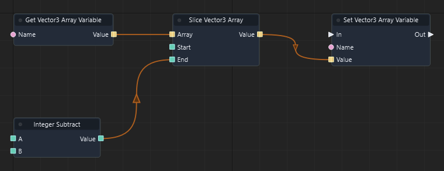

Graph: `templates/games/isometric_snake_3d/graphs/gameplay.json` · Function: **Advance snake** · Node: `n31`.

[Mở hướng dẫn game](games/isometric-snake.md)

### Đọc thêm

[Tài liệu hệ thống: typed-data.md](typed-data.md)

### Slice Entity Array

ID `3715` · `pure` · Workflow `shared`

Trả mảng con từ Start (gồm) tới End (không gồm), đánh số từ 0. Không ghi lại biến gốc; dùng Set Variable nếu cần lưu.

### IO

| Chiều | Cổng | Kiểu | Mặc định |
| --- | --- | --- | --- |
| IN | Array | `array<entity>` | `[]` |
| IN | Start | `int` | `0` |
| IN | End | `int` | `0` |
| OUT | Value | `array<entity>` | — |

Cổng `exec` điều khiển thứ tự. Cổng dữ liệu phải khớp kiểu; `vec2` không tự chuyển sang `vec3`.

### Cách dùng

1. Tìm **Slice Entity Array** trong Node Library hoặc nhấn Tab trong graph để thêm node.
2. Chọn node, nhập hằng số ở Inspector theo bảng IN. Chuỗi nhập trực tiếp; vector/mảng nhập theo JSON, ví dụ `[1, 0, 0]`. Khai báo biến qua Scene > Scene Variables… trước khi dùng Get/Set Variable.
3. Có thể kéo dây từ OUT dữ liệu vào IN có cùng kiểu; giá trị từ dây thay thế hằng số của cổng.
4. Nối OUT dữ liệu tới node dùng kết quả. Node pure không cần dây exec.
5. Nhấn F5, thử tình huống, kiểm tra Console/Diagnostics; Shift+F5 dừng. Ctrl+S lưu thay đổi graph.

### Đọc thêm

[Tài liệu hệ thống: typed-data.md](typed-data.md)

### Slice Vector2 Array

ID `3716` · `pure` · Workflow `shared`

Trả mảng con từ Start (gồm) tới End (không gồm), đánh số từ 0. Không ghi lại biến gốc; dùng Set Variable nếu cần lưu.

### IO

| Chiều | Cổng | Kiểu | Mặc định |
| --- | --- | --- | --- |
| IN | Array | `array<vec2>` | `[]` |
| IN | Start | `int` | `0` |
| IN | End | `int` | `0` |
| OUT | Value | `array<vec2>` | — |

Cổng `exec` điều khiển thứ tự. Cổng dữ liệu phải khớp kiểu; `vec2` không tự chuyển sang `vec3`.

### Cách dùng

1. Tìm **Slice Vector2 Array** trong Node Library hoặc nhấn Tab trong graph để thêm node.
2. Chọn node, nhập hằng số ở Inspector theo bảng IN. Chuỗi nhập trực tiếp; vector/mảng nhập theo JSON, ví dụ `[1, 0, 0]`. Khai báo biến qua Scene > Scene Variables… trước khi dùng Get/Set Variable.
3. Có thể kéo dây từ OUT dữ liệu vào IN có cùng kiểu; giá trị từ dây thay thế hằng số của cổng.
4. Nối OUT dữ liệu tới node dùng kết quả. Node pure không cần dây exec.
5. Nhấn F5, thử tình huống, kiểm tra Console/Diagnostics; Shift+F5 dừng. Ctrl+S lưu thay đổi graph.

### Đọc thêm

[Tài liệu hệ thống: typed-data.md](typed-data.md)

### Slice Vector4 Array

ID `3717` · `pure` · Workflow `shared`

Trả mảng con từ Start (gồm) tới End (không gồm), đánh số từ 0. Không ghi lại biến gốc; dùng Set Variable nếu cần lưu.

### IO

| Chiều | Cổng | Kiểu | Mặc định |
| --- | --- | --- | --- |
| IN | Array | `array<vec4>` | `[]` |
| IN | Start | `int` | `0` |
| IN | End | `int` | `0` |
| OUT | Value | `array<vec4>` | — |

Cổng `exec` điều khiển thứ tự. Cổng dữ liệu phải khớp kiểu; `vec2` không tự chuyển sang `vec3`.

### Cách dùng

1. Tìm **Slice Vector4 Array** trong Node Library hoặc nhấn Tab trong graph để thêm node.
2. Chọn node, nhập hằng số ở Inspector theo bảng IN. Chuỗi nhập trực tiếp; vector/mảng nhập theo JSON, ví dụ `[1, 0, 0]`. Khai báo biến qua Scene > Scene Variables… trước khi dùng Get/Set Variable.
3. Có thể kéo dây từ OUT dữ liệu vào IN có cùng kiểu; giá trị từ dây thay thế hằng số của cổng.
4. Nối OUT dữ liệu tới node dùng kết quả. Node pure không cần dây exec.
5. Nhấn F5, thử tình huống, kiểm tra Console/Diagnostics; Shift+F5 dừng. Ctrl+S lưu thay đổi graph.

### Đọc thêm

[Tài liệu hệ thống: typed-data.md](typed-data.md)

### Slice Quaternion Array

ID `3718` · `pure` · Workflow `shared`

Trả mảng con từ Start (gồm) tới End (không gồm), đánh số từ 0. Không ghi lại biến gốc; dùng Set Variable nếu cần lưu.

### IO

| Chiều | Cổng | Kiểu | Mặc định |
| --- | --- | --- | --- |
| IN | Array | `array<quat>` | `[]` |
| IN | Start | `int` | `0` |
| IN | End | `int` | `0` |
| OUT | Value | `array<quat>` | — |

Cổng `exec` điều khiển thứ tự. Cổng dữ liệu phải khớp kiểu; `vec2` không tự chuyển sang `vec3`.

### Cách dùng

1. Tìm **Slice Quaternion Array** trong Node Library hoặc nhấn Tab trong graph để thêm node.
2. Chọn node, nhập hằng số ở Inspector theo bảng IN. Chuỗi nhập trực tiếp; vector/mảng nhập theo JSON, ví dụ `[1, 0, 0]`. Khai báo biến qua Scene > Scene Variables… trước khi dùng Get/Set Variable.
3. Có thể kéo dây từ OUT dữ liệu vào IN có cùng kiểu; giá trị từ dây thay thế hằng số của cổng.
4. Nối OUT dữ liệu tới node dùng kết quả. Node pure không cần dây exec.
5. Nhấn F5, thử tình huống, kiểm tra Console/Diagnostics; Shift+F5 dừng. Ctrl+S lưu thay đổi graph.

### Đọc thêm

[Tài liệu hệ thống: typed-data.md](typed-data.md)

### Slice Matrix4 Array

ID `3719` · `pure` · Workflow `shared`

Trả mảng con từ Start (gồm) tới End (không gồm), đánh số từ 0. Không ghi lại biến gốc; dùng Set Variable nếu cần lưu.

### IO

| Chiều | Cổng | Kiểu | Mặc định |
| --- | --- | --- | --- |
| IN | Array | `array<mat4>` | `[]` |
| IN | Start | `int` | `0` |
| IN | End | `int` | `0` |
| OUT | Value | `array<mat4>` | — |

Cổng `exec` điều khiển thứ tự. Cổng dữ liệu phải khớp kiểu; `vec2` không tự chuyển sang `vec3`.

### Cách dùng

1. Tìm **Slice Matrix4 Array** trong Node Library hoặc nhấn Tab trong graph để thêm node.
2. Chọn node, nhập hằng số ở Inspector theo bảng IN. Chuỗi nhập trực tiếp; vector/mảng nhập theo JSON, ví dụ `[1, 0, 0]`. Khai báo biến qua Scene > Scene Variables… trước khi dùng Get/Set Variable.
3. Có thể kéo dây từ OUT dữ liệu vào IN có cùng kiểu; giá trị từ dây thay thế hằng số của cổng.
4. Nối OUT dữ liệu tới node dùng kết quả. Node pure không cần dây exec.
5. Nhấn F5, thử tình huống, kiểm tra Console/Diagnostics; Shift+F5 dừng. Ctrl+S lưu thay đổi graph.

### Đọc thêm

[Tài liệu hệ thống: typed-data.md](typed-data.md)

### Sort Float Array

ID `3720` · `collection_callback` · Workflow `shared`

Trả mảng được sắp xếp theo pure function so sánh được chọn bằng Callback.

### IO

| Chiều | Cổng | Kiểu | Mặc định |
| --- | --- | --- | --- |
| IN | Array | `array<float>` | `[]` |
| IN | Callback | `int` | `0` |
| OUT | Value | `array<float>` | — |

Cổng `exec` điều khiển thứ tự. Cổng dữ liệu phải khớp kiểu; `vec2` không tự chuyển sang `vec3`.

### Cách dùng

1. Tìm **Sort Float Array** trong Node Library hoặc nhấn Tab trong graph để thêm node.
2. Chọn node, nhập hằng số ở Inspector theo bảng IN. Chuỗi nhập trực tiếp; vector/mảng nhập theo JSON, ví dụ `[1, 0, 0]`. Khai báo biến qua Scene > Scene Variables… trước khi dùng Get/Set Variable.
3. Có thể kéo dây từ OUT dữ liệu vào IN có cùng kiểu; giá trị từ dây thay thế hằng số của cổng.
4. Nối OUT dữ liệu tới node dùng kết quả. Node pure không cần dây exec.
5. Nhấn F5, thử tình huống, kiểm tra Console/Diagnostics; Shift+F5 dừng. Ctrl+S lưu thay đổi graph.

### Đọc thêm

[Tài liệu hệ thống: typed-data.md](typed-data.md)

### Sort Integer Array

ID `3721` · `collection_callback` · Workflow `shared`

Trả mảng được sắp xếp theo pure function so sánh được chọn bằng Callback.

### IO

| Chiều | Cổng | Kiểu | Mặc định |
| --- | --- | --- | --- |
| IN | Array | `array<int>` | `[]` |
| IN | Callback | `int` | `0` |
| OUT | Value | `array<int>` | — |

Cổng `exec` điều khiển thứ tự. Cổng dữ liệu phải khớp kiểu; `vec2` không tự chuyển sang `vec3`.

### Cách dùng

1. Tìm **Sort Integer Array** trong Node Library hoặc nhấn Tab trong graph để thêm node.
2. Chọn node, nhập hằng số ở Inspector theo bảng IN. Chuỗi nhập trực tiếp; vector/mảng nhập theo JSON, ví dụ `[1, 0, 0]`. Khai báo biến qua Scene > Scene Variables… trước khi dùng Get/Set Variable.
3. Có thể kéo dây từ OUT dữ liệu vào IN có cùng kiểu; giá trị từ dây thay thế hằng số của cổng.
4. Nối OUT dữ liệu tới node dùng kết quả. Node pure không cần dây exec.
5. Nhấn F5, thử tình huống, kiểm tra Console/Diagnostics; Shift+F5 dừng. Ctrl+S lưu thay đổi graph.

### Đọc thêm

[Tài liệu hệ thống: typed-data.md](typed-data.md)

### Sort Boolean Array

ID `3722` · `collection_callback` · Workflow `shared`

Trả mảng được sắp xếp theo pure function so sánh được chọn bằng Callback.

### IO

| Chiều | Cổng | Kiểu | Mặc định |
| --- | --- | --- | --- |
| IN | Array | `array<bool>` | `[]` |
| IN | Callback | `int` | `0` |
| OUT | Value | `array<bool>` | — |

Cổng `exec` điều khiển thứ tự. Cổng dữ liệu phải khớp kiểu; `vec2` không tự chuyển sang `vec3`.

### Cách dùng

1. Tìm **Sort Boolean Array** trong Node Library hoặc nhấn Tab trong graph để thêm node.
2. Chọn node, nhập hằng số ở Inspector theo bảng IN. Chuỗi nhập trực tiếp; vector/mảng nhập theo JSON, ví dụ `[1, 0, 0]`. Khai báo biến qua Scene > Scene Variables… trước khi dùng Get/Set Variable.
3. Có thể kéo dây từ OUT dữ liệu vào IN có cùng kiểu; giá trị từ dây thay thế hằng số của cổng.
4. Nối OUT dữ liệu tới node dùng kết quả. Node pure không cần dây exec.
5. Nhấn F5, thử tình huống, kiểm tra Console/Diagnostics; Shift+F5 dừng. Ctrl+S lưu thay đổi graph.

### Đọc thêm

[Tài liệu hệ thống: typed-data.md](typed-data.md)

### Sort String Array

ID `3723` · `collection_callback` · Workflow `shared`

Trả mảng được sắp xếp theo pure function so sánh được chọn bằng Callback.

### IO

| Chiều | Cổng | Kiểu | Mặc định |
| --- | --- | --- | --- |
| IN | Array | `array<string>` | `[]` |
| IN | Callback | `int` | `0` |
| OUT | Value | `array<string>` | — |

Cổng `exec` điều khiển thứ tự. Cổng dữ liệu phải khớp kiểu; `vec2` không tự chuyển sang `vec3`.

### Cách dùng

1. Tìm **Sort String Array** trong Node Library hoặc nhấn Tab trong graph để thêm node.
2. Chọn node, nhập hằng số ở Inspector theo bảng IN. Chuỗi nhập trực tiếp; vector/mảng nhập theo JSON, ví dụ `[1, 0, 0]`. Khai báo biến qua Scene > Scene Variables… trước khi dùng Get/Set Variable.
3. Có thể kéo dây từ OUT dữ liệu vào IN có cùng kiểu; giá trị từ dây thay thế hằng số của cổng.
4. Nối OUT dữ liệu tới node dùng kết quả. Node pure không cần dây exec.
5. Nhấn F5, thử tình huống, kiểm tra Console/Diagnostics; Shift+F5 dừng. Ctrl+S lưu thay đổi graph.

### Đọc thêm

[Tài liệu hệ thống: typed-data.md](typed-data.md)

### Sort Vector3 Array

ID `3724` · `collection_callback` · Workflow `shared`

Trả mảng được sắp xếp theo pure function so sánh được chọn bằng Callback.

### IO

| Chiều | Cổng | Kiểu | Mặc định |
| --- | --- | --- | --- |
| IN | Array | `array<vec3>` | `[]` |
| IN | Callback | `int` | `0` |
| OUT | Value | `array<vec3>` | — |

Cổng `exec` điều khiển thứ tự. Cổng dữ liệu phải khớp kiểu; `vec2` không tự chuyển sang `vec3`.

### Cách dùng

1. Tìm **Sort Vector3 Array** trong Node Library hoặc nhấn Tab trong graph để thêm node.
2. Chọn node, nhập hằng số ở Inspector theo bảng IN. Chuỗi nhập trực tiếp; vector/mảng nhập theo JSON, ví dụ `[1, 0, 0]`. Khai báo biến qua Scene > Scene Variables… trước khi dùng Get/Set Variable.
3. Có thể kéo dây từ OUT dữ liệu vào IN có cùng kiểu; giá trị từ dây thay thế hằng số của cổng.
4. Nối OUT dữ liệu tới node dùng kết quả. Node pure không cần dây exec.
5. Nhấn F5, thử tình huống, kiểm tra Console/Diagnostics; Shift+F5 dừng. Ctrl+S lưu thay đổi graph.

### Đọc thêm

[Tài liệu hệ thống: typed-data.md](typed-data.md)

### Sort Entity Array

ID `3725` · `collection_callback` · Workflow `shared`

Trả mảng được sắp xếp theo pure function so sánh được chọn bằng Callback.

### IO

| Chiều | Cổng | Kiểu | Mặc định |
| --- | --- | --- | --- |
| IN | Array | `array<entity>` | `[]` |
| IN | Callback | `int` | `0` |
| OUT | Value | `array<entity>` | — |

Cổng `exec` điều khiển thứ tự. Cổng dữ liệu phải khớp kiểu; `vec2` không tự chuyển sang `vec3`.

### Cách dùng

1. Tìm **Sort Entity Array** trong Node Library hoặc nhấn Tab trong graph để thêm node.
2. Chọn node, nhập hằng số ở Inspector theo bảng IN. Chuỗi nhập trực tiếp; vector/mảng nhập theo JSON, ví dụ `[1, 0, 0]`. Khai báo biến qua Scene > Scene Variables… trước khi dùng Get/Set Variable.
3. Có thể kéo dây từ OUT dữ liệu vào IN có cùng kiểu; giá trị từ dây thay thế hằng số của cổng.
4. Nối OUT dữ liệu tới node dùng kết quả. Node pure không cần dây exec.
5. Nhấn F5, thử tình huống, kiểm tra Console/Diagnostics; Shift+F5 dừng. Ctrl+S lưu thay đổi graph.

### Đọc thêm

[Tài liệu hệ thống: typed-data.md](typed-data.md)

### Sort Vector2 Array

ID `3726` · `collection_callback` · Workflow `shared`

Trả mảng được sắp xếp theo pure function so sánh được chọn bằng Callback.

### IO

| Chiều | Cổng | Kiểu | Mặc định |
| --- | --- | --- | --- |
| IN | Array | `array<vec2>` | `[]` |
| IN | Callback | `int` | `0` |
| OUT | Value | `array<vec2>` | — |

Cổng `exec` điều khiển thứ tự. Cổng dữ liệu phải khớp kiểu; `vec2` không tự chuyển sang `vec3`.

### Cách dùng

1. Tìm **Sort Vector2 Array** trong Node Library hoặc nhấn Tab trong graph để thêm node.
2. Chọn node, nhập hằng số ở Inspector theo bảng IN. Chuỗi nhập trực tiếp; vector/mảng nhập theo JSON, ví dụ `[1, 0, 0]`. Khai báo biến qua Scene > Scene Variables… trước khi dùng Get/Set Variable.
3. Có thể kéo dây từ OUT dữ liệu vào IN có cùng kiểu; giá trị từ dây thay thế hằng số của cổng.
4. Nối OUT dữ liệu tới node dùng kết quả. Node pure không cần dây exec.
5. Nhấn F5, thử tình huống, kiểm tra Console/Diagnostics; Shift+F5 dừng. Ctrl+S lưu thay đổi graph.

### Đọc thêm

[Tài liệu hệ thống: typed-data.md](typed-data.md)

### Sort Vector4 Array

ID `3727` · `collection_callback` · Workflow `shared`

Trả mảng được sắp xếp theo pure function so sánh được chọn bằng Callback.

### IO

| Chiều | Cổng | Kiểu | Mặc định |
| --- | --- | --- | --- |
| IN | Array | `array<vec4>` | `[]` |
| IN | Callback | `int` | `0` |
| OUT | Value | `array<vec4>` | — |

Cổng `exec` điều khiển thứ tự. Cổng dữ liệu phải khớp kiểu; `vec2` không tự chuyển sang `vec3`.

### Cách dùng

1. Tìm **Sort Vector4 Array** trong Node Library hoặc nhấn Tab trong graph để thêm node.
2. Chọn node, nhập hằng số ở Inspector theo bảng IN. Chuỗi nhập trực tiếp; vector/mảng nhập theo JSON, ví dụ `[1, 0, 0]`. Khai báo biến qua Scene > Scene Variables… trước khi dùng Get/Set Variable.
3. Có thể kéo dây từ OUT dữ liệu vào IN có cùng kiểu; giá trị từ dây thay thế hằng số của cổng.
4. Nối OUT dữ liệu tới node dùng kết quả. Node pure không cần dây exec.
5. Nhấn F5, thử tình huống, kiểm tra Console/Diagnostics; Shift+F5 dừng. Ctrl+S lưu thay đổi graph.

### Đọc thêm

[Tài liệu hệ thống: typed-data.md](typed-data.md)

### Sort Quaternion Array

ID `3728` · `collection_callback` · Workflow `shared`

Trả mảng được sắp xếp theo pure function so sánh được chọn bằng Callback.

### IO

| Chiều | Cổng | Kiểu | Mặc định |
| --- | --- | --- | --- |
| IN | Array | `array<quat>` | `[]` |
| IN | Callback | `int` | `0` |
| OUT | Value | `array<quat>` | — |

Cổng `exec` điều khiển thứ tự. Cổng dữ liệu phải khớp kiểu; `vec2` không tự chuyển sang `vec3`.

### Cách dùng

1. Tìm **Sort Quaternion Array** trong Node Library hoặc nhấn Tab trong graph để thêm node.
2. Chọn node, nhập hằng số ở Inspector theo bảng IN. Chuỗi nhập trực tiếp; vector/mảng nhập theo JSON, ví dụ `[1, 0, 0]`. Khai báo biến qua Scene > Scene Variables… trước khi dùng Get/Set Variable.
3. Có thể kéo dây từ OUT dữ liệu vào IN có cùng kiểu; giá trị từ dây thay thế hằng số của cổng.
4. Nối OUT dữ liệu tới node dùng kết quả. Node pure không cần dây exec.
5. Nhấn F5, thử tình huống, kiểm tra Console/Diagnostics; Shift+F5 dừng. Ctrl+S lưu thay đổi graph.

### Đọc thêm

[Tài liệu hệ thống: typed-data.md](typed-data.md)

### Sort Matrix4 Array

ID `3729` · `collection_callback` · Workflow `shared`

Trả mảng được sắp xếp theo pure function so sánh được chọn bằng Callback.

### IO

| Chiều | Cổng | Kiểu | Mặc định |
| --- | --- | --- | --- |
| IN | Array | `array<mat4>` | `[]` |
| IN | Callback | `int` | `0` |
| OUT | Value | `array<mat4>` | — |

Cổng `exec` điều khiển thứ tự. Cổng dữ liệu phải khớp kiểu; `vec2` không tự chuyển sang `vec3`.

### Cách dùng

1. Tìm **Sort Matrix4 Array** trong Node Library hoặc nhấn Tab trong graph để thêm node.
2. Chọn node, nhập hằng số ở Inspector theo bảng IN. Chuỗi nhập trực tiếp; vector/mảng nhập theo JSON, ví dụ `[1, 0, 0]`. Khai báo biến qua Scene > Scene Variables… trước khi dùng Get/Set Variable.
3. Có thể kéo dây từ OUT dữ liệu vào IN có cùng kiểu; giá trị từ dây thay thế hằng số của cổng.
4. Nối OUT dữ liệu tới node dùng kết quả. Node pure không cần dây exec.
5. Nhấn F5, thử tình huống, kiểm tra Console/Diagnostics; Shift+F5 dừng. Ctrl+S lưu thay đổi graph.

### Đọc thêm

[Tài liệu hệ thống: typed-data.md](typed-data.md)

### Filter Float Array

ID `3730` · `collection_callback` · Workflow `shared`

Trả mảng chỉ chứa các phần tử thỏa pure function điều kiện được chọn bằng Callback.

### IO

| Chiều | Cổng | Kiểu | Mặc định |
| --- | --- | --- | --- |
| IN | Array | `array<float>` | `[]` |
| IN | Callback | `int` | `0` |
| OUT | Value | `array<float>` | — |

Cổng `exec` điều khiển thứ tự. Cổng dữ liệu phải khớp kiểu; `vec2` không tự chuyển sang `vec3`.

### Cách dùng

1. Tìm **Filter Float Array** trong Node Library hoặc nhấn Tab trong graph để thêm node.
2. Chọn node, nhập hằng số ở Inspector theo bảng IN. Chuỗi nhập trực tiếp; vector/mảng nhập theo JSON, ví dụ `[1, 0, 0]`. Khai báo biến qua Scene > Scene Variables… trước khi dùng Get/Set Variable.
3. Có thể kéo dây từ OUT dữ liệu vào IN có cùng kiểu; giá trị từ dây thay thế hằng số của cổng.
4. Nối OUT dữ liệu tới node dùng kết quả. Node pure không cần dây exec.
5. Nhấn F5, thử tình huống, kiểm tra Console/Diagnostics; Shift+F5 dừng. Ctrl+S lưu thay đổi graph.

### Đọc thêm

[Tài liệu hệ thống: typed-data.md](typed-data.md)

### Filter Integer Array

ID `3731` · `collection_callback` · Workflow `shared`

Trả mảng chỉ chứa các phần tử thỏa pure function điều kiện được chọn bằng Callback.

### IO

| Chiều | Cổng | Kiểu | Mặc định |
| --- | --- | --- | --- |
| IN | Array | `array<int>` | `[]` |
| IN | Callback | `int` | `0` |
| OUT | Value | `array<int>` | — |

Cổng `exec` điều khiển thứ tự. Cổng dữ liệu phải khớp kiểu; `vec2` không tự chuyển sang `vec3`.

### Cách dùng

1. Tìm **Filter Integer Array** trong Node Library hoặc nhấn Tab trong graph để thêm node.
2. Chọn node, nhập hằng số ở Inspector theo bảng IN. Chuỗi nhập trực tiếp; vector/mảng nhập theo JSON, ví dụ `[1, 0, 0]`. Khai báo biến qua Scene > Scene Variables… trước khi dùng Get/Set Variable.
3. Có thể kéo dây từ OUT dữ liệu vào IN có cùng kiểu; giá trị từ dây thay thế hằng số của cổng.
4. Nối OUT dữ liệu tới node dùng kết quả. Node pure không cần dây exec.
5. Nhấn F5, thử tình huống, kiểm tra Console/Diagnostics; Shift+F5 dừng. Ctrl+S lưu thay đổi graph.

### Đọc thêm

[Tài liệu hệ thống: typed-data.md](typed-data.md)

### Filter Boolean Array

ID `3732` · `collection_callback` · Workflow `shared`

Trả mảng chỉ chứa các phần tử thỏa pure function điều kiện được chọn bằng Callback.

### IO

| Chiều | Cổng | Kiểu | Mặc định |
| --- | --- | --- | --- |
| IN | Array | `array<bool>` | `[]` |
| IN | Callback | `int` | `0` |
| OUT | Value | `array<bool>` | — |

Cổng `exec` điều khiển thứ tự. Cổng dữ liệu phải khớp kiểu; `vec2` không tự chuyển sang `vec3`.

### Cách dùng

1. Tìm **Filter Boolean Array** trong Node Library hoặc nhấn Tab trong graph để thêm node.
2. Chọn node, nhập hằng số ở Inspector theo bảng IN. Chuỗi nhập trực tiếp; vector/mảng nhập theo JSON, ví dụ `[1, 0, 0]`. Khai báo biến qua Scene > Scene Variables… trước khi dùng Get/Set Variable.
3. Có thể kéo dây từ OUT dữ liệu vào IN có cùng kiểu; giá trị từ dây thay thế hằng số của cổng.
4. Nối OUT dữ liệu tới node dùng kết quả. Node pure không cần dây exec.
5. Nhấn F5, thử tình huống, kiểm tra Console/Diagnostics; Shift+F5 dừng. Ctrl+S lưu thay đổi graph.

### Đọc thêm

[Tài liệu hệ thống: typed-data.md](typed-data.md)

### Filter String Array

ID `3733` · `collection_callback` · Workflow `shared`

Trả mảng chỉ chứa các phần tử thỏa pure function điều kiện được chọn bằng Callback.

### IO

| Chiều | Cổng | Kiểu | Mặc định |
| --- | --- | --- | --- |
| IN | Array | `array<string>` | `[]` |
| IN | Callback | `int` | `0` |
| OUT | Value | `array<string>` | — |

Cổng `exec` điều khiển thứ tự. Cổng dữ liệu phải khớp kiểu; `vec2` không tự chuyển sang `vec3`.

### Cách dùng

1. Tìm **Filter String Array** trong Node Library hoặc nhấn Tab trong graph để thêm node.
2. Chọn node, nhập hằng số ở Inspector theo bảng IN. Chuỗi nhập trực tiếp; vector/mảng nhập theo JSON, ví dụ `[1, 0, 0]`. Khai báo biến qua Scene > Scene Variables… trước khi dùng Get/Set Variable.
3. Có thể kéo dây từ OUT dữ liệu vào IN có cùng kiểu; giá trị từ dây thay thế hằng số của cổng.
4. Nối OUT dữ liệu tới node dùng kết quả. Node pure không cần dây exec.
5. Nhấn F5, thử tình huống, kiểm tra Console/Diagnostics; Shift+F5 dừng. Ctrl+S lưu thay đổi graph.

### Đọc thêm

[Tài liệu hệ thống: typed-data.md](typed-data.md)

### Filter Vector3 Array

ID `3734` · `collection_callback` · Workflow `shared`

Trả mảng chỉ chứa các phần tử thỏa pure function điều kiện được chọn bằng Callback.

### IO

| Chiều | Cổng | Kiểu | Mặc định |
| --- | --- | --- | --- |
| IN | Array | `array<vec3>` | `[]` |
| IN | Callback | `int` | `0` |
| OUT | Value | `array<vec3>` | — |

Cổng `exec` điều khiển thứ tự. Cổng dữ liệu phải khớp kiểu; `vec2` không tự chuyển sang `vec3`.

### Cách dùng

1. Tìm **Filter Vector3 Array** trong Node Library hoặc nhấn Tab trong graph để thêm node.
2. Chọn node, nhập hằng số ở Inspector theo bảng IN. Chuỗi nhập trực tiếp; vector/mảng nhập theo JSON, ví dụ `[1, 0, 0]`. Khai báo biến qua Scene > Scene Variables… trước khi dùng Get/Set Variable.
3. Có thể kéo dây từ OUT dữ liệu vào IN có cùng kiểu; giá trị từ dây thay thế hằng số của cổng.
4. Nối OUT dữ liệu tới node dùng kết quả. Node pure không cần dây exec.
5. Nhấn F5, thử tình huống, kiểm tra Console/Diagnostics; Shift+F5 dừng. Ctrl+S lưu thay đổi graph.

### Đọc thêm

[Tài liệu hệ thống: typed-data.md](typed-data.md)

### Filter Entity Array

ID `3735` · `collection_callback` · Workflow `shared`

Trả mảng chỉ chứa các phần tử thỏa pure function điều kiện được chọn bằng Callback.

### IO

| Chiều | Cổng | Kiểu | Mặc định |
| --- | --- | --- | --- |
| IN | Array | `array<entity>` | `[]` |
| IN | Callback | `int` | `0` |
| OUT | Value | `array<entity>` | — |

Cổng `exec` điều khiển thứ tự. Cổng dữ liệu phải khớp kiểu; `vec2` không tự chuyển sang `vec3`.

### Cách dùng

1. Tìm **Filter Entity Array** trong Node Library hoặc nhấn Tab trong graph để thêm node.
2. Chọn node, nhập hằng số ở Inspector theo bảng IN. Chuỗi nhập trực tiếp; vector/mảng nhập theo JSON, ví dụ `[1, 0, 0]`. Khai báo biến qua Scene > Scene Variables… trước khi dùng Get/Set Variable.
3. Có thể kéo dây từ OUT dữ liệu vào IN có cùng kiểu; giá trị từ dây thay thế hằng số của cổng.
4. Nối OUT dữ liệu tới node dùng kết quả. Node pure không cần dây exec.
5. Nhấn F5, thử tình huống, kiểm tra Console/Diagnostics; Shift+F5 dừng. Ctrl+S lưu thay đổi graph.

### Đọc thêm

[Tài liệu hệ thống: typed-data.md](typed-data.md)

### Filter Vector2 Array

ID `3736` · `collection_callback` · Workflow `shared`

Trả mảng chỉ chứa các phần tử thỏa pure function điều kiện được chọn bằng Callback.

### IO

| Chiều | Cổng | Kiểu | Mặc định |
| --- | --- | --- | --- |
| IN | Array | `array<vec2>` | `[]` |
| IN | Callback | `int` | `0` |
| OUT | Value | `array<vec2>` | — |

Cổng `exec` điều khiển thứ tự. Cổng dữ liệu phải khớp kiểu; `vec2` không tự chuyển sang `vec3`.

### Cách dùng

1. Tìm **Filter Vector2 Array** trong Node Library hoặc nhấn Tab trong graph để thêm node.
2. Chọn node, nhập hằng số ở Inspector theo bảng IN. Chuỗi nhập trực tiếp; vector/mảng nhập theo JSON, ví dụ `[1, 0, 0]`. Khai báo biến qua Scene > Scene Variables… trước khi dùng Get/Set Variable.
3. Có thể kéo dây từ OUT dữ liệu vào IN có cùng kiểu; giá trị từ dây thay thế hằng số của cổng.
4. Nối OUT dữ liệu tới node dùng kết quả. Node pure không cần dây exec.
5. Nhấn F5, thử tình huống, kiểm tra Console/Diagnostics; Shift+F5 dừng. Ctrl+S lưu thay đổi graph.

### Đọc thêm

[Tài liệu hệ thống: typed-data.md](typed-data.md)

### Filter Vector4 Array

ID `3737` · `collection_callback` · Workflow `shared`

Trả mảng chỉ chứa các phần tử thỏa pure function điều kiện được chọn bằng Callback.

### IO

| Chiều | Cổng | Kiểu | Mặc định |
| --- | --- | --- | --- |
| IN | Array | `array<vec4>` | `[]` |
| IN | Callback | `int` | `0` |
| OUT | Value | `array<vec4>` | — |

Cổng `exec` điều khiển thứ tự. Cổng dữ liệu phải khớp kiểu; `vec2` không tự chuyển sang `vec3`.

### Cách dùng

1. Tìm **Filter Vector4 Array** trong Node Library hoặc nhấn Tab trong graph để thêm node.
2. Chọn node, nhập hằng số ở Inspector theo bảng IN. Chuỗi nhập trực tiếp; vector/mảng nhập theo JSON, ví dụ `[1, 0, 0]`. Khai báo biến qua Scene > Scene Variables… trước khi dùng Get/Set Variable.
3. Có thể kéo dây từ OUT dữ liệu vào IN có cùng kiểu; giá trị từ dây thay thế hằng số của cổng.
4. Nối OUT dữ liệu tới node dùng kết quả. Node pure không cần dây exec.
5. Nhấn F5, thử tình huống, kiểm tra Console/Diagnostics; Shift+F5 dừng. Ctrl+S lưu thay đổi graph.

### Đọc thêm

[Tài liệu hệ thống: typed-data.md](typed-data.md)

### Filter Quaternion Array

ID `3738` · `collection_callback` · Workflow `shared`

Trả mảng chỉ chứa các phần tử thỏa pure function điều kiện được chọn bằng Callback.

### IO

| Chiều | Cổng | Kiểu | Mặc định |
| --- | --- | --- | --- |
| IN | Array | `array<quat>` | `[]` |
| IN | Callback | `int` | `0` |
| OUT | Value | `array<quat>` | — |

Cổng `exec` điều khiển thứ tự. Cổng dữ liệu phải khớp kiểu; `vec2` không tự chuyển sang `vec3`.

### Cách dùng

1. Tìm **Filter Quaternion Array** trong Node Library hoặc nhấn Tab trong graph để thêm node.
2. Chọn node, nhập hằng số ở Inspector theo bảng IN. Chuỗi nhập trực tiếp; vector/mảng nhập theo JSON, ví dụ `[1, 0, 0]`. Khai báo biến qua Scene > Scene Variables… trước khi dùng Get/Set Variable.
3. Có thể kéo dây từ OUT dữ liệu vào IN có cùng kiểu; giá trị từ dây thay thế hằng số của cổng.
4. Nối OUT dữ liệu tới node dùng kết quả. Node pure không cần dây exec.
5. Nhấn F5, thử tình huống, kiểm tra Console/Diagnostics; Shift+F5 dừng. Ctrl+S lưu thay đổi graph.

### Đọc thêm

[Tài liệu hệ thống: typed-data.md](typed-data.md)

### Filter Matrix4 Array

ID `3739` · `collection_callback` · Workflow `shared`

Trả mảng chỉ chứa các phần tử thỏa pure function điều kiện được chọn bằng Callback.

### IO

| Chiều | Cổng | Kiểu | Mặc định |
| --- | --- | --- | --- |
| IN | Array | `array<mat4>` | `[]` |
| IN | Callback | `int` | `0` |
| OUT | Value | `array<mat4>` | — |

Cổng `exec` điều khiển thứ tự. Cổng dữ liệu phải khớp kiểu; `vec2` không tự chuyển sang `vec3`.

### Cách dùng

1. Tìm **Filter Matrix4 Array** trong Node Library hoặc nhấn Tab trong graph để thêm node.
2. Chọn node, nhập hằng số ở Inspector theo bảng IN. Chuỗi nhập trực tiếp; vector/mảng nhập theo JSON, ví dụ `[1, 0, 0]`. Khai báo biến qua Scene > Scene Variables… trước khi dùng Get/Set Variable.
3. Có thể kéo dây từ OUT dữ liệu vào IN có cùng kiểu; giá trị từ dây thay thế hằng số của cổng.
4. Nối OUT dữ liệu tới node dùng kết quả. Node pure không cần dây exec.
5. Nhấn F5, thử tình huống, kiểm tra Console/Diagnostics; Shift+F5 dừng. Ctrl+S lưu thay đổi graph.

### Đọc thêm

[Tài liệu hệ thống: typed-data.md](typed-data.md)

### Map Float Array

ID `3740` · `collection_callback` · Workflow `shared`

Áp dụng pure function Callback lên từng phần tử để tạo mảng kết quả. Các phép pure trả bản sao; muốn lưu thay đổi qua frame, nối kết quả vào Set Variable cùng kiểu.

### IO

| Chiều | Cổng | Kiểu | Mặc định |
| --- | --- | --- | --- |
| IN | Array | `array<float>` | `[]` |
| IN | Callback | `int` | `0` |
| OUT | Value | `array<float>` | — |

Cổng `exec` điều khiển thứ tự. Cổng dữ liệu phải khớp kiểu; `vec2` không tự chuyển sang `vec3`.

### Cách dùng

1. Tìm **Map Float Array** trong Node Library hoặc nhấn Tab trong graph để thêm node.
2. Chọn node, nhập hằng số ở Inspector theo bảng IN. Chuỗi nhập trực tiếp; vector/mảng nhập theo JSON, ví dụ `[1, 0, 0]`. Khai báo biến qua Scene > Scene Variables… trước khi dùng Get/Set Variable.
3. Có thể kéo dây từ OUT dữ liệu vào IN có cùng kiểu; giá trị từ dây thay thế hằng số của cổng.
4. Nối OUT dữ liệu tới node dùng kết quả. Node pure không cần dây exec.
5. Nhấn F5, thử tình huống, kiểm tra Console/Diagnostics; Shift+F5 dừng. Ctrl+S lưu thay đổi graph.

### Đọc thêm

[Tài liệu hệ thống: typed-data.md](typed-data.md)

### Map Integer Array

ID `3741` · `collection_callback` · Workflow `shared`

Áp dụng pure function Callback lên từng phần tử để tạo mảng kết quả. Các phép pure trả bản sao; muốn lưu thay đổi qua frame, nối kết quả vào Set Variable cùng kiểu.

### IO

| Chiều | Cổng | Kiểu | Mặc định |
| --- | --- | --- | --- |
| IN | Array | `array<int>` | `[]` |
| IN | Callback | `int` | `0` |
| OUT | Value | `array<int>` | — |

Cổng `exec` điều khiển thứ tự. Cổng dữ liệu phải khớp kiểu; `vec2` không tự chuyển sang `vec3`.

### Cách dùng

1. Tìm **Map Integer Array** trong Node Library hoặc nhấn Tab trong graph để thêm node.
2. Chọn node, nhập hằng số ở Inspector theo bảng IN. Chuỗi nhập trực tiếp; vector/mảng nhập theo JSON, ví dụ `[1, 0, 0]`. Khai báo biến qua Scene > Scene Variables… trước khi dùng Get/Set Variable.
3. Có thể kéo dây từ OUT dữ liệu vào IN có cùng kiểu; giá trị từ dây thay thế hằng số của cổng.
4. Nối OUT dữ liệu tới node dùng kết quả. Node pure không cần dây exec.
5. Nhấn F5, thử tình huống, kiểm tra Console/Diagnostics; Shift+F5 dừng. Ctrl+S lưu thay đổi graph.

### Đọc thêm

[Tài liệu hệ thống: typed-data.md](typed-data.md)

### Map Boolean Array

ID `3742` · `collection_callback` · Workflow `shared`

Áp dụng pure function Callback lên từng phần tử để tạo mảng kết quả. Các phép pure trả bản sao; muốn lưu thay đổi qua frame, nối kết quả vào Set Variable cùng kiểu.

### IO

| Chiều | Cổng | Kiểu | Mặc định |
| --- | --- | --- | --- |
| IN | Array | `array<bool>` | `[]` |
| IN | Callback | `int` | `0` |
| OUT | Value | `array<bool>` | — |

Cổng `exec` điều khiển thứ tự. Cổng dữ liệu phải khớp kiểu; `vec2` không tự chuyển sang `vec3`.

### Cách dùng

1. Tìm **Map Boolean Array** trong Node Library hoặc nhấn Tab trong graph để thêm node.
2. Chọn node, nhập hằng số ở Inspector theo bảng IN. Chuỗi nhập trực tiếp; vector/mảng nhập theo JSON, ví dụ `[1, 0, 0]`. Khai báo biến qua Scene > Scene Variables… trước khi dùng Get/Set Variable.
3. Có thể kéo dây từ OUT dữ liệu vào IN có cùng kiểu; giá trị từ dây thay thế hằng số của cổng.
4. Nối OUT dữ liệu tới node dùng kết quả. Node pure không cần dây exec.
5. Nhấn F5, thử tình huống, kiểm tra Console/Diagnostics; Shift+F5 dừng. Ctrl+S lưu thay đổi graph.

### Đọc thêm

[Tài liệu hệ thống: typed-data.md](typed-data.md)

### Map String Array

ID `3743` · `collection_callback` · Workflow `shared`

Áp dụng pure function Callback lên từng phần tử để tạo mảng kết quả. Các phép pure trả bản sao; muốn lưu thay đổi qua frame, nối kết quả vào Set Variable cùng kiểu.

### IO

| Chiều | Cổng | Kiểu | Mặc định |
| --- | --- | --- | --- |
| IN | Array | `array<string>` | `[]` |
| IN | Callback | `int` | `0` |
| OUT | Value | `array<string>` | — |

Cổng `exec` điều khiển thứ tự. Cổng dữ liệu phải khớp kiểu; `vec2` không tự chuyển sang `vec3`.

### Cách dùng

1. Tìm **Map String Array** trong Node Library hoặc nhấn Tab trong graph để thêm node.
2. Chọn node, nhập hằng số ở Inspector theo bảng IN. Chuỗi nhập trực tiếp; vector/mảng nhập theo JSON, ví dụ `[1, 0, 0]`. Khai báo biến qua Scene > Scene Variables… trước khi dùng Get/Set Variable.
3. Có thể kéo dây từ OUT dữ liệu vào IN có cùng kiểu; giá trị từ dây thay thế hằng số của cổng.
4. Nối OUT dữ liệu tới node dùng kết quả. Node pure không cần dây exec.
5. Nhấn F5, thử tình huống, kiểm tra Console/Diagnostics; Shift+F5 dừng. Ctrl+S lưu thay đổi graph.

### Đọc thêm

[Tài liệu hệ thống: typed-data.md](typed-data.md)

### Map Vector3 Array

ID `3744` · `collection_callback` · Workflow `shared`

Áp dụng pure function Callback lên từng phần tử để tạo mảng kết quả. Các phép pure trả bản sao; muốn lưu thay đổi qua frame, nối kết quả vào Set Variable cùng kiểu.

### IO

| Chiều | Cổng | Kiểu | Mặc định |
| --- | --- | --- | --- |
| IN | Array | `array<vec3>` | `[]` |
| IN | Callback | `int` | `0` |
| OUT | Value | `array<vec3>` | — |

Cổng `exec` điều khiển thứ tự. Cổng dữ liệu phải khớp kiểu; `vec2` không tự chuyển sang `vec3`.

### Cách dùng

1. Tìm **Map Vector3 Array** trong Node Library hoặc nhấn Tab trong graph để thêm node.
2. Chọn node, nhập hằng số ở Inspector theo bảng IN. Chuỗi nhập trực tiếp; vector/mảng nhập theo JSON, ví dụ `[1, 0, 0]`. Khai báo biến qua Scene > Scene Variables… trước khi dùng Get/Set Variable.
3. Có thể kéo dây từ OUT dữ liệu vào IN có cùng kiểu; giá trị từ dây thay thế hằng số của cổng.
4. Nối OUT dữ liệu tới node dùng kết quả. Node pure không cần dây exec.
5. Nhấn F5, thử tình huống, kiểm tra Console/Diagnostics; Shift+F5 dừng. Ctrl+S lưu thay đổi graph.

### Đọc thêm

[Tài liệu hệ thống: typed-data.md](typed-data.md)

### Map Entity Array

ID `3745` · `collection_callback` · Workflow `shared`

Áp dụng pure function Callback lên từng phần tử để tạo mảng kết quả. Các phép pure trả bản sao; muốn lưu thay đổi qua frame, nối kết quả vào Set Variable cùng kiểu.

### IO

| Chiều | Cổng | Kiểu | Mặc định |
| --- | --- | --- | --- |
| IN | Array | `array<entity>` | `[]` |
| IN | Callback | `int` | `0` |
| OUT | Value | `array<entity>` | — |

Cổng `exec` điều khiển thứ tự. Cổng dữ liệu phải khớp kiểu; `vec2` không tự chuyển sang `vec3`.

### Cách dùng

1. Tìm **Map Entity Array** trong Node Library hoặc nhấn Tab trong graph để thêm node.
2. Chọn node, nhập hằng số ở Inspector theo bảng IN. Chuỗi nhập trực tiếp; vector/mảng nhập theo JSON, ví dụ `[1, 0, 0]`. Khai báo biến qua Scene > Scene Variables… trước khi dùng Get/Set Variable.
3. Có thể kéo dây từ OUT dữ liệu vào IN có cùng kiểu; giá trị từ dây thay thế hằng số của cổng.
4. Nối OUT dữ liệu tới node dùng kết quả. Node pure không cần dây exec.
5. Nhấn F5, thử tình huống, kiểm tra Console/Diagnostics; Shift+F5 dừng. Ctrl+S lưu thay đổi graph.

### Đọc thêm

[Tài liệu hệ thống: typed-data.md](typed-data.md)

### Map Vector2 Array

ID `3746` · `collection_callback` · Workflow `shared`

Áp dụng pure function Callback lên từng phần tử để tạo mảng kết quả. Các phép pure trả bản sao; muốn lưu thay đổi qua frame, nối kết quả vào Set Variable cùng kiểu.

### IO

| Chiều | Cổng | Kiểu | Mặc định |
| --- | --- | --- | --- |
| IN | Array | `array<vec2>` | `[]` |
| IN | Callback | `int` | `0` |
| OUT | Value | `array<vec2>` | — |

Cổng `exec` điều khiển thứ tự. Cổng dữ liệu phải khớp kiểu; `vec2` không tự chuyển sang `vec3`.

### Cách dùng

1. Tìm **Map Vector2 Array** trong Node Library hoặc nhấn Tab trong graph để thêm node.
2. Chọn node, nhập hằng số ở Inspector theo bảng IN. Chuỗi nhập trực tiếp; vector/mảng nhập theo JSON, ví dụ `[1, 0, 0]`. Khai báo biến qua Scene > Scene Variables… trước khi dùng Get/Set Variable.
3. Có thể kéo dây từ OUT dữ liệu vào IN có cùng kiểu; giá trị từ dây thay thế hằng số của cổng.
4. Nối OUT dữ liệu tới node dùng kết quả. Node pure không cần dây exec.
5. Nhấn F5, thử tình huống, kiểm tra Console/Diagnostics; Shift+F5 dừng. Ctrl+S lưu thay đổi graph.

### Đọc thêm

[Tài liệu hệ thống: typed-data.md](typed-data.md)

### Map Vector4 Array

ID `3747` · `collection_callback` · Workflow `shared`

Áp dụng pure function Callback lên từng phần tử để tạo mảng kết quả. Các phép pure trả bản sao; muốn lưu thay đổi qua frame, nối kết quả vào Set Variable cùng kiểu.

### IO

| Chiều | Cổng | Kiểu | Mặc định |
| --- | --- | --- | --- |
| IN | Array | `array<vec4>` | `[]` |
| IN | Callback | `int` | `0` |
| OUT | Value | `array<vec4>` | — |

Cổng `exec` điều khiển thứ tự. Cổng dữ liệu phải khớp kiểu; `vec2` không tự chuyển sang `vec3`.

### Cách dùng

1. Tìm **Map Vector4 Array** trong Node Library hoặc nhấn Tab trong graph để thêm node.
2. Chọn node, nhập hằng số ở Inspector theo bảng IN. Chuỗi nhập trực tiếp; vector/mảng nhập theo JSON, ví dụ `[1, 0, 0]`. Khai báo biến qua Scene > Scene Variables… trước khi dùng Get/Set Variable.
3. Có thể kéo dây từ OUT dữ liệu vào IN có cùng kiểu; giá trị từ dây thay thế hằng số của cổng.
4. Nối OUT dữ liệu tới node dùng kết quả. Node pure không cần dây exec.
5. Nhấn F5, thử tình huống, kiểm tra Console/Diagnostics; Shift+F5 dừng. Ctrl+S lưu thay đổi graph.

### Đọc thêm

[Tài liệu hệ thống: typed-data.md](typed-data.md)

### Map Quaternion Array

ID `3748` · `collection_callback` · Workflow `shared`

Áp dụng pure function Callback lên từng phần tử để tạo mảng kết quả. Các phép pure trả bản sao; muốn lưu thay đổi qua frame, nối kết quả vào Set Variable cùng kiểu.

### IO

| Chiều | Cổng | Kiểu | Mặc định |
| --- | --- | --- | --- |
| IN | Array | `array<quat>` | `[]` |
| IN | Callback | `int` | `0` |
| OUT | Value | `array<quat>` | — |

Cổng `exec` điều khiển thứ tự. Cổng dữ liệu phải khớp kiểu; `vec2` không tự chuyển sang `vec3`.

### Cách dùng

1. Tìm **Map Quaternion Array** trong Node Library hoặc nhấn Tab trong graph để thêm node.
2. Chọn node, nhập hằng số ở Inspector theo bảng IN. Chuỗi nhập trực tiếp; vector/mảng nhập theo JSON, ví dụ `[1, 0, 0]`. Khai báo biến qua Scene > Scene Variables… trước khi dùng Get/Set Variable.
3. Có thể kéo dây từ OUT dữ liệu vào IN có cùng kiểu; giá trị từ dây thay thế hằng số của cổng.
4. Nối OUT dữ liệu tới node dùng kết quả. Node pure không cần dây exec.
5. Nhấn F5, thử tình huống, kiểm tra Console/Diagnostics; Shift+F5 dừng. Ctrl+S lưu thay đổi graph.

### Đọc thêm

[Tài liệu hệ thống: typed-data.md](typed-data.md)

### Map Matrix4 Array

ID `3749` · `collection_callback` · Workflow `shared`

Áp dụng pure function Callback lên từng phần tử để tạo mảng kết quả. Các phép pure trả bản sao; muốn lưu thay đổi qua frame, nối kết quả vào Set Variable cùng kiểu.

### IO

| Chiều | Cổng | Kiểu | Mặc định |
| --- | --- | --- | --- |
| IN | Array | `array<mat4>` | `[]` |
| IN | Callback | `int` | `0` |
| OUT | Value | `array<mat4>` | — |

Cổng `exec` điều khiển thứ tự. Cổng dữ liệu phải khớp kiểu; `vec2` không tự chuyển sang `vec3`.

### Cách dùng

1. Tìm **Map Matrix4 Array** trong Node Library hoặc nhấn Tab trong graph để thêm node.
2. Chọn node, nhập hằng số ở Inspector theo bảng IN. Chuỗi nhập trực tiếp; vector/mảng nhập theo JSON, ví dụ `[1, 0, 0]`. Khai báo biến qua Scene > Scene Variables… trước khi dùng Get/Set Variable.
3. Có thể kéo dây từ OUT dữ liệu vào IN có cùng kiểu; giá trị từ dây thay thế hằng số của cổng.
4. Nối OUT dữ liệu tới node dùng kết quả. Node pure không cần dây exec.
5. Nhấn F5, thử tình huống, kiểm tra Console/Diagnostics; Shift+F5 dừng. Ctrl+S lưu thay đổi graph.

### Đọc thêm

[Tài liệu hệ thống: typed-data.md](typed-data.md)

### Integer to Float

ID `4035` · `pure` · Workflow `shared`

Chuyển số nguyên thành số thực. Cần khi nối chỉ số ô bàn vào thành phần vec3.

### IO

| Chiều | Cổng | Kiểu | Mặc định |
| --- | --- | --- | --- |
| IN | Value | `int` | `0` |
| OUT | Value | `float` | — |

Cổng `exec` điều khiển thứ tự. Cổng dữ liệu phải khớp kiểu; `vec2` không tự chuyển sang `vec3`.

### Cách dùng

1. Tìm **Integer to Float** trong Node Library hoặc nhấn Tab trong graph để thêm node.
2. Chọn node, nhập hằng số ở Inspector theo bảng IN. Chuỗi nhập trực tiếp; vector/mảng nhập theo JSON, ví dụ `[1, 0, 0]`. Khai báo biến qua Scene > Scene Variables… trước khi dùng Get/Set Variable.
3. Có thể kéo dây từ OUT dữ liệu vào IN có cùng kiểu; giá trị từ dây thay thế hằng số của cổng.
4. Nối OUT dữ liệu tới node dùng kết quả. Node pure không cần dây exec.
5. Nhấn F5, thử tình huống, kiểm tra Console/Diagnostics; Shift+F5 dừng. Ctrl+S lưu thay đổi graph.

### Ví dụ từ graph thật

Trích đoạn Spawn food của isometric_snake_3d: node n9. Đây là các node và dây nối thật từ graph đã chạy; vị trí được sắp lại để dễ đọc.

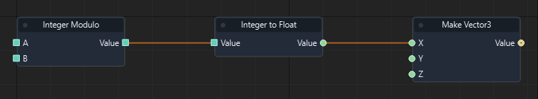

Graph: `templates/games/isometric_snake_3d/graphs/gameplay.json` · Function: **Spawn food** · Node: `n9`.

[Mở hướng dẫn game](games/isometric-snake.md)

### Đọc thêm

[Tài liệu hệ thống: typed-data.md](typed-data.md)

### Truncate to Integer

ID `4036` · `pure` · Workflow `shared`

Đổi float sang int bằng cách bỏ phần thập phân.

### IO

| Chiều | Cổng | Kiểu | Mặc định |
| --- | --- | --- | --- |
| IN | Value | `float` | `0` |
| OUT | Value | `int` | — |

Cổng `exec` điều khiển thứ tự. Cổng dữ liệu phải khớp kiểu; `vec2` không tự chuyển sang `vec3`.

### Cách dùng

1. Tìm **Truncate to Integer** trong Node Library hoặc nhấn Tab trong graph để thêm node.
2. Chọn node, nhập hằng số ở Inspector theo bảng IN. Chuỗi nhập trực tiếp; vector/mảng nhập theo JSON, ví dụ `[1, 0, 0]`. Khai báo biến qua Scene > Scene Variables… trước khi dùng Get/Set Variable.
3. Có thể kéo dây từ OUT dữ liệu vào IN có cùng kiểu; giá trị từ dây thay thế hằng số của cổng.
4. Nối OUT dữ liệu tới node dùng kết quả. Node pure không cần dây exec.
5. Nhấn F5, thử tình huống, kiểm tra Console/Diagnostics; Shift+F5 dừng. Ctrl+S lưu thay đổi graph.

### Đọc thêm

[Tài liệu hệ thống: typed-data.md](typed-data.md)

### Get Global Float Variable

ID `50000` · `pure` · Workflow `shared`

Ghi biến float trong phạm vi global. Name phải khớp biến đã khai báo; chọn đúng kiểu.

### IO

| Chiều | Cổng | Kiểu | Mặc định |
| --- | --- | --- | --- |
| IN | Name | `string` | `"float_value"` |
| OUT | Value | `float` | — |

Cổng `exec` điều khiển thứ tự. Cổng dữ liệu phải khớp kiểu; `vec2` không tự chuyển sang `vec3`.

### Cách dùng

1. Tìm **Get Global Float Variable** trong Node Library hoặc nhấn Tab trong graph để thêm node.
2. Chọn node, nhập hằng số ở Inspector theo bảng IN. Chuỗi nhập trực tiếp; vector/mảng nhập theo JSON, ví dụ `[1, 0, 0]`. Khai báo biến qua Scene > Scene Variables… trước khi dùng Get/Set Variable.
3. Có thể kéo dây từ OUT dữ liệu vào IN có cùng kiểu; giá trị từ dây thay thế hằng số của cổng.
4. Nối OUT dữ liệu tới node dùng kết quả. Node pure không cần dây exec.
5. Nhấn F5, thử tình huống, kiểm tra Console/Diagnostics; Shift+F5 dừng. Ctrl+S lưu thay đổi graph.

### Đọc thêm

[Tài liệu hệ thống: typed-data.md](typed-data.md)

### Get Global Integer Variable

ID `50001` · `pure` · Workflow `shared`

Ghi biến int trong phạm vi global. Name phải khớp biến đã khai báo; chọn đúng kiểu.

### IO

| Chiều | Cổng | Kiểu | Mặc định |
| --- | --- | --- | --- |
| IN | Name | `string` | `"int_value"` |
| OUT | Value | `int` | — |

Cổng `exec` điều khiển thứ tự. Cổng dữ liệu phải khớp kiểu; `vec2` không tự chuyển sang `vec3`.

### Cách dùng

1. Tìm **Get Global Integer Variable** trong Node Library hoặc nhấn Tab trong graph để thêm node.
2. Chọn node, nhập hằng số ở Inspector theo bảng IN. Chuỗi nhập trực tiếp; vector/mảng nhập theo JSON, ví dụ `[1, 0, 0]`. Khai báo biến qua Scene > Scene Variables… trước khi dùng Get/Set Variable.
3. Có thể kéo dây từ OUT dữ liệu vào IN có cùng kiểu; giá trị từ dây thay thế hằng số của cổng.
4. Nối OUT dữ liệu tới node dùng kết quả. Node pure không cần dây exec.
5. Nhấn F5, thử tình huống, kiểm tra Console/Diagnostics; Shift+F5 dừng. Ctrl+S lưu thay đổi graph.

### Đọc thêm

[Tài liệu hệ thống: typed-data.md](typed-data.md)

### Get Global Boolean Variable

ID `50002` · `pure` · Workflow `shared`

Ghi biến bool trong phạm vi global. Name phải khớp biến đã khai báo; chọn đúng kiểu.

### IO

| Chiều | Cổng | Kiểu | Mặc định |
| --- | --- | --- | --- |
| IN | Name | `string` | `"bool_value"` |
| OUT | Value | `bool` | — |

Cổng `exec` điều khiển thứ tự. Cổng dữ liệu phải khớp kiểu; `vec2` không tự chuyển sang `vec3`.

### Cách dùng

1. Tìm **Get Global Boolean Variable** trong Node Library hoặc nhấn Tab trong graph để thêm node.
2. Chọn node, nhập hằng số ở Inspector theo bảng IN. Chuỗi nhập trực tiếp; vector/mảng nhập theo JSON, ví dụ `[1, 0, 0]`. Khai báo biến qua Scene > Scene Variables… trước khi dùng Get/Set Variable.
3. Có thể kéo dây từ OUT dữ liệu vào IN có cùng kiểu; giá trị từ dây thay thế hằng số của cổng.
4. Nối OUT dữ liệu tới node dùng kết quả. Node pure không cần dây exec.
5. Nhấn F5, thử tình huống, kiểm tra Console/Diagnostics; Shift+F5 dừng. Ctrl+S lưu thay đổi graph.

### Đọc thêm

[Tài liệu hệ thống: typed-data.md](typed-data.md)

### Get Global String Variable

ID `50003` · `pure` · Workflow `shared`

Ghi biến string trong phạm vi global. Name phải khớp biến đã khai báo; chọn đúng kiểu.

### IO

| Chiều | Cổng | Kiểu | Mặc định |
| --- | --- | --- | --- |
| IN | Name | `string` | `"string_value"` |
| OUT | Value | `string` | — |

Cổng `exec` điều khiển thứ tự. Cổng dữ liệu phải khớp kiểu; `vec2` không tự chuyển sang `vec3`.

### Cách dùng

1. Tìm **Get Global String Variable** trong Node Library hoặc nhấn Tab trong graph để thêm node.
2. Chọn node, nhập hằng số ở Inspector theo bảng IN. Chuỗi nhập trực tiếp; vector/mảng nhập theo JSON, ví dụ `[1, 0, 0]`. Khai báo biến qua Scene > Scene Variables… trước khi dùng Get/Set Variable.
3. Có thể kéo dây từ OUT dữ liệu vào IN có cùng kiểu; giá trị từ dây thay thế hằng số của cổng.
4. Nối OUT dữ liệu tới node dùng kết quả. Node pure không cần dây exec.
5. Nhấn F5, thử tình huống, kiểm tra Console/Diagnostics; Shift+F5 dừng. Ctrl+S lưu thay đổi graph.

### Đọc thêm

[Tài liệu hệ thống: typed-data.md](typed-data.md)

### Get Global Vector3 Variable

ID `50004` · `pure` · Workflow `shared`

Ghi biến vec3 trong phạm vi global. Name phải khớp biến đã khai báo; chọn đúng kiểu.

### IO

| Chiều | Cổng | Kiểu | Mặc định |
| --- | --- | --- | --- |
| IN | Name | `string` | `"vec3_value"` |
| OUT | Value | `vec3` | — |

Cổng `exec` điều khiển thứ tự. Cổng dữ liệu phải khớp kiểu; `vec2` không tự chuyển sang `vec3`.

### Cách dùng

1. Tìm **Get Global Vector3 Variable** trong Node Library hoặc nhấn Tab trong graph để thêm node.
2. Chọn node, nhập hằng số ở Inspector theo bảng IN. Chuỗi nhập trực tiếp; vector/mảng nhập theo JSON, ví dụ `[1, 0, 0]`. Khai báo biến qua Scene > Scene Variables… trước khi dùng Get/Set Variable.
3. Có thể kéo dây từ OUT dữ liệu vào IN có cùng kiểu; giá trị từ dây thay thế hằng số của cổng.
4. Nối OUT dữ liệu tới node dùng kết quả. Node pure không cần dây exec.
5. Nhấn F5, thử tình huống, kiểm tra Console/Diagnostics; Shift+F5 dừng. Ctrl+S lưu thay đổi graph.

### Đọc thêm

[Tài liệu hệ thống: typed-data.md](typed-data.md)

### Get Global Entity Variable

ID `50005` · `pure` · Workflow `shared`

Ghi biến entity trong phạm vi global. Name phải khớp biến đã khai báo; chọn đúng kiểu.

### IO

| Chiều | Cổng | Kiểu | Mặc định |
| --- | --- | --- | --- |
| IN | Name | `string` | `"entity_value"` |
| OUT | Value | `entity` | — |

Cổng `exec` điều khiển thứ tự. Cổng dữ liệu phải khớp kiểu; `vec2` không tự chuyển sang `vec3`.

### Cách dùng

1. Tìm **Get Global Entity Variable** trong Node Library hoặc nhấn Tab trong graph để thêm node.
2. Chọn node, nhập hằng số ở Inspector theo bảng IN. Chuỗi nhập trực tiếp; vector/mảng nhập theo JSON, ví dụ `[1, 0, 0]`. Khai báo biến qua Scene > Scene Variables… trước khi dùng Get/Set Variable.
3. Có thể kéo dây từ OUT dữ liệu vào IN có cùng kiểu; giá trị từ dây thay thế hằng số của cổng.
4. Nối OUT dữ liệu tới node dùng kết quả. Node pure không cần dây exec.
5. Nhấn F5, thử tình huống, kiểm tra Console/Diagnostics; Shift+F5 dừng. Ctrl+S lưu thay đổi graph.

### Đọc thêm

[Tài liệu hệ thống: typed-data.md](typed-data.md)

### Get Global Vector2 Variable

ID `50006` · `pure` · Workflow `shared`

Ghi biến vec2 trong phạm vi global. Name phải khớp biến đã khai báo; chọn đúng kiểu.

### IO

| Chiều | Cổng | Kiểu | Mặc định |
| --- | --- | --- | --- |
| IN | Name | `string` | `"vec2_value"` |
| OUT | Value | `vec2` | — |

Cổng `exec` điều khiển thứ tự. Cổng dữ liệu phải khớp kiểu; `vec2` không tự chuyển sang `vec3`.

### Cách dùng

1. Tìm **Get Global Vector2 Variable** trong Node Library hoặc nhấn Tab trong graph để thêm node.
2. Chọn node, nhập hằng số ở Inspector theo bảng IN. Chuỗi nhập trực tiếp; vector/mảng nhập theo JSON, ví dụ `[1, 0, 0]`. Khai báo biến qua Scene > Scene Variables… trước khi dùng Get/Set Variable.
3. Có thể kéo dây từ OUT dữ liệu vào IN có cùng kiểu; giá trị từ dây thay thế hằng số của cổng.
4. Nối OUT dữ liệu tới node dùng kết quả. Node pure không cần dây exec.
5. Nhấn F5, thử tình huống, kiểm tra Console/Diagnostics; Shift+F5 dừng. Ctrl+S lưu thay đổi graph.

### Đọc thêm

[Tài liệu hệ thống: typed-data.md](typed-data.md)

### Get Global Vector4 Variable

ID `50007` · `pure` · Workflow `shared`

Ghi biến vec4 trong phạm vi global. Name phải khớp biến đã khai báo; chọn đúng kiểu.

### IO

| Chiều | Cổng | Kiểu | Mặc định |
| --- | --- | --- | --- |
| IN | Name | `string` | `"vec4_value"` |
| OUT | Value | `vec4` | — |

Cổng `exec` điều khiển thứ tự. Cổng dữ liệu phải khớp kiểu; `vec2` không tự chuyển sang `vec3`.

### Cách dùng

1. Tìm **Get Global Vector4 Variable** trong Node Library hoặc nhấn Tab trong graph để thêm node.
2. Chọn node, nhập hằng số ở Inspector theo bảng IN. Chuỗi nhập trực tiếp; vector/mảng nhập theo JSON, ví dụ `[1, 0, 0]`. Khai báo biến qua Scene > Scene Variables… trước khi dùng Get/Set Variable.
3. Có thể kéo dây từ OUT dữ liệu vào IN có cùng kiểu; giá trị từ dây thay thế hằng số của cổng.
4. Nối OUT dữ liệu tới node dùng kết quả. Node pure không cần dây exec.
5. Nhấn F5, thử tình huống, kiểm tra Console/Diagnostics; Shift+F5 dừng. Ctrl+S lưu thay đổi graph.

### Đọc thêm

[Tài liệu hệ thống: typed-data.md](typed-data.md)

### Get Global Quaternion Variable

ID `50008` · `pure` · Workflow `shared`

Ghi biến quat trong phạm vi global. Name phải khớp biến đã khai báo; chọn đúng kiểu.

### IO

| Chiều | Cổng | Kiểu | Mặc định |
| --- | --- | --- | --- |
| IN | Name | `string` | `"quat_value"` |
| OUT | Value | `quat` | — |

Cổng `exec` điều khiển thứ tự. Cổng dữ liệu phải khớp kiểu; `vec2` không tự chuyển sang `vec3`.

### Cách dùng

1. Tìm **Get Global Quaternion Variable** trong Node Library hoặc nhấn Tab trong graph để thêm node.
2. Chọn node, nhập hằng số ở Inspector theo bảng IN. Chuỗi nhập trực tiếp; vector/mảng nhập theo JSON, ví dụ `[1, 0, 0]`. Khai báo biến qua Scene > Scene Variables… trước khi dùng Get/Set Variable.
3. Có thể kéo dây từ OUT dữ liệu vào IN có cùng kiểu; giá trị từ dây thay thế hằng số của cổng.
4. Nối OUT dữ liệu tới node dùng kết quả. Node pure không cần dây exec.
5. Nhấn F5, thử tình huống, kiểm tra Console/Diagnostics; Shift+F5 dừng. Ctrl+S lưu thay đổi graph.

### Đọc thêm

[Tài liệu hệ thống: typed-data.md](typed-data.md)

### Get Global Matrix4 Variable

ID `50009` · `pure` · Workflow `shared`

Ghi biến mat4 trong phạm vi global. Name phải khớp biến đã khai báo; chọn đúng kiểu.

### IO

| Chiều | Cổng | Kiểu | Mặc định |
| --- | --- | --- | --- |
| IN | Name | `string` | `"mat4_value"` |
| OUT | Value | `mat4` | — |

Cổng `exec` điều khiển thứ tự. Cổng dữ liệu phải khớp kiểu; `vec2` không tự chuyển sang `vec3`.

### Cách dùng

1. Tìm **Get Global Matrix4 Variable** trong Node Library hoặc nhấn Tab trong graph để thêm node.
2. Chọn node, nhập hằng số ở Inspector theo bảng IN. Chuỗi nhập trực tiếp; vector/mảng nhập theo JSON, ví dụ `[1, 0, 0]`. Khai báo biến qua Scene > Scene Variables… trước khi dùng Get/Set Variable.
3. Có thể kéo dây từ OUT dữ liệu vào IN có cùng kiểu; giá trị từ dây thay thế hằng số của cổng.
4. Nối OUT dữ liệu tới node dùng kết quả. Node pure không cần dây exec.
5. Nhấn F5, thử tình huống, kiểm tra Console/Diagnostics; Shift+F5 dừng. Ctrl+S lưu thay đổi graph.

### Đọc thêm

[Tài liệu hệ thống: typed-data.md](typed-data.md)

### Set Global Float Variable

ID `50010` · `action` · Workflow `shared`

Ghi biến float trong phạm vi global. Name phải khớp biến đã khai báo; chọn đúng kiểu.

### IO

| Chiều | Cổng | Kiểu | Mặc định |
| --- | --- | --- | --- |
| IN | In | `exec` | — |
| IN | Name | `string` | `"float_value"` |
| IN | Value | `float` | `0.0` |
| OUT | Out | `exec` | — |

Cổng `exec` điều khiển thứ tự. Cổng dữ liệu phải khớp kiểu; `vec2` không tự chuyển sang `vec3`.

### Cách dùng

1. Tìm **Set Global Float Variable** trong Node Library hoặc nhấn Tab trong graph để thêm node.
2. Chọn node, nhập hằng số ở Inspector theo bảng IN. Chuỗi nhập trực tiếp; vector/mảng nhập theo JSON, ví dụ `[1, 0, 0]`. Khai báo biến qua Scene > Scene Variables… trước khi dùng Get/Set Variable.
3. Có thể kéo dây từ OUT dữ liệu vào IN có cùng kiểu; giá trị từ dây thay thế hằng số của cổng.
4. Nối OUT exec của sự kiện/node trước vào IN exec; nối tiếp các OUT exec phù hợp tới bước sau.
5. Nhấn F5, thử tình huống, kiểm tra Console/Diagnostics; Shift+F5 dừng. Ctrl+S lưu thay đổi graph.

### Đọc thêm

[Tài liệu hệ thống: typed-data.md](typed-data.md)

### Set Global Integer Variable

ID `50011` · `action` · Workflow `shared`

Ghi biến int trong phạm vi global. Name phải khớp biến đã khai báo; chọn đúng kiểu.

### IO

| Chiều | Cổng | Kiểu | Mặc định |
| --- | --- | --- | --- |
| IN | In | `exec` | — |
| IN | Name | `string` | `"int_value"` |
| IN | Value | `int` | `0` |
| OUT | Out | `exec` | — |

Cổng `exec` điều khiển thứ tự. Cổng dữ liệu phải khớp kiểu; `vec2` không tự chuyển sang `vec3`.

### Cách dùng

1. Tìm **Set Global Integer Variable** trong Node Library hoặc nhấn Tab trong graph để thêm node.
2. Chọn node, nhập hằng số ở Inspector theo bảng IN. Chuỗi nhập trực tiếp; vector/mảng nhập theo JSON, ví dụ `[1, 0, 0]`. Khai báo biến qua Scene > Scene Variables… trước khi dùng Get/Set Variable.
3. Có thể kéo dây từ OUT dữ liệu vào IN có cùng kiểu; giá trị từ dây thay thế hằng số của cổng.
4. Nối OUT exec của sự kiện/node trước vào IN exec; nối tiếp các OUT exec phù hợp tới bước sau.
5. Nhấn F5, thử tình huống, kiểm tra Console/Diagnostics; Shift+F5 dừng. Ctrl+S lưu thay đổi graph.

### Đọc thêm

[Tài liệu hệ thống: typed-data.md](typed-data.md)

### Set Global Boolean Variable

ID `50012` · `action` · Workflow `shared`

Ghi biến bool trong phạm vi global. Name phải khớp biến đã khai báo; chọn đúng kiểu.

### IO

| Chiều | Cổng | Kiểu | Mặc định |
| --- | --- | --- | --- |
| IN | In | `exec` | — |
| IN | Name | `string` | `"bool_value"` |
| IN | Value | `bool` | `false` |
| OUT | Out | `exec` | — |

Cổng `exec` điều khiển thứ tự. Cổng dữ liệu phải khớp kiểu; `vec2` không tự chuyển sang `vec3`.

### Cách dùng

1. Tìm **Set Global Boolean Variable** trong Node Library hoặc nhấn Tab trong graph để thêm node.
2. Chọn node, nhập hằng số ở Inspector theo bảng IN. Chuỗi nhập trực tiếp; vector/mảng nhập theo JSON, ví dụ `[1, 0, 0]`. Khai báo biến qua Scene > Scene Variables… trước khi dùng Get/Set Variable.
3. Có thể kéo dây từ OUT dữ liệu vào IN có cùng kiểu; giá trị từ dây thay thế hằng số của cổng.
4. Nối OUT exec của sự kiện/node trước vào IN exec; nối tiếp các OUT exec phù hợp tới bước sau.
5. Nhấn F5, thử tình huống, kiểm tra Console/Diagnostics; Shift+F5 dừng. Ctrl+S lưu thay đổi graph.

### Đọc thêm

[Tài liệu hệ thống: typed-data.md](typed-data.md)

### Set Global String Variable

ID `50013` · `action` · Workflow `shared`

Ghi biến string trong phạm vi global. Name phải khớp biến đã khai báo; chọn đúng kiểu.

### IO

| Chiều | Cổng | Kiểu | Mặc định |
| --- | --- | --- | --- |
| IN | In | `exec` | — |
| IN | Name | `string` | `"string_value"` |
| IN | Value | `string` | `""` |
| OUT | Out | `exec` | — |

Cổng `exec` điều khiển thứ tự. Cổng dữ liệu phải khớp kiểu; `vec2` không tự chuyển sang `vec3`.

### Cách dùng

1. Tìm **Set Global String Variable** trong Node Library hoặc nhấn Tab trong graph để thêm node.
2. Chọn node, nhập hằng số ở Inspector theo bảng IN. Chuỗi nhập trực tiếp; vector/mảng nhập theo JSON, ví dụ `[1, 0, 0]`. Khai báo biến qua Scene > Scene Variables… trước khi dùng Get/Set Variable.
3. Có thể kéo dây từ OUT dữ liệu vào IN có cùng kiểu; giá trị từ dây thay thế hằng số của cổng.
4. Nối OUT exec của sự kiện/node trước vào IN exec; nối tiếp các OUT exec phù hợp tới bước sau.
5. Nhấn F5, thử tình huống, kiểm tra Console/Diagnostics; Shift+F5 dừng. Ctrl+S lưu thay đổi graph.

### Đọc thêm

[Tài liệu hệ thống: typed-data.md](typed-data.md)

### Set Global Vector3 Variable

ID `50014` · `action` · Workflow `shared`

Ghi biến vec3 trong phạm vi global. Name phải khớp biến đã khai báo; chọn đúng kiểu.

### IO

| Chiều | Cổng | Kiểu | Mặc định |
| --- | --- | --- | --- |
| IN | In | `exec` | — |
| IN | Name | `string` | `"vec3_value"` |
| IN | Value | `vec3` | `[0, 0, 0]` |
| OUT | Out | `exec` | — |

Cổng `exec` điều khiển thứ tự. Cổng dữ liệu phải khớp kiểu; `vec2` không tự chuyển sang `vec3`.

### Cách dùng

1. Tìm **Set Global Vector3 Variable** trong Node Library hoặc nhấn Tab trong graph để thêm node.
2. Chọn node, nhập hằng số ở Inspector theo bảng IN. Chuỗi nhập trực tiếp; vector/mảng nhập theo JSON, ví dụ `[1, 0, 0]`. Khai báo biến qua Scene > Scene Variables… trước khi dùng Get/Set Variable.
3. Có thể kéo dây từ OUT dữ liệu vào IN có cùng kiểu; giá trị từ dây thay thế hằng số của cổng.
4. Nối OUT exec của sự kiện/node trước vào IN exec; nối tiếp các OUT exec phù hợp tới bước sau.
5. Nhấn F5, thử tình huống, kiểm tra Console/Diagnostics; Shift+F5 dừng. Ctrl+S lưu thay đổi graph.

### Đọc thêm

[Tài liệu hệ thống: typed-data.md](typed-data.md)

### Set Global Entity Variable

ID `50015` · `action` · Workflow `shared`

Ghi biến entity trong phạm vi global. Name phải khớp biến đã khai báo; chọn đúng kiểu.

### IO

| Chiều | Cổng | Kiểu | Mặc định |
| --- | --- | --- | --- |
| IN | In | `exec` | — |
| IN | Name | `string` | `"entity_value"` |
| IN | Value | `entity` | `""` |
| OUT | Out | `exec` | — |

Cổng `exec` điều khiển thứ tự. Cổng dữ liệu phải khớp kiểu; `vec2` không tự chuyển sang `vec3`.

### Cách dùng

1. Tìm **Set Global Entity Variable** trong Node Library hoặc nhấn Tab trong graph để thêm node.
2. Chọn node, nhập hằng số ở Inspector theo bảng IN. Chuỗi nhập trực tiếp; vector/mảng nhập theo JSON, ví dụ `[1, 0, 0]`. Khai báo biến qua Scene > Scene Variables… trước khi dùng Get/Set Variable.
3. Có thể kéo dây từ OUT dữ liệu vào IN có cùng kiểu; giá trị từ dây thay thế hằng số của cổng.
4. Nối OUT exec của sự kiện/node trước vào IN exec; nối tiếp các OUT exec phù hợp tới bước sau.
5. Nhấn F5, thử tình huống, kiểm tra Console/Diagnostics; Shift+F5 dừng. Ctrl+S lưu thay đổi graph.

### Đọc thêm

[Tài liệu hệ thống: typed-data.md](typed-data.md)

### Set Global Vector2 Variable

ID `50016` · `action` · Workflow `shared`

Ghi biến vec2 trong phạm vi global. Name phải khớp biến đã khai báo; chọn đúng kiểu.

### IO

| Chiều | Cổng | Kiểu | Mặc định |
| --- | --- | --- | --- |
| IN | In | `exec` | — |
| IN | Name | `string` | `"vec2_value"` |
| IN | Value | `vec2` | `[0, 0]` |
| OUT | Out | `exec` | — |

Cổng `exec` điều khiển thứ tự. Cổng dữ liệu phải khớp kiểu; `vec2` không tự chuyển sang `vec3`.

### Cách dùng

1. Tìm **Set Global Vector2 Variable** trong Node Library hoặc nhấn Tab trong graph để thêm node.
2. Chọn node, nhập hằng số ở Inspector theo bảng IN. Chuỗi nhập trực tiếp; vector/mảng nhập theo JSON, ví dụ `[1, 0, 0]`. Khai báo biến qua Scene > Scene Variables… trước khi dùng Get/Set Variable.
3. Có thể kéo dây từ OUT dữ liệu vào IN có cùng kiểu; giá trị từ dây thay thế hằng số của cổng.
4. Nối OUT exec của sự kiện/node trước vào IN exec; nối tiếp các OUT exec phù hợp tới bước sau.
5. Nhấn F5, thử tình huống, kiểm tra Console/Diagnostics; Shift+F5 dừng. Ctrl+S lưu thay đổi graph.

### Đọc thêm

[Tài liệu hệ thống: typed-data.md](typed-data.md)

### Set Global Vector4 Variable

ID `50017` · `action` · Workflow `shared`

Ghi biến vec4 trong phạm vi global. Name phải khớp biến đã khai báo; chọn đúng kiểu.

### IO

| Chiều | Cổng | Kiểu | Mặc định |
| --- | --- | --- | --- |
| IN | In | `exec` | — |
| IN | Name | `string` | `"vec4_value"` |
| IN | Value | `vec4` | `[0, 0, 0, 0]` |
| OUT | Out | `exec` | — |

Cổng `exec` điều khiển thứ tự. Cổng dữ liệu phải khớp kiểu; `vec2` không tự chuyển sang `vec3`.

### Cách dùng

1. Tìm **Set Global Vector4 Variable** trong Node Library hoặc nhấn Tab trong graph để thêm node.
2. Chọn node, nhập hằng số ở Inspector theo bảng IN. Chuỗi nhập trực tiếp; vector/mảng nhập theo JSON, ví dụ `[1, 0, 0]`. Khai báo biến qua Scene > Scene Variables… trước khi dùng Get/Set Variable.
3. Có thể kéo dây từ OUT dữ liệu vào IN có cùng kiểu; giá trị từ dây thay thế hằng số của cổng.
4. Nối OUT exec của sự kiện/node trước vào IN exec; nối tiếp các OUT exec phù hợp tới bước sau.
5. Nhấn F5, thử tình huống, kiểm tra Console/Diagnostics; Shift+F5 dừng. Ctrl+S lưu thay đổi graph.

### Đọc thêm

[Tài liệu hệ thống: typed-data.md](typed-data.md)

### Set Global Quaternion Variable

ID `50018` · `action` · Workflow `shared`

Ghi biến quat trong phạm vi global. Name phải khớp biến đã khai báo; chọn đúng kiểu.

### IO

| Chiều | Cổng | Kiểu | Mặc định |
| --- | --- | --- | --- |
| IN | In | `exec` | — |
| IN | Name | `string` | `"quat_value"` |
| IN | Value | `quat` | `[0, 0, 0, 1]` |
| OUT | Out | `exec` | — |

Cổng `exec` điều khiển thứ tự. Cổng dữ liệu phải khớp kiểu; `vec2` không tự chuyển sang `vec3`.

### Cách dùng

1. Tìm **Set Global Quaternion Variable** trong Node Library hoặc nhấn Tab trong graph để thêm node.
2. Chọn node, nhập hằng số ở Inspector theo bảng IN. Chuỗi nhập trực tiếp; vector/mảng nhập theo JSON, ví dụ `[1, 0, 0]`. Khai báo biến qua Scene > Scene Variables… trước khi dùng Get/Set Variable.
3. Có thể kéo dây từ OUT dữ liệu vào IN có cùng kiểu; giá trị từ dây thay thế hằng số của cổng.
4. Nối OUT exec của sự kiện/node trước vào IN exec; nối tiếp các OUT exec phù hợp tới bước sau.
5. Nhấn F5, thử tình huống, kiểm tra Console/Diagnostics; Shift+F5 dừng. Ctrl+S lưu thay đổi graph.

### Đọc thêm

[Tài liệu hệ thống: typed-data.md](typed-data.md)

### Set Global Matrix4 Variable

ID `50019` · `action` · Workflow `shared`

Ghi biến mat4 trong phạm vi global. Name phải khớp biến đã khai báo; chọn đúng kiểu.

### IO

| Chiều | Cổng | Kiểu | Mặc định |
| --- | --- | --- | --- |
| IN | In | `exec` | — |
| IN | Name | `string` | `"mat4_value"` |
| IN | Value | `mat4` | `[1, 0, 0, 0, 0, 1, 0, 0, 0, 0, 1, 0, 0, 0, 0, 1]` |
| OUT | Out | `exec` | — |

Cổng `exec` điều khiển thứ tự. Cổng dữ liệu phải khớp kiểu; `vec2` không tự chuyển sang `vec3`.

### Cách dùng

1. Tìm **Set Global Matrix4 Variable** trong Node Library hoặc nhấn Tab trong graph để thêm node.
2. Chọn node, nhập hằng số ở Inspector theo bảng IN. Chuỗi nhập trực tiếp; vector/mảng nhập theo JSON, ví dụ `[1, 0, 0]`. Khai báo biến qua Scene > Scene Variables… trước khi dùng Get/Set Variable.
3. Có thể kéo dây từ OUT dữ liệu vào IN có cùng kiểu; giá trị từ dây thay thế hằng số của cổng.
4. Nối OUT exec của sự kiện/node trước vào IN exec; nối tiếp các OUT exec phù hợp tới bước sau.
5. Nhấn F5, thử tình huống, kiểm tra Console/Diagnostics; Shift+F5 dừng. Ctrl+S lưu thay đổi graph.

### Đọc thêm

[Tài liệu hệ thống: typed-data.md](typed-data.md)

### Get Global Float Array Variable

ID `50020` · `pure` · Workflow `shared`

Ghi biến array<float> trong phạm vi global. Name phải khớp biến đã khai báo; chọn đúng kiểu.

### IO

| Chiều | Cổng | Kiểu | Mặc định |
| --- | --- | --- | --- |
| IN | Name | `string` | `"float_value"` |
| OUT | Value | `array<float>` | — |

Cổng `exec` điều khiển thứ tự. Cổng dữ liệu phải khớp kiểu; `vec2` không tự chuyển sang `vec3`.

### Cách dùng

1. Tìm **Get Global Float Array Variable** trong Node Library hoặc nhấn Tab trong graph để thêm node.
2. Chọn node, nhập hằng số ở Inspector theo bảng IN. Chuỗi nhập trực tiếp; vector/mảng nhập theo JSON, ví dụ `[1, 0, 0]`. Khai báo biến qua Scene > Scene Variables… trước khi dùng Get/Set Variable.
3. Có thể kéo dây từ OUT dữ liệu vào IN có cùng kiểu; giá trị từ dây thay thế hằng số của cổng.
4. Nối OUT dữ liệu tới node dùng kết quả. Node pure không cần dây exec.
5. Nhấn F5, thử tình huống, kiểm tra Console/Diagnostics; Shift+F5 dừng. Ctrl+S lưu thay đổi graph.

### Đọc thêm

[Tài liệu hệ thống: typed-data.md](typed-data.md)

### Get Global Integer Array Variable

ID `50021` · `pure` · Workflow `shared`

Ghi biến array<int> trong phạm vi global. Name phải khớp biến đã khai báo; chọn đúng kiểu.

### IO

| Chiều | Cổng | Kiểu | Mặc định |
| --- | --- | --- | --- |
| IN | Name | `string` | `"int_value"` |
| OUT | Value | `array<int>` | — |

Cổng `exec` điều khiển thứ tự. Cổng dữ liệu phải khớp kiểu; `vec2` không tự chuyển sang `vec3`.

### Cách dùng

1. Tìm **Get Global Integer Array Variable** trong Node Library hoặc nhấn Tab trong graph để thêm node.
2. Chọn node, nhập hằng số ở Inspector theo bảng IN. Chuỗi nhập trực tiếp; vector/mảng nhập theo JSON, ví dụ `[1, 0, 0]`. Khai báo biến qua Scene > Scene Variables… trước khi dùng Get/Set Variable.
3. Có thể kéo dây từ OUT dữ liệu vào IN có cùng kiểu; giá trị từ dây thay thế hằng số của cổng.
4. Nối OUT dữ liệu tới node dùng kết quả. Node pure không cần dây exec.
5. Nhấn F5, thử tình huống, kiểm tra Console/Diagnostics; Shift+F5 dừng. Ctrl+S lưu thay đổi graph.

### Đọc thêm

[Tài liệu hệ thống: typed-data.md](typed-data.md)

### Get Global Boolean Array Variable

ID `50022` · `pure` · Workflow `shared`

Ghi biến array<bool> trong phạm vi global. Name phải khớp biến đã khai báo; chọn đúng kiểu.

### IO

| Chiều | Cổng | Kiểu | Mặc định |
| --- | --- | --- | --- |
| IN | Name | `string` | `"bool_value"` |
| OUT | Value | `array<bool>` | — |

Cổng `exec` điều khiển thứ tự. Cổng dữ liệu phải khớp kiểu; `vec2` không tự chuyển sang `vec3`.

### Cách dùng

1. Tìm **Get Global Boolean Array Variable** trong Node Library hoặc nhấn Tab trong graph để thêm node.
2. Chọn node, nhập hằng số ở Inspector theo bảng IN. Chuỗi nhập trực tiếp; vector/mảng nhập theo JSON, ví dụ `[1, 0, 0]`. Khai báo biến qua Scene > Scene Variables… trước khi dùng Get/Set Variable.
3. Có thể kéo dây từ OUT dữ liệu vào IN có cùng kiểu; giá trị từ dây thay thế hằng số của cổng.
4. Nối OUT dữ liệu tới node dùng kết quả. Node pure không cần dây exec.
5. Nhấn F5, thử tình huống, kiểm tra Console/Diagnostics; Shift+F5 dừng. Ctrl+S lưu thay đổi graph.

### Đọc thêm

[Tài liệu hệ thống: typed-data.md](typed-data.md)

### Get Global String Array Variable

ID `50023` · `pure` · Workflow `shared`

Ghi biến array<string> trong phạm vi global. Name phải khớp biến đã khai báo; chọn đúng kiểu.

### IO

| Chiều | Cổng | Kiểu | Mặc định |
| --- | --- | --- | --- |
| IN | Name | `string` | `"string_value"` |
| OUT | Value | `array<string>` | — |

Cổng `exec` điều khiển thứ tự. Cổng dữ liệu phải khớp kiểu; `vec2` không tự chuyển sang `vec3`.

### Cách dùng

1. Tìm **Get Global String Array Variable** trong Node Library hoặc nhấn Tab trong graph để thêm node.
2. Chọn node, nhập hằng số ở Inspector theo bảng IN. Chuỗi nhập trực tiếp; vector/mảng nhập theo JSON, ví dụ `[1, 0, 0]`. Khai báo biến qua Scene > Scene Variables… trước khi dùng Get/Set Variable.
3. Có thể kéo dây từ OUT dữ liệu vào IN có cùng kiểu; giá trị từ dây thay thế hằng số của cổng.
4. Nối OUT dữ liệu tới node dùng kết quả. Node pure không cần dây exec.
5. Nhấn F5, thử tình huống, kiểm tra Console/Diagnostics; Shift+F5 dừng. Ctrl+S lưu thay đổi graph.

### Đọc thêm

[Tài liệu hệ thống: typed-data.md](typed-data.md)

### Get Global Vector3 Array Variable

ID `50024` · `pure` · Workflow `shared`

Ghi biến array<vec3> trong phạm vi global. Name phải khớp biến đã khai báo; chọn đúng kiểu.

### IO

| Chiều | Cổng | Kiểu | Mặc định |
| --- | --- | --- | --- |
| IN | Name | `string` | `"vec3_value"` |
| OUT | Value | `array<vec3>` | — |

Cổng `exec` điều khiển thứ tự. Cổng dữ liệu phải khớp kiểu; `vec2` không tự chuyển sang `vec3`.

### Cách dùng

1. Tìm **Get Global Vector3 Array Variable** trong Node Library hoặc nhấn Tab trong graph để thêm node.
2. Chọn node, nhập hằng số ở Inspector theo bảng IN. Chuỗi nhập trực tiếp; vector/mảng nhập theo JSON, ví dụ `[1, 0, 0]`. Khai báo biến qua Scene > Scene Variables… trước khi dùng Get/Set Variable.
3. Có thể kéo dây từ OUT dữ liệu vào IN có cùng kiểu; giá trị từ dây thay thế hằng số của cổng.
4. Nối OUT dữ liệu tới node dùng kết quả. Node pure không cần dây exec.
5. Nhấn F5, thử tình huống, kiểm tra Console/Diagnostics; Shift+F5 dừng. Ctrl+S lưu thay đổi graph.

### Đọc thêm

[Tài liệu hệ thống: typed-data.md](typed-data.md)

### Get Global Entity Array Variable

ID `50025` · `pure` · Workflow `shared`

Ghi biến array<entity> trong phạm vi global. Name phải khớp biến đã khai báo; chọn đúng kiểu.

### IO

| Chiều | Cổng | Kiểu | Mặc định |
| --- | --- | --- | --- |
| IN | Name | `string` | `"entity_value"` |
| OUT | Value | `array<entity>` | — |

Cổng `exec` điều khiển thứ tự. Cổng dữ liệu phải khớp kiểu; `vec2` không tự chuyển sang `vec3`.

### Cách dùng

1. Tìm **Get Global Entity Array Variable** trong Node Library hoặc nhấn Tab trong graph để thêm node.
2. Chọn node, nhập hằng số ở Inspector theo bảng IN. Chuỗi nhập trực tiếp; vector/mảng nhập theo JSON, ví dụ `[1, 0, 0]`. Khai báo biến qua Scene > Scene Variables… trước khi dùng Get/Set Variable.
3. Có thể kéo dây từ OUT dữ liệu vào IN có cùng kiểu; giá trị từ dây thay thế hằng số của cổng.
4. Nối OUT dữ liệu tới node dùng kết quả. Node pure không cần dây exec.
5. Nhấn F5, thử tình huống, kiểm tra Console/Diagnostics; Shift+F5 dừng. Ctrl+S lưu thay đổi graph.

### Đọc thêm

[Tài liệu hệ thống: typed-data.md](typed-data.md)

### Get Global Vector2 Array Variable

ID `50026` · `pure` · Workflow `shared`

Ghi biến array<vec2> trong phạm vi global. Name phải khớp biến đã khai báo; chọn đúng kiểu.

### IO

| Chiều | Cổng | Kiểu | Mặc định |
| --- | --- | --- | --- |
| IN | Name | `string` | `"vec2_value"` |
| OUT | Value | `array<vec2>` | — |

Cổng `exec` điều khiển thứ tự. Cổng dữ liệu phải khớp kiểu; `vec2` không tự chuyển sang `vec3`.

### Cách dùng

1. Tìm **Get Global Vector2 Array Variable** trong Node Library hoặc nhấn Tab trong graph để thêm node.
2. Chọn node, nhập hằng số ở Inspector theo bảng IN. Chuỗi nhập trực tiếp; vector/mảng nhập theo JSON, ví dụ `[1, 0, 0]`. Khai báo biến qua Scene > Scene Variables… trước khi dùng Get/Set Variable.
3. Có thể kéo dây từ OUT dữ liệu vào IN có cùng kiểu; giá trị từ dây thay thế hằng số của cổng.
4. Nối OUT dữ liệu tới node dùng kết quả. Node pure không cần dây exec.
5. Nhấn F5, thử tình huống, kiểm tra Console/Diagnostics; Shift+F5 dừng. Ctrl+S lưu thay đổi graph.

### Đọc thêm

[Tài liệu hệ thống: typed-data.md](typed-data.md)

### Get Global Vector4 Array Variable

ID `50027` · `pure` · Workflow `shared`

Ghi biến array<vec4> trong phạm vi global. Name phải khớp biến đã khai báo; chọn đúng kiểu.

### IO

| Chiều | Cổng | Kiểu | Mặc định |
| --- | --- | --- | --- |
| IN | Name | `string` | `"vec4_value"` |
| OUT | Value | `array<vec4>` | — |

Cổng `exec` điều khiển thứ tự. Cổng dữ liệu phải khớp kiểu; `vec2` không tự chuyển sang `vec3`.

### Cách dùng

1. Tìm **Get Global Vector4 Array Variable** trong Node Library hoặc nhấn Tab trong graph để thêm node.
2. Chọn node, nhập hằng số ở Inspector theo bảng IN. Chuỗi nhập trực tiếp; vector/mảng nhập theo JSON, ví dụ `[1, 0, 0]`. Khai báo biến qua Scene > Scene Variables… trước khi dùng Get/Set Variable.
3. Có thể kéo dây từ OUT dữ liệu vào IN có cùng kiểu; giá trị từ dây thay thế hằng số của cổng.
4. Nối OUT dữ liệu tới node dùng kết quả. Node pure không cần dây exec.
5. Nhấn F5, thử tình huống, kiểm tra Console/Diagnostics; Shift+F5 dừng. Ctrl+S lưu thay đổi graph.

### Đọc thêm

[Tài liệu hệ thống: typed-data.md](typed-data.md)

### Get Global Quaternion Array Variable

ID `50028` · `pure` · Workflow `shared`

Ghi biến array<quat> trong phạm vi global. Name phải khớp biến đã khai báo; chọn đúng kiểu.

### IO

| Chiều | Cổng | Kiểu | Mặc định |
| --- | --- | --- | --- |
| IN | Name | `string` | `"quat_value"` |
| OUT | Value | `array<quat>` | — |

Cổng `exec` điều khiển thứ tự. Cổng dữ liệu phải khớp kiểu; `vec2` không tự chuyển sang `vec3`.

### Cách dùng

1. Tìm **Get Global Quaternion Array Variable** trong Node Library hoặc nhấn Tab trong graph để thêm node.
2. Chọn node, nhập hằng số ở Inspector theo bảng IN. Chuỗi nhập trực tiếp; vector/mảng nhập theo JSON, ví dụ `[1, 0, 0]`. Khai báo biến qua Scene > Scene Variables… trước khi dùng Get/Set Variable.
3. Có thể kéo dây từ OUT dữ liệu vào IN có cùng kiểu; giá trị từ dây thay thế hằng số của cổng.
4. Nối OUT dữ liệu tới node dùng kết quả. Node pure không cần dây exec.
5. Nhấn F5, thử tình huống, kiểm tra Console/Diagnostics; Shift+F5 dừng. Ctrl+S lưu thay đổi graph.

### Đọc thêm

[Tài liệu hệ thống: typed-data.md](typed-data.md)

### Get Global Matrix4 Array Variable

ID `50029` · `pure` · Workflow `shared`

Ghi biến array<mat4> trong phạm vi global. Name phải khớp biến đã khai báo; chọn đúng kiểu.

### IO

| Chiều | Cổng | Kiểu | Mặc định |
| --- | --- | --- | --- |
| IN | Name | `string` | `"mat4_value"` |
| OUT | Value | `array<mat4>` | — |

Cổng `exec` điều khiển thứ tự. Cổng dữ liệu phải khớp kiểu; `vec2` không tự chuyển sang `vec3`.

### Cách dùng

1. Tìm **Get Global Matrix4 Array Variable** trong Node Library hoặc nhấn Tab trong graph để thêm node.
2. Chọn node, nhập hằng số ở Inspector theo bảng IN. Chuỗi nhập trực tiếp; vector/mảng nhập theo JSON, ví dụ `[1, 0, 0]`. Khai báo biến qua Scene > Scene Variables… trước khi dùng Get/Set Variable.
3. Có thể kéo dây từ OUT dữ liệu vào IN có cùng kiểu; giá trị từ dây thay thế hằng số của cổng.
4. Nối OUT dữ liệu tới node dùng kết quả. Node pure không cần dây exec.
5. Nhấn F5, thử tình huống, kiểm tra Console/Diagnostics; Shift+F5 dừng. Ctrl+S lưu thay đổi graph.

### Đọc thêm

[Tài liệu hệ thống: typed-data.md](typed-data.md)

### Set Global Float Array Variable

ID `50030` · `action` · Workflow `shared`

Ghi biến array<float> trong phạm vi global. Name phải khớp biến đã khai báo; chọn đúng kiểu.

### IO

| Chiều | Cổng | Kiểu | Mặc định |
| --- | --- | --- | --- |
| IN | In | `exec` | — |
| IN | Name | `string` | `"float_value"` |
| IN | Value | `array<float>` | `[]` |
| OUT | Out | `exec` | — |

Cổng `exec` điều khiển thứ tự. Cổng dữ liệu phải khớp kiểu; `vec2` không tự chuyển sang `vec3`.

### Cách dùng

1. Tìm **Set Global Float Array Variable** trong Node Library hoặc nhấn Tab trong graph để thêm node.
2. Chọn node, nhập hằng số ở Inspector theo bảng IN. Chuỗi nhập trực tiếp; vector/mảng nhập theo JSON, ví dụ `[1, 0, 0]`. Khai báo biến qua Scene > Scene Variables… trước khi dùng Get/Set Variable.
3. Có thể kéo dây từ OUT dữ liệu vào IN có cùng kiểu; giá trị từ dây thay thế hằng số của cổng.
4. Nối OUT exec của sự kiện/node trước vào IN exec; nối tiếp các OUT exec phù hợp tới bước sau.
5. Nhấn F5, thử tình huống, kiểm tra Console/Diagnostics; Shift+F5 dừng. Ctrl+S lưu thay đổi graph.

### Đọc thêm

[Tài liệu hệ thống: typed-data.md](typed-data.md)

### Set Global Integer Array Variable

ID `50031` · `action` · Workflow `shared`

Ghi biến array<int> trong phạm vi global. Name phải khớp biến đã khai báo; chọn đúng kiểu.

### IO

| Chiều | Cổng | Kiểu | Mặc định |
| --- | --- | --- | --- |
| IN | In | `exec` | — |
| IN | Name | `string` | `"int_value"` |
| IN | Value | `array<int>` | `[]` |
| OUT | Out | `exec` | — |

Cổng `exec` điều khiển thứ tự. Cổng dữ liệu phải khớp kiểu; `vec2` không tự chuyển sang `vec3`.

### Cách dùng

1. Tìm **Set Global Integer Array Variable** trong Node Library hoặc nhấn Tab trong graph để thêm node.
2. Chọn node, nhập hằng số ở Inspector theo bảng IN. Chuỗi nhập trực tiếp; vector/mảng nhập theo JSON, ví dụ `[1, 0, 0]`. Khai báo biến qua Scene > Scene Variables… trước khi dùng Get/Set Variable.
3. Có thể kéo dây từ OUT dữ liệu vào IN có cùng kiểu; giá trị từ dây thay thế hằng số của cổng.
4. Nối OUT exec của sự kiện/node trước vào IN exec; nối tiếp các OUT exec phù hợp tới bước sau.
5. Nhấn F5, thử tình huống, kiểm tra Console/Diagnostics; Shift+F5 dừng. Ctrl+S lưu thay đổi graph.

### Đọc thêm

[Tài liệu hệ thống: typed-data.md](typed-data.md)

### Set Global Boolean Array Variable

ID `50032` · `action` · Workflow `shared`

Ghi biến array<bool> trong phạm vi global. Name phải khớp biến đã khai báo; chọn đúng kiểu.

### IO

| Chiều | Cổng | Kiểu | Mặc định |
| --- | --- | --- | --- |
| IN | In | `exec` | — |
| IN | Name | `string` | `"bool_value"` |
| IN | Value | `array<bool>` | `[]` |
| OUT | Out | `exec` | — |

Cổng `exec` điều khiển thứ tự. Cổng dữ liệu phải khớp kiểu; `vec2` không tự chuyển sang `vec3`.

### Cách dùng

1. Tìm **Set Global Boolean Array Variable** trong Node Library hoặc nhấn Tab trong graph để thêm node.
2. Chọn node, nhập hằng số ở Inspector theo bảng IN. Chuỗi nhập trực tiếp; vector/mảng nhập theo JSON, ví dụ `[1, 0, 0]`. Khai báo biến qua Scene > Scene Variables… trước khi dùng Get/Set Variable.
3. Có thể kéo dây từ OUT dữ liệu vào IN có cùng kiểu; giá trị từ dây thay thế hằng số của cổng.
4. Nối OUT exec của sự kiện/node trước vào IN exec; nối tiếp các OUT exec phù hợp tới bước sau.
5. Nhấn F5, thử tình huống, kiểm tra Console/Diagnostics; Shift+F5 dừng. Ctrl+S lưu thay đổi graph.

### Đọc thêm

[Tài liệu hệ thống: typed-data.md](typed-data.md)

### Set Global String Array Variable

ID `50033` · `action` · Workflow `shared`

Ghi biến array<string> trong phạm vi global. Name phải khớp biến đã khai báo; chọn đúng kiểu.

### IO

| Chiều | Cổng | Kiểu | Mặc định |
| --- | --- | --- | --- |
| IN | In | `exec` | — |
| IN | Name | `string` | `"string_value"` |
| IN | Value | `array<string>` | `[]` |
| OUT | Out | `exec` | — |

Cổng `exec` điều khiển thứ tự. Cổng dữ liệu phải khớp kiểu; `vec2` không tự chuyển sang `vec3`.

### Cách dùng

1. Tìm **Set Global String Array Variable** trong Node Library hoặc nhấn Tab trong graph để thêm node.
2. Chọn node, nhập hằng số ở Inspector theo bảng IN. Chuỗi nhập trực tiếp; vector/mảng nhập theo JSON, ví dụ `[1, 0, 0]`. Khai báo biến qua Scene > Scene Variables… trước khi dùng Get/Set Variable.
3. Có thể kéo dây từ OUT dữ liệu vào IN có cùng kiểu; giá trị từ dây thay thế hằng số của cổng.
4. Nối OUT exec của sự kiện/node trước vào IN exec; nối tiếp các OUT exec phù hợp tới bước sau.
5. Nhấn F5, thử tình huống, kiểm tra Console/Diagnostics; Shift+F5 dừng. Ctrl+S lưu thay đổi graph.

### Đọc thêm

[Tài liệu hệ thống: typed-data.md](typed-data.md)

### Set Global Vector3 Array Variable

ID `50034` · `action` · Workflow `shared`

Ghi biến array<vec3> trong phạm vi global. Name phải khớp biến đã khai báo; chọn đúng kiểu.

### IO

| Chiều | Cổng | Kiểu | Mặc định |
| --- | --- | --- | --- |
| IN | In | `exec` | — |
| IN | Name | `string` | `"vec3_value"` |
| IN | Value | `array<vec3>` | `[]` |
| OUT | Out | `exec` | — |

Cổng `exec` điều khiển thứ tự. Cổng dữ liệu phải khớp kiểu; `vec2` không tự chuyển sang `vec3`.

### Cách dùng

1. Tìm **Set Global Vector3 Array Variable** trong Node Library hoặc nhấn Tab trong graph để thêm node.
2. Chọn node, nhập hằng số ở Inspector theo bảng IN. Chuỗi nhập trực tiếp; vector/mảng nhập theo JSON, ví dụ `[1, 0, 0]`. Khai báo biến qua Scene > Scene Variables… trước khi dùng Get/Set Variable.
3. Có thể kéo dây từ OUT dữ liệu vào IN có cùng kiểu; giá trị từ dây thay thế hằng số của cổng.
4. Nối OUT exec của sự kiện/node trước vào IN exec; nối tiếp các OUT exec phù hợp tới bước sau.
5. Nhấn F5, thử tình huống, kiểm tra Console/Diagnostics; Shift+F5 dừng. Ctrl+S lưu thay đổi graph.

### Đọc thêm

[Tài liệu hệ thống: typed-data.md](typed-data.md)

### Set Global Entity Array Variable

ID `50035` · `action` · Workflow `shared`

Ghi biến array<entity> trong phạm vi global. Name phải khớp biến đã khai báo; chọn đúng kiểu.

### IO

| Chiều | Cổng | Kiểu | Mặc định |
| --- | --- | --- | --- |
| IN | In | `exec` | — |
| IN | Name | `string` | `"entity_value"` |
| IN | Value | `array<entity>` | `[]` |
| OUT | Out | `exec` | — |

Cổng `exec` điều khiển thứ tự. Cổng dữ liệu phải khớp kiểu; `vec2` không tự chuyển sang `vec3`.

### Cách dùng

1. Tìm **Set Global Entity Array Variable** trong Node Library hoặc nhấn Tab trong graph để thêm node.
2. Chọn node, nhập hằng số ở Inspector theo bảng IN. Chuỗi nhập trực tiếp; vector/mảng nhập theo JSON, ví dụ `[1, 0, 0]`. Khai báo biến qua Scene > Scene Variables… trước khi dùng Get/Set Variable.
3. Có thể kéo dây từ OUT dữ liệu vào IN có cùng kiểu; giá trị từ dây thay thế hằng số của cổng.
4. Nối OUT exec của sự kiện/node trước vào IN exec; nối tiếp các OUT exec phù hợp tới bước sau.
5. Nhấn F5, thử tình huống, kiểm tra Console/Diagnostics; Shift+F5 dừng. Ctrl+S lưu thay đổi graph.

### Đọc thêm

[Tài liệu hệ thống: typed-data.md](typed-data.md)

### Set Global Vector2 Array Variable

ID `50036` · `action` · Workflow `shared`

Ghi biến array<vec2> trong phạm vi global. Name phải khớp biến đã khai báo; chọn đúng kiểu.

### IO

| Chiều | Cổng | Kiểu | Mặc định |
| --- | --- | --- | --- |
| IN | In | `exec` | — |
| IN | Name | `string` | `"vec2_value"` |
| IN | Value | `array<vec2>` | `[]` |
| OUT | Out | `exec` | — |

Cổng `exec` điều khiển thứ tự. Cổng dữ liệu phải khớp kiểu; `vec2` không tự chuyển sang `vec3`.

### Cách dùng

1. Tìm **Set Global Vector2 Array Variable** trong Node Library hoặc nhấn Tab trong graph để thêm node.
2. Chọn node, nhập hằng số ở Inspector theo bảng IN. Chuỗi nhập trực tiếp; vector/mảng nhập theo JSON, ví dụ `[1, 0, 0]`. Khai báo biến qua Scene > Scene Variables… trước khi dùng Get/Set Variable.
3. Có thể kéo dây từ OUT dữ liệu vào IN có cùng kiểu; giá trị từ dây thay thế hằng số của cổng.
4. Nối OUT exec của sự kiện/node trước vào IN exec; nối tiếp các OUT exec phù hợp tới bước sau.
5. Nhấn F5, thử tình huống, kiểm tra Console/Diagnostics; Shift+F5 dừng. Ctrl+S lưu thay đổi graph.

### Đọc thêm

[Tài liệu hệ thống: typed-data.md](typed-data.md)

### Set Global Vector4 Array Variable

ID `50037` · `action` · Workflow `shared`

Ghi biến array<vec4> trong phạm vi global. Name phải khớp biến đã khai báo; chọn đúng kiểu.

### IO

| Chiều | Cổng | Kiểu | Mặc định |
| --- | --- | --- | --- |
| IN | In | `exec` | — |
| IN | Name | `string` | `"vec4_value"` |
| IN | Value | `array<vec4>` | `[]` |
| OUT | Out | `exec` | — |

Cổng `exec` điều khiển thứ tự. Cổng dữ liệu phải khớp kiểu; `vec2` không tự chuyển sang `vec3`.

### Cách dùng

1. Tìm **Set Global Vector4 Array Variable** trong Node Library hoặc nhấn Tab trong graph để thêm node.
2. Chọn node, nhập hằng số ở Inspector theo bảng IN. Chuỗi nhập trực tiếp; vector/mảng nhập theo JSON, ví dụ `[1, 0, 0]`. Khai báo biến qua Scene > Scene Variables… trước khi dùng Get/Set Variable.
3. Có thể kéo dây từ OUT dữ liệu vào IN có cùng kiểu; giá trị từ dây thay thế hằng số của cổng.
4. Nối OUT exec của sự kiện/node trước vào IN exec; nối tiếp các OUT exec phù hợp tới bước sau.
5. Nhấn F5, thử tình huống, kiểm tra Console/Diagnostics; Shift+F5 dừng. Ctrl+S lưu thay đổi graph.

### Đọc thêm

[Tài liệu hệ thống: typed-data.md](typed-data.md)

### Set Global Quaternion Array Variable

ID `50038` · `action` · Workflow `shared`

Ghi biến array<quat> trong phạm vi global. Name phải khớp biến đã khai báo; chọn đúng kiểu.

### IO

| Chiều | Cổng | Kiểu | Mặc định |
| --- | --- | --- | --- |
| IN | In | `exec` | — |
| IN | Name | `string` | `"quat_value"` |
| IN | Value | `array<quat>` | `[]` |
| OUT | Out | `exec` | — |

Cổng `exec` điều khiển thứ tự. Cổng dữ liệu phải khớp kiểu; `vec2` không tự chuyển sang `vec3`.

### Cách dùng

1. Tìm **Set Global Quaternion Array Variable** trong Node Library hoặc nhấn Tab trong graph để thêm node.
2. Chọn node, nhập hằng số ở Inspector theo bảng IN. Chuỗi nhập trực tiếp; vector/mảng nhập theo JSON, ví dụ `[1, 0, 0]`. Khai báo biến qua Scene > Scene Variables… trước khi dùng Get/Set Variable.
3. Có thể kéo dây từ OUT dữ liệu vào IN có cùng kiểu; giá trị từ dây thay thế hằng số của cổng.
4. Nối OUT exec của sự kiện/node trước vào IN exec; nối tiếp các OUT exec phù hợp tới bước sau.
5. Nhấn F5, thử tình huống, kiểm tra Console/Diagnostics; Shift+F5 dừng. Ctrl+S lưu thay đổi graph.

### Đọc thêm

[Tài liệu hệ thống: typed-data.md](typed-data.md)

### Set Global Matrix4 Array Variable

ID `50039` · `action` · Workflow `shared`

Ghi biến array<mat4> trong phạm vi global. Name phải khớp biến đã khai báo; chọn đúng kiểu.

### IO

| Chiều | Cổng | Kiểu | Mặc định |
| --- | --- | --- | --- |
| IN | In | `exec` | — |
| IN | Name | `string` | `"mat4_value"` |
| IN | Value | `array<mat4>` | `[]` |
| OUT | Out | `exec` | — |

Cổng `exec` điều khiển thứ tự. Cổng dữ liệu phải khớp kiểu; `vec2` không tự chuyển sang `vec3`.

### Cách dùng

1. Tìm **Set Global Matrix4 Array Variable** trong Node Library hoặc nhấn Tab trong graph để thêm node.
2. Chọn node, nhập hằng số ở Inspector theo bảng IN. Chuỗi nhập trực tiếp; vector/mảng nhập theo JSON, ví dụ `[1, 0, 0]`. Khai báo biến qua Scene > Scene Variables… trước khi dùng Get/Set Variable.
3. Có thể kéo dây từ OUT dữ liệu vào IN có cùng kiểu; giá trị từ dây thay thế hằng số của cổng.
4. Nối OUT exec của sự kiện/node trước vào IN exec; nối tiếp các OUT exec phù hợp tới bước sau.
5. Nhấn F5, thử tình huống, kiểm tra Console/Diagnostics; Shift+F5 dừng. Ctrl+S lưu thay đổi graph.

### Đọc thêm

[Tài liệu hệ thống: typed-data.md](typed-data.md)

### Get Global Float Map Variable

ID `50040` · `pure` · Workflow `shared`

Ghi biến map<float> trong phạm vi global. Name phải khớp biến đã khai báo; chọn đúng kiểu.

### IO

| Chiều | Cổng | Kiểu | Mặc định |
| --- | --- | --- | --- |
| IN | Name | `string` | `"float_value"` |
| OUT | Value | `map<float>` | — |

Cổng `exec` điều khiển thứ tự. Cổng dữ liệu phải khớp kiểu; `vec2` không tự chuyển sang `vec3`.

### Cách dùng

1. Tìm **Get Global Float Map Variable** trong Node Library hoặc nhấn Tab trong graph để thêm node.
2. Chọn node, nhập hằng số ở Inspector theo bảng IN. Chuỗi nhập trực tiếp; vector/mảng nhập theo JSON, ví dụ `[1, 0, 0]`. Khai báo biến qua Scene > Scene Variables… trước khi dùng Get/Set Variable.
3. Có thể kéo dây từ OUT dữ liệu vào IN có cùng kiểu; giá trị từ dây thay thế hằng số của cổng.
4. Nối OUT dữ liệu tới node dùng kết quả. Node pure không cần dây exec.
5. Nhấn F5, thử tình huống, kiểm tra Console/Diagnostics; Shift+F5 dừng. Ctrl+S lưu thay đổi graph.

### Đọc thêm

[Tài liệu hệ thống: typed-data.md](typed-data.md)

### Get Global Integer Map Variable

ID `50041` · `pure` · Workflow `shared`

Ghi biến map<int> trong phạm vi global. Name phải khớp biến đã khai báo; chọn đúng kiểu.

### IO

| Chiều | Cổng | Kiểu | Mặc định |
| --- | --- | --- | --- |
| IN | Name | `string` | `"int_value"` |
| OUT | Value | `map<int>` | — |

Cổng `exec` điều khiển thứ tự. Cổng dữ liệu phải khớp kiểu; `vec2` không tự chuyển sang `vec3`.

### Cách dùng

1. Tìm **Get Global Integer Map Variable** trong Node Library hoặc nhấn Tab trong graph để thêm node.
2. Chọn node, nhập hằng số ở Inspector theo bảng IN. Chuỗi nhập trực tiếp; vector/mảng nhập theo JSON, ví dụ `[1, 0, 0]`. Khai báo biến qua Scene > Scene Variables… trước khi dùng Get/Set Variable.
3. Có thể kéo dây từ OUT dữ liệu vào IN có cùng kiểu; giá trị từ dây thay thế hằng số của cổng.
4. Nối OUT dữ liệu tới node dùng kết quả. Node pure không cần dây exec.
5. Nhấn F5, thử tình huống, kiểm tra Console/Diagnostics; Shift+F5 dừng. Ctrl+S lưu thay đổi graph.

### Đọc thêm

[Tài liệu hệ thống: typed-data.md](typed-data.md)

### Get Global Boolean Map Variable

ID `50042` · `pure` · Workflow `shared`

Ghi biến map<bool> trong phạm vi global. Name phải khớp biến đã khai báo; chọn đúng kiểu.

### IO

| Chiều | Cổng | Kiểu | Mặc định |
| --- | --- | --- | --- |
| IN | Name | `string` | `"bool_value"` |
| OUT | Value | `map<bool>` | — |

Cổng `exec` điều khiển thứ tự. Cổng dữ liệu phải khớp kiểu; `vec2` không tự chuyển sang `vec3`.

### Cách dùng

1. Tìm **Get Global Boolean Map Variable** trong Node Library hoặc nhấn Tab trong graph để thêm node.
2. Chọn node, nhập hằng số ở Inspector theo bảng IN. Chuỗi nhập trực tiếp; vector/mảng nhập theo JSON, ví dụ `[1, 0, 0]`. Khai báo biến qua Scene > Scene Variables… trước khi dùng Get/Set Variable.
3. Có thể kéo dây từ OUT dữ liệu vào IN có cùng kiểu; giá trị từ dây thay thế hằng số của cổng.
4. Nối OUT dữ liệu tới node dùng kết quả. Node pure không cần dây exec.
5. Nhấn F5, thử tình huống, kiểm tra Console/Diagnostics; Shift+F5 dừng. Ctrl+S lưu thay đổi graph.

### Đọc thêm

[Tài liệu hệ thống: typed-data.md](typed-data.md)

### Get Global String Map Variable

ID `50043` · `pure` · Workflow `shared`

Ghi biến map<string> trong phạm vi global. Name phải khớp biến đã khai báo; chọn đúng kiểu.

### IO

| Chiều | Cổng | Kiểu | Mặc định |
| --- | --- | --- | --- |
| IN | Name | `string` | `"string_value"` |
| OUT | Value | `map<string>` | — |

Cổng `exec` điều khiển thứ tự. Cổng dữ liệu phải khớp kiểu; `vec2` không tự chuyển sang `vec3`.

### Cách dùng

1. Tìm **Get Global String Map Variable** trong Node Library hoặc nhấn Tab trong graph để thêm node.
2. Chọn node, nhập hằng số ở Inspector theo bảng IN. Chuỗi nhập trực tiếp; vector/mảng nhập theo JSON, ví dụ `[1, 0, 0]`. Khai báo biến qua Scene > Scene Variables… trước khi dùng Get/Set Variable.
3. Có thể kéo dây từ OUT dữ liệu vào IN có cùng kiểu; giá trị từ dây thay thế hằng số của cổng.
4. Nối OUT dữ liệu tới node dùng kết quả. Node pure không cần dây exec.
5. Nhấn F5, thử tình huống, kiểm tra Console/Diagnostics; Shift+F5 dừng. Ctrl+S lưu thay đổi graph.

### Đọc thêm

[Tài liệu hệ thống: typed-data.md](typed-data.md)

### Get Global Vector3 Map Variable

ID `50044` · `pure` · Workflow `shared`

Ghi biến map<vec3> trong phạm vi global. Name phải khớp biến đã khai báo; chọn đúng kiểu.

### IO

| Chiều | Cổng | Kiểu | Mặc định |
| --- | --- | --- | --- |
| IN | Name | `string` | `"vec3_value"` |
| OUT | Value | `map<vec3>` | — |

Cổng `exec` điều khiển thứ tự. Cổng dữ liệu phải khớp kiểu; `vec2` không tự chuyển sang `vec3`.

### Cách dùng

1. Tìm **Get Global Vector3 Map Variable** trong Node Library hoặc nhấn Tab trong graph để thêm node.
2. Chọn node, nhập hằng số ở Inspector theo bảng IN. Chuỗi nhập trực tiếp; vector/mảng nhập theo JSON, ví dụ `[1, 0, 0]`. Khai báo biến qua Scene > Scene Variables… trước khi dùng Get/Set Variable.
3. Có thể kéo dây từ OUT dữ liệu vào IN có cùng kiểu; giá trị từ dây thay thế hằng số của cổng.
4. Nối OUT dữ liệu tới node dùng kết quả. Node pure không cần dây exec.
5. Nhấn F5, thử tình huống, kiểm tra Console/Diagnostics; Shift+F5 dừng. Ctrl+S lưu thay đổi graph.

### Đọc thêm

[Tài liệu hệ thống: typed-data.md](typed-data.md)

### Get Global Entity Map Variable

ID `50045` · `pure` · Workflow `shared`

Ghi biến map<entity> trong phạm vi global. Name phải khớp biến đã khai báo; chọn đúng kiểu.

### IO

| Chiều | Cổng | Kiểu | Mặc định |
| --- | --- | --- | --- |
| IN | Name | `string` | `"entity_value"` |
| OUT | Value | `map<entity>` | — |

Cổng `exec` điều khiển thứ tự. Cổng dữ liệu phải khớp kiểu; `vec2` không tự chuyển sang `vec3`.

### Cách dùng

1. Tìm **Get Global Entity Map Variable** trong Node Library hoặc nhấn Tab trong graph để thêm node.
2. Chọn node, nhập hằng số ở Inspector theo bảng IN. Chuỗi nhập trực tiếp; vector/mảng nhập theo JSON, ví dụ `[1, 0, 0]`. Khai báo biến qua Scene > Scene Variables… trước khi dùng Get/Set Variable.
3. Có thể kéo dây từ OUT dữ liệu vào IN có cùng kiểu; giá trị từ dây thay thế hằng số của cổng.
4. Nối OUT dữ liệu tới node dùng kết quả. Node pure không cần dây exec.
5. Nhấn F5, thử tình huống, kiểm tra Console/Diagnostics; Shift+F5 dừng. Ctrl+S lưu thay đổi graph.

### Đọc thêm

[Tài liệu hệ thống: typed-data.md](typed-data.md)

### Get Global Vector2 Map Variable

ID `50046` · `pure` · Workflow `shared`

Ghi biến map<vec2> trong phạm vi global. Name phải khớp biến đã khai báo; chọn đúng kiểu.

### IO

| Chiều | Cổng | Kiểu | Mặc định |
| --- | --- | --- | --- |
| IN | Name | `string` | `"vec2_value"` |
| OUT | Value | `map<vec2>` | — |

Cổng `exec` điều khiển thứ tự. Cổng dữ liệu phải khớp kiểu; `vec2` không tự chuyển sang `vec3`.

### Cách dùng

1. Tìm **Get Global Vector2 Map Variable** trong Node Library hoặc nhấn Tab trong graph để thêm node.
2. Chọn node, nhập hằng số ở Inspector theo bảng IN. Chuỗi nhập trực tiếp; vector/mảng nhập theo JSON, ví dụ `[1, 0, 0]`. Khai báo biến qua Scene > Scene Variables… trước khi dùng Get/Set Variable.
3. Có thể kéo dây từ OUT dữ liệu vào IN có cùng kiểu; giá trị từ dây thay thế hằng số của cổng.
4. Nối OUT dữ liệu tới node dùng kết quả. Node pure không cần dây exec.
5. Nhấn F5, thử tình huống, kiểm tra Console/Diagnostics; Shift+F5 dừng. Ctrl+S lưu thay đổi graph.

### Đọc thêm

[Tài liệu hệ thống: typed-data.md](typed-data.md)

### Get Global Vector4 Map Variable

ID `50047` · `pure` · Workflow `shared`

Ghi biến map<vec4> trong phạm vi global. Name phải khớp biến đã khai báo; chọn đúng kiểu.

### IO

| Chiều | Cổng | Kiểu | Mặc định |
| --- | --- | --- | --- |
| IN | Name | `string` | `"vec4_value"` |
| OUT | Value | `map<vec4>` | — |

Cổng `exec` điều khiển thứ tự. Cổng dữ liệu phải khớp kiểu; `vec2` không tự chuyển sang `vec3`.

### Cách dùng

1. Tìm **Get Global Vector4 Map Variable** trong Node Library hoặc nhấn Tab trong graph để thêm node.
2. Chọn node, nhập hằng số ở Inspector theo bảng IN. Chuỗi nhập trực tiếp; vector/mảng nhập theo JSON, ví dụ `[1, 0, 0]`. Khai báo biến qua Scene > Scene Variables… trước khi dùng Get/Set Variable.
3. Có thể kéo dây từ OUT dữ liệu vào IN có cùng kiểu; giá trị từ dây thay thế hằng số của cổng.
4. Nối OUT dữ liệu tới node dùng kết quả. Node pure không cần dây exec.
5. Nhấn F5, thử tình huống, kiểm tra Console/Diagnostics; Shift+F5 dừng. Ctrl+S lưu thay đổi graph.

### Đọc thêm

[Tài liệu hệ thống: typed-data.md](typed-data.md)

### Get Global Quaternion Map Variable

ID `50048` · `pure` · Workflow `shared`

Ghi biến map<quat> trong phạm vi global. Name phải khớp biến đã khai báo; chọn đúng kiểu.

### IO

| Chiều | Cổng | Kiểu | Mặc định |
| --- | --- | --- | --- |
| IN | Name | `string` | `"quat_value"` |
| OUT | Value | `map<quat>` | — |

Cổng `exec` điều khiển thứ tự. Cổng dữ liệu phải khớp kiểu; `vec2` không tự chuyển sang `vec3`.

### Cách dùng

1. Tìm **Get Global Quaternion Map Variable** trong Node Library hoặc nhấn Tab trong graph để thêm node.
2. Chọn node, nhập hằng số ở Inspector theo bảng IN. Chuỗi nhập trực tiếp; vector/mảng nhập theo JSON, ví dụ `[1, 0, 0]`. Khai báo biến qua Scene > Scene Variables… trước khi dùng Get/Set Variable.
3. Có thể kéo dây từ OUT dữ liệu vào IN có cùng kiểu; giá trị từ dây thay thế hằng số của cổng.
4. Nối OUT dữ liệu tới node dùng kết quả. Node pure không cần dây exec.
5. Nhấn F5, thử tình huống, kiểm tra Console/Diagnostics; Shift+F5 dừng. Ctrl+S lưu thay đổi graph.

### Đọc thêm

[Tài liệu hệ thống: typed-data.md](typed-data.md)

### Get Global Matrix4 Map Variable

ID `50049` · `pure` · Workflow `shared`

Ghi biến map<mat4> trong phạm vi global. Name phải khớp biến đã khai báo; chọn đúng kiểu.

### IO

| Chiều | Cổng | Kiểu | Mặc định |
| --- | --- | --- | --- |
| IN | Name | `string` | `"mat4_value"` |
| OUT | Value | `map<mat4>` | — |

Cổng `exec` điều khiển thứ tự. Cổng dữ liệu phải khớp kiểu; `vec2` không tự chuyển sang `vec3`.

### Cách dùng

1. Tìm **Get Global Matrix4 Map Variable** trong Node Library hoặc nhấn Tab trong graph để thêm node.
2. Chọn node, nhập hằng số ở Inspector theo bảng IN. Chuỗi nhập trực tiếp; vector/mảng nhập theo JSON, ví dụ `[1, 0, 0]`. Khai báo biến qua Scene > Scene Variables… trước khi dùng Get/Set Variable.
3. Có thể kéo dây từ OUT dữ liệu vào IN có cùng kiểu; giá trị từ dây thay thế hằng số của cổng.
4. Nối OUT dữ liệu tới node dùng kết quả. Node pure không cần dây exec.
5. Nhấn F5, thử tình huống, kiểm tra Console/Diagnostics; Shift+F5 dừng. Ctrl+S lưu thay đổi graph.

### Đọc thêm

[Tài liệu hệ thống: typed-data.md](typed-data.md)

### Set Global Float Map Variable

ID `50050` · `action` · Workflow `shared`

Ghi biến map<float> trong phạm vi global. Name phải khớp biến đã khai báo; chọn đúng kiểu.

### IO

| Chiều | Cổng | Kiểu | Mặc định |
| --- | --- | --- | --- |
| IN | In | `exec` | — |
| IN | Name | `string` | `"float_value"` |
| IN | Value | `map<float>` | `{}` |
| OUT | Out | `exec` | — |

Cổng `exec` điều khiển thứ tự. Cổng dữ liệu phải khớp kiểu; `vec2` không tự chuyển sang `vec3`.

### Cách dùng

1. Tìm **Set Global Float Map Variable** trong Node Library hoặc nhấn Tab trong graph để thêm node.
2. Chọn node, nhập hằng số ở Inspector theo bảng IN. Chuỗi nhập trực tiếp; vector/mảng nhập theo JSON, ví dụ `[1, 0, 0]`. Khai báo biến qua Scene > Scene Variables… trước khi dùng Get/Set Variable.
3. Có thể kéo dây từ OUT dữ liệu vào IN có cùng kiểu; giá trị từ dây thay thế hằng số của cổng.
4. Nối OUT exec của sự kiện/node trước vào IN exec; nối tiếp các OUT exec phù hợp tới bước sau.
5. Nhấn F5, thử tình huống, kiểm tra Console/Diagnostics; Shift+F5 dừng. Ctrl+S lưu thay đổi graph.

### Đọc thêm

[Tài liệu hệ thống: typed-data.md](typed-data.md)

### Set Global Integer Map Variable

ID `50051` · `action` · Workflow `shared`

Ghi biến map<int> trong phạm vi global. Name phải khớp biến đã khai báo; chọn đúng kiểu.

### IO

| Chiều | Cổng | Kiểu | Mặc định |
| --- | --- | --- | --- |
| IN | In | `exec` | — |
| IN | Name | `string` | `"int_value"` |
| IN | Value | `map<int>` | `{}` |
| OUT | Out | `exec` | — |

Cổng `exec` điều khiển thứ tự. Cổng dữ liệu phải khớp kiểu; `vec2` không tự chuyển sang `vec3`.

### Cách dùng

1. Tìm **Set Global Integer Map Variable** trong Node Library hoặc nhấn Tab trong graph để thêm node.
2. Chọn node, nhập hằng số ở Inspector theo bảng IN. Chuỗi nhập trực tiếp; vector/mảng nhập theo JSON, ví dụ `[1, 0, 0]`. Khai báo biến qua Scene > Scene Variables… trước khi dùng Get/Set Variable.
3. Có thể kéo dây từ OUT dữ liệu vào IN có cùng kiểu; giá trị từ dây thay thế hằng số của cổng.
4. Nối OUT exec của sự kiện/node trước vào IN exec; nối tiếp các OUT exec phù hợp tới bước sau.
5. Nhấn F5, thử tình huống, kiểm tra Console/Diagnostics; Shift+F5 dừng. Ctrl+S lưu thay đổi graph.

### Đọc thêm

[Tài liệu hệ thống: typed-data.md](typed-data.md)

### Set Global Boolean Map Variable

ID `50052` · `action` · Workflow `shared`

Ghi biến map<bool> trong phạm vi global. Name phải khớp biến đã khai báo; chọn đúng kiểu.

### IO

| Chiều | Cổng | Kiểu | Mặc định |
| --- | --- | --- | --- |
| IN | In | `exec` | — |
| IN | Name | `string` | `"bool_value"` |
| IN | Value | `map<bool>` | `{}` |
| OUT | Out | `exec` | — |

Cổng `exec` điều khiển thứ tự. Cổng dữ liệu phải khớp kiểu; `vec2` không tự chuyển sang `vec3`.

### Cách dùng

1. Tìm **Set Global Boolean Map Variable** trong Node Library hoặc nhấn Tab trong graph để thêm node.
2. Chọn node, nhập hằng số ở Inspector theo bảng IN. Chuỗi nhập trực tiếp; vector/mảng nhập theo JSON, ví dụ `[1, 0, 0]`. Khai báo biến qua Scene > Scene Variables… trước khi dùng Get/Set Variable.
3. Có thể kéo dây từ OUT dữ liệu vào IN có cùng kiểu; giá trị từ dây thay thế hằng số của cổng.
4. Nối OUT exec của sự kiện/node trước vào IN exec; nối tiếp các OUT exec phù hợp tới bước sau.
5. Nhấn F5, thử tình huống, kiểm tra Console/Diagnostics; Shift+F5 dừng. Ctrl+S lưu thay đổi graph.

### Đọc thêm

[Tài liệu hệ thống: typed-data.md](typed-data.md)

### Set Global String Map Variable

ID `50053` · `action` · Workflow `shared`

Ghi biến map<string> trong phạm vi global. Name phải khớp biến đã khai báo; chọn đúng kiểu.

### IO

| Chiều | Cổng | Kiểu | Mặc định |
| --- | --- | --- | --- |
| IN | In | `exec` | — |
| IN | Name | `string` | `"string_value"` |
| IN | Value | `map<string>` | `{}` |
| OUT | Out | `exec` | — |

Cổng `exec` điều khiển thứ tự. Cổng dữ liệu phải khớp kiểu; `vec2` không tự chuyển sang `vec3`.

### Cách dùng

1. Tìm **Set Global String Map Variable** trong Node Library hoặc nhấn Tab trong graph để thêm node.
2. Chọn node, nhập hằng số ở Inspector theo bảng IN. Chuỗi nhập trực tiếp; vector/mảng nhập theo JSON, ví dụ `[1, 0, 0]`. Khai báo biến qua Scene > Scene Variables… trước khi dùng Get/Set Variable.
3. Có thể kéo dây từ OUT dữ liệu vào IN có cùng kiểu; giá trị từ dây thay thế hằng số của cổng.
4. Nối OUT exec của sự kiện/node trước vào IN exec; nối tiếp các OUT exec phù hợp tới bước sau.
5. Nhấn F5, thử tình huống, kiểm tra Console/Diagnostics; Shift+F5 dừng. Ctrl+S lưu thay đổi graph.

### Đọc thêm

[Tài liệu hệ thống: typed-data.md](typed-data.md)

### Set Global Vector3 Map Variable

ID `50054` · `action` · Workflow `shared`

Ghi biến map<vec3> trong phạm vi global. Name phải khớp biến đã khai báo; chọn đúng kiểu.

### IO

| Chiều | Cổng | Kiểu | Mặc định |
| --- | --- | --- | --- |
| IN | In | `exec` | — |
| IN | Name | `string` | `"vec3_value"` |
| IN | Value | `map<vec3>` | `{}` |
| OUT | Out | `exec` | — |

Cổng `exec` điều khiển thứ tự. Cổng dữ liệu phải khớp kiểu; `vec2` không tự chuyển sang `vec3`.

### Cách dùng

1. Tìm **Set Global Vector3 Map Variable** trong Node Library hoặc nhấn Tab trong graph để thêm node.
2. Chọn node, nhập hằng số ở Inspector theo bảng IN. Chuỗi nhập trực tiếp; vector/mảng nhập theo JSON, ví dụ `[1, 0, 0]`. Khai báo biến qua Scene > Scene Variables… trước khi dùng Get/Set Variable.
3. Có thể kéo dây từ OUT dữ liệu vào IN có cùng kiểu; giá trị từ dây thay thế hằng số của cổng.
4. Nối OUT exec của sự kiện/node trước vào IN exec; nối tiếp các OUT exec phù hợp tới bước sau.
5. Nhấn F5, thử tình huống, kiểm tra Console/Diagnostics; Shift+F5 dừng. Ctrl+S lưu thay đổi graph.

### Đọc thêm

[Tài liệu hệ thống: typed-data.md](typed-data.md)

### Set Global Entity Map Variable

ID `50055` · `action` · Workflow `shared`

Ghi biến map<entity> trong phạm vi global. Name phải khớp biến đã khai báo; chọn đúng kiểu.

### IO

| Chiều | Cổng | Kiểu | Mặc định |
| --- | --- | --- | --- |
| IN | In | `exec` | — |
| IN | Name | `string` | `"entity_value"` |
| IN | Value | `map<entity>` | `{}` |
| OUT | Out | `exec` | — |

Cổng `exec` điều khiển thứ tự. Cổng dữ liệu phải khớp kiểu; `vec2` không tự chuyển sang `vec3`.

### Cách dùng

1. Tìm **Set Global Entity Map Variable** trong Node Library hoặc nhấn Tab trong graph để thêm node.
2. Chọn node, nhập hằng số ở Inspector theo bảng IN. Chuỗi nhập trực tiếp; vector/mảng nhập theo JSON, ví dụ `[1, 0, 0]`. Khai báo biến qua Scene > Scene Variables… trước khi dùng Get/Set Variable.
3. Có thể kéo dây từ OUT dữ liệu vào IN có cùng kiểu; giá trị từ dây thay thế hằng số của cổng.
4. Nối OUT exec của sự kiện/node trước vào IN exec; nối tiếp các OUT exec phù hợp tới bước sau.
5. Nhấn F5, thử tình huống, kiểm tra Console/Diagnostics; Shift+F5 dừng. Ctrl+S lưu thay đổi graph.

### Đọc thêm

[Tài liệu hệ thống: typed-data.md](typed-data.md)

### Set Global Vector2 Map Variable

ID `50056` · `action` · Workflow `shared`

Ghi biến map<vec2> trong phạm vi global. Name phải khớp biến đã khai báo; chọn đúng kiểu.

### IO

| Chiều | Cổng | Kiểu | Mặc định |
| --- | --- | --- | --- |
| IN | In | `exec` | — |
| IN | Name | `string` | `"vec2_value"` |
| IN | Value | `map<vec2>` | `{}` |
| OUT | Out | `exec` | — |

Cổng `exec` điều khiển thứ tự. Cổng dữ liệu phải khớp kiểu; `vec2` không tự chuyển sang `vec3`.

### Cách dùng

1. Tìm **Set Global Vector2 Map Variable** trong Node Library hoặc nhấn Tab trong graph để thêm node.
2. Chọn node, nhập hằng số ở Inspector theo bảng IN. Chuỗi nhập trực tiếp; vector/mảng nhập theo JSON, ví dụ `[1, 0, 0]`. Khai báo biến qua Scene > Scene Variables… trước khi dùng Get/Set Variable.
3. Có thể kéo dây từ OUT dữ liệu vào IN có cùng kiểu; giá trị từ dây thay thế hằng số của cổng.
4. Nối OUT exec của sự kiện/node trước vào IN exec; nối tiếp các OUT exec phù hợp tới bước sau.
5. Nhấn F5, thử tình huống, kiểm tra Console/Diagnostics; Shift+F5 dừng. Ctrl+S lưu thay đổi graph.

### Đọc thêm

[Tài liệu hệ thống: typed-data.md](typed-data.md)

### Set Global Vector4 Map Variable

ID `50057` · `action` · Workflow `shared`

Ghi biến map<vec4> trong phạm vi global. Name phải khớp biến đã khai báo; chọn đúng kiểu.

### IO

| Chiều | Cổng | Kiểu | Mặc định |
| --- | --- | --- | --- |
| IN | In | `exec` | — |
| IN | Name | `string` | `"vec4_value"` |
| IN | Value | `map<vec4>` | `{}` |
| OUT | Out | `exec` | — |

Cổng `exec` điều khiển thứ tự. Cổng dữ liệu phải khớp kiểu; `vec2` không tự chuyển sang `vec3`.

### Cách dùng

1. Tìm **Set Global Vector4 Map Variable** trong Node Library hoặc nhấn Tab trong graph để thêm node.
2. Chọn node, nhập hằng số ở Inspector theo bảng IN. Chuỗi nhập trực tiếp; vector/mảng nhập theo JSON, ví dụ `[1, 0, 0]`. Khai báo biến qua Scene > Scene Variables… trước khi dùng Get/Set Variable.
3. Có thể kéo dây từ OUT dữ liệu vào IN có cùng kiểu; giá trị từ dây thay thế hằng số của cổng.
4. Nối OUT exec của sự kiện/node trước vào IN exec; nối tiếp các OUT exec phù hợp tới bước sau.
5. Nhấn F5, thử tình huống, kiểm tra Console/Diagnostics; Shift+F5 dừng. Ctrl+S lưu thay đổi graph.

### Đọc thêm

[Tài liệu hệ thống: typed-data.md](typed-data.md)

### Set Global Quaternion Map Variable

ID `50058` · `action` · Workflow `shared`

Ghi biến map<quat> trong phạm vi global. Name phải khớp biến đã khai báo; chọn đúng kiểu.

### IO

| Chiều | Cổng | Kiểu | Mặc định |
| --- | --- | --- | --- |
| IN | In | `exec` | — |
| IN | Name | `string` | `"quat_value"` |
| IN | Value | `map<quat>` | `{}` |
| OUT | Out | `exec` | — |

Cổng `exec` điều khiển thứ tự. Cổng dữ liệu phải khớp kiểu; `vec2` không tự chuyển sang `vec3`.

### Cách dùng

1. Tìm **Set Global Quaternion Map Variable** trong Node Library hoặc nhấn Tab trong graph để thêm node.
2. Chọn node, nhập hằng số ở Inspector theo bảng IN. Chuỗi nhập trực tiếp; vector/mảng nhập theo JSON, ví dụ `[1, 0, 0]`. Khai báo biến qua Scene > Scene Variables… trước khi dùng Get/Set Variable.
3. Có thể kéo dây từ OUT dữ liệu vào IN có cùng kiểu; giá trị từ dây thay thế hằng số của cổng.
4. Nối OUT exec của sự kiện/node trước vào IN exec; nối tiếp các OUT exec phù hợp tới bước sau.
5. Nhấn F5, thử tình huống, kiểm tra Console/Diagnostics; Shift+F5 dừng. Ctrl+S lưu thay đổi graph.

### Đọc thêm

[Tài liệu hệ thống: typed-data.md](typed-data.md)

### Set Global Matrix4 Map Variable

ID `50059` · `action` · Workflow `shared`

Ghi biến map<mat4> trong phạm vi global. Name phải khớp biến đã khai báo; chọn đúng kiểu.

### IO

| Chiều | Cổng | Kiểu | Mặc định |
| --- | --- | --- | --- |
| IN | In | `exec` | — |
| IN | Name | `string` | `"mat4_value"` |
| IN | Value | `map<mat4>` | `{}` |
| OUT | Out | `exec` | — |

Cổng `exec` điều khiển thứ tự. Cổng dữ liệu phải khớp kiểu; `vec2` không tự chuyển sang `vec3`.

### Cách dùng

1. Tìm **Set Global Matrix4 Map Variable** trong Node Library hoặc nhấn Tab trong graph để thêm node.
2. Chọn node, nhập hằng số ở Inspector theo bảng IN. Chuỗi nhập trực tiếp; vector/mảng nhập theo JSON, ví dụ `[1, 0, 0]`. Khai báo biến qua Scene > Scene Variables… trước khi dùng Get/Set Variable.
3. Có thể kéo dây từ OUT dữ liệu vào IN có cùng kiểu; giá trị từ dây thay thế hằng số của cổng.
4. Nối OUT exec của sự kiện/node trước vào IN exec; nối tiếp các OUT exec phù hợp tới bước sau.
5. Nhấn F5, thử tình huống, kiểm tra Console/Diagnostics; Shift+F5 dừng. Ctrl+S lưu thay đổi graph.

### Đọc thêm

[Tài liệu hệ thống: typed-data.md](typed-data.md)

### Get Global Float Set Variable

ID `50060` · `pure` · Workflow `shared`

Ghi biến set<float> trong phạm vi global. Name phải khớp biến đã khai báo; chọn đúng kiểu.

### IO

| Chiều | Cổng | Kiểu | Mặc định |
| --- | --- | --- | --- |
| IN | Name | `string` | `"float_value"` |
| OUT | Value | `set<float>` | — |

Cổng `exec` điều khiển thứ tự. Cổng dữ liệu phải khớp kiểu; `vec2` không tự chuyển sang `vec3`.

### Cách dùng

1. Tìm **Get Global Float Set Variable** trong Node Library hoặc nhấn Tab trong graph để thêm node.
2. Chọn node, nhập hằng số ở Inspector theo bảng IN. Chuỗi nhập trực tiếp; vector/mảng nhập theo JSON, ví dụ `[1, 0, 0]`. Khai báo biến qua Scene > Scene Variables… trước khi dùng Get/Set Variable.
3. Có thể kéo dây từ OUT dữ liệu vào IN có cùng kiểu; giá trị từ dây thay thế hằng số của cổng.
4. Nối OUT dữ liệu tới node dùng kết quả. Node pure không cần dây exec.
5. Nhấn F5, thử tình huống, kiểm tra Console/Diagnostics; Shift+F5 dừng. Ctrl+S lưu thay đổi graph.

### Đọc thêm

[Tài liệu hệ thống: typed-data.md](typed-data.md)

### Get Global Integer Set Variable

ID `50061` · `pure` · Workflow `shared`

Ghi biến set<int> trong phạm vi global. Name phải khớp biến đã khai báo; chọn đúng kiểu.

### IO

| Chiều | Cổng | Kiểu | Mặc định |
| --- | --- | --- | --- |
| IN | Name | `string` | `"int_value"` |
| OUT | Value | `set<int>` | — |

Cổng `exec` điều khiển thứ tự. Cổng dữ liệu phải khớp kiểu; `vec2` không tự chuyển sang `vec3`.

### Cách dùng

1. Tìm **Get Global Integer Set Variable** trong Node Library hoặc nhấn Tab trong graph để thêm node.
2. Chọn node, nhập hằng số ở Inspector theo bảng IN. Chuỗi nhập trực tiếp; vector/mảng nhập theo JSON, ví dụ `[1, 0, 0]`. Khai báo biến qua Scene > Scene Variables… trước khi dùng Get/Set Variable.
3. Có thể kéo dây từ OUT dữ liệu vào IN có cùng kiểu; giá trị từ dây thay thế hằng số của cổng.
4. Nối OUT dữ liệu tới node dùng kết quả. Node pure không cần dây exec.
5. Nhấn F5, thử tình huống, kiểm tra Console/Diagnostics; Shift+F5 dừng. Ctrl+S lưu thay đổi graph.

### Đọc thêm

[Tài liệu hệ thống: typed-data.md](typed-data.md)

### Get Global Boolean Set Variable

ID `50062` · `pure` · Workflow `shared`

Ghi biến set<bool> trong phạm vi global. Name phải khớp biến đã khai báo; chọn đúng kiểu.

### IO

| Chiều | Cổng | Kiểu | Mặc định |
| --- | --- | --- | --- |
| IN | Name | `string` | `"bool_value"` |
| OUT | Value | `set<bool>` | — |

Cổng `exec` điều khiển thứ tự. Cổng dữ liệu phải khớp kiểu; `vec2` không tự chuyển sang `vec3`.

### Cách dùng

1. Tìm **Get Global Boolean Set Variable** trong Node Library hoặc nhấn Tab trong graph để thêm node.
2. Chọn node, nhập hằng số ở Inspector theo bảng IN. Chuỗi nhập trực tiếp; vector/mảng nhập theo JSON, ví dụ `[1, 0, 0]`. Khai báo biến qua Scene > Scene Variables… trước khi dùng Get/Set Variable.
3. Có thể kéo dây từ OUT dữ liệu vào IN có cùng kiểu; giá trị từ dây thay thế hằng số của cổng.
4. Nối OUT dữ liệu tới node dùng kết quả. Node pure không cần dây exec.
5. Nhấn F5, thử tình huống, kiểm tra Console/Diagnostics; Shift+F5 dừng. Ctrl+S lưu thay đổi graph.

### Đọc thêm

[Tài liệu hệ thống: typed-data.md](typed-data.md)

### Get Global String Set Variable

ID `50063` · `pure` · Workflow `shared`

Ghi biến set<string> trong phạm vi global. Name phải khớp biến đã khai báo; chọn đúng kiểu.

### IO

| Chiều | Cổng | Kiểu | Mặc định |
| --- | --- | --- | --- |
| IN | Name | `string` | `"string_value"` |
| OUT | Value | `set<string>` | — |

Cổng `exec` điều khiển thứ tự. Cổng dữ liệu phải khớp kiểu; `vec2` không tự chuyển sang `vec3`.

### Cách dùng

1. Tìm **Get Global String Set Variable** trong Node Library hoặc nhấn Tab trong graph để thêm node.
2. Chọn node, nhập hằng số ở Inspector theo bảng IN. Chuỗi nhập trực tiếp; vector/mảng nhập theo JSON, ví dụ `[1, 0, 0]`. Khai báo biến qua Scene > Scene Variables… trước khi dùng Get/Set Variable.
3. Có thể kéo dây từ OUT dữ liệu vào IN có cùng kiểu; giá trị từ dây thay thế hằng số của cổng.
4. Nối OUT dữ liệu tới node dùng kết quả. Node pure không cần dây exec.
5. Nhấn F5, thử tình huống, kiểm tra Console/Diagnostics; Shift+F5 dừng. Ctrl+S lưu thay đổi graph.

### Đọc thêm

[Tài liệu hệ thống: typed-data.md](typed-data.md)

### Get Global Vector3 Set Variable

ID `50064` · `pure` · Workflow `shared`

Ghi biến set<vec3> trong phạm vi global. Name phải khớp biến đã khai báo; chọn đúng kiểu.

### IO

| Chiều | Cổng | Kiểu | Mặc định |
| --- | --- | --- | --- |
| IN | Name | `string` | `"vec3_value"` |
| OUT | Value | `set<vec3>` | — |

Cổng `exec` điều khiển thứ tự. Cổng dữ liệu phải khớp kiểu; `vec2` không tự chuyển sang `vec3`.

### Cách dùng

1. Tìm **Get Global Vector3 Set Variable** trong Node Library hoặc nhấn Tab trong graph để thêm node.
2. Chọn node, nhập hằng số ở Inspector theo bảng IN. Chuỗi nhập trực tiếp; vector/mảng nhập theo JSON, ví dụ `[1, 0, 0]`. Khai báo biến qua Scene > Scene Variables… trước khi dùng Get/Set Variable.
3. Có thể kéo dây từ OUT dữ liệu vào IN có cùng kiểu; giá trị từ dây thay thế hằng số của cổng.
4. Nối OUT dữ liệu tới node dùng kết quả. Node pure không cần dây exec.
5. Nhấn F5, thử tình huống, kiểm tra Console/Diagnostics; Shift+F5 dừng. Ctrl+S lưu thay đổi graph.

### Đọc thêm

[Tài liệu hệ thống: typed-data.md](typed-data.md)

### Get Global Entity Set Variable

ID `50065` · `pure` · Workflow `shared`

Ghi biến set<entity> trong phạm vi global. Name phải khớp biến đã khai báo; chọn đúng kiểu.

### IO

| Chiều | Cổng | Kiểu | Mặc định |
| --- | --- | --- | --- |
| IN | Name | `string` | `"entity_value"` |
| OUT | Value | `set<entity>` | — |

Cổng `exec` điều khiển thứ tự. Cổng dữ liệu phải khớp kiểu; `vec2` không tự chuyển sang `vec3`.

### Cách dùng

1. Tìm **Get Global Entity Set Variable** trong Node Library hoặc nhấn Tab trong graph để thêm node.
2. Chọn node, nhập hằng số ở Inspector theo bảng IN. Chuỗi nhập trực tiếp; vector/mảng nhập theo JSON, ví dụ `[1, 0, 0]`. Khai báo biến qua Scene > Scene Variables… trước khi dùng Get/Set Variable.
3. Có thể kéo dây từ OUT dữ liệu vào IN có cùng kiểu; giá trị từ dây thay thế hằng số của cổng.
4. Nối OUT dữ liệu tới node dùng kết quả. Node pure không cần dây exec.
5. Nhấn F5, thử tình huống, kiểm tra Console/Diagnostics; Shift+F5 dừng. Ctrl+S lưu thay đổi graph.

### Đọc thêm

[Tài liệu hệ thống: typed-data.md](typed-data.md)

### Get Global Vector2 Set Variable

ID `50066` · `pure` · Workflow `shared`

Ghi biến set<vec2> trong phạm vi global. Name phải khớp biến đã khai báo; chọn đúng kiểu.

### IO

| Chiều | Cổng | Kiểu | Mặc định |
| --- | --- | --- | --- |
| IN | Name | `string` | `"vec2_value"` |
| OUT | Value | `set<vec2>` | — |

Cổng `exec` điều khiển thứ tự. Cổng dữ liệu phải khớp kiểu; `vec2` không tự chuyển sang `vec3`.

### Cách dùng

1. Tìm **Get Global Vector2 Set Variable** trong Node Library hoặc nhấn Tab trong graph để thêm node.
2. Chọn node, nhập hằng số ở Inspector theo bảng IN. Chuỗi nhập trực tiếp; vector/mảng nhập theo JSON, ví dụ `[1, 0, 0]`. Khai báo biến qua Scene > Scene Variables… trước khi dùng Get/Set Variable.
3. Có thể kéo dây từ OUT dữ liệu vào IN có cùng kiểu; giá trị từ dây thay thế hằng số của cổng.
4. Nối OUT dữ liệu tới node dùng kết quả. Node pure không cần dây exec.
5. Nhấn F5, thử tình huống, kiểm tra Console/Diagnostics; Shift+F5 dừng. Ctrl+S lưu thay đổi graph.

### Đọc thêm

[Tài liệu hệ thống: typed-data.md](typed-data.md)

### Get Global Vector4 Set Variable

ID `50067` · `pure` · Workflow `shared`

Ghi biến set<vec4> trong phạm vi global. Name phải khớp biến đã khai báo; chọn đúng kiểu.

### IO

| Chiều | Cổng | Kiểu | Mặc định |
| --- | --- | --- | --- |
| IN | Name | `string` | `"vec4_value"` |
| OUT | Value | `set<vec4>` | — |

Cổng `exec` điều khiển thứ tự. Cổng dữ liệu phải khớp kiểu; `vec2` không tự chuyển sang `vec3`.

### Cách dùng

1. Tìm **Get Global Vector4 Set Variable** trong Node Library hoặc nhấn Tab trong graph để thêm node.
2. Chọn node, nhập hằng số ở Inspector theo bảng IN. Chuỗi nhập trực tiếp; vector/mảng nhập theo JSON, ví dụ `[1, 0, 0]`. Khai báo biến qua Scene > Scene Variables… trước khi dùng Get/Set Variable.
3. Có thể kéo dây từ OUT dữ liệu vào IN có cùng kiểu; giá trị từ dây thay thế hằng số của cổng.
4. Nối OUT dữ liệu tới node dùng kết quả. Node pure không cần dây exec.
5. Nhấn F5, thử tình huống, kiểm tra Console/Diagnostics; Shift+F5 dừng. Ctrl+S lưu thay đổi graph.

### Đọc thêm

[Tài liệu hệ thống: typed-data.md](typed-data.md)

### Get Global Quaternion Set Variable

ID `50068` · `pure` · Workflow `shared`

Ghi biến set<quat> trong phạm vi global. Name phải khớp biến đã khai báo; chọn đúng kiểu.

### IO

| Chiều | Cổng | Kiểu | Mặc định |
| --- | --- | --- | --- |
| IN | Name | `string` | `"quat_value"` |
| OUT | Value | `set<quat>` | — |

Cổng `exec` điều khiển thứ tự. Cổng dữ liệu phải khớp kiểu; `vec2` không tự chuyển sang `vec3`.

### Cách dùng

1. Tìm **Get Global Quaternion Set Variable** trong Node Library hoặc nhấn Tab trong graph để thêm node.
2. Chọn node, nhập hằng số ở Inspector theo bảng IN. Chuỗi nhập trực tiếp; vector/mảng nhập theo JSON, ví dụ `[1, 0, 0]`. Khai báo biến qua Scene > Scene Variables… trước khi dùng Get/Set Variable.
3. Có thể kéo dây từ OUT dữ liệu vào IN có cùng kiểu; giá trị từ dây thay thế hằng số của cổng.
4. Nối OUT dữ liệu tới node dùng kết quả. Node pure không cần dây exec.
5. Nhấn F5, thử tình huống, kiểm tra Console/Diagnostics; Shift+F5 dừng. Ctrl+S lưu thay đổi graph.

### Đọc thêm

[Tài liệu hệ thống: typed-data.md](typed-data.md)

### Get Global Matrix4 Set Variable

ID `50069` · `pure` · Workflow `shared`

Ghi biến set<mat4> trong phạm vi global. Name phải khớp biến đã khai báo; chọn đúng kiểu.

### IO

| Chiều | Cổng | Kiểu | Mặc định |
| --- | --- | --- | --- |
| IN | Name | `string` | `"mat4_value"` |
| OUT | Value | `set<mat4>` | — |

Cổng `exec` điều khiển thứ tự. Cổng dữ liệu phải khớp kiểu; `vec2` không tự chuyển sang `vec3`.

### Cách dùng

1. Tìm **Get Global Matrix4 Set Variable** trong Node Library hoặc nhấn Tab trong graph để thêm node.
2. Chọn node, nhập hằng số ở Inspector theo bảng IN. Chuỗi nhập trực tiếp; vector/mảng nhập theo JSON, ví dụ `[1, 0, 0]`. Khai báo biến qua Scene > Scene Variables… trước khi dùng Get/Set Variable.
3. Có thể kéo dây từ OUT dữ liệu vào IN có cùng kiểu; giá trị từ dây thay thế hằng số của cổng.
4. Nối OUT dữ liệu tới node dùng kết quả. Node pure không cần dây exec.
5. Nhấn F5, thử tình huống, kiểm tra Console/Diagnostics; Shift+F5 dừng. Ctrl+S lưu thay đổi graph.

### Đọc thêm

[Tài liệu hệ thống: typed-data.md](typed-data.md)

### Set Global Float Set Variable

ID `50070` · `action` · Workflow `shared`

Ghi biến set<float> trong phạm vi global. Name phải khớp biến đã khai báo; chọn đúng kiểu.

### IO

| Chiều | Cổng | Kiểu | Mặc định |
| --- | --- | --- | --- |
| IN | In | `exec` | — |
| IN | Name | `string` | `"float_value"` |
| IN | Value | `set<float>` | `[]` |
| OUT | Out | `exec` | — |

Cổng `exec` điều khiển thứ tự. Cổng dữ liệu phải khớp kiểu; `vec2` không tự chuyển sang `vec3`.

### Cách dùng

1. Tìm **Set Global Float Set Variable** trong Node Library hoặc nhấn Tab trong graph để thêm node.
2. Chọn node, nhập hằng số ở Inspector theo bảng IN. Chuỗi nhập trực tiếp; vector/mảng nhập theo JSON, ví dụ `[1, 0, 0]`. Khai báo biến qua Scene > Scene Variables… trước khi dùng Get/Set Variable.
3. Có thể kéo dây từ OUT dữ liệu vào IN có cùng kiểu; giá trị từ dây thay thế hằng số của cổng.
4. Nối OUT exec của sự kiện/node trước vào IN exec; nối tiếp các OUT exec phù hợp tới bước sau.
5. Nhấn F5, thử tình huống, kiểm tra Console/Diagnostics; Shift+F5 dừng. Ctrl+S lưu thay đổi graph.

### Đọc thêm

[Tài liệu hệ thống: typed-data.md](typed-data.md)

### Set Global Integer Set Variable

ID `50071` · `action` · Workflow `shared`

Ghi biến set<int> trong phạm vi global. Name phải khớp biến đã khai báo; chọn đúng kiểu.

### IO

| Chiều | Cổng | Kiểu | Mặc định |
| --- | --- | --- | --- |
| IN | In | `exec` | — |
| IN | Name | `string` | `"int_value"` |
| IN | Value | `set<int>` | `[]` |
| OUT | Out | `exec` | — |

Cổng `exec` điều khiển thứ tự. Cổng dữ liệu phải khớp kiểu; `vec2` không tự chuyển sang `vec3`.

### Cách dùng

1. Tìm **Set Global Integer Set Variable** trong Node Library hoặc nhấn Tab trong graph để thêm node.
2. Chọn node, nhập hằng số ở Inspector theo bảng IN. Chuỗi nhập trực tiếp; vector/mảng nhập theo JSON, ví dụ `[1, 0, 0]`. Khai báo biến qua Scene > Scene Variables… trước khi dùng Get/Set Variable.
3. Có thể kéo dây từ OUT dữ liệu vào IN có cùng kiểu; giá trị từ dây thay thế hằng số của cổng.
4. Nối OUT exec của sự kiện/node trước vào IN exec; nối tiếp các OUT exec phù hợp tới bước sau.
5. Nhấn F5, thử tình huống, kiểm tra Console/Diagnostics; Shift+F5 dừng. Ctrl+S lưu thay đổi graph.

### Đọc thêm

[Tài liệu hệ thống: typed-data.md](typed-data.md)

### Set Global Boolean Set Variable

ID `50072` · `action` · Workflow `shared`

Ghi biến set<bool> trong phạm vi global. Name phải khớp biến đã khai báo; chọn đúng kiểu.

### IO

| Chiều | Cổng | Kiểu | Mặc định |
| --- | --- | --- | --- |
| IN | In | `exec` | — |
| IN | Name | `string` | `"bool_value"` |
| IN | Value | `set<bool>` | `[]` |
| OUT | Out | `exec` | — |

Cổng `exec` điều khiển thứ tự. Cổng dữ liệu phải khớp kiểu; `vec2` không tự chuyển sang `vec3`.

### Cách dùng

1. Tìm **Set Global Boolean Set Variable** trong Node Library hoặc nhấn Tab trong graph để thêm node.
2. Chọn node, nhập hằng số ở Inspector theo bảng IN. Chuỗi nhập trực tiếp; vector/mảng nhập theo JSON, ví dụ `[1, 0, 0]`. Khai báo biến qua Scene > Scene Variables… trước khi dùng Get/Set Variable.
3. Có thể kéo dây từ OUT dữ liệu vào IN có cùng kiểu; giá trị từ dây thay thế hằng số của cổng.
4. Nối OUT exec của sự kiện/node trước vào IN exec; nối tiếp các OUT exec phù hợp tới bước sau.
5. Nhấn F5, thử tình huống, kiểm tra Console/Diagnostics; Shift+F5 dừng. Ctrl+S lưu thay đổi graph.

### Đọc thêm

[Tài liệu hệ thống: typed-data.md](typed-data.md)

### Set Global String Set Variable

ID `50073` · `action` · Workflow `shared`

Ghi biến set<string> trong phạm vi global. Name phải khớp biến đã khai báo; chọn đúng kiểu.

### IO

| Chiều | Cổng | Kiểu | Mặc định |
| --- | --- | --- | --- |
| IN | In | `exec` | — |
| IN | Name | `string` | `"string_value"` |
| IN | Value | `set<string>` | `[]` |
| OUT | Out | `exec` | — |

Cổng `exec` điều khiển thứ tự. Cổng dữ liệu phải khớp kiểu; `vec2` không tự chuyển sang `vec3`.

### Cách dùng

1. Tìm **Set Global String Set Variable** trong Node Library hoặc nhấn Tab trong graph để thêm node.
2. Chọn node, nhập hằng số ở Inspector theo bảng IN. Chuỗi nhập trực tiếp; vector/mảng nhập theo JSON, ví dụ `[1, 0, 0]`. Khai báo biến qua Scene > Scene Variables… trước khi dùng Get/Set Variable.
3. Có thể kéo dây từ OUT dữ liệu vào IN có cùng kiểu; giá trị từ dây thay thế hằng số của cổng.
4. Nối OUT exec của sự kiện/node trước vào IN exec; nối tiếp các OUT exec phù hợp tới bước sau.
5. Nhấn F5, thử tình huống, kiểm tra Console/Diagnostics; Shift+F5 dừng. Ctrl+S lưu thay đổi graph.

### Đọc thêm

[Tài liệu hệ thống: typed-data.md](typed-data.md)

### Set Global Vector3 Set Variable

ID `50074` · `action` · Workflow `shared`

Ghi biến set<vec3> trong phạm vi global. Name phải khớp biến đã khai báo; chọn đúng kiểu.

### IO

| Chiều | Cổng | Kiểu | Mặc định |
| --- | --- | --- | --- |
| IN | In | `exec` | — |
| IN | Name | `string` | `"vec3_value"` |
| IN | Value | `set<vec3>` | `[]` |
| OUT | Out | `exec` | — |

Cổng `exec` điều khiển thứ tự. Cổng dữ liệu phải khớp kiểu; `vec2` không tự chuyển sang `vec3`.

### Cách dùng

1. Tìm **Set Global Vector3 Set Variable** trong Node Library hoặc nhấn Tab trong graph để thêm node.
2. Chọn node, nhập hằng số ở Inspector theo bảng IN. Chuỗi nhập trực tiếp; vector/mảng nhập theo JSON, ví dụ `[1, 0, 0]`. Khai báo biến qua Scene > Scene Variables… trước khi dùng Get/Set Variable.
3. Có thể kéo dây từ OUT dữ liệu vào IN có cùng kiểu; giá trị từ dây thay thế hằng số của cổng.
4. Nối OUT exec của sự kiện/node trước vào IN exec; nối tiếp các OUT exec phù hợp tới bước sau.
5. Nhấn F5, thử tình huống, kiểm tra Console/Diagnostics; Shift+F5 dừng. Ctrl+S lưu thay đổi graph.

### Đọc thêm

[Tài liệu hệ thống: typed-data.md](typed-data.md)

### Set Global Entity Set Variable

ID `50075` · `action` · Workflow `shared`

Ghi biến set<entity> trong phạm vi global. Name phải khớp biến đã khai báo; chọn đúng kiểu.

### IO

| Chiều | Cổng | Kiểu | Mặc định |
| --- | --- | --- | --- |
| IN | In | `exec` | — |
| IN | Name | `string` | `"entity_value"` |
| IN | Value | `set<entity>` | `[]` |
| OUT | Out | `exec` | — |

Cổng `exec` điều khiển thứ tự. Cổng dữ liệu phải khớp kiểu; `vec2` không tự chuyển sang `vec3`.

### Cách dùng

1. Tìm **Set Global Entity Set Variable** trong Node Library hoặc nhấn Tab trong graph để thêm node.
2. Chọn node, nhập hằng số ở Inspector theo bảng IN. Chuỗi nhập trực tiếp; vector/mảng nhập theo JSON, ví dụ `[1, 0, 0]`. Khai báo biến qua Scene > Scene Variables… trước khi dùng Get/Set Variable.
3. Có thể kéo dây từ OUT dữ liệu vào IN có cùng kiểu; giá trị từ dây thay thế hằng số của cổng.
4. Nối OUT exec của sự kiện/node trước vào IN exec; nối tiếp các OUT exec phù hợp tới bước sau.
5. Nhấn F5, thử tình huống, kiểm tra Console/Diagnostics; Shift+F5 dừng. Ctrl+S lưu thay đổi graph.

### Đọc thêm

[Tài liệu hệ thống: typed-data.md](typed-data.md)

### Set Global Vector2 Set Variable

ID `50076` · `action` · Workflow `shared`

Ghi biến set<vec2> trong phạm vi global. Name phải khớp biến đã khai báo; chọn đúng kiểu.

### IO

| Chiều | Cổng | Kiểu | Mặc định |
| --- | --- | --- | --- |
| IN | In | `exec` | — |
| IN | Name | `string` | `"vec2_value"` |
| IN | Value | `set<vec2>` | `[]` |
| OUT | Out | `exec` | — |

Cổng `exec` điều khiển thứ tự. Cổng dữ liệu phải khớp kiểu; `vec2` không tự chuyển sang `vec3`.

### Cách dùng

1. Tìm **Set Global Vector2 Set Variable** trong Node Library hoặc nhấn Tab trong graph để thêm node.
2. Chọn node, nhập hằng số ở Inspector theo bảng IN. Chuỗi nhập trực tiếp; vector/mảng nhập theo JSON, ví dụ `[1, 0, 0]`. Khai báo biến qua Scene > Scene Variables… trước khi dùng Get/Set Variable.
3. Có thể kéo dây từ OUT dữ liệu vào IN có cùng kiểu; giá trị từ dây thay thế hằng số của cổng.
4. Nối OUT exec của sự kiện/node trước vào IN exec; nối tiếp các OUT exec phù hợp tới bước sau.
5. Nhấn F5, thử tình huống, kiểm tra Console/Diagnostics; Shift+F5 dừng. Ctrl+S lưu thay đổi graph.

### Đọc thêm

[Tài liệu hệ thống: typed-data.md](typed-data.md)

### Set Global Vector4 Set Variable

ID `50077` · `action` · Workflow `shared`

Ghi biến set<vec4> trong phạm vi global. Name phải khớp biến đã khai báo; chọn đúng kiểu.

### IO

| Chiều | Cổng | Kiểu | Mặc định |
| --- | --- | --- | --- |
| IN | In | `exec` | — |
| IN | Name | `string` | `"vec4_value"` |
| IN | Value | `set<vec4>` | `[]` |
| OUT | Out | `exec` | — |

Cổng `exec` điều khiển thứ tự. Cổng dữ liệu phải khớp kiểu; `vec2` không tự chuyển sang `vec3`.

### Cách dùng

1. Tìm **Set Global Vector4 Set Variable** trong Node Library hoặc nhấn Tab trong graph để thêm node.
2. Chọn node, nhập hằng số ở Inspector theo bảng IN. Chuỗi nhập trực tiếp; vector/mảng nhập theo JSON, ví dụ `[1, 0, 0]`. Khai báo biến qua Scene > Scene Variables… trước khi dùng Get/Set Variable.
3. Có thể kéo dây từ OUT dữ liệu vào IN có cùng kiểu; giá trị từ dây thay thế hằng số của cổng.
4. Nối OUT exec của sự kiện/node trước vào IN exec; nối tiếp các OUT exec phù hợp tới bước sau.
5. Nhấn F5, thử tình huống, kiểm tra Console/Diagnostics; Shift+F5 dừng. Ctrl+S lưu thay đổi graph.

### Đọc thêm

[Tài liệu hệ thống: typed-data.md](typed-data.md)

### Set Global Quaternion Set Variable

ID `50078` · `action` · Workflow `shared`

Ghi biến set<quat> trong phạm vi global. Name phải khớp biến đã khai báo; chọn đúng kiểu.

### IO

| Chiều | Cổng | Kiểu | Mặc định |
| --- | --- | --- | --- |
| IN | In | `exec` | — |
| IN | Name | `string` | `"quat_value"` |
| IN | Value | `set<quat>` | `[]` |
| OUT | Out | `exec` | — |

Cổng `exec` điều khiển thứ tự. Cổng dữ liệu phải khớp kiểu; `vec2` không tự chuyển sang `vec3`.

### Cách dùng

1. Tìm **Set Global Quaternion Set Variable** trong Node Library hoặc nhấn Tab trong graph để thêm node.
2. Chọn node, nhập hằng số ở Inspector theo bảng IN. Chuỗi nhập trực tiếp; vector/mảng nhập theo JSON, ví dụ `[1, 0, 0]`. Khai báo biến qua Scene > Scene Variables… trước khi dùng Get/Set Variable.
3. Có thể kéo dây từ OUT dữ liệu vào IN có cùng kiểu; giá trị từ dây thay thế hằng số của cổng.
4. Nối OUT exec của sự kiện/node trước vào IN exec; nối tiếp các OUT exec phù hợp tới bước sau.
5. Nhấn F5, thử tình huống, kiểm tra Console/Diagnostics; Shift+F5 dừng. Ctrl+S lưu thay đổi graph.

### Đọc thêm

[Tài liệu hệ thống: typed-data.md](typed-data.md)

### Set Global Matrix4 Set Variable

ID `50079` · `action` · Workflow `shared`

Ghi biến set<mat4> trong phạm vi global. Name phải khớp biến đã khai báo; chọn đúng kiểu.

### IO

| Chiều | Cổng | Kiểu | Mặc định |
| --- | --- | --- | --- |
| IN | In | `exec` | — |
| IN | Name | `string` | `"mat4_value"` |
| IN | Value | `set<mat4>` | `[]` |
| OUT | Out | `exec` | — |

Cổng `exec` điều khiển thứ tự. Cổng dữ liệu phải khớp kiểu; `vec2` không tự chuyển sang `vec3`.

### Cách dùng

1. Tìm **Set Global Matrix4 Set Variable** trong Node Library hoặc nhấn Tab trong graph để thêm node.
2. Chọn node, nhập hằng số ở Inspector theo bảng IN. Chuỗi nhập trực tiếp; vector/mảng nhập theo JSON, ví dụ `[1, 0, 0]`. Khai báo biến qua Scene > Scene Variables… trước khi dùng Get/Set Variable.
3. Có thể kéo dây từ OUT dữ liệu vào IN có cùng kiểu; giá trị từ dây thay thế hằng số của cổng.
4. Nối OUT exec của sự kiện/node trước vào IN exec; nối tiếp các OUT exec phù hợp tới bước sau.
5. Nhấn F5, thử tình huống, kiểm tra Console/Diagnostics; Shift+F5 dừng. Ctrl+S lưu thay đổi graph.

### Đọc thêm

[Tài liệu hệ thống: typed-data.md](typed-data.md)

### Get Scene Float Variable

ID `50080` · `pure` · Workflow `shared`

Ghi biến float trong phạm vi scene. Name phải khớp biến đã khai báo; chọn đúng kiểu.

### IO

| Chiều | Cổng | Kiểu | Mặc định |
| --- | --- | --- | --- |
| IN | Name | `string` | `"float_value"` |
| OUT | Value | `float` | — |

Cổng `exec` điều khiển thứ tự. Cổng dữ liệu phải khớp kiểu; `vec2` không tự chuyển sang `vec3`.

### Cách dùng

1. Tìm **Get Scene Float Variable** trong Node Library hoặc nhấn Tab trong graph để thêm node.
2. Chọn node, nhập hằng số ở Inspector theo bảng IN. Chuỗi nhập trực tiếp; vector/mảng nhập theo JSON, ví dụ `[1, 0, 0]`. Khai báo biến qua Scene > Scene Variables… trước khi dùng Get/Set Variable.
3. Có thể kéo dây từ OUT dữ liệu vào IN có cùng kiểu; giá trị từ dây thay thế hằng số của cổng.
4. Nối OUT dữ liệu tới node dùng kết quả. Node pure không cần dây exec.
5. Nhấn F5, thử tình huống, kiểm tra Console/Diagnostics; Shift+F5 dừng. Ctrl+S lưu thay đổi graph.

### Đọc thêm

[Tài liệu hệ thống: typed-data.md](typed-data.md)

### Get Scene Integer Variable

ID `50081` · `pure` · Workflow `shared`

Ghi biến int trong phạm vi scene. Name phải khớp biến đã khai báo; chọn đúng kiểu.

### IO

| Chiều | Cổng | Kiểu | Mặc định |
| --- | --- | --- | --- |
| IN | Name | `string` | `"int_value"` |
| OUT | Value | `int` | — |

Cổng `exec` điều khiển thứ tự. Cổng dữ liệu phải khớp kiểu; `vec2` không tự chuyển sang `vec3`.

### Cách dùng

1. Tìm **Get Scene Integer Variable** trong Node Library hoặc nhấn Tab trong graph để thêm node.
2. Chọn node, nhập hằng số ở Inspector theo bảng IN. Chuỗi nhập trực tiếp; vector/mảng nhập theo JSON, ví dụ `[1, 0, 0]`. Khai báo biến qua Scene > Scene Variables… trước khi dùng Get/Set Variable.
3. Có thể kéo dây từ OUT dữ liệu vào IN có cùng kiểu; giá trị từ dây thay thế hằng số của cổng.
4. Nối OUT dữ liệu tới node dùng kết quả. Node pure không cần dây exec.
5. Nhấn F5, thử tình huống, kiểm tra Console/Diagnostics; Shift+F5 dừng. Ctrl+S lưu thay đổi graph.

### Đọc thêm

[Tài liệu hệ thống: typed-data.md](typed-data.md)

### Get Scene Boolean Variable

ID `50082` · `pure` · Workflow `shared`

Ghi biến bool trong phạm vi scene. Name phải khớp biến đã khai báo; chọn đúng kiểu.

### IO

| Chiều | Cổng | Kiểu | Mặc định |
| --- | --- | --- | --- |
| IN | Name | `string` | `"bool_value"` |
| OUT | Value | `bool` | — |

Cổng `exec` điều khiển thứ tự. Cổng dữ liệu phải khớp kiểu; `vec2` không tự chuyển sang `vec3`.

### Cách dùng

1. Tìm **Get Scene Boolean Variable** trong Node Library hoặc nhấn Tab trong graph để thêm node.
2. Chọn node, nhập hằng số ở Inspector theo bảng IN. Chuỗi nhập trực tiếp; vector/mảng nhập theo JSON, ví dụ `[1, 0, 0]`. Khai báo biến qua Scene > Scene Variables… trước khi dùng Get/Set Variable.
3. Có thể kéo dây từ OUT dữ liệu vào IN có cùng kiểu; giá trị từ dây thay thế hằng số của cổng.
4. Nối OUT dữ liệu tới node dùng kết quả. Node pure không cần dây exec.
5. Nhấn F5, thử tình huống, kiểm tra Console/Diagnostics; Shift+F5 dừng. Ctrl+S lưu thay đổi graph.

### Đọc thêm

[Tài liệu hệ thống: typed-data.md](typed-data.md)

### Get Scene String Variable

ID `50083` · `pure` · Workflow `shared`

Ghi biến string trong phạm vi scene. Name phải khớp biến đã khai báo; chọn đúng kiểu.

### IO

| Chiều | Cổng | Kiểu | Mặc định |
| --- | --- | --- | --- |
| IN | Name | `string` | `"string_value"` |
| OUT | Value | `string` | — |

Cổng `exec` điều khiển thứ tự. Cổng dữ liệu phải khớp kiểu; `vec2` không tự chuyển sang `vec3`.

### Cách dùng

1. Tìm **Get Scene String Variable** trong Node Library hoặc nhấn Tab trong graph để thêm node.
2. Chọn node, nhập hằng số ở Inspector theo bảng IN. Chuỗi nhập trực tiếp; vector/mảng nhập theo JSON, ví dụ `[1, 0, 0]`. Khai báo biến qua Scene > Scene Variables… trước khi dùng Get/Set Variable.
3. Có thể kéo dây từ OUT dữ liệu vào IN có cùng kiểu; giá trị từ dây thay thế hằng số của cổng.
4. Nối OUT dữ liệu tới node dùng kết quả. Node pure không cần dây exec.
5. Nhấn F5, thử tình huống, kiểm tra Console/Diagnostics; Shift+F5 dừng. Ctrl+S lưu thay đổi graph.

### Đọc thêm

[Tài liệu hệ thống: typed-data.md](typed-data.md)

### Get Scene Vector3 Variable

ID `50084` · `pure` · Workflow `shared`

Ghi biến vec3 trong phạm vi scene. Name phải khớp biến đã khai báo; chọn đúng kiểu.

### IO

| Chiều | Cổng | Kiểu | Mặc định |
| --- | --- | --- | --- |
| IN | Name | `string` | `"vec3_value"` |
| OUT | Value | `vec3` | — |

Cổng `exec` điều khiển thứ tự. Cổng dữ liệu phải khớp kiểu; `vec2` không tự chuyển sang `vec3`.

### Cách dùng

1. Tìm **Get Scene Vector3 Variable** trong Node Library hoặc nhấn Tab trong graph để thêm node.
2. Chọn node, nhập hằng số ở Inspector theo bảng IN. Chuỗi nhập trực tiếp; vector/mảng nhập theo JSON, ví dụ `[1, 0, 0]`. Khai báo biến qua Scene > Scene Variables… trước khi dùng Get/Set Variable.
3. Có thể kéo dây từ OUT dữ liệu vào IN có cùng kiểu; giá trị từ dây thay thế hằng số của cổng.
4. Nối OUT dữ liệu tới node dùng kết quả. Node pure không cần dây exec.
5. Nhấn F5, thử tình huống, kiểm tra Console/Diagnostics; Shift+F5 dừng. Ctrl+S lưu thay đổi graph.

### Đọc thêm

[Tài liệu hệ thống: typed-data.md](typed-data.md)

### Get Scene Entity Variable

ID `50085` · `pure` · Workflow `shared`

Ghi biến entity trong phạm vi scene. Name phải khớp biến đã khai báo; chọn đúng kiểu.

### IO

| Chiều | Cổng | Kiểu | Mặc định |
| --- | --- | --- | --- |
| IN | Name | `string` | `"entity_value"` |
| OUT | Value | `entity` | — |

Cổng `exec` điều khiển thứ tự. Cổng dữ liệu phải khớp kiểu; `vec2` không tự chuyển sang `vec3`.

### Cách dùng

1. Tìm **Get Scene Entity Variable** trong Node Library hoặc nhấn Tab trong graph để thêm node.
2. Chọn node, nhập hằng số ở Inspector theo bảng IN. Chuỗi nhập trực tiếp; vector/mảng nhập theo JSON, ví dụ `[1, 0, 0]`. Khai báo biến qua Scene > Scene Variables… trước khi dùng Get/Set Variable.
3. Có thể kéo dây từ OUT dữ liệu vào IN có cùng kiểu; giá trị từ dây thay thế hằng số của cổng.
4. Nối OUT dữ liệu tới node dùng kết quả. Node pure không cần dây exec.
5. Nhấn F5, thử tình huống, kiểm tra Console/Diagnostics; Shift+F5 dừng. Ctrl+S lưu thay đổi graph.

### Đọc thêm

[Tài liệu hệ thống: typed-data.md](typed-data.md)

### Get Scene Vector2 Variable

ID `50086` · `pure` · Workflow `shared`

Ghi biến vec2 trong phạm vi scene. Name phải khớp biến đã khai báo; chọn đúng kiểu.

### IO

| Chiều | Cổng | Kiểu | Mặc định |
| --- | --- | --- | --- |
| IN | Name | `string` | `"vec2_value"` |
| OUT | Value | `vec2` | — |

Cổng `exec` điều khiển thứ tự. Cổng dữ liệu phải khớp kiểu; `vec2` không tự chuyển sang `vec3`.

### Cách dùng

1. Tìm **Get Scene Vector2 Variable** trong Node Library hoặc nhấn Tab trong graph để thêm node.
2. Chọn node, nhập hằng số ở Inspector theo bảng IN. Chuỗi nhập trực tiếp; vector/mảng nhập theo JSON, ví dụ `[1, 0, 0]`. Khai báo biến qua Scene > Scene Variables… trước khi dùng Get/Set Variable.
3. Có thể kéo dây từ OUT dữ liệu vào IN có cùng kiểu; giá trị từ dây thay thế hằng số của cổng.
4. Nối OUT dữ liệu tới node dùng kết quả. Node pure không cần dây exec.
5. Nhấn F5, thử tình huống, kiểm tra Console/Diagnostics; Shift+F5 dừng. Ctrl+S lưu thay đổi graph.

### Đọc thêm

[Tài liệu hệ thống: typed-data.md](typed-data.md)

### Get Scene Vector4 Variable

ID `50087` · `pure` · Workflow `shared`

Ghi biến vec4 trong phạm vi scene. Name phải khớp biến đã khai báo; chọn đúng kiểu.

### IO

| Chiều | Cổng | Kiểu | Mặc định |
| --- | --- | --- | --- |
| IN | Name | `string` | `"vec4_value"` |
| OUT | Value | `vec4` | — |

Cổng `exec` điều khiển thứ tự. Cổng dữ liệu phải khớp kiểu; `vec2` không tự chuyển sang `vec3`.

### Cách dùng

1. Tìm **Get Scene Vector4 Variable** trong Node Library hoặc nhấn Tab trong graph để thêm node.
2. Chọn node, nhập hằng số ở Inspector theo bảng IN. Chuỗi nhập trực tiếp; vector/mảng nhập theo JSON, ví dụ `[1, 0, 0]`. Khai báo biến qua Scene > Scene Variables… trước khi dùng Get/Set Variable.
3. Có thể kéo dây từ OUT dữ liệu vào IN có cùng kiểu; giá trị từ dây thay thế hằng số của cổng.
4. Nối OUT dữ liệu tới node dùng kết quả. Node pure không cần dây exec.
5. Nhấn F5, thử tình huống, kiểm tra Console/Diagnostics; Shift+F5 dừng. Ctrl+S lưu thay đổi graph.

### Đọc thêm

[Tài liệu hệ thống: typed-data.md](typed-data.md)

### Get Scene Quaternion Variable

ID `50088` · `pure` · Workflow `shared`

Ghi biến quat trong phạm vi scene. Name phải khớp biến đã khai báo; chọn đúng kiểu.

### IO

| Chiều | Cổng | Kiểu | Mặc định |
| --- | --- | --- | --- |
| IN | Name | `string` | `"quat_value"` |
| OUT | Value | `quat` | — |

Cổng `exec` điều khiển thứ tự. Cổng dữ liệu phải khớp kiểu; `vec2` không tự chuyển sang `vec3`.

### Cách dùng

1. Tìm **Get Scene Quaternion Variable** trong Node Library hoặc nhấn Tab trong graph để thêm node.
2. Chọn node, nhập hằng số ở Inspector theo bảng IN. Chuỗi nhập trực tiếp; vector/mảng nhập theo JSON, ví dụ `[1, 0, 0]`. Khai báo biến qua Scene > Scene Variables… trước khi dùng Get/Set Variable.
3. Có thể kéo dây từ OUT dữ liệu vào IN có cùng kiểu; giá trị từ dây thay thế hằng số của cổng.
4. Nối OUT dữ liệu tới node dùng kết quả. Node pure không cần dây exec.
5. Nhấn F5, thử tình huống, kiểm tra Console/Diagnostics; Shift+F5 dừng. Ctrl+S lưu thay đổi graph.

### Đọc thêm

[Tài liệu hệ thống: typed-data.md](typed-data.md)

### Get Scene Matrix4 Variable

ID `50089` · `pure` · Workflow `shared`

Ghi biến mat4 trong phạm vi scene. Name phải khớp biến đã khai báo; chọn đúng kiểu.

### IO

| Chiều | Cổng | Kiểu | Mặc định |
| --- | --- | --- | --- |
| IN | Name | `string` | `"mat4_value"` |
| OUT | Value | `mat4` | — |

Cổng `exec` điều khiển thứ tự. Cổng dữ liệu phải khớp kiểu; `vec2` không tự chuyển sang `vec3`.

### Cách dùng

1. Tìm **Get Scene Matrix4 Variable** trong Node Library hoặc nhấn Tab trong graph để thêm node.
2. Chọn node, nhập hằng số ở Inspector theo bảng IN. Chuỗi nhập trực tiếp; vector/mảng nhập theo JSON, ví dụ `[1, 0, 0]`. Khai báo biến qua Scene > Scene Variables… trước khi dùng Get/Set Variable.
3. Có thể kéo dây từ OUT dữ liệu vào IN có cùng kiểu; giá trị từ dây thay thế hằng số của cổng.
4. Nối OUT dữ liệu tới node dùng kết quả. Node pure không cần dây exec.
5. Nhấn F5, thử tình huống, kiểm tra Console/Diagnostics; Shift+F5 dừng. Ctrl+S lưu thay đổi graph.

### Đọc thêm

[Tài liệu hệ thống: typed-data.md](typed-data.md)

### Set Scene Float Variable

ID `50090` · `action` · Workflow `shared`

Ghi biến float trong phạm vi scene. Name phải khớp biến đã khai báo; chọn đúng kiểu.

### IO

| Chiều | Cổng | Kiểu | Mặc định |
| --- | --- | --- | --- |
| IN | In | `exec` | — |
| IN | Name | `string` | `"float_value"` |
| IN | Value | `float` | `0.0` |
| OUT | Out | `exec` | — |

Cổng `exec` điều khiển thứ tự. Cổng dữ liệu phải khớp kiểu; `vec2` không tự chuyển sang `vec3`.

### Cách dùng

1. Tìm **Set Scene Float Variable** trong Node Library hoặc nhấn Tab trong graph để thêm node.
2. Chọn node, nhập hằng số ở Inspector theo bảng IN. Chuỗi nhập trực tiếp; vector/mảng nhập theo JSON, ví dụ `[1, 0, 0]`. Khai báo biến qua Scene > Scene Variables… trước khi dùng Get/Set Variable.
3. Có thể kéo dây từ OUT dữ liệu vào IN có cùng kiểu; giá trị từ dây thay thế hằng số của cổng.
4. Nối OUT exec của sự kiện/node trước vào IN exec; nối tiếp các OUT exec phù hợp tới bước sau.
5. Nhấn F5, thử tình huống, kiểm tra Console/Diagnostics; Shift+F5 dừng. Ctrl+S lưu thay đổi graph.

### Đọc thêm

[Tài liệu hệ thống: typed-data.md](typed-data.md)

### Set Scene Integer Variable

ID `50091` · `action` · Workflow `shared`

Ghi biến int trong phạm vi scene. Name phải khớp biến đã khai báo; chọn đúng kiểu.

### IO

| Chiều | Cổng | Kiểu | Mặc định |
| --- | --- | --- | --- |
| IN | In | `exec` | — |
| IN | Name | `string` | `"int_value"` |
| IN | Value | `int` | `0` |
| OUT | Out | `exec` | — |

Cổng `exec` điều khiển thứ tự. Cổng dữ liệu phải khớp kiểu; `vec2` không tự chuyển sang `vec3`.

### Cách dùng

1. Tìm **Set Scene Integer Variable** trong Node Library hoặc nhấn Tab trong graph để thêm node.
2. Chọn node, nhập hằng số ở Inspector theo bảng IN. Chuỗi nhập trực tiếp; vector/mảng nhập theo JSON, ví dụ `[1, 0, 0]`. Khai báo biến qua Scene > Scene Variables… trước khi dùng Get/Set Variable.
3. Có thể kéo dây từ OUT dữ liệu vào IN có cùng kiểu; giá trị từ dây thay thế hằng số của cổng.
4. Nối OUT exec của sự kiện/node trước vào IN exec; nối tiếp các OUT exec phù hợp tới bước sau.
5. Nhấn F5, thử tình huống, kiểm tra Console/Diagnostics; Shift+F5 dừng. Ctrl+S lưu thay đổi graph.

### Đọc thêm

[Tài liệu hệ thống: typed-data.md](typed-data.md)

### Set Scene Boolean Variable

ID `50092` · `action` · Workflow `shared`

Ghi biến bool trong phạm vi scene. Name phải khớp biến đã khai báo; chọn đúng kiểu.

### IO

| Chiều | Cổng | Kiểu | Mặc định |
| --- | --- | --- | --- |
| IN | In | `exec` | — |
| IN | Name | `string` | `"bool_value"` |
| IN | Value | `bool` | `false` |
| OUT | Out | `exec` | — |

Cổng `exec` điều khiển thứ tự. Cổng dữ liệu phải khớp kiểu; `vec2` không tự chuyển sang `vec3`.

### Cách dùng

1. Tìm **Set Scene Boolean Variable** trong Node Library hoặc nhấn Tab trong graph để thêm node.
2. Chọn node, nhập hằng số ở Inspector theo bảng IN. Chuỗi nhập trực tiếp; vector/mảng nhập theo JSON, ví dụ `[1, 0, 0]`. Khai báo biến qua Scene > Scene Variables… trước khi dùng Get/Set Variable.
3. Có thể kéo dây từ OUT dữ liệu vào IN có cùng kiểu; giá trị từ dây thay thế hằng số của cổng.
4. Nối OUT exec của sự kiện/node trước vào IN exec; nối tiếp các OUT exec phù hợp tới bước sau.
5. Nhấn F5, thử tình huống, kiểm tra Console/Diagnostics; Shift+F5 dừng. Ctrl+S lưu thay đổi graph.

### Đọc thêm

[Tài liệu hệ thống: typed-data.md](typed-data.md)

### Set Scene String Variable

ID `50093` · `action` · Workflow `shared`

Ghi biến string trong phạm vi scene. Name phải khớp biến đã khai báo; chọn đúng kiểu.

### IO

| Chiều | Cổng | Kiểu | Mặc định |
| --- | --- | --- | --- |
| IN | In | `exec` | — |
| IN | Name | `string` | `"string_value"` |
| IN | Value | `string` | `""` |
| OUT | Out | `exec` | — |

Cổng `exec` điều khiển thứ tự. Cổng dữ liệu phải khớp kiểu; `vec2` không tự chuyển sang `vec3`.

### Cách dùng

1. Tìm **Set Scene String Variable** trong Node Library hoặc nhấn Tab trong graph để thêm node.
2. Chọn node, nhập hằng số ở Inspector theo bảng IN. Chuỗi nhập trực tiếp; vector/mảng nhập theo JSON, ví dụ `[1, 0, 0]`. Khai báo biến qua Scene > Scene Variables… trước khi dùng Get/Set Variable.
3. Có thể kéo dây từ OUT dữ liệu vào IN có cùng kiểu; giá trị từ dây thay thế hằng số của cổng.
4. Nối OUT exec của sự kiện/node trước vào IN exec; nối tiếp các OUT exec phù hợp tới bước sau.
5. Nhấn F5, thử tình huống, kiểm tra Console/Diagnostics; Shift+F5 dừng. Ctrl+S lưu thay đổi graph.

### Đọc thêm

[Tài liệu hệ thống: typed-data.md](typed-data.md)

### Set Scene Vector3 Variable

ID `50094` · `action` · Workflow `shared`

Ghi biến vec3 trong phạm vi scene. Name phải khớp biến đã khai báo; chọn đúng kiểu.

### IO

| Chiều | Cổng | Kiểu | Mặc định |
| --- | --- | --- | --- |
| IN | In | `exec` | — |
| IN | Name | `string` | `"vec3_value"` |
| IN | Value | `vec3` | `[0, 0, 0]` |
| OUT | Out | `exec` | — |

Cổng `exec` điều khiển thứ tự. Cổng dữ liệu phải khớp kiểu; `vec2` không tự chuyển sang `vec3`.

### Cách dùng

1. Tìm **Set Scene Vector3 Variable** trong Node Library hoặc nhấn Tab trong graph để thêm node.
2. Chọn node, nhập hằng số ở Inspector theo bảng IN. Chuỗi nhập trực tiếp; vector/mảng nhập theo JSON, ví dụ `[1, 0, 0]`. Khai báo biến qua Scene > Scene Variables… trước khi dùng Get/Set Variable.
3. Có thể kéo dây từ OUT dữ liệu vào IN có cùng kiểu; giá trị từ dây thay thế hằng số của cổng.
4. Nối OUT exec của sự kiện/node trước vào IN exec; nối tiếp các OUT exec phù hợp tới bước sau.
5. Nhấn F5, thử tình huống, kiểm tra Console/Diagnostics; Shift+F5 dừng. Ctrl+S lưu thay đổi graph.

### Đọc thêm

[Tài liệu hệ thống: typed-data.md](typed-data.md)

### Set Scene Entity Variable

ID `50095` · `action` · Workflow `shared`

Ghi biến entity trong phạm vi scene. Name phải khớp biến đã khai báo; chọn đúng kiểu.

### IO

| Chiều | Cổng | Kiểu | Mặc định |
| --- | --- | --- | --- |
| IN | In | `exec` | — |
| IN | Name | `string` | `"entity_value"` |
| IN | Value | `entity` | `""` |
| OUT | Out | `exec` | — |

Cổng `exec` điều khiển thứ tự. Cổng dữ liệu phải khớp kiểu; `vec2` không tự chuyển sang `vec3`.

### Cách dùng

1. Tìm **Set Scene Entity Variable** trong Node Library hoặc nhấn Tab trong graph để thêm node.
2. Chọn node, nhập hằng số ở Inspector theo bảng IN. Chuỗi nhập trực tiếp; vector/mảng nhập theo JSON, ví dụ `[1, 0, 0]`. Khai báo biến qua Scene > Scene Variables… trước khi dùng Get/Set Variable.
3. Có thể kéo dây từ OUT dữ liệu vào IN có cùng kiểu; giá trị từ dây thay thế hằng số của cổng.
4. Nối OUT exec của sự kiện/node trước vào IN exec; nối tiếp các OUT exec phù hợp tới bước sau.
5. Nhấn F5, thử tình huống, kiểm tra Console/Diagnostics; Shift+F5 dừng. Ctrl+S lưu thay đổi graph.

### Đọc thêm

[Tài liệu hệ thống: typed-data.md](typed-data.md)

### Set Scene Vector2 Variable

ID `50096` · `action` · Workflow `shared`

Ghi biến vec2 trong phạm vi scene. Name phải khớp biến đã khai báo; chọn đúng kiểu.

### IO

| Chiều | Cổng | Kiểu | Mặc định |
| --- | --- | --- | --- |
| IN | In | `exec` | — |
| IN | Name | `string` | `"vec2_value"` |
| IN | Value | `vec2` | `[0, 0]` |
| OUT | Out | `exec` | — |

Cổng `exec` điều khiển thứ tự. Cổng dữ liệu phải khớp kiểu; `vec2` không tự chuyển sang `vec3`.

### Cách dùng

1. Tìm **Set Scene Vector2 Variable** trong Node Library hoặc nhấn Tab trong graph để thêm node.
2. Chọn node, nhập hằng số ở Inspector theo bảng IN. Chuỗi nhập trực tiếp; vector/mảng nhập theo JSON, ví dụ `[1, 0, 0]`. Khai báo biến qua Scene > Scene Variables… trước khi dùng Get/Set Variable.
3. Có thể kéo dây từ OUT dữ liệu vào IN có cùng kiểu; giá trị từ dây thay thế hằng số của cổng.
4. Nối OUT exec của sự kiện/node trước vào IN exec; nối tiếp các OUT exec phù hợp tới bước sau.
5. Nhấn F5, thử tình huống, kiểm tra Console/Diagnostics; Shift+F5 dừng. Ctrl+S lưu thay đổi graph.

### Đọc thêm

[Tài liệu hệ thống: typed-data.md](typed-data.md)

### Set Scene Vector4 Variable

ID `50097` · `action` · Workflow `shared`

Ghi biến vec4 trong phạm vi scene. Name phải khớp biến đã khai báo; chọn đúng kiểu.

### IO

| Chiều | Cổng | Kiểu | Mặc định |
| --- | --- | --- | --- |
| IN | In | `exec` | — |
| IN | Name | `string` | `"vec4_value"` |
| IN | Value | `vec4` | `[0, 0, 0, 0]` |
| OUT | Out | `exec` | — |

Cổng `exec` điều khiển thứ tự. Cổng dữ liệu phải khớp kiểu; `vec2` không tự chuyển sang `vec3`.

### Cách dùng

1. Tìm **Set Scene Vector4 Variable** trong Node Library hoặc nhấn Tab trong graph để thêm node.
2. Chọn node, nhập hằng số ở Inspector theo bảng IN. Chuỗi nhập trực tiếp; vector/mảng nhập theo JSON, ví dụ `[1, 0, 0]`. Khai báo biến qua Scene > Scene Variables… trước khi dùng Get/Set Variable.
3. Có thể kéo dây từ OUT dữ liệu vào IN có cùng kiểu; giá trị từ dây thay thế hằng số của cổng.
4. Nối OUT exec của sự kiện/node trước vào IN exec; nối tiếp các OUT exec phù hợp tới bước sau.
5. Nhấn F5, thử tình huống, kiểm tra Console/Diagnostics; Shift+F5 dừng. Ctrl+S lưu thay đổi graph.

### Đọc thêm

[Tài liệu hệ thống: typed-data.md](typed-data.md)

### Set Scene Quaternion Variable

ID `50098` · `action` · Workflow `shared`

Ghi biến quat trong phạm vi scene. Name phải khớp biến đã khai báo; chọn đúng kiểu.

### IO

| Chiều | Cổng | Kiểu | Mặc định |
| --- | --- | --- | --- |
| IN | In | `exec` | — |
| IN | Name | `string` | `"quat_value"` |
| IN | Value | `quat` | `[0, 0, 0, 1]` |
| OUT | Out | `exec` | — |

Cổng `exec` điều khiển thứ tự. Cổng dữ liệu phải khớp kiểu; `vec2` không tự chuyển sang `vec3`.

### Cách dùng

1. Tìm **Set Scene Quaternion Variable** trong Node Library hoặc nhấn Tab trong graph để thêm node.
2. Chọn node, nhập hằng số ở Inspector theo bảng IN. Chuỗi nhập trực tiếp; vector/mảng nhập theo JSON, ví dụ `[1, 0, 0]`. Khai báo biến qua Scene > Scene Variables… trước khi dùng Get/Set Variable.
3. Có thể kéo dây từ OUT dữ liệu vào IN có cùng kiểu; giá trị từ dây thay thế hằng số của cổng.
4. Nối OUT exec của sự kiện/node trước vào IN exec; nối tiếp các OUT exec phù hợp tới bước sau.
5. Nhấn F5, thử tình huống, kiểm tra Console/Diagnostics; Shift+F5 dừng. Ctrl+S lưu thay đổi graph.

### Đọc thêm

[Tài liệu hệ thống: typed-data.md](typed-data.md)

### Set Scene Matrix4 Variable

ID `50099` · `action` · Workflow `shared`

Ghi biến mat4 trong phạm vi scene. Name phải khớp biến đã khai báo; chọn đúng kiểu.

### IO

| Chiều | Cổng | Kiểu | Mặc định |
| --- | --- | --- | --- |
| IN | In | `exec` | — |
| IN | Name | `string` | `"mat4_value"` |
| IN | Value | `mat4` | `[1, 0, 0, 0, 0, 1, 0, 0, 0, 0, 1, 0, 0, 0, 0, 1]` |
| OUT | Out | `exec` | — |

Cổng `exec` điều khiển thứ tự. Cổng dữ liệu phải khớp kiểu; `vec2` không tự chuyển sang `vec3`.

### Cách dùng

1. Tìm **Set Scene Matrix4 Variable** trong Node Library hoặc nhấn Tab trong graph để thêm node.
2. Chọn node, nhập hằng số ở Inspector theo bảng IN. Chuỗi nhập trực tiếp; vector/mảng nhập theo JSON, ví dụ `[1, 0, 0]`. Khai báo biến qua Scene > Scene Variables… trước khi dùng Get/Set Variable.
3. Có thể kéo dây từ OUT dữ liệu vào IN có cùng kiểu; giá trị từ dây thay thế hằng số của cổng.
4. Nối OUT exec của sự kiện/node trước vào IN exec; nối tiếp các OUT exec phù hợp tới bước sau.
5. Nhấn F5, thử tình huống, kiểm tra Console/Diagnostics; Shift+F5 dừng. Ctrl+S lưu thay đổi graph.

### Đọc thêm

[Tài liệu hệ thống: typed-data.md](typed-data.md)

### Get Scene Float Array Variable

ID `50100` · `pure` · Workflow `shared`

Ghi biến array<float> trong phạm vi scene. Name phải khớp biến đã khai báo; chọn đúng kiểu.

### IO

| Chiều | Cổng | Kiểu | Mặc định |
| --- | --- | --- | --- |
| IN | Name | `string` | `"float_value"` |
| OUT | Value | `array<float>` | — |

Cổng `exec` điều khiển thứ tự. Cổng dữ liệu phải khớp kiểu; `vec2` không tự chuyển sang `vec3`.

### Cách dùng

1. Tìm **Get Scene Float Array Variable** trong Node Library hoặc nhấn Tab trong graph để thêm node.
2. Chọn node, nhập hằng số ở Inspector theo bảng IN. Chuỗi nhập trực tiếp; vector/mảng nhập theo JSON, ví dụ `[1, 0, 0]`. Khai báo biến qua Scene > Scene Variables… trước khi dùng Get/Set Variable.
3. Có thể kéo dây từ OUT dữ liệu vào IN có cùng kiểu; giá trị từ dây thay thế hằng số của cổng.
4. Nối OUT dữ liệu tới node dùng kết quả. Node pure không cần dây exec.
5. Nhấn F5, thử tình huống, kiểm tra Console/Diagnostics; Shift+F5 dừng. Ctrl+S lưu thay đổi graph.

### Đọc thêm

[Tài liệu hệ thống: typed-data.md](typed-data.md)

### Get Scene Integer Array Variable

ID `50101` · `pure` · Workflow `shared`

Ghi biến array<int> trong phạm vi scene. Name phải khớp biến đã khai báo; chọn đúng kiểu.

### IO

| Chiều | Cổng | Kiểu | Mặc định |
| --- | --- | --- | --- |
| IN | Name | `string` | `"int_value"` |
| OUT | Value | `array<int>` | — |

Cổng `exec` điều khiển thứ tự. Cổng dữ liệu phải khớp kiểu; `vec2` không tự chuyển sang `vec3`.

### Cách dùng

1. Tìm **Get Scene Integer Array Variable** trong Node Library hoặc nhấn Tab trong graph để thêm node.
2. Chọn node, nhập hằng số ở Inspector theo bảng IN. Chuỗi nhập trực tiếp; vector/mảng nhập theo JSON, ví dụ `[1, 0, 0]`. Khai báo biến qua Scene > Scene Variables… trước khi dùng Get/Set Variable.
3. Có thể kéo dây từ OUT dữ liệu vào IN có cùng kiểu; giá trị từ dây thay thế hằng số của cổng.
4. Nối OUT dữ liệu tới node dùng kết quả. Node pure không cần dây exec.
5. Nhấn F5, thử tình huống, kiểm tra Console/Diagnostics; Shift+F5 dừng. Ctrl+S lưu thay đổi graph.

### Đọc thêm

[Tài liệu hệ thống: typed-data.md](typed-data.md)

### Get Scene Boolean Array Variable

ID `50102` · `pure` · Workflow `shared`

Ghi biến array<bool> trong phạm vi scene. Name phải khớp biến đã khai báo; chọn đúng kiểu.

### IO

| Chiều | Cổng | Kiểu | Mặc định |
| --- | --- | --- | --- |
| IN | Name | `string` | `"bool_value"` |
| OUT | Value | `array<bool>` | — |

Cổng `exec` điều khiển thứ tự. Cổng dữ liệu phải khớp kiểu; `vec2` không tự chuyển sang `vec3`.

### Cách dùng

1. Tìm **Get Scene Boolean Array Variable** trong Node Library hoặc nhấn Tab trong graph để thêm node.
2. Chọn node, nhập hằng số ở Inspector theo bảng IN. Chuỗi nhập trực tiếp; vector/mảng nhập theo JSON, ví dụ `[1, 0, 0]`. Khai báo biến qua Scene > Scene Variables… trước khi dùng Get/Set Variable.
3. Có thể kéo dây từ OUT dữ liệu vào IN có cùng kiểu; giá trị từ dây thay thế hằng số của cổng.
4. Nối OUT dữ liệu tới node dùng kết quả. Node pure không cần dây exec.
5. Nhấn F5, thử tình huống, kiểm tra Console/Diagnostics; Shift+F5 dừng. Ctrl+S lưu thay đổi graph.

### Đọc thêm

[Tài liệu hệ thống: typed-data.md](typed-data.md)

### Get Scene String Array Variable

ID `50103` · `pure` · Workflow `shared`

Ghi biến array<string> trong phạm vi scene. Name phải khớp biến đã khai báo; chọn đúng kiểu.

### IO

| Chiều | Cổng | Kiểu | Mặc định |
| --- | --- | --- | --- |
| IN | Name | `string` | `"string_value"` |
| OUT | Value | `array<string>` | — |

Cổng `exec` điều khiển thứ tự. Cổng dữ liệu phải khớp kiểu; `vec2` không tự chuyển sang `vec3`.

### Cách dùng

1. Tìm **Get Scene String Array Variable** trong Node Library hoặc nhấn Tab trong graph để thêm node.
2. Chọn node, nhập hằng số ở Inspector theo bảng IN. Chuỗi nhập trực tiếp; vector/mảng nhập theo JSON, ví dụ `[1, 0, 0]`. Khai báo biến qua Scene > Scene Variables… trước khi dùng Get/Set Variable.
3. Có thể kéo dây từ OUT dữ liệu vào IN có cùng kiểu; giá trị từ dây thay thế hằng số của cổng.
4. Nối OUT dữ liệu tới node dùng kết quả. Node pure không cần dây exec.
5. Nhấn F5, thử tình huống, kiểm tra Console/Diagnostics; Shift+F5 dừng. Ctrl+S lưu thay đổi graph.

### Đọc thêm

[Tài liệu hệ thống: typed-data.md](typed-data.md)

### Get Scene Vector3 Array Variable

ID `50104` · `pure` · Workflow `shared`

Ghi biến array<vec3> trong phạm vi scene. Name phải khớp biến đã khai báo; chọn đúng kiểu.

### IO

| Chiều | Cổng | Kiểu | Mặc định |
| --- | --- | --- | --- |
| IN | Name | `string` | `"vec3_value"` |
| OUT | Value | `array<vec3>` | — |

Cổng `exec` điều khiển thứ tự. Cổng dữ liệu phải khớp kiểu; `vec2` không tự chuyển sang `vec3`.

### Cách dùng

1. Tìm **Get Scene Vector3 Array Variable** trong Node Library hoặc nhấn Tab trong graph để thêm node.
2. Chọn node, nhập hằng số ở Inspector theo bảng IN. Chuỗi nhập trực tiếp; vector/mảng nhập theo JSON, ví dụ `[1, 0, 0]`. Khai báo biến qua Scene > Scene Variables… trước khi dùng Get/Set Variable.
3. Có thể kéo dây từ OUT dữ liệu vào IN có cùng kiểu; giá trị từ dây thay thế hằng số của cổng.
4. Nối OUT dữ liệu tới node dùng kết quả. Node pure không cần dây exec.
5. Nhấn F5, thử tình huống, kiểm tra Console/Diagnostics; Shift+F5 dừng. Ctrl+S lưu thay đổi graph.

### Đọc thêm

[Tài liệu hệ thống: typed-data.md](typed-data.md)

### Get Scene Entity Array Variable

ID `50105` · `pure` · Workflow `shared`

Ghi biến array<entity> trong phạm vi scene. Name phải khớp biến đã khai báo; chọn đúng kiểu.

### IO

| Chiều | Cổng | Kiểu | Mặc định |
| --- | --- | --- | --- |
| IN | Name | `string` | `"entity_value"` |
| OUT | Value | `array<entity>` | — |

Cổng `exec` điều khiển thứ tự. Cổng dữ liệu phải khớp kiểu; `vec2` không tự chuyển sang `vec3`.

### Cách dùng

1. Tìm **Get Scene Entity Array Variable** trong Node Library hoặc nhấn Tab trong graph để thêm node.
2. Chọn node, nhập hằng số ở Inspector theo bảng IN. Chuỗi nhập trực tiếp; vector/mảng nhập theo JSON, ví dụ `[1, 0, 0]`. Khai báo biến qua Scene > Scene Variables… trước khi dùng Get/Set Variable.
3. Có thể kéo dây từ OUT dữ liệu vào IN có cùng kiểu; giá trị từ dây thay thế hằng số của cổng.
4. Nối OUT dữ liệu tới node dùng kết quả. Node pure không cần dây exec.
5. Nhấn F5, thử tình huống, kiểm tra Console/Diagnostics; Shift+F5 dừng. Ctrl+S lưu thay đổi graph.

### Đọc thêm

[Tài liệu hệ thống: typed-data.md](typed-data.md)

### Get Scene Vector2 Array Variable

ID `50106` · `pure` · Workflow `shared`

Ghi biến array<vec2> trong phạm vi scene. Name phải khớp biến đã khai báo; chọn đúng kiểu.

### IO

| Chiều | Cổng | Kiểu | Mặc định |
| --- | --- | --- | --- |
| IN | Name | `string` | `"vec2_value"` |
| OUT | Value | `array<vec2>` | — |

Cổng `exec` điều khiển thứ tự. Cổng dữ liệu phải khớp kiểu; `vec2` không tự chuyển sang `vec3`.

### Cách dùng

1. Tìm **Get Scene Vector2 Array Variable** trong Node Library hoặc nhấn Tab trong graph để thêm node.
2. Chọn node, nhập hằng số ở Inspector theo bảng IN. Chuỗi nhập trực tiếp; vector/mảng nhập theo JSON, ví dụ `[1, 0, 0]`. Khai báo biến qua Scene > Scene Variables… trước khi dùng Get/Set Variable.
3. Có thể kéo dây từ OUT dữ liệu vào IN có cùng kiểu; giá trị từ dây thay thế hằng số của cổng.
4. Nối OUT dữ liệu tới node dùng kết quả. Node pure không cần dây exec.
5. Nhấn F5, thử tình huống, kiểm tra Console/Diagnostics; Shift+F5 dừng. Ctrl+S lưu thay đổi graph.

### Đọc thêm

[Tài liệu hệ thống: typed-data.md](typed-data.md)

### Get Scene Vector4 Array Variable

ID `50107` · `pure` · Workflow `shared`

Ghi biến array<vec4> trong phạm vi scene. Name phải khớp biến đã khai báo; chọn đúng kiểu.

### IO

| Chiều | Cổng | Kiểu | Mặc định |
| --- | --- | --- | --- |
| IN | Name | `string` | `"vec4_value"` |
| OUT | Value | `array<vec4>` | — |

Cổng `exec` điều khiển thứ tự. Cổng dữ liệu phải khớp kiểu; `vec2` không tự chuyển sang `vec3`.

### Cách dùng

1. Tìm **Get Scene Vector4 Array Variable** trong Node Library hoặc nhấn Tab trong graph để thêm node.
2. Chọn node, nhập hằng số ở Inspector theo bảng IN. Chuỗi nhập trực tiếp; vector/mảng nhập theo JSON, ví dụ `[1, 0, 0]`. Khai báo biến qua Scene > Scene Variables… trước khi dùng Get/Set Variable.
3. Có thể kéo dây từ OUT dữ liệu vào IN có cùng kiểu; giá trị từ dây thay thế hằng số của cổng.
4. Nối OUT dữ liệu tới node dùng kết quả. Node pure không cần dây exec.
5. Nhấn F5, thử tình huống, kiểm tra Console/Diagnostics; Shift+F5 dừng. Ctrl+S lưu thay đổi graph.

### Đọc thêm

[Tài liệu hệ thống: typed-data.md](typed-data.md)

### Get Scene Quaternion Array Variable

ID `50108` · `pure` · Workflow `shared`

Ghi biến array<quat> trong phạm vi scene. Name phải khớp biến đã khai báo; chọn đúng kiểu.

### IO

| Chiều | Cổng | Kiểu | Mặc định |
| --- | --- | --- | --- |
| IN | Name | `string` | `"quat_value"` |
| OUT | Value | `array<quat>` | — |

Cổng `exec` điều khiển thứ tự. Cổng dữ liệu phải khớp kiểu; `vec2` không tự chuyển sang `vec3`.

### Cách dùng

1. Tìm **Get Scene Quaternion Array Variable** trong Node Library hoặc nhấn Tab trong graph để thêm node.
2. Chọn node, nhập hằng số ở Inspector theo bảng IN. Chuỗi nhập trực tiếp; vector/mảng nhập theo JSON, ví dụ `[1, 0, 0]`. Khai báo biến qua Scene > Scene Variables… trước khi dùng Get/Set Variable.
3. Có thể kéo dây từ OUT dữ liệu vào IN có cùng kiểu; giá trị từ dây thay thế hằng số của cổng.
4. Nối OUT dữ liệu tới node dùng kết quả. Node pure không cần dây exec.
5. Nhấn F5, thử tình huống, kiểm tra Console/Diagnostics; Shift+F5 dừng. Ctrl+S lưu thay đổi graph.

### Đọc thêm

[Tài liệu hệ thống: typed-data.md](typed-data.md)

### Get Scene Matrix4 Array Variable

ID `50109` · `pure` · Workflow `shared`

Ghi biến array<mat4> trong phạm vi scene. Name phải khớp biến đã khai báo; chọn đúng kiểu.

### IO

| Chiều | Cổng | Kiểu | Mặc định |
| --- | --- | --- | --- |
| IN | Name | `string` | `"mat4_value"` |
| OUT | Value | `array<mat4>` | — |

Cổng `exec` điều khiển thứ tự. Cổng dữ liệu phải khớp kiểu; `vec2` không tự chuyển sang `vec3`.

### Cách dùng

1. Tìm **Get Scene Matrix4 Array Variable** trong Node Library hoặc nhấn Tab trong graph để thêm node.
2. Chọn node, nhập hằng số ở Inspector theo bảng IN. Chuỗi nhập trực tiếp; vector/mảng nhập theo JSON, ví dụ `[1, 0, 0]`. Khai báo biến qua Scene > Scene Variables… trước khi dùng Get/Set Variable.
3. Có thể kéo dây từ OUT dữ liệu vào IN có cùng kiểu; giá trị từ dây thay thế hằng số của cổng.
4. Nối OUT dữ liệu tới node dùng kết quả. Node pure không cần dây exec.
5. Nhấn F5, thử tình huống, kiểm tra Console/Diagnostics; Shift+F5 dừng. Ctrl+S lưu thay đổi graph.

### Đọc thêm

[Tài liệu hệ thống: typed-data.md](typed-data.md)

### Set Scene Float Array Variable

ID `50110` · `action` · Workflow `shared`

Ghi biến array<float> trong phạm vi scene. Name phải khớp biến đã khai báo; chọn đúng kiểu.

### IO

| Chiều | Cổng | Kiểu | Mặc định |
| --- | --- | --- | --- |
| IN | In | `exec` | — |
| IN | Name | `string` | `"float_value"` |
| IN | Value | `array<float>` | `[]` |
| OUT | Out | `exec` | — |

Cổng `exec` điều khiển thứ tự. Cổng dữ liệu phải khớp kiểu; `vec2` không tự chuyển sang `vec3`.

### Cách dùng

1. Tìm **Set Scene Float Array Variable** trong Node Library hoặc nhấn Tab trong graph để thêm node.
2. Chọn node, nhập hằng số ở Inspector theo bảng IN. Chuỗi nhập trực tiếp; vector/mảng nhập theo JSON, ví dụ `[1, 0, 0]`. Khai báo biến qua Scene > Scene Variables… trước khi dùng Get/Set Variable.
3. Có thể kéo dây từ OUT dữ liệu vào IN có cùng kiểu; giá trị từ dây thay thế hằng số của cổng.
4. Nối OUT exec của sự kiện/node trước vào IN exec; nối tiếp các OUT exec phù hợp tới bước sau.
5. Nhấn F5, thử tình huống, kiểm tra Console/Diagnostics; Shift+F5 dừng. Ctrl+S lưu thay đổi graph.

### Đọc thêm

[Tài liệu hệ thống: typed-data.md](typed-data.md)

### Set Scene Integer Array Variable

ID `50111` · `action` · Workflow `shared`

Ghi biến array<int> trong phạm vi scene. Name phải khớp biến đã khai báo; chọn đúng kiểu.

### IO

| Chiều | Cổng | Kiểu | Mặc định |
| --- | --- | --- | --- |
| IN | In | `exec` | — |
| IN | Name | `string` | `"int_value"` |
| IN | Value | `array<int>` | `[]` |
| OUT | Out | `exec` | — |

Cổng `exec` điều khiển thứ tự. Cổng dữ liệu phải khớp kiểu; `vec2` không tự chuyển sang `vec3`.

### Cách dùng

1. Tìm **Set Scene Integer Array Variable** trong Node Library hoặc nhấn Tab trong graph để thêm node.
2. Chọn node, nhập hằng số ở Inspector theo bảng IN. Chuỗi nhập trực tiếp; vector/mảng nhập theo JSON, ví dụ `[1, 0, 0]`. Khai báo biến qua Scene > Scene Variables… trước khi dùng Get/Set Variable.
3. Có thể kéo dây từ OUT dữ liệu vào IN có cùng kiểu; giá trị từ dây thay thế hằng số của cổng.
4. Nối OUT exec của sự kiện/node trước vào IN exec; nối tiếp các OUT exec phù hợp tới bước sau.
5. Nhấn F5, thử tình huống, kiểm tra Console/Diagnostics; Shift+F5 dừng. Ctrl+S lưu thay đổi graph.

### Đọc thêm

[Tài liệu hệ thống: typed-data.md](typed-data.md)

### Set Scene Boolean Array Variable

ID `50112` · `action` · Workflow `shared`

Ghi biến array<bool> trong phạm vi scene. Name phải khớp biến đã khai báo; chọn đúng kiểu.

### IO

| Chiều | Cổng | Kiểu | Mặc định |
| --- | --- | --- | --- |
| IN | In | `exec` | — |
| IN | Name | `string` | `"bool_value"` |
| IN | Value | `array<bool>` | `[]` |
| OUT | Out | `exec` | — |

Cổng `exec` điều khiển thứ tự. Cổng dữ liệu phải khớp kiểu; `vec2` không tự chuyển sang `vec3`.

### Cách dùng

1. Tìm **Set Scene Boolean Array Variable** trong Node Library hoặc nhấn Tab trong graph để thêm node.
2. Chọn node, nhập hằng số ở Inspector theo bảng IN. Chuỗi nhập trực tiếp; vector/mảng nhập theo JSON, ví dụ `[1, 0, 0]`. Khai báo biến qua Scene > Scene Variables… trước khi dùng Get/Set Variable.
3. Có thể kéo dây từ OUT dữ liệu vào IN có cùng kiểu; giá trị từ dây thay thế hằng số của cổng.
4. Nối OUT exec của sự kiện/node trước vào IN exec; nối tiếp các OUT exec phù hợp tới bước sau.
5. Nhấn F5, thử tình huống, kiểm tra Console/Diagnostics; Shift+F5 dừng. Ctrl+S lưu thay đổi graph.

### Đọc thêm

[Tài liệu hệ thống: typed-data.md](typed-data.md)

### Set Scene String Array Variable

ID `50113` · `action` · Workflow `shared`

Ghi biến array<string> trong phạm vi scene. Name phải khớp biến đã khai báo; chọn đúng kiểu.

### IO

| Chiều | Cổng | Kiểu | Mặc định |
| --- | --- | --- | --- |
| IN | In | `exec` | — |
| IN | Name | `string` | `"string_value"` |
| IN | Value | `array<string>` | `[]` |
| OUT | Out | `exec` | — |

Cổng `exec` điều khiển thứ tự. Cổng dữ liệu phải khớp kiểu; `vec2` không tự chuyển sang `vec3`.

### Cách dùng

1. Tìm **Set Scene String Array Variable** trong Node Library hoặc nhấn Tab trong graph để thêm node.
2. Chọn node, nhập hằng số ở Inspector theo bảng IN. Chuỗi nhập trực tiếp; vector/mảng nhập theo JSON, ví dụ `[1, 0, 0]`. Khai báo biến qua Scene > Scene Variables… trước khi dùng Get/Set Variable.
3. Có thể kéo dây từ OUT dữ liệu vào IN có cùng kiểu; giá trị từ dây thay thế hằng số của cổng.
4. Nối OUT exec của sự kiện/node trước vào IN exec; nối tiếp các OUT exec phù hợp tới bước sau.
5. Nhấn F5, thử tình huống, kiểm tra Console/Diagnostics; Shift+F5 dừng. Ctrl+S lưu thay đổi graph.

### Đọc thêm

[Tài liệu hệ thống: typed-data.md](typed-data.md)

### Set Scene Vector3 Array Variable

ID `50114` · `action` · Workflow `shared`

Ghi biến array<vec3> trong phạm vi scene. Name phải khớp biến đã khai báo; chọn đúng kiểu.

### IO

| Chiều | Cổng | Kiểu | Mặc định |
| --- | --- | --- | --- |
| IN | In | `exec` | — |
| IN | Name | `string` | `"vec3_value"` |
| IN | Value | `array<vec3>` | `[]` |
| OUT | Out | `exec` | — |

Cổng `exec` điều khiển thứ tự. Cổng dữ liệu phải khớp kiểu; `vec2` không tự chuyển sang `vec3`.

### Cách dùng

1. Tìm **Set Scene Vector3 Array Variable** trong Node Library hoặc nhấn Tab trong graph để thêm node.
2. Chọn node, nhập hằng số ở Inspector theo bảng IN. Chuỗi nhập trực tiếp; vector/mảng nhập theo JSON, ví dụ `[1, 0, 0]`. Khai báo biến qua Scene > Scene Variables… trước khi dùng Get/Set Variable.
3. Có thể kéo dây từ OUT dữ liệu vào IN có cùng kiểu; giá trị từ dây thay thế hằng số của cổng.
4. Nối OUT exec của sự kiện/node trước vào IN exec; nối tiếp các OUT exec phù hợp tới bước sau.
5. Nhấn F5, thử tình huống, kiểm tra Console/Diagnostics; Shift+F5 dừng. Ctrl+S lưu thay đổi graph.

### Đọc thêm

[Tài liệu hệ thống: typed-data.md](typed-data.md)

### Set Scene Entity Array Variable

ID `50115` · `action` · Workflow `shared`

Ghi biến array<entity> trong phạm vi scene. Name phải khớp biến đã khai báo; chọn đúng kiểu.

### IO

| Chiều | Cổng | Kiểu | Mặc định |
| --- | --- | --- | --- |
| IN | In | `exec` | — |
| IN | Name | `string` | `"entity_value"` |
| IN | Value | `array<entity>` | `[]` |
| OUT | Out | `exec` | — |

Cổng `exec` điều khiển thứ tự. Cổng dữ liệu phải khớp kiểu; `vec2` không tự chuyển sang `vec3`.

### Cách dùng

1. Tìm **Set Scene Entity Array Variable** trong Node Library hoặc nhấn Tab trong graph để thêm node.
2. Chọn node, nhập hằng số ở Inspector theo bảng IN. Chuỗi nhập trực tiếp; vector/mảng nhập theo JSON, ví dụ `[1, 0, 0]`. Khai báo biến qua Scene > Scene Variables… trước khi dùng Get/Set Variable.
3. Có thể kéo dây từ OUT dữ liệu vào IN có cùng kiểu; giá trị từ dây thay thế hằng số của cổng.
4. Nối OUT exec của sự kiện/node trước vào IN exec; nối tiếp các OUT exec phù hợp tới bước sau.
5. Nhấn F5, thử tình huống, kiểm tra Console/Diagnostics; Shift+F5 dừng. Ctrl+S lưu thay đổi graph.

### Đọc thêm

[Tài liệu hệ thống: typed-data.md](typed-data.md)

### Set Scene Vector2 Array Variable

ID `50116` · `action` · Workflow `shared`

Ghi biến array<vec2> trong phạm vi scene. Name phải khớp biến đã khai báo; chọn đúng kiểu.

### IO

| Chiều | Cổng | Kiểu | Mặc định |
| --- | --- | --- | --- |
| IN | In | `exec` | — |
| IN | Name | `string` | `"vec2_value"` |
| IN | Value | `array<vec2>` | `[]` |
| OUT | Out | `exec` | — |

Cổng `exec` điều khiển thứ tự. Cổng dữ liệu phải khớp kiểu; `vec2` không tự chuyển sang `vec3`.

### Cách dùng

1. Tìm **Set Scene Vector2 Array Variable** trong Node Library hoặc nhấn Tab trong graph để thêm node.
2. Chọn node, nhập hằng số ở Inspector theo bảng IN. Chuỗi nhập trực tiếp; vector/mảng nhập theo JSON, ví dụ `[1, 0, 0]`. Khai báo biến qua Scene > Scene Variables… trước khi dùng Get/Set Variable.
3. Có thể kéo dây từ OUT dữ liệu vào IN có cùng kiểu; giá trị từ dây thay thế hằng số của cổng.
4. Nối OUT exec của sự kiện/node trước vào IN exec; nối tiếp các OUT exec phù hợp tới bước sau.
5. Nhấn F5, thử tình huống, kiểm tra Console/Diagnostics; Shift+F5 dừng. Ctrl+S lưu thay đổi graph.

### Đọc thêm

[Tài liệu hệ thống: typed-data.md](typed-data.md)

### Set Scene Vector4 Array Variable

ID `50117` · `action` · Workflow `shared`

Ghi biến array<vec4> trong phạm vi scene. Name phải khớp biến đã khai báo; chọn đúng kiểu.

### IO

| Chiều | Cổng | Kiểu | Mặc định |
| --- | --- | --- | --- |
| IN | In | `exec` | — |
| IN | Name | `string` | `"vec4_value"` |
| IN | Value | `array<vec4>` | `[]` |
| OUT | Out | `exec` | — |

Cổng `exec` điều khiển thứ tự. Cổng dữ liệu phải khớp kiểu; `vec2` không tự chuyển sang `vec3`.

### Cách dùng

1. Tìm **Set Scene Vector4 Array Variable** trong Node Library hoặc nhấn Tab trong graph để thêm node.
2. Chọn node, nhập hằng số ở Inspector theo bảng IN. Chuỗi nhập trực tiếp; vector/mảng nhập theo JSON, ví dụ `[1, 0, 0]`. Khai báo biến qua Scene > Scene Variables… trước khi dùng Get/Set Variable.
3. Có thể kéo dây từ OUT dữ liệu vào IN có cùng kiểu; giá trị từ dây thay thế hằng số của cổng.
4. Nối OUT exec của sự kiện/node trước vào IN exec; nối tiếp các OUT exec phù hợp tới bước sau.
5. Nhấn F5, thử tình huống, kiểm tra Console/Diagnostics; Shift+F5 dừng. Ctrl+S lưu thay đổi graph.

### Đọc thêm

[Tài liệu hệ thống: typed-data.md](typed-data.md)

### Set Scene Quaternion Array Variable

ID `50118` · `action` · Workflow `shared`

Ghi biến array<quat> trong phạm vi scene. Name phải khớp biến đã khai báo; chọn đúng kiểu.

### IO

| Chiều | Cổng | Kiểu | Mặc định |
| --- | --- | --- | --- |
| IN | In | `exec` | — |
| IN | Name | `string` | `"quat_value"` |
| IN | Value | `array<quat>` | `[]` |
| OUT | Out | `exec` | — |

Cổng `exec` điều khiển thứ tự. Cổng dữ liệu phải khớp kiểu; `vec2` không tự chuyển sang `vec3`.

### Cách dùng

1. Tìm **Set Scene Quaternion Array Variable** trong Node Library hoặc nhấn Tab trong graph để thêm node.
2. Chọn node, nhập hằng số ở Inspector theo bảng IN. Chuỗi nhập trực tiếp; vector/mảng nhập theo JSON, ví dụ `[1, 0, 0]`. Khai báo biến qua Scene > Scene Variables… trước khi dùng Get/Set Variable.
3. Có thể kéo dây từ OUT dữ liệu vào IN có cùng kiểu; giá trị từ dây thay thế hằng số của cổng.
4. Nối OUT exec của sự kiện/node trước vào IN exec; nối tiếp các OUT exec phù hợp tới bước sau.
5. Nhấn F5, thử tình huống, kiểm tra Console/Diagnostics; Shift+F5 dừng. Ctrl+S lưu thay đổi graph.

### Đọc thêm

[Tài liệu hệ thống: typed-data.md](typed-data.md)

### Set Scene Matrix4 Array Variable

ID `50119` · `action` · Workflow `shared`

Ghi biến array<mat4> trong phạm vi scene. Name phải khớp biến đã khai báo; chọn đúng kiểu.

### IO

| Chiều | Cổng | Kiểu | Mặc định |
| --- | --- | --- | --- |
| IN | In | `exec` | — |
| IN | Name | `string` | `"mat4_value"` |
| IN | Value | `array<mat4>` | `[]` |
| OUT | Out | `exec` | — |

Cổng `exec` điều khiển thứ tự. Cổng dữ liệu phải khớp kiểu; `vec2` không tự chuyển sang `vec3`.

### Cách dùng

1. Tìm **Set Scene Matrix4 Array Variable** trong Node Library hoặc nhấn Tab trong graph để thêm node.
2. Chọn node, nhập hằng số ở Inspector theo bảng IN. Chuỗi nhập trực tiếp; vector/mảng nhập theo JSON, ví dụ `[1, 0, 0]`. Khai báo biến qua Scene > Scene Variables… trước khi dùng Get/Set Variable.
3. Có thể kéo dây từ OUT dữ liệu vào IN có cùng kiểu; giá trị từ dây thay thế hằng số của cổng.
4. Nối OUT exec của sự kiện/node trước vào IN exec; nối tiếp các OUT exec phù hợp tới bước sau.
5. Nhấn F5, thử tình huống, kiểm tra Console/Diagnostics; Shift+F5 dừng. Ctrl+S lưu thay đổi graph.

### Đọc thêm

[Tài liệu hệ thống: typed-data.md](typed-data.md)

### Get Scene Float Map Variable

ID `50120` · `pure` · Workflow `shared`

Ghi biến map<float> trong phạm vi scene. Name phải khớp biến đã khai báo; chọn đúng kiểu.

### IO

| Chiều | Cổng | Kiểu | Mặc định |
| --- | --- | --- | --- |
| IN | Name | `string` | `"float_value"` |
| OUT | Value | `map<float>` | — |

Cổng `exec` điều khiển thứ tự. Cổng dữ liệu phải khớp kiểu; `vec2` không tự chuyển sang `vec3`.

### Cách dùng

1. Tìm **Get Scene Float Map Variable** trong Node Library hoặc nhấn Tab trong graph để thêm node.
2. Chọn node, nhập hằng số ở Inspector theo bảng IN. Chuỗi nhập trực tiếp; vector/mảng nhập theo JSON, ví dụ `[1, 0, 0]`. Khai báo biến qua Scene > Scene Variables… trước khi dùng Get/Set Variable.
3. Có thể kéo dây từ OUT dữ liệu vào IN có cùng kiểu; giá trị từ dây thay thế hằng số của cổng.
4. Nối OUT dữ liệu tới node dùng kết quả. Node pure không cần dây exec.
5. Nhấn F5, thử tình huống, kiểm tra Console/Diagnostics; Shift+F5 dừng. Ctrl+S lưu thay đổi graph.

### Đọc thêm

[Tài liệu hệ thống: typed-data.md](typed-data.md)

### Get Scene Integer Map Variable

ID `50121` · `pure` · Workflow `shared`

Ghi biến map<int> trong phạm vi scene. Name phải khớp biến đã khai báo; chọn đúng kiểu.

### IO

| Chiều | Cổng | Kiểu | Mặc định |
| --- | --- | --- | --- |
| IN | Name | `string` | `"int_value"` |
| OUT | Value | `map<int>` | — |

Cổng `exec` điều khiển thứ tự. Cổng dữ liệu phải khớp kiểu; `vec2` không tự chuyển sang `vec3`.

### Cách dùng

1. Tìm **Get Scene Integer Map Variable** trong Node Library hoặc nhấn Tab trong graph để thêm node.
2. Chọn node, nhập hằng số ở Inspector theo bảng IN. Chuỗi nhập trực tiếp; vector/mảng nhập theo JSON, ví dụ `[1, 0, 0]`. Khai báo biến qua Scene > Scene Variables… trước khi dùng Get/Set Variable.
3. Có thể kéo dây từ OUT dữ liệu vào IN có cùng kiểu; giá trị từ dây thay thế hằng số của cổng.
4. Nối OUT dữ liệu tới node dùng kết quả. Node pure không cần dây exec.
5. Nhấn F5, thử tình huống, kiểm tra Console/Diagnostics; Shift+F5 dừng. Ctrl+S lưu thay đổi graph.

### Đọc thêm

[Tài liệu hệ thống: typed-data.md](typed-data.md)

### Get Scene Boolean Map Variable

ID `50122` · `pure` · Workflow `shared`

Ghi biến map<bool> trong phạm vi scene. Name phải khớp biến đã khai báo; chọn đúng kiểu.

### IO

| Chiều | Cổng | Kiểu | Mặc định |
| --- | --- | --- | --- |
| IN | Name | `string` | `"bool_value"` |
| OUT | Value | `map<bool>` | — |

Cổng `exec` điều khiển thứ tự. Cổng dữ liệu phải khớp kiểu; `vec2` không tự chuyển sang `vec3`.

### Cách dùng

1. Tìm **Get Scene Boolean Map Variable** trong Node Library hoặc nhấn Tab trong graph để thêm node.
2. Chọn node, nhập hằng số ở Inspector theo bảng IN. Chuỗi nhập trực tiếp; vector/mảng nhập theo JSON, ví dụ `[1, 0, 0]`. Khai báo biến qua Scene > Scene Variables… trước khi dùng Get/Set Variable.
3. Có thể kéo dây từ OUT dữ liệu vào IN có cùng kiểu; giá trị từ dây thay thế hằng số của cổng.
4. Nối OUT dữ liệu tới node dùng kết quả. Node pure không cần dây exec.
5. Nhấn F5, thử tình huống, kiểm tra Console/Diagnostics; Shift+F5 dừng. Ctrl+S lưu thay đổi graph.

### Đọc thêm

[Tài liệu hệ thống: typed-data.md](typed-data.md)

### Get Scene String Map Variable

ID `50123` · `pure` · Workflow `shared`

Ghi biến map<string> trong phạm vi scene. Name phải khớp biến đã khai báo; chọn đúng kiểu.

### IO

| Chiều | Cổng | Kiểu | Mặc định |
| --- | --- | --- | --- |
| IN | Name | `string` | `"string_value"` |
| OUT | Value | `map<string>` | — |

Cổng `exec` điều khiển thứ tự. Cổng dữ liệu phải khớp kiểu; `vec2` không tự chuyển sang `vec3`.

### Cách dùng

1. Tìm **Get Scene String Map Variable** trong Node Library hoặc nhấn Tab trong graph để thêm node.
2. Chọn node, nhập hằng số ở Inspector theo bảng IN. Chuỗi nhập trực tiếp; vector/mảng nhập theo JSON, ví dụ `[1, 0, 0]`. Khai báo biến qua Scene > Scene Variables… trước khi dùng Get/Set Variable.
3. Có thể kéo dây từ OUT dữ liệu vào IN có cùng kiểu; giá trị từ dây thay thế hằng số của cổng.
4. Nối OUT dữ liệu tới node dùng kết quả. Node pure không cần dây exec.
5. Nhấn F5, thử tình huống, kiểm tra Console/Diagnostics; Shift+F5 dừng. Ctrl+S lưu thay đổi graph.

### Đọc thêm

[Tài liệu hệ thống: typed-data.md](typed-data.md)

### Get Scene Vector3 Map Variable

ID `50124` · `pure` · Workflow `shared`

Ghi biến map<vec3> trong phạm vi scene. Name phải khớp biến đã khai báo; chọn đúng kiểu.

### IO

| Chiều | Cổng | Kiểu | Mặc định |
| --- | --- | --- | --- |
| IN | Name | `string` | `"vec3_value"` |
| OUT | Value | `map<vec3>` | — |

Cổng `exec` điều khiển thứ tự. Cổng dữ liệu phải khớp kiểu; `vec2` không tự chuyển sang `vec3`.

### Cách dùng

1. Tìm **Get Scene Vector3 Map Variable** trong Node Library hoặc nhấn Tab trong graph để thêm node.
2. Chọn node, nhập hằng số ở Inspector theo bảng IN. Chuỗi nhập trực tiếp; vector/mảng nhập theo JSON, ví dụ `[1, 0, 0]`. Khai báo biến qua Scene > Scene Variables… trước khi dùng Get/Set Variable.
3. Có thể kéo dây từ OUT dữ liệu vào IN có cùng kiểu; giá trị từ dây thay thế hằng số của cổng.
4. Nối OUT dữ liệu tới node dùng kết quả. Node pure không cần dây exec.
5. Nhấn F5, thử tình huống, kiểm tra Console/Diagnostics; Shift+F5 dừng. Ctrl+S lưu thay đổi graph.

### Đọc thêm

[Tài liệu hệ thống: typed-data.md](typed-data.md)

### Get Scene Entity Map Variable

ID `50125` · `pure` · Workflow `shared`

Ghi biến map<entity> trong phạm vi scene. Name phải khớp biến đã khai báo; chọn đúng kiểu.

### IO

| Chiều | Cổng | Kiểu | Mặc định |
| --- | --- | --- | --- |
| IN | Name | `string` | `"entity_value"` |
| OUT | Value | `map<entity>` | — |

Cổng `exec` điều khiển thứ tự. Cổng dữ liệu phải khớp kiểu; `vec2` không tự chuyển sang `vec3`.

### Cách dùng

1. Tìm **Get Scene Entity Map Variable** trong Node Library hoặc nhấn Tab trong graph để thêm node.
2. Chọn node, nhập hằng số ở Inspector theo bảng IN. Chuỗi nhập trực tiếp; vector/mảng nhập theo JSON, ví dụ `[1, 0, 0]`. Khai báo biến qua Scene > Scene Variables… trước khi dùng Get/Set Variable.
3. Có thể kéo dây từ OUT dữ liệu vào IN có cùng kiểu; giá trị từ dây thay thế hằng số của cổng.
4. Nối OUT dữ liệu tới node dùng kết quả. Node pure không cần dây exec.
5. Nhấn F5, thử tình huống, kiểm tra Console/Diagnostics; Shift+F5 dừng. Ctrl+S lưu thay đổi graph.

### Đọc thêm

[Tài liệu hệ thống: typed-data.md](typed-data.md)

### Get Scene Vector2 Map Variable

ID `50126` · `pure` · Workflow `shared`

Ghi biến map<vec2> trong phạm vi scene. Name phải khớp biến đã khai báo; chọn đúng kiểu.

### IO

| Chiều | Cổng | Kiểu | Mặc định |
| --- | --- | --- | --- |
| IN | Name | `string` | `"vec2_value"` |
| OUT | Value | `map<vec2>` | — |

Cổng `exec` điều khiển thứ tự. Cổng dữ liệu phải khớp kiểu; `vec2` không tự chuyển sang `vec3`.

### Cách dùng

1. Tìm **Get Scene Vector2 Map Variable** trong Node Library hoặc nhấn Tab trong graph để thêm node.
2. Chọn node, nhập hằng số ở Inspector theo bảng IN. Chuỗi nhập trực tiếp; vector/mảng nhập theo JSON, ví dụ `[1, 0, 0]`. Khai báo biến qua Scene > Scene Variables… trước khi dùng Get/Set Variable.
3. Có thể kéo dây từ OUT dữ liệu vào IN có cùng kiểu; giá trị từ dây thay thế hằng số của cổng.
4. Nối OUT dữ liệu tới node dùng kết quả. Node pure không cần dây exec.
5. Nhấn F5, thử tình huống, kiểm tra Console/Diagnostics; Shift+F5 dừng. Ctrl+S lưu thay đổi graph.

### Đọc thêm

[Tài liệu hệ thống: typed-data.md](typed-data.md)

### Get Scene Vector4 Map Variable

ID `50127` · `pure` · Workflow `shared`

Ghi biến map<vec4> trong phạm vi scene. Name phải khớp biến đã khai báo; chọn đúng kiểu.

### IO

| Chiều | Cổng | Kiểu | Mặc định |
| --- | --- | --- | --- |
| IN | Name | `string` | `"vec4_value"` |
| OUT | Value | `map<vec4>` | — |

Cổng `exec` điều khiển thứ tự. Cổng dữ liệu phải khớp kiểu; `vec2` không tự chuyển sang `vec3`.

### Cách dùng

1. Tìm **Get Scene Vector4 Map Variable** trong Node Library hoặc nhấn Tab trong graph để thêm node.
2. Chọn node, nhập hằng số ở Inspector theo bảng IN. Chuỗi nhập trực tiếp; vector/mảng nhập theo JSON, ví dụ `[1, 0, 0]`. Khai báo biến qua Scene > Scene Variables… trước khi dùng Get/Set Variable.
3. Có thể kéo dây từ OUT dữ liệu vào IN có cùng kiểu; giá trị từ dây thay thế hằng số của cổng.
4. Nối OUT dữ liệu tới node dùng kết quả. Node pure không cần dây exec.
5. Nhấn F5, thử tình huống, kiểm tra Console/Diagnostics; Shift+F5 dừng. Ctrl+S lưu thay đổi graph.

### Đọc thêm

[Tài liệu hệ thống: typed-data.md](typed-data.md)

### Get Scene Quaternion Map Variable

ID `50128` · `pure` · Workflow `shared`

Ghi biến map<quat> trong phạm vi scene. Name phải khớp biến đã khai báo; chọn đúng kiểu.

### IO

| Chiều | Cổng | Kiểu | Mặc định |
| --- | --- | --- | --- |
| IN | Name | `string` | `"quat_value"` |
| OUT | Value | `map<quat>` | — |

Cổng `exec` điều khiển thứ tự. Cổng dữ liệu phải khớp kiểu; `vec2` không tự chuyển sang `vec3`.

### Cách dùng

1. Tìm **Get Scene Quaternion Map Variable** trong Node Library hoặc nhấn Tab trong graph để thêm node.
2. Chọn node, nhập hằng số ở Inspector theo bảng IN. Chuỗi nhập trực tiếp; vector/mảng nhập theo JSON, ví dụ `[1, 0, 0]`. Khai báo biến qua Scene > Scene Variables… trước khi dùng Get/Set Variable.
3. Có thể kéo dây từ OUT dữ liệu vào IN có cùng kiểu; giá trị từ dây thay thế hằng số của cổng.
4. Nối OUT dữ liệu tới node dùng kết quả. Node pure không cần dây exec.
5. Nhấn F5, thử tình huống, kiểm tra Console/Diagnostics; Shift+F5 dừng. Ctrl+S lưu thay đổi graph.

### Đọc thêm

[Tài liệu hệ thống: typed-data.md](typed-data.md)

### Get Scene Matrix4 Map Variable

ID `50129` · `pure` · Workflow `shared`

Ghi biến map<mat4> trong phạm vi scene. Name phải khớp biến đã khai báo; chọn đúng kiểu.

### IO

| Chiều | Cổng | Kiểu | Mặc định |
| --- | --- | --- | --- |
| IN | Name | `string` | `"mat4_value"` |
| OUT | Value | `map<mat4>` | — |

Cổng `exec` điều khiển thứ tự. Cổng dữ liệu phải khớp kiểu; `vec2` không tự chuyển sang `vec3`.

### Cách dùng

1. Tìm **Get Scene Matrix4 Map Variable** trong Node Library hoặc nhấn Tab trong graph để thêm node.
2. Chọn node, nhập hằng số ở Inspector theo bảng IN. Chuỗi nhập trực tiếp; vector/mảng nhập theo JSON, ví dụ `[1, 0, 0]`. Khai báo biến qua Scene > Scene Variables… trước khi dùng Get/Set Variable.
3. Có thể kéo dây từ OUT dữ liệu vào IN có cùng kiểu; giá trị từ dây thay thế hằng số của cổng.
4. Nối OUT dữ liệu tới node dùng kết quả. Node pure không cần dây exec.
5. Nhấn F5, thử tình huống, kiểm tra Console/Diagnostics; Shift+F5 dừng. Ctrl+S lưu thay đổi graph.

### Đọc thêm

[Tài liệu hệ thống: typed-data.md](typed-data.md)

### Set Scene Float Map Variable

ID `50130` · `action` · Workflow `shared`

Ghi biến map<float> trong phạm vi scene. Name phải khớp biến đã khai báo; chọn đúng kiểu.

### IO

| Chiều | Cổng | Kiểu | Mặc định |
| --- | --- | --- | --- |
| IN | In | `exec` | — |
| IN | Name | `string` | `"float_value"` |
| IN | Value | `map<float>` | `{}` |
| OUT | Out | `exec` | — |

Cổng `exec` điều khiển thứ tự. Cổng dữ liệu phải khớp kiểu; `vec2` không tự chuyển sang `vec3`.

### Cách dùng

1. Tìm **Set Scene Float Map Variable** trong Node Library hoặc nhấn Tab trong graph để thêm node.
2. Chọn node, nhập hằng số ở Inspector theo bảng IN. Chuỗi nhập trực tiếp; vector/mảng nhập theo JSON, ví dụ `[1, 0, 0]`. Khai báo biến qua Scene > Scene Variables… trước khi dùng Get/Set Variable.
3. Có thể kéo dây từ OUT dữ liệu vào IN có cùng kiểu; giá trị từ dây thay thế hằng số của cổng.
4. Nối OUT exec của sự kiện/node trước vào IN exec; nối tiếp các OUT exec phù hợp tới bước sau.
5. Nhấn F5, thử tình huống, kiểm tra Console/Diagnostics; Shift+F5 dừng. Ctrl+S lưu thay đổi graph.

### Đọc thêm

[Tài liệu hệ thống: typed-data.md](typed-data.md)

### Set Scene Integer Map Variable

ID `50131` · `action` · Workflow `shared`

Ghi biến map<int> trong phạm vi scene. Name phải khớp biến đã khai báo; chọn đúng kiểu.

### IO

| Chiều | Cổng | Kiểu | Mặc định |
| --- | --- | --- | --- |
| IN | In | `exec` | — |
| IN | Name | `string` | `"int_value"` |
| IN | Value | `map<int>` | `{}` |
| OUT | Out | `exec` | — |

Cổng `exec` điều khiển thứ tự. Cổng dữ liệu phải khớp kiểu; `vec2` không tự chuyển sang `vec3`.

### Cách dùng

1. Tìm **Set Scene Integer Map Variable** trong Node Library hoặc nhấn Tab trong graph để thêm node.
2. Chọn node, nhập hằng số ở Inspector theo bảng IN. Chuỗi nhập trực tiếp; vector/mảng nhập theo JSON, ví dụ `[1, 0, 0]`. Khai báo biến qua Scene > Scene Variables… trước khi dùng Get/Set Variable.
3. Có thể kéo dây từ OUT dữ liệu vào IN có cùng kiểu; giá trị từ dây thay thế hằng số của cổng.
4. Nối OUT exec của sự kiện/node trước vào IN exec; nối tiếp các OUT exec phù hợp tới bước sau.
5. Nhấn F5, thử tình huống, kiểm tra Console/Diagnostics; Shift+F5 dừng. Ctrl+S lưu thay đổi graph.

### Đọc thêm

[Tài liệu hệ thống: typed-data.md](typed-data.md)

### Set Scene Boolean Map Variable

ID `50132` · `action` · Workflow `shared`

Ghi biến map<bool> trong phạm vi scene. Name phải khớp biến đã khai báo; chọn đúng kiểu.

### IO

| Chiều | Cổng | Kiểu | Mặc định |
| --- | --- | --- | --- |
| IN | In | `exec` | — |
| IN | Name | `string` | `"bool_value"` |
| IN | Value | `map<bool>` | `{}` |
| OUT | Out | `exec` | — |

Cổng `exec` điều khiển thứ tự. Cổng dữ liệu phải khớp kiểu; `vec2` không tự chuyển sang `vec3`.

### Cách dùng

1. Tìm **Set Scene Boolean Map Variable** trong Node Library hoặc nhấn Tab trong graph để thêm node.
2. Chọn node, nhập hằng số ở Inspector theo bảng IN. Chuỗi nhập trực tiếp; vector/mảng nhập theo JSON, ví dụ `[1, 0, 0]`. Khai báo biến qua Scene > Scene Variables… trước khi dùng Get/Set Variable.
3. Có thể kéo dây từ OUT dữ liệu vào IN có cùng kiểu; giá trị từ dây thay thế hằng số của cổng.
4. Nối OUT exec của sự kiện/node trước vào IN exec; nối tiếp các OUT exec phù hợp tới bước sau.
5. Nhấn F5, thử tình huống, kiểm tra Console/Diagnostics; Shift+F5 dừng. Ctrl+S lưu thay đổi graph.

### Đọc thêm

[Tài liệu hệ thống: typed-data.md](typed-data.md)

### Set Scene String Map Variable

ID `50133` · `action` · Workflow `shared`

Ghi biến map<string> trong phạm vi scene. Name phải khớp biến đã khai báo; chọn đúng kiểu.

### IO

| Chiều | Cổng | Kiểu | Mặc định |
| --- | --- | --- | --- |
| IN | In | `exec` | — |
| IN | Name | `string` | `"string_value"` |
| IN | Value | `map<string>` | `{}` |
| OUT | Out | `exec` | — |

Cổng `exec` điều khiển thứ tự. Cổng dữ liệu phải khớp kiểu; `vec2` không tự chuyển sang `vec3`.

### Cách dùng

1. Tìm **Set Scene String Map Variable** trong Node Library hoặc nhấn Tab trong graph để thêm node.
2. Chọn node, nhập hằng số ở Inspector theo bảng IN. Chuỗi nhập trực tiếp; vector/mảng nhập theo JSON, ví dụ `[1, 0, 0]`. Khai báo biến qua Scene > Scene Variables… trước khi dùng Get/Set Variable.
3. Có thể kéo dây từ OUT dữ liệu vào IN có cùng kiểu; giá trị từ dây thay thế hằng số của cổng.
4. Nối OUT exec của sự kiện/node trước vào IN exec; nối tiếp các OUT exec phù hợp tới bước sau.
5. Nhấn F5, thử tình huống, kiểm tra Console/Diagnostics; Shift+F5 dừng. Ctrl+S lưu thay đổi graph.

### Đọc thêm

[Tài liệu hệ thống: typed-data.md](typed-data.md)

### Set Scene Vector3 Map Variable

ID `50134` · `action` · Workflow `shared`

Ghi biến map<vec3> trong phạm vi scene. Name phải khớp biến đã khai báo; chọn đúng kiểu.

### IO

| Chiều | Cổng | Kiểu | Mặc định |
| --- | --- | --- | --- |
| IN | In | `exec` | — |
| IN | Name | `string` | `"vec3_value"` |
| IN | Value | `map<vec3>` | `{}` |
| OUT | Out | `exec` | — |

Cổng `exec` điều khiển thứ tự. Cổng dữ liệu phải khớp kiểu; `vec2` không tự chuyển sang `vec3`.

### Cách dùng

1. Tìm **Set Scene Vector3 Map Variable** trong Node Library hoặc nhấn Tab trong graph để thêm node.
2. Chọn node, nhập hằng số ở Inspector theo bảng IN. Chuỗi nhập trực tiếp; vector/mảng nhập theo JSON, ví dụ `[1, 0, 0]`. Khai báo biến qua Scene > Scene Variables… trước khi dùng Get/Set Variable.
3. Có thể kéo dây từ OUT dữ liệu vào IN có cùng kiểu; giá trị từ dây thay thế hằng số của cổng.
4. Nối OUT exec của sự kiện/node trước vào IN exec; nối tiếp các OUT exec phù hợp tới bước sau.
5. Nhấn F5, thử tình huống, kiểm tra Console/Diagnostics; Shift+F5 dừng. Ctrl+S lưu thay đổi graph.

### Đọc thêm

[Tài liệu hệ thống: typed-data.md](typed-data.md)

### Set Scene Entity Map Variable

ID `50135` · `action` · Workflow `shared`

Ghi biến map<entity> trong phạm vi scene. Name phải khớp biến đã khai báo; chọn đúng kiểu.

### IO

| Chiều | Cổng | Kiểu | Mặc định |
| --- | --- | --- | --- |
| IN | In | `exec` | — |
| IN | Name | `string` | `"entity_value"` |
| IN | Value | `map<entity>` | `{}` |
| OUT | Out | `exec` | — |

Cổng `exec` điều khiển thứ tự. Cổng dữ liệu phải khớp kiểu; `vec2` không tự chuyển sang `vec3`.

### Cách dùng

1. Tìm **Set Scene Entity Map Variable** trong Node Library hoặc nhấn Tab trong graph để thêm node.
2. Chọn node, nhập hằng số ở Inspector theo bảng IN. Chuỗi nhập trực tiếp; vector/mảng nhập theo JSON, ví dụ `[1, 0, 0]`. Khai báo biến qua Scene > Scene Variables… trước khi dùng Get/Set Variable.
3. Có thể kéo dây từ OUT dữ liệu vào IN có cùng kiểu; giá trị từ dây thay thế hằng số của cổng.
4. Nối OUT exec của sự kiện/node trước vào IN exec; nối tiếp các OUT exec phù hợp tới bước sau.
5. Nhấn F5, thử tình huống, kiểm tra Console/Diagnostics; Shift+F5 dừng. Ctrl+S lưu thay đổi graph.

### Đọc thêm

[Tài liệu hệ thống: typed-data.md](typed-data.md)

### Set Scene Vector2 Map Variable

ID `50136` · `action` · Workflow `shared`

Ghi biến map<vec2> trong phạm vi scene. Name phải khớp biến đã khai báo; chọn đúng kiểu.

### IO

| Chiều | Cổng | Kiểu | Mặc định |
| --- | --- | --- | --- |
| IN | In | `exec` | — |
| IN | Name | `string` | `"vec2_value"` |
| IN | Value | `map<vec2>` | `{}` |
| OUT | Out | `exec` | — |

Cổng `exec` điều khiển thứ tự. Cổng dữ liệu phải khớp kiểu; `vec2` không tự chuyển sang `vec3`.

### Cách dùng

1. Tìm **Set Scene Vector2 Map Variable** trong Node Library hoặc nhấn Tab trong graph để thêm node.
2. Chọn node, nhập hằng số ở Inspector theo bảng IN. Chuỗi nhập trực tiếp; vector/mảng nhập theo JSON, ví dụ `[1, 0, 0]`. Khai báo biến qua Scene > Scene Variables… trước khi dùng Get/Set Variable.
3. Có thể kéo dây từ OUT dữ liệu vào IN có cùng kiểu; giá trị từ dây thay thế hằng số của cổng.
4. Nối OUT exec của sự kiện/node trước vào IN exec; nối tiếp các OUT exec phù hợp tới bước sau.
5. Nhấn F5, thử tình huống, kiểm tra Console/Diagnostics; Shift+F5 dừng. Ctrl+S lưu thay đổi graph.

### Đọc thêm

[Tài liệu hệ thống: typed-data.md](typed-data.md)

### Set Scene Vector4 Map Variable

ID `50137` · `action` · Workflow `shared`

Ghi biến map<vec4> trong phạm vi scene. Name phải khớp biến đã khai báo; chọn đúng kiểu.

### IO

| Chiều | Cổng | Kiểu | Mặc định |
| --- | --- | --- | --- |
| IN | In | `exec` | — |
| IN | Name | `string` | `"vec4_value"` |
| IN | Value | `map<vec4>` | `{}` |
| OUT | Out | `exec` | — |

Cổng `exec` điều khiển thứ tự. Cổng dữ liệu phải khớp kiểu; `vec2` không tự chuyển sang `vec3`.

### Cách dùng

1. Tìm **Set Scene Vector4 Map Variable** trong Node Library hoặc nhấn Tab trong graph để thêm node.
2. Chọn node, nhập hằng số ở Inspector theo bảng IN. Chuỗi nhập trực tiếp; vector/mảng nhập theo JSON, ví dụ `[1, 0, 0]`. Khai báo biến qua Scene > Scene Variables… trước khi dùng Get/Set Variable.
3. Có thể kéo dây từ OUT dữ liệu vào IN có cùng kiểu; giá trị từ dây thay thế hằng số của cổng.
4. Nối OUT exec của sự kiện/node trước vào IN exec; nối tiếp các OUT exec phù hợp tới bước sau.
5. Nhấn F5, thử tình huống, kiểm tra Console/Diagnostics; Shift+F5 dừng. Ctrl+S lưu thay đổi graph.

### Đọc thêm

[Tài liệu hệ thống: typed-data.md](typed-data.md)

### Set Scene Quaternion Map Variable

ID `50138` · `action` · Workflow `shared`

Ghi biến map<quat> trong phạm vi scene. Name phải khớp biến đã khai báo; chọn đúng kiểu.

### IO

| Chiều | Cổng | Kiểu | Mặc định |
| --- | --- | --- | --- |
| IN | In | `exec` | — |
| IN | Name | `string` | `"quat_value"` |
| IN | Value | `map<quat>` | `{}` |
| OUT | Out | `exec` | — |

Cổng `exec` điều khiển thứ tự. Cổng dữ liệu phải khớp kiểu; `vec2` không tự chuyển sang `vec3`.

### Cách dùng

1. Tìm **Set Scene Quaternion Map Variable** trong Node Library hoặc nhấn Tab trong graph để thêm node.
2. Chọn node, nhập hằng số ở Inspector theo bảng IN. Chuỗi nhập trực tiếp; vector/mảng nhập theo JSON, ví dụ `[1, 0, 0]`. Khai báo biến qua Scene > Scene Variables… trước khi dùng Get/Set Variable.
3. Có thể kéo dây từ OUT dữ liệu vào IN có cùng kiểu; giá trị từ dây thay thế hằng số của cổng.
4. Nối OUT exec của sự kiện/node trước vào IN exec; nối tiếp các OUT exec phù hợp tới bước sau.
5. Nhấn F5, thử tình huống, kiểm tra Console/Diagnostics; Shift+F5 dừng. Ctrl+S lưu thay đổi graph.

### Đọc thêm

[Tài liệu hệ thống: typed-data.md](typed-data.md)

### Set Scene Matrix4 Map Variable

ID `50139` · `action` · Workflow `shared`

Ghi biến map<mat4> trong phạm vi scene. Name phải khớp biến đã khai báo; chọn đúng kiểu.

### IO

| Chiều | Cổng | Kiểu | Mặc định |
| --- | --- | --- | --- |
| IN | In | `exec` | — |
| IN | Name | `string` | `"mat4_value"` |
| IN | Value | `map<mat4>` | `{}` |
| OUT | Out | `exec` | — |

Cổng `exec` điều khiển thứ tự. Cổng dữ liệu phải khớp kiểu; `vec2` không tự chuyển sang `vec3`.

### Cách dùng

1. Tìm **Set Scene Matrix4 Map Variable** trong Node Library hoặc nhấn Tab trong graph để thêm node.
2. Chọn node, nhập hằng số ở Inspector theo bảng IN. Chuỗi nhập trực tiếp; vector/mảng nhập theo JSON, ví dụ `[1, 0, 0]`. Khai báo biến qua Scene > Scene Variables… trước khi dùng Get/Set Variable.
3. Có thể kéo dây từ OUT dữ liệu vào IN có cùng kiểu; giá trị từ dây thay thế hằng số của cổng.
4. Nối OUT exec của sự kiện/node trước vào IN exec; nối tiếp các OUT exec phù hợp tới bước sau.
5. Nhấn F5, thử tình huống, kiểm tra Console/Diagnostics; Shift+F5 dừng. Ctrl+S lưu thay đổi graph.

### Đọc thêm

[Tài liệu hệ thống: typed-data.md](typed-data.md)

### Get Scene Float Set Variable

ID `50140` · `pure` · Workflow `shared`

Ghi biến set<float> trong phạm vi scene. Name phải khớp biến đã khai báo; chọn đúng kiểu.

### IO

| Chiều | Cổng | Kiểu | Mặc định |
| --- | --- | --- | --- |
| IN | Name | `string` | `"float_value"` |
| OUT | Value | `set<float>` | — |

Cổng `exec` điều khiển thứ tự. Cổng dữ liệu phải khớp kiểu; `vec2` không tự chuyển sang `vec3`.

### Cách dùng

1. Tìm **Get Scene Float Set Variable** trong Node Library hoặc nhấn Tab trong graph để thêm node.
2. Chọn node, nhập hằng số ở Inspector theo bảng IN. Chuỗi nhập trực tiếp; vector/mảng nhập theo JSON, ví dụ `[1, 0, 0]`. Khai báo biến qua Scene > Scene Variables… trước khi dùng Get/Set Variable.
3. Có thể kéo dây từ OUT dữ liệu vào IN có cùng kiểu; giá trị từ dây thay thế hằng số của cổng.
4. Nối OUT dữ liệu tới node dùng kết quả. Node pure không cần dây exec.
5. Nhấn F5, thử tình huống, kiểm tra Console/Diagnostics; Shift+F5 dừng. Ctrl+S lưu thay đổi graph.

### Đọc thêm

[Tài liệu hệ thống: typed-data.md](typed-data.md)

### Get Scene Integer Set Variable

ID `50141` · `pure` · Workflow `shared`

Ghi biến set<int> trong phạm vi scene. Name phải khớp biến đã khai báo; chọn đúng kiểu.

### IO

| Chiều | Cổng | Kiểu | Mặc định |
| --- | --- | --- | --- |
| IN | Name | `string` | `"int_value"` |
| OUT | Value | `set<int>` | — |

Cổng `exec` điều khiển thứ tự. Cổng dữ liệu phải khớp kiểu; `vec2` không tự chuyển sang `vec3`.

### Cách dùng

1. Tìm **Get Scene Integer Set Variable** trong Node Library hoặc nhấn Tab trong graph để thêm node.
2. Chọn node, nhập hằng số ở Inspector theo bảng IN. Chuỗi nhập trực tiếp; vector/mảng nhập theo JSON, ví dụ `[1, 0, 0]`. Khai báo biến qua Scene > Scene Variables… trước khi dùng Get/Set Variable.
3. Có thể kéo dây từ OUT dữ liệu vào IN có cùng kiểu; giá trị từ dây thay thế hằng số của cổng.
4. Nối OUT dữ liệu tới node dùng kết quả. Node pure không cần dây exec.
5. Nhấn F5, thử tình huống, kiểm tra Console/Diagnostics; Shift+F5 dừng. Ctrl+S lưu thay đổi graph.

### Đọc thêm

[Tài liệu hệ thống: typed-data.md](typed-data.md)

### Get Scene Boolean Set Variable

ID `50142` · `pure` · Workflow `shared`

Ghi biến set<bool> trong phạm vi scene. Name phải khớp biến đã khai báo; chọn đúng kiểu.

### IO

| Chiều | Cổng | Kiểu | Mặc định |
| --- | --- | --- | --- |
| IN | Name | `string` | `"bool_value"` |
| OUT | Value | `set<bool>` | — |

Cổng `exec` điều khiển thứ tự. Cổng dữ liệu phải khớp kiểu; `vec2` không tự chuyển sang `vec3`.

### Cách dùng

1. Tìm **Get Scene Boolean Set Variable** trong Node Library hoặc nhấn Tab trong graph để thêm node.
2. Chọn node, nhập hằng số ở Inspector theo bảng IN. Chuỗi nhập trực tiếp; vector/mảng nhập theo JSON, ví dụ `[1, 0, 0]`. Khai báo biến qua Scene > Scene Variables… trước khi dùng Get/Set Variable.
3. Có thể kéo dây từ OUT dữ liệu vào IN có cùng kiểu; giá trị từ dây thay thế hằng số của cổng.
4. Nối OUT dữ liệu tới node dùng kết quả. Node pure không cần dây exec.
5. Nhấn F5, thử tình huống, kiểm tra Console/Diagnostics; Shift+F5 dừng. Ctrl+S lưu thay đổi graph.

### Đọc thêm

[Tài liệu hệ thống: typed-data.md](typed-data.md)

### Get Scene String Set Variable

ID `50143` · `pure` · Workflow `shared`

Ghi biến set<string> trong phạm vi scene. Name phải khớp biến đã khai báo; chọn đúng kiểu.

### IO

| Chiều | Cổng | Kiểu | Mặc định |
| --- | --- | --- | --- |
| IN | Name | `string` | `"string_value"` |
| OUT | Value | `set<string>` | — |

Cổng `exec` điều khiển thứ tự. Cổng dữ liệu phải khớp kiểu; `vec2` không tự chuyển sang `vec3`.

### Cách dùng

1. Tìm **Get Scene String Set Variable** trong Node Library hoặc nhấn Tab trong graph để thêm node.
2. Chọn node, nhập hằng số ở Inspector theo bảng IN. Chuỗi nhập trực tiếp; vector/mảng nhập theo JSON, ví dụ `[1, 0, 0]`. Khai báo biến qua Scene > Scene Variables… trước khi dùng Get/Set Variable.
3. Có thể kéo dây từ OUT dữ liệu vào IN có cùng kiểu; giá trị từ dây thay thế hằng số của cổng.
4. Nối OUT dữ liệu tới node dùng kết quả. Node pure không cần dây exec.
5. Nhấn F5, thử tình huống, kiểm tra Console/Diagnostics; Shift+F5 dừng. Ctrl+S lưu thay đổi graph.

### Đọc thêm

[Tài liệu hệ thống: typed-data.md](typed-data.md)

### Get Scene Vector3 Set Variable

ID `50144` · `pure` · Workflow `shared`

Ghi biến set<vec3> trong phạm vi scene. Name phải khớp biến đã khai báo; chọn đúng kiểu.

### IO

| Chiều | Cổng | Kiểu | Mặc định |
| --- | --- | --- | --- |
| IN | Name | `string` | `"vec3_value"` |
| OUT | Value | `set<vec3>` | — |

Cổng `exec` điều khiển thứ tự. Cổng dữ liệu phải khớp kiểu; `vec2` không tự chuyển sang `vec3`.

### Cách dùng

1. Tìm **Get Scene Vector3 Set Variable** trong Node Library hoặc nhấn Tab trong graph để thêm node.
2. Chọn node, nhập hằng số ở Inspector theo bảng IN. Chuỗi nhập trực tiếp; vector/mảng nhập theo JSON, ví dụ `[1, 0, 0]`. Khai báo biến qua Scene > Scene Variables… trước khi dùng Get/Set Variable.
3. Có thể kéo dây từ OUT dữ liệu vào IN có cùng kiểu; giá trị từ dây thay thế hằng số của cổng.
4. Nối OUT dữ liệu tới node dùng kết quả. Node pure không cần dây exec.
5. Nhấn F5, thử tình huống, kiểm tra Console/Diagnostics; Shift+F5 dừng. Ctrl+S lưu thay đổi graph.

### Đọc thêm

[Tài liệu hệ thống: typed-data.md](typed-data.md)

### Get Scene Entity Set Variable

ID `50145` · `pure` · Workflow `shared`

Ghi biến set<entity> trong phạm vi scene. Name phải khớp biến đã khai báo; chọn đúng kiểu.

### IO

| Chiều | Cổng | Kiểu | Mặc định |
| --- | --- | --- | --- |
| IN | Name | `string` | `"entity_value"` |
| OUT | Value | `set<entity>` | — |

Cổng `exec` điều khiển thứ tự. Cổng dữ liệu phải khớp kiểu; `vec2` không tự chuyển sang `vec3`.

### Cách dùng

1. Tìm **Get Scene Entity Set Variable** trong Node Library hoặc nhấn Tab trong graph để thêm node.
2. Chọn node, nhập hằng số ở Inspector theo bảng IN. Chuỗi nhập trực tiếp; vector/mảng nhập theo JSON, ví dụ `[1, 0, 0]`. Khai báo biến qua Scene > Scene Variables… trước khi dùng Get/Set Variable.
3. Có thể kéo dây từ OUT dữ liệu vào IN có cùng kiểu; giá trị từ dây thay thế hằng số của cổng.
4. Nối OUT dữ liệu tới node dùng kết quả. Node pure không cần dây exec.
5. Nhấn F5, thử tình huống, kiểm tra Console/Diagnostics; Shift+F5 dừng. Ctrl+S lưu thay đổi graph.

### Đọc thêm

[Tài liệu hệ thống: typed-data.md](typed-data.md)

### Get Scene Vector2 Set Variable

ID `50146` · `pure` · Workflow `shared`

Ghi biến set<vec2> trong phạm vi scene. Name phải khớp biến đã khai báo; chọn đúng kiểu.

### IO

| Chiều | Cổng | Kiểu | Mặc định |
| --- | --- | --- | --- |
| IN | Name | `string` | `"vec2_value"` |
| OUT | Value | `set<vec2>` | — |

Cổng `exec` điều khiển thứ tự. Cổng dữ liệu phải khớp kiểu; `vec2` không tự chuyển sang `vec3`.

### Cách dùng

1. Tìm **Get Scene Vector2 Set Variable** trong Node Library hoặc nhấn Tab trong graph để thêm node.
2. Chọn node, nhập hằng số ở Inspector theo bảng IN. Chuỗi nhập trực tiếp; vector/mảng nhập theo JSON, ví dụ `[1, 0, 0]`. Khai báo biến qua Scene > Scene Variables… trước khi dùng Get/Set Variable.
3. Có thể kéo dây từ OUT dữ liệu vào IN có cùng kiểu; giá trị từ dây thay thế hằng số của cổng.
4. Nối OUT dữ liệu tới node dùng kết quả. Node pure không cần dây exec.
5. Nhấn F5, thử tình huống, kiểm tra Console/Diagnostics; Shift+F5 dừng. Ctrl+S lưu thay đổi graph.

### Đọc thêm

[Tài liệu hệ thống: typed-data.md](typed-data.md)

### Get Scene Vector4 Set Variable

ID `50147` · `pure` · Workflow `shared`

Ghi biến set<vec4> trong phạm vi scene. Name phải khớp biến đã khai báo; chọn đúng kiểu.

### IO

| Chiều | Cổng | Kiểu | Mặc định |
| --- | --- | --- | --- |
| IN | Name | `string` | `"vec4_value"` |
| OUT | Value | `set<vec4>` | — |

Cổng `exec` điều khiển thứ tự. Cổng dữ liệu phải khớp kiểu; `vec2` không tự chuyển sang `vec3`.

### Cách dùng

1. Tìm **Get Scene Vector4 Set Variable** trong Node Library hoặc nhấn Tab trong graph để thêm node.
2. Chọn node, nhập hằng số ở Inspector theo bảng IN. Chuỗi nhập trực tiếp; vector/mảng nhập theo JSON, ví dụ `[1, 0, 0]`. Khai báo biến qua Scene > Scene Variables… trước khi dùng Get/Set Variable.
3. Có thể kéo dây từ OUT dữ liệu vào IN có cùng kiểu; giá trị từ dây thay thế hằng số của cổng.
4. Nối OUT dữ liệu tới node dùng kết quả. Node pure không cần dây exec.
5. Nhấn F5, thử tình huống, kiểm tra Console/Diagnostics; Shift+F5 dừng. Ctrl+S lưu thay đổi graph.

### Đọc thêm

[Tài liệu hệ thống: typed-data.md](typed-data.md)

### Get Scene Quaternion Set Variable

ID `50148` · `pure` · Workflow `shared`

Ghi biến set<quat> trong phạm vi scene. Name phải khớp biến đã khai báo; chọn đúng kiểu.

### IO

| Chiều | Cổng | Kiểu | Mặc định |
| --- | --- | --- | --- |
| IN | Name | `string` | `"quat_value"` |
| OUT | Value | `set<quat>` | — |

Cổng `exec` điều khiển thứ tự. Cổng dữ liệu phải khớp kiểu; `vec2` không tự chuyển sang `vec3`.

### Cách dùng

1. Tìm **Get Scene Quaternion Set Variable** trong Node Library hoặc nhấn Tab trong graph để thêm node.
2. Chọn node, nhập hằng số ở Inspector theo bảng IN. Chuỗi nhập trực tiếp; vector/mảng nhập theo JSON, ví dụ `[1, 0, 0]`. Khai báo biến qua Scene > Scene Variables… trước khi dùng Get/Set Variable.
3. Có thể kéo dây từ OUT dữ liệu vào IN có cùng kiểu; giá trị từ dây thay thế hằng số của cổng.
4. Nối OUT dữ liệu tới node dùng kết quả. Node pure không cần dây exec.
5. Nhấn F5, thử tình huống, kiểm tra Console/Diagnostics; Shift+F5 dừng. Ctrl+S lưu thay đổi graph.

### Đọc thêm

[Tài liệu hệ thống: typed-data.md](typed-data.md)

### Get Scene Matrix4 Set Variable

ID `50149` · `pure` · Workflow `shared`

Ghi biến set<mat4> trong phạm vi scene. Name phải khớp biến đã khai báo; chọn đúng kiểu.

### IO

| Chiều | Cổng | Kiểu | Mặc định |
| --- | --- | --- | --- |
| IN | Name | `string` | `"mat4_value"` |
| OUT | Value | `set<mat4>` | — |

Cổng `exec` điều khiển thứ tự. Cổng dữ liệu phải khớp kiểu; `vec2` không tự chuyển sang `vec3`.

### Cách dùng

1. Tìm **Get Scene Matrix4 Set Variable** trong Node Library hoặc nhấn Tab trong graph để thêm node.
2. Chọn node, nhập hằng số ở Inspector theo bảng IN. Chuỗi nhập trực tiếp; vector/mảng nhập theo JSON, ví dụ `[1, 0, 0]`. Khai báo biến qua Scene > Scene Variables… trước khi dùng Get/Set Variable.
3. Có thể kéo dây từ OUT dữ liệu vào IN có cùng kiểu; giá trị từ dây thay thế hằng số của cổng.
4. Nối OUT dữ liệu tới node dùng kết quả. Node pure không cần dây exec.
5. Nhấn F5, thử tình huống, kiểm tra Console/Diagnostics; Shift+F5 dừng. Ctrl+S lưu thay đổi graph.

### Đọc thêm

[Tài liệu hệ thống: typed-data.md](typed-data.md)

### Set Scene Float Set Variable

ID `50150` · `action` · Workflow `shared`

Ghi biến set<float> trong phạm vi scene. Name phải khớp biến đã khai báo; chọn đúng kiểu.

### IO

| Chiều | Cổng | Kiểu | Mặc định |
| --- | --- | --- | --- |
| IN | In | `exec` | — |
| IN | Name | `string` | `"float_value"` |
| IN | Value | `set<float>` | `[]` |
| OUT | Out | `exec` | — |

Cổng `exec` điều khiển thứ tự. Cổng dữ liệu phải khớp kiểu; `vec2` không tự chuyển sang `vec3`.

### Cách dùng

1. Tìm **Set Scene Float Set Variable** trong Node Library hoặc nhấn Tab trong graph để thêm node.
2. Chọn node, nhập hằng số ở Inspector theo bảng IN. Chuỗi nhập trực tiếp; vector/mảng nhập theo JSON, ví dụ `[1, 0, 0]`. Khai báo biến qua Scene > Scene Variables… trước khi dùng Get/Set Variable.
3. Có thể kéo dây từ OUT dữ liệu vào IN có cùng kiểu; giá trị từ dây thay thế hằng số của cổng.
4. Nối OUT exec của sự kiện/node trước vào IN exec; nối tiếp các OUT exec phù hợp tới bước sau.
5. Nhấn F5, thử tình huống, kiểm tra Console/Diagnostics; Shift+F5 dừng. Ctrl+S lưu thay đổi graph.

### Đọc thêm

[Tài liệu hệ thống: typed-data.md](typed-data.md)

### Set Scene Integer Set Variable

ID `50151` · `action` · Workflow `shared`

Ghi biến set<int> trong phạm vi scene. Name phải khớp biến đã khai báo; chọn đúng kiểu.

### IO

| Chiều | Cổng | Kiểu | Mặc định |
| --- | --- | --- | --- |
| IN | In | `exec` | — |
| IN | Name | `string` | `"int_value"` |
| IN | Value | `set<int>` | `[]` |
| OUT | Out | `exec` | — |

Cổng `exec` điều khiển thứ tự. Cổng dữ liệu phải khớp kiểu; `vec2` không tự chuyển sang `vec3`.

### Cách dùng

1. Tìm **Set Scene Integer Set Variable** trong Node Library hoặc nhấn Tab trong graph để thêm node.
2. Chọn node, nhập hằng số ở Inspector theo bảng IN. Chuỗi nhập trực tiếp; vector/mảng nhập theo JSON, ví dụ `[1, 0, 0]`. Khai báo biến qua Scene > Scene Variables… trước khi dùng Get/Set Variable.
3. Có thể kéo dây từ OUT dữ liệu vào IN có cùng kiểu; giá trị từ dây thay thế hằng số của cổng.
4. Nối OUT exec của sự kiện/node trước vào IN exec; nối tiếp các OUT exec phù hợp tới bước sau.
5. Nhấn F5, thử tình huống, kiểm tra Console/Diagnostics; Shift+F5 dừng. Ctrl+S lưu thay đổi graph.

### Đọc thêm

[Tài liệu hệ thống: typed-data.md](typed-data.md)

### Set Scene Boolean Set Variable

ID `50152` · `action` · Workflow `shared`

Ghi biến set<bool> trong phạm vi scene. Name phải khớp biến đã khai báo; chọn đúng kiểu.

### IO

| Chiều | Cổng | Kiểu | Mặc định |
| --- | --- | --- | --- |
| IN | In | `exec` | — |
| IN | Name | `string` | `"bool_value"` |
| IN | Value | `set<bool>` | `[]` |
| OUT | Out | `exec` | — |

Cổng `exec` điều khiển thứ tự. Cổng dữ liệu phải khớp kiểu; `vec2` không tự chuyển sang `vec3`.

### Cách dùng

1. Tìm **Set Scene Boolean Set Variable** trong Node Library hoặc nhấn Tab trong graph để thêm node.
2. Chọn node, nhập hằng số ở Inspector theo bảng IN. Chuỗi nhập trực tiếp; vector/mảng nhập theo JSON, ví dụ `[1, 0, 0]`. Khai báo biến qua Scene > Scene Variables… trước khi dùng Get/Set Variable.
3. Có thể kéo dây từ OUT dữ liệu vào IN có cùng kiểu; giá trị từ dây thay thế hằng số của cổng.
4. Nối OUT exec của sự kiện/node trước vào IN exec; nối tiếp các OUT exec phù hợp tới bước sau.
5. Nhấn F5, thử tình huống, kiểm tra Console/Diagnostics; Shift+F5 dừng. Ctrl+S lưu thay đổi graph.

### Đọc thêm

[Tài liệu hệ thống: typed-data.md](typed-data.md)

### Set Scene String Set Variable

ID `50153` · `action` · Workflow `shared`

Ghi biến set<string> trong phạm vi scene. Name phải khớp biến đã khai báo; chọn đúng kiểu.

### IO

| Chiều | Cổng | Kiểu | Mặc định |
| --- | --- | --- | --- |
| IN | In | `exec` | — |
| IN | Name | `string` | `"string_value"` |
| IN | Value | `set<string>` | `[]` |
| OUT | Out | `exec` | — |

Cổng `exec` điều khiển thứ tự. Cổng dữ liệu phải khớp kiểu; `vec2` không tự chuyển sang `vec3`.

### Cách dùng

1. Tìm **Set Scene String Set Variable** trong Node Library hoặc nhấn Tab trong graph để thêm node.
2. Chọn node, nhập hằng số ở Inspector theo bảng IN. Chuỗi nhập trực tiếp; vector/mảng nhập theo JSON, ví dụ `[1, 0, 0]`. Khai báo biến qua Scene > Scene Variables… trước khi dùng Get/Set Variable.
3. Có thể kéo dây từ OUT dữ liệu vào IN có cùng kiểu; giá trị từ dây thay thế hằng số của cổng.
4. Nối OUT exec của sự kiện/node trước vào IN exec; nối tiếp các OUT exec phù hợp tới bước sau.
5. Nhấn F5, thử tình huống, kiểm tra Console/Diagnostics; Shift+F5 dừng. Ctrl+S lưu thay đổi graph.

### Đọc thêm

[Tài liệu hệ thống: typed-data.md](typed-data.md)

### Set Scene Vector3 Set Variable

ID `50154` · `action` · Workflow `shared`

Ghi biến set<vec3> trong phạm vi scene. Name phải khớp biến đã khai báo; chọn đúng kiểu.

### IO

| Chiều | Cổng | Kiểu | Mặc định |
| --- | --- | --- | --- |
| IN | In | `exec` | — |
| IN | Name | `string` | `"vec3_value"` |
| IN | Value | `set<vec3>` | `[]` |
| OUT | Out | `exec` | — |

Cổng `exec` điều khiển thứ tự. Cổng dữ liệu phải khớp kiểu; `vec2` không tự chuyển sang `vec3`.

### Cách dùng

1. Tìm **Set Scene Vector3 Set Variable** trong Node Library hoặc nhấn Tab trong graph để thêm node.
2. Chọn node, nhập hằng số ở Inspector theo bảng IN. Chuỗi nhập trực tiếp; vector/mảng nhập theo JSON, ví dụ `[1, 0, 0]`. Khai báo biến qua Scene > Scene Variables… trước khi dùng Get/Set Variable.
3. Có thể kéo dây từ OUT dữ liệu vào IN có cùng kiểu; giá trị từ dây thay thế hằng số của cổng.
4. Nối OUT exec của sự kiện/node trước vào IN exec; nối tiếp các OUT exec phù hợp tới bước sau.
5. Nhấn F5, thử tình huống, kiểm tra Console/Diagnostics; Shift+F5 dừng. Ctrl+S lưu thay đổi graph.

### Đọc thêm

[Tài liệu hệ thống: typed-data.md](typed-data.md)

### Set Scene Entity Set Variable

ID `50155` · `action` · Workflow `shared`

Ghi biến set<entity> trong phạm vi scene. Name phải khớp biến đã khai báo; chọn đúng kiểu.

### IO

| Chiều | Cổng | Kiểu | Mặc định |
| --- | --- | --- | --- |
| IN | In | `exec` | — |
| IN | Name | `string` | `"entity_value"` |
| IN | Value | `set<entity>` | `[]` |
| OUT | Out | `exec` | — |

Cổng `exec` điều khiển thứ tự. Cổng dữ liệu phải khớp kiểu; `vec2` không tự chuyển sang `vec3`.

### Cách dùng

1. Tìm **Set Scene Entity Set Variable** trong Node Library hoặc nhấn Tab trong graph để thêm node.
2. Chọn node, nhập hằng số ở Inspector theo bảng IN. Chuỗi nhập trực tiếp; vector/mảng nhập theo JSON, ví dụ `[1, 0, 0]`. Khai báo biến qua Scene > Scene Variables… trước khi dùng Get/Set Variable.
3. Có thể kéo dây từ OUT dữ liệu vào IN có cùng kiểu; giá trị từ dây thay thế hằng số của cổng.
4. Nối OUT exec của sự kiện/node trước vào IN exec; nối tiếp các OUT exec phù hợp tới bước sau.
5. Nhấn F5, thử tình huống, kiểm tra Console/Diagnostics; Shift+F5 dừng. Ctrl+S lưu thay đổi graph.

### Đọc thêm

[Tài liệu hệ thống: typed-data.md](typed-data.md)

### Set Scene Vector2 Set Variable

ID `50156` · `action` · Workflow `shared`

Ghi biến set<vec2> trong phạm vi scene. Name phải khớp biến đã khai báo; chọn đúng kiểu.

### IO

| Chiều | Cổng | Kiểu | Mặc định |
| --- | --- | --- | --- |
| IN | In | `exec` | — |
| IN | Name | `string` | `"vec2_value"` |
| IN | Value | `set<vec2>` | `[]` |
| OUT | Out | `exec` | — |

Cổng `exec` điều khiển thứ tự. Cổng dữ liệu phải khớp kiểu; `vec2` không tự chuyển sang `vec3`.

### Cách dùng

1. Tìm **Set Scene Vector2 Set Variable** trong Node Library hoặc nhấn Tab trong graph để thêm node.
2. Chọn node, nhập hằng số ở Inspector theo bảng IN. Chuỗi nhập trực tiếp; vector/mảng nhập theo JSON, ví dụ `[1, 0, 0]`. Khai báo biến qua Scene > Scene Variables… trước khi dùng Get/Set Variable.
3. Có thể kéo dây từ OUT dữ liệu vào IN có cùng kiểu; giá trị từ dây thay thế hằng số của cổng.
4. Nối OUT exec của sự kiện/node trước vào IN exec; nối tiếp các OUT exec phù hợp tới bước sau.
5. Nhấn F5, thử tình huống, kiểm tra Console/Diagnostics; Shift+F5 dừng. Ctrl+S lưu thay đổi graph.

### Đọc thêm

[Tài liệu hệ thống: typed-data.md](typed-data.md)

### Set Scene Vector4 Set Variable

ID `50157` · `action` · Workflow `shared`

Ghi biến set<vec4> trong phạm vi scene. Name phải khớp biến đã khai báo; chọn đúng kiểu.

### IO

| Chiều | Cổng | Kiểu | Mặc định |
| --- | --- | --- | --- |
| IN | In | `exec` | — |
| IN | Name | `string` | `"vec4_value"` |
| IN | Value | `set<vec4>` | `[]` |
| OUT | Out | `exec` | — |

Cổng `exec` điều khiển thứ tự. Cổng dữ liệu phải khớp kiểu; `vec2` không tự chuyển sang `vec3`.

### Cách dùng

1. Tìm **Set Scene Vector4 Set Variable** trong Node Library hoặc nhấn Tab trong graph để thêm node.
2. Chọn node, nhập hằng số ở Inspector theo bảng IN. Chuỗi nhập trực tiếp; vector/mảng nhập theo JSON, ví dụ `[1, 0, 0]`. Khai báo biến qua Scene > Scene Variables… trước khi dùng Get/Set Variable.
3. Có thể kéo dây từ OUT dữ liệu vào IN có cùng kiểu; giá trị từ dây thay thế hằng số của cổng.
4. Nối OUT exec của sự kiện/node trước vào IN exec; nối tiếp các OUT exec phù hợp tới bước sau.
5. Nhấn F5, thử tình huống, kiểm tra Console/Diagnostics; Shift+F5 dừng. Ctrl+S lưu thay đổi graph.

### Đọc thêm

[Tài liệu hệ thống: typed-data.md](typed-data.md)

### Set Scene Quaternion Set Variable

ID `50158` · `action` · Workflow `shared`

Ghi biến set<quat> trong phạm vi scene. Name phải khớp biến đã khai báo; chọn đúng kiểu.

### IO

| Chiều | Cổng | Kiểu | Mặc định |
| --- | --- | --- | --- |
| IN | In | `exec` | — |
| IN | Name | `string` | `"quat_value"` |
| IN | Value | `set<quat>` | `[]` |
| OUT | Out | `exec` | — |

Cổng `exec` điều khiển thứ tự. Cổng dữ liệu phải khớp kiểu; `vec2` không tự chuyển sang `vec3`.

### Cách dùng

1. Tìm **Set Scene Quaternion Set Variable** trong Node Library hoặc nhấn Tab trong graph để thêm node.
2. Chọn node, nhập hằng số ở Inspector theo bảng IN. Chuỗi nhập trực tiếp; vector/mảng nhập theo JSON, ví dụ `[1, 0, 0]`. Khai báo biến qua Scene > Scene Variables… trước khi dùng Get/Set Variable.
3. Có thể kéo dây từ OUT dữ liệu vào IN có cùng kiểu; giá trị từ dây thay thế hằng số của cổng.
4. Nối OUT exec của sự kiện/node trước vào IN exec; nối tiếp các OUT exec phù hợp tới bước sau.
5. Nhấn F5, thử tình huống, kiểm tra Console/Diagnostics; Shift+F5 dừng. Ctrl+S lưu thay đổi graph.

### Đọc thêm

[Tài liệu hệ thống: typed-data.md](typed-data.md)

### Set Scene Matrix4 Set Variable

ID `50159` · `action` · Workflow `shared`

Ghi biến set<mat4> trong phạm vi scene. Name phải khớp biến đã khai báo; chọn đúng kiểu.

### IO

| Chiều | Cổng | Kiểu | Mặc định |
| --- | --- | --- | --- |
| IN | In | `exec` | — |
| IN | Name | `string` | `"mat4_value"` |
| IN | Value | `set<mat4>` | `[]` |
| OUT | Out | `exec` | — |

Cổng `exec` điều khiển thứ tự. Cổng dữ liệu phải khớp kiểu; `vec2` không tự chuyển sang `vec3`.

### Cách dùng

1. Tìm **Set Scene Matrix4 Set Variable** trong Node Library hoặc nhấn Tab trong graph để thêm node.
2. Chọn node, nhập hằng số ở Inspector theo bảng IN. Chuỗi nhập trực tiếp; vector/mảng nhập theo JSON, ví dụ `[1, 0, 0]`. Khai báo biến qua Scene > Scene Variables… trước khi dùng Get/Set Variable.
3. Có thể kéo dây từ OUT dữ liệu vào IN có cùng kiểu; giá trị từ dây thay thế hằng số của cổng.
4. Nối OUT exec của sự kiện/node trước vào IN exec; nối tiếp các OUT exec phù hợp tới bước sau.
5. Nhấn F5, thử tình huống, kiểm tra Console/Diagnostics; Shift+F5 dừng. Ctrl+S lưu thay đổi graph.

### Đọc thêm

[Tài liệu hệ thống: typed-data.md](typed-data.md)

### Get Entity Float Variable

ID `50160` · `pure` · Workflow `shared`

Ghi biến float trong phạm vi entity. Name phải khớp biến đã khai báo; chọn đúng kiểu.

### IO

| Chiều | Cổng | Kiểu | Mặc định |
| --- | --- | --- | --- |
| IN | Entity | `entity` | `"player"` |
| IN | Name | `string` | `"float_value"` |
| OUT | Value | `float` | — |

Cổng `exec` điều khiển thứ tự. Cổng dữ liệu phải khớp kiểu; `vec2` không tự chuyển sang `vec3`.

### Cách dùng

1. Tìm **Get Entity Float Variable** trong Node Library hoặc nhấn Tab trong graph để thêm node.
2. Chọn node, nhập hằng số ở Inspector theo bảng IN. Chuỗi nhập trực tiếp; vector/mảng nhập theo JSON, ví dụ `[1, 0, 0]`. Khai báo biến qua Scene > Scene Variables… trước khi dùng Get/Set Variable.
3. Có thể kéo dây từ OUT dữ liệu vào IN có cùng kiểu; giá trị từ dây thay thế hằng số của cổng.
4. Nối OUT dữ liệu tới node dùng kết quả. Node pure không cần dây exec.
5. Nhấn F5, thử tình huống, kiểm tra Console/Diagnostics; Shift+F5 dừng. Ctrl+S lưu thay đổi graph.

### Đọc thêm

[Tài liệu hệ thống: typed-data.md](typed-data.md)

### Get Entity Integer Variable

ID `50161` · `pure` · Workflow `shared`

Ghi biến int trong phạm vi entity. Name phải khớp biến đã khai báo; chọn đúng kiểu.

### IO

| Chiều | Cổng | Kiểu | Mặc định |
| --- | --- | --- | --- |
| IN | Entity | `entity` | `"player"` |
| IN | Name | `string` | `"int_value"` |
| OUT | Value | `int` | — |

Cổng `exec` điều khiển thứ tự. Cổng dữ liệu phải khớp kiểu; `vec2` không tự chuyển sang `vec3`.

### Cách dùng

1. Tìm **Get Entity Integer Variable** trong Node Library hoặc nhấn Tab trong graph để thêm node.
2. Chọn node, nhập hằng số ở Inspector theo bảng IN. Chuỗi nhập trực tiếp; vector/mảng nhập theo JSON, ví dụ `[1, 0, 0]`. Khai báo biến qua Scene > Scene Variables… trước khi dùng Get/Set Variable.
3. Có thể kéo dây từ OUT dữ liệu vào IN có cùng kiểu; giá trị từ dây thay thế hằng số của cổng.
4. Nối OUT dữ liệu tới node dùng kết quả. Node pure không cần dây exec.
5. Nhấn F5, thử tình huống, kiểm tra Console/Diagnostics; Shift+F5 dừng. Ctrl+S lưu thay đổi graph.

### Đọc thêm

[Tài liệu hệ thống: typed-data.md](typed-data.md)

### Get Entity Boolean Variable

ID `50162` · `pure` · Workflow `shared`

Ghi biến bool trong phạm vi entity. Name phải khớp biến đã khai báo; chọn đúng kiểu.

### IO

| Chiều | Cổng | Kiểu | Mặc định |
| --- | --- | --- | --- |
| IN | Entity | `entity` | `"player"` |
| IN | Name | `string` | `"bool_value"` |
| OUT | Value | `bool` | — |

Cổng `exec` điều khiển thứ tự. Cổng dữ liệu phải khớp kiểu; `vec2` không tự chuyển sang `vec3`.

### Cách dùng

1. Tìm **Get Entity Boolean Variable** trong Node Library hoặc nhấn Tab trong graph để thêm node.
2. Chọn node, nhập hằng số ở Inspector theo bảng IN. Chuỗi nhập trực tiếp; vector/mảng nhập theo JSON, ví dụ `[1, 0, 0]`. Khai báo biến qua Scene > Scene Variables… trước khi dùng Get/Set Variable.
3. Có thể kéo dây từ OUT dữ liệu vào IN có cùng kiểu; giá trị từ dây thay thế hằng số của cổng.
4. Nối OUT dữ liệu tới node dùng kết quả. Node pure không cần dây exec.
5. Nhấn F5, thử tình huống, kiểm tra Console/Diagnostics; Shift+F5 dừng. Ctrl+S lưu thay đổi graph.

### Đọc thêm

[Tài liệu hệ thống: typed-data.md](typed-data.md)

### Get Entity String Variable

ID `50163` · `pure` · Workflow `shared`

Ghi biến string trong phạm vi entity. Name phải khớp biến đã khai báo; chọn đúng kiểu.

### IO

| Chiều | Cổng | Kiểu | Mặc định |
| --- | --- | --- | --- |
| IN | Entity | `entity` | `"player"` |
| IN | Name | `string` | `"string_value"` |
| OUT | Value | `string` | — |

Cổng `exec` điều khiển thứ tự. Cổng dữ liệu phải khớp kiểu; `vec2` không tự chuyển sang `vec3`.

### Cách dùng

1. Tìm **Get Entity String Variable** trong Node Library hoặc nhấn Tab trong graph để thêm node.
2. Chọn node, nhập hằng số ở Inspector theo bảng IN. Chuỗi nhập trực tiếp; vector/mảng nhập theo JSON, ví dụ `[1, 0, 0]`. Khai báo biến qua Scene > Scene Variables… trước khi dùng Get/Set Variable.
3. Có thể kéo dây từ OUT dữ liệu vào IN có cùng kiểu; giá trị từ dây thay thế hằng số của cổng.
4. Nối OUT dữ liệu tới node dùng kết quả. Node pure không cần dây exec.
5. Nhấn F5, thử tình huống, kiểm tra Console/Diagnostics; Shift+F5 dừng. Ctrl+S lưu thay đổi graph.

### Đọc thêm

[Tài liệu hệ thống: typed-data.md](typed-data.md)

### Get Entity Vector3 Variable

ID `50164` · `pure` · Workflow `shared`

Ghi biến vec3 trong phạm vi entity. Name phải khớp biến đã khai báo; chọn đúng kiểu.

### IO

| Chiều | Cổng | Kiểu | Mặc định |
| --- | --- | --- | --- |
| IN | Entity | `entity` | `"player"` |
| IN | Name | `string` | `"vec3_value"` |
| OUT | Value | `vec3` | — |

Cổng `exec` điều khiển thứ tự. Cổng dữ liệu phải khớp kiểu; `vec2` không tự chuyển sang `vec3`.

### Cách dùng

1. Tìm **Get Entity Vector3 Variable** trong Node Library hoặc nhấn Tab trong graph để thêm node.
2. Chọn node, nhập hằng số ở Inspector theo bảng IN. Chuỗi nhập trực tiếp; vector/mảng nhập theo JSON, ví dụ `[1, 0, 0]`. Khai báo biến qua Scene > Scene Variables… trước khi dùng Get/Set Variable.
3. Có thể kéo dây từ OUT dữ liệu vào IN có cùng kiểu; giá trị từ dây thay thế hằng số của cổng.
4. Nối OUT dữ liệu tới node dùng kết quả. Node pure không cần dây exec.
5. Nhấn F5, thử tình huống, kiểm tra Console/Diagnostics; Shift+F5 dừng. Ctrl+S lưu thay đổi graph.

### Đọc thêm

[Tài liệu hệ thống: typed-data.md](typed-data.md)

### Get Entity Entity Variable

ID `50165` · `pure` · Workflow `shared`

Ghi biến entity trong phạm vi entity. Name phải khớp biến đã khai báo; chọn đúng kiểu.

### IO

| Chiều | Cổng | Kiểu | Mặc định |
| --- | --- | --- | --- |
| IN | Entity | `entity` | `"player"` |
| IN | Name | `string` | `"entity_value"` |
| OUT | Value | `entity` | — |

Cổng `exec` điều khiển thứ tự. Cổng dữ liệu phải khớp kiểu; `vec2` không tự chuyển sang `vec3`.

### Cách dùng

1. Tìm **Get Entity Entity Variable** trong Node Library hoặc nhấn Tab trong graph để thêm node.
2. Chọn node, nhập hằng số ở Inspector theo bảng IN. Chuỗi nhập trực tiếp; vector/mảng nhập theo JSON, ví dụ `[1, 0, 0]`. Khai báo biến qua Scene > Scene Variables… trước khi dùng Get/Set Variable.
3. Có thể kéo dây từ OUT dữ liệu vào IN có cùng kiểu; giá trị từ dây thay thế hằng số của cổng.
4. Nối OUT dữ liệu tới node dùng kết quả. Node pure không cần dây exec.
5. Nhấn F5, thử tình huống, kiểm tra Console/Diagnostics; Shift+F5 dừng. Ctrl+S lưu thay đổi graph.

### Đọc thêm

[Tài liệu hệ thống: typed-data.md](typed-data.md)

### Get Entity Vector2 Variable

ID `50166` · `pure` · Workflow `shared`

Ghi biến vec2 trong phạm vi entity. Name phải khớp biến đã khai báo; chọn đúng kiểu.

### IO

| Chiều | Cổng | Kiểu | Mặc định |
| --- | --- | --- | --- |
| IN | Entity | `entity` | `"player"` |
| IN | Name | `string` | `"vec2_value"` |
| OUT | Value | `vec2` | — |

Cổng `exec` điều khiển thứ tự. Cổng dữ liệu phải khớp kiểu; `vec2` không tự chuyển sang `vec3`.

### Cách dùng

1. Tìm **Get Entity Vector2 Variable** trong Node Library hoặc nhấn Tab trong graph để thêm node.
2. Chọn node, nhập hằng số ở Inspector theo bảng IN. Chuỗi nhập trực tiếp; vector/mảng nhập theo JSON, ví dụ `[1, 0, 0]`. Khai báo biến qua Scene > Scene Variables… trước khi dùng Get/Set Variable.
3. Có thể kéo dây từ OUT dữ liệu vào IN có cùng kiểu; giá trị từ dây thay thế hằng số của cổng.
4. Nối OUT dữ liệu tới node dùng kết quả. Node pure không cần dây exec.
5. Nhấn F5, thử tình huống, kiểm tra Console/Diagnostics; Shift+F5 dừng. Ctrl+S lưu thay đổi graph.

### Đọc thêm

[Tài liệu hệ thống: typed-data.md](typed-data.md)

### Get Entity Vector4 Variable

ID `50167` · `pure` · Workflow `shared`

Ghi biến vec4 trong phạm vi entity. Name phải khớp biến đã khai báo; chọn đúng kiểu.

### IO

| Chiều | Cổng | Kiểu | Mặc định |
| --- | --- | --- | --- |
| IN | Entity | `entity` | `"player"` |
| IN | Name | `string` | `"vec4_value"` |
| OUT | Value | `vec4` | — |

Cổng `exec` điều khiển thứ tự. Cổng dữ liệu phải khớp kiểu; `vec2` không tự chuyển sang `vec3`.

### Cách dùng

1. Tìm **Get Entity Vector4 Variable** trong Node Library hoặc nhấn Tab trong graph để thêm node.
2. Chọn node, nhập hằng số ở Inspector theo bảng IN. Chuỗi nhập trực tiếp; vector/mảng nhập theo JSON, ví dụ `[1, 0, 0]`. Khai báo biến qua Scene > Scene Variables… trước khi dùng Get/Set Variable.
3. Có thể kéo dây từ OUT dữ liệu vào IN có cùng kiểu; giá trị từ dây thay thế hằng số của cổng.
4. Nối OUT dữ liệu tới node dùng kết quả. Node pure không cần dây exec.
5. Nhấn F5, thử tình huống, kiểm tra Console/Diagnostics; Shift+F5 dừng. Ctrl+S lưu thay đổi graph.

### Đọc thêm

[Tài liệu hệ thống: typed-data.md](typed-data.md)

### Get Entity Quaternion Variable

ID `50168` · `pure` · Workflow `shared`

Ghi biến quat trong phạm vi entity. Name phải khớp biến đã khai báo; chọn đúng kiểu.

### IO

| Chiều | Cổng | Kiểu | Mặc định |
| --- | --- | --- | --- |
| IN | Entity | `entity` | `"player"` |
| IN | Name | `string` | `"quat_value"` |
| OUT | Value | `quat` | — |

Cổng `exec` điều khiển thứ tự. Cổng dữ liệu phải khớp kiểu; `vec2` không tự chuyển sang `vec3`.

### Cách dùng

1. Tìm **Get Entity Quaternion Variable** trong Node Library hoặc nhấn Tab trong graph để thêm node.
2. Chọn node, nhập hằng số ở Inspector theo bảng IN. Chuỗi nhập trực tiếp; vector/mảng nhập theo JSON, ví dụ `[1, 0, 0]`. Khai báo biến qua Scene > Scene Variables… trước khi dùng Get/Set Variable.
3. Có thể kéo dây từ OUT dữ liệu vào IN có cùng kiểu; giá trị từ dây thay thế hằng số của cổng.
4. Nối OUT dữ liệu tới node dùng kết quả. Node pure không cần dây exec.
5. Nhấn F5, thử tình huống, kiểm tra Console/Diagnostics; Shift+F5 dừng. Ctrl+S lưu thay đổi graph.

### Đọc thêm

[Tài liệu hệ thống: typed-data.md](typed-data.md)

### Get Entity Matrix4 Variable

ID `50169` · `pure` · Workflow `shared`

Ghi biến mat4 trong phạm vi entity. Name phải khớp biến đã khai báo; chọn đúng kiểu.

### IO

| Chiều | Cổng | Kiểu | Mặc định |
| --- | --- | --- | --- |
| IN | Entity | `entity` | `"player"` |
| IN | Name | `string` | `"mat4_value"` |
| OUT | Value | `mat4` | — |

Cổng `exec` điều khiển thứ tự. Cổng dữ liệu phải khớp kiểu; `vec2` không tự chuyển sang `vec3`.

### Cách dùng

1. Tìm **Get Entity Matrix4 Variable** trong Node Library hoặc nhấn Tab trong graph để thêm node.
2. Chọn node, nhập hằng số ở Inspector theo bảng IN. Chuỗi nhập trực tiếp; vector/mảng nhập theo JSON, ví dụ `[1, 0, 0]`. Khai báo biến qua Scene > Scene Variables… trước khi dùng Get/Set Variable.
3. Có thể kéo dây từ OUT dữ liệu vào IN có cùng kiểu; giá trị từ dây thay thế hằng số của cổng.
4. Nối OUT dữ liệu tới node dùng kết quả. Node pure không cần dây exec.
5. Nhấn F5, thử tình huống, kiểm tra Console/Diagnostics; Shift+F5 dừng. Ctrl+S lưu thay đổi graph.

### Đọc thêm

[Tài liệu hệ thống: typed-data.md](typed-data.md)

### Set Entity Float Variable

ID `50170` · `action` · Workflow `shared`

Ghi biến float trong phạm vi entity. Name phải khớp biến đã khai báo; chọn đúng kiểu.

### IO

| Chiều | Cổng | Kiểu | Mặc định |
| --- | --- | --- | --- |
| IN | In | `exec` | — |
| IN | Entity | `entity` | `"player"` |
| IN | Name | `string` | `"float_value"` |
| IN | Value | `float` | `0.0` |
| OUT | Out | `exec` | — |

Cổng `exec` điều khiển thứ tự. Cổng dữ liệu phải khớp kiểu; `vec2` không tự chuyển sang `vec3`.

### Cách dùng

1. Tìm **Set Entity Float Variable** trong Node Library hoặc nhấn Tab trong graph để thêm node.
2. Chọn node, nhập hằng số ở Inspector theo bảng IN. Chuỗi nhập trực tiếp; vector/mảng nhập theo JSON, ví dụ `[1, 0, 0]`. Khai báo biến qua Scene > Scene Variables… trước khi dùng Get/Set Variable.
3. Có thể kéo dây từ OUT dữ liệu vào IN có cùng kiểu; giá trị từ dây thay thế hằng số của cổng.
4. Nối OUT exec của sự kiện/node trước vào IN exec; nối tiếp các OUT exec phù hợp tới bước sau.
5. Nhấn F5, thử tình huống, kiểm tra Console/Diagnostics; Shift+F5 dừng. Ctrl+S lưu thay đổi graph.

### Đọc thêm

[Tài liệu hệ thống: typed-data.md](typed-data.md)

### Set Entity Integer Variable

ID `50171` · `action` · Workflow `shared`

Ghi biến int trong phạm vi entity. Name phải khớp biến đã khai báo; chọn đúng kiểu.

### IO

| Chiều | Cổng | Kiểu | Mặc định |
| --- | --- | --- | --- |
| IN | In | `exec` | — |
| IN | Entity | `entity` | `"player"` |
| IN | Name | `string` | `"int_value"` |
| IN | Value | `int` | `0` |
| OUT | Out | `exec` | — |

Cổng `exec` điều khiển thứ tự. Cổng dữ liệu phải khớp kiểu; `vec2` không tự chuyển sang `vec3`.

### Cách dùng

1. Tìm **Set Entity Integer Variable** trong Node Library hoặc nhấn Tab trong graph để thêm node.
2. Chọn node, nhập hằng số ở Inspector theo bảng IN. Chuỗi nhập trực tiếp; vector/mảng nhập theo JSON, ví dụ `[1, 0, 0]`. Khai báo biến qua Scene > Scene Variables… trước khi dùng Get/Set Variable.
3. Có thể kéo dây từ OUT dữ liệu vào IN có cùng kiểu; giá trị từ dây thay thế hằng số của cổng.
4. Nối OUT exec của sự kiện/node trước vào IN exec; nối tiếp các OUT exec phù hợp tới bước sau.
5. Nhấn F5, thử tình huống, kiểm tra Console/Diagnostics; Shift+F5 dừng. Ctrl+S lưu thay đổi graph.

### Đọc thêm

[Tài liệu hệ thống: typed-data.md](typed-data.md)

### Set Entity Boolean Variable

ID `50172` · `action` · Workflow `shared`

Ghi biến bool trong phạm vi entity. Name phải khớp biến đã khai báo; chọn đúng kiểu.

### IO

| Chiều | Cổng | Kiểu | Mặc định |
| --- | --- | --- | --- |
| IN | In | `exec` | — |
| IN | Entity | `entity` | `"player"` |
| IN | Name | `string` | `"bool_value"` |
| IN | Value | `bool` | `false` |
| OUT | Out | `exec` | — |

Cổng `exec` điều khiển thứ tự. Cổng dữ liệu phải khớp kiểu; `vec2` không tự chuyển sang `vec3`.

### Cách dùng

1. Tìm **Set Entity Boolean Variable** trong Node Library hoặc nhấn Tab trong graph để thêm node.
2. Chọn node, nhập hằng số ở Inspector theo bảng IN. Chuỗi nhập trực tiếp; vector/mảng nhập theo JSON, ví dụ `[1, 0, 0]`. Khai báo biến qua Scene > Scene Variables… trước khi dùng Get/Set Variable.
3. Có thể kéo dây từ OUT dữ liệu vào IN có cùng kiểu; giá trị từ dây thay thế hằng số của cổng.
4. Nối OUT exec của sự kiện/node trước vào IN exec; nối tiếp các OUT exec phù hợp tới bước sau.
5. Nhấn F5, thử tình huống, kiểm tra Console/Diagnostics; Shift+F5 dừng. Ctrl+S lưu thay đổi graph.

### Đọc thêm

[Tài liệu hệ thống: typed-data.md](typed-data.md)

### Set Entity String Variable

ID `50173` · `action` · Workflow `shared`

Ghi biến string trong phạm vi entity. Name phải khớp biến đã khai báo; chọn đúng kiểu.

### IO

| Chiều | Cổng | Kiểu | Mặc định |
| --- | --- | --- | --- |
| IN | In | `exec` | — |
| IN | Entity | `entity` | `"player"` |
| IN | Name | `string` | `"string_value"` |
| IN | Value | `string` | `""` |
| OUT | Out | `exec` | — |

Cổng `exec` điều khiển thứ tự. Cổng dữ liệu phải khớp kiểu; `vec2` không tự chuyển sang `vec3`.

### Cách dùng

1. Tìm **Set Entity String Variable** trong Node Library hoặc nhấn Tab trong graph để thêm node.
2. Chọn node, nhập hằng số ở Inspector theo bảng IN. Chuỗi nhập trực tiếp; vector/mảng nhập theo JSON, ví dụ `[1, 0, 0]`. Khai báo biến qua Scene > Scene Variables… trước khi dùng Get/Set Variable.
3. Có thể kéo dây từ OUT dữ liệu vào IN có cùng kiểu; giá trị từ dây thay thế hằng số của cổng.
4. Nối OUT exec của sự kiện/node trước vào IN exec; nối tiếp các OUT exec phù hợp tới bước sau.
5. Nhấn F5, thử tình huống, kiểm tra Console/Diagnostics; Shift+F5 dừng. Ctrl+S lưu thay đổi graph.

### Đọc thêm

[Tài liệu hệ thống: typed-data.md](typed-data.md)

### Set Entity Vector3 Variable

ID `50174` · `action` · Workflow `shared`

Ghi biến vec3 trong phạm vi entity. Name phải khớp biến đã khai báo; chọn đúng kiểu.

### IO

| Chiều | Cổng | Kiểu | Mặc định |
| --- | --- | --- | --- |
| IN | In | `exec` | — |
| IN | Entity | `entity` | `"player"` |
| IN | Name | `string` | `"vec3_value"` |
| IN | Value | `vec3` | `[0, 0, 0]` |
| OUT | Out | `exec` | — |

Cổng `exec` điều khiển thứ tự. Cổng dữ liệu phải khớp kiểu; `vec2` không tự chuyển sang `vec3`.

### Cách dùng

1. Tìm **Set Entity Vector3 Variable** trong Node Library hoặc nhấn Tab trong graph để thêm node.
2. Chọn node, nhập hằng số ở Inspector theo bảng IN. Chuỗi nhập trực tiếp; vector/mảng nhập theo JSON, ví dụ `[1, 0, 0]`. Khai báo biến qua Scene > Scene Variables… trước khi dùng Get/Set Variable.
3. Có thể kéo dây từ OUT dữ liệu vào IN có cùng kiểu; giá trị từ dây thay thế hằng số của cổng.
4. Nối OUT exec của sự kiện/node trước vào IN exec; nối tiếp các OUT exec phù hợp tới bước sau.
5. Nhấn F5, thử tình huống, kiểm tra Console/Diagnostics; Shift+F5 dừng. Ctrl+S lưu thay đổi graph.

### Đọc thêm

[Tài liệu hệ thống: typed-data.md](typed-data.md)

### Set Entity Entity Variable

ID `50175` · `action` · Workflow `shared`

Ghi biến entity trong phạm vi entity. Name phải khớp biến đã khai báo; chọn đúng kiểu.

### IO

| Chiều | Cổng | Kiểu | Mặc định |
| --- | --- | --- | --- |
| IN | In | `exec` | — |
| IN | Entity | `entity` | `"player"` |
| IN | Name | `string` | `"entity_value"` |
| IN | Value | `entity` | `""` |
| OUT | Out | `exec` | — |

Cổng `exec` điều khiển thứ tự. Cổng dữ liệu phải khớp kiểu; `vec2` không tự chuyển sang `vec3`.

### Cách dùng

1. Tìm **Set Entity Entity Variable** trong Node Library hoặc nhấn Tab trong graph để thêm node.
2. Chọn node, nhập hằng số ở Inspector theo bảng IN. Chuỗi nhập trực tiếp; vector/mảng nhập theo JSON, ví dụ `[1, 0, 0]`. Khai báo biến qua Scene > Scene Variables… trước khi dùng Get/Set Variable.
3. Có thể kéo dây từ OUT dữ liệu vào IN có cùng kiểu; giá trị từ dây thay thế hằng số của cổng.
4. Nối OUT exec của sự kiện/node trước vào IN exec; nối tiếp các OUT exec phù hợp tới bước sau.
5. Nhấn F5, thử tình huống, kiểm tra Console/Diagnostics; Shift+F5 dừng. Ctrl+S lưu thay đổi graph.

### Đọc thêm

[Tài liệu hệ thống: typed-data.md](typed-data.md)

### Set Entity Vector2 Variable

ID `50176` · `action` · Workflow `shared`

Ghi biến vec2 trong phạm vi entity. Name phải khớp biến đã khai báo; chọn đúng kiểu.

### IO

| Chiều | Cổng | Kiểu | Mặc định |
| --- | --- | --- | --- |
| IN | In | `exec` | — |
| IN | Entity | `entity` | `"player"` |
| IN | Name | `string` | `"vec2_value"` |
| IN | Value | `vec2` | `[0, 0]` |
| OUT | Out | `exec` | — |

Cổng `exec` điều khiển thứ tự. Cổng dữ liệu phải khớp kiểu; `vec2` không tự chuyển sang `vec3`.

### Cách dùng

1. Tìm **Set Entity Vector2 Variable** trong Node Library hoặc nhấn Tab trong graph để thêm node.
2. Chọn node, nhập hằng số ở Inspector theo bảng IN. Chuỗi nhập trực tiếp; vector/mảng nhập theo JSON, ví dụ `[1, 0, 0]`. Khai báo biến qua Scene > Scene Variables… trước khi dùng Get/Set Variable.
3. Có thể kéo dây từ OUT dữ liệu vào IN có cùng kiểu; giá trị từ dây thay thế hằng số của cổng.
4. Nối OUT exec của sự kiện/node trước vào IN exec; nối tiếp các OUT exec phù hợp tới bước sau.
5. Nhấn F5, thử tình huống, kiểm tra Console/Diagnostics; Shift+F5 dừng. Ctrl+S lưu thay đổi graph.

### Đọc thêm

[Tài liệu hệ thống: typed-data.md](typed-data.md)

### Set Entity Vector4 Variable

ID `50177` · `action` · Workflow `shared`

Ghi biến vec4 trong phạm vi entity. Name phải khớp biến đã khai báo; chọn đúng kiểu.

### IO

| Chiều | Cổng | Kiểu | Mặc định |
| --- | --- | --- | --- |
| IN | In | `exec` | — |
| IN | Entity | `entity` | `"player"` |
| IN | Name | `string` | `"vec4_value"` |
| IN | Value | `vec4` | `[0, 0, 0, 0]` |
| OUT | Out | `exec` | — |

Cổng `exec` điều khiển thứ tự. Cổng dữ liệu phải khớp kiểu; `vec2` không tự chuyển sang `vec3`.

### Cách dùng

1. Tìm **Set Entity Vector4 Variable** trong Node Library hoặc nhấn Tab trong graph để thêm node.
2. Chọn node, nhập hằng số ở Inspector theo bảng IN. Chuỗi nhập trực tiếp; vector/mảng nhập theo JSON, ví dụ `[1, 0, 0]`. Khai báo biến qua Scene > Scene Variables… trước khi dùng Get/Set Variable.
3. Có thể kéo dây từ OUT dữ liệu vào IN có cùng kiểu; giá trị từ dây thay thế hằng số của cổng.
4. Nối OUT exec của sự kiện/node trước vào IN exec; nối tiếp các OUT exec phù hợp tới bước sau.
5. Nhấn F5, thử tình huống, kiểm tra Console/Diagnostics; Shift+F5 dừng. Ctrl+S lưu thay đổi graph.

### Đọc thêm

[Tài liệu hệ thống: typed-data.md](typed-data.md)

### Set Entity Quaternion Variable

ID `50178` · `action` · Workflow `shared`

Ghi biến quat trong phạm vi entity. Name phải khớp biến đã khai báo; chọn đúng kiểu.

### IO

| Chiều | Cổng | Kiểu | Mặc định |
| --- | --- | --- | --- |
| IN | In | `exec` | — |
| IN | Entity | `entity` | `"player"` |
| IN | Name | `string` | `"quat_value"` |
| IN | Value | `quat` | `[0, 0, 0, 1]` |
| OUT | Out | `exec` | — |

Cổng `exec` điều khiển thứ tự. Cổng dữ liệu phải khớp kiểu; `vec2` không tự chuyển sang `vec3`.

### Cách dùng

1. Tìm **Set Entity Quaternion Variable** trong Node Library hoặc nhấn Tab trong graph để thêm node.
2. Chọn node, nhập hằng số ở Inspector theo bảng IN. Chuỗi nhập trực tiếp; vector/mảng nhập theo JSON, ví dụ `[1, 0, 0]`. Khai báo biến qua Scene > Scene Variables… trước khi dùng Get/Set Variable.
3. Có thể kéo dây từ OUT dữ liệu vào IN có cùng kiểu; giá trị từ dây thay thế hằng số của cổng.
4. Nối OUT exec của sự kiện/node trước vào IN exec; nối tiếp các OUT exec phù hợp tới bước sau.
5. Nhấn F5, thử tình huống, kiểm tra Console/Diagnostics; Shift+F5 dừng. Ctrl+S lưu thay đổi graph.

### Đọc thêm

[Tài liệu hệ thống: typed-data.md](typed-data.md)

### Set Entity Matrix4 Variable

ID `50179` · `action` · Workflow `shared`

Ghi biến mat4 trong phạm vi entity. Name phải khớp biến đã khai báo; chọn đúng kiểu.

### IO

| Chiều | Cổng | Kiểu | Mặc định |
| --- | --- | --- | --- |
| IN | In | `exec` | — |
| IN | Entity | `entity` | `"player"` |
| IN | Name | `string` | `"mat4_value"` |
| IN | Value | `mat4` | `[1, 0, 0, 0, 0, 1, 0, 0, 0, 0, 1, 0, 0, 0, 0, 1]` |
| OUT | Out | `exec` | — |

Cổng `exec` điều khiển thứ tự. Cổng dữ liệu phải khớp kiểu; `vec2` không tự chuyển sang `vec3`.

### Cách dùng

1. Tìm **Set Entity Matrix4 Variable** trong Node Library hoặc nhấn Tab trong graph để thêm node.
2. Chọn node, nhập hằng số ở Inspector theo bảng IN. Chuỗi nhập trực tiếp; vector/mảng nhập theo JSON, ví dụ `[1, 0, 0]`. Khai báo biến qua Scene > Scene Variables… trước khi dùng Get/Set Variable.
3. Có thể kéo dây từ OUT dữ liệu vào IN có cùng kiểu; giá trị từ dây thay thế hằng số của cổng.
4. Nối OUT exec của sự kiện/node trước vào IN exec; nối tiếp các OUT exec phù hợp tới bước sau.
5. Nhấn F5, thử tình huống, kiểm tra Console/Diagnostics; Shift+F5 dừng. Ctrl+S lưu thay đổi graph.

### Đọc thêm

[Tài liệu hệ thống: typed-data.md](typed-data.md)

### Get Entity Float Array Variable

ID `50180` · `pure` · Workflow `shared`

Ghi biến array<float> trong phạm vi entity. Name phải khớp biến đã khai báo; chọn đúng kiểu.

### IO

| Chiều | Cổng | Kiểu | Mặc định |
| --- | --- | --- | --- |
| IN | Entity | `entity` | `"player"` |
| IN | Name | `string` | `"float_value"` |
| OUT | Value | `array<float>` | — |

Cổng `exec` điều khiển thứ tự. Cổng dữ liệu phải khớp kiểu; `vec2` không tự chuyển sang `vec3`.

### Cách dùng

1. Tìm **Get Entity Float Array Variable** trong Node Library hoặc nhấn Tab trong graph để thêm node.
2. Chọn node, nhập hằng số ở Inspector theo bảng IN. Chuỗi nhập trực tiếp; vector/mảng nhập theo JSON, ví dụ `[1, 0, 0]`. Khai báo biến qua Scene > Scene Variables… trước khi dùng Get/Set Variable.
3. Có thể kéo dây từ OUT dữ liệu vào IN có cùng kiểu; giá trị từ dây thay thế hằng số của cổng.
4. Nối OUT dữ liệu tới node dùng kết quả. Node pure không cần dây exec.
5. Nhấn F5, thử tình huống, kiểm tra Console/Diagnostics; Shift+F5 dừng. Ctrl+S lưu thay đổi graph.

### Đọc thêm

[Tài liệu hệ thống: typed-data.md](typed-data.md)

### Get Entity Integer Array Variable

ID `50181` · `pure` · Workflow `shared`

Ghi biến array<int> trong phạm vi entity. Name phải khớp biến đã khai báo; chọn đúng kiểu.

### IO

| Chiều | Cổng | Kiểu | Mặc định |
| --- | --- | --- | --- |
| IN | Entity | `entity` | `"player"` |
| IN | Name | `string` | `"int_value"` |
| OUT | Value | `array<int>` | — |

Cổng `exec` điều khiển thứ tự. Cổng dữ liệu phải khớp kiểu; `vec2` không tự chuyển sang `vec3`.

### Cách dùng

1. Tìm **Get Entity Integer Array Variable** trong Node Library hoặc nhấn Tab trong graph để thêm node.
2. Chọn node, nhập hằng số ở Inspector theo bảng IN. Chuỗi nhập trực tiếp; vector/mảng nhập theo JSON, ví dụ `[1, 0, 0]`. Khai báo biến qua Scene > Scene Variables… trước khi dùng Get/Set Variable.
3. Có thể kéo dây từ OUT dữ liệu vào IN có cùng kiểu; giá trị từ dây thay thế hằng số của cổng.
4. Nối OUT dữ liệu tới node dùng kết quả. Node pure không cần dây exec.
5. Nhấn F5, thử tình huống, kiểm tra Console/Diagnostics; Shift+F5 dừng. Ctrl+S lưu thay đổi graph.

### Đọc thêm

[Tài liệu hệ thống: typed-data.md](typed-data.md)

### Get Entity Boolean Array Variable

ID `50182` · `pure` · Workflow `shared`

Ghi biến array<bool> trong phạm vi entity. Name phải khớp biến đã khai báo; chọn đúng kiểu.

### IO

| Chiều | Cổng | Kiểu | Mặc định |
| --- | --- | --- | --- |
| IN | Entity | `entity` | `"player"` |
| IN | Name | `string` | `"bool_value"` |
| OUT | Value | `array<bool>` | — |

Cổng `exec` điều khiển thứ tự. Cổng dữ liệu phải khớp kiểu; `vec2` không tự chuyển sang `vec3`.

### Cách dùng

1. Tìm **Get Entity Boolean Array Variable** trong Node Library hoặc nhấn Tab trong graph để thêm node.
2. Chọn node, nhập hằng số ở Inspector theo bảng IN. Chuỗi nhập trực tiếp; vector/mảng nhập theo JSON, ví dụ `[1, 0, 0]`. Khai báo biến qua Scene > Scene Variables… trước khi dùng Get/Set Variable.
3. Có thể kéo dây từ OUT dữ liệu vào IN có cùng kiểu; giá trị từ dây thay thế hằng số của cổng.
4. Nối OUT dữ liệu tới node dùng kết quả. Node pure không cần dây exec.
5. Nhấn F5, thử tình huống, kiểm tra Console/Diagnostics; Shift+F5 dừng. Ctrl+S lưu thay đổi graph.

### Đọc thêm

[Tài liệu hệ thống: typed-data.md](typed-data.md)

### Get Entity String Array Variable

ID `50183` · `pure` · Workflow `shared`

Ghi biến array<string> trong phạm vi entity. Name phải khớp biến đã khai báo; chọn đúng kiểu.

### IO

| Chiều | Cổng | Kiểu | Mặc định |
| --- | --- | --- | --- |
| IN | Entity | `entity` | `"player"` |
| IN | Name | `string` | `"string_value"` |
| OUT | Value | `array<string>` | — |

Cổng `exec` điều khiển thứ tự. Cổng dữ liệu phải khớp kiểu; `vec2` không tự chuyển sang `vec3`.

### Cách dùng

1. Tìm **Get Entity String Array Variable** trong Node Library hoặc nhấn Tab trong graph để thêm node.
2. Chọn node, nhập hằng số ở Inspector theo bảng IN. Chuỗi nhập trực tiếp; vector/mảng nhập theo JSON, ví dụ `[1, 0, 0]`. Khai báo biến qua Scene > Scene Variables… trước khi dùng Get/Set Variable.
3. Có thể kéo dây từ OUT dữ liệu vào IN có cùng kiểu; giá trị từ dây thay thế hằng số của cổng.
4. Nối OUT dữ liệu tới node dùng kết quả. Node pure không cần dây exec.
5. Nhấn F5, thử tình huống, kiểm tra Console/Diagnostics; Shift+F5 dừng. Ctrl+S lưu thay đổi graph.

### Đọc thêm

[Tài liệu hệ thống: typed-data.md](typed-data.md)

### Get Entity Vector3 Array Variable

ID `50184` · `pure` · Workflow `shared`

Ghi biến array<vec3> trong phạm vi entity. Name phải khớp biến đã khai báo; chọn đúng kiểu.

### IO

| Chiều | Cổng | Kiểu | Mặc định |
| --- | --- | --- | --- |
| IN | Entity | `entity` | `"player"` |
| IN | Name | `string` | `"vec3_value"` |
| OUT | Value | `array<vec3>` | — |

Cổng `exec` điều khiển thứ tự. Cổng dữ liệu phải khớp kiểu; `vec2` không tự chuyển sang `vec3`.

### Cách dùng

1. Tìm **Get Entity Vector3 Array Variable** trong Node Library hoặc nhấn Tab trong graph để thêm node.
2. Chọn node, nhập hằng số ở Inspector theo bảng IN. Chuỗi nhập trực tiếp; vector/mảng nhập theo JSON, ví dụ `[1, 0, 0]`. Khai báo biến qua Scene > Scene Variables… trước khi dùng Get/Set Variable.
3. Có thể kéo dây từ OUT dữ liệu vào IN có cùng kiểu; giá trị từ dây thay thế hằng số của cổng.
4. Nối OUT dữ liệu tới node dùng kết quả. Node pure không cần dây exec.
5. Nhấn F5, thử tình huống, kiểm tra Console/Diagnostics; Shift+F5 dừng. Ctrl+S lưu thay đổi graph.

### Đọc thêm

[Tài liệu hệ thống: typed-data.md](typed-data.md)

### Get Entity Entity Array Variable

ID `50185` · `pure` · Workflow `shared`

Ghi biến array<entity> trong phạm vi entity. Name phải khớp biến đã khai báo; chọn đúng kiểu.

### IO

| Chiều | Cổng | Kiểu | Mặc định |
| --- | --- | --- | --- |
| IN | Entity | `entity` | `"player"` |
| IN | Name | `string` | `"entity_value"` |
| OUT | Value | `array<entity>` | — |

Cổng `exec` điều khiển thứ tự. Cổng dữ liệu phải khớp kiểu; `vec2` không tự chuyển sang `vec3`.

### Cách dùng

1. Tìm **Get Entity Entity Array Variable** trong Node Library hoặc nhấn Tab trong graph để thêm node.
2. Chọn node, nhập hằng số ở Inspector theo bảng IN. Chuỗi nhập trực tiếp; vector/mảng nhập theo JSON, ví dụ `[1, 0, 0]`. Khai báo biến qua Scene > Scene Variables… trước khi dùng Get/Set Variable.
3. Có thể kéo dây từ OUT dữ liệu vào IN có cùng kiểu; giá trị từ dây thay thế hằng số của cổng.
4. Nối OUT dữ liệu tới node dùng kết quả. Node pure không cần dây exec.
5. Nhấn F5, thử tình huống, kiểm tra Console/Diagnostics; Shift+F5 dừng. Ctrl+S lưu thay đổi graph.

### Đọc thêm

[Tài liệu hệ thống: typed-data.md](typed-data.md)

### Get Entity Vector2 Array Variable

ID `50186` · `pure` · Workflow `shared`

Ghi biến array<vec2> trong phạm vi entity. Name phải khớp biến đã khai báo; chọn đúng kiểu.

### IO

| Chiều | Cổng | Kiểu | Mặc định |
| --- | --- | --- | --- |
| IN | Entity | `entity` | `"player"` |
| IN | Name | `string` | `"vec2_value"` |
| OUT | Value | `array<vec2>` | — |

Cổng `exec` điều khiển thứ tự. Cổng dữ liệu phải khớp kiểu; `vec2` không tự chuyển sang `vec3`.

### Cách dùng

1. Tìm **Get Entity Vector2 Array Variable** trong Node Library hoặc nhấn Tab trong graph để thêm node.
2. Chọn node, nhập hằng số ở Inspector theo bảng IN. Chuỗi nhập trực tiếp; vector/mảng nhập theo JSON, ví dụ `[1, 0, 0]`. Khai báo biến qua Scene > Scene Variables… trước khi dùng Get/Set Variable.
3. Có thể kéo dây từ OUT dữ liệu vào IN có cùng kiểu; giá trị từ dây thay thế hằng số của cổng.
4. Nối OUT dữ liệu tới node dùng kết quả. Node pure không cần dây exec.
5. Nhấn F5, thử tình huống, kiểm tra Console/Diagnostics; Shift+F5 dừng. Ctrl+S lưu thay đổi graph.

### Đọc thêm

[Tài liệu hệ thống: typed-data.md](typed-data.md)

### Get Entity Vector4 Array Variable

ID `50187` · `pure` · Workflow `shared`

Ghi biến array<vec4> trong phạm vi entity. Name phải khớp biến đã khai báo; chọn đúng kiểu.

### IO

| Chiều | Cổng | Kiểu | Mặc định |
| --- | --- | --- | --- |
| IN | Entity | `entity` | `"player"` |
| IN | Name | `string` | `"vec4_value"` |
| OUT | Value | `array<vec4>` | — |

Cổng `exec` điều khiển thứ tự. Cổng dữ liệu phải khớp kiểu; `vec2` không tự chuyển sang `vec3`.

### Cách dùng

1. Tìm **Get Entity Vector4 Array Variable** trong Node Library hoặc nhấn Tab trong graph để thêm node.
2. Chọn node, nhập hằng số ở Inspector theo bảng IN. Chuỗi nhập trực tiếp; vector/mảng nhập theo JSON, ví dụ `[1, 0, 0]`. Khai báo biến qua Scene > Scene Variables… trước khi dùng Get/Set Variable.
3. Có thể kéo dây từ OUT dữ liệu vào IN có cùng kiểu; giá trị từ dây thay thế hằng số của cổng.
4. Nối OUT dữ liệu tới node dùng kết quả. Node pure không cần dây exec.
5. Nhấn F5, thử tình huống, kiểm tra Console/Diagnostics; Shift+F5 dừng. Ctrl+S lưu thay đổi graph.

### Đọc thêm

[Tài liệu hệ thống: typed-data.md](typed-data.md)

### Get Entity Quaternion Array Variable

ID `50188` · `pure` · Workflow `shared`

Ghi biến array<quat> trong phạm vi entity. Name phải khớp biến đã khai báo; chọn đúng kiểu.

### IO

| Chiều | Cổng | Kiểu | Mặc định |
| --- | --- | --- | --- |
| IN | Entity | `entity` | `"player"` |
| IN | Name | `string` | `"quat_value"` |
| OUT | Value | `array<quat>` | — |

Cổng `exec` điều khiển thứ tự. Cổng dữ liệu phải khớp kiểu; `vec2` không tự chuyển sang `vec3`.

### Cách dùng

1. Tìm **Get Entity Quaternion Array Variable** trong Node Library hoặc nhấn Tab trong graph để thêm node.
2. Chọn node, nhập hằng số ở Inspector theo bảng IN. Chuỗi nhập trực tiếp; vector/mảng nhập theo JSON, ví dụ `[1, 0, 0]`. Khai báo biến qua Scene > Scene Variables… trước khi dùng Get/Set Variable.
3. Có thể kéo dây từ OUT dữ liệu vào IN có cùng kiểu; giá trị từ dây thay thế hằng số của cổng.
4. Nối OUT dữ liệu tới node dùng kết quả. Node pure không cần dây exec.
5. Nhấn F5, thử tình huống, kiểm tra Console/Diagnostics; Shift+F5 dừng. Ctrl+S lưu thay đổi graph.

### Đọc thêm

[Tài liệu hệ thống: typed-data.md](typed-data.md)

### Get Entity Matrix4 Array Variable

ID `50189` · `pure` · Workflow `shared`

Ghi biến array<mat4> trong phạm vi entity. Name phải khớp biến đã khai báo; chọn đúng kiểu.

### IO

| Chiều | Cổng | Kiểu | Mặc định |
| --- | --- | --- | --- |
| IN | Entity | `entity` | `"player"` |
| IN | Name | `string` | `"mat4_value"` |
| OUT | Value | `array<mat4>` | — |

Cổng `exec` điều khiển thứ tự. Cổng dữ liệu phải khớp kiểu; `vec2` không tự chuyển sang `vec3`.

### Cách dùng

1. Tìm **Get Entity Matrix4 Array Variable** trong Node Library hoặc nhấn Tab trong graph để thêm node.
2. Chọn node, nhập hằng số ở Inspector theo bảng IN. Chuỗi nhập trực tiếp; vector/mảng nhập theo JSON, ví dụ `[1, 0, 0]`. Khai báo biến qua Scene > Scene Variables… trước khi dùng Get/Set Variable.
3. Có thể kéo dây từ OUT dữ liệu vào IN có cùng kiểu; giá trị từ dây thay thế hằng số của cổng.
4. Nối OUT dữ liệu tới node dùng kết quả. Node pure không cần dây exec.
5. Nhấn F5, thử tình huống, kiểm tra Console/Diagnostics; Shift+F5 dừng. Ctrl+S lưu thay đổi graph.

### Đọc thêm

[Tài liệu hệ thống: typed-data.md](typed-data.md)

### Set Entity Float Array Variable

ID `50190` · `action` · Workflow `shared`

Ghi biến array<float> trong phạm vi entity. Name phải khớp biến đã khai báo; chọn đúng kiểu.

### IO

| Chiều | Cổng | Kiểu | Mặc định |
| --- | --- | --- | --- |
| IN | In | `exec` | — |
| IN | Entity | `entity` | `"player"` |
| IN | Name | `string` | `"float_value"` |
| IN | Value | `array<float>` | `[]` |
| OUT | Out | `exec` | — |

Cổng `exec` điều khiển thứ tự. Cổng dữ liệu phải khớp kiểu; `vec2` không tự chuyển sang `vec3`.

### Cách dùng

1. Tìm **Set Entity Float Array Variable** trong Node Library hoặc nhấn Tab trong graph để thêm node.
2. Chọn node, nhập hằng số ở Inspector theo bảng IN. Chuỗi nhập trực tiếp; vector/mảng nhập theo JSON, ví dụ `[1, 0, 0]`. Khai báo biến qua Scene > Scene Variables… trước khi dùng Get/Set Variable.
3. Có thể kéo dây từ OUT dữ liệu vào IN có cùng kiểu; giá trị từ dây thay thế hằng số của cổng.
4. Nối OUT exec của sự kiện/node trước vào IN exec; nối tiếp các OUT exec phù hợp tới bước sau.
5. Nhấn F5, thử tình huống, kiểm tra Console/Diagnostics; Shift+F5 dừng. Ctrl+S lưu thay đổi graph.

### Đọc thêm

[Tài liệu hệ thống: typed-data.md](typed-data.md)

### Set Entity Integer Array Variable

ID `50191` · `action` · Workflow `shared`

Ghi biến array<int> trong phạm vi entity. Name phải khớp biến đã khai báo; chọn đúng kiểu.

### IO

| Chiều | Cổng | Kiểu | Mặc định |
| --- | --- | --- | --- |
| IN | In | `exec` | — |
| IN | Entity | `entity` | `"player"` |
| IN | Name | `string` | `"int_value"` |
| IN | Value | `array<int>` | `[]` |
| OUT | Out | `exec` | — |

Cổng `exec` điều khiển thứ tự. Cổng dữ liệu phải khớp kiểu; `vec2` không tự chuyển sang `vec3`.

### Cách dùng

1. Tìm **Set Entity Integer Array Variable** trong Node Library hoặc nhấn Tab trong graph để thêm node.
2. Chọn node, nhập hằng số ở Inspector theo bảng IN. Chuỗi nhập trực tiếp; vector/mảng nhập theo JSON, ví dụ `[1, 0, 0]`. Khai báo biến qua Scene > Scene Variables… trước khi dùng Get/Set Variable.
3. Có thể kéo dây từ OUT dữ liệu vào IN có cùng kiểu; giá trị từ dây thay thế hằng số của cổng.
4. Nối OUT exec của sự kiện/node trước vào IN exec; nối tiếp các OUT exec phù hợp tới bước sau.
5. Nhấn F5, thử tình huống, kiểm tra Console/Diagnostics; Shift+F5 dừng. Ctrl+S lưu thay đổi graph.

### Đọc thêm

[Tài liệu hệ thống: typed-data.md](typed-data.md)

### Set Entity Boolean Array Variable

ID `50192` · `action` · Workflow `shared`

Ghi biến array<bool> trong phạm vi entity. Name phải khớp biến đã khai báo; chọn đúng kiểu.

### IO

| Chiều | Cổng | Kiểu | Mặc định |
| --- | --- | --- | --- |
| IN | In | `exec` | — |
| IN | Entity | `entity` | `"player"` |
| IN | Name | `string` | `"bool_value"` |
| IN | Value | `array<bool>` | `[]` |
| OUT | Out | `exec` | — |

Cổng `exec` điều khiển thứ tự. Cổng dữ liệu phải khớp kiểu; `vec2` không tự chuyển sang `vec3`.

### Cách dùng

1. Tìm **Set Entity Boolean Array Variable** trong Node Library hoặc nhấn Tab trong graph để thêm node.
2. Chọn node, nhập hằng số ở Inspector theo bảng IN. Chuỗi nhập trực tiếp; vector/mảng nhập theo JSON, ví dụ `[1, 0, 0]`. Khai báo biến qua Scene > Scene Variables… trước khi dùng Get/Set Variable.
3. Có thể kéo dây từ OUT dữ liệu vào IN có cùng kiểu; giá trị từ dây thay thế hằng số của cổng.
4. Nối OUT exec của sự kiện/node trước vào IN exec; nối tiếp các OUT exec phù hợp tới bước sau.
5. Nhấn F5, thử tình huống, kiểm tra Console/Diagnostics; Shift+F5 dừng. Ctrl+S lưu thay đổi graph.

### Đọc thêm

[Tài liệu hệ thống: typed-data.md](typed-data.md)

### Set Entity String Array Variable

ID `50193` · `action` · Workflow `shared`

Ghi biến array<string> trong phạm vi entity. Name phải khớp biến đã khai báo; chọn đúng kiểu.

### IO

| Chiều | Cổng | Kiểu | Mặc định |
| --- | --- | --- | --- |
| IN | In | `exec` | — |
| IN | Entity | `entity` | `"player"` |
| IN | Name | `string` | `"string_value"` |
| IN | Value | `array<string>` | `[]` |
| OUT | Out | `exec` | — |

Cổng `exec` điều khiển thứ tự. Cổng dữ liệu phải khớp kiểu; `vec2` không tự chuyển sang `vec3`.

### Cách dùng

1. Tìm **Set Entity String Array Variable** trong Node Library hoặc nhấn Tab trong graph để thêm node.
2. Chọn node, nhập hằng số ở Inspector theo bảng IN. Chuỗi nhập trực tiếp; vector/mảng nhập theo JSON, ví dụ `[1, 0, 0]`. Khai báo biến qua Scene > Scene Variables… trước khi dùng Get/Set Variable.
3. Có thể kéo dây từ OUT dữ liệu vào IN có cùng kiểu; giá trị từ dây thay thế hằng số của cổng.
4. Nối OUT exec của sự kiện/node trước vào IN exec; nối tiếp các OUT exec phù hợp tới bước sau.
5. Nhấn F5, thử tình huống, kiểm tra Console/Diagnostics; Shift+F5 dừng. Ctrl+S lưu thay đổi graph.

### Đọc thêm

[Tài liệu hệ thống: typed-data.md](typed-data.md)

### Set Entity Vector3 Array Variable

ID `50194` · `action` · Workflow `shared`

Ghi biến array<vec3> trong phạm vi entity. Name phải khớp biến đã khai báo; chọn đúng kiểu.

### IO

| Chiều | Cổng | Kiểu | Mặc định |
| --- | --- | --- | --- |
| IN | In | `exec` | — |
| IN | Entity | `entity` | `"player"` |
| IN | Name | `string` | `"vec3_value"` |
| IN | Value | `array<vec3>` | `[]` |
| OUT | Out | `exec` | — |

Cổng `exec` điều khiển thứ tự. Cổng dữ liệu phải khớp kiểu; `vec2` không tự chuyển sang `vec3`.

### Cách dùng

1. Tìm **Set Entity Vector3 Array Variable** trong Node Library hoặc nhấn Tab trong graph để thêm node.
2. Chọn node, nhập hằng số ở Inspector theo bảng IN. Chuỗi nhập trực tiếp; vector/mảng nhập theo JSON, ví dụ `[1, 0, 0]`. Khai báo biến qua Scene > Scene Variables… trước khi dùng Get/Set Variable.
3. Có thể kéo dây từ OUT dữ liệu vào IN có cùng kiểu; giá trị từ dây thay thế hằng số của cổng.
4. Nối OUT exec của sự kiện/node trước vào IN exec; nối tiếp các OUT exec phù hợp tới bước sau.
5. Nhấn F5, thử tình huống, kiểm tra Console/Diagnostics; Shift+F5 dừng. Ctrl+S lưu thay đổi graph.

### Đọc thêm

[Tài liệu hệ thống: typed-data.md](typed-data.md)

### Set Entity Entity Array Variable

ID `50195` · `action` · Workflow `shared`

Ghi biến array<entity> trong phạm vi entity. Name phải khớp biến đã khai báo; chọn đúng kiểu.

### IO

| Chiều | Cổng | Kiểu | Mặc định |
| --- | --- | --- | --- |
| IN | In | `exec` | — |
| IN | Entity | `entity` | `"player"` |
| IN | Name | `string` | `"entity_value"` |
| IN | Value | `array<entity>` | `[]` |
| OUT | Out | `exec` | — |

Cổng `exec` điều khiển thứ tự. Cổng dữ liệu phải khớp kiểu; `vec2` không tự chuyển sang `vec3`.

### Cách dùng

1. Tìm **Set Entity Entity Array Variable** trong Node Library hoặc nhấn Tab trong graph để thêm node.
2. Chọn node, nhập hằng số ở Inspector theo bảng IN. Chuỗi nhập trực tiếp; vector/mảng nhập theo JSON, ví dụ `[1, 0, 0]`. Khai báo biến qua Scene > Scene Variables… trước khi dùng Get/Set Variable.
3. Có thể kéo dây từ OUT dữ liệu vào IN có cùng kiểu; giá trị từ dây thay thế hằng số của cổng.
4. Nối OUT exec của sự kiện/node trước vào IN exec; nối tiếp các OUT exec phù hợp tới bước sau.
5. Nhấn F5, thử tình huống, kiểm tra Console/Diagnostics; Shift+F5 dừng. Ctrl+S lưu thay đổi graph.

### Đọc thêm

[Tài liệu hệ thống: typed-data.md](typed-data.md)

### Set Entity Vector2 Array Variable

ID `50196` · `action` · Workflow `shared`

Ghi biến array<vec2> trong phạm vi entity. Name phải khớp biến đã khai báo; chọn đúng kiểu.

### IO

| Chiều | Cổng | Kiểu | Mặc định |
| --- | --- | --- | --- |
| IN | In | `exec` | — |
| IN | Entity | `entity` | `"player"` |
| IN | Name | `string` | `"vec2_value"` |
| IN | Value | `array<vec2>` | `[]` |
| OUT | Out | `exec` | — |

Cổng `exec` điều khiển thứ tự. Cổng dữ liệu phải khớp kiểu; `vec2` không tự chuyển sang `vec3`.

### Cách dùng

1. Tìm **Set Entity Vector2 Array Variable** trong Node Library hoặc nhấn Tab trong graph để thêm node.
2. Chọn node, nhập hằng số ở Inspector theo bảng IN. Chuỗi nhập trực tiếp; vector/mảng nhập theo JSON, ví dụ `[1, 0, 0]`. Khai báo biến qua Scene > Scene Variables… trước khi dùng Get/Set Variable.
3. Có thể kéo dây từ OUT dữ liệu vào IN có cùng kiểu; giá trị từ dây thay thế hằng số của cổng.
4. Nối OUT exec của sự kiện/node trước vào IN exec; nối tiếp các OUT exec phù hợp tới bước sau.
5. Nhấn F5, thử tình huống, kiểm tra Console/Diagnostics; Shift+F5 dừng. Ctrl+S lưu thay đổi graph.

### Đọc thêm

[Tài liệu hệ thống: typed-data.md](typed-data.md)

### Set Entity Vector4 Array Variable

ID `50197` · `action` · Workflow `shared`

Ghi biến array<vec4> trong phạm vi entity. Name phải khớp biến đã khai báo; chọn đúng kiểu.

### IO

| Chiều | Cổng | Kiểu | Mặc định |
| --- | --- | --- | --- |
| IN | In | `exec` | — |
| IN | Entity | `entity` | `"player"` |
| IN | Name | `string` | `"vec4_value"` |
| IN | Value | `array<vec4>` | `[]` |
| OUT | Out | `exec` | — |

Cổng `exec` điều khiển thứ tự. Cổng dữ liệu phải khớp kiểu; `vec2` không tự chuyển sang `vec3`.

### Cách dùng

1. Tìm **Set Entity Vector4 Array Variable** trong Node Library hoặc nhấn Tab trong graph để thêm node.
2. Chọn node, nhập hằng số ở Inspector theo bảng IN. Chuỗi nhập trực tiếp; vector/mảng nhập theo JSON, ví dụ `[1, 0, 0]`. Khai báo biến qua Scene > Scene Variables… trước khi dùng Get/Set Variable.
3. Có thể kéo dây từ OUT dữ liệu vào IN có cùng kiểu; giá trị từ dây thay thế hằng số của cổng.
4. Nối OUT exec của sự kiện/node trước vào IN exec; nối tiếp các OUT exec phù hợp tới bước sau.
5. Nhấn F5, thử tình huống, kiểm tra Console/Diagnostics; Shift+F5 dừng. Ctrl+S lưu thay đổi graph.

### Đọc thêm

[Tài liệu hệ thống: typed-data.md](typed-data.md)

### Set Entity Quaternion Array Variable

ID `50198` · `action` · Workflow `shared`

Ghi biến array<quat> trong phạm vi entity. Name phải khớp biến đã khai báo; chọn đúng kiểu.

### IO

| Chiều | Cổng | Kiểu | Mặc định |
| --- | --- | --- | --- |
| IN | In | `exec` | — |
| IN | Entity | `entity` | `"player"` |
| IN | Name | `string` | `"quat_value"` |
| IN | Value | `array<quat>` | `[]` |
| OUT | Out | `exec` | — |

Cổng `exec` điều khiển thứ tự. Cổng dữ liệu phải khớp kiểu; `vec2` không tự chuyển sang `vec3`.

### Cách dùng

1. Tìm **Set Entity Quaternion Array Variable** trong Node Library hoặc nhấn Tab trong graph để thêm node.
2. Chọn node, nhập hằng số ở Inspector theo bảng IN. Chuỗi nhập trực tiếp; vector/mảng nhập theo JSON, ví dụ `[1, 0, 0]`. Khai báo biến qua Scene > Scene Variables… trước khi dùng Get/Set Variable.
3. Có thể kéo dây từ OUT dữ liệu vào IN có cùng kiểu; giá trị từ dây thay thế hằng số của cổng.
4. Nối OUT exec của sự kiện/node trước vào IN exec; nối tiếp các OUT exec phù hợp tới bước sau.
5. Nhấn F5, thử tình huống, kiểm tra Console/Diagnostics; Shift+F5 dừng. Ctrl+S lưu thay đổi graph.

### Đọc thêm

[Tài liệu hệ thống: typed-data.md](typed-data.md)

### Set Entity Matrix4 Array Variable

ID `50199` · `action` · Workflow `shared`

Ghi biến array<mat4> trong phạm vi entity. Name phải khớp biến đã khai báo; chọn đúng kiểu.

### IO

| Chiều | Cổng | Kiểu | Mặc định |
| --- | --- | --- | --- |
| IN | In | `exec` | — |
| IN | Entity | `entity` | `"player"` |
| IN | Name | `string` | `"mat4_value"` |
| IN | Value | `array<mat4>` | `[]` |
| OUT | Out | `exec` | — |

Cổng `exec` điều khiển thứ tự. Cổng dữ liệu phải khớp kiểu; `vec2` không tự chuyển sang `vec3`.

### Cách dùng

1. Tìm **Set Entity Matrix4 Array Variable** trong Node Library hoặc nhấn Tab trong graph để thêm node.
2. Chọn node, nhập hằng số ở Inspector theo bảng IN. Chuỗi nhập trực tiếp; vector/mảng nhập theo JSON, ví dụ `[1, 0, 0]`. Khai báo biến qua Scene > Scene Variables… trước khi dùng Get/Set Variable.
3. Có thể kéo dây từ OUT dữ liệu vào IN có cùng kiểu; giá trị từ dây thay thế hằng số của cổng.
4. Nối OUT exec của sự kiện/node trước vào IN exec; nối tiếp các OUT exec phù hợp tới bước sau.
5. Nhấn F5, thử tình huống, kiểm tra Console/Diagnostics; Shift+F5 dừng. Ctrl+S lưu thay đổi graph.

### Đọc thêm

[Tài liệu hệ thống: typed-data.md](typed-data.md)

### Get Entity Float Map Variable

ID `50200` · `pure` · Workflow `shared`

Ghi biến map<float> trong phạm vi entity. Name phải khớp biến đã khai báo; chọn đúng kiểu.

### IO

| Chiều | Cổng | Kiểu | Mặc định |
| --- | --- | --- | --- |
| IN | Entity | `entity` | `"player"` |
| IN | Name | `string` | `"float_value"` |
| OUT | Value | `map<float>` | — |

Cổng `exec` điều khiển thứ tự. Cổng dữ liệu phải khớp kiểu; `vec2` không tự chuyển sang `vec3`.

### Cách dùng

1. Tìm **Get Entity Float Map Variable** trong Node Library hoặc nhấn Tab trong graph để thêm node.
2. Chọn node, nhập hằng số ở Inspector theo bảng IN. Chuỗi nhập trực tiếp; vector/mảng nhập theo JSON, ví dụ `[1, 0, 0]`. Khai báo biến qua Scene > Scene Variables… trước khi dùng Get/Set Variable.
3. Có thể kéo dây từ OUT dữ liệu vào IN có cùng kiểu; giá trị từ dây thay thế hằng số của cổng.
4. Nối OUT dữ liệu tới node dùng kết quả. Node pure không cần dây exec.
5. Nhấn F5, thử tình huống, kiểm tra Console/Diagnostics; Shift+F5 dừng. Ctrl+S lưu thay đổi graph.

### Đọc thêm

[Tài liệu hệ thống: typed-data.md](typed-data.md)

### Get Entity Integer Map Variable

ID `50201` · `pure` · Workflow `shared`

Ghi biến map<int> trong phạm vi entity. Name phải khớp biến đã khai báo; chọn đúng kiểu.

### IO

| Chiều | Cổng | Kiểu | Mặc định |
| --- | --- | --- | --- |
| IN | Entity | `entity` | `"player"` |
| IN | Name | `string` | `"int_value"` |
| OUT | Value | `map<int>` | — |

Cổng `exec` điều khiển thứ tự. Cổng dữ liệu phải khớp kiểu; `vec2` không tự chuyển sang `vec3`.

### Cách dùng

1. Tìm **Get Entity Integer Map Variable** trong Node Library hoặc nhấn Tab trong graph để thêm node.
2. Chọn node, nhập hằng số ở Inspector theo bảng IN. Chuỗi nhập trực tiếp; vector/mảng nhập theo JSON, ví dụ `[1, 0, 0]`. Khai báo biến qua Scene > Scene Variables… trước khi dùng Get/Set Variable.
3. Có thể kéo dây từ OUT dữ liệu vào IN có cùng kiểu; giá trị từ dây thay thế hằng số của cổng.
4. Nối OUT dữ liệu tới node dùng kết quả. Node pure không cần dây exec.
5. Nhấn F5, thử tình huống, kiểm tra Console/Diagnostics; Shift+F5 dừng. Ctrl+S lưu thay đổi graph.

### Đọc thêm

[Tài liệu hệ thống: typed-data.md](typed-data.md)

### Get Entity Boolean Map Variable

ID `50202` · `pure` · Workflow `shared`

Ghi biến map<bool> trong phạm vi entity. Name phải khớp biến đã khai báo; chọn đúng kiểu.

### IO

| Chiều | Cổng | Kiểu | Mặc định |
| --- | --- | --- | --- |
| IN | Entity | `entity` | `"player"` |
| IN | Name | `string` | `"bool_value"` |
| OUT | Value | `map<bool>` | — |

Cổng `exec` điều khiển thứ tự. Cổng dữ liệu phải khớp kiểu; `vec2` không tự chuyển sang `vec3`.

### Cách dùng

1. Tìm **Get Entity Boolean Map Variable** trong Node Library hoặc nhấn Tab trong graph để thêm node.
2. Chọn node, nhập hằng số ở Inspector theo bảng IN. Chuỗi nhập trực tiếp; vector/mảng nhập theo JSON, ví dụ `[1, 0, 0]`. Khai báo biến qua Scene > Scene Variables… trước khi dùng Get/Set Variable.
3. Có thể kéo dây từ OUT dữ liệu vào IN có cùng kiểu; giá trị từ dây thay thế hằng số của cổng.
4. Nối OUT dữ liệu tới node dùng kết quả. Node pure không cần dây exec.
5. Nhấn F5, thử tình huống, kiểm tra Console/Diagnostics; Shift+F5 dừng. Ctrl+S lưu thay đổi graph.

### Đọc thêm

[Tài liệu hệ thống: typed-data.md](typed-data.md)

### Get Entity String Map Variable

ID `50203` · `pure` · Workflow `shared`

Ghi biến map<string> trong phạm vi entity. Name phải khớp biến đã khai báo; chọn đúng kiểu.

### IO

| Chiều | Cổng | Kiểu | Mặc định |
| --- | --- | --- | --- |
| IN | Entity | `entity` | `"player"` |
| IN | Name | `string` | `"string_value"` |
| OUT | Value | `map<string>` | — |

Cổng `exec` điều khiển thứ tự. Cổng dữ liệu phải khớp kiểu; `vec2` không tự chuyển sang `vec3`.

### Cách dùng

1. Tìm **Get Entity String Map Variable** trong Node Library hoặc nhấn Tab trong graph để thêm node.
2. Chọn node, nhập hằng số ở Inspector theo bảng IN. Chuỗi nhập trực tiếp; vector/mảng nhập theo JSON, ví dụ `[1, 0, 0]`. Khai báo biến qua Scene > Scene Variables… trước khi dùng Get/Set Variable.
3. Có thể kéo dây từ OUT dữ liệu vào IN có cùng kiểu; giá trị từ dây thay thế hằng số của cổng.
4. Nối OUT dữ liệu tới node dùng kết quả. Node pure không cần dây exec.
5. Nhấn F5, thử tình huống, kiểm tra Console/Diagnostics; Shift+F5 dừng. Ctrl+S lưu thay đổi graph.

### Đọc thêm

[Tài liệu hệ thống: typed-data.md](typed-data.md)

### Get Entity Vector3 Map Variable

ID `50204` · `pure` · Workflow `shared`

Ghi biến map<vec3> trong phạm vi entity. Name phải khớp biến đã khai báo; chọn đúng kiểu.

### IO

| Chiều | Cổng | Kiểu | Mặc định |
| --- | --- | --- | --- |
| IN | Entity | `entity` | `"player"` |
| IN | Name | `string` | `"vec3_value"` |
| OUT | Value | `map<vec3>` | — |

Cổng `exec` điều khiển thứ tự. Cổng dữ liệu phải khớp kiểu; `vec2` không tự chuyển sang `vec3`.

### Cách dùng

1. Tìm **Get Entity Vector3 Map Variable** trong Node Library hoặc nhấn Tab trong graph để thêm node.
2. Chọn node, nhập hằng số ở Inspector theo bảng IN. Chuỗi nhập trực tiếp; vector/mảng nhập theo JSON, ví dụ `[1, 0, 0]`. Khai báo biến qua Scene > Scene Variables… trước khi dùng Get/Set Variable.
3. Có thể kéo dây từ OUT dữ liệu vào IN có cùng kiểu; giá trị từ dây thay thế hằng số của cổng.
4. Nối OUT dữ liệu tới node dùng kết quả. Node pure không cần dây exec.
5. Nhấn F5, thử tình huống, kiểm tra Console/Diagnostics; Shift+F5 dừng. Ctrl+S lưu thay đổi graph.

### Đọc thêm

[Tài liệu hệ thống: typed-data.md](typed-data.md)

### Get Entity Entity Map Variable

ID `50205` · `pure` · Workflow `shared`

Ghi biến map<entity> trong phạm vi entity. Name phải khớp biến đã khai báo; chọn đúng kiểu.

### IO

| Chiều | Cổng | Kiểu | Mặc định |
| --- | --- | --- | --- |
| IN | Entity | `entity` | `"player"` |
| IN | Name | `string` | `"entity_value"` |
| OUT | Value | `map<entity>` | — |

Cổng `exec` điều khiển thứ tự. Cổng dữ liệu phải khớp kiểu; `vec2` không tự chuyển sang `vec3`.

### Cách dùng

1. Tìm **Get Entity Entity Map Variable** trong Node Library hoặc nhấn Tab trong graph để thêm node.
2. Chọn node, nhập hằng số ở Inspector theo bảng IN. Chuỗi nhập trực tiếp; vector/mảng nhập theo JSON, ví dụ `[1, 0, 0]`. Khai báo biến qua Scene > Scene Variables… trước khi dùng Get/Set Variable.
3. Có thể kéo dây từ OUT dữ liệu vào IN có cùng kiểu; giá trị từ dây thay thế hằng số của cổng.
4. Nối OUT dữ liệu tới node dùng kết quả. Node pure không cần dây exec.
5. Nhấn F5, thử tình huống, kiểm tra Console/Diagnostics; Shift+F5 dừng. Ctrl+S lưu thay đổi graph.

### Đọc thêm

[Tài liệu hệ thống: typed-data.md](typed-data.md)

### Get Entity Vector2 Map Variable

ID `50206` · `pure` · Workflow `shared`

Ghi biến map<vec2> trong phạm vi entity. Name phải khớp biến đã khai báo; chọn đúng kiểu.

### IO

| Chiều | Cổng | Kiểu | Mặc định |
| --- | --- | --- | --- |
| IN | Entity | `entity` | `"player"` |
| IN | Name | `string` | `"vec2_value"` |
| OUT | Value | `map<vec2>` | — |

Cổng `exec` điều khiển thứ tự. Cổng dữ liệu phải khớp kiểu; `vec2` không tự chuyển sang `vec3`.

### Cách dùng

1. Tìm **Get Entity Vector2 Map Variable** trong Node Library hoặc nhấn Tab trong graph để thêm node.
2. Chọn node, nhập hằng số ở Inspector theo bảng IN. Chuỗi nhập trực tiếp; vector/mảng nhập theo JSON, ví dụ `[1, 0, 0]`. Khai báo biến qua Scene > Scene Variables… trước khi dùng Get/Set Variable.
3. Có thể kéo dây từ OUT dữ liệu vào IN có cùng kiểu; giá trị từ dây thay thế hằng số của cổng.
4. Nối OUT dữ liệu tới node dùng kết quả. Node pure không cần dây exec.
5. Nhấn F5, thử tình huống, kiểm tra Console/Diagnostics; Shift+F5 dừng. Ctrl+S lưu thay đổi graph.

### Đọc thêm

[Tài liệu hệ thống: typed-data.md](typed-data.md)

### Get Entity Vector4 Map Variable

ID `50207` · `pure` · Workflow `shared`

Ghi biến map<vec4> trong phạm vi entity. Name phải khớp biến đã khai báo; chọn đúng kiểu.

### IO

| Chiều | Cổng | Kiểu | Mặc định |
| --- | --- | --- | --- |
| IN | Entity | `entity` | `"player"` |
| IN | Name | `string` | `"vec4_value"` |
| OUT | Value | `map<vec4>` | — |

Cổng `exec` điều khiển thứ tự. Cổng dữ liệu phải khớp kiểu; `vec2` không tự chuyển sang `vec3`.

### Cách dùng

1. Tìm **Get Entity Vector4 Map Variable** trong Node Library hoặc nhấn Tab trong graph để thêm node.
2. Chọn node, nhập hằng số ở Inspector theo bảng IN. Chuỗi nhập trực tiếp; vector/mảng nhập theo JSON, ví dụ `[1, 0, 0]`. Khai báo biến qua Scene > Scene Variables… trước khi dùng Get/Set Variable.
3. Có thể kéo dây từ OUT dữ liệu vào IN có cùng kiểu; giá trị từ dây thay thế hằng số của cổng.
4. Nối OUT dữ liệu tới node dùng kết quả. Node pure không cần dây exec.
5. Nhấn F5, thử tình huống, kiểm tra Console/Diagnostics; Shift+F5 dừng. Ctrl+S lưu thay đổi graph.

### Đọc thêm

[Tài liệu hệ thống: typed-data.md](typed-data.md)

### Get Entity Quaternion Map Variable

ID `50208` · `pure` · Workflow `shared`

Ghi biến map<quat> trong phạm vi entity. Name phải khớp biến đã khai báo; chọn đúng kiểu.

### IO

| Chiều | Cổng | Kiểu | Mặc định |
| --- | --- | --- | --- |
| IN | Entity | `entity` | `"player"` |
| IN | Name | `string` | `"quat_value"` |
| OUT | Value | `map<quat>` | — |

Cổng `exec` điều khiển thứ tự. Cổng dữ liệu phải khớp kiểu; `vec2` không tự chuyển sang `vec3`.

### Cách dùng

1. Tìm **Get Entity Quaternion Map Variable** trong Node Library hoặc nhấn Tab trong graph để thêm node.
2. Chọn node, nhập hằng số ở Inspector theo bảng IN. Chuỗi nhập trực tiếp; vector/mảng nhập theo JSON, ví dụ `[1, 0, 0]`. Khai báo biến qua Scene > Scene Variables… trước khi dùng Get/Set Variable.
3. Có thể kéo dây từ OUT dữ liệu vào IN có cùng kiểu; giá trị từ dây thay thế hằng số của cổng.
4. Nối OUT dữ liệu tới node dùng kết quả. Node pure không cần dây exec.
5. Nhấn F5, thử tình huống, kiểm tra Console/Diagnostics; Shift+F5 dừng. Ctrl+S lưu thay đổi graph.

### Đọc thêm

[Tài liệu hệ thống: typed-data.md](typed-data.md)

### Get Entity Matrix4 Map Variable

ID `50209` · `pure` · Workflow `shared`

Ghi biến map<mat4> trong phạm vi entity. Name phải khớp biến đã khai báo; chọn đúng kiểu.

### IO

| Chiều | Cổng | Kiểu | Mặc định |
| --- | --- | --- | --- |
| IN | Entity | `entity` | `"player"` |
| IN | Name | `string` | `"mat4_value"` |
| OUT | Value | `map<mat4>` | — |

Cổng `exec` điều khiển thứ tự. Cổng dữ liệu phải khớp kiểu; `vec2` không tự chuyển sang `vec3`.

### Cách dùng

1. Tìm **Get Entity Matrix4 Map Variable** trong Node Library hoặc nhấn Tab trong graph để thêm node.
2. Chọn node, nhập hằng số ở Inspector theo bảng IN. Chuỗi nhập trực tiếp; vector/mảng nhập theo JSON, ví dụ `[1, 0, 0]`. Khai báo biến qua Scene > Scene Variables… trước khi dùng Get/Set Variable.
3. Có thể kéo dây từ OUT dữ liệu vào IN có cùng kiểu; giá trị từ dây thay thế hằng số của cổng.
4. Nối OUT dữ liệu tới node dùng kết quả. Node pure không cần dây exec.
5. Nhấn F5, thử tình huống, kiểm tra Console/Diagnostics; Shift+F5 dừng. Ctrl+S lưu thay đổi graph.

### Đọc thêm

[Tài liệu hệ thống: typed-data.md](typed-data.md)

### Set Entity Float Map Variable

ID `50210` · `action` · Workflow `shared`

Ghi biến map<float> trong phạm vi entity. Name phải khớp biến đã khai báo; chọn đúng kiểu.

### IO

| Chiều | Cổng | Kiểu | Mặc định |
| --- | --- | --- | --- |
| IN | In | `exec` | — |
| IN | Entity | `entity` | `"player"` |
| IN | Name | `string` | `"float_value"` |
| IN | Value | `map<float>` | `{}` |
| OUT | Out | `exec` | — |

Cổng `exec` điều khiển thứ tự. Cổng dữ liệu phải khớp kiểu; `vec2` không tự chuyển sang `vec3`.

### Cách dùng

1. Tìm **Set Entity Float Map Variable** trong Node Library hoặc nhấn Tab trong graph để thêm node.
2. Chọn node, nhập hằng số ở Inspector theo bảng IN. Chuỗi nhập trực tiếp; vector/mảng nhập theo JSON, ví dụ `[1, 0, 0]`. Khai báo biến qua Scene > Scene Variables… trước khi dùng Get/Set Variable.
3. Có thể kéo dây từ OUT dữ liệu vào IN có cùng kiểu; giá trị từ dây thay thế hằng số của cổng.
4. Nối OUT exec của sự kiện/node trước vào IN exec; nối tiếp các OUT exec phù hợp tới bước sau.
5. Nhấn F5, thử tình huống, kiểm tra Console/Diagnostics; Shift+F5 dừng. Ctrl+S lưu thay đổi graph.

### Đọc thêm

[Tài liệu hệ thống: typed-data.md](typed-data.md)

### Set Entity Integer Map Variable

ID `50211` · `action` · Workflow `shared`

Ghi biến map<int> trong phạm vi entity. Name phải khớp biến đã khai báo; chọn đúng kiểu.

### IO

| Chiều | Cổng | Kiểu | Mặc định |
| --- | --- | --- | --- |
| IN | In | `exec` | — |
| IN | Entity | `entity` | `"player"` |
| IN | Name | `string` | `"int_value"` |
| IN | Value | `map<int>` | `{}` |
| OUT | Out | `exec` | — |

Cổng `exec` điều khiển thứ tự. Cổng dữ liệu phải khớp kiểu; `vec2` không tự chuyển sang `vec3`.

### Cách dùng

1. Tìm **Set Entity Integer Map Variable** trong Node Library hoặc nhấn Tab trong graph để thêm node.
2. Chọn node, nhập hằng số ở Inspector theo bảng IN. Chuỗi nhập trực tiếp; vector/mảng nhập theo JSON, ví dụ `[1, 0, 0]`. Khai báo biến qua Scene > Scene Variables… trước khi dùng Get/Set Variable.
3. Có thể kéo dây từ OUT dữ liệu vào IN có cùng kiểu; giá trị từ dây thay thế hằng số của cổng.
4. Nối OUT exec của sự kiện/node trước vào IN exec; nối tiếp các OUT exec phù hợp tới bước sau.
5. Nhấn F5, thử tình huống, kiểm tra Console/Diagnostics; Shift+F5 dừng. Ctrl+S lưu thay đổi graph.

### Đọc thêm

[Tài liệu hệ thống: typed-data.md](typed-data.md)

### Set Entity Boolean Map Variable

ID `50212` · `action` · Workflow `shared`

Ghi biến map<bool> trong phạm vi entity. Name phải khớp biến đã khai báo; chọn đúng kiểu.

### IO

| Chiều | Cổng | Kiểu | Mặc định |
| --- | --- | --- | --- |
| IN | In | `exec` | — |
| IN | Entity | `entity` | `"player"` |
| IN | Name | `string` | `"bool_value"` |
| IN | Value | `map<bool>` | `{}` |
| OUT | Out | `exec` | — |

Cổng `exec` điều khiển thứ tự. Cổng dữ liệu phải khớp kiểu; `vec2` không tự chuyển sang `vec3`.

### Cách dùng

1. Tìm **Set Entity Boolean Map Variable** trong Node Library hoặc nhấn Tab trong graph để thêm node.
2. Chọn node, nhập hằng số ở Inspector theo bảng IN. Chuỗi nhập trực tiếp; vector/mảng nhập theo JSON, ví dụ `[1, 0, 0]`. Khai báo biến qua Scene > Scene Variables… trước khi dùng Get/Set Variable.
3. Có thể kéo dây từ OUT dữ liệu vào IN có cùng kiểu; giá trị từ dây thay thế hằng số của cổng.
4. Nối OUT exec của sự kiện/node trước vào IN exec; nối tiếp các OUT exec phù hợp tới bước sau.
5. Nhấn F5, thử tình huống, kiểm tra Console/Diagnostics; Shift+F5 dừng. Ctrl+S lưu thay đổi graph.

### Đọc thêm

[Tài liệu hệ thống: typed-data.md](typed-data.md)

### Set Entity String Map Variable

ID `50213` · `action` · Workflow `shared`

Ghi biến map<string> trong phạm vi entity. Name phải khớp biến đã khai báo; chọn đúng kiểu.

### IO

| Chiều | Cổng | Kiểu | Mặc định |
| --- | --- | --- | --- |
| IN | In | `exec` | — |
| IN | Entity | `entity` | `"player"` |
| IN | Name | `string` | `"string_value"` |
| IN | Value | `map<string>` | `{}` |
| OUT | Out | `exec` | — |

Cổng `exec` điều khiển thứ tự. Cổng dữ liệu phải khớp kiểu; `vec2` không tự chuyển sang `vec3`.

### Cách dùng

1. Tìm **Set Entity String Map Variable** trong Node Library hoặc nhấn Tab trong graph để thêm node.
2. Chọn node, nhập hằng số ở Inspector theo bảng IN. Chuỗi nhập trực tiếp; vector/mảng nhập theo JSON, ví dụ `[1, 0, 0]`. Khai báo biến qua Scene > Scene Variables… trước khi dùng Get/Set Variable.
3. Có thể kéo dây từ OUT dữ liệu vào IN có cùng kiểu; giá trị từ dây thay thế hằng số của cổng.
4. Nối OUT exec của sự kiện/node trước vào IN exec; nối tiếp các OUT exec phù hợp tới bước sau.
5. Nhấn F5, thử tình huống, kiểm tra Console/Diagnostics; Shift+F5 dừng. Ctrl+S lưu thay đổi graph.

### Đọc thêm

[Tài liệu hệ thống: typed-data.md](typed-data.md)

### Set Entity Vector3 Map Variable

ID `50214` · `action` · Workflow `shared`

Ghi biến map<vec3> trong phạm vi entity. Name phải khớp biến đã khai báo; chọn đúng kiểu.

### IO

| Chiều | Cổng | Kiểu | Mặc định |
| --- | --- | --- | --- |
| IN | In | `exec` | — |
| IN | Entity | `entity` | `"player"` |
| IN | Name | `string` | `"vec3_value"` |
| IN | Value | `map<vec3>` | `{}` |
| OUT | Out | `exec` | — |

Cổng `exec` điều khiển thứ tự. Cổng dữ liệu phải khớp kiểu; `vec2` không tự chuyển sang `vec3`.

### Cách dùng

1. Tìm **Set Entity Vector3 Map Variable** trong Node Library hoặc nhấn Tab trong graph để thêm node.
2. Chọn node, nhập hằng số ở Inspector theo bảng IN. Chuỗi nhập trực tiếp; vector/mảng nhập theo JSON, ví dụ `[1, 0, 0]`. Khai báo biến qua Scene > Scene Variables… trước khi dùng Get/Set Variable.
3. Có thể kéo dây từ OUT dữ liệu vào IN có cùng kiểu; giá trị từ dây thay thế hằng số của cổng.
4. Nối OUT exec của sự kiện/node trước vào IN exec; nối tiếp các OUT exec phù hợp tới bước sau.
5. Nhấn F5, thử tình huống, kiểm tra Console/Diagnostics; Shift+F5 dừng. Ctrl+S lưu thay đổi graph.

### Đọc thêm

[Tài liệu hệ thống: typed-data.md](typed-data.md)

### Set Entity Entity Map Variable

ID `50215` · `action` · Workflow `shared`

Ghi biến map<entity> trong phạm vi entity. Name phải khớp biến đã khai báo; chọn đúng kiểu.

### IO

| Chiều | Cổng | Kiểu | Mặc định |
| --- | --- | --- | --- |
| IN | In | `exec` | — |
| IN | Entity | `entity` | `"player"` |
| IN | Name | `string` | `"entity_value"` |
| IN | Value | `map<entity>` | `{}` |
| OUT | Out | `exec` | — |

Cổng `exec` điều khiển thứ tự. Cổng dữ liệu phải khớp kiểu; `vec2` không tự chuyển sang `vec3`.

### Cách dùng

1. Tìm **Set Entity Entity Map Variable** trong Node Library hoặc nhấn Tab trong graph để thêm node.
2. Chọn node, nhập hằng số ở Inspector theo bảng IN. Chuỗi nhập trực tiếp; vector/mảng nhập theo JSON, ví dụ `[1, 0, 0]`. Khai báo biến qua Scene > Scene Variables… trước khi dùng Get/Set Variable.
3. Có thể kéo dây từ OUT dữ liệu vào IN có cùng kiểu; giá trị từ dây thay thế hằng số của cổng.
4. Nối OUT exec của sự kiện/node trước vào IN exec; nối tiếp các OUT exec phù hợp tới bước sau.
5. Nhấn F5, thử tình huống, kiểm tra Console/Diagnostics; Shift+F5 dừng. Ctrl+S lưu thay đổi graph.

### Đọc thêm

[Tài liệu hệ thống: typed-data.md](typed-data.md)

### Set Entity Vector2 Map Variable

ID `50216` · `action` · Workflow `shared`

Ghi biến map<vec2> trong phạm vi entity. Name phải khớp biến đã khai báo; chọn đúng kiểu.

### IO

| Chiều | Cổng | Kiểu | Mặc định |
| --- | --- | --- | --- |
| IN | In | `exec` | — |
| IN | Entity | `entity` | `"player"` |
| IN | Name | `string` | `"vec2_value"` |
| IN | Value | `map<vec2>` | `{}` |
| OUT | Out | `exec` | — |

Cổng `exec` điều khiển thứ tự. Cổng dữ liệu phải khớp kiểu; `vec2` không tự chuyển sang `vec3`.

### Cách dùng

1. Tìm **Set Entity Vector2 Map Variable** trong Node Library hoặc nhấn Tab trong graph để thêm node.
2. Chọn node, nhập hằng số ở Inspector theo bảng IN. Chuỗi nhập trực tiếp; vector/mảng nhập theo JSON, ví dụ `[1, 0, 0]`. Khai báo biến qua Scene > Scene Variables… trước khi dùng Get/Set Variable.
3. Có thể kéo dây từ OUT dữ liệu vào IN có cùng kiểu; giá trị từ dây thay thế hằng số của cổng.
4. Nối OUT exec của sự kiện/node trước vào IN exec; nối tiếp các OUT exec phù hợp tới bước sau.
5. Nhấn F5, thử tình huống, kiểm tra Console/Diagnostics; Shift+F5 dừng. Ctrl+S lưu thay đổi graph.

### Đọc thêm

[Tài liệu hệ thống: typed-data.md](typed-data.md)

### Set Entity Vector4 Map Variable

ID `50217` · `action` · Workflow `shared`

Ghi biến map<vec4> trong phạm vi entity. Name phải khớp biến đã khai báo; chọn đúng kiểu.

### IO

| Chiều | Cổng | Kiểu | Mặc định |
| --- | --- | --- | --- |
| IN | In | `exec` | — |
| IN | Entity | `entity` | `"player"` |
| IN | Name | `string` | `"vec4_value"` |
| IN | Value | `map<vec4>` | `{}` |
| OUT | Out | `exec` | — |

Cổng `exec` điều khiển thứ tự. Cổng dữ liệu phải khớp kiểu; `vec2` không tự chuyển sang `vec3`.

### Cách dùng

1. Tìm **Set Entity Vector4 Map Variable** trong Node Library hoặc nhấn Tab trong graph để thêm node.
2. Chọn node, nhập hằng số ở Inspector theo bảng IN. Chuỗi nhập trực tiếp; vector/mảng nhập theo JSON, ví dụ `[1, 0, 0]`. Khai báo biến qua Scene > Scene Variables… trước khi dùng Get/Set Variable.
3. Có thể kéo dây từ OUT dữ liệu vào IN có cùng kiểu; giá trị từ dây thay thế hằng số của cổng.
4. Nối OUT exec của sự kiện/node trước vào IN exec; nối tiếp các OUT exec phù hợp tới bước sau.
5. Nhấn F5, thử tình huống, kiểm tra Console/Diagnostics; Shift+F5 dừng. Ctrl+S lưu thay đổi graph.

### Đọc thêm

[Tài liệu hệ thống: typed-data.md](typed-data.md)

### Set Entity Quaternion Map Variable

ID `50218` · `action` · Workflow `shared`

Ghi biến map<quat> trong phạm vi entity. Name phải khớp biến đã khai báo; chọn đúng kiểu.

### IO

| Chiều | Cổng | Kiểu | Mặc định |
| --- | --- | --- | --- |
| IN | In | `exec` | — |
| IN | Entity | `entity` | `"player"` |
| IN | Name | `string` | `"quat_value"` |
| IN | Value | `map<quat>` | `{}` |
| OUT | Out | `exec` | — |

Cổng `exec` điều khiển thứ tự. Cổng dữ liệu phải khớp kiểu; `vec2` không tự chuyển sang `vec3`.

### Cách dùng

1. Tìm **Set Entity Quaternion Map Variable** trong Node Library hoặc nhấn Tab trong graph để thêm node.
2. Chọn node, nhập hằng số ở Inspector theo bảng IN. Chuỗi nhập trực tiếp; vector/mảng nhập theo JSON, ví dụ `[1, 0, 0]`. Khai báo biến qua Scene > Scene Variables… trước khi dùng Get/Set Variable.
3. Có thể kéo dây từ OUT dữ liệu vào IN có cùng kiểu; giá trị từ dây thay thế hằng số của cổng.
4. Nối OUT exec của sự kiện/node trước vào IN exec; nối tiếp các OUT exec phù hợp tới bước sau.
5. Nhấn F5, thử tình huống, kiểm tra Console/Diagnostics; Shift+F5 dừng. Ctrl+S lưu thay đổi graph.

### Đọc thêm

[Tài liệu hệ thống: typed-data.md](typed-data.md)

### Set Entity Matrix4 Map Variable

ID `50219` · `action` · Workflow `shared`

Ghi biến map<mat4> trong phạm vi entity. Name phải khớp biến đã khai báo; chọn đúng kiểu.

### IO

| Chiều | Cổng | Kiểu | Mặc định |
| --- | --- | --- | --- |
| IN | In | `exec` | — |
| IN | Entity | `entity` | `"player"` |
| IN | Name | `string` | `"mat4_value"` |
| IN | Value | `map<mat4>` | `{}` |
| OUT | Out | `exec` | — |

Cổng `exec` điều khiển thứ tự. Cổng dữ liệu phải khớp kiểu; `vec2` không tự chuyển sang `vec3`.

### Cách dùng

1. Tìm **Set Entity Matrix4 Map Variable** trong Node Library hoặc nhấn Tab trong graph để thêm node.
2. Chọn node, nhập hằng số ở Inspector theo bảng IN. Chuỗi nhập trực tiếp; vector/mảng nhập theo JSON, ví dụ `[1, 0, 0]`. Khai báo biến qua Scene > Scene Variables… trước khi dùng Get/Set Variable.
3. Có thể kéo dây từ OUT dữ liệu vào IN có cùng kiểu; giá trị từ dây thay thế hằng số của cổng.
4. Nối OUT exec của sự kiện/node trước vào IN exec; nối tiếp các OUT exec phù hợp tới bước sau.
5. Nhấn F5, thử tình huống, kiểm tra Console/Diagnostics; Shift+F5 dừng. Ctrl+S lưu thay đổi graph.

### Đọc thêm

[Tài liệu hệ thống: typed-data.md](typed-data.md)

### Get Entity Float Set Variable

ID `50220` · `pure` · Workflow `shared`

Ghi biến set<float> trong phạm vi entity. Name phải khớp biến đã khai báo; chọn đúng kiểu.

### IO

| Chiều | Cổng | Kiểu | Mặc định |
| --- | --- | --- | --- |
| IN | Entity | `entity` | `"player"` |
| IN | Name | `string` | `"float_value"` |
| OUT | Value | `set<float>` | — |

Cổng `exec` điều khiển thứ tự. Cổng dữ liệu phải khớp kiểu; `vec2` không tự chuyển sang `vec3`.

### Cách dùng

1. Tìm **Get Entity Float Set Variable** trong Node Library hoặc nhấn Tab trong graph để thêm node.
2. Chọn node, nhập hằng số ở Inspector theo bảng IN. Chuỗi nhập trực tiếp; vector/mảng nhập theo JSON, ví dụ `[1, 0, 0]`. Khai báo biến qua Scene > Scene Variables… trước khi dùng Get/Set Variable.
3. Có thể kéo dây từ OUT dữ liệu vào IN có cùng kiểu; giá trị từ dây thay thế hằng số của cổng.
4. Nối OUT dữ liệu tới node dùng kết quả. Node pure không cần dây exec.
5. Nhấn F5, thử tình huống, kiểm tra Console/Diagnostics; Shift+F5 dừng. Ctrl+S lưu thay đổi graph.

### Đọc thêm

[Tài liệu hệ thống: typed-data.md](typed-data.md)

### Get Entity Integer Set Variable

ID `50221` · `pure` · Workflow `shared`

Ghi biến set<int> trong phạm vi entity. Name phải khớp biến đã khai báo; chọn đúng kiểu.

### IO

| Chiều | Cổng | Kiểu | Mặc định |
| --- | --- | --- | --- |
| IN | Entity | `entity` | `"player"` |
| IN | Name | `string` | `"int_value"` |
| OUT | Value | `set<int>` | — |

Cổng `exec` điều khiển thứ tự. Cổng dữ liệu phải khớp kiểu; `vec2` không tự chuyển sang `vec3`.

### Cách dùng

1. Tìm **Get Entity Integer Set Variable** trong Node Library hoặc nhấn Tab trong graph để thêm node.
2. Chọn node, nhập hằng số ở Inspector theo bảng IN. Chuỗi nhập trực tiếp; vector/mảng nhập theo JSON, ví dụ `[1, 0, 0]`. Khai báo biến qua Scene > Scene Variables… trước khi dùng Get/Set Variable.
3. Có thể kéo dây từ OUT dữ liệu vào IN có cùng kiểu; giá trị từ dây thay thế hằng số của cổng.
4. Nối OUT dữ liệu tới node dùng kết quả. Node pure không cần dây exec.
5. Nhấn F5, thử tình huống, kiểm tra Console/Diagnostics; Shift+F5 dừng. Ctrl+S lưu thay đổi graph.

### Đọc thêm

[Tài liệu hệ thống: typed-data.md](typed-data.md)

### Get Entity Boolean Set Variable

ID `50222` · `pure` · Workflow `shared`

Ghi biến set<bool> trong phạm vi entity. Name phải khớp biến đã khai báo; chọn đúng kiểu.

### IO

| Chiều | Cổng | Kiểu | Mặc định |
| --- | --- | --- | --- |
| IN | Entity | `entity` | `"player"` |
| IN | Name | `string` | `"bool_value"` |
| OUT | Value | `set<bool>` | — |

Cổng `exec` điều khiển thứ tự. Cổng dữ liệu phải khớp kiểu; `vec2` không tự chuyển sang `vec3`.

### Cách dùng

1. Tìm **Get Entity Boolean Set Variable** trong Node Library hoặc nhấn Tab trong graph để thêm node.
2. Chọn node, nhập hằng số ở Inspector theo bảng IN. Chuỗi nhập trực tiếp; vector/mảng nhập theo JSON, ví dụ `[1, 0, 0]`. Khai báo biến qua Scene > Scene Variables… trước khi dùng Get/Set Variable.
3. Có thể kéo dây từ OUT dữ liệu vào IN có cùng kiểu; giá trị từ dây thay thế hằng số của cổng.
4. Nối OUT dữ liệu tới node dùng kết quả. Node pure không cần dây exec.
5. Nhấn F5, thử tình huống, kiểm tra Console/Diagnostics; Shift+F5 dừng. Ctrl+S lưu thay đổi graph.

### Đọc thêm

[Tài liệu hệ thống: typed-data.md](typed-data.md)

### Get Entity String Set Variable

ID `50223` · `pure` · Workflow `shared`

Ghi biến set<string> trong phạm vi entity. Name phải khớp biến đã khai báo; chọn đúng kiểu.

### IO

| Chiều | Cổng | Kiểu | Mặc định |
| --- | --- | --- | --- |
| IN | Entity | `entity` | `"player"` |
| IN | Name | `string` | `"string_value"` |
| OUT | Value | `set<string>` | — |

Cổng `exec` điều khiển thứ tự. Cổng dữ liệu phải khớp kiểu; `vec2` không tự chuyển sang `vec3`.

### Cách dùng

1. Tìm **Get Entity String Set Variable** trong Node Library hoặc nhấn Tab trong graph để thêm node.
2. Chọn node, nhập hằng số ở Inspector theo bảng IN. Chuỗi nhập trực tiếp; vector/mảng nhập theo JSON, ví dụ `[1, 0, 0]`. Khai báo biến qua Scene > Scene Variables… trước khi dùng Get/Set Variable.
3. Có thể kéo dây từ OUT dữ liệu vào IN có cùng kiểu; giá trị từ dây thay thế hằng số của cổng.
4. Nối OUT dữ liệu tới node dùng kết quả. Node pure không cần dây exec.
5. Nhấn F5, thử tình huống, kiểm tra Console/Diagnostics; Shift+F5 dừng. Ctrl+S lưu thay đổi graph.

### Đọc thêm

[Tài liệu hệ thống: typed-data.md](typed-data.md)

### Get Entity Vector3 Set Variable

ID `50224` · `pure` · Workflow `shared`

Ghi biến set<vec3> trong phạm vi entity. Name phải khớp biến đã khai báo; chọn đúng kiểu.

### IO

| Chiều | Cổng | Kiểu | Mặc định |
| --- | --- | --- | --- |
| IN | Entity | `entity` | `"player"` |
| IN | Name | `string` | `"vec3_value"` |
| OUT | Value | `set<vec3>` | — |

Cổng `exec` điều khiển thứ tự. Cổng dữ liệu phải khớp kiểu; `vec2` không tự chuyển sang `vec3`.

### Cách dùng

1. Tìm **Get Entity Vector3 Set Variable** trong Node Library hoặc nhấn Tab trong graph để thêm node.
2. Chọn node, nhập hằng số ở Inspector theo bảng IN. Chuỗi nhập trực tiếp; vector/mảng nhập theo JSON, ví dụ `[1, 0, 0]`. Khai báo biến qua Scene > Scene Variables… trước khi dùng Get/Set Variable.
3. Có thể kéo dây từ OUT dữ liệu vào IN có cùng kiểu; giá trị từ dây thay thế hằng số của cổng.
4. Nối OUT dữ liệu tới node dùng kết quả. Node pure không cần dây exec.
5. Nhấn F5, thử tình huống, kiểm tra Console/Diagnostics; Shift+F5 dừng. Ctrl+S lưu thay đổi graph.

### Đọc thêm

[Tài liệu hệ thống: typed-data.md](typed-data.md)

### Get Entity Entity Set Variable

ID `50225` · `pure` · Workflow `shared`

Ghi biến set<entity> trong phạm vi entity. Name phải khớp biến đã khai báo; chọn đúng kiểu.

### IO

| Chiều | Cổng | Kiểu | Mặc định |
| --- | --- | --- | --- |
| IN | Entity | `entity` | `"player"` |
| IN | Name | `string` | `"entity_value"` |
| OUT | Value | `set<entity>` | — |

Cổng `exec` điều khiển thứ tự. Cổng dữ liệu phải khớp kiểu; `vec2` không tự chuyển sang `vec3`.

### Cách dùng

1. Tìm **Get Entity Entity Set Variable** trong Node Library hoặc nhấn Tab trong graph để thêm node.
2. Chọn node, nhập hằng số ở Inspector theo bảng IN. Chuỗi nhập trực tiếp; vector/mảng nhập theo JSON, ví dụ `[1, 0, 0]`. Khai báo biến qua Scene > Scene Variables… trước khi dùng Get/Set Variable.
3. Có thể kéo dây từ OUT dữ liệu vào IN có cùng kiểu; giá trị từ dây thay thế hằng số của cổng.
4. Nối OUT dữ liệu tới node dùng kết quả. Node pure không cần dây exec.
5. Nhấn F5, thử tình huống, kiểm tra Console/Diagnostics; Shift+F5 dừng. Ctrl+S lưu thay đổi graph.

### Đọc thêm

[Tài liệu hệ thống: typed-data.md](typed-data.md)

### Get Entity Vector2 Set Variable

ID `50226` · `pure` · Workflow `shared`

Ghi biến set<vec2> trong phạm vi entity. Name phải khớp biến đã khai báo; chọn đúng kiểu.

### IO

| Chiều | Cổng | Kiểu | Mặc định |
| --- | --- | --- | --- |
| IN | Entity | `entity` | `"player"` |
| IN | Name | `string` | `"vec2_value"` |
| OUT | Value | `set<vec2>` | — |

Cổng `exec` điều khiển thứ tự. Cổng dữ liệu phải khớp kiểu; `vec2` không tự chuyển sang `vec3`.

### Cách dùng

1. Tìm **Get Entity Vector2 Set Variable** trong Node Library hoặc nhấn Tab trong graph để thêm node.
2. Chọn node, nhập hằng số ở Inspector theo bảng IN. Chuỗi nhập trực tiếp; vector/mảng nhập theo JSON, ví dụ `[1, 0, 0]`. Khai báo biến qua Scene > Scene Variables… trước khi dùng Get/Set Variable.
3. Có thể kéo dây từ OUT dữ liệu vào IN có cùng kiểu; giá trị từ dây thay thế hằng số của cổng.
4. Nối OUT dữ liệu tới node dùng kết quả. Node pure không cần dây exec.
5. Nhấn F5, thử tình huống, kiểm tra Console/Diagnostics; Shift+F5 dừng. Ctrl+S lưu thay đổi graph.

### Đọc thêm

[Tài liệu hệ thống: typed-data.md](typed-data.md)

### Get Entity Vector4 Set Variable

ID `50227` · `pure` · Workflow `shared`

Ghi biến set<vec4> trong phạm vi entity. Name phải khớp biến đã khai báo; chọn đúng kiểu.

### IO

| Chiều | Cổng | Kiểu | Mặc định |
| --- | --- | --- | --- |
| IN | Entity | `entity` | `"player"` |
| IN | Name | `string` | `"vec4_value"` |
| OUT | Value | `set<vec4>` | — |

Cổng `exec` điều khiển thứ tự. Cổng dữ liệu phải khớp kiểu; `vec2` không tự chuyển sang `vec3`.

### Cách dùng

1. Tìm **Get Entity Vector4 Set Variable** trong Node Library hoặc nhấn Tab trong graph để thêm node.
2. Chọn node, nhập hằng số ở Inspector theo bảng IN. Chuỗi nhập trực tiếp; vector/mảng nhập theo JSON, ví dụ `[1, 0, 0]`. Khai báo biến qua Scene > Scene Variables… trước khi dùng Get/Set Variable.
3. Có thể kéo dây từ OUT dữ liệu vào IN có cùng kiểu; giá trị từ dây thay thế hằng số của cổng.
4. Nối OUT dữ liệu tới node dùng kết quả. Node pure không cần dây exec.
5. Nhấn F5, thử tình huống, kiểm tra Console/Diagnostics; Shift+F5 dừng. Ctrl+S lưu thay đổi graph.

### Đọc thêm

[Tài liệu hệ thống: typed-data.md](typed-data.md)

### Get Entity Quaternion Set Variable

ID `50228` · `pure` · Workflow `shared`

Ghi biến set<quat> trong phạm vi entity. Name phải khớp biến đã khai báo; chọn đúng kiểu.

### IO

| Chiều | Cổng | Kiểu | Mặc định |
| --- | --- | --- | --- |
| IN | Entity | `entity` | `"player"` |
| IN | Name | `string` | `"quat_value"` |
| OUT | Value | `set<quat>` | — |

Cổng `exec` điều khiển thứ tự. Cổng dữ liệu phải khớp kiểu; `vec2` không tự chuyển sang `vec3`.

### Cách dùng

1. Tìm **Get Entity Quaternion Set Variable** trong Node Library hoặc nhấn Tab trong graph để thêm node.
2. Chọn node, nhập hằng số ở Inspector theo bảng IN. Chuỗi nhập trực tiếp; vector/mảng nhập theo JSON, ví dụ `[1, 0, 0]`. Khai báo biến qua Scene > Scene Variables… trước khi dùng Get/Set Variable.
3. Có thể kéo dây từ OUT dữ liệu vào IN có cùng kiểu; giá trị từ dây thay thế hằng số của cổng.
4. Nối OUT dữ liệu tới node dùng kết quả. Node pure không cần dây exec.
5. Nhấn F5, thử tình huống, kiểm tra Console/Diagnostics; Shift+F5 dừng. Ctrl+S lưu thay đổi graph.

### Đọc thêm

[Tài liệu hệ thống: typed-data.md](typed-data.md)

### Get Entity Matrix4 Set Variable

ID `50229` · `pure` · Workflow `shared`

Ghi biến set<mat4> trong phạm vi entity. Name phải khớp biến đã khai báo; chọn đúng kiểu.

### IO

| Chiều | Cổng | Kiểu | Mặc định |
| --- | --- | --- | --- |
| IN | Entity | `entity` | `"player"` |
| IN | Name | `string` | `"mat4_value"` |
| OUT | Value | `set<mat4>` | — |

Cổng `exec` điều khiển thứ tự. Cổng dữ liệu phải khớp kiểu; `vec2` không tự chuyển sang `vec3`.

### Cách dùng

1. Tìm **Get Entity Matrix4 Set Variable** trong Node Library hoặc nhấn Tab trong graph để thêm node.
2. Chọn node, nhập hằng số ở Inspector theo bảng IN. Chuỗi nhập trực tiếp; vector/mảng nhập theo JSON, ví dụ `[1, 0, 0]`. Khai báo biến qua Scene > Scene Variables… trước khi dùng Get/Set Variable.
3. Có thể kéo dây từ OUT dữ liệu vào IN có cùng kiểu; giá trị từ dây thay thế hằng số của cổng.
4. Nối OUT dữ liệu tới node dùng kết quả. Node pure không cần dây exec.
5. Nhấn F5, thử tình huống, kiểm tra Console/Diagnostics; Shift+F5 dừng. Ctrl+S lưu thay đổi graph.

### Đọc thêm

[Tài liệu hệ thống: typed-data.md](typed-data.md)

### Set Entity Float Set Variable

ID `50230` · `action` · Workflow `shared`

Ghi biến set<float> trong phạm vi entity. Name phải khớp biến đã khai báo; chọn đúng kiểu.

### IO

| Chiều | Cổng | Kiểu | Mặc định |
| --- | --- | --- | --- |
| IN | In | `exec` | — |
| IN | Entity | `entity` | `"player"` |
| IN | Name | `string` | `"float_value"` |
| IN | Value | `set<float>` | `[]` |
| OUT | Out | `exec` | — |

Cổng `exec` điều khiển thứ tự. Cổng dữ liệu phải khớp kiểu; `vec2` không tự chuyển sang `vec3`.

### Cách dùng

1. Tìm **Set Entity Float Set Variable** trong Node Library hoặc nhấn Tab trong graph để thêm node.
2. Chọn node, nhập hằng số ở Inspector theo bảng IN. Chuỗi nhập trực tiếp; vector/mảng nhập theo JSON, ví dụ `[1, 0, 0]`. Khai báo biến qua Scene > Scene Variables… trước khi dùng Get/Set Variable.
3. Có thể kéo dây từ OUT dữ liệu vào IN có cùng kiểu; giá trị từ dây thay thế hằng số của cổng.
4. Nối OUT exec của sự kiện/node trước vào IN exec; nối tiếp các OUT exec phù hợp tới bước sau.
5. Nhấn F5, thử tình huống, kiểm tra Console/Diagnostics; Shift+F5 dừng. Ctrl+S lưu thay đổi graph.

### Đọc thêm

[Tài liệu hệ thống: typed-data.md](typed-data.md)

### Set Entity Integer Set Variable

ID `50231` · `action` · Workflow `shared`

Ghi biến set<int> trong phạm vi entity. Name phải khớp biến đã khai báo; chọn đúng kiểu.

### IO

| Chiều | Cổng | Kiểu | Mặc định |
| --- | --- | --- | --- |
| IN | In | `exec` | — |
| IN | Entity | `entity` | `"player"` |
| IN | Name | `string` | `"int_value"` |
| IN | Value | `set<int>` | `[]` |
| OUT | Out | `exec` | — |

Cổng `exec` điều khiển thứ tự. Cổng dữ liệu phải khớp kiểu; `vec2` không tự chuyển sang `vec3`.

### Cách dùng

1. Tìm **Set Entity Integer Set Variable** trong Node Library hoặc nhấn Tab trong graph để thêm node.
2. Chọn node, nhập hằng số ở Inspector theo bảng IN. Chuỗi nhập trực tiếp; vector/mảng nhập theo JSON, ví dụ `[1, 0, 0]`. Khai báo biến qua Scene > Scene Variables… trước khi dùng Get/Set Variable.
3. Có thể kéo dây từ OUT dữ liệu vào IN có cùng kiểu; giá trị từ dây thay thế hằng số của cổng.
4. Nối OUT exec của sự kiện/node trước vào IN exec; nối tiếp các OUT exec phù hợp tới bước sau.
5. Nhấn F5, thử tình huống, kiểm tra Console/Diagnostics; Shift+F5 dừng. Ctrl+S lưu thay đổi graph.

### Đọc thêm

[Tài liệu hệ thống: typed-data.md](typed-data.md)

### Set Entity Boolean Set Variable

ID `50232` · `action` · Workflow `shared`

Ghi biến set<bool> trong phạm vi entity. Name phải khớp biến đã khai báo; chọn đúng kiểu.

### IO

| Chiều | Cổng | Kiểu | Mặc định |
| --- | --- | --- | --- |
| IN | In | `exec` | — |
| IN | Entity | `entity` | `"player"` |
| IN | Name | `string` | `"bool_value"` |
| IN | Value | `set<bool>` | `[]` |
| OUT | Out | `exec` | — |

Cổng `exec` điều khiển thứ tự. Cổng dữ liệu phải khớp kiểu; `vec2` không tự chuyển sang `vec3`.

### Cách dùng

1. Tìm **Set Entity Boolean Set Variable** trong Node Library hoặc nhấn Tab trong graph để thêm node.
2. Chọn node, nhập hằng số ở Inspector theo bảng IN. Chuỗi nhập trực tiếp; vector/mảng nhập theo JSON, ví dụ `[1, 0, 0]`. Khai báo biến qua Scene > Scene Variables… trước khi dùng Get/Set Variable.
3. Có thể kéo dây từ OUT dữ liệu vào IN có cùng kiểu; giá trị từ dây thay thế hằng số của cổng.
4. Nối OUT exec của sự kiện/node trước vào IN exec; nối tiếp các OUT exec phù hợp tới bước sau.
5. Nhấn F5, thử tình huống, kiểm tra Console/Diagnostics; Shift+F5 dừng. Ctrl+S lưu thay đổi graph.

### Đọc thêm

[Tài liệu hệ thống: typed-data.md](typed-data.md)

### Set Entity String Set Variable

ID `50233` · `action` · Workflow `shared`

Ghi biến set<string> trong phạm vi entity. Name phải khớp biến đã khai báo; chọn đúng kiểu.

### IO

| Chiều | Cổng | Kiểu | Mặc định |
| --- | --- | --- | --- |
| IN | In | `exec` | — |
| IN | Entity | `entity` | `"player"` |
| IN | Name | `string` | `"string_value"` |
| IN | Value | `set<string>` | `[]` |
| OUT | Out | `exec` | — |

Cổng `exec` điều khiển thứ tự. Cổng dữ liệu phải khớp kiểu; `vec2` không tự chuyển sang `vec3`.

### Cách dùng

1. Tìm **Set Entity String Set Variable** trong Node Library hoặc nhấn Tab trong graph để thêm node.
2. Chọn node, nhập hằng số ở Inspector theo bảng IN. Chuỗi nhập trực tiếp; vector/mảng nhập theo JSON, ví dụ `[1, 0, 0]`. Khai báo biến qua Scene > Scene Variables… trước khi dùng Get/Set Variable.
3. Có thể kéo dây từ OUT dữ liệu vào IN có cùng kiểu; giá trị từ dây thay thế hằng số của cổng.
4. Nối OUT exec của sự kiện/node trước vào IN exec; nối tiếp các OUT exec phù hợp tới bước sau.
5. Nhấn F5, thử tình huống, kiểm tra Console/Diagnostics; Shift+F5 dừng. Ctrl+S lưu thay đổi graph.

### Đọc thêm

[Tài liệu hệ thống: typed-data.md](typed-data.md)

### Set Entity Vector3 Set Variable

ID `50234` · `action` · Workflow `shared`

Ghi biến set<vec3> trong phạm vi entity. Name phải khớp biến đã khai báo; chọn đúng kiểu.

### IO

| Chiều | Cổng | Kiểu | Mặc định |
| --- | --- | --- | --- |
| IN | In | `exec` | — |
| IN | Entity | `entity` | `"player"` |
| IN | Name | `string` | `"vec3_value"` |
| IN | Value | `set<vec3>` | `[]` |
| OUT | Out | `exec` | — |

Cổng `exec` điều khiển thứ tự. Cổng dữ liệu phải khớp kiểu; `vec2` không tự chuyển sang `vec3`.

### Cách dùng

1. Tìm **Set Entity Vector3 Set Variable** trong Node Library hoặc nhấn Tab trong graph để thêm node.
2. Chọn node, nhập hằng số ở Inspector theo bảng IN. Chuỗi nhập trực tiếp; vector/mảng nhập theo JSON, ví dụ `[1, 0, 0]`. Khai báo biến qua Scene > Scene Variables… trước khi dùng Get/Set Variable.
3. Có thể kéo dây từ OUT dữ liệu vào IN có cùng kiểu; giá trị từ dây thay thế hằng số của cổng.
4. Nối OUT exec của sự kiện/node trước vào IN exec; nối tiếp các OUT exec phù hợp tới bước sau.
5. Nhấn F5, thử tình huống, kiểm tra Console/Diagnostics; Shift+F5 dừng. Ctrl+S lưu thay đổi graph.

### Đọc thêm

[Tài liệu hệ thống: typed-data.md](typed-data.md)

### Set Entity Entity Set Variable

ID `50235` · `action` · Workflow `shared`

Ghi biến set<entity> trong phạm vi entity. Name phải khớp biến đã khai báo; chọn đúng kiểu.

### IO

| Chiều | Cổng | Kiểu | Mặc định |
| --- | --- | --- | --- |
| IN | In | `exec` | — |
| IN | Entity | `entity` | `"player"` |
| IN | Name | `string` | `"entity_value"` |
| IN | Value | `set<entity>` | `[]` |
| OUT | Out | `exec` | — |

Cổng `exec` điều khiển thứ tự. Cổng dữ liệu phải khớp kiểu; `vec2` không tự chuyển sang `vec3`.

### Cách dùng

1. Tìm **Set Entity Entity Set Variable** trong Node Library hoặc nhấn Tab trong graph để thêm node.
2. Chọn node, nhập hằng số ở Inspector theo bảng IN. Chuỗi nhập trực tiếp; vector/mảng nhập theo JSON, ví dụ `[1, 0, 0]`. Khai báo biến qua Scene > Scene Variables… trước khi dùng Get/Set Variable.
3. Có thể kéo dây từ OUT dữ liệu vào IN có cùng kiểu; giá trị từ dây thay thế hằng số của cổng.
4. Nối OUT exec của sự kiện/node trước vào IN exec; nối tiếp các OUT exec phù hợp tới bước sau.
5. Nhấn F5, thử tình huống, kiểm tra Console/Diagnostics; Shift+F5 dừng. Ctrl+S lưu thay đổi graph.

### Đọc thêm

[Tài liệu hệ thống: typed-data.md](typed-data.md)

### Set Entity Vector2 Set Variable

ID `50236` · `action` · Workflow `shared`

Ghi biến set<vec2> trong phạm vi entity. Name phải khớp biến đã khai báo; chọn đúng kiểu.

### IO

| Chiều | Cổng | Kiểu | Mặc định |
| --- | --- | --- | --- |
| IN | In | `exec` | — |
| IN | Entity | `entity` | `"player"` |
| IN | Name | `string` | `"vec2_value"` |
| IN | Value | `set<vec2>` | `[]` |
| OUT | Out | `exec` | — |

Cổng `exec` điều khiển thứ tự. Cổng dữ liệu phải khớp kiểu; `vec2` không tự chuyển sang `vec3`.

### Cách dùng

1. Tìm **Set Entity Vector2 Set Variable** trong Node Library hoặc nhấn Tab trong graph để thêm node.
2. Chọn node, nhập hằng số ở Inspector theo bảng IN. Chuỗi nhập trực tiếp; vector/mảng nhập theo JSON, ví dụ `[1, 0, 0]`. Khai báo biến qua Scene > Scene Variables… trước khi dùng Get/Set Variable.
3. Có thể kéo dây từ OUT dữ liệu vào IN có cùng kiểu; giá trị từ dây thay thế hằng số của cổng.
4. Nối OUT exec của sự kiện/node trước vào IN exec; nối tiếp các OUT exec phù hợp tới bước sau.
5. Nhấn F5, thử tình huống, kiểm tra Console/Diagnostics; Shift+F5 dừng. Ctrl+S lưu thay đổi graph.

### Đọc thêm

[Tài liệu hệ thống: typed-data.md](typed-data.md)

### Set Entity Vector4 Set Variable

ID `50237` · `action` · Workflow `shared`

Ghi biến set<vec4> trong phạm vi entity. Name phải khớp biến đã khai báo; chọn đúng kiểu.

### IO

| Chiều | Cổng | Kiểu | Mặc định |
| --- | --- | --- | --- |
| IN | In | `exec` | — |
| IN | Entity | `entity` | `"player"` |
| IN | Name | `string` | `"vec4_value"` |
| IN | Value | `set<vec4>` | `[]` |
| OUT | Out | `exec` | — |

Cổng `exec` điều khiển thứ tự. Cổng dữ liệu phải khớp kiểu; `vec2` không tự chuyển sang `vec3`.

### Cách dùng

1. Tìm **Set Entity Vector4 Set Variable** trong Node Library hoặc nhấn Tab trong graph để thêm node.
2. Chọn node, nhập hằng số ở Inspector theo bảng IN. Chuỗi nhập trực tiếp; vector/mảng nhập theo JSON, ví dụ `[1, 0, 0]`. Khai báo biến qua Scene > Scene Variables… trước khi dùng Get/Set Variable.
3. Có thể kéo dây từ OUT dữ liệu vào IN có cùng kiểu; giá trị từ dây thay thế hằng số của cổng.
4. Nối OUT exec của sự kiện/node trước vào IN exec; nối tiếp các OUT exec phù hợp tới bước sau.
5. Nhấn F5, thử tình huống, kiểm tra Console/Diagnostics; Shift+F5 dừng. Ctrl+S lưu thay đổi graph.

### Đọc thêm

[Tài liệu hệ thống: typed-data.md](typed-data.md)

### Set Entity Quaternion Set Variable

ID `50238` · `action` · Workflow `shared`

Ghi biến set<quat> trong phạm vi entity. Name phải khớp biến đã khai báo; chọn đúng kiểu.

### IO

| Chiều | Cổng | Kiểu | Mặc định |
| --- | --- | --- | --- |
| IN | In | `exec` | — |
| IN | Entity | `entity` | `"player"` |
| IN | Name | `string` | `"quat_value"` |
| IN | Value | `set<quat>` | `[]` |
| OUT | Out | `exec` | — |

Cổng `exec` điều khiển thứ tự. Cổng dữ liệu phải khớp kiểu; `vec2` không tự chuyển sang `vec3`.

### Cách dùng

1. Tìm **Set Entity Quaternion Set Variable** trong Node Library hoặc nhấn Tab trong graph để thêm node.
2. Chọn node, nhập hằng số ở Inspector theo bảng IN. Chuỗi nhập trực tiếp; vector/mảng nhập theo JSON, ví dụ `[1, 0, 0]`. Khai báo biến qua Scene > Scene Variables… trước khi dùng Get/Set Variable.
3. Có thể kéo dây từ OUT dữ liệu vào IN có cùng kiểu; giá trị từ dây thay thế hằng số của cổng.
4. Nối OUT exec của sự kiện/node trước vào IN exec; nối tiếp các OUT exec phù hợp tới bước sau.
5. Nhấn F5, thử tình huống, kiểm tra Console/Diagnostics; Shift+F5 dừng. Ctrl+S lưu thay đổi graph.

### Đọc thêm

[Tài liệu hệ thống: typed-data.md](typed-data.md)

### Set Entity Matrix4 Set Variable

ID `50239` · `action` · Workflow `shared`

Ghi biến set<mat4> trong phạm vi entity. Name phải khớp biến đã khai báo; chọn đúng kiểu.

### IO

| Chiều | Cổng | Kiểu | Mặc định |
| --- | --- | --- | --- |
| IN | In | `exec` | — |
| IN | Entity | `entity` | `"player"` |
| IN | Name | `string` | `"mat4_value"` |
| IN | Value | `set<mat4>` | `[]` |
| OUT | Out | `exec` | — |

Cổng `exec` điều khiển thứ tự. Cổng dữ liệu phải khớp kiểu; `vec2` không tự chuyển sang `vec3`.

### Cách dùng

1. Tìm **Set Entity Matrix4 Set Variable** trong Node Library hoặc nhấn Tab trong graph để thêm node.
2. Chọn node, nhập hằng số ở Inspector theo bảng IN. Chuỗi nhập trực tiếp; vector/mảng nhập theo JSON, ví dụ `[1, 0, 0]`. Khai báo biến qua Scene > Scene Variables… trước khi dùng Get/Set Variable.
3. Có thể kéo dây từ OUT dữ liệu vào IN có cùng kiểu; giá trị từ dây thay thế hằng số của cổng.
4. Nối OUT exec của sự kiện/node trước vào IN exec; nối tiếp các OUT exec phù hợp tới bước sau.
5. Nhấn F5, thử tình huống, kiểm tra Console/Diagnostics; Shift+F5 dừng. Ctrl+S lưu thay đổi graph.

### Đọc thêm

[Tài liệu hệ thống: typed-data.md](typed-data.md)

## 04. Math & Geometry

### Add

ID `4001` · `pure` · Workflow `shared`

Trả A + B dưới dạng float.

### IO

| Chiều | Cổng | Kiểu | Mặc định |
| --- | --- | --- | --- |
| IN | A | `float` | `0.0` |
| IN | B | `float` | `0.0` |
| OUT | Value | `float` | — |

Cổng `exec` điều khiển thứ tự. Cổng dữ liệu phải khớp kiểu; `vec2` không tự chuyển sang `vec3`.

### Cách dùng

1. Tìm **Add** trong Node Library hoặc nhấn Tab trong graph để thêm node.
2. Chọn node, nhập hằng số ở Inspector theo bảng IN. Chuỗi nhập trực tiếp; vector/mảng nhập theo JSON, ví dụ `[1, 0, 0]`. Khai báo biến qua Scene > Scene Variables… trước khi dùng Get/Set Variable.
3. Có thể kéo dây từ OUT dữ liệu vào IN có cùng kiểu; giá trị từ dây thay thế hằng số của cổng.
4. Nối OUT dữ liệu tới node dùng kết quả. Node pure không cần dây exec.
5. Nhấn F5, thử tình huống, kiểm tra Console/Diagnostics; Shift+F5 dừng. Ctrl+S lưu thay đổi graph.

### Ví dụ từ graph thật

Trích đoạn Simulate Bird của flappy_bird: node n13. Đây là các node và dây nối thật từ graph đã chạy; vị trí được sắp lại để dễ đọc.

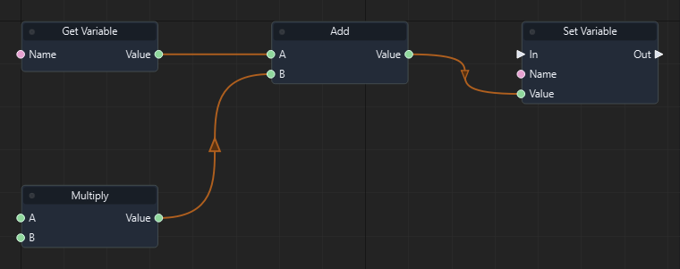

Graph: `templates/games/flappy_bird/graphs/gameplay.json` · Function: **Simulate Bird** · Node: `n13`.

[Mở hướng dẫn game](games/flappy-bird.md)

### Đọc thêm

[Tài liệu hệ thống: typed-data.md](typed-data.md)

### Subtract

ID `4002` · `pure` · Workflow `shared`

Trả A - B dưới dạng float.

### IO

| Chiều | Cổng | Kiểu | Mặc định |
| --- | --- | --- | --- |
| IN | A | `float` | `0.0` |
| IN | B | `float` | `0.0` |
| OUT | Value | `float` | — |

Cổng `exec` điều khiển thứ tự. Cổng dữ liệu phải khớp kiểu; `vec2` không tự chuyển sang `vec3`.

### Cách dùng

1. Tìm **Subtract** trong Node Library hoặc nhấn Tab trong graph để thêm node.
2. Chọn node, nhập hằng số ở Inspector theo bảng IN. Chuỗi nhập trực tiếp; vector/mảng nhập theo JSON, ví dụ `[1, 0, 0]`. Khai báo biến qua Scene > Scene Variables… trước khi dùng Get/Set Variable.
3. Có thể kéo dây từ OUT dữ liệu vào IN có cùng kiểu; giá trị từ dây thay thế hằng số của cổng.
4. Nối OUT dữ liệu tới node dùng kết quả. Node pure không cần dây exec.
5. Nhấn F5, thử tình huống, kiểm tra Console/Diagnostics; Shift+F5 dừng. Ctrl+S lưu thay đổi graph.

### Ví dụ từ graph thật

Trích đoạn Advance Pipe 1 của flappy_bird: node n4. Đây là các node và dây nối thật từ graph đã chạy; vị trí được sắp lại để dễ đọc.

Graph: `templates/games/flappy_bird/graphs/gameplay.json` · Function: **Advance Pipe 1** · Node: `n4`.

[Mở hướng dẫn game](games/flappy-bird.md)

### Đọc thêm

[Tài liệu hệ thống: typed-data.md](typed-data.md)

### Multiply

ID `4003` · `pure` · Workflow `shared`

Trả A × B; tốc độ × delta time cho độ dời trong một frame.

### IO

| Chiều | Cổng | Kiểu | Mặc định |
| --- | --- | --- | --- |
| IN | A | `float` | `1.0` |
| IN | B | `float` | `1.0` |
| OUT | Value | `float` | — |

Cổng `exec` điều khiển thứ tự. Cổng dữ liệu phải khớp kiểu; `vec2` không tự chuyển sang `vec3`.

### Cách dùng

1. Tìm **Multiply** trong Node Library hoặc nhấn Tab trong graph để thêm node.
2. Chọn node, nhập hằng số ở Inspector theo bảng IN. Chuỗi nhập trực tiếp; vector/mảng nhập theo JSON, ví dụ `[1, 0, 0]`. Khai báo biến qua Scene > Scene Variables… trước khi dùng Get/Set Variable.
3. Có thể kéo dây từ OUT dữ liệu vào IN có cùng kiểu; giá trị từ dây thay thế hằng số của cổng.
4. Nối OUT dữ liệu tới node dùng kết quả. Node pure không cần dây exec.
5. Nhấn F5, thử tình huống, kiểm tra Console/Diagnostics; Shift+F5 dừng. Ctrl+S lưu thay đổi graph.

### Ví dụ từ graph thật

Trích đoạn Simulate Bird của flappy_bird: node n12. Đây là các node và dây nối thật từ graph đã chạy; vị trí được sắp lại để dễ đọc.

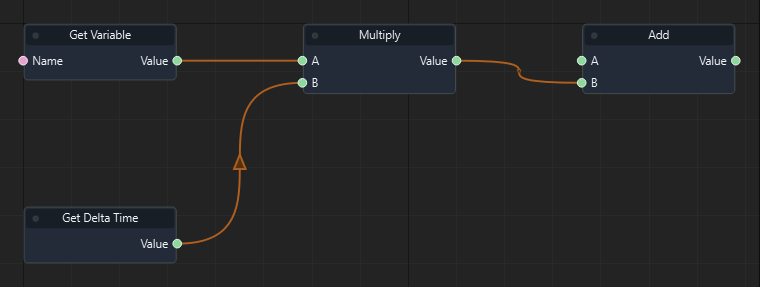

Graph: `templates/games/flappy_bird/graphs/gameplay.json` · Function: **Simulate Bird** · Node: `n12`.

[Mở hướng dẫn game](games/flappy-bird.md)

### Đọc thêm

[Tài liệu hệ thống: typed-data.md](typed-data.md)

### Divide

ID `4004` · `pure` · Workflow `shared`

Trả A / B. B không được bằng 0.

### IO

| Chiều | Cổng | Kiểu | Mặc định |
| --- | --- | --- | --- |
| IN | A | `float` | `1.0` |
| IN | B | `float` | `1.0` |
| OUT | Value | `float` | — |

Cổng `exec` điều khiển thứ tự. Cổng dữ liệu phải khớp kiểu; `vec2` không tự chuyển sang `vec3`.

### Cách dùng

1. Tìm **Divide** trong Node Library hoặc nhấn Tab trong graph để thêm node.
2. Chọn node, nhập hằng số ở Inspector theo bảng IN. Chuỗi nhập trực tiếp; vector/mảng nhập theo JSON, ví dụ `[1, 0, 0]`. Khai báo biến qua Scene > Scene Variables… trước khi dùng Get/Set Variable.
3. Có thể kéo dây từ OUT dữ liệu vào IN có cùng kiểu; giá trị từ dây thay thế hằng số của cổng.
4. Nối OUT dữ liệu tới node dùng kết quả. Node pure không cần dây exec.
5. Nhấn F5, thử tình huống, kiểm tra Console/Diagnostics; Shift+F5 dừng. Ctrl+S lưu thay đổi graph.

### Đọc thêm

[Tài liệu hệ thống: typed-data.md](typed-data.md)

### Min

ID `4005` · `pure` · Workflow `shared`

Trả giá trị nhỏ hơn trong A, B.

### IO

| Chiều | Cổng | Kiểu | Mặc định |
| --- | --- | --- | --- |
| IN | A | `float` | `0.0` |
| IN | B | `float` | `1.0` |
| OUT | Value | `float` | — |

Cổng `exec` điều khiển thứ tự. Cổng dữ liệu phải khớp kiểu; `vec2` không tự chuyển sang `vec3`.

### Cách dùng

1. Tìm **Min** trong Node Library hoặc nhấn Tab trong graph để thêm node.
2. Chọn node, nhập hằng số ở Inspector theo bảng IN. Chuỗi nhập trực tiếp; vector/mảng nhập theo JSON, ví dụ `[1, 0, 0]`. Khai báo biến qua Scene > Scene Variables… trước khi dùng Get/Set Variable.
3. Có thể kéo dây từ OUT dữ liệu vào IN có cùng kiểu; giá trị từ dây thay thế hằng số của cổng.
4. Nối OUT dữ liệu tới node dùng kết quả. Node pure không cần dây exec.
5. Nhấn F5, thử tình huống, kiểm tra Console/Diagnostics; Shift+F5 dừng. Ctrl+S lưu thay đổi graph.

### Đọc thêm

[Tài liệu hệ thống: typed-data.md](typed-data.md)

### Max

ID `4006` · `pure` · Workflow `shared`

Trả giá trị lớn hơn trong A, B.

### IO

| Chiều | Cổng | Kiểu | Mặc định |
| --- | --- | --- | --- |
| IN | A | `float` | `0.0` |
| IN | B | `float` | `1.0` |
| OUT | Value | `float` | — |

Cổng `exec` điều khiển thứ tự. Cổng dữ liệu phải khớp kiểu; `vec2` không tự chuyển sang `vec3`.

### Cách dùng

1. Tìm **Max** trong Node Library hoặc nhấn Tab trong graph để thêm node.
2. Chọn node, nhập hằng số ở Inspector theo bảng IN. Chuỗi nhập trực tiếp; vector/mảng nhập theo JSON, ví dụ `[1, 0, 0]`. Khai báo biến qua Scene > Scene Variables… trước khi dùng Get/Set Variable.
3. Có thể kéo dây từ OUT dữ liệu vào IN có cùng kiểu; giá trị từ dây thay thế hằng số của cổng.
4. Nối OUT dữ liệu tới node dùng kết quả. Node pure không cần dây exec.
5. Nhấn F5, thử tình huống, kiểm tra Console/Diagnostics; Shift+F5 dừng. Ctrl+S lưu thay đổi graph.

### Đọc thêm

[Tài liệu hệ thống: typed-data.md](typed-data.md)

### Clamp

ID `4007` · `pure` · Workflow `shared`

Giới hạn giá trị.

### IO

| Chiều | Cổng | Kiểu | Mặc định |
| --- | --- | --- | --- |
| IN | Value | `float` | `0.5` |
| IN | Min | `float` | `0.0` |
| IN | Max | `float` | `1.0` |
| OUT | Value | `float` | — |

Cổng `exec` điều khiển thứ tự. Cổng dữ liệu phải khớp kiểu; `vec2` không tự chuyển sang `vec3`.

### Cách dùng

1. Tìm **Clamp** trong Node Library hoặc nhấn Tab trong graph để thêm node.
2. Chọn node, nhập hằng số ở Inspector theo bảng IN. Chuỗi nhập trực tiếp; vector/mảng nhập theo JSON, ví dụ `[1, 0, 0]`. Khai báo biến qua Scene > Scene Variables… trước khi dùng Get/Set Variable.
3. Có thể kéo dây từ OUT dữ liệu vào IN có cùng kiểu; giá trị từ dây thay thế hằng số của cổng.
4. Nối OUT dữ liệu tới node dùng kết quả. Node pure không cần dây exec.
5. Nhấn F5, thử tình huống, kiểm tra Console/Diagnostics; Shift+F5 dừng. Ctrl+S lưu thay đổi graph.

### Đọc thêm

[Tài liệu hệ thống: typed-data.md](typed-data.md)

### Lerp

ID `4008` · `pure` · Workflow `shared`

Nội suy A + (B - A) × T; T=0 cho A, T=1 cho B. Không tự giới hạn T.

### IO

| Chiều | Cổng | Kiểu | Mặc định |
| --- | --- | --- | --- |
| IN | A | `float` | `0.0` |
| IN | B | `float` | `1.0` |
| IN | T | `float` | `0.5` |
| OUT | Value | `float` | — |

Cổng `exec` điều khiển thứ tự. Cổng dữ liệu phải khớp kiểu; `vec2` không tự chuyển sang `vec3`.

### Cách dùng

1. Tìm **Lerp** trong Node Library hoặc nhấn Tab trong graph để thêm node.
2. Chọn node, nhập hằng số ở Inspector theo bảng IN. Chuỗi nhập trực tiếp; vector/mảng nhập theo JSON, ví dụ `[1, 0, 0]`. Khai báo biến qua Scene > Scene Variables… trước khi dùng Get/Set Variable.
3. Có thể kéo dây từ OUT dữ liệu vào IN có cùng kiểu; giá trị từ dây thay thế hằng số của cổng.
4. Nối OUT dữ liệu tới node dùng kết quả. Node pure không cần dây exec.
5. Nhấn F5, thử tình huống, kiểm tra Console/Diagnostics; Shift+F5 dừng. Ctrl+S lưu thay đổi graph.

### Đọc thêm

[Tài liệu hệ thống: typed-data.md](typed-data.md)

### Sin

ID `4009` · `pure` · Workflow `shared`

Trả sin của góc đầu vào, tính bằng radian.

### IO

| Chiều | Cổng | Kiểu | Mặc định |
| --- | --- | --- | --- |
| IN | Radians | `float` | `0.0` |
| OUT | Value | `float` | — |

Cổng `exec` điều khiển thứ tự. Cổng dữ liệu phải khớp kiểu; `vec2` không tự chuyển sang `vec3`.

### Cách dùng

1. Tìm **Sin** trong Node Library hoặc nhấn Tab trong graph để thêm node.
2. Chọn node, nhập hằng số ở Inspector theo bảng IN. Chuỗi nhập trực tiếp; vector/mảng nhập theo JSON, ví dụ `[1, 0, 0]`. Khai báo biến qua Scene > Scene Variables… trước khi dùng Get/Set Variable.
3. Có thể kéo dây từ OUT dữ liệu vào IN có cùng kiểu; giá trị từ dây thay thế hằng số của cổng.
4. Nối OUT dữ liệu tới node dùng kết quả. Node pure không cần dây exec.
5. Nhấn F5, thử tình huống, kiểm tra Console/Diagnostics; Shift+F5 dừng. Ctrl+S lưu thay đổi graph.

### Đọc thêm

[Tài liệu hệ thống: typed-data.md](typed-data.md)

### Cos

ID `4010` · `pure` · Workflow `shared`

Trả cos của góc đầu vào, tính bằng radian.

### IO

| Chiều | Cổng | Kiểu | Mặc định |
| --- | --- | --- | --- |
| IN | Radians | `float` | `0.0` |
| OUT | Value | `float` | — |

Cổng `exec` điều khiển thứ tự. Cổng dữ liệu phải khớp kiểu; `vec2` không tự chuyển sang `vec3`.

### Cách dùng

1. Tìm **Cos** trong Node Library hoặc nhấn Tab trong graph để thêm node.
2. Chọn node, nhập hằng số ở Inspector theo bảng IN. Chuỗi nhập trực tiếp; vector/mảng nhập theo JSON, ví dụ `[1, 0, 0]`. Khai báo biến qua Scene > Scene Variables… trước khi dùng Get/Set Variable.
3. Có thể kéo dây từ OUT dữ liệu vào IN có cùng kiểu; giá trị từ dây thay thế hằng số của cổng.
4. Nối OUT dữ liệu tới node dùng kết quả. Node pure không cần dây exec.
5. Nhấn F5, thử tình huống, kiểm tra Console/Diagnostics; Shift+F5 dừng. Ctrl+S lưu thay đổi graph.

### Đọc thêm

[Tài liệu hệ thống: typed-data.md](typed-data.md)

### Abs

ID `4011` · `pure` · Workflow `shared`

Trả trị tuyệt đối của Value. Flappy dùng khoảng cách tuyệt đối tới tâm cột và khe.

### IO

| Chiều | Cổng | Kiểu | Mặc định |
| --- | --- | --- | --- |
| IN | Value | `float` | `0.0` |
| OUT | Value | `float` | — |

Cổng `exec` điều khiển thứ tự. Cổng dữ liệu phải khớp kiểu; `vec2` không tự chuyển sang `vec3`.

### Cách dùng

1. Tìm **Abs** trong Node Library hoặc nhấn Tab trong graph để thêm node.
2. Chọn node, nhập hằng số ở Inspector theo bảng IN. Chuỗi nhập trực tiếp; vector/mảng nhập theo JSON, ví dụ `[1, 0, 0]`. Khai báo biến qua Scene > Scene Variables… trước khi dùng Get/Set Variable.
3. Có thể kéo dây từ OUT dữ liệu vào IN có cùng kiểu; giá trị từ dây thay thế hằng số của cổng.
4. Nối OUT dữ liệu tới node dùng kết quả. Node pure không cần dây exec.
5. Nhấn F5, thử tình huống, kiểm tra Console/Diagnostics; Shift+F5 dừng. Ctrl+S lưu thay đổi graph.

### Ví dụ từ graph thật

Trích đoạn Advance Pipe 1 của flappy_bird: node n42. Đây là các node và dây nối thật từ graph đã chạy; vị trí được sắp lại để dễ đọc.

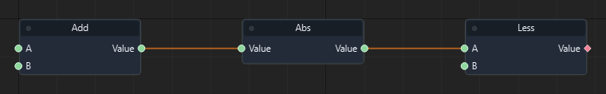

Graph: `templates/games/flappy_bird/graphs/gameplay.json` · Function: **Advance Pipe 1** · Node: `n42`.

[Mở hướng dẫn game](games/flappy-bird.md)

### Đọc thêm

[Tài liệu hệ thống: typed-data.md](typed-data.md)

### Less

ID `4012` · `pure` · Workflow `shared`

Trả true khi A < B.

### IO

| Chiều | Cổng | Kiểu | Mặc định |
| --- | --- | --- | --- |
| IN | A | `float` | `0.0` |
| IN | B | `float` | `1.0` |
| OUT | Value | `bool` | — |

Cổng `exec` điều khiển thứ tự. Cổng dữ liệu phải khớp kiểu; `vec2` không tự chuyển sang `vec3`.

### Cách dùng

1. Tìm **Less** trong Node Library hoặc nhấn Tab trong graph để thêm node.
2. Chọn node, nhập hằng số ở Inspector theo bảng IN. Chuỗi nhập trực tiếp; vector/mảng nhập theo JSON, ví dụ `[1, 0, 0]`. Khai báo biến qua Scene > Scene Variables… trước khi dùng Get/Set Variable.
3. Có thể kéo dây từ OUT dữ liệu vào IN có cùng kiểu; giá trị từ dây thay thế hằng số của cổng.
4. Nối OUT dữ liệu tới node dùng kết quả. Node pure không cần dây exec.
5. Nhấn F5, thử tình huống, kiểm tra Console/Diagnostics; Shift+F5 dừng. Ctrl+S lưu thay đổi graph.

### Ví dụ từ graph thật

Trích đoạn Advance Pipe 1 của flappy_bird: node n7. Đây là các node và dây nối thật từ graph đã chạy; vị trí được sắp lại để dễ đọc.

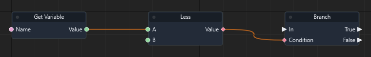

Graph: `templates/games/flappy_bird/graphs/gameplay.json` · Function: **Advance Pipe 1** · Node: `n7`.

[Mở hướng dẫn game](games/flappy-bird.md)

### Đọc thêm

[Tài liệu hệ thống: typed-data.md](typed-data.md)

### Greater

ID `4013` · `pure` · Workflow `shared`

Trả true khi A > B.

### IO

| Chiều | Cổng | Kiểu | Mặc định |
| --- | --- | --- | --- |
| IN | A | `float` | `0.0` |
| IN | B | `float` | `1.0` |
| OUT | Value | `bool` | — |

Cổng `exec` điều khiển thứ tự. Cổng dữ liệu phải khớp kiểu; `vec2` không tự chuyển sang `vec3`.

### Cách dùng

1. Tìm **Greater** trong Node Library hoặc nhấn Tab trong graph để thêm node.
2. Chọn node, nhập hằng số ở Inspector theo bảng IN. Chuỗi nhập trực tiếp; vector/mảng nhập theo JSON, ví dụ `[1, 0, 0]`. Khai báo biến qua Scene > Scene Variables… trước khi dùng Get/Set Variable.
3. Có thể kéo dây từ OUT dữ liệu vào IN có cùng kiểu; giá trị từ dây thay thế hằng số của cổng.
4. Nối OUT dữ liệu tới node dùng kết quả. Node pure không cần dây exec.
5. Nhấn F5, thử tình huống, kiểm tra Console/Diagnostics; Shift+F5 dừng. Ctrl+S lưu thay đổi graph.

### Ví dụ từ graph thật

Trích đoạn Advance Pipe 1 của flappy_bird: node n48. Đây là các node và dây nối thật từ graph đã chạy; vị trí được sắp lại để dễ đọc.

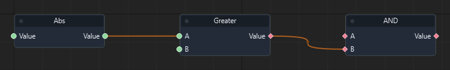

Graph: `templates/games/flappy_bird/graphs/gameplay.json` · Function: **Advance Pipe 1** · Node: `n48`.

[Mở hướng dẫn game](games/flappy-bird.md)

### Đọc thêm

[Tài liệu hệ thống: typed-data.md](typed-data.md)

### Nearly Equal

ID `4014` · `pure` · Workflow `shared`

So sánh số thực với dung sai.

### IO

| Chiều | Cổng | Kiểu | Mặc định |
| --- | --- | --- | --- |
| IN | A | `float` | `0.0` |
| IN | B | `float` | `0.0` |
| IN | Epsilon | `float` | `1e-06` |
| OUT | Value | `bool` | — |

Cổng `exec` điều khiển thứ tự. Cổng dữ liệu phải khớp kiểu; `vec2` không tự chuyển sang `vec3`.

### Cách dùng

1. Tìm **Nearly Equal** trong Node Library hoặc nhấn Tab trong graph để thêm node.
2. Chọn node, nhập hằng số ở Inspector theo bảng IN. Chuỗi nhập trực tiếp; vector/mảng nhập theo JSON, ví dụ `[1, 0, 0]`. Khai báo biến qua Scene > Scene Variables… trước khi dùng Get/Set Variable.
3. Có thể kéo dây từ OUT dữ liệu vào IN có cùng kiểu; giá trị từ dây thay thế hằng số của cổng.
4. Nối OUT dữ liệu tới node dùng kết quả. Node pure không cần dây exec.
5. Nhấn F5, thử tình huống, kiểm tra Console/Diagnostics; Shift+F5 dừng. Ctrl+S lưu thay đổi graph.

### Đọc thêm

[Tài liệu hệ thống: typed-data.md](typed-data.md)

### AND

ID `4015` · `pure` · Workflow `shared`

Trả true khi A và B đều true. Dùng để gộp alive, started và NOT paused.

### IO

| Chiều | Cổng | Kiểu | Mặc định |
| --- | --- | --- | --- |
| IN | A | `bool` | `true` |
| IN | B | `bool` | `true` |
| OUT | Value | `bool` | — |

Cổng `exec` điều khiển thứ tự. Cổng dữ liệu phải khớp kiểu; `vec2` không tự chuyển sang `vec3`.

### Cách dùng

1. Tìm **AND** trong Node Library hoặc nhấn Tab trong graph để thêm node.
2. Chọn node, nhập hằng số ở Inspector theo bảng IN. Chuỗi nhập trực tiếp; vector/mảng nhập theo JSON, ví dụ `[1, 0, 0]`. Khai báo biến qua Scene > Scene Variables… trước khi dùng Get/Set Variable.
3. Có thể kéo dây từ OUT dữ liệu vào IN có cùng kiểu; giá trị từ dây thay thế hằng số của cổng.
4. Nối OUT dữ liệu tới node dùng kết quả. Node pure không cần dây exec.
5. Nhấn F5, thử tình huống, kiểm tra Console/Diagnostics; Shift+F5 dừng. Ctrl+S lưu thay đổi graph.

### Ví dụ từ graph thật

Trích đoạn Gameplay của flappy_bird: node n16. Đây là các node và dây nối thật từ graph đã chạy; vị trí được sắp lại để dễ đọc.

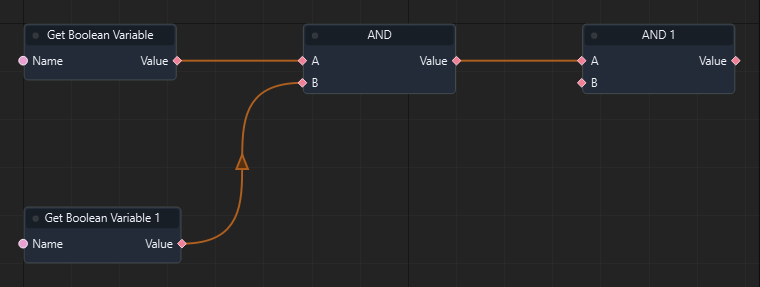

Graph: `templates/games/flappy_bird/graphs/gameplay.json` · Function: **Gameplay** · Node: `n16`.

[Mở hướng dẫn game](games/flappy-bird.md)

### Đọc thêm

[Tài liệu hệ thống: typed-data.md](typed-data.md)

### OR

ID `4016` · `pure` · Workflow `shared`

Trả true khi ít nhất một trong A, B là true. Flappy gộp va chạm sàn hoặc trần.

### IO

| Chiều | Cổng | Kiểu | Mặc định |
| --- | --- | --- | --- |
| IN | A | `bool` | `false` |
| IN | B | `bool` | `false` |
| OUT | Value | `bool` | — |

Cổng `exec` điều khiển thứ tự. Cổng dữ liệu phải khớp kiểu; `vec2` không tự chuyển sang `vec3`.

### Cách dùng

1. Tìm **OR** trong Node Library hoặc nhấn Tab trong graph để thêm node.
2. Chọn node, nhập hằng số ở Inspector theo bảng IN. Chuỗi nhập trực tiếp; vector/mảng nhập theo JSON, ví dụ `[1, 0, 0]`. Khai báo biến qua Scene > Scene Variables… trước khi dùng Get/Set Variable.
3. Có thể kéo dây từ OUT dữ liệu vào IN có cùng kiểu; giá trị từ dây thay thế hằng số của cổng.
4. Nối OUT dữ liệu tới node dùng kết quả. Node pure không cần dây exec.
5. Nhấn F5, thử tình huống, kiểm tra Console/Diagnostics; Shift+F5 dừng. Ctrl+S lưu thay đổi graph.

### Ví dụ từ graph thật

Trích đoạn Simulate Bird của flappy_bird: node n25. Đây là các node và dây nối thật từ graph đã chạy; vị trí được sắp lại để dễ đọc.

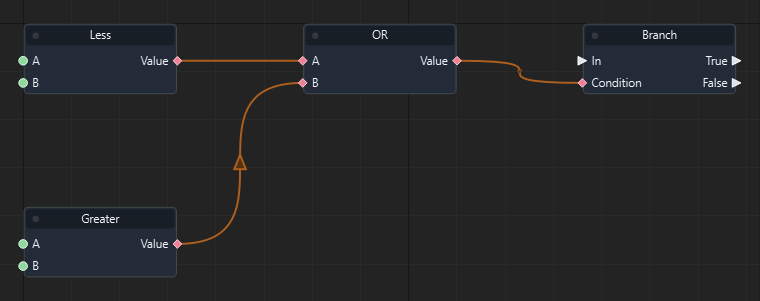

Graph: `templates/games/flappy_bird/graphs/gameplay.json` · Function: **Simulate Bird** · Node: `n25`.

[Mở hướng dẫn game](games/flappy-bird.md)

### Đọc thêm

[Tài liệu hệ thống: typed-data.md](typed-data.md)

### NOT

ID `4017` · `pure` · Workflow `shared`

Đảo bool Value: true thành false và ngược lại. Dùng để bật/tắt paused.

### IO

| Chiều | Cổng | Kiểu | Mặc định |
| --- | --- | --- | --- |
| IN | Value | `bool` | `false` |
| OUT | Value | `bool` | — |

Cổng `exec` điều khiển thứ tự. Cổng dữ liệu phải khớp kiểu; `vec2` không tự chuyển sang `vec3`.

### Cách dùng

1. Tìm **NOT** trong Node Library hoặc nhấn Tab trong graph để thêm node.
2. Chọn node, nhập hằng số ở Inspector theo bảng IN. Chuỗi nhập trực tiếp; vector/mảng nhập theo JSON, ví dụ `[1, 0, 0]`. Khai báo biến qua Scene > Scene Variables… trước khi dùng Get/Set Variable.
3. Có thể kéo dây từ OUT dữ liệu vào IN có cùng kiểu; giá trị từ dây thay thế hằng số của cổng.
4. Nối OUT dữ liệu tới node dùng kết quả. Node pure không cần dây exec.
5. Nhấn F5, thử tình huống, kiểm tra Console/Diagnostics; Shift+F5 dừng. Ctrl+S lưu thay đổi graph.

### Ví dụ từ graph thật

Trích đoạn Gameplay của flappy_bird: node n11. Đây là các node và dây nối thật từ graph đã chạy; vị trí được sắp lại để dễ đọc.

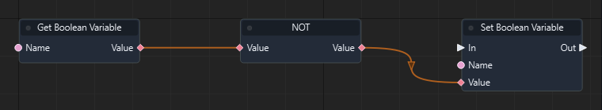

Graph: `templates/games/flappy_bird/graphs/gameplay.json` · Function: **Gameplay** · Node: `n11`.

[Mở hướng dẫn game](games/flappy-bird.md)

### Đọc thêm

[Tài liệu hệ thống: typed-data.md](typed-data.md)

### Make Vector3

ID `4020` · `pure` · Workflow `shared`

Ghép X, Y, Z thành vec3. Dùng để tạo vị trí trong cả game 2D và 3D.

### IO

| Chiều | Cổng | Kiểu | Mặc định |
| --- | --- | --- | --- |
| IN | X | `float` | `0.0` |
| IN | Y | `float` | `0.0` |
| IN | Z | `float` | `0.0` |
| OUT | Value | `vec3` | — |

Cổng `exec` điều khiển thứ tự. Cổng dữ liệu phải khớp kiểu; `vec2` không tự chuyển sang `vec3`.

### Cách dùng

1. Tìm **Make Vector3** trong Node Library hoặc nhấn Tab trong graph để thêm node.
2. Chọn node, nhập hằng số ở Inspector theo bảng IN. Chuỗi nhập trực tiếp; vector/mảng nhập theo JSON, ví dụ `[1, 0, 0]`. Khai báo biến qua Scene > Scene Variables… trước khi dùng Get/Set Variable.
3. Có thể kéo dây từ OUT dữ liệu vào IN có cùng kiểu; giá trị từ dây thay thế hằng số của cổng.
4. Nối OUT dữ liệu tới node dùng kết quả. Node pure không cần dây exec.
5. Nhấn F5, thử tình huống, kiểm tra Console/Diagnostics; Shift+F5 dừng. Ctrl+S lưu thay đổi graph.

### Ví dụ từ graph thật

Trích đoạn Spawn food của isometric_snake_3d: node n12. Đây là các node và dây nối thật từ graph đã chạy; vị trí được sắp lại để dễ đọc.

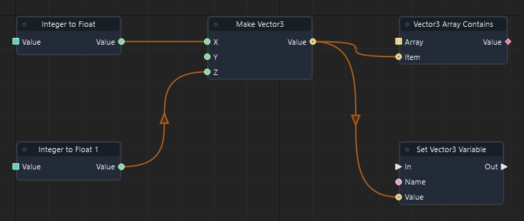

Graph: `templates/games/isometric_snake_3d/graphs/gameplay.json` · Function: **Spawn food** · Node: `n12`.

[Mở hướng dẫn game](games/isometric-snake.md)

### Đọc thêm

[Tài liệu hệ thống: typed-data.md](typed-data.md)

### Vector Add

ID `4021` · `pure` · Workflow `shared`

Cộng từng thành phần của hai vec3 A, B. Snake tính đầu mới = đầu cũ + direction.

### IO

| Chiều | Cổng | Kiểu | Mặc định |
| --- | --- | --- | --- |
| IN | A | `vec3` | `[0, 0, 0]` |
| IN | B | `vec3` | `[0, 0, 0]` |
| OUT | Value | `vec3` | — |

Cổng `exec` điều khiển thứ tự. Cổng dữ liệu phải khớp kiểu; `vec2` không tự chuyển sang `vec3`.

### Cách dùng

1. Tìm **Vector Add** trong Node Library hoặc nhấn Tab trong graph để thêm node.
2. Chọn node, nhập hằng số ở Inspector theo bảng IN. Chuỗi nhập trực tiếp; vector/mảng nhập theo JSON, ví dụ `[1, 0, 0]`. Khai báo biến qua Scene > Scene Variables… trước khi dùng Get/Set Variable.
3. Có thể kéo dây từ OUT dữ liệu vào IN có cùng kiểu; giá trị từ dây thay thế hằng số của cổng.
4. Nối OUT dữ liệu tới node dùng kết quả. Node pure không cần dây exec.
5. Nhấn F5, thử tình huống, kiểm tra Console/Diagnostics; Shift+F5 dừng. Ctrl+S lưu thay đổi graph.

### Ví dụ từ graph thật

Trích đoạn Advance snake của isometric_snake_3d: node n15. Đây là các node và dây nối thật từ graph đã chạy; vị trí được sắp lại để dễ đọc.

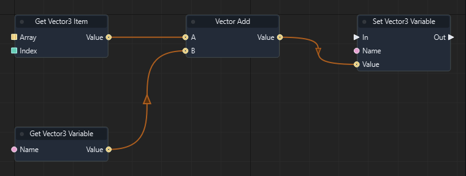

Graph: `templates/games/isometric_snake_3d/graphs/gameplay.json` · Function: **Advance snake** · Node: `n15`.

[Mở hướng dẫn game](games/isometric-snake.md)

### Đọc thêm

[Tài liệu hệ thống: typed-data.md](typed-data.md)

### Vector Scale

ID `4022` · `pure` · Workflow `shared`

Nhân từng thành phần Vector với Scale.

### IO

| Chiều | Cổng | Kiểu | Mặc định |
| --- | --- | --- | --- |
| IN | Vector | `vec3` | `[1, 0, 0]` |
| IN | Scale | `float` | `1.0` |
| OUT | Value | `vec3` | — |

Cổng `exec` điều khiển thứ tự. Cổng dữ liệu phải khớp kiểu; `vec2` không tự chuyển sang `vec3`.

### Cách dùng

1. Tìm **Vector Scale** trong Node Library hoặc nhấn Tab trong graph để thêm node.
2. Chọn node, nhập hằng số ở Inspector theo bảng IN. Chuỗi nhập trực tiếp; vector/mảng nhập theo JSON, ví dụ `[1, 0, 0]`. Khai báo biến qua Scene > Scene Variables… trước khi dùng Get/Set Variable.
3. Có thể kéo dây từ OUT dữ liệu vào IN có cùng kiểu; giá trị từ dây thay thế hằng số của cổng.
4. Nối OUT dữ liệu tới node dùng kết quả. Node pure không cần dây exec.
5. Nhấn F5, thử tình huống, kiểm tra Console/Diagnostics; Shift+F5 dừng. Ctrl+S lưu thay đổi graph.

### Đọc thêm

[Tài liệu hệ thống: typed-data.md](typed-data.md)

### Normalize

ID `4023` · `pure` · Workflow `shared`

Trả vec3 cùng hướng có độ dài 1; vector 0 cho kết quả 0.

### IO

| Chiều | Cổng | Kiểu | Mặc định |
| --- | --- | --- | --- |
| IN | Vector | `vec3` | `[1, 0, 0]` |
| OUT | Value | `vec3` | — |

Cổng `exec` điều khiển thứ tự. Cổng dữ liệu phải khớp kiểu; `vec2` không tự chuyển sang `vec3`.

### Cách dùng

1. Tìm **Normalize** trong Node Library hoặc nhấn Tab trong graph để thêm node.
2. Chọn node, nhập hằng số ở Inspector theo bảng IN. Chuỗi nhập trực tiếp; vector/mảng nhập theo JSON, ví dụ `[1, 0, 0]`. Khai báo biến qua Scene > Scene Variables… trước khi dùng Get/Set Variable.
3. Có thể kéo dây từ OUT dữ liệu vào IN có cùng kiểu; giá trị từ dây thay thế hằng số của cổng.
4. Nối OUT dữ liệu tới node dùng kết quả. Node pure không cần dây exec.
5. Nhấn F5, thử tình huống, kiểm tra Console/Diagnostics; Shift+F5 dừng. Ctrl+S lưu thay đổi graph.

### Đọc thêm

[Tài liệu hệ thống: typed-data.md](typed-data.md)

### Magnitude

ID `4024` · `pure` · Workflow `shared`

Trả độ dài Euclid của vec3.

### IO

| Chiều | Cổng | Kiểu | Mặc định |
| --- | --- | --- | --- |
| IN | Vector | `vec3` | `[1, 0, 0]` |
| OUT | Value | `float` | — |

Cổng `exec` điều khiển thứ tự. Cổng dữ liệu phải khớp kiểu; `vec2` không tự chuyển sang `vec3`.

### Cách dùng

1. Tìm **Magnitude** trong Node Library hoặc nhấn Tab trong graph để thêm node.
2. Chọn node, nhập hằng số ở Inspector theo bảng IN. Chuỗi nhập trực tiếp; vector/mảng nhập theo JSON, ví dụ `[1, 0, 0]`. Khai báo biến qua Scene > Scene Variables… trước khi dùng Get/Set Variable.
3. Có thể kéo dây từ OUT dữ liệu vào IN có cùng kiểu; giá trị từ dây thay thế hằng số của cổng.
4. Nối OUT dữ liệu tới node dùng kết quả. Node pure không cần dây exec.
5. Nhấn F5, thử tình huống, kiểm tra Console/Diagnostics; Shift+F5 dừng. Ctrl+S lưu thay đổi graph.

### Đọc thêm

[Tài liệu hệ thống: typed-data.md](typed-data.md)

### Dot Product

ID `4025` · `pure` · Workflow `shared`

Trả tích vô hướng A·B. Với hai hướng đơn vị đối nhau, kết quả -1; Snake dùng để chặn quay ngược.

### IO

| Chiều | Cổng | Kiểu | Mặc định |
| --- | --- | --- | --- |
| IN | A | `vec3` | `[1, 0, 0]` |
| IN | B | `vec3` | `[1, 0, 0]` |
| OUT | Value | `float` | — |

Cổng `exec` điều khiển thứ tự. Cổng dữ liệu phải khớp kiểu; `vec2` không tự chuyển sang `vec3`.

### Cách dùng

1. Tìm **Dot Product** trong Node Library hoặc nhấn Tab trong graph để thêm node.
2. Chọn node, nhập hằng số ở Inspector theo bảng IN. Chuỗi nhập trực tiếp; vector/mảng nhập theo JSON, ví dụ `[1, 0, 0]`. Khai báo biến qua Scene > Scene Variables… trước khi dùng Get/Set Variable.
3. Có thể kéo dây từ OUT dữ liệu vào IN có cùng kiểu; giá trị từ dây thay thế hằng số của cổng.
4. Nối OUT dữ liệu tới node dùng kết quả. Node pure không cần dây exec.
5. Nhấn F5, thử tình huống, kiểm tra Console/Diagnostics; Shift+F5 dừng. Ctrl+S lưu thay đổi graph.

### Ví dụ từ graph thật

Trích đoạn Request turn của isometric_snake_3d: node n11. Đây là các node và dây nối thật từ graph đã chạy; vị trí được sắp lại để dễ đọc.

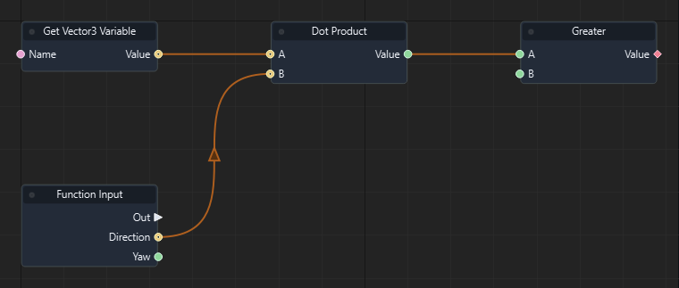

Graph: `templates/games/isometric_snake_3d/graphs/gameplay.json` · Function: **Request turn** · Node: `n11`.

[Mở hướng dẫn game](games/isometric-snake.md)

### Đọc thêm

[Tài liệu hệ thống: typed-data.md](typed-data.md)

### Cross Product

ID `4026` · `pure` · Workflow `shared`

Trả tích có hướng A × B.

### IO

| Chiều | Cổng | Kiểu | Mặc định |
| --- | --- | --- | --- |
| IN | A | `vec3` | `[1, 0, 0]` |
| IN | B | `vec3` | `[0, 1, 0]` |
| OUT | Value | `vec3` | — |

Cổng `exec` điều khiển thứ tự. Cổng dữ liệu phải khớp kiểu; `vec2` không tự chuyển sang `vec3`.

### Cách dùng

1. Tìm **Cross Product** trong Node Library hoặc nhấn Tab trong graph để thêm node.
2. Chọn node, nhập hằng số ở Inspector theo bảng IN. Chuỗi nhập trực tiếp; vector/mảng nhập theo JSON, ví dụ `[1, 0, 0]`. Khai báo biến qua Scene > Scene Variables… trước khi dùng Get/Set Variable.
3. Có thể kéo dây từ OUT dữ liệu vào IN có cùng kiểu; giá trị từ dây thay thế hằng số của cổng.
4. Nối OUT dữ liệu tới node dùng kết quả. Node pure không cần dây exec.
5. Nhấn F5, thử tình huống, kiểm tra Console/Diagnostics; Shift+F5 dừng. Ctrl+S lưu thay đổi graph.

### Đọc thêm

[Tài liệu hệ thống: typed-data.md](typed-data.md)

### Vector Subtract

ID `4027` · `pure` · Workflow `shared`

Trừ từng thành phần: A - B.

### IO

| Chiều | Cổng | Kiểu | Mặc định |
| --- | --- | --- | --- |
| IN | A | `vec3` | `[0, 0, 0]` |
| IN | B | `vec3` | `[0, 0, 0]` |
| OUT | Value | `vec3` | — |

Cổng `exec` điều khiển thứ tự. Cổng dữ liệu phải khớp kiểu; `vec2` không tự chuyển sang `vec3`.

### Cách dùng

1. Tìm **Vector Subtract** trong Node Library hoặc nhấn Tab trong graph để thêm node.
2. Chọn node, nhập hằng số ở Inspector theo bảng IN. Chuỗi nhập trực tiếp; vector/mảng nhập theo JSON, ví dụ `[1, 0, 0]`. Khai báo biến qua Scene > Scene Variables… trước khi dùng Get/Set Variable.
3. Có thể kéo dây từ OUT dữ liệu vào IN có cùng kiểu; giá trị từ dây thay thế hằng số của cổng.
4. Nối OUT dữ liệu tới node dùng kết quả. Node pure không cần dây exec.
5. Nhấn F5, thử tình huống, kiểm tra Console/Diagnostics; Shift+F5 dừng. Ctrl+S lưu thay đổi graph.

### Đọc thêm

[Tài liệu hệ thống: typed-data.md](typed-data.md)

### Vector Lerp

ID `4028` · `pure` · Workflow `shared`

Nội suy từng thành phần A + (B-A) × T.

### IO

| Chiều | Cổng | Kiểu | Mặc định |
| --- | --- | --- | --- |
| IN | A | `vec3` | `[0, 0, 0]` |
| IN | B | `vec3` | `[1, 1, 1]` |
| IN | T | `float` | `0.5` |
| OUT | Value | `vec3` | — |

Cổng `exec` điều khiển thứ tự. Cổng dữ liệu phải khớp kiểu; `vec2` không tự chuyển sang `vec3`.

### Cách dùng

1. Tìm **Vector Lerp** trong Node Library hoặc nhấn Tab trong graph để thêm node.
2. Chọn node, nhập hằng số ở Inspector theo bảng IN. Chuỗi nhập trực tiếp; vector/mảng nhập theo JSON, ví dụ `[1, 0, 0]`. Khai báo biến qua Scene > Scene Variables… trước khi dùng Get/Set Variable.
3. Có thể kéo dây từ OUT dữ liệu vào IN có cùng kiểu; giá trị từ dây thay thế hằng số của cổng.
4. Nối OUT dữ liệu tới node dùng kết quả. Node pure không cần dây exec.
5. Nhấn F5, thử tình huống, kiểm tra Console/Diagnostics; Shift+F5 dừng. Ctrl+S lưu thay đổi graph.

### Đọc thêm

[Tài liệu hệ thống: typed-data.md](typed-data.md)

### Distance

ID `4029` · `pure` · Workflow `shared`

Trả khoảng cách Euclid giữa hai điểm A và B. Snake coi khoảng cách tới food < 0.1 là ăn được.

### IO

| Chiều | Cổng | Kiểu | Mặc định |
| --- | --- | --- | --- |
| IN | A | `vec3` | `[0, 0, 0]` |
| IN | B | `vec3` | `[1, 0, 0]` |
| OUT | Value | `float` | — |

Cổng `exec` điều khiển thứ tự. Cổng dữ liệu phải khớp kiểu; `vec2` không tự chuyển sang `vec3`.

### Cách dùng

1. Tìm **Distance** trong Node Library hoặc nhấn Tab trong graph để thêm node.
2. Chọn node, nhập hằng số ở Inspector theo bảng IN. Chuỗi nhập trực tiếp; vector/mảng nhập theo JSON, ví dụ `[1, 0, 0]`. Khai báo biến qua Scene > Scene Variables… trước khi dùng Get/Set Variable.
3. Có thể kéo dây từ OUT dữ liệu vào IN có cùng kiểu; giá trị từ dây thay thế hằng số của cổng.
4. Nối OUT dữ liệu tới node dùng kết quả. Node pure không cần dây exec.
5. Nhấn F5, thử tình huống, kiểm tra Console/Diagnostics; Shift+F5 dừng. Ctrl+S lưu thay đổi graph.

### Ví dụ từ graph thật

Trích đoạn Advance snake của isometric_snake_3d: node n22. Đây là các node và dây nối thật từ graph đã chạy; vị trí được sắp lại để dễ đọc.

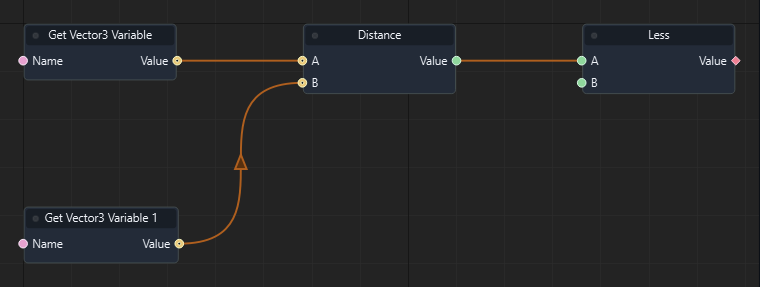

Graph: `templates/games/isometric_snake_3d/graphs/gameplay.json` · Function: **Advance snake** · Node: `n22`.

[Mở hướng dẫn game](games/isometric-snake.md)

### Đọc thêm

[Tài liệu hệ thống: typed-data.md](typed-data.md)

### Integer Add

ID `4030` · `pure` · Workflow `shared`

Trả A + B dưới dạng int; thường dùng tăng score hoặc bộ đếm.

### IO

| Chiều | Cổng | Kiểu | Mặc định |
| --- | --- | --- | --- |
| IN | A | `int` | `0` |
| IN | B | `int` | `1` |
| OUT | Value | `int` | — |

Cổng `exec` điều khiển thứ tự. Cổng dữ liệu phải khớp kiểu; `vec2` không tự chuyển sang `vec3`.

### Cách dùng

1. Tìm **Integer Add** trong Node Library hoặc nhấn Tab trong graph để thêm node.
2. Chọn node, nhập hằng số ở Inspector theo bảng IN. Chuỗi nhập trực tiếp; vector/mảng nhập theo JSON, ví dụ `[1, 0, 0]`. Khai báo biến qua Scene > Scene Variables… trước khi dùng Get/Set Variable.
3. Có thể kéo dây từ OUT dữ liệu vào IN có cùng kiểu; giá trị từ dây thay thế hằng số của cổng.
4. Nối OUT dữ liệu tới node dùng kết quả. Node pure không cần dây exec.
5. Nhấn F5, thử tình huống, kiểm tra Console/Diagnostics; Shift+F5 dừng. Ctrl+S lưu thay đổi graph.

### Ví dụ từ graph thật

Trích đoạn Spawn food của isometric_snake_3d: node n6. Đây là các node và dây nối thật từ graph đã chạy; vị trí được sắp lại để dễ đọc.

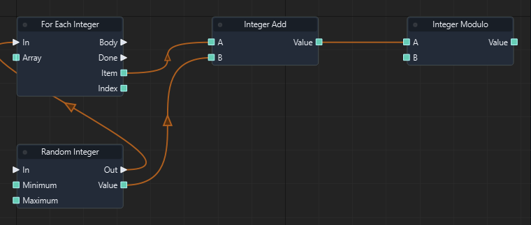

Graph: `templates/games/isometric_snake_3d/graphs/gameplay.json` · Function: **Spawn food** · Node: `n6`.

[Mở hướng dẫn game](games/isometric-snake.md)

### Đọc thêm

[Tài liệu hệ thống: typed-data.md](typed-data.md)

### Integer Subtract

ID `4031` · `pure` · Workflow `shared`

Trả A - B dưới dạng int.

### IO

| Chiều | Cổng | Kiểu | Mặc định |
| --- | --- | --- | --- |
| IN | A | `int` | `0` |
| IN | B | `int` | `1` |
| OUT | Value | `int` | — |

Cổng `exec` điều khiển thứ tự. Cổng dữ liệu phải khớp kiểu; `vec2` không tự chuyển sang `vec3`.

### Cách dùng

1. Tìm **Integer Subtract** trong Node Library hoặc nhấn Tab trong graph để thêm node.
2. Chọn node, nhập hằng số ở Inspector theo bảng IN. Chuỗi nhập trực tiếp; vector/mảng nhập theo JSON, ví dụ `[1, 0, 0]`. Khai báo biến qua Scene > Scene Variables… trước khi dùng Get/Set Variable.
3. Có thể kéo dây từ OUT dữ liệu vào IN có cùng kiểu; giá trị từ dây thay thế hằng số của cổng.
4. Nối OUT dữ liệu tới node dùng kết quả. Node pure không cần dây exec.
5. Nhấn F5, thử tình huống, kiểm tra Console/Diagnostics; Shift+F5 dừng. Ctrl+S lưu thay đổi graph.

### Ví dụ từ graph thật

Trích đoạn Advance snake của isometric_snake_3d: node n29. Đây là các node và dây nối thật từ graph đã chạy; vị trí được sắp lại để dễ đọc.

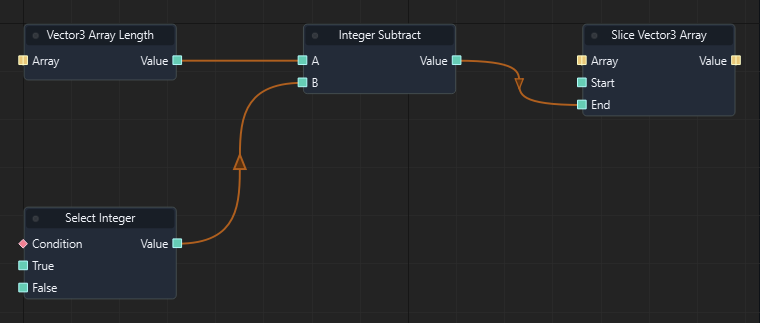

Graph: `templates/games/isometric_snake_3d/graphs/gameplay.json` · Function: **Advance snake** · Node: `n29`.

[Mở hướng dẫn game](games/isometric-snake.md)

### Đọc thêm

[Tài liệu hệ thống: typed-data.md](typed-data.md)

### Integer Multiply

ID `4032` · `pure` · Workflow `shared`

Trả tích số nguyên A × B.

### IO

| Chiều | Cổng | Kiểu | Mặc định |
| --- | --- | --- | --- |
| IN | A | `int` | `0` |
| IN | B | `int` | `1` |
| OUT | Value | `int` | — |

Cổng `exec` điều khiển thứ tự. Cổng dữ liệu phải khớp kiểu; `vec2` không tự chuyển sang `vec3`.

### Cách dùng

1. Tìm **Integer Multiply** trong Node Library hoặc nhấn Tab trong graph để thêm node.
2. Chọn node, nhập hằng số ở Inspector theo bảng IN. Chuỗi nhập trực tiếp; vector/mảng nhập theo JSON, ví dụ `[1, 0, 0]`. Khai báo biến qua Scene > Scene Variables… trước khi dùng Get/Set Variable.
3. Có thể kéo dây từ OUT dữ liệu vào IN có cùng kiểu; giá trị từ dây thay thế hằng số của cổng.
4. Nối OUT dữ liệu tới node dùng kết quả. Node pure không cần dây exec.
5. Nhấn F5, thử tình huống, kiểm tra Console/Diagnostics; Shift+F5 dừng. Ctrl+S lưu thay đổi graph.

### Đọc thêm

[Tài liệu hệ thống: typed-data.md](typed-data.md)

### Integer Less

ID `4033` · `pure` · Workflow `shared`

Trả true khi số nguyên A < B.

### IO

| Chiều | Cổng | Kiểu | Mặc định |
| --- | --- | --- | --- |
| IN | A | `int` | `0` |
| IN | B | `int` | `1` |
| OUT | Value | `bool` | — |

Cổng `exec` điều khiển thứ tự. Cổng dữ liệu phải khớp kiểu; `vec2` không tự chuyển sang `vec3`.

### Cách dùng

1. Tìm **Integer Less** trong Node Library hoặc nhấn Tab trong graph để thêm node.
2. Chọn node, nhập hằng số ở Inspector theo bảng IN. Chuỗi nhập trực tiếp; vector/mảng nhập theo JSON, ví dụ `[1, 0, 0]`. Khai báo biến qua Scene > Scene Variables… trước khi dùng Get/Set Variable.
3. Có thể kéo dây từ OUT dữ liệu vào IN có cùng kiểu; giá trị từ dây thay thế hằng số của cổng.
4. Nối OUT dữ liệu tới node dùng kết quả. Node pure không cần dây exec.
5. Nhấn F5, thử tình huống, kiểm tra Console/Diagnostics; Shift+F5 dừng. Ctrl+S lưu thay đổi graph.

### Ví dụ từ graph thật

Trích đoạn Refresh board của isometric_snake_3d: node n7. Đây là các node và dây nối thật từ graph đã chạy; vị trí được sắp lại để dễ đọc.

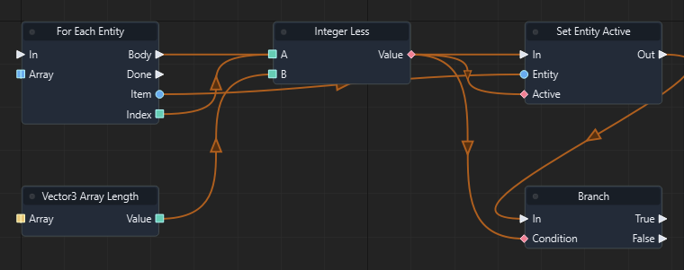

Graph: `templates/games/isometric_snake_3d/graphs/gameplay.json` · Function: **Refresh board** · Node: `n7`.

[Mở hướng dẫn game](games/isometric-snake.md)

### Đọc thêm

[Tài liệu hệ thống: typed-data.md](typed-data.md)

### Integer Equal

ID `4034` · `pure` · Workflow `shared`

Trả true khi hai số nguyên A và B bằng nhau.

### IO

| Chiều | Cổng | Kiểu | Mặc định |
| --- | --- | --- | --- |
| IN | A | `int` | `0` |
| IN | B | `int` | `0` |
| OUT | Value | `bool` | — |

Cổng `exec` điều khiển thứ tự. Cổng dữ liệu phải khớp kiểu; `vec2` không tự chuyển sang `vec3`.

### Cách dùng

1. Tìm **Integer Equal** trong Node Library hoặc nhấn Tab trong graph để thêm node.
2. Chọn node, nhập hằng số ở Inspector theo bảng IN. Chuỗi nhập trực tiếp; vector/mảng nhập theo JSON, ví dụ `[1, 0, 0]`. Khai báo biến qua Scene > Scene Variables… trước khi dùng Get/Set Variable.
3. Có thể kéo dây từ OUT dữ liệu vào IN có cùng kiểu; giá trị từ dây thay thế hằng số của cổng.
4. Nối OUT dữ liệu tới node dùng kết quả. Node pure không cần dây exec.
5. Nhấn F5, thử tình huống, kiểm tra Console/Diagnostics; Shift+F5 dừng. Ctrl+S lưu thay đổi graph.

### Đọc thêm

[Tài liệu hệ thống: typed-data.md](typed-data.md)

### Modulo

ID `4040` · `pure` · Workflow `shared`

Trả phần dư float theo fmod(A,B). B không được bằng 0.

### IO

| Chiều | Cổng | Kiểu | Mặc định |
| --- | --- | --- | --- |
| IN | A | `float` | `0.0` |
| IN | B | `float` | `1.0` |
| OUT | Value | `float` | — |

Cổng `exec` điều khiển thứ tự. Cổng dữ liệu phải khớp kiểu; `vec2` không tự chuyển sang `vec3`.

### Cách dùng

1. Tìm **Modulo** trong Node Library hoặc nhấn Tab trong graph để thêm node.
2. Chọn node, nhập hằng số ở Inspector theo bảng IN. Chuỗi nhập trực tiếp; vector/mảng nhập theo JSON, ví dụ `[1, 0, 0]`. Khai báo biến qua Scene > Scene Variables… trước khi dùng Get/Set Variable.
3. Có thể kéo dây từ OUT dữ liệu vào IN có cùng kiểu; giá trị từ dây thay thế hằng số của cổng.
4. Nối OUT dữ liệu tới node dùng kết quả. Node pure không cần dây exec.
5. Nhấn F5, thử tình huống, kiểm tra Console/Diagnostics; Shift+F5 dừng. Ctrl+S lưu thay đổi graph.

### Đọc thêm

[Tài liệu hệ thống: typed-data.md](typed-data.md)

### Power

ID `4041` · `pure` · Workflow `shared`

Trả Base lũy thừa Exponent; kết quả phải là số hữu hạn.

### IO

| Chiều | Cổng | Kiểu | Mặc định |
| --- | --- | --- | --- |
| IN | Base | `float` | `2.0` |
| IN | Exponent | `float` | `2.0` |
| OUT | Value | `float` | — |

Cổng `exec` điều khiển thứ tự. Cổng dữ liệu phải khớp kiểu; `vec2` không tự chuyển sang `vec3`.

### Cách dùng

1. Tìm **Power** trong Node Library hoặc nhấn Tab trong graph để thêm node.
2. Chọn node, nhập hằng số ở Inspector theo bảng IN. Chuỗi nhập trực tiếp; vector/mảng nhập theo JSON, ví dụ `[1, 0, 0]`. Khai báo biến qua Scene > Scene Variables… trước khi dùng Get/Set Variable.
3. Có thể kéo dây từ OUT dữ liệu vào IN có cùng kiểu; giá trị từ dây thay thế hằng số của cổng.
4. Nối OUT dữ liệu tới node dùng kết quả. Node pure không cần dây exec.
5. Nhấn F5, thử tình huống, kiểm tra Console/Diagnostics; Shift+F5 dừng. Ctrl+S lưu thay đổi graph.

### Đọc thêm

[Tài liệu hệ thống: typed-data.md](typed-data.md)

### Sqrt

ID `4042` · `pure` · Workflow `shared`

Trả căn bậc hai của Value; Value không được âm.

### IO

| Chiều | Cổng | Kiểu | Mặc định |
| --- | --- | --- | --- |
| IN | Value | `float` | `0.0` |
| OUT | Value | `float` | — |

Cổng `exec` điều khiển thứ tự. Cổng dữ liệu phải khớp kiểu; `vec2` không tự chuyển sang `vec3`.

### Cách dùng

1. Tìm **Sqrt** trong Node Library hoặc nhấn Tab trong graph để thêm node.
2. Chọn node, nhập hằng số ở Inspector theo bảng IN. Chuỗi nhập trực tiếp; vector/mảng nhập theo JSON, ví dụ `[1, 0, 0]`. Khai báo biến qua Scene > Scene Variables… trước khi dùng Get/Set Variable.
3. Có thể kéo dây từ OUT dữ liệu vào IN có cùng kiểu; giá trị từ dây thay thế hằng số của cổng.
4. Nối OUT dữ liệu tới node dùng kết quả. Node pure không cần dây exec.
5. Nhấn F5, thử tình huống, kiểm tra Console/Diagnostics; Shift+F5 dừng. Ctrl+S lưu thay đổi graph.

### Đọc thêm

[Tài liệu hệ thống: typed-data.md](typed-data.md)

### Floor

ID `4043` · `pure` · Workflow `shared`

Làm tròn xuống số nguyên gần nhất nhưng trả kiểu float.

### IO

| Chiều | Cổng | Kiểu | Mặc định |
| --- | --- | --- | --- |
| IN | Value | `float` | `0.0` |
| OUT | Value | `float` | — |

Cổng `exec` điều khiển thứ tự. Cổng dữ liệu phải khớp kiểu; `vec2` không tự chuyển sang `vec3`.

### Cách dùng

1. Tìm **Floor** trong Node Library hoặc nhấn Tab trong graph để thêm node.
2. Chọn node, nhập hằng số ở Inspector theo bảng IN. Chuỗi nhập trực tiếp; vector/mảng nhập theo JSON, ví dụ `[1, 0, 0]`. Khai báo biến qua Scene > Scene Variables… trước khi dùng Get/Set Variable.
3. Có thể kéo dây từ OUT dữ liệu vào IN có cùng kiểu; giá trị từ dây thay thế hằng số của cổng.
4. Nối OUT dữ liệu tới node dùng kết quả. Node pure không cần dây exec.
5. Nhấn F5, thử tình huống, kiểm tra Console/Diagnostics; Shift+F5 dừng. Ctrl+S lưu thay đổi graph.

### Đọc thêm

[Tài liệu hệ thống: typed-data.md](typed-data.md)

### Ceil

ID `4044` · `pure` · Workflow `shared`

Làm tròn lên số nguyên gần nhất nhưng trả kiểu float.

### IO

| Chiều | Cổng | Kiểu | Mặc định |
| --- | --- | --- | --- |
| IN | Value | `float` | `0.0` |
| OUT | Value | `float` | — |

Cổng `exec` điều khiển thứ tự. Cổng dữ liệu phải khớp kiểu; `vec2` không tự chuyển sang `vec3`.

### Cách dùng

1. Tìm **Ceil** trong Node Library hoặc nhấn Tab trong graph để thêm node.
2. Chọn node, nhập hằng số ở Inspector theo bảng IN. Chuỗi nhập trực tiếp; vector/mảng nhập theo JSON, ví dụ `[1, 0, 0]`. Khai báo biến qua Scene > Scene Variables… trước khi dùng Get/Set Variable.
3. Có thể kéo dây từ OUT dữ liệu vào IN có cùng kiểu; giá trị từ dây thay thế hằng số của cổng.
4. Nối OUT dữ liệu tới node dùng kết quả. Node pure không cần dây exec.
5. Nhấn F5, thử tình huống, kiểm tra Console/Diagnostics; Shift+F5 dừng. Ctrl+S lưu thay đổi graph.

### Đọc thêm

[Tài liệu hệ thống: typed-data.md](typed-data.md)

### Round

ID `4045` · `pure` · Workflow `shared`

Làm tròn gần nhất; nửa đơn vị được làm tròn ra xa 0. Kết quả kiểu float.

### IO

| Chiều | Cổng | Kiểu | Mặc định |
| --- | --- | --- | --- |
| IN | Value | `float` | `0.0` |
| OUT | Value | `float` | — |

Cổng `exec` điều khiển thứ tự. Cổng dữ liệu phải khớp kiểu; `vec2` không tự chuyển sang `vec3`.

### Cách dùng

1. Tìm **Round** trong Node Library hoặc nhấn Tab trong graph để thêm node.
2. Chọn node, nhập hằng số ở Inspector theo bảng IN. Chuỗi nhập trực tiếp; vector/mảng nhập theo JSON, ví dụ `[1, 0, 0]`. Khai báo biến qua Scene > Scene Variables… trước khi dùng Get/Set Variable.
3. Có thể kéo dây từ OUT dữ liệu vào IN có cùng kiểu; giá trị từ dây thay thế hằng số của cổng.
4. Nối OUT dữ liệu tới node dùng kết quả. Node pure không cần dây exec.
5. Nhấn F5, thử tình huống, kiểm tra Console/Diagnostics; Shift+F5 dừng. Ctrl+S lưu thay đổi graph.

### Đọc thêm

[Tài liệu hệ thống: typed-data.md](typed-data.md)

### Tan

ID `4046` · `pure` · Workflow `shared`

Trả tan của góc đầu vào, tính bằng radian.

### IO

| Chiều | Cổng | Kiểu | Mặc định |
| --- | --- | --- | --- |
| IN | Radians | `float` | `0.0` |
| OUT | Value | `float` | — |

Cổng `exec` điều khiển thứ tự. Cổng dữ liệu phải khớp kiểu; `vec2` không tự chuyển sang `vec3`.

### Cách dùng

1. Tìm **Tan** trong Node Library hoặc nhấn Tab trong graph để thêm node.
2. Chọn node, nhập hằng số ở Inspector theo bảng IN. Chuỗi nhập trực tiếp; vector/mảng nhập theo JSON, ví dụ `[1, 0, 0]`. Khai báo biến qua Scene > Scene Variables… trước khi dùng Get/Set Variable.
3. Có thể kéo dây từ OUT dữ liệu vào IN có cùng kiểu; giá trị từ dây thay thế hằng số của cổng.
4. Nối OUT dữ liệu tới node dùng kết quả. Node pure không cần dây exec.
5. Nhấn F5, thử tình huống, kiểm tra Console/Diagnostics; Shift+F5 dừng. Ctrl+S lưu thay đổi graph.

### Đọc thêm

[Tài liệu hệ thống: typed-data.md](typed-data.md)

### Atan2

ID `4047` · `pure` · Workflow `shared`

Trả góc atan2(Y,X) tính bằng radian.

### IO

| Chiều | Cổng | Kiểu | Mặc định |
| --- | --- | --- | --- |
| IN | Y | `float` | `0.0` |
| IN | X | `float` | `1.0` |
| OUT | Value | `float` | — |

Cổng `exec` điều khiển thứ tự. Cổng dữ liệu phải khớp kiểu; `vec2` không tự chuyển sang `vec3`.

### Cách dùng

1. Tìm **Atan2** trong Node Library hoặc nhấn Tab trong graph để thêm node.
2. Chọn node, nhập hằng số ở Inspector theo bảng IN. Chuỗi nhập trực tiếp; vector/mảng nhập theo JSON, ví dụ `[1, 0, 0]`. Khai báo biến qua Scene > Scene Variables… trước khi dùng Get/Set Variable.
3. Có thể kéo dây từ OUT dữ liệu vào IN có cùng kiểu; giá trị từ dây thay thế hằng số của cổng.
4. Nối OUT dữ liệu tới node dùng kết quả. Node pure không cần dây exec.
5. Nhấn F5, thử tình huống, kiểm tra Console/Diagnostics; Shift+F5 dừng. Ctrl+S lưu thay đổi graph.

### Đọc thêm

[Tài liệu hệ thống: typed-data.md](typed-data.md)

### Inverse Lerp

ID `4048` · `pure` · Workflow `shared`

Trả (Value-A)/(B-A). A và B phải khác nhau.

### IO

| Chiều | Cổng | Kiểu | Mặc định |
| --- | --- | --- | --- |
| IN | A | `float` | `0.0` |
| IN | B | `float` | `1.0` |
| IN | Value | `float` | `0.5` |
| OUT | Value | `float` | — |

Cổng `exec` điều khiển thứ tự. Cổng dữ liệu phải khớp kiểu; `vec2` không tự chuyển sang `vec3`.

### Cách dùng

1. Tìm **Inverse Lerp** trong Node Library hoặc nhấn Tab trong graph để thêm node.
2. Chọn node, nhập hằng số ở Inspector theo bảng IN. Chuỗi nhập trực tiếp; vector/mảng nhập theo JSON, ví dụ `[1, 0, 0]`. Khai báo biến qua Scene > Scene Variables… trước khi dùng Get/Set Variable.
3. Có thể kéo dây từ OUT dữ liệu vào IN có cùng kiểu; giá trị từ dây thay thế hằng số của cổng.
4. Nối OUT dữ liệu tới node dùng kết quả. Node pure không cần dây exec.
5. Nhấn F5, thử tình huống, kiểm tra Console/Diagnostics; Shift+F5 dừng. Ctrl+S lưu thay đổi graph.

### Đọc thêm

[Tài liệu hệ thống: typed-data.md](typed-data.md)

### SmoothStep

ID `4049` · `pure` · Workflow `shared`

Nội suy mượt t²(3-2t), với t được tính bằng Inverse Lerp rồi giới hạn 0..1.

### IO

| Chiều | Cổng | Kiểu | Mặc định |
| --- | --- | --- | --- |
| IN | A | `float` | `0.0` |
| IN | B | `float` | `1.0` |
| IN | Value | `float` | `0.5` |
| OUT | Value | `float` | — |

Cổng `exec` điều khiển thứ tự. Cổng dữ liệu phải khớp kiểu; `vec2` không tự chuyển sang `vec3`.

### Cách dùng

1. Tìm **SmoothStep** trong Node Library hoặc nhấn Tab trong graph để thêm node.
2. Chọn node, nhập hằng số ở Inspector theo bảng IN. Chuỗi nhập trực tiếp; vector/mảng nhập theo JSON, ví dụ `[1, 0, 0]`. Khai báo biến qua Scene > Scene Variables… trước khi dùng Get/Set Variable.
3. Có thể kéo dây từ OUT dữ liệu vào IN có cùng kiểu; giá trị từ dây thay thế hằng số của cổng.
4. Nối OUT dữ liệu tới node dùng kết quả. Node pure không cần dây exec.
5. Nhấn F5, thử tình huống, kiểm tra Console/Diagnostics; Shift+F5 dừng. Ctrl+S lưu thay đổi graph.

### Đọc thêm

[Tài liệu hệ thống: typed-data.md](typed-data.md)

### Remap Range

ID `4050` · `pure` · Workflow `shared`

Ánh xạ từ khoảng này sang khoảng khác.

### IO

| Chiều | Cổng | Kiểu | Mặc định |
| --- | --- | --- | --- |
| IN | Value | `float` | `0.5` |
| IN | Input Min | `float` | `0.0` |
| IN | Input Max | `float` | `1.0` |
| IN | Output Min | `float` | `0.0` |
| IN | Output Max | `float` | `1.0` |
| OUT | Value | `float` | — |

Cổng `exec` điều khiển thứ tự. Cổng dữ liệu phải khớp kiểu; `vec2` không tự chuyển sang `vec3`.

### Cách dùng

1. Tìm **Remap Range** trong Node Library hoặc nhấn Tab trong graph để thêm node.
2. Chọn node, nhập hằng số ở Inspector theo bảng IN. Chuỗi nhập trực tiếp; vector/mảng nhập theo JSON, ví dụ `[1, 0, 0]`. Khai báo biến qua Scene > Scene Variables… trước khi dùng Get/Set Variable.
3. Có thể kéo dây từ OUT dữ liệu vào IN có cùng kiểu; giá trị từ dây thay thế hằng số của cổng.
4. Nối OUT dữ liệu tới node dùng kết quả. Node pure không cần dây exec.
5. Nhấn F5, thử tình huống, kiểm tra Console/Diagnostics; Shift+F5 dừng. Ctrl+S lưu thay đổi graph.

### Đọc thêm

[Tài liệu hệ thống: typed-data.md](typed-data.md)

### Equal

ID `4051` · `pure` · Workflow `shared`

So sánh A == B chính xác. Với float cần dung sai, dùng Nearly Equal.

### IO

| Chiều | Cổng | Kiểu | Mặc định |
| --- | --- | --- | --- |
| IN | A | `float` | `0.0` |
| IN | B | `float` | `0.0` |
| OUT | Value | `bool` | — |

Cổng `exec` điều khiển thứ tự. Cổng dữ liệu phải khớp kiểu; `vec2` không tự chuyển sang `vec3`.

### Cách dùng

1. Tìm **Equal** trong Node Library hoặc nhấn Tab trong graph để thêm node.
2. Chọn node, nhập hằng số ở Inspector theo bảng IN. Chuỗi nhập trực tiếp; vector/mảng nhập theo JSON, ví dụ `[1, 0, 0]`. Khai báo biến qua Scene > Scene Variables… trước khi dùng Get/Set Variable.
3. Có thể kéo dây từ OUT dữ liệu vào IN có cùng kiểu; giá trị từ dây thay thế hằng số của cổng.
4. Nối OUT dữ liệu tới node dùng kết quả. Node pure không cần dây exec.
5. Nhấn F5, thử tình huống, kiểm tra Console/Diagnostics; Shift+F5 dừng. Ctrl+S lưu thay đổi graph.

### Đọc thêm

[Tài liệu hệ thống: typed-data.md](typed-data.md)

### Not Equal

ID `4052` · `pure` · Workflow `shared`

Trả true khi A khác B.

### IO

| Chiều | Cổng | Kiểu | Mặc định |
| --- | --- | --- | --- |
| IN | A | `float` | `0.0` |
| IN | B | `float` | `0.0` |
| OUT | Value | `bool` | — |

Cổng `exec` điều khiển thứ tự. Cổng dữ liệu phải khớp kiểu; `vec2` không tự chuyển sang `vec3`.

### Cách dùng

1. Tìm **Not Equal** trong Node Library hoặc nhấn Tab trong graph để thêm node.
2. Chọn node, nhập hằng số ở Inspector theo bảng IN. Chuỗi nhập trực tiếp; vector/mảng nhập theo JSON, ví dụ `[1, 0, 0]`. Khai báo biến qua Scene > Scene Variables… trước khi dùng Get/Set Variable.
3. Có thể kéo dây từ OUT dữ liệu vào IN có cùng kiểu; giá trị từ dây thay thế hằng số của cổng.
4. Nối OUT dữ liệu tới node dùng kết quả. Node pure không cần dây exec.
5. Nhấn F5, thử tình huống, kiểm tra Console/Diagnostics; Shift+F5 dừng. Ctrl+S lưu thay đổi graph.

### Đọc thêm

[Tài liệu hệ thống: typed-data.md](typed-data.md)

### Less or Equal

ID `4053` · `pure` · Workflow `shared`

Trả true khi A ≤ B.

### IO

| Chiều | Cổng | Kiểu | Mặc định |
| --- | --- | --- | --- |
| IN | A | `float` | `0.0` |
| IN | B | `float` | `1.0` |
| OUT | Value | `bool` | — |

Cổng `exec` điều khiển thứ tự. Cổng dữ liệu phải khớp kiểu; `vec2` không tự chuyển sang `vec3`.

### Cách dùng

1. Tìm **Less or Equal** trong Node Library hoặc nhấn Tab trong graph để thêm node.
2. Chọn node, nhập hằng số ở Inspector theo bảng IN. Chuỗi nhập trực tiếp; vector/mảng nhập theo JSON, ví dụ `[1, 0, 0]`. Khai báo biến qua Scene > Scene Variables… trước khi dùng Get/Set Variable.
3. Có thể kéo dây từ OUT dữ liệu vào IN có cùng kiểu; giá trị từ dây thay thế hằng số của cổng.
4. Nối OUT dữ liệu tới node dùng kết quả. Node pure không cần dây exec.
5. Nhấn F5, thử tình huống, kiểm tra Console/Diagnostics; Shift+F5 dừng. Ctrl+S lưu thay đổi graph.

### Đọc thêm

[Tài liệu hệ thống: typed-data.md](typed-data.md)

### Greater or Equal

ID `4054` · `pure` · Workflow `shared`

Trả true khi A ≥ B.

### IO

| Chiều | Cổng | Kiểu | Mặc định |
| --- | --- | --- | --- |
| IN | A | `float` | `0.0` |
| IN | B | `float` | `1.0` |
| OUT | Value | `bool` | — |

Cổng `exec` điều khiển thứ tự. Cổng dữ liệu phải khớp kiểu; `vec2` không tự chuyển sang `vec3`.

### Cách dùng

1. Tìm **Greater or Equal** trong Node Library hoặc nhấn Tab trong graph để thêm node.
2. Chọn node, nhập hằng số ở Inspector theo bảng IN. Chuỗi nhập trực tiếp; vector/mảng nhập theo JSON, ví dụ `[1, 0, 0]`. Khai báo biến qua Scene > Scene Variables… trước khi dùng Get/Set Variable.
3. Có thể kéo dây từ OUT dữ liệu vào IN có cùng kiểu; giá trị từ dây thay thế hằng số của cổng.
4. Nối OUT dữ liệu tới node dùng kết quả. Node pure không cần dây exec.
5. Nhấn F5, thử tình huống, kiểm tra Console/Diagnostics; Shift+F5 dừng. Ctrl+S lưu thay đổi graph.

### Đọc thêm

[Tài liệu hệ thống: typed-data.md](typed-data.md)

### XOR

ID `4055` · `pure` · Workflow `shared`

Trả true khi hai bool A và B khác nhau.

### IO

| Chiều | Cổng | Kiểu | Mặc định |
| --- | --- | --- | --- |
| IN | A | `bool` | `false` |
| IN | B | `bool` | `false` |
| OUT | Value | `bool` | — |

Cổng `exec` điều khiển thứ tự. Cổng dữ liệu phải khớp kiểu; `vec2` không tự chuyển sang `vec3`.

### Cách dùng

1. Tìm **XOR** trong Node Library hoặc nhấn Tab trong graph để thêm node.
2. Chọn node, nhập hằng số ở Inspector theo bảng IN. Chuỗi nhập trực tiếp; vector/mảng nhập theo JSON, ví dụ `[1, 0, 0]`. Khai báo biến qua Scene > Scene Variables… trước khi dùng Get/Set Variable.
3. Có thể kéo dây từ OUT dữ liệu vào IN có cùng kiểu; giá trị từ dây thay thế hằng số của cổng.
4. Nối OUT dữ liệu tới node dùng kết quả. Node pure không cần dây exec.
5. Nhấn F5, thử tình huống, kiểm tra Console/Diagnostics; Shift+F5 dừng. Ctrl+S lưu thay đổi graph.

### Đọc thêm

[Tài liệu hệ thống: typed-data.md](typed-data.md)

### Bitwise AND

ID `4056` · `pure` · Workflow `shared`

Thực hiện phép AND trên từng bit của hai số nguyên.

### IO

| Chiều | Cổng | Kiểu | Mặc định |
| --- | --- | --- | --- |
| IN | A | `int` | `0` |
| IN | B | `int` | `0` |
| OUT | Value | `int` | — |

Cổng `exec` điều khiển thứ tự. Cổng dữ liệu phải khớp kiểu; `vec2` không tự chuyển sang `vec3`.

### Cách dùng

1. Tìm **Bitwise AND** trong Node Library hoặc nhấn Tab trong graph để thêm node.
2. Chọn node, nhập hằng số ở Inspector theo bảng IN. Chuỗi nhập trực tiếp; vector/mảng nhập theo JSON, ví dụ `[1, 0, 0]`. Khai báo biến qua Scene > Scene Variables… trước khi dùng Get/Set Variable.
3. Có thể kéo dây từ OUT dữ liệu vào IN có cùng kiểu; giá trị từ dây thay thế hằng số của cổng.
4. Nối OUT dữ liệu tới node dùng kết quả. Node pure không cần dây exec.
5. Nhấn F5, thử tình huống, kiểm tra Console/Diagnostics; Shift+F5 dừng. Ctrl+S lưu thay đổi graph.

### Đọc thêm

[Tài liệu hệ thống: typed-data.md](typed-data.md)

### Bitwise OR

ID `4057` · `pure` · Workflow `shared`

Thực hiện phép OR trên từng bit của hai số nguyên.

### IO

| Chiều | Cổng | Kiểu | Mặc định |
| --- | --- | --- | --- |
| IN | A | `int` | `0` |
| IN | B | `int` | `0` |
| OUT | Value | `int` | — |

Cổng `exec` điều khiển thứ tự. Cổng dữ liệu phải khớp kiểu; `vec2` không tự chuyển sang `vec3`.

### Cách dùng

1. Tìm **Bitwise OR** trong Node Library hoặc nhấn Tab trong graph để thêm node.
2. Chọn node, nhập hằng số ở Inspector theo bảng IN. Chuỗi nhập trực tiếp; vector/mảng nhập theo JSON, ví dụ `[1, 0, 0]`. Khai báo biến qua Scene > Scene Variables… trước khi dùng Get/Set Variable.
3. Có thể kéo dây từ OUT dữ liệu vào IN có cùng kiểu; giá trị từ dây thay thế hằng số của cổng.
4. Nối OUT dữ liệu tới node dùng kết quả. Node pure không cần dây exec.
5. Nhấn F5, thử tình huống, kiểm tra Console/Diagnostics; Shift+F5 dừng. Ctrl+S lưu thay đổi graph.

### Đọc thêm

[Tài liệu hệ thống: typed-data.md](typed-data.md)

### Bitwise XOR

ID `4058` · `pure` · Workflow `shared`

Thực hiện phép XOR trên từng bit của hai số nguyên.

### IO

| Chiều | Cổng | Kiểu | Mặc định |
| --- | --- | --- | --- |
| IN | A | `int` | `0` |
| IN | B | `int` | `0` |
| OUT | Value | `int` | — |

Cổng `exec` điều khiển thứ tự. Cổng dữ liệu phải khớp kiểu; `vec2` không tự chuyển sang `vec3`.

### Cách dùng

1. Tìm **Bitwise XOR** trong Node Library hoặc nhấn Tab trong graph để thêm node.
2. Chọn node, nhập hằng số ở Inspector theo bảng IN. Chuỗi nhập trực tiếp; vector/mảng nhập theo JSON, ví dụ `[1, 0, 0]`. Khai báo biến qua Scene > Scene Variables… trước khi dùng Get/Set Variable.
3. Có thể kéo dây từ OUT dữ liệu vào IN có cùng kiểu; giá trị từ dây thay thế hằng số của cổng.
4. Nối OUT dữ liệu tới node dùng kết quả. Node pure không cần dây exec.
5. Nhấn F5, thử tình huống, kiểm tra Console/Diagnostics; Shift+F5 dừng. Ctrl+S lưu thay đổi graph.

### Đọc thêm

[Tài liệu hệ thống: typed-data.md](typed-data.md)

### Integer Divide

ID `4059` · `pure` · Workflow `shared`

Chia số nguyên A cho B, bỏ phần thập phân. B không được bằng 0.

### IO

| Chiều | Cổng | Kiểu | Mặc định |
| --- | --- | --- | --- |
| IN | A | `int` | `0` |
| IN | B | `int` | `1` |
| OUT | Value | `int` | — |

Cổng `exec` điều khiển thứ tự. Cổng dữ liệu phải khớp kiểu; `vec2` không tự chuyển sang `vec3`.

### Cách dùng

1. Tìm **Integer Divide** trong Node Library hoặc nhấn Tab trong graph để thêm node.
2. Chọn node, nhập hằng số ở Inspector theo bảng IN. Chuỗi nhập trực tiếp; vector/mảng nhập theo JSON, ví dụ `[1, 0, 0]`. Khai báo biến qua Scene > Scene Variables… trước khi dùng Get/Set Variable.
3. Có thể kéo dây từ OUT dữ liệu vào IN có cùng kiểu; giá trị từ dây thay thế hằng số của cổng.
4. Nối OUT dữ liệu tới node dùng kết quả. Node pure không cần dây exec.
5. Nhấn F5, thử tình huống, kiểm tra Console/Diagnostics; Shift+F5 dừng. Ctrl+S lưu thay đổi graph.

### Ví dụ từ graph thật

Trích đoạn Spawn food của isometric_snake_3d: node n10. Đây là các node và dây nối thật từ graph đã chạy; vị trí được sắp lại để dễ đọc.

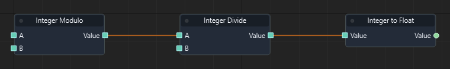

Graph: `templates/games/isometric_snake_3d/graphs/gameplay.json` · Function: **Spawn food** · Node: `n10`.

[Mở hướng dẫn game](games/isometric-snake.md)

### Đọc thêm

[Tài liệu hệ thống: typed-data.md](typed-data.md)

### Integer Modulo

ID `4060` · `pure` · Workflow `shared`

Lấy phần dư của phép chia A cho B. B không được bằng 0; Snake dùng để quy đổi chỉ số ô.

### IO

| Chiều | Cổng | Kiểu | Mặc định |
| --- | --- | --- | --- |
| IN | A | `int` | `0` |
| IN | B | `int` | `1` |
| OUT | Value | `int` | — |

Cổng `exec` điều khiển thứ tự. Cổng dữ liệu phải khớp kiểu; `vec2` không tự chuyển sang `vec3`.

### Cách dùng

1. Tìm **Integer Modulo** trong Node Library hoặc nhấn Tab trong graph để thêm node.
2. Chọn node, nhập hằng số ở Inspector theo bảng IN. Chuỗi nhập trực tiếp; vector/mảng nhập theo JSON, ví dụ `[1, 0, 0]`. Khai báo biến qua Scene > Scene Variables… trước khi dùng Get/Set Variable.
3. Có thể kéo dây từ OUT dữ liệu vào IN có cùng kiểu; giá trị từ dây thay thế hằng số của cổng.
4. Nối OUT dữ liệu tới node dùng kết quả. Node pure không cần dây exec.
5. Nhấn F5, thử tình huống, kiểm tra Console/Diagnostics; Shift+F5 dừng. Ctrl+S lưu thay đổi graph.

### Ví dụ từ graph thật

Trích đoạn Spawn food của isometric_snake_3d: node n7. Đây là các node và dây nối thật từ graph đã chạy; vị trí được sắp lại để dễ đọc.

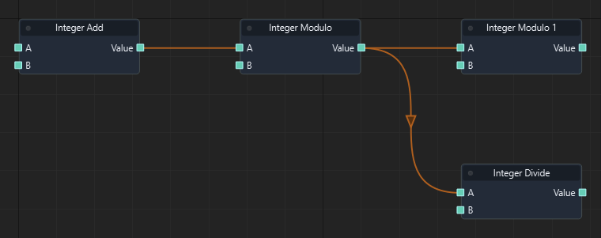

Graph: `templates/games/isometric_snake_3d/graphs/gameplay.json` · Function: **Spawn food** · Node: `n7`.

[Mở hướng dẫn game](games/isometric-snake.md)

### Đọc thêm

[Tài liệu hệ thống: typed-data.md](typed-data.md)

### Integer Abs

ID `4061` · `pure` · Workflow `shared`

Trả trị tuyệt đối của số nguyên Value.

### IO

| Chiều | Cổng | Kiểu | Mặc định |
| --- | --- | --- | --- |
| IN | Value | `int` | `0` |
| OUT | Value | `int` | — |

Cổng `exec` điều khiển thứ tự. Cổng dữ liệu phải khớp kiểu; `vec2` không tự chuyển sang `vec3`.

### Cách dùng

1. Tìm **Integer Abs** trong Node Library hoặc nhấn Tab trong graph để thêm node.
2. Chọn node, nhập hằng số ở Inspector theo bảng IN. Chuỗi nhập trực tiếp; vector/mảng nhập theo JSON, ví dụ `[1, 0, 0]`. Khai báo biến qua Scene > Scene Variables… trước khi dùng Get/Set Variable.
3. Có thể kéo dây từ OUT dữ liệu vào IN có cùng kiểu; giá trị từ dây thay thế hằng số của cổng.
4. Nối OUT dữ liệu tới node dùng kết quả. Node pure không cần dây exec.
5. Nhấn F5, thử tình huống, kiểm tra Console/Diagnostics; Shift+F5 dừng. Ctrl+S lưu thay đổi graph.

### Đọc thêm

[Tài liệu hệ thống: typed-data.md](typed-data.md)

### Integer Min

ID `4062` · `pure` · Workflow `shared`

Trả số nguyên nhỏ hơn trong A, B.

### IO

| Chiều | Cổng | Kiểu | Mặc định |
| --- | --- | --- | --- |
| IN | A | `int` | `0` |
| IN | B | `int` | `1` |
| OUT | Value | `int` | — |

Cổng `exec` điều khiển thứ tự. Cổng dữ liệu phải khớp kiểu; `vec2` không tự chuyển sang `vec3`.

### Cách dùng

1. Tìm **Integer Min** trong Node Library hoặc nhấn Tab trong graph để thêm node.
2. Chọn node, nhập hằng số ở Inspector theo bảng IN. Chuỗi nhập trực tiếp; vector/mảng nhập theo JSON, ví dụ `[1, 0, 0]`. Khai báo biến qua Scene > Scene Variables… trước khi dùng Get/Set Variable.
3. Có thể kéo dây từ OUT dữ liệu vào IN có cùng kiểu; giá trị từ dây thay thế hằng số của cổng.
4. Nối OUT dữ liệu tới node dùng kết quả. Node pure không cần dây exec.
5. Nhấn F5, thử tình huống, kiểm tra Console/Diagnostics; Shift+F5 dừng. Ctrl+S lưu thay đổi graph.

### Đọc thêm

[Tài liệu hệ thống: typed-data.md](typed-data.md)

### Integer Max

ID `4063` · `pure` · Workflow `shared`

Trả số lớn hơn giữa A và B; dùng giữ best score.

### IO

| Chiều | Cổng | Kiểu | Mặc định |
| --- | --- | --- | --- |
| IN | A | `int` | `0` |
| IN | B | `int` | `1` |
| OUT | Value | `int` | — |

Cổng `exec` điều khiển thứ tự. Cổng dữ liệu phải khớp kiểu; `vec2` không tự chuyển sang `vec3`.

### Cách dùng

1. Tìm **Integer Max** trong Node Library hoặc nhấn Tab trong graph để thêm node.
2. Chọn node, nhập hằng số ở Inspector theo bảng IN. Chuỗi nhập trực tiếp; vector/mảng nhập theo JSON, ví dụ `[1, 0, 0]`. Khai báo biến qua Scene > Scene Variables… trước khi dùng Get/Set Variable.
3. Có thể kéo dây từ OUT dữ liệu vào IN có cùng kiểu; giá trị từ dây thay thế hằng số của cổng.
4. Nối OUT dữ liệu tới node dùng kết quả. Node pure không cần dây exec.
5. Nhấn F5, thử tình huống, kiểm tra Console/Diagnostics; Shift+F5 dừng. Ctrl+S lưu thay đổi graph.

### Ví dụ từ graph thật

Trích đoạn Game Over của flappy_bird: node n6. Đây là các node và dây nối thật từ graph đã chạy; vị trí được sắp lại để dễ đọc.

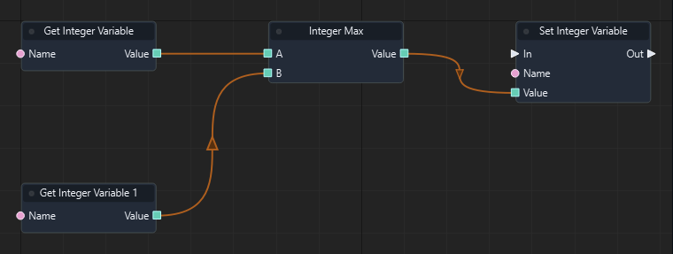

Graph: `templates/games/flappy_bird/graphs/gameplay.json` · Function: **Game Over** · Node: `n6`.

[Mở hướng dẫn game](games/flappy-bird.md)

### Đọc thêm

[Tài liệu hệ thống: typed-data.md](typed-data.md)

### Integer Less or Equal

ID `4064` · `pure` · Workflow `shared`

So sánh hai số nguyên A ≤ B.

### IO

| Chiều | Cổng | Kiểu | Mặc định |
| --- | --- | --- | --- |
| IN | A | `int` | `0` |
| IN | B | `int` | `1` |
| OUT | Value | `bool` | — |

Cổng `exec` điều khiển thứ tự. Cổng dữ liệu phải khớp kiểu; `vec2` không tự chuyển sang `vec3`.

### Cách dùng

1. Tìm **Integer Less or Equal** trong Node Library hoặc nhấn Tab trong graph để thêm node.
2. Chọn node, nhập hằng số ở Inspector theo bảng IN. Chuỗi nhập trực tiếp; vector/mảng nhập theo JSON, ví dụ `[1, 0, 0]`. Khai báo biến qua Scene > Scene Variables… trước khi dùng Get/Set Variable.
3. Có thể kéo dây từ OUT dữ liệu vào IN có cùng kiểu; giá trị từ dây thay thế hằng số của cổng.
4. Nối OUT dữ liệu tới node dùng kết quả. Node pure không cần dây exec.
5. Nhấn F5, thử tình huống, kiểm tra Console/Diagnostics; Shift+F5 dừng. Ctrl+S lưu thay đổi graph.

### Đọc thêm

[Tài liệu hệ thống: typed-data.md](typed-data.md)

### Integer Greater or Equal

ID `4065` · `pure` · Workflow `shared`

So sánh hai số nguyên A ≥ B.

### IO

| Chiều | Cổng | Kiểu | Mặc định |
| --- | --- | --- | --- |
| IN | A | `int` | `0` |
| IN | B | `int` | `1` |
| OUT | Value | `bool` | — |

Cổng `exec` điều khiển thứ tự. Cổng dữ liệu phải khớp kiểu; `vec2` không tự chuyển sang `vec3`.

### Cách dùng

1. Tìm **Integer Greater or Equal** trong Node Library hoặc nhấn Tab trong graph để thêm node.
2. Chọn node, nhập hằng số ở Inspector theo bảng IN. Chuỗi nhập trực tiếp; vector/mảng nhập theo JSON, ví dụ `[1, 0, 0]`. Khai báo biến qua Scene > Scene Variables… trước khi dùng Get/Set Variable.
3. Có thể kéo dây từ OUT dữ liệu vào IN có cùng kiểu; giá trị từ dây thay thế hằng số của cổng.
4. Nối OUT dữ liệu tới node dùng kết quả. Node pure không cần dây exec.
5. Nhấn F5, thử tình huống, kiểm tra Console/Diagnostics; Shift+F5 dừng. Ctrl+S lưu thay đổi graph.

### Đọc thêm

[Tài liệu hệ thống: typed-data.md](typed-data.md)

### Integer Not Equal

ID `4066` · `pure` · Workflow `shared`

Trả true khi hai số nguyên A và B khác nhau.

### IO

| Chiều | Cổng | Kiểu | Mặc định |
| --- | --- | --- | --- |
| IN | A | `int` | `0` |
| IN | B | `int` | `0` |
| OUT | Value | `bool` | — |

Cổng `exec` điều khiển thứ tự. Cổng dữ liệu phải khớp kiểu; `vec2` không tự chuyển sang `vec3`.

### Cách dùng

1. Tìm **Integer Not Equal** trong Node Library hoặc nhấn Tab trong graph để thêm node.
2. Chọn node, nhập hằng số ở Inspector theo bảng IN. Chuỗi nhập trực tiếp; vector/mảng nhập theo JSON, ví dụ `[1, 0, 0]`. Khai báo biến qua Scene > Scene Variables… trước khi dùng Get/Set Variable.
3. Có thể kéo dây từ OUT dữ liệu vào IN có cùng kiểu; giá trị từ dây thay thế hằng số của cổng.
4. Nối OUT dữ liệu tới node dùng kết quả. Node pure không cần dây exec.
5. Nhấn F5, thử tình huống, kiểm tra Console/Diagnostics; Shift+F5 dừng. Ctrl+S lưu thay đổi graph.

### Đọc thêm

[Tài liệu hệ thống: typed-data.md](typed-data.md)

### Vector X

ID `4070` · `pure` · Workflow `shared`

Tách thành phần X của vec3 Value.

### IO

| Chiều | Cổng | Kiểu | Mặc định |
| --- | --- | --- | --- |
| IN | Vector | `vec3` | `[0, 0, 0]` |
| OUT | Value | `float` | — |

Cổng `exec` điều khiển thứ tự. Cổng dữ liệu phải khớp kiểu; `vec2` không tự chuyển sang `vec3`.

### Cách dùng

1. Tìm **Vector X** trong Node Library hoặc nhấn Tab trong graph để thêm node.
2. Chọn node, nhập hằng số ở Inspector theo bảng IN. Chuỗi nhập trực tiếp; vector/mảng nhập theo JSON, ví dụ `[1, 0, 0]`. Khai báo biến qua Scene > Scene Variables… trước khi dùng Get/Set Variable.
3. Có thể kéo dây từ OUT dữ liệu vào IN có cùng kiểu; giá trị từ dây thay thế hằng số của cổng.
4. Nối OUT dữ liệu tới node dùng kết quả. Node pure không cần dây exec.
5. Nhấn F5, thử tình huống, kiểm tra Console/Diagnostics; Shift+F5 dừng. Ctrl+S lưu thay đổi graph.

### Đọc thêm

[Tài liệu hệ thống: typed-data.md](typed-data.md)

### Vector Y

ID `4071` · `pure` · Workflow `shared`

Tách thành phần Y của vec3 Value.

### IO

| Chiều | Cổng | Kiểu | Mặc định |
| --- | --- | --- | --- |
| IN | Vector | `vec3` | `[0, 0, 0]` |
| OUT | Value | `float` | — |

Cổng `exec` điều khiển thứ tự. Cổng dữ liệu phải khớp kiểu; `vec2` không tự chuyển sang `vec3`.

### Cách dùng

1. Tìm **Vector Y** trong Node Library hoặc nhấn Tab trong graph để thêm node.
2. Chọn node, nhập hằng số ở Inspector theo bảng IN. Chuỗi nhập trực tiếp; vector/mảng nhập theo JSON, ví dụ `[1, 0, 0]`. Khai báo biến qua Scene > Scene Variables… trước khi dùng Get/Set Variable.
3. Có thể kéo dây từ OUT dữ liệu vào IN có cùng kiểu; giá trị từ dây thay thế hằng số của cổng.
4. Nối OUT dữ liệu tới node dùng kết quả. Node pure không cần dây exec.
5. Nhấn F5, thử tình huống, kiểm tra Console/Diagnostics; Shift+F5 dừng. Ctrl+S lưu thay đổi graph.

### Đọc thêm

[Tài liệu hệ thống: typed-data.md](typed-data.md)

### Vector Z

ID `4072` · `pure` · Workflow `shared`

Tách thành phần Z của vec3 Value.

### IO

| Chiều | Cổng | Kiểu | Mặc định |
| --- | --- | --- | --- |
| IN | Vector | `vec3` | `[0, 0, 0]` |
| OUT | Value | `float` | — |

Cổng `exec` điều khiển thứ tự. Cổng dữ liệu phải khớp kiểu; `vec2` không tự chuyển sang `vec3`.

### Cách dùng

1. Tìm **Vector Z** trong Node Library hoặc nhấn Tab trong graph để thêm node.
2. Chọn node, nhập hằng số ở Inspector theo bảng IN. Chuỗi nhập trực tiếp; vector/mảng nhập theo JSON, ví dụ `[1, 0, 0]`. Khai báo biến qua Scene > Scene Variables… trước khi dùng Get/Set Variable.
3. Có thể kéo dây từ OUT dữ liệu vào IN có cùng kiểu; giá trị từ dây thay thế hằng số của cổng.
4. Nối OUT dữ liệu tới node dùng kết quả. Node pure không cần dây exec.
5. Nhấn F5, thử tình huống, kiểm tra Console/Diagnostics; Shift+F5 dừng. Ctrl+S lưu thay đổi graph.

### Đọc thêm

[Tài liệu hệ thống: typed-data.md](typed-data.md)

### Angle Between

ID `4073` · `pure` · Workflow `shared`

Trả góc giữa A và B bằng radian. Cả hai vector phải có độ dài lớn hơn 0.

### IO

| Chiều | Cổng | Kiểu | Mặc định |
| --- | --- | --- | --- |
| IN | A | `vec3` | `[1, 0, 0]` |
| IN | B | `vec3` | `[0, 1, 0]` |
| OUT | Value | `float` | — |

Cổng `exec` điều khiển thứ tự. Cổng dữ liệu phải khớp kiểu; `vec2` không tự chuyển sang `vec3`.

### Cách dùng

1. Tìm **Angle Between** trong Node Library hoặc nhấn Tab trong graph để thêm node.
2. Chọn node, nhập hằng số ở Inspector theo bảng IN. Chuỗi nhập trực tiếp; vector/mảng nhập theo JSON, ví dụ `[1, 0, 0]`. Khai báo biến qua Scene > Scene Variables… trước khi dùng Get/Set Variable.
3. Có thể kéo dây từ OUT dữ liệu vào IN có cùng kiểu; giá trị từ dây thay thế hằng số của cổng.
4. Nối OUT dữ liệu tới node dùng kết quả. Node pure không cần dây exec.
5. Nhấn F5, thử tình huống, kiểm tra Console/Diagnostics; Shift+F5 dừng. Ctrl+S lưu thay đổi graph.

### Đọc thêm

[Tài liệu hệ thống: typed-data.md](typed-data.md)

### Project Vector

ID `4074` · `pure` · Workflow `shared`

Chiếu Value lên vector On; On có độ dài 0 cho vector 0.

### IO

| Chiều | Cổng | Kiểu | Mặc định |
| --- | --- | --- | --- |
| IN | Vector | `vec3` | `[1, 0, 0]` |
| IN | On | `vec3` | `[1, 0, 0]` |
| OUT | Value | `vec3` | — |

Cổng `exec` điều khiển thứ tự. Cổng dữ liệu phải khớp kiểu; `vec2` không tự chuyển sang `vec3`.

### Cách dùng

1. Tìm **Project Vector** trong Node Library hoặc nhấn Tab trong graph để thêm node.
2. Chọn node, nhập hằng số ở Inspector theo bảng IN. Chuỗi nhập trực tiếp; vector/mảng nhập theo JSON, ví dụ `[1, 0, 0]`. Khai báo biến qua Scene > Scene Variables… trước khi dùng Get/Set Variable.
3. Có thể kéo dây từ OUT dữ liệu vào IN có cùng kiểu; giá trị từ dây thay thế hằng số của cổng.
4. Nối OUT dữ liệu tới node dùng kết quả. Node pure không cần dây exec.
5. Nhấn F5, thử tình huống, kiểm tra Console/Diagnostics; Shift+F5 dừng. Ctrl+S lưu thay đổi graph.

### Đọc thêm

[Tài liệu hệ thống: typed-data.md](typed-data.md)

### Reflect Vector

ID `4075` · `pure` · Workflow `shared`

Phản xạ Value qua Normal. Normal phải khác vector 0 và được chuẩn hóa trước khi tính.

### IO

| Chiều | Cổng | Kiểu | Mặc định |
| --- | --- | --- | --- |
| IN | Vector | `vec3` | `[1, -1, 0]` |
| IN | Normal | `vec3` | `[0, 1, 0]` |
| OUT | Value | `vec3` | — |

Cổng `exec` điều khiển thứ tự. Cổng dữ liệu phải khớp kiểu; `vec2` không tự chuyển sang `vec3`.

### Cách dùng

1. Tìm **Reflect Vector** trong Node Library hoặc nhấn Tab trong graph để thêm node.
2. Chọn node, nhập hằng số ở Inspector theo bảng IN. Chuỗi nhập trực tiếp; vector/mảng nhập theo JSON, ví dụ `[1, 0, 0]`. Khai báo biến qua Scene > Scene Variables… trước khi dùng Get/Set Variable.
3. Có thể kéo dây từ OUT dữ liệu vào IN có cùng kiểu; giá trị từ dây thay thế hằng số của cổng.
4. Nối OUT dữ liệu tới node dùng kết quả. Node pure không cần dây exec.
5. Nhấn F5, thử tình huống, kiểm tra Console/Diagnostics; Shift+F5 dừng. Ctrl+S lưu thay đổi graph.

### Đọc thêm

[Tài liệu hệ thống: typed-data.md](typed-data.md)

### Rotate Vector

ID `4076` · `pure` · Workflow `shared`

Xoay vec3 bằng Euler Rotation tính theo độ.

### IO

| Chiều | Cổng | Kiểu | Mặc định |
| --- | --- | --- | --- |
| IN | Vector | `vec3` | `[1, 0, 0]` |
| IN | Rotation | `vec3` | `[0, 0, 90]` |
| OUT | Value | `vec3` | — |

Cổng `exec` điều khiển thứ tự. Cổng dữ liệu phải khớp kiểu; `vec2` không tự chuyển sang `vec3`.

### Cách dùng

1. Tìm **Rotate Vector** trong Node Library hoặc nhấn Tab trong graph để thêm node.
2. Chọn node, nhập hằng số ở Inspector theo bảng IN. Chuỗi nhập trực tiếp; vector/mảng nhập theo JSON, ví dụ `[1, 0, 0]`. Khai báo biến qua Scene > Scene Variables… trước khi dùng Get/Set Variable.
3. Có thể kéo dây từ OUT dữ liệu vào IN có cùng kiểu; giá trị từ dây thay thế hằng số của cổng.
4. Nối OUT dữ liệu tới node dùng kết quả. Node pure không cần dây exec.
5. Nhấn F5, thử tình huống, kiểm tra Console/Diagnostics; Shift+F5 dừng. Ctrl+S lưu thay đổi graph.

### Đọc thêm

[Tài liệu hệ thống: typed-data.md](typed-data.md)

### Make Vector2

ID `4080` · `pure` · Workflow `shared`

Ghép các thành phần đầu vào thành một vector đúng kiểu của node.

### IO

| Chiều | Cổng | Kiểu | Mặc định |
| --- | --- | --- | --- |
| IN | X | `float` | `0.0` |
| IN | Y | `float` | `0.0` |
| OUT | Value | `vec2` | — |

Cổng `exec` điều khiển thứ tự. Cổng dữ liệu phải khớp kiểu; `vec2` không tự chuyển sang `vec3`.

### Cách dùng

1. Tìm **Make Vector2** trong Node Library hoặc nhấn Tab trong graph để thêm node.
2. Chọn node, nhập hằng số ở Inspector theo bảng IN. Chuỗi nhập trực tiếp; vector/mảng nhập theo JSON, ví dụ `[1, 0, 0]`. Khai báo biến qua Scene > Scene Variables… trước khi dùng Get/Set Variable.
3. Có thể kéo dây từ OUT dữ liệu vào IN có cùng kiểu; giá trị từ dây thay thế hằng số của cổng.
4. Nối OUT dữ liệu tới node dùng kết quả. Node pure không cần dây exec.
5. Nhấn F5, thử tình huống, kiểm tra Console/Diagnostics; Shift+F5 dừng. Ctrl+S lưu thay đổi graph.

### Đọc thêm

[Tài liệu hệ thống: typed-data.md](typed-data.md)

### Vector2 Add

ID `4081` · `pure` · Workflow `shared`

Cộng từng thành phần A + B.

### IO

| Chiều | Cổng | Kiểu | Mặc định |
| --- | --- | --- | --- |
| IN | A | `vec2` | `[0, 0]` |
| IN | B | `vec2` | `[0, 0]` |
| OUT | Value | `vec2` | — |

Cổng `exec` điều khiển thứ tự. Cổng dữ liệu phải khớp kiểu; `vec2` không tự chuyển sang `vec3`.

### Cách dùng

1. Tìm **Vector2 Add** trong Node Library hoặc nhấn Tab trong graph để thêm node.
2. Chọn node, nhập hằng số ở Inspector theo bảng IN. Chuỗi nhập trực tiếp; vector/mảng nhập theo JSON, ví dụ `[1, 0, 0]`. Khai báo biến qua Scene > Scene Variables… trước khi dùng Get/Set Variable.
3. Có thể kéo dây từ OUT dữ liệu vào IN có cùng kiểu; giá trị từ dây thay thế hằng số của cổng.
4. Nối OUT dữ liệu tới node dùng kết quả. Node pure không cần dây exec.
5. Nhấn F5, thử tình huống, kiểm tra Console/Diagnostics; Shift+F5 dừng. Ctrl+S lưu thay đổi graph.

### Đọc thêm

[Tài liệu hệ thống: typed-data.md](typed-data.md)

### Vector2 Subtract

ID `4082` · `pure` · Workflow `shared`

Trừ từng thành phần A - B.

### IO

| Chiều | Cổng | Kiểu | Mặc định |
| --- | --- | --- | --- |
| IN | A | `vec2` | `[0, 0]` |
| IN | B | `vec2` | `[0, 0]` |
| OUT | Value | `vec2` | — |

Cổng `exec` điều khiển thứ tự. Cổng dữ liệu phải khớp kiểu; `vec2` không tự chuyển sang `vec3`.

### Cách dùng

1. Tìm **Vector2 Subtract** trong Node Library hoặc nhấn Tab trong graph để thêm node.
2. Chọn node, nhập hằng số ở Inspector theo bảng IN. Chuỗi nhập trực tiếp; vector/mảng nhập theo JSON, ví dụ `[1, 0, 0]`. Khai báo biến qua Scene > Scene Variables… trước khi dùng Get/Set Variable.
3. Có thể kéo dây từ OUT dữ liệu vào IN có cùng kiểu; giá trị từ dây thay thế hằng số của cổng.
4. Nối OUT dữ liệu tới node dùng kết quả. Node pure không cần dây exec.
5. Nhấn F5, thử tình huống, kiểm tra Console/Diagnostics; Shift+F5 dừng. Ctrl+S lưu thay đổi graph.

### Đọc thêm

[Tài liệu hệ thống: typed-data.md](typed-data.md)

### Vector2 Scale

ID `4083` · `pure` · Workflow `shared`

Nhân từng thành phần Vector với Scale.

### IO

| Chiều | Cổng | Kiểu | Mặc định |
| --- | --- | --- | --- |
| IN | Vector | `vec2` | `[1, 0]` |
| IN | Scale | `float` | `1.0` |
| OUT | Value | `vec2` | — |

Cổng `exec` điều khiển thứ tự. Cổng dữ liệu phải khớp kiểu; `vec2` không tự chuyển sang `vec3`.

### Cách dùng

1. Tìm **Vector2 Scale** trong Node Library hoặc nhấn Tab trong graph để thêm node.
2. Chọn node, nhập hằng số ở Inspector theo bảng IN. Chuỗi nhập trực tiếp; vector/mảng nhập theo JSON, ví dụ `[1, 0, 0]`. Khai báo biến qua Scene > Scene Variables… trước khi dùng Get/Set Variable.
3. Có thể kéo dây từ OUT dữ liệu vào IN có cùng kiểu; giá trị từ dây thay thế hằng số của cổng.
4. Nối OUT dữ liệu tới node dùng kết quả. Node pure không cần dây exec.
5. Nhấn F5, thử tình huống, kiểm tra Console/Diagnostics; Shift+F5 dừng. Ctrl+S lưu thay đổi graph.

### Đọc thêm

[Tài liệu hệ thống: typed-data.md](typed-data.md)

### Vector2 Magnitude

ID `4084` · `pure` · Workflow `shared`

Trả độ dài Euclid của Vector.

### IO

| Chiều | Cổng | Kiểu | Mặc định |
| --- | --- | --- | --- |
| IN | Vector | `vec2` | `[1, 0]` |
| OUT | Value | `float` | — |

Cổng `exec` điều khiển thứ tự. Cổng dữ liệu phải khớp kiểu; `vec2` không tự chuyển sang `vec3`.

### Cách dùng

1. Tìm **Vector2 Magnitude** trong Node Library hoặc nhấn Tab trong graph để thêm node.
2. Chọn node, nhập hằng số ở Inspector theo bảng IN. Chuỗi nhập trực tiếp; vector/mảng nhập theo JSON, ví dụ `[1, 0, 0]`. Khai báo biến qua Scene > Scene Variables… trước khi dùng Get/Set Variable.
3. Có thể kéo dây từ OUT dữ liệu vào IN có cùng kiểu; giá trị từ dây thay thế hằng số của cổng.
4. Nối OUT dữ liệu tới node dùng kết quả. Node pure không cần dây exec.
5. Nhấn F5, thử tình huống, kiểm tra Console/Diagnostics; Shift+F5 dừng. Ctrl+S lưu thay đổi graph.

### Đọc thêm

[Tài liệu hệ thống: typed-data.md](typed-data.md)

### Vector2 Normalize

ID `4085` · `pure` · Workflow `shared`

Trả vector đơn vị cùng hướng; vector 0 cho kết quả 0.

### IO

| Chiều | Cổng | Kiểu | Mặc định |
| --- | --- | --- | --- |
| IN | Vector | `vec2` | `[1, 0]` |
| OUT | Value | `vec2` | — |

Cổng `exec` điều khiển thứ tự. Cổng dữ liệu phải khớp kiểu; `vec2` không tự chuyển sang `vec3`.

### Cách dùng

1. Tìm **Vector2 Normalize** trong Node Library hoặc nhấn Tab trong graph để thêm node.
2. Chọn node, nhập hằng số ở Inspector theo bảng IN. Chuỗi nhập trực tiếp; vector/mảng nhập theo JSON, ví dụ `[1, 0, 0]`. Khai báo biến qua Scene > Scene Variables… trước khi dùng Get/Set Variable.
3. Có thể kéo dây từ OUT dữ liệu vào IN có cùng kiểu; giá trị từ dây thay thế hằng số của cổng.
4. Nối OUT dữ liệu tới node dùng kết quả. Node pure không cần dây exec.
5. Nhấn F5, thử tình huống, kiểm tra Console/Diagnostics; Shift+F5 dừng. Ctrl+S lưu thay đổi graph.

### Đọc thêm

[Tài liệu hệ thống: typed-data.md](typed-data.md)

### Vector2 Dot

ID `4086` · `pure` · Workflow `shared`

Trả tích vô hướng A·B.

### IO

| Chiều | Cổng | Kiểu | Mặc định |
| --- | --- | --- | --- |
| IN | A | `vec2` | `[1, 0]` |
| IN | B | `vec2` | `[1, 0]` |
| OUT | Value | `float` | — |

Cổng `exec` điều khiển thứ tự. Cổng dữ liệu phải khớp kiểu; `vec2` không tự chuyển sang `vec3`.

### Cách dùng

1. Tìm **Vector2 Dot** trong Node Library hoặc nhấn Tab trong graph để thêm node.
2. Chọn node, nhập hằng số ở Inspector theo bảng IN. Chuỗi nhập trực tiếp; vector/mảng nhập theo JSON, ví dụ `[1, 0, 0]`. Khai báo biến qua Scene > Scene Variables… trước khi dùng Get/Set Variable.
3. Có thể kéo dây từ OUT dữ liệu vào IN có cùng kiểu; giá trị từ dây thay thế hằng số của cổng.
4. Nối OUT dữ liệu tới node dùng kết quả. Node pure không cần dây exec.
5. Nhấn F5, thử tình huống, kiểm tra Console/Diagnostics; Shift+F5 dừng. Ctrl+S lưu thay đổi graph.

### Đọc thêm

[Tài liệu hệ thống: typed-data.md](typed-data.md)

### Vector2 Distance

ID `4087` · `pure` · Workflow `shared`

Trả khoảng cách Euclid giữa A và B.

### IO

| Chiều | Cổng | Kiểu | Mặc định |
| --- | --- | --- | --- |
| IN | A | `vec2` | `[0, 0]` |
| IN | B | `vec2` | `[1, 0]` |
| OUT | Value | `float` | — |

Cổng `exec` điều khiển thứ tự. Cổng dữ liệu phải khớp kiểu; `vec2` không tự chuyển sang `vec3`.

### Cách dùng

1. Tìm **Vector2 Distance** trong Node Library hoặc nhấn Tab trong graph để thêm node.
2. Chọn node, nhập hằng số ở Inspector theo bảng IN. Chuỗi nhập trực tiếp; vector/mảng nhập theo JSON, ví dụ `[1, 0, 0]`. Khai báo biến qua Scene > Scene Variables… trước khi dùng Get/Set Variable.
3. Có thể kéo dây từ OUT dữ liệu vào IN có cùng kiểu; giá trị từ dây thay thế hằng số của cổng.
4. Nối OUT dữ liệu tới node dùng kết quả. Node pure không cần dây exec.
5. Nhấn F5, thử tình huống, kiểm tra Console/Diagnostics; Shift+F5 dừng. Ctrl+S lưu thay đổi graph.

### Đọc thêm

[Tài liệu hệ thống: typed-data.md](typed-data.md)

### Make Vector4

ID `4090` · `pure` · Workflow `shared`

Ghép các thành phần đầu vào thành một vector đúng kiểu của node.

### IO

| Chiều | Cổng | Kiểu | Mặc định |
| --- | --- | --- | --- |
| IN | X | `float` | `0.0` |
| IN | Y | `float` | `0.0` |
| IN | Z | `float` | `0.0` |
| IN | W | `float` | `0.0` |
| OUT | Value | `vec4` | — |

Cổng `exec` điều khiển thứ tự. Cổng dữ liệu phải khớp kiểu; `vec2` không tự chuyển sang `vec3`.

### Cách dùng

1. Tìm **Make Vector4** trong Node Library hoặc nhấn Tab trong graph để thêm node.
2. Chọn node, nhập hằng số ở Inspector theo bảng IN. Chuỗi nhập trực tiếp; vector/mảng nhập theo JSON, ví dụ `[1, 0, 0]`. Khai báo biến qua Scene > Scene Variables… trước khi dùng Get/Set Variable.
3. Có thể kéo dây từ OUT dữ liệu vào IN có cùng kiểu; giá trị từ dây thay thế hằng số của cổng.
4. Nối OUT dữ liệu tới node dùng kết quả. Node pure không cần dây exec.
5. Nhấn F5, thử tình huống, kiểm tra Console/Diagnostics; Shift+F5 dừng. Ctrl+S lưu thay đổi graph.

### Đọc thêm

[Tài liệu hệ thống: typed-data.md](typed-data.md)

### Vector4 Add

ID `4091` · `pure` · Workflow `shared`

Cộng từng thành phần A + B.

### IO

| Chiều | Cổng | Kiểu | Mặc định |
| --- | --- | --- | --- |
| IN | A | `vec4` | `[0, 0, 0, 0]` |
| IN | B | `vec4` | `[0, 0, 0, 0]` |
| OUT | Value | `vec4` | — |

Cổng `exec` điều khiển thứ tự. Cổng dữ liệu phải khớp kiểu; `vec2` không tự chuyển sang `vec3`.

### Cách dùng

1. Tìm **Vector4 Add** trong Node Library hoặc nhấn Tab trong graph để thêm node.
2. Chọn node, nhập hằng số ở Inspector theo bảng IN. Chuỗi nhập trực tiếp; vector/mảng nhập theo JSON, ví dụ `[1, 0, 0]`. Khai báo biến qua Scene > Scene Variables… trước khi dùng Get/Set Variable.
3. Có thể kéo dây từ OUT dữ liệu vào IN có cùng kiểu; giá trị từ dây thay thế hằng số của cổng.
4. Nối OUT dữ liệu tới node dùng kết quả. Node pure không cần dây exec.
5. Nhấn F5, thử tình huống, kiểm tra Console/Diagnostics; Shift+F5 dừng. Ctrl+S lưu thay đổi graph.

### Đọc thêm

[Tài liệu hệ thống: typed-data.md](typed-data.md)

### Vector4 Subtract

ID `4092` · `pure` · Workflow `shared`

Trừ từng thành phần A - B.

### IO

| Chiều | Cổng | Kiểu | Mặc định |
| --- | --- | --- | --- |
| IN | A | `vec4` | `[0, 0, 0, 0]` |
| IN | B | `vec4` | `[0, 0, 0, 0]` |
| OUT | Value | `vec4` | — |

Cổng `exec` điều khiển thứ tự. Cổng dữ liệu phải khớp kiểu; `vec2` không tự chuyển sang `vec3`.

### Cách dùng

1. Tìm **Vector4 Subtract** trong Node Library hoặc nhấn Tab trong graph để thêm node.
2. Chọn node, nhập hằng số ở Inspector theo bảng IN. Chuỗi nhập trực tiếp; vector/mảng nhập theo JSON, ví dụ `[1, 0, 0]`. Khai báo biến qua Scene > Scene Variables… trước khi dùng Get/Set Variable.
3. Có thể kéo dây từ OUT dữ liệu vào IN có cùng kiểu; giá trị từ dây thay thế hằng số của cổng.
4. Nối OUT dữ liệu tới node dùng kết quả. Node pure không cần dây exec.
5. Nhấn F5, thử tình huống, kiểm tra Console/Diagnostics; Shift+F5 dừng. Ctrl+S lưu thay đổi graph.

### Đọc thêm

[Tài liệu hệ thống: typed-data.md](typed-data.md)

### Vector4 Scale

ID `4093` · `pure` · Workflow `shared`

Nhân từng thành phần Vector với Scale.

### IO

| Chiều | Cổng | Kiểu | Mặc định |
| --- | --- | --- | --- |
| IN | Vector | `vec4` | `[1, 0, 0, 0]` |
| IN | Scale | `float` | `1.0` |
| OUT | Value | `vec4` | — |

Cổng `exec` điều khiển thứ tự. Cổng dữ liệu phải khớp kiểu; `vec2` không tự chuyển sang `vec3`.

### Cách dùng

1. Tìm **Vector4 Scale** trong Node Library hoặc nhấn Tab trong graph để thêm node.
2. Chọn node, nhập hằng số ở Inspector theo bảng IN. Chuỗi nhập trực tiếp; vector/mảng nhập theo JSON, ví dụ `[1, 0, 0]`. Khai báo biến qua Scene > Scene Variables… trước khi dùng Get/Set Variable.
3. Có thể kéo dây từ OUT dữ liệu vào IN có cùng kiểu; giá trị từ dây thay thế hằng số của cổng.
4. Nối OUT dữ liệu tới node dùng kết quả. Node pure không cần dây exec.
5. Nhấn F5, thử tình huống, kiểm tra Console/Diagnostics; Shift+F5 dừng. Ctrl+S lưu thay đổi graph.

### Đọc thêm

[Tài liệu hệ thống: typed-data.md](typed-data.md)

### Vector4 Magnitude

ID `4094` · `pure` · Workflow `shared`

Trả độ dài Euclid của Vector.

### IO

| Chiều | Cổng | Kiểu | Mặc định |
| --- | --- | --- | --- |
| IN | Vector | `vec4` | `[1, 0, 0, 0]` |
| OUT | Value | `float` | — |

Cổng `exec` điều khiển thứ tự. Cổng dữ liệu phải khớp kiểu; `vec2` không tự chuyển sang `vec3`.

### Cách dùng

1. Tìm **Vector4 Magnitude** trong Node Library hoặc nhấn Tab trong graph để thêm node.
2. Chọn node, nhập hằng số ở Inspector theo bảng IN. Chuỗi nhập trực tiếp; vector/mảng nhập theo JSON, ví dụ `[1, 0, 0]`. Khai báo biến qua Scene > Scene Variables… trước khi dùng Get/Set Variable.
3. Có thể kéo dây từ OUT dữ liệu vào IN có cùng kiểu; giá trị từ dây thay thế hằng số của cổng.
4. Nối OUT dữ liệu tới node dùng kết quả. Node pure không cần dây exec.
5. Nhấn F5, thử tình huống, kiểm tra Console/Diagnostics; Shift+F5 dừng. Ctrl+S lưu thay đổi graph.

### Đọc thêm

[Tài liệu hệ thống: typed-data.md](typed-data.md)

### Vector4 Normalize

ID `4095` · `pure` · Workflow `shared`

Trả vector đơn vị cùng hướng; vector 0 cho kết quả 0.

### IO

| Chiều | Cổng | Kiểu | Mặc định |
| --- | --- | --- | --- |
| IN | Vector | `vec4` | `[1, 0, 0, 0]` |
| OUT | Value | `vec4` | — |

Cổng `exec` điều khiển thứ tự. Cổng dữ liệu phải khớp kiểu; `vec2` không tự chuyển sang `vec3`.

### Cách dùng

1. Tìm **Vector4 Normalize** trong Node Library hoặc nhấn Tab trong graph để thêm node.
2. Chọn node, nhập hằng số ở Inspector theo bảng IN. Chuỗi nhập trực tiếp; vector/mảng nhập theo JSON, ví dụ `[1, 0, 0]`. Khai báo biến qua Scene > Scene Variables… trước khi dùng Get/Set Variable.
3. Có thể kéo dây từ OUT dữ liệu vào IN có cùng kiểu; giá trị từ dây thay thế hằng số của cổng.
4. Nối OUT dữ liệu tới node dùng kết quả. Node pure không cần dây exec.
5. Nhấn F5, thử tình huống, kiểm tra Console/Diagnostics; Shift+F5 dừng. Ctrl+S lưu thay đổi graph.

### Đọc thêm

[Tài liệu hệ thống: typed-data.md](typed-data.md)

### Vector4 Dot

ID `4096` · `pure` · Workflow `shared`

Trả tích vô hướng A·B.

### IO

| Chiều | Cổng | Kiểu | Mặc định |
| --- | --- | --- | --- |
| IN | A | `vec4` | `[1, 0, 0, 0]` |
| IN | B | `vec4` | `[1, 0, 0, 0]` |
| OUT | Value | `float` | — |

Cổng `exec` điều khiển thứ tự. Cổng dữ liệu phải khớp kiểu; `vec2` không tự chuyển sang `vec3`.

### Cách dùng

1. Tìm **Vector4 Dot** trong Node Library hoặc nhấn Tab trong graph để thêm node.
2. Chọn node, nhập hằng số ở Inspector theo bảng IN. Chuỗi nhập trực tiếp; vector/mảng nhập theo JSON, ví dụ `[1, 0, 0]`. Khai báo biến qua Scene > Scene Variables… trước khi dùng Get/Set Variable.
3. Có thể kéo dây từ OUT dữ liệu vào IN có cùng kiểu; giá trị từ dây thay thế hằng số của cổng.
4. Nối OUT dữ liệu tới node dùng kết quả. Node pure không cần dây exec.
5. Nhấn F5, thử tình huống, kiểm tra Console/Diagnostics; Shift+F5 dừng. Ctrl+S lưu thay đổi graph.

### Đọc thêm

[Tài liệu hệ thống: typed-data.md](typed-data.md)

### Vector4 Distance

ID `4097` · `pure` · Workflow `shared`

Trả khoảng cách Euclid giữa A và B.

### IO

| Chiều | Cổng | Kiểu | Mặc định |
| --- | --- | --- | --- |
| IN | A | `vec4` | `[0, 0, 0, 0]` |
| IN | B | `vec4` | `[1, 0, 0, 0]` |
| OUT | Value | `float` | — |

Cổng `exec` điều khiển thứ tự. Cổng dữ liệu phải khớp kiểu; `vec2` không tự chuyển sang `vec3`.

### Cách dùng

1. Tìm **Vector4 Distance** trong Node Library hoặc nhấn Tab trong graph để thêm node.
2. Chọn node, nhập hằng số ở Inspector theo bảng IN. Chuỗi nhập trực tiếp; vector/mảng nhập theo JSON, ví dụ `[1, 0, 0]`. Khai báo biến qua Scene > Scene Variables… trước khi dùng Get/Set Variable.
3. Có thể kéo dây từ OUT dữ liệu vào IN có cùng kiểu; giá trị từ dây thay thế hằng số của cổng.
4. Nối OUT dữ liệu tới node dùng kết quả. Node pure không cần dây exec.
5. Nhấn F5, thử tình huống, kiểm tra Console/Diagnostics; Shift+F5 dừng. Ctrl+S lưu thay đổi graph.

### Đọc thêm

[Tài liệu hệ thống: typed-data.md](typed-data.md)

### Make Quaternion

ID `4100` · `pure` · Workflow `shared`

Tạo quaternion từ các thành phần theo cổng khai báo. Dùng Quaternion Normalize khi cần chuẩn hóa.

### IO

| Chiều | Cổng | Kiểu | Mặc định |
| --- | --- | --- | --- |
| IN | Euler | `vec3` | `[0, 0, 0]` |
| OUT | Value | `quat` | — |

Cổng `exec` điều khiển thứ tự. Cổng dữ liệu phải khớp kiểu; `vec2` không tự chuyển sang `vec3`.

### Cách dùng

1. Tìm **Make Quaternion** trong Node Library hoặc nhấn Tab trong graph để thêm node.
2. Chọn node, nhập hằng số ở Inspector theo bảng IN. Chuỗi nhập trực tiếp; vector/mảng nhập theo JSON, ví dụ `[1, 0, 0]`. Khai báo biến qua Scene > Scene Variables… trước khi dùng Get/Set Variable.
3. Có thể kéo dây từ OUT dữ liệu vào IN có cùng kiểu; giá trị từ dây thay thế hằng số của cổng.
4. Nối OUT dữ liệu tới node dùng kết quả. Node pure không cần dây exec.
5. Nhấn F5, thử tình huống, kiểm tra Console/Diagnostics; Shift+F5 dừng. Ctrl+S lưu thay đổi graph.

### Đọc thêm

[Tài liệu hệ thống: typed-data.md](typed-data.md)

### Quaternion From Axis Angle

ID `4101` · `pure` · Workflow `shared`

Tạo quaternion từ Axis và góc tính bằng độ.

### IO

| Chiều | Cổng | Kiểu | Mặc định |
| --- | --- | --- | --- |
| IN | Axis | `vec3` | `[0, 1, 0]` |
| IN | Degrees | `float` | `0.0` |
| OUT | Value | `quat` | — |

Cổng `exec` điều khiển thứ tự. Cổng dữ liệu phải khớp kiểu; `vec2` không tự chuyển sang `vec3`.

### Cách dùng

1. Tìm **Quaternion From Axis Angle** trong Node Library hoặc nhấn Tab trong graph để thêm node.
2. Chọn node, nhập hằng số ở Inspector theo bảng IN. Chuỗi nhập trực tiếp; vector/mảng nhập theo JSON, ví dụ `[1, 0, 0]`. Khai báo biến qua Scene > Scene Variables… trước khi dùng Get/Set Variable.
3. Có thể kéo dây từ OUT dữ liệu vào IN có cùng kiểu; giá trị từ dây thay thế hằng số của cổng.
4. Nối OUT dữ liệu tới node dùng kết quả. Node pure không cần dây exec.
5. Nhấn F5, thử tình huống, kiểm tra Console/Diagnostics; Shift+F5 dừng. Ctrl+S lưu thay đổi graph.

### Đọc thêm

[Tài liệu hệ thống: typed-data.md](typed-data.md)

### Quaternion Multiply

ID `4102` · `pure` · Workflow `shared`

Kết hợp hai phép quay quaternion A và B theo thứ tự nhân.

### IO

| Chiều | Cổng | Kiểu | Mặc định |
| --- | --- | --- | --- |
| IN | A | `quat` | `[0, 0, 0, 1]` |
| IN | B | `quat` | `[0, 0, 0, 1]` |
| OUT | Value | `quat` | — |

Cổng `exec` điều khiển thứ tự. Cổng dữ liệu phải khớp kiểu; `vec2` không tự chuyển sang `vec3`.

### Cách dùng

1. Tìm **Quaternion Multiply** trong Node Library hoặc nhấn Tab trong graph để thêm node.
2. Chọn node, nhập hằng số ở Inspector theo bảng IN. Chuỗi nhập trực tiếp; vector/mảng nhập theo JSON, ví dụ `[1, 0, 0]`. Khai báo biến qua Scene > Scene Variables… trước khi dùng Get/Set Variable.
3. Có thể kéo dây từ OUT dữ liệu vào IN có cùng kiểu; giá trị từ dây thay thế hằng số của cổng.
4. Nối OUT dữ liệu tới node dùng kết quả. Node pure không cần dây exec.
5. Nhấn F5, thử tình huống, kiểm tra Console/Diagnostics; Shift+F5 dừng. Ctrl+S lưu thay đổi graph.

### Đọc thêm

[Tài liệu hệ thống: typed-data.md](typed-data.md)

### Quaternion Normalize

ID `4103` · `pure` · Workflow `shared`

Chuẩn hóa quaternion; quaternion có độ dài 0 không hợp lệ.

### IO

| Chiều | Cổng | Kiểu | Mặc định |
| --- | --- | --- | --- |
| IN | Value | `quat` | `[0, 0, 0, 1]` |
| OUT | Value | `quat` | — |

Cổng `exec` điều khiển thứ tự. Cổng dữ liệu phải khớp kiểu; `vec2` không tự chuyển sang `vec3`.

### Cách dùng

1. Tìm **Quaternion Normalize** trong Node Library hoặc nhấn Tab trong graph để thêm node.
2. Chọn node, nhập hằng số ở Inspector theo bảng IN. Chuỗi nhập trực tiếp; vector/mảng nhập theo JSON, ví dụ `[1, 0, 0]`. Khai báo biến qua Scene > Scene Variables… trước khi dùng Get/Set Variable.
3. Có thể kéo dây từ OUT dữ liệu vào IN có cùng kiểu; giá trị từ dây thay thế hằng số của cổng.
4. Nối OUT dữ liệu tới node dùng kết quả. Node pure không cần dây exec.
5. Nhấn F5, thử tình huống, kiểm tra Console/Diagnostics; Shift+F5 dừng. Ctrl+S lưu thay đổi graph.

### Đọc thêm

[Tài liệu hệ thống: typed-data.md](typed-data.md)

### Quaternion Inverse

ID `4104` · `pure` · Workflow `shared`

Trả phép quay đảo của quaternion được chuẩn hóa.

### IO

| Chiều | Cổng | Kiểu | Mặc định |
| --- | --- | --- | --- |
| IN | Value | `quat` | `[0, 0, 0, 1]` |
| OUT | Value | `quat` | — |

Cổng `exec` điều khiển thứ tự. Cổng dữ liệu phải khớp kiểu; `vec2` không tự chuyển sang `vec3`.

### Cách dùng

1. Tìm **Quaternion Inverse** trong Node Library hoặc nhấn Tab trong graph để thêm node.
2. Chọn node, nhập hằng số ở Inspector theo bảng IN. Chuỗi nhập trực tiếp; vector/mảng nhập theo JSON, ví dụ `[1, 0, 0]`. Khai báo biến qua Scene > Scene Variables… trước khi dùng Get/Set Variable.
3. Có thể kéo dây từ OUT dữ liệu vào IN có cùng kiểu; giá trị từ dây thay thế hằng số của cổng.
4. Nối OUT dữ liệu tới node dùng kết quả. Node pure không cần dây exec.
5. Nhấn F5, thử tình huống, kiểm tra Console/Diagnostics; Shift+F5 dừng. Ctrl+S lưu thay đổi graph.

### Đọc thêm

[Tài liệu hệ thống: typed-data.md](typed-data.md)

### Quaternion Slerp

ID `4105` · `pure` · Workflow `shared`

Nội suy cầu giữa hai phép quay quaternion theo T.

### IO

| Chiều | Cổng | Kiểu | Mặc định |
| --- | --- | --- | --- |
| IN | A | `quat` | `[0, 0, 0, 1]` |
| IN | B | `quat` | `[0, 0, 0, 1]` |
| IN | T | `float` | `0.5` |
| OUT | Value | `quat` | — |

Cổng `exec` điều khiển thứ tự. Cổng dữ liệu phải khớp kiểu; `vec2` không tự chuyển sang `vec3`.

### Cách dùng

1. Tìm **Quaternion Slerp** trong Node Library hoặc nhấn Tab trong graph để thêm node.
2. Chọn node, nhập hằng số ở Inspector theo bảng IN. Chuỗi nhập trực tiếp; vector/mảng nhập theo JSON, ví dụ `[1, 0, 0]`. Khai báo biến qua Scene > Scene Variables… trước khi dùng Get/Set Variable.
3. Có thể kéo dây từ OUT dữ liệu vào IN có cùng kiểu; giá trị từ dây thay thế hằng số của cổng.
4. Nối OUT dữ liệu tới node dùng kết quả. Node pure không cần dây exec.
5. Nhấn F5, thử tình huống, kiểm tra Console/Diagnostics; Shift+F5 dừng. Ctrl+S lưu thay đổi graph.

### Đọc thêm

[Tài liệu hệ thống: typed-data.md](typed-data.md)

### Quaternion Rotate Vector

ID `4106` · `pure` · Workflow `shared`

Áp dụng phép quay quaternion lên vector.

### IO

| Chiều | Cổng | Kiểu | Mặc định |
| --- | --- | --- | --- |
| IN | Vector | `vec3` | `[1, 0, 0]` |
| IN | Rotation | `quat` | `[0, 0, 0, 1]` |
| OUT | Value | `vec3` | — |

Cổng `exec` điều khiển thứ tự. Cổng dữ liệu phải khớp kiểu; `vec2` không tự chuyển sang `vec3`.

### Cách dùng

1. Tìm **Quaternion Rotate Vector** trong Node Library hoặc nhấn Tab trong graph để thêm node.
2. Chọn node, nhập hằng số ở Inspector theo bảng IN. Chuỗi nhập trực tiếp; vector/mảng nhập theo JSON, ví dụ `[1, 0, 0]`. Khai báo biến qua Scene > Scene Variables… trước khi dùng Get/Set Variable.
3. Có thể kéo dây từ OUT dữ liệu vào IN có cùng kiểu; giá trị từ dây thay thế hằng số của cổng.
4. Nối OUT dữ liệu tới node dùng kết quả. Node pure không cần dây exec.
5. Nhấn F5, thử tình huống, kiểm tra Console/Diagnostics; Shift+F5 dừng. Ctrl+S lưu thay đổi graph.

### Đọc thêm

[Tài liệu hệ thống: typed-data.md](typed-data.md)

### Identity Matrix

ID `4110` · `pure` · Workflow `shared`

Tạo ma trận đơn vị 4×4.

### IO

| Chiều | Cổng | Kiểu | Mặc định |
| --- | --- | --- | --- |
| OUT | Value | `mat4` | — |

Cổng `exec` điều khiển thứ tự. Cổng dữ liệu phải khớp kiểu; `vec2` không tự chuyển sang `vec3`.

### Cách dùng

1. Tìm **Identity Matrix** trong Node Library hoặc nhấn Tab trong graph để thêm node.
2. Có thể kéo dây từ OUT dữ liệu vào IN có cùng kiểu; giá trị từ dây thay thế hằng số của cổng.
3. Nối OUT dữ liệu tới node dùng kết quả. Node pure không cần dây exec.
4. Nhấn F5, thử tình huống, kiểm tra Console/Diagnostics; Shift+F5 dừng. Ctrl+S lưu thay đổi graph.

### Đọc thêm

[Tài liệu hệ thống: typed-data.md](typed-data.md)

### Matrix Multiply

ID `4111` · `pure` · Workflow `shared`

Nhân ma trận A × B theo thứ tự.

### IO

| Chiều | Cổng | Kiểu | Mặc định |
| --- | --- | --- | --- |
| IN | A | `mat4` | `[1, 0, 0, 0, 0, 1, 0, 0, 0, 0, 1, 0, 0, 0, 0, 1]` |
| IN | B | `mat4` | `[1, 0, 0, 0, 0, 1, 0, 0, 0, 0, 1, 0, 0, 0, 0, 1]` |
| OUT | Value | `mat4` | — |

Cổng `exec` điều khiển thứ tự. Cổng dữ liệu phải khớp kiểu; `vec2` không tự chuyển sang `vec3`.

### Cách dùng

1. Tìm **Matrix Multiply** trong Node Library hoặc nhấn Tab trong graph để thêm node.
2. Chọn node, nhập hằng số ở Inspector theo bảng IN. Chuỗi nhập trực tiếp; vector/mảng nhập theo JSON, ví dụ `[1, 0, 0]`. Khai báo biến qua Scene > Scene Variables… trước khi dùng Get/Set Variable.
3. Có thể kéo dây từ OUT dữ liệu vào IN có cùng kiểu; giá trị từ dây thay thế hằng số của cổng.
4. Nối OUT dữ liệu tới node dùng kết quả. Node pure không cần dây exec.
5. Nhấn F5, thử tình huống, kiểm tra Console/Diagnostics; Shift+F5 dừng. Ctrl+S lưu thay đổi graph.

### Đọc thêm

[Tài liệu hệ thống: typed-data.md](typed-data.md)

### Matrix Inverse

ID `4112` · `pure` · Workflow `shared`

Tìm ma trận nghịch đảo; ma trận phải khả nghịch.

### IO

| Chiều | Cổng | Kiểu | Mặc định |
| --- | --- | --- | --- |
| IN | Value | `mat4` | `[1, 0, 0, 0, 0, 1, 0, 0, 0, 0, 1, 0, 0, 0, 0, 1]` |
| OUT | Value | `mat4` | — |

Cổng `exec` điều khiển thứ tự. Cổng dữ liệu phải khớp kiểu; `vec2` không tự chuyển sang `vec3`.

### Cách dùng

1. Tìm **Matrix Inverse** trong Node Library hoặc nhấn Tab trong graph để thêm node.
2. Chọn node, nhập hằng số ở Inspector theo bảng IN. Chuỗi nhập trực tiếp; vector/mảng nhập theo JSON, ví dụ `[1, 0, 0]`. Khai báo biến qua Scene > Scene Variables… trước khi dùng Get/Set Variable.
3. Có thể kéo dây từ OUT dữ liệu vào IN có cùng kiểu; giá trị từ dây thay thế hằng số của cổng.
4. Nối OUT dữ liệu tới node dùng kết quả. Node pure không cần dây exec.
5. Nhấn F5, thử tình huống, kiểm tra Console/Diagnostics; Shift+F5 dừng. Ctrl+S lưu thay đổi graph.

### Đọc thêm

[Tài liệu hệ thống: typed-data.md](typed-data.md)

### Transform Point

ID `4113` · `pure` · Workflow `shared`

Biến đổi điểm bằng ma trận, gồm cả thành phần tịnh tiến.

### IO

| Chiều | Cổng | Kiểu | Mặc định |
| --- | --- | --- | --- |
| IN | Matrix | `mat4` | `[1, 0, 0, 0, 0, 1, 0, 0, 0, 0, 1, 0, 0, 0, 0, 1]` |
| IN | Point | `vec3` | `[0, 0, 0]` |
| OUT | Value | `vec3` | — |

Cổng `exec` điều khiển thứ tự. Cổng dữ liệu phải khớp kiểu; `vec2` không tự chuyển sang `vec3`.

### Cách dùng

1. Tìm **Transform Point** trong Node Library hoặc nhấn Tab trong graph để thêm node.
2. Chọn node, nhập hằng số ở Inspector theo bảng IN. Chuỗi nhập trực tiếp; vector/mảng nhập theo JSON, ví dụ `[1, 0, 0]`. Khai báo biến qua Scene > Scene Variables… trước khi dùng Get/Set Variable.
3. Có thể kéo dây từ OUT dữ liệu vào IN có cùng kiểu; giá trị từ dây thay thế hằng số của cổng.
4. Nối OUT dữ liệu tới node dùng kết quả. Node pure không cần dây exec.
5. Nhấn F5, thử tình huống, kiểm tra Console/Diagnostics; Shift+F5 dừng. Ctrl+S lưu thay đổi graph.

### Đọc thêm

[Tài liệu hệ thống: typed-data.md](typed-data.md)

### Transform Direction

ID `4114` · `pure` · Workflow `shared`

Biến đổi hướng bằng ma trận; hướng không có thành phần tịnh tiến.

### IO

| Chiều | Cổng | Kiểu | Mặc định |
| --- | --- | --- | --- |
| IN | Matrix | `mat4` | `[1, 0, 0, 0, 0, 1, 0, 0, 0, 0, 1, 0, 0, 0, 0, 1]` |
| IN | Direction | `vec3` | `[0, 0, 1]` |
| OUT | Value | `vec3` | — |

Cổng `exec` điều khiển thứ tự. Cổng dữ liệu phải khớp kiểu; `vec2` không tự chuyển sang `vec3`.

### Cách dùng

1. Tìm **Transform Direction** trong Node Library hoặc nhấn Tab trong graph để thêm node.
2. Chọn node, nhập hằng số ở Inspector theo bảng IN. Chuỗi nhập trực tiếp; vector/mảng nhập theo JSON, ví dụ `[1, 0, 0]`. Khai báo biến qua Scene > Scene Variables… trước khi dùng Get/Set Variable.
3. Có thể kéo dây từ OUT dữ liệu vào IN có cùng kiểu; giá trị từ dây thay thế hằng số của cổng.
4. Nối OUT dữ liệu tới node dùng kết quả. Node pure không cần dây exec.
5. Nhấn F5, thử tình huống, kiểm tra Console/Diagnostics; Shift+F5 dừng. Ctrl+S lưu thay đổi graph.

### Đọc thêm

[Tài liệu hệ thống: typed-data.md](typed-data.md)

### Make Transform Matrix

ID `4115` · `pure` · Workflow `shared`

Ghép Position, Rotation quaternion và Scale thành ma trận transform.

### IO

| Chiều | Cổng | Kiểu | Mặc định |
| --- | --- | --- | --- |
| IN | Position | `vec3` | `[0, 0, 0]` |
| IN | Rotation | `quat` | `[0, 0, 0, 1]` |
| IN | Scale | `vec3` | `[1, 1, 1]` |
| OUT | Value | `mat4` | — |

Cổng `exec` điều khiển thứ tự. Cổng dữ liệu phải khớp kiểu; `vec2` không tự chuyển sang `vec3`.

### Cách dùng

1. Tìm **Make Transform Matrix** trong Node Library hoặc nhấn Tab trong graph để thêm node.
2. Chọn node, nhập hằng số ở Inspector theo bảng IN. Chuỗi nhập trực tiếp; vector/mảng nhập theo JSON, ví dụ `[1, 0, 0]`. Khai báo biến qua Scene > Scene Variables… trước khi dùng Get/Set Variable.
3. Có thể kéo dây từ OUT dữ liệu vào IN có cùng kiểu; giá trị từ dây thay thế hằng số của cổng.
4. Nối OUT dữ liệu tới node dùng kết quả. Node pure không cần dây exec.
5. Nhấn F5, thử tình huống, kiểm tra Console/Diagnostics; Shift+F5 dừng. Ctrl+S lưu thay đổi graph.

### Đọc thêm

[Tài liệu hệ thống: typed-data.md](typed-data.md)

### Point In Bounds

ID `4120` · `pure` · Workflow `shared`

Trả bool cho biết Point nằm trong hộp Min..Max, gồm biên. Snake giới hạn X/Z từ 0 đến 11.

### IO

| Chiều | Cổng | Kiểu | Mặc định |
| --- | --- | --- | --- |
| IN | Point | `vec3` | `[0, 0, 0]` |
| IN | Min | `vec3` | `[-1, -1, -1]` |
| IN | Max | `vec3` | `[1, 1, 1]` |
| OUT | Value | `bool` | — |

Cổng `exec` điều khiển thứ tự. Cổng dữ liệu phải khớp kiểu; `vec2` không tự chuyển sang `vec3`.

### Cách dùng

1. Tìm **Point In Bounds** trong Node Library hoặc nhấn Tab trong graph để thêm node.
2. Chọn node, nhập hằng số ở Inspector theo bảng IN. Chuỗi nhập trực tiếp; vector/mảng nhập theo JSON, ví dụ `[1, 0, 0]`. Khai báo biến qua Scene > Scene Variables… trước khi dùng Get/Set Variable.
3. Có thể kéo dây từ OUT dữ liệu vào IN có cùng kiểu; giá trị từ dây thay thế hằng số của cổng.
4. Nối OUT dữ liệu tới node dùng kết quả. Node pure không cần dây exec.
5. Nhấn F5, thử tình huống, kiểm tra Console/Diagnostics; Shift+F5 dừng. Ctrl+S lưu thay đổi graph.

### Ví dụ từ graph thật

Trích đoạn Advance snake của isometric_snake_3d: node n18. Đây là các node và dây nối thật từ graph đã chạy; vị trí được sắp lại để dễ đọc.

Graph: `templates/games/isometric_snake_3d/graphs/gameplay.json` · Function: **Advance snake** · Node: `n18`.

[Mở hướng dẫn game](games/isometric-snake.md)

### Đọc thêm

[Tài liệu hệ thống: typed-data.md](typed-data.md)

### Closest Point On Segment

ID `4121` · `pure` · Workflow `shared`

Trả điểm gần Point nhất trên đoạn thẳng từ A tới B.

### IO

| Chiều | Cổng | Kiểu | Mặc định |
| --- | --- | --- | --- |
| IN | Point | `vec3` | `[0, 0, 0]` |
| IN | A | `vec3` | `[-1, 0, 0]` |
| IN | B | `vec3` | `[1, 0, 0]` |
| OUT | Value | `vec3` | — |

Cổng `exec` điều khiển thứ tự. Cổng dữ liệu phải khớp kiểu; `vec2` không tự chuyển sang `vec3`.

### Cách dùng

1. Tìm **Closest Point On Segment** trong Node Library hoặc nhấn Tab trong graph để thêm node.
2. Chọn node, nhập hằng số ở Inspector theo bảng IN. Chuỗi nhập trực tiếp; vector/mảng nhập theo JSON, ví dụ `[1, 0, 0]`. Khai báo biến qua Scene > Scene Variables… trước khi dùng Get/Set Variable.
3. Có thể kéo dây từ OUT dữ liệu vào IN có cùng kiểu; giá trị từ dây thay thế hằng số của cổng.
4. Nối OUT dữ liệu tới node dùng kết quả. Node pure không cần dây exec.
5. Nhấn F5, thử tình huống, kiểm tra Console/Diagnostics; Shift+F5 dừng. Ctrl+S lưu thay đổi graph.

### Đọc thêm

[Tài liệu hệ thống: typed-data.md](typed-data.md)

### Closest Point On Bounds

ID `4122` · `pure` · Workflow `shared`

Trả điểm gần Point nhất trên/trong hộp giới hạn Min..Max.

### IO

| Chiều | Cổng | Kiểu | Mặc định |
| --- | --- | --- | --- |
| IN | Point | `vec3` | `[0, 0, 0]` |
| IN | Min | `vec3` | `[-1, -1, -1]` |
| IN | Max | `vec3` | `[1, 1, 1]` |
| OUT | Value | `vec3` | — |

Cổng `exec` điều khiển thứ tự. Cổng dữ liệu phải khớp kiểu; `vec2` không tự chuyển sang `vec3`.

### Cách dùng

1. Tìm **Closest Point On Bounds** trong Node Library hoặc nhấn Tab trong graph để thêm node.
2. Chọn node, nhập hằng số ở Inspector theo bảng IN. Chuỗi nhập trực tiếp; vector/mảng nhập theo JSON, ví dụ `[1, 0, 0]`. Khai báo biến qua Scene > Scene Variables… trước khi dùng Get/Set Variable.
3. Có thể kéo dây từ OUT dữ liệu vào IN có cùng kiểu; giá trị từ dây thay thế hằng số của cổng.
4. Nối OUT dữ liệu tới node dùng kết quả. Node pure không cần dây exec.
5. Nhấn F5, thử tình huống, kiểm tra Console/Diagnostics; Shift+F5 dừng. Ctrl+S lưu thay đổi graph.

### Đọc thêm

[Tài liệu hệ thống: typed-data.md](typed-data.md)

### Ray Plane Intersection

ID `4123` · `pure` · Workflow `shared`

Tính điểm giao của ray với mặt phẳng từ các tham số hình học đầu vào.

### IO

| Chiều | Cổng | Kiểu | Mặc định |
| --- | --- | --- | --- |
| IN | Origin | `vec3` | `[0, 0, 0]` |
| IN | Direction | `vec3` | `[0, -1, 0]` |
| IN | Plane Point | `vec3` | `[0, -1, 0]` |
| IN | Plane Normal | `vec3` | `[0, 1, 0]` |
| OUT | Value | `vec3` | — |

Cổng `exec` điều khiển thứ tự. Cổng dữ liệu phải khớp kiểu; `vec2` không tự chuyển sang `vec3`.

### Cách dùng

1. Tìm **Ray Plane Intersection** trong Node Library hoặc nhấn Tab trong graph để thêm node.
2. Chọn node, nhập hằng số ở Inspector theo bảng IN. Chuỗi nhập trực tiếp; vector/mảng nhập theo JSON, ví dụ `[1, 0, 0]`. Khai báo biến qua Scene > Scene Variables… trước khi dùng Get/Set Variable.
3. Có thể kéo dây từ OUT dữ liệu vào IN có cùng kiểu; giá trị từ dây thay thế hằng số của cổng.
4. Nối OUT dữ liệu tới node dùng kết quả. Node pure không cần dây exec.
5. Nhấn F5, thử tình huống, kiểm tra Console/Diagnostics; Shift+F5 dừng. Ctrl+S lưu thay đổi graph.

### Đọc thêm

[Tài liệu hệ thống: typed-data.md](typed-data.md)

### Ray Sphere Intersection Distance

ID `4124` · `pure` · Workflow `shared`

Tính khoảng cách giao của ray với hình cầu. Đây là phép toán hình học, không truy vấn physics world.

### IO

| Chiều | Cổng | Kiểu | Mặc định |
| --- | --- | --- | --- |
| IN | Origin | `vec3` | `[0, 0, -5]` |
| IN | Direction | `vec3` | `[0, 0, 1]` |
| IN | Center | `vec3` | `[0, 0, 0]` |
| IN | Radius | `float` | `1.0` |
| OUT | Value | `float` | — |

Cổng `exec` điều khiển thứ tự. Cổng dữ liệu phải khớp kiểu; `vec2` không tự chuyển sang `vec3`.

### Cách dùng

1. Tìm **Ray Sphere Intersection Distance** trong Node Library hoặc nhấn Tab trong graph để thêm node.
2. Chọn node, nhập hằng số ở Inspector theo bảng IN. Chuỗi nhập trực tiếp; vector/mảng nhập theo JSON, ví dụ `[1, 0, 0]`. Khai báo biến qua Scene > Scene Variables… trước khi dùng Get/Set Variable.
3. Có thể kéo dây từ OUT dữ liệu vào IN có cùng kiểu; giá trị từ dây thay thế hằng số của cổng.
4. Nối OUT dữ liệu tới node dùng kết quả. Node pure không cần dây exec.
5. Nhấn F5, thử tình huống, kiểm tra Console/Diagnostics; Shift+F5 dừng. Ctrl+S lưu thay đổi graph.

### Đọc thêm

[Tài liệu hệ thống: typed-data.md](typed-data.md)

### Line Segments Intersect 2D

ID `4125` · `pure` · Workflow `shared`

Trả bool cho biết hai đoạn thẳng 2D có giao nhau.

### IO

| Chiều | Cổng | Kiểu | Mặc định |
| --- | --- | --- | --- |
| IN | A1 | `vec3` | `[-1, 0, 0]` |
| IN | A2 | `vec3` | `[1, 0, 0]` |
| IN | B1 | `vec3` | `[0, -1, 0]` |
| IN | B2 | `vec3` | `[0, 1, 0]` |
| OUT | Value | `bool` | — |

Cổng `exec` điều khiển thứ tự. Cổng dữ liệu phải khớp kiểu; `vec2` không tự chuyển sang `vec3`.

### Cách dùng

1. Tìm **Line Segments Intersect 2D** trong Node Library hoặc nhấn Tab trong graph để thêm node.
2. Chọn node, nhập hằng số ở Inspector theo bảng IN. Chuỗi nhập trực tiếp; vector/mảng nhập theo JSON, ví dụ `[1, 0, 0]`. Khai báo biến qua Scene > Scene Variables… trước khi dùng Get/Set Variable.
3. Có thể kéo dây từ OUT dữ liệu vào IN có cùng kiểu; giá trị từ dây thay thế hằng số của cổng.
4. Nối OUT dữ liệu tới node dùng kết quả. Node pure không cần dây exec.
5. Nhấn F5, thử tình huống, kiểm tra Console/Diagnostics; Shift+F5 dừng. Ctrl+S lưu thay đổi graph.

### Đọc thêm

[Tài liệu hệ thống: typed-data.md](typed-data.md)

### Bounds Min

ID `4126` · `pure` · Workflow `shared`

Lấy tọa độ nhỏ nhất theo từng trục của mảng Points để tạo góc min của bounding box.

### IO

| Chiều | Cổng | Kiểu | Mặc định |
| --- | --- | --- | --- |
| IN | Points | `array<vec3>` | `[]` |
| OUT | Value | `vec3` | — |

Cổng `exec` điều khiển thứ tự. Cổng dữ liệu phải khớp kiểu; `vec2` không tự chuyển sang `vec3`.

### Cách dùng

1. Tìm **Bounds Min** trong Node Library hoặc nhấn Tab trong graph để thêm node.
2. Chọn node, nhập hằng số ở Inspector theo bảng IN. Chuỗi nhập trực tiếp; vector/mảng nhập theo JSON, ví dụ `[1, 0, 0]`. Khai báo biến qua Scene > Scene Variables… trước khi dùng Get/Set Variable.
3. Có thể kéo dây từ OUT dữ liệu vào IN có cùng kiểu; giá trị từ dây thay thế hằng số của cổng.
4. Nối OUT dữ liệu tới node dùng kết quả. Node pure không cần dây exec.
5. Nhấn F5, thử tình huống, kiểm tra Console/Diagnostics; Shift+F5 dừng. Ctrl+S lưu thay đổi graph.

### Đọc thêm

[Tài liệu hệ thống: typed-data.md](typed-data.md)

### Bounds Max

ID `4127` · `pure` · Workflow `shared`

Lấy tọa độ lớn nhất theo từng trục của mảng Points để tạo góc max của bounding box.

### IO

| Chiều | Cổng | Kiểu | Mặc định |
| --- | --- | --- | --- |
| IN | Points | `array<vec3>` | `[]` |
| OUT | Value | `vec3` | — |

Cổng `exec` điều khiển thứ tự. Cổng dữ liệu phải khớp kiểu; `vec2` không tự chuyển sang `vec3`.

### Cách dùng

1. Tìm **Bounds Max** trong Node Library hoặc nhấn Tab trong graph để thêm node.
2. Chọn node, nhập hằng số ở Inspector theo bảng IN. Chuỗi nhập trực tiếp; vector/mảng nhập theo JSON, ví dụ `[1, 0, 0]`. Khai báo biến qua Scene > Scene Variables… trước khi dùng Get/Set Variable.
3. Có thể kéo dây từ OUT dữ liệu vào IN có cùng kiểu; giá trị từ dây thay thế hằng số của cổng.
4. Nối OUT dữ liệu tới node dùng kết quả. Node pure không cần dây exec.
5. Nhấn F5, thử tình huống, kiểm tra Console/Diagnostics; Shift+F5 dừng. Ctrl+S lưu thay đổi graph.

### Đọc thêm

[Tài liệu hệ thống: typed-data.md](typed-data.md)

### Ray Bounds Intersection Distance

ID `4128` · `pure` · Workflow `shared`

Tính khoảng cách giao giữa ray và hộp giới hạn trục từ các tham số hình học.

### IO

| Chiều | Cổng | Kiểu | Mặc định |
| --- | --- | --- | --- |
| IN | Origin | `vec3` | `[0, 0, -5]` |
| IN | Direction | `vec3` | `[0, 0, 1]` |
| IN | Min | `vec3` | `[-1, -1, -1]` |
| IN | Max | `vec3` | `[1, 1, 1]` |
| OUT | Value | `float` | — |

Cổng `exec` điều khiển thứ tự. Cổng dữ liệu phải khớp kiểu; `vec2` không tự chuyển sang `vec3`.

### Cách dùng

1. Tìm **Ray Bounds Intersection Distance** trong Node Library hoặc nhấn Tab trong graph để thêm node.
2. Chọn node, nhập hằng số ở Inspector theo bảng IN. Chuỗi nhập trực tiếp; vector/mảng nhập theo JSON, ví dụ `[1, 0, 0]`. Khai báo biến qua Scene > Scene Variables… trước khi dùng Get/Set Variable.
3. Có thể kéo dây từ OUT dữ liệu vào IN có cùng kiểu; giá trị từ dây thay thế hằng số của cổng.
4. Nối OUT dữ liệu tới node dùng kết quả. Node pure không cần dây exec.
5. Nhấn F5, thử tình huống, kiểm tra Console/Diagnostics; Shift+F5 dừng. Ctrl+S lưu thay đổi graph.

### Đọc thêm

[Tài liệu hệ thống: typed-data.md](typed-data.md)

### Closest Point On Triangle

ID `4129` · `pure` · Workflow `shared`

Đã có: tìm điểm gần nhất trên tam giác.

### IO

| Chiều | Cổng | Kiểu | Mặc định |
| --- | --- | --- | --- |
| IN | Point | `vec3` | `[0.25, 0.25, 1]` |
| IN | A | `vec3` | `[0, 0, 0]` |
| IN | B | `vec3` | `[1, 0, 0]` |
| IN | C | `vec3` | `[0, 1, 0]` |
| OUT | Value | `vec3` | — |

Cổng `exec` điều khiển thứ tự. Cổng dữ liệu phải khớp kiểu; `vec2` không tự chuyển sang `vec3`.

### Cách dùng

1. Tìm **Closest Point On Triangle** trong Node Library hoặc nhấn Tab trong graph để thêm node.
2. Chọn node, nhập hằng số ở Inspector theo bảng IN. Chuỗi nhập trực tiếp; vector/mảng nhập theo JSON, ví dụ `[1, 0, 0]`. Khai báo biến qua Scene > Scene Variables… trước khi dùng Get/Set Variable.
3. Có thể kéo dây từ OUT dữ liệu vào IN có cùng kiểu; giá trị từ dây thay thế hằng số của cổng.
4. Nối OUT dữ liệu tới node dùng kết quả. Node pure không cần dây exec.
5. Nhấn F5, thử tình huống, kiểm tra Console/Diagnostics; Shift+F5 dừng. Ctrl+S lưu thay đổi graph.

### Đọc thêm

[Tài liệu hệ thống: typed-data.md](typed-data.md)

### Sphere Overlaps Bounds

ID `4130` · `pure` · Workflow `shared`

Đã có: kiểm tra hình cầu giao với khung bao.

### IO

| Chiều | Cổng | Kiểu | Mặc định |
| --- | --- | --- | --- |
| IN | Center | `vec3` | `[0, 0, 0]` |
| IN | Radius | `float` | `1` |
| IN | Min | `vec3` | `[-1, -1, -1]` |
| IN | Max | `vec3` | `[1, 1, 1]` |
| OUT | Value | `bool` | — |

Cổng `exec` điều khiển thứ tự. Cổng dữ liệu phải khớp kiểu; `vec2` không tự chuyển sang `vec3`.

### Cách dùng

1. Tìm **Sphere Overlaps Bounds** trong Node Library hoặc nhấn Tab trong graph để thêm node.
2. Chọn node, nhập hằng số ở Inspector theo bảng IN. Chuỗi nhập trực tiếp; vector/mảng nhập theo JSON, ví dụ `[1, 0, 0]`. Khai báo biến qua Scene > Scene Variables… trước khi dùng Get/Set Variable.
3. Có thể kéo dây từ OUT dữ liệu vào IN có cùng kiểu; giá trị từ dây thay thế hằng số của cổng.
4. Nối OUT dữ liệu tới node dùng kết quả. Node pure không cần dây exec.
5. Nhấn F5, thử tình huống, kiểm tra Console/Diagnostics; Shift+F5 dừng. Ctrl+S lưu thay đổi graph.

### Đọc thêm

[Tài liệu hệ thống: typed-data.md](typed-data.md)

### Distance To Plane

ID `4131` · `pure` · Workflow `shared`

Đã có: khoảng cách có dấu tới mặt phẳng.

### IO

| Chiều | Cổng | Kiểu | Mặc định |
| --- | --- | --- | --- |
| IN | Point | `vec3` | `[0, 1, 0]` |
| IN | Plane Point | `vec3` | `[0, 0, 0]` |
| IN | Plane Normal | `vec3` | `[0, 1, 0]` |
| OUT | Value | `float` | — |

Cổng `exec` điều khiển thứ tự. Cổng dữ liệu phải khớp kiểu; `vec2` không tự chuyển sang `vec3`.

### Cách dùng

1. Tìm **Distance To Plane** trong Node Library hoặc nhấn Tab trong graph để thêm node.
2. Chọn node, nhập hằng số ở Inspector theo bảng IN. Chuỗi nhập trực tiếp; vector/mảng nhập theo JSON, ví dụ `[1, 0, 0]`. Khai báo biến qua Scene > Scene Variables… trước khi dùng Get/Set Variable.
3. Có thể kéo dây từ OUT dữ liệu vào IN có cùng kiểu; giá trị từ dây thay thế hằng số của cổng.
4. Nối OUT dữ liệu tới node dùng kết quả. Node pure không cần dây exec.
5. Nhấn F5, thử tình huống, kiểm tra Console/Diagnostics; Shift+F5 dừng. Ctrl+S lưu thay đổi graph.

### Đọc thêm

[Tài liệu hệ thống: typed-data.md](typed-data.md)

## 05. Time & Random

### Get Delta Time

ID `5001` · `pure` · Workflow `shared`

Trả số giây của bước game hiện tại sau time scale. Flappy dùng để tích phân vận tốc và vị trí.

### IO

| Chiều | Cổng | Kiểu | Mặc định |
| --- | --- | --- | --- |
| OUT | Value | `float` | — |

Cổng `exec` điều khiển thứ tự. Cổng dữ liệu phải khớp kiểu; `vec2` không tự chuyển sang `vec3`.

### Cách dùng

1. Tìm **Get Delta Time** trong Node Library hoặc nhấn Tab trong graph để thêm node.
2. Có thể kéo dây từ OUT dữ liệu vào IN có cùng kiểu; giá trị từ dây thay thế hằng số của cổng.
3. Nối OUT dữ liệu tới node dùng kết quả. Node pure không cần dây exec.
4. Nhấn F5, thử tình huống, kiểm tra Console/Diagnostics; Shift+F5 dừng. Ctrl+S lưu thay đổi graph.

### Ví dụ từ graph thật

Trích đoạn Advance Pipe 1 của flappy_bird: node n2. Đây là các node và dây nối thật từ graph đã chạy; vị trí được sắp lại để dễ đọc.

Graph: `templates/games/flappy_bird/graphs/gameplay.json` · Function: **Advance Pipe 1** · Node: `n2`.

[Mở hướng dẫn game](games/flappy-bird.md)

### Đọc thêm

[Tài liệu hệ thống: time.md](time.md)

### Get Game Time

ID `5002` · `pure` · Workflow `shared`

Thời gian mô phỏng game.

### IO

| Chiều | Cổng | Kiểu | Mặc định |
| --- | --- | --- | --- |
| OUT | Value | `float` | — |

Cổng `exec` điều khiển thứ tự. Cổng dữ liệu phải khớp kiểu; `vec2` không tự chuyển sang `vec3`.

### Cách dùng

1. Tìm **Get Game Time** trong Node Library hoặc nhấn Tab trong graph để thêm node.
2. Có thể kéo dây từ OUT dữ liệu vào IN có cùng kiểu; giá trị từ dây thay thế hằng số của cổng.
3. Nối OUT dữ liệu tới node dùng kết quả. Node pure không cần dây exec.
4. Nhấn F5, thử tình huống, kiểm tra Console/Diagnostics; Shift+F5 dừng. Ctrl+S lưu thay đổi graph.

### Đọc thêm

[Tài liệu hệ thống: time.md](time.md)

### Get Frame Count

ID `5003` · `pure` · Workflow `shared`

Số frame đã xử lý.

### IO

| Chiều | Cổng | Kiểu | Mặc định |
| --- | --- | --- | --- |
| OUT | Value | `float` | — |

Cổng `exec` điều khiển thứ tự. Cổng dữ liệu phải khớp kiểu; `vec2` không tự chuyển sang `vec3`.

### Cách dùng

1. Tìm **Get Frame Count** trong Node Library hoặc nhấn Tab trong graph để thêm node.
2. Có thể kéo dây từ OUT dữ liệu vào IN có cùng kiểu; giá trị từ dây thay thế hằng số của cổng.
3. Nối OUT dữ liệu tới node dùng kết quả. Node pure không cần dây exec.
4. Nhấn F5, thử tình huống, kiểm tra Console/Diagnostics; Shift+F5 dừng. Ctrl+S lưu thay đổi graph.

### Đọc thêm

[Tài liệu hệ thống: time.md](time.md)

### Start Timer

ID `5010` · `action` · Workflow `shared`

Tạo/thay timer Name với chu kỳ Seconds. Repeat=true lặp lại; Unscaled chọn đồng hồ không chịu time scale.

### IO

| Chiều | Cổng | Kiểu | Mặc định |
| --- | --- | --- | --- |
| IN | In | `exec` | — |
| IN | Name | `string` | `"timer"` |
| IN | Seconds | `float` | `1.0` |
| IN | Repeat | `bool` | `false` |
| IN | Owner | `entity` | `""` |
| IN | Unscaled | `bool` | `false` |
| OUT | Out | `exec` | — |

Cổng `exec` điều khiển thứ tự. Cổng dữ liệu phải khớp kiểu; `vec2` không tự chuyển sang `vec3`.

### Cách dùng

1. Tìm **Start Timer** trong Node Library hoặc nhấn Tab trong graph để thêm node.
2. Chọn node, nhập hằng số ở Inspector theo bảng IN. Chuỗi nhập trực tiếp; vector/mảng nhập theo JSON, ví dụ `[1, 0, 0]`. Khai báo biến qua Scene > Scene Variables… trước khi dùng Get/Set Variable.
3. Có thể kéo dây từ OUT dữ liệu vào IN có cùng kiểu; giá trị từ dây thay thế hằng số của cổng.
4. Nối OUT exec của sự kiện/node trước vào IN exec; nối tiếp các OUT exec phù hợp tới bước sau.
5. Nhấn F5, thử tình huống, kiểm tra Console/Diagnostics; Shift+F5 dừng. Ctrl+S lưu thay đổi graph.

### Ví dụ từ graph thật

Trích đoạn Reset round của isometric_snake_3d: node n15. Đây là các node và dây nối thật từ graph đã chạy; vị trí được sắp lại để dễ đọc.

Graph: `templates/games/isometric_snake_3d/graphs/gameplay.json` · Function: **Reset round** · Node: `n15`.

[Mở hướng dẫn game](games/isometric-snake.md)

### Đọc thêm

[Tài liệu hệ thống: timers.md](timers.md)

### Stop Timer

ID `5011` · `action` · Workflow `shared`

Dừng Timer theo Name, Owner. Kết quả và kiểu dữ liệu được ghi ở bảng IO; thiết lập tài nguyên theo tài liệu hệ thống liên quan trước khi chạy.

### IO

| Chiều | Cổng | Kiểu | Mặc định |
| --- | --- | --- | --- |
| IN | In | `exec` | — |
| IN | Name | `string` | `"timer"` |
| IN | Owner | `entity` | `""` |
| OUT | Out | `exec` | — |

Cổng `exec` điều khiển thứ tự. Cổng dữ liệu phải khớp kiểu; `vec2` không tự chuyển sang `vec3`.

### Cách dùng

1. Tìm **Stop Timer** trong Node Library hoặc nhấn Tab trong graph để thêm node.
2. Chọn node, nhập hằng số ở Inspector theo bảng IN. Chuỗi nhập trực tiếp; vector/mảng nhập theo JSON, ví dụ `[1, 0, 0]`. Khai báo biến qua Scene > Scene Variables… trước khi dùng Get/Set Variable.
3. Có thể kéo dây từ OUT dữ liệu vào IN có cùng kiểu; giá trị từ dây thay thế hằng số của cổng.
4. Nối OUT exec của sự kiện/node trước vào IN exec; nối tiếp các OUT exec phù hợp tới bước sau.
5. Nhấn F5, thử tình huống, kiểm tra Console/Diagnostics; Shift+F5 dừng. Ctrl+S lưu thay đổi graph.

### Đọc thêm

[Tài liệu hệ thống: timers.md](timers.md)

### Pause Timer

ID `5012` · `action` · Workflow `shared`

Tạm dừng Timer theo Name, Owner. Kết quả và kiểu dữ liệu được ghi ở bảng IO; thiết lập tài nguyên theo tài liệu hệ thống liên quan trước khi chạy.

### IO

| Chiều | Cổng | Kiểu | Mặc định |
| --- | --- | --- | --- |
| IN | In | `exec` | — |
| IN | Name | `string` | `"timer"` |
| IN | Owner | `entity` | `""` |
| OUT | Out | `exec` | — |

Cổng `exec` điều khiển thứ tự. Cổng dữ liệu phải khớp kiểu; `vec2` không tự chuyển sang `vec3`.

### Cách dùng

1. Tìm **Pause Timer** trong Node Library hoặc nhấn Tab trong graph để thêm node.
2. Chọn node, nhập hằng số ở Inspector theo bảng IN. Chuỗi nhập trực tiếp; vector/mảng nhập theo JSON, ví dụ `[1, 0, 0]`. Khai báo biến qua Scene > Scene Variables… trước khi dùng Get/Set Variable.
3. Có thể kéo dây từ OUT dữ liệu vào IN có cùng kiểu; giá trị từ dây thay thế hằng số của cổng.
4. Nối OUT exec của sự kiện/node trước vào IN exec; nối tiếp các OUT exec phù hợp tới bước sau.
5. Nhấn F5, thử tình huống, kiểm tra Console/Diagnostics; Shift+F5 dừng. Ctrl+S lưu thay đổi graph.

### Đọc thêm

[Tài liệu hệ thống: timers.md](timers.md)

### Resume Timer

ID `5013` · `action` · Workflow `shared`

Tiếp tục Timer theo Name, Owner. Kết quả và kiểu dữ liệu được ghi ở bảng IO; thiết lập tài nguyên theo tài liệu hệ thống liên quan trước khi chạy.

### IO

| Chiều | Cổng | Kiểu | Mặc định |
| --- | --- | --- | --- |
| IN | In | `exec` | — |
| IN | Name | `string` | `"timer"` |
| IN | Owner | `entity` | `""` |
| OUT | Out | `exec` | — |

Cổng `exec` điều khiển thứ tự. Cổng dữ liệu phải khớp kiểu; `vec2` không tự chuyển sang `vec3`.

### Cách dùng

1. Tìm **Resume Timer** trong Node Library hoặc nhấn Tab trong graph để thêm node.
2. Chọn node, nhập hằng số ở Inspector theo bảng IN. Chuỗi nhập trực tiếp; vector/mảng nhập theo JSON, ví dụ `[1, 0, 0]`. Khai báo biến qua Scene > Scene Variables… trước khi dùng Get/Set Variable.
3. Có thể kéo dây từ OUT dữ liệu vào IN có cùng kiểu; giá trị từ dây thay thế hằng số của cổng.
4. Nối OUT exec của sự kiện/node trước vào IN exec; nối tiếp các OUT exec phù hợp tới bước sau.
5. Nhấn F5, thử tình huống, kiểm tra Console/Diagnostics; Shift+F5 dừng. Ctrl+S lưu thay đổi graph.

### Đọc thêm

[Tài liệu hệ thống: timers.md](timers.md)

### Timer Exists

ID `5014` · `pure` · Workflow `shared`

Kiểm tra timer Name có tồn tại trong phạm vi Owner hay không.

### IO

| Chiều | Cổng | Kiểu | Mặc định |
| --- | --- | --- | --- |
| IN | Name | `string` | `"timer"` |
| IN | Owner | `entity` | `""` |
| OUT | Value | `bool` | — |

Cổng `exec` điều khiển thứ tự. Cổng dữ liệu phải khớp kiểu; `vec2` không tự chuyển sang `vec3`.

### Cách dùng

1. Tìm **Timer Exists** trong Node Library hoặc nhấn Tab trong graph để thêm node.
2. Chọn node, nhập hằng số ở Inspector theo bảng IN. Chuỗi nhập trực tiếp; vector/mảng nhập theo JSON, ví dụ `[1, 0, 0]`. Khai báo biến qua Scene > Scene Variables… trước khi dùng Get/Set Variable.
3. Có thể kéo dây từ OUT dữ liệu vào IN có cùng kiểu; giá trị từ dây thay thế hằng số của cổng.
4. Nối OUT dữ liệu tới node dùng kết quả. Node pure không cần dây exec.
5. Nhấn F5, thử tình huống, kiểm tra Console/Diagnostics; Shift+F5 dừng. Ctrl+S lưu thay đổi graph.

### Đọc thêm

[Tài liệu hệ thống: timers.md](timers.md)

### Is Timer Paused

ID `5015` · `pure` · Workflow `shared`

Kiểm tra điều kiện Timer Paused theo Name, Owner. Kết quả và kiểu dữ liệu được ghi ở bảng IO; thiết lập tài nguyên theo tài liệu hệ thống liên quan trước khi chạy.

### IO

| Chiều | Cổng | Kiểu | Mặc định |
| --- | --- | --- | --- |
| IN | Name | `string` | `"timer"` |
| IN | Owner | `entity` | `""` |
| OUT | Value | `bool` | — |

Cổng `exec` điều khiển thứ tự. Cổng dữ liệu phải khớp kiểu; `vec2` không tự chuyển sang `vec3`.

### Cách dùng

1. Tìm **Is Timer Paused** trong Node Library hoặc nhấn Tab trong graph để thêm node.
2. Chọn node, nhập hằng số ở Inspector theo bảng IN. Chuỗi nhập trực tiếp; vector/mảng nhập theo JSON, ví dụ `[1, 0, 0]`. Khai báo biến qua Scene > Scene Variables… trước khi dùng Get/Set Variable.
3. Có thể kéo dây từ OUT dữ liệu vào IN có cùng kiểu; giá trị từ dây thay thế hằng số của cổng.
4. Nối OUT dữ liệu tới node dùng kết quả. Node pure không cần dây exec.
5. Nhấn F5, thử tình huống, kiểm tra Console/Diagnostics; Shift+F5 dừng. Ctrl+S lưu thay đổi graph.

### Đọc thêm

[Tài liệu hệ thống: timers.md](timers.md)

### Get Timer Remaining

ID `5016` · `pure` · Workflow `shared`

Đọc Timer Remaining theo Name, Owner. Kết quả và kiểu dữ liệu được ghi ở bảng IO; thiết lập tài nguyên theo tài liệu hệ thống liên quan trước khi chạy.

### IO

| Chiều | Cổng | Kiểu | Mặc định |
| --- | --- | --- | --- |
| IN | Name | `string` | `"timer"` |
| IN | Owner | `entity` | `""` |
| OUT | Value | `float` | — |

Cổng `exec` điều khiển thứ tự. Cổng dữ liệu phải khớp kiểu; `vec2` không tự chuyển sang `vec3`.

### Cách dùng

1. Tìm **Get Timer Remaining** trong Node Library hoặc nhấn Tab trong graph để thêm node.
2. Chọn node, nhập hằng số ở Inspector theo bảng IN. Chuỗi nhập trực tiếp; vector/mảng nhập theo JSON, ví dụ `[1, 0, 0]`. Khai báo biến qua Scene > Scene Variables… trước khi dùng Get/Set Variable.
3. Có thể kéo dây từ OUT dữ liệu vào IN có cùng kiểu; giá trị từ dây thay thế hằng số của cổng.
4. Nối OUT dữ liệu tới node dùng kết quả. Node pure không cần dây exec.
5. Nhấn F5, thử tình huống, kiểm tra Console/Diagnostics; Shift+F5 dừng. Ctrl+S lưu thay đổi graph.

### Đọc thêm

[Tài liệu hệ thống: timers.md](timers.md)

### Set Random Seed

ID `5020` · `action` · Workflow `shared`

Đặt lại luồng số ngẫu nhiên bằng Seed. Cùng seed và thứ tự gọi tạo cùng kết quả, hữu ích cho replay.

### IO

| Chiều | Cổng | Kiểu | Mặc định |
| --- | --- | --- | --- |
| IN | In | `exec` | — |
| IN | Seed | `int` | `0` |
| OUT | Out | `exec` | — |

Cổng `exec` điều khiển thứ tự. Cổng dữ liệu phải khớp kiểu; `vec2` không tự chuyển sang `vec3`.

### Cách dùng

1. Tìm **Set Random Seed** trong Node Library hoặc nhấn Tab trong graph để thêm node.
2. Chọn node, nhập hằng số ở Inspector theo bảng IN. Chuỗi nhập trực tiếp; vector/mảng nhập theo JSON, ví dụ `[1, 0, 0]`. Khai báo biến qua Scene > Scene Variables… trước khi dùng Get/Set Variable.
3. Có thể kéo dây từ OUT dữ liệu vào IN có cùng kiểu; giá trị từ dây thay thế hằng số của cổng.
4. Nối OUT exec của sự kiện/node trước vào IN exec; nối tiếp các OUT exec phù hợp tới bước sau.
5. Nhấn F5, thử tình huống, kiểm tra Console/Diagnostics; Shift+F5 dừng. Ctrl+S lưu thay đổi graph.

### Ví dụ từ graph thật

Trích đoạn Reset Round của flappy_bird: node n1. Đây là các node và dây nối thật từ graph đã chạy; vị trí được sắp lại để dễ đọc.

Graph: `templates/games/flappy_bird/graphs/gameplay.json` · Function: **Reset Round** · Node: `n1`.

[Mở hướng dẫn game](games/flappy-bird.md)

### Đọc thêm

[Tài liệu hệ thống: random.md](random.md)

### Get Random Seed

ID `5021` · `pure` · Workflow `shared`

Đọc Random Seed theo trạng thái hiện tại. Kết quả và kiểu dữ liệu được ghi ở bảng IO; thiết lập tài nguyên theo tài liệu hệ thống liên quan trước khi chạy.

### IO

| Chiều | Cổng | Kiểu | Mặc định |
| --- | --- | --- | --- |
| OUT | Value | `int` | — |

Cổng `exec` điều khiển thứ tự. Cổng dữ liệu phải khớp kiểu; `vec2` không tự chuyển sang `vec3`.

### Cách dùng

1. Tìm **Get Random Seed** trong Node Library hoặc nhấn Tab trong graph để thêm node.
2. Có thể kéo dây từ OUT dữ liệu vào IN có cùng kiểu; giá trị từ dây thay thế hằng số của cổng.
3. Nối OUT dữ liệu tới node dùng kết quả. Node pure không cần dây exec.
4. Nhấn F5, thử tình huống, kiểm tra Console/Diagnostics; Shift+F5 dừng. Ctrl+S lưu thay đổi graph.

### Đọc thêm

[Tài liệu hệ thống: random.md](random.md)

### Random Float

ID `5022` · `action_result` · Workflow `shared`

Khi In chạy, lấy một số thực trong khoảng Minimum..Maximum. Đọc Value trong luồng Out của lần gọi đó.

### IO

| Chiều | Cổng | Kiểu | Mặc định |
| --- | --- | --- | --- |
| IN | In | `exec` | — |
| IN | Minimum | `float` | `0.0` |
| IN | Maximum | `float` | `1.0` |
| OUT | Out | `exec` | — |
| OUT | Value | `float` | — |

Cổng `exec` điều khiển thứ tự. Cổng dữ liệu phải khớp kiểu; `vec2` không tự chuyển sang `vec3`.

### Cách dùng

1. Tìm **Random Float** trong Node Library hoặc nhấn Tab trong graph để thêm node.
2. Chọn node, nhập hằng số ở Inspector theo bảng IN. Chuỗi nhập trực tiếp; vector/mảng nhập theo JSON, ví dụ `[1, 0, 0]`. Khai báo biến qua Scene > Scene Variables… trước khi dùng Get/Set Variable.
3. Có thể kéo dây từ OUT dữ liệu vào IN có cùng kiểu; giá trị từ dây thay thế hằng số của cổng.
4. Nối OUT exec của sự kiện/node trước vào IN exec; nối tiếp các OUT exec phù hợp tới bước sau.
5. Dùng kết quả dữ liệu trong nhánh exec phát ra từ chính node; không lấy payload sang một sự kiện khác.
6. Nhấn F5, thử tình huống, kiểm tra Console/Diagnostics; Shift+F5 dừng. Ctrl+S lưu thay đổi graph.

### Ví dụ từ graph thật

Trích đoạn Advance Pipe 1 của flappy_bird: node n12. Đây là các node và dây nối thật từ graph đã chạy; vị trí được sắp lại để dễ đọc.

Graph: `templates/games/flappy_bird/graphs/gameplay.json` · Function: **Advance Pipe 1** · Node: `n12`.

[Mở hướng dẫn game](games/flappy-bird.md)

### Đọc thêm

[Tài liệu hệ thống: random.md](random.md)

### Random Integer

ID `5023` · `action_result` · Workflow `shared`

Khi In chạy, lấy một số nguyên từ Minimum đến Maximum, gồm hai đầu. Đọc Value trong luồng Out.

### IO

| Chiều | Cổng | Kiểu | Mặc định |
| --- | --- | --- | --- |
| IN | In | `exec` | — |
| IN | Minimum | `int` | `0` |
| IN | Maximum | `int` | `100` |
| OUT | Out | `exec` | — |
| OUT | Value | `int` | — |

Cổng `exec` điều khiển thứ tự. Cổng dữ liệu phải khớp kiểu; `vec2` không tự chuyển sang `vec3`.

### Cách dùng

1. Tìm **Random Integer** trong Node Library hoặc nhấn Tab trong graph để thêm node.
2. Chọn node, nhập hằng số ở Inspector theo bảng IN. Chuỗi nhập trực tiếp; vector/mảng nhập theo JSON, ví dụ `[1, 0, 0]`. Khai báo biến qua Scene > Scene Variables… trước khi dùng Get/Set Variable.
3. Có thể kéo dây từ OUT dữ liệu vào IN có cùng kiểu; giá trị từ dây thay thế hằng số của cổng.
4. Nối OUT exec của sự kiện/node trước vào IN exec; nối tiếp các OUT exec phù hợp tới bước sau.
5. Dùng kết quả dữ liệu trong nhánh exec phát ra từ chính node; không lấy payload sang một sự kiện khác.
6. Nhấn F5, thử tình huống, kiểm tra Console/Diagnostics; Shift+F5 dừng. Ctrl+S lưu thay đổi graph.

### Ví dụ từ graph thật

Trích đoạn Spawn food của isometric_snake_3d: node n4. Đây là các node và dây nối thật từ graph đã chạy; vị trí được sắp lại để dễ đọc.

Graph: `templates/games/isometric_snake_3d/graphs/gameplay.json` · Function: **Spawn food** · Node: `n4`.

[Mở hướng dẫn game](games/isometric-snake.md)

### Đọc thêm

[Tài liệu hệ thống: random.md](random.md)

### Random Boolean

ID `5024` · `action_result` · Workflow `shared`

Sinh giá trị đúng/sai.

### IO

| Chiều | Cổng | Kiểu | Mặc định |
| --- | --- | --- | --- |
| IN | In | `exec` | — |
| IN | Probability | `float` | `0.5` |
| OUT | Out | `exec` | — |
| OUT | Value | `bool` | — |

Cổng `exec` điều khiển thứ tự. Cổng dữ liệu phải khớp kiểu; `vec2` không tự chuyển sang `vec3`.

### Cách dùng

1. Tìm **Random Boolean** trong Node Library hoặc nhấn Tab trong graph để thêm node.
2. Chọn node, nhập hằng số ở Inspector theo bảng IN. Chuỗi nhập trực tiếp; vector/mảng nhập theo JSON, ví dụ `[1, 0, 0]`. Khai báo biến qua Scene > Scene Variables… trước khi dùng Get/Set Variable.
3. Có thể kéo dây từ OUT dữ liệu vào IN có cùng kiểu; giá trị từ dây thay thế hằng số của cổng.
4. Nối OUT exec của sự kiện/node trước vào IN exec; nối tiếp các OUT exec phù hợp tới bước sau.
5. Dùng kết quả dữ liệu trong nhánh exec phát ra từ chính node; không lấy payload sang một sự kiện khác.
6. Nhấn F5, thử tình huống, kiểm tra Console/Diagnostics; Shift+F5 dừng. Ctrl+S lưu thay đổi graph.

### Đọc thêm

[Tài liệu hệ thống: random.md](random.md)

### Random Vector

ID `5025` · `action_result` · Workflow `shared`

Sinh vec3 ngẫu nhiên theo các giới hạn đầu vào khi In chạy; đọc Value trong nhánh Out.

### IO

| Chiều | Cổng | Kiểu | Mặc định |
| --- | --- | --- | --- |
| IN | In | `exec` | — |
| IN | Minimum | `vec3` | `[0, 0, 0]` |
| IN | Maximum | `vec3` | `[1, 1, 1]` |
| OUT | Out | `exec` | — |
| OUT | Value | `vec3` | — |

Cổng `exec` điều khiển thứ tự. Cổng dữ liệu phải khớp kiểu; `vec2` không tự chuyển sang `vec3`.

### Cách dùng

1. Tìm **Random Vector** trong Node Library hoặc nhấn Tab trong graph để thêm node.
2. Chọn node, nhập hằng số ở Inspector theo bảng IN. Chuỗi nhập trực tiếp; vector/mảng nhập theo JSON, ví dụ `[1, 0, 0]`. Khai báo biến qua Scene > Scene Variables… trước khi dùng Get/Set Variable.
3. Có thể kéo dây từ OUT dữ liệu vào IN có cùng kiểu; giá trị từ dây thay thế hằng số của cổng.
4. Nối OUT exec của sự kiện/node trước vào IN exec; nối tiếp các OUT exec phù hợp tới bước sau.
5. Dùng kết quả dữ liệu trong nhánh exec phát ra từ chính node; không lấy payload sang một sự kiện khác.
6. Nhấn F5, thử tình huống, kiểm tra Console/Diagnostics; Shift+F5 dừng. Ctrl+S lưu thay đổi graph.

### Đọc thêm

[Tài liệu hệ thống: random.md](random.md)

### Random Direction

ID `5026` · `action_result` · Workflow `shared`

Sinh hướng vec3 ngẫu nhiên có độ dài 1 khi In chạy; dùng Seed để replay lặp lại.

### IO

| Chiều | Cổng | Kiểu | Mặc định |
| --- | --- | --- | --- |
| IN | In | `exec` | — |
| OUT | Out | `exec` | — |
| OUT | Value | `vec3` | — |

Cổng `exec` điều khiển thứ tự. Cổng dữ liệu phải khớp kiểu; `vec2` không tự chuyển sang `vec3`.

### Cách dùng

1. Tìm **Random Direction** trong Node Library hoặc nhấn Tab trong graph để thêm node.
2. Có thể kéo dây từ OUT dữ liệu vào IN có cùng kiểu; giá trị từ dây thay thế hằng số của cổng.
3. Nối OUT exec của sự kiện/node trước vào IN exec; nối tiếp các OUT exec phù hợp tới bước sau.
4. Dùng kết quả dữ liệu trong nhánh exec phát ra từ chính node; không lấy payload sang một sự kiện khác.
5. Nhấn F5, thử tình huống, kiểm tra Console/Diagnostics; Shift+F5 dừng. Ctrl+S lưu thay đổi graph.

### Đọc thêm

[Tài liệu hệ thống: random.md](random.md)

### Set Time Scale

ID `5030` · `action` · Workflow `shared`

Tăng/giảm tốc độ thời gian game.

### IO

| Chiều | Cổng | Kiểu | Mặc định |
| --- | --- | --- | --- |
| IN | In | `exec` | — |
| IN | Scale | `float` | `1.0` |
| OUT | Out | `exec` | — |

Cổng `exec` điều khiển thứ tự. Cổng dữ liệu phải khớp kiểu; `vec2` không tự chuyển sang `vec3`.

### Cách dùng

1. Tìm **Set Time Scale** trong Node Library hoặc nhấn Tab trong graph để thêm node.
2. Chọn node, nhập hằng số ở Inspector theo bảng IN. Chuỗi nhập trực tiếp; vector/mảng nhập theo JSON, ví dụ `[1, 0, 0]`. Khai báo biến qua Scene > Scene Variables… trước khi dùng Get/Set Variable.
3. Có thể kéo dây từ OUT dữ liệu vào IN có cùng kiểu; giá trị từ dây thay thế hằng số của cổng.
4. Nối OUT exec của sự kiện/node trước vào IN exec; nối tiếp các OUT exec phù hợp tới bước sau.
5. Nhấn F5, thử tình huống, kiểm tra Console/Diagnostics; Shift+F5 dừng. Ctrl+S lưu thay đổi graph.

### Đọc thêm

[Tài liệu hệ thống: time.md](time.md)

### Get Time Scale

ID `5031` · `pure` · Workflow `shared`

Đọc Time Scale theo trạng thái hiện tại. Kết quả và kiểu dữ liệu được ghi ở bảng IO; thiết lập tài nguyên theo tài liệu hệ thống liên quan trước khi chạy.

### IO

| Chiều | Cổng | Kiểu | Mặc định |
| --- | --- | --- | --- |
| OUT | Value | `float` | — |

Cổng `exec` điều khiển thứ tự. Cổng dữ liệu phải khớp kiểu; `vec2` không tự chuyển sang `vec3`.

### Cách dùng

1. Tìm **Get Time Scale** trong Node Library hoặc nhấn Tab trong graph để thêm node.
2. Có thể kéo dây từ OUT dữ liệu vào IN có cùng kiểu; giá trị từ dây thay thế hằng số của cổng.
3. Nối OUT dữ liệu tới node dùng kết quả. Node pure không cần dây exec.
4. Nhấn F5, thử tình huống, kiểm tra Console/Diagnostics; Shift+F5 dừng. Ctrl+S lưu thay đổi graph.

### Đọc thêm

[Tài liệu hệ thống: time.md](time.md)

### Get Unscaled Delta Time

ID `5032` · `pure` · Workflow `shared`

Đọc Unscaled Delta Time theo trạng thái hiện tại. Kết quả và kiểu dữ liệu được ghi ở bảng IO; thiết lập tài nguyên theo tài liệu hệ thống liên quan trước khi chạy.

### IO

| Chiều | Cổng | Kiểu | Mặc định |
| --- | --- | --- | --- |
| OUT | Value | `float` | — |

Cổng `exec` điều khiển thứ tự. Cổng dữ liệu phải khớp kiểu; `vec2` không tự chuyển sang `vec3`.

### Cách dùng

1. Tìm **Get Unscaled Delta Time** trong Node Library hoặc nhấn Tab trong graph để thêm node.
2. Có thể kéo dây từ OUT dữ liệu vào IN có cùng kiểu; giá trị từ dây thay thế hằng số của cổng.
3. Nối OUT dữ liệu tới node dùng kết quả. Node pure không cần dây exec.
4. Nhấn F5, thử tình huống, kiểm tra Console/Diagnostics; Shift+F5 dừng. Ctrl+S lưu thay đổi graph.

### Đọc thêm

[Tài liệu hệ thống: time.md](time.md)

### Get Real Time

ID `5033` · `pure` · Workflow `shared`

Thời gian thực đã trôi qua.

### IO

| Chiều | Cổng | Kiểu | Mặc định |
| --- | --- | --- | --- |
| OUT | Value | `float` | — |

Cổng `exec` điều khiển thứ tự. Cổng dữ liệu phải khớp kiểu; `vec2` không tự chuyển sang `vec3`.

### Cách dùng

1. Tìm **Get Real Time** trong Node Library hoặc nhấn Tab trong graph để thêm node.
2. Có thể kéo dây từ OUT dữ liệu vào IN có cùng kiểu; giá trị từ dây thay thế hằng số của cổng.
3. Nối OUT dữ liệu tới node dùng kết quả. Node pure không cần dây exec.
4. Nhấn F5, thử tình huống, kiểm tra Console/Diagnostics; Shift+F5 dừng. Ctrl+S lưu thay đổi graph.

### Đọc thêm

[Tài liệu hệ thống: time.md](time.md)

### Get Fixed Delta Time

ID `5034` · `pure` · Workflow `shared`

Bước thời gian vật lý.

### IO

| Chiều | Cổng | Kiểu | Mặc định |
| --- | --- | --- | --- |
| OUT | Value | `float` | — |

Cổng `exec` điều khiển thứ tự. Cổng dữ liệu phải khớp kiểu; `vec2` không tự chuyển sang `vec3`.

### Cách dùng

1. Tìm **Get Fixed Delta Time** trong Node Library hoặc nhấn Tab trong graph để thêm node.
2. Có thể kéo dây từ OUT dữ liệu vào IN có cùng kiểu; giá trị từ dây thay thế hằng số của cổng.
3. Nối OUT dữ liệu tới node dùng kết quả. Node pure không cần dây exec.
4. Nhấn F5, thử tình huống, kiểm tra Console/Diagnostics; Shift+F5 dừng. Ctrl+S lưu thay đổi graph.

### Đọc thêm

[Tài liệu hệ thống: time.md](time.md)

### Random Float Item

ID `5100` · `action_result` · Workflow `shared`

Chọn ngẫu nhiên một phần tử của mảng bằng luồng random hiện tại.

### IO

| Chiều | Cổng | Kiểu | Mặc định |
| --- | --- | --- | --- |
| IN | In | `exec` | — |
| IN | Array | `array<float>` | `[]` |
| OUT | Out | `exec` | — |
| OUT | Value | `float` | — |
| OUT | Index | `int` | — |

Cổng `exec` điều khiển thứ tự. Cổng dữ liệu phải khớp kiểu; `vec2` không tự chuyển sang `vec3`.

### Cách dùng

1. Tìm **Random Float Item** trong Node Library hoặc nhấn Tab trong graph để thêm node.
2. Chọn node, nhập hằng số ở Inspector theo bảng IN. Chuỗi nhập trực tiếp; vector/mảng nhập theo JSON, ví dụ `[1, 0, 0]`. Khai báo biến qua Scene > Scene Variables… trước khi dùng Get/Set Variable.
3. Có thể kéo dây từ OUT dữ liệu vào IN có cùng kiểu; giá trị từ dây thay thế hằng số của cổng.
4. Nối OUT exec của sự kiện/node trước vào IN exec; nối tiếp các OUT exec phù hợp tới bước sau.
5. Dùng kết quả dữ liệu trong nhánh exec phát ra từ chính node; không lấy payload sang một sự kiện khác.
6. Nhấn F5, thử tình huống, kiểm tra Console/Diagnostics; Shift+F5 dừng. Ctrl+S lưu thay đổi graph.

### Đọc thêm

[Tài liệu hệ thống: random.md](random.md)

### Random Integer Item

ID `5101` · `action_result` · Workflow `shared`

Chọn ngẫu nhiên một phần tử của mảng bằng luồng random hiện tại.

### IO

| Chiều | Cổng | Kiểu | Mặc định |
| --- | --- | --- | --- |
| IN | In | `exec` | — |
| IN | Array | `array<int>` | `[]` |
| OUT | Out | `exec` | — |
| OUT | Value | `int` | — |
| OUT | Index | `int` | — |

Cổng `exec` điều khiển thứ tự. Cổng dữ liệu phải khớp kiểu; `vec2` không tự chuyển sang `vec3`.

### Cách dùng

1. Tìm **Random Integer Item** trong Node Library hoặc nhấn Tab trong graph để thêm node.
2. Chọn node, nhập hằng số ở Inspector theo bảng IN. Chuỗi nhập trực tiếp; vector/mảng nhập theo JSON, ví dụ `[1, 0, 0]`. Khai báo biến qua Scene > Scene Variables… trước khi dùng Get/Set Variable.
3. Có thể kéo dây từ OUT dữ liệu vào IN có cùng kiểu; giá trị từ dây thay thế hằng số của cổng.
4. Nối OUT exec của sự kiện/node trước vào IN exec; nối tiếp các OUT exec phù hợp tới bước sau.
5. Dùng kết quả dữ liệu trong nhánh exec phát ra từ chính node; không lấy payload sang một sự kiện khác.
6. Nhấn F5, thử tình huống, kiểm tra Console/Diagnostics; Shift+F5 dừng. Ctrl+S lưu thay đổi graph.

### Đọc thêm

[Tài liệu hệ thống: random.md](random.md)

### Random Boolean Item

ID `5102` · `action_result` · Workflow `shared`

Chọn ngẫu nhiên một phần tử của mảng bằng luồng random hiện tại.

### IO

| Chiều | Cổng | Kiểu | Mặc định |
| --- | --- | --- | --- |
| IN | In | `exec` | — |
| IN | Array | `array<bool>` | `[]` |
| OUT | Out | `exec` | — |
| OUT | Value | `bool` | — |
| OUT | Index | `int` | — |

Cổng `exec` điều khiển thứ tự. Cổng dữ liệu phải khớp kiểu; `vec2` không tự chuyển sang `vec3`.

### Cách dùng

1. Tìm **Random Boolean Item** trong Node Library hoặc nhấn Tab trong graph để thêm node.
2. Chọn node, nhập hằng số ở Inspector theo bảng IN. Chuỗi nhập trực tiếp; vector/mảng nhập theo JSON, ví dụ `[1, 0, 0]`. Khai báo biến qua Scene > Scene Variables… trước khi dùng Get/Set Variable.
3. Có thể kéo dây từ OUT dữ liệu vào IN có cùng kiểu; giá trị từ dây thay thế hằng số của cổng.
4. Nối OUT exec của sự kiện/node trước vào IN exec; nối tiếp các OUT exec phù hợp tới bước sau.
5. Dùng kết quả dữ liệu trong nhánh exec phát ra từ chính node; không lấy payload sang một sự kiện khác.
6. Nhấn F5, thử tình huống, kiểm tra Console/Diagnostics; Shift+F5 dừng. Ctrl+S lưu thay đổi graph.

### Đọc thêm

[Tài liệu hệ thống: random.md](random.md)

### Random String Item

ID `5103` · `action_result` · Workflow `shared`

Chọn ngẫu nhiên một phần tử của mảng bằng luồng random hiện tại.

### IO

| Chiều | Cổng | Kiểu | Mặc định |
| --- | --- | --- | --- |
| IN | In | `exec` | — |
| IN | Array | `array<string>` | `[]` |
| OUT | Out | `exec` | — |
| OUT | Value | `string` | — |
| OUT | Index | `int` | — |

Cổng `exec` điều khiển thứ tự. Cổng dữ liệu phải khớp kiểu; `vec2` không tự chuyển sang `vec3`.

### Cách dùng

1. Tìm **Random String Item** trong Node Library hoặc nhấn Tab trong graph để thêm node.
2. Chọn node, nhập hằng số ở Inspector theo bảng IN. Chuỗi nhập trực tiếp; vector/mảng nhập theo JSON, ví dụ `[1, 0, 0]`. Khai báo biến qua Scene > Scene Variables… trước khi dùng Get/Set Variable.
3. Có thể kéo dây từ OUT dữ liệu vào IN có cùng kiểu; giá trị từ dây thay thế hằng số của cổng.
4. Nối OUT exec của sự kiện/node trước vào IN exec; nối tiếp các OUT exec phù hợp tới bước sau.
5. Dùng kết quả dữ liệu trong nhánh exec phát ra từ chính node; không lấy payload sang một sự kiện khác.
6. Nhấn F5, thử tình huống, kiểm tra Console/Diagnostics; Shift+F5 dừng. Ctrl+S lưu thay đổi graph.

### Đọc thêm

[Tài liệu hệ thống: random.md](random.md)

### Random Vector3 Item

ID `5104` · `action_result` · Workflow `shared`

Chọn ngẫu nhiên một phần tử của mảng bằng luồng random hiện tại.

### IO

| Chiều | Cổng | Kiểu | Mặc định |
| --- | --- | --- | --- |
| IN | In | `exec` | — |
| IN | Array | `array<vec3>` | `[]` |
| OUT | Out | `exec` | — |
| OUT | Value | `vec3` | — |
| OUT | Index | `int` | — |

Cổng `exec` điều khiển thứ tự. Cổng dữ liệu phải khớp kiểu; `vec2` không tự chuyển sang `vec3`.

### Cách dùng

1. Tìm **Random Vector3 Item** trong Node Library hoặc nhấn Tab trong graph để thêm node.
2. Chọn node, nhập hằng số ở Inspector theo bảng IN. Chuỗi nhập trực tiếp; vector/mảng nhập theo JSON, ví dụ `[1, 0, 0]`. Khai báo biến qua Scene > Scene Variables… trước khi dùng Get/Set Variable.
3. Có thể kéo dây từ OUT dữ liệu vào IN có cùng kiểu; giá trị từ dây thay thế hằng số của cổng.
4. Nối OUT exec của sự kiện/node trước vào IN exec; nối tiếp các OUT exec phù hợp tới bước sau.
5. Dùng kết quả dữ liệu trong nhánh exec phát ra từ chính node; không lấy payload sang một sự kiện khác.
6. Nhấn F5, thử tình huống, kiểm tra Console/Diagnostics; Shift+F5 dừng. Ctrl+S lưu thay đổi graph.

### Đọc thêm

[Tài liệu hệ thống: random.md](random.md)

### Random Entity Item

ID `5105` · `action_result` · Workflow `shared`

Chọn ngẫu nhiên một phần tử của mảng bằng luồng random hiện tại.

### IO

| Chiều | Cổng | Kiểu | Mặc định |
| --- | --- | --- | --- |
| IN | In | `exec` | — |
| IN | Array | `array<entity>` | `[]` |
| OUT | Out | `exec` | — |
| OUT | Value | `entity` | — |
| OUT | Index | `int` | — |

Cổng `exec` điều khiển thứ tự. Cổng dữ liệu phải khớp kiểu; `vec2` không tự chuyển sang `vec3`.

### Cách dùng

1. Tìm **Random Entity Item** trong Node Library hoặc nhấn Tab trong graph để thêm node.
2. Chọn node, nhập hằng số ở Inspector theo bảng IN. Chuỗi nhập trực tiếp; vector/mảng nhập theo JSON, ví dụ `[1, 0, 0]`. Khai báo biến qua Scene > Scene Variables… trước khi dùng Get/Set Variable.
3. Có thể kéo dây từ OUT dữ liệu vào IN có cùng kiểu; giá trị từ dây thay thế hằng số của cổng.
4. Nối OUT exec của sự kiện/node trước vào IN exec; nối tiếp các OUT exec phù hợp tới bước sau.
5. Dùng kết quả dữ liệu trong nhánh exec phát ra từ chính node; không lấy payload sang một sự kiện khác.
6. Nhấn F5, thử tình huống, kiểm tra Console/Diagnostics; Shift+F5 dừng. Ctrl+S lưu thay đổi graph.

### Đọc thêm

[Tài liệu hệ thống: random.md](random.md)

### Random Vector2 Item

ID `5106` · `action_result` · Workflow `shared`

Chọn ngẫu nhiên một phần tử của mảng bằng luồng random hiện tại.

### IO

| Chiều | Cổng | Kiểu | Mặc định |
| --- | --- | --- | --- |
| IN | In | `exec` | — |
| IN | Array | `array<vec2>` | `[]` |
| OUT | Out | `exec` | — |
| OUT | Value | `vec2` | — |
| OUT | Index | `int` | — |

Cổng `exec` điều khiển thứ tự. Cổng dữ liệu phải khớp kiểu; `vec2` không tự chuyển sang `vec3`.

### Cách dùng

1. Tìm **Random Vector2 Item** trong Node Library hoặc nhấn Tab trong graph để thêm node.
2. Chọn node, nhập hằng số ở Inspector theo bảng IN. Chuỗi nhập trực tiếp; vector/mảng nhập theo JSON, ví dụ `[1, 0, 0]`. Khai báo biến qua Scene > Scene Variables… trước khi dùng Get/Set Variable.
3. Có thể kéo dây từ OUT dữ liệu vào IN có cùng kiểu; giá trị từ dây thay thế hằng số của cổng.
4. Nối OUT exec của sự kiện/node trước vào IN exec; nối tiếp các OUT exec phù hợp tới bước sau.
5. Dùng kết quả dữ liệu trong nhánh exec phát ra từ chính node; không lấy payload sang một sự kiện khác.
6. Nhấn F5, thử tình huống, kiểm tra Console/Diagnostics; Shift+F5 dừng. Ctrl+S lưu thay đổi graph.

### Đọc thêm

[Tài liệu hệ thống: random.md](random.md)

### Random Vector4 Item

ID `5107` · `action_result` · Workflow `shared`

Chọn ngẫu nhiên một phần tử của mảng bằng luồng random hiện tại.

### IO

| Chiều | Cổng | Kiểu | Mặc định |
| --- | --- | --- | --- |
| IN | In | `exec` | — |
| IN | Array | `array<vec4>` | `[]` |
| OUT | Out | `exec` | — |
| OUT | Value | `vec4` | — |
| OUT | Index | `int` | — |

Cổng `exec` điều khiển thứ tự. Cổng dữ liệu phải khớp kiểu; `vec2` không tự chuyển sang `vec3`.

### Cách dùng

1. Tìm **Random Vector4 Item** trong Node Library hoặc nhấn Tab trong graph để thêm node.
2. Chọn node, nhập hằng số ở Inspector theo bảng IN. Chuỗi nhập trực tiếp; vector/mảng nhập theo JSON, ví dụ `[1, 0, 0]`. Khai báo biến qua Scene > Scene Variables… trước khi dùng Get/Set Variable.
3. Có thể kéo dây từ OUT dữ liệu vào IN có cùng kiểu; giá trị từ dây thay thế hằng số của cổng.
4. Nối OUT exec của sự kiện/node trước vào IN exec; nối tiếp các OUT exec phù hợp tới bước sau.
5. Dùng kết quả dữ liệu trong nhánh exec phát ra từ chính node; không lấy payload sang một sự kiện khác.
6. Nhấn F5, thử tình huống, kiểm tra Console/Diagnostics; Shift+F5 dừng. Ctrl+S lưu thay đổi graph.

### Đọc thêm

[Tài liệu hệ thống: random.md](random.md)

### Random Quaternion Item

ID `5108` · `action_result` · Workflow `shared`

Chọn ngẫu nhiên một phần tử của mảng bằng luồng random hiện tại.

### IO

| Chiều | Cổng | Kiểu | Mặc định |
| --- | --- | --- | --- |
| IN | In | `exec` | — |
| IN | Array | `array<quat>` | `[]` |
| OUT | Out | `exec` | — |
| OUT | Value | `quat` | — |
| OUT | Index | `int` | — |

Cổng `exec` điều khiển thứ tự. Cổng dữ liệu phải khớp kiểu; `vec2` không tự chuyển sang `vec3`.

### Cách dùng

1. Tìm **Random Quaternion Item** trong Node Library hoặc nhấn Tab trong graph để thêm node.
2. Chọn node, nhập hằng số ở Inspector theo bảng IN. Chuỗi nhập trực tiếp; vector/mảng nhập theo JSON, ví dụ `[1, 0, 0]`. Khai báo biến qua Scene > Scene Variables… trước khi dùng Get/Set Variable.
3. Có thể kéo dây từ OUT dữ liệu vào IN có cùng kiểu; giá trị từ dây thay thế hằng số của cổng.
4. Nối OUT exec của sự kiện/node trước vào IN exec; nối tiếp các OUT exec phù hợp tới bước sau.
5. Dùng kết quả dữ liệu trong nhánh exec phát ra từ chính node; không lấy payload sang một sự kiện khác.
6. Nhấn F5, thử tình huống, kiểm tra Console/Diagnostics; Shift+F5 dừng. Ctrl+S lưu thay đổi graph.

### Đọc thêm

[Tài liệu hệ thống: random.md](random.md)

### Random Matrix4 Item

ID `5109` · `action_result` · Workflow `shared`

Chọn ngẫu nhiên một phần tử của mảng bằng luồng random hiện tại.

### IO

| Chiều | Cổng | Kiểu | Mặc định |
| --- | --- | --- | --- |
| IN | In | `exec` | — |
| IN | Array | `array<mat4>` | `[]` |
| OUT | Out | `exec` | — |
| OUT | Value | `mat4` | — |
| OUT | Index | `int` | — |

Cổng `exec` điều khiển thứ tự. Cổng dữ liệu phải khớp kiểu; `vec2` không tự chuyển sang `vec3`.

### Cách dùng

1. Tìm **Random Matrix4 Item** trong Node Library hoặc nhấn Tab trong graph để thêm node.
2. Chọn node, nhập hằng số ở Inspector theo bảng IN. Chuỗi nhập trực tiếp; vector/mảng nhập theo JSON, ví dụ `[1, 0, 0]`. Khai báo biến qua Scene > Scene Variables… trước khi dùng Get/Set Variable.
3. Có thể kéo dây từ OUT dữ liệu vào IN có cùng kiểu; giá trị từ dây thay thế hằng số của cổng.
4. Nối OUT exec của sự kiện/node trước vào IN exec; nối tiếp các OUT exec phù hợp tới bước sau.
5. Dùng kết quả dữ liệu trong nhánh exec phát ra từ chính node; không lấy payload sang một sự kiện khác.
6. Nhấn F5, thử tình huống, kiểm tra Console/Diagnostics; Shift+F5 dừng. Ctrl+S lưu thay đổi graph.

### Đọc thêm

[Tài liệu hệ thống: random.md](random.md)

### Random Weighted Float Item

ID `5110` · `action_result` · Workflow `shared`

Chọn phần tử ngẫu nhiên theo trọng số; khai báo trọng số đúng với mảng phần tử.

### IO

| Chiều | Cổng | Kiểu | Mặc định |
| --- | --- | --- | --- |
| IN | In | `exec` | — |
| IN | Array | `array<float>` | `[]` |
| IN | Weights | `array<float>` | `[]` |
| OUT | Out | `exec` | — |
| OUT | Value | `float` | — |
| OUT | Index | `int` | — |

Cổng `exec` điều khiển thứ tự. Cổng dữ liệu phải khớp kiểu; `vec2` không tự chuyển sang `vec3`.

### Cách dùng

1. Tìm **Random Weighted Float Item** trong Node Library hoặc nhấn Tab trong graph để thêm node.
2. Chọn node, nhập hằng số ở Inspector theo bảng IN. Chuỗi nhập trực tiếp; vector/mảng nhập theo JSON, ví dụ `[1, 0, 0]`. Khai báo biến qua Scene > Scene Variables… trước khi dùng Get/Set Variable.
3. Có thể kéo dây từ OUT dữ liệu vào IN có cùng kiểu; giá trị từ dây thay thế hằng số của cổng.
4. Nối OUT exec của sự kiện/node trước vào IN exec; nối tiếp các OUT exec phù hợp tới bước sau.
5. Dùng kết quả dữ liệu trong nhánh exec phát ra từ chính node; không lấy payload sang một sự kiện khác.
6. Nhấn F5, thử tình huống, kiểm tra Console/Diagnostics; Shift+F5 dừng. Ctrl+S lưu thay đổi graph.

### Đọc thêm

[Tài liệu hệ thống: random.md](random.md)

### Random Weighted Integer Item

ID `5111` · `action_result` · Workflow `shared`

Chọn phần tử ngẫu nhiên theo trọng số; khai báo trọng số đúng với mảng phần tử.

### IO

| Chiều | Cổng | Kiểu | Mặc định |
| --- | --- | --- | --- |
| IN | In | `exec` | — |
| IN | Array | `array<int>` | `[]` |
| IN | Weights | `array<float>` | `[]` |
| OUT | Out | `exec` | — |
| OUT | Value | `int` | — |
| OUT | Index | `int` | — |

Cổng `exec` điều khiển thứ tự. Cổng dữ liệu phải khớp kiểu; `vec2` không tự chuyển sang `vec3`.

### Cách dùng

1. Tìm **Random Weighted Integer Item** trong Node Library hoặc nhấn Tab trong graph để thêm node.
2. Chọn node, nhập hằng số ở Inspector theo bảng IN. Chuỗi nhập trực tiếp; vector/mảng nhập theo JSON, ví dụ `[1, 0, 0]`. Khai báo biến qua Scene > Scene Variables… trước khi dùng Get/Set Variable.
3. Có thể kéo dây từ OUT dữ liệu vào IN có cùng kiểu; giá trị từ dây thay thế hằng số của cổng.
4. Nối OUT exec của sự kiện/node trước vào IN exec; nối tiếp các OUT exec phù hợp tới bước sau.
5. Dùng kết quả dữ liệu trong nhánh exec phát ra từ chính node; không lấy payload sang một sự kiện khác.
6. Nhấn F5, thử tình huống, kiểm tra Console/Diagnostics; Shift+F5 dừng. Ctrl+S lưu thay đổi graph.

### Đọc thêm

[Tài liệu hệ thống: random.md](random.md)

### Random Weighted Boolean Item

ID `5112` · `action_result` · Workflow `shared`

Chọn phần tử ngẫu nhiên theo trọng số; khai báo trọng số đúng với mảng phần tử.

### IO

| Chiều | Cổng | Kiểu | Mặc định |
| --- | --- | --- | --- |
| IN | In | `exec` | — |
| IN | Array | `array<bool>` | `[]` |
| IN | Weights | `array<float>` | `[]` |
| OUT | Out | `exec` | — |
| OUT | Value | `bool` | — |
| OUT | Index | `int` | — |

Cổng `exec` điều khiển thứ tự. Cổng dữ liệu phải khớp kiểu; `vec2` không tự chuyển sang `vec3`.

### Cách dùng

1. Tìm **Random Weighted Boolean Item** trong Node Library hoặc nhấn Tab trong graph để thêm node.
2. Chọn node, nhập hằng số ở Inspector theo bảng IN. Chuỗi nhập trực tiếp; vector/mảng nhập theo JSON, ví dụ `[1, 0, 0]`. Khai báo biến qua Scene > Scene Variables… trước khi dùng Get/Set Variable.
3. Có thể kéo dây từ OUT dữ liệu vào IN có cùng kiểu; giá trị từ dây thay thế hằng số của cổng.
4. Nối OUT exec của sự kiện/node trước vào IN exec; nối tiếp các OUT exec phù hợp tới bước sau.
5. Dùng kết quả dữ liệu trong nhánh exec phát ra từ chính node; không lấy payload sang một sự kiện khác.
6. Nhấn F5, thử tình huống, kiểm tra Console/Diagnostics; Shift+F5 dừng. Ctrl+S lưu thay đổi graph.

### Đọc thêm

[Tài liệu hệ thống: random.md](random.md)

### Random Weighted String Item

ID `5113` · `action_result` · Workflow `shared`

Chọn phần tử ngẫu nhiên theo trọng số; khai báo trọng số đúng với mảng phần tử.

### IO

| Chiều | Cổng | Kiểu | Mặc định |
| --- | --- | --- | --- |
| IN | In | `exec` | — |
| IN | Array | `array<string>` | `[]` |
| IN | Weights | `array<float>` | `[]` |
| OUT | Out | `exec` | — |
| OUT | Value | `string` | — |
| OUT | Index | `int` | — |

Cổng `exec` điều khiển thứ tự. Cổng dữ liệu phải khớp kiểu; `vec2` không tự chuyển sang `vec3`.

### Cách dùng

1. Tìm **Random Weighted String Item** trong Node Library hoặc nhấn Tab trong graph để thêm node.
2. Chọn node, nhập hằng số ở Inspector theo bảng IN. Chuỗi nhập trực tiếp; vector/mảng nhập theo JSON, ví dụ `[1, 0, 0]`. Khai báo biến qua Scene > Scene Variables… trước khi dùng Get/Set Variable.
3. Có thể kéo dây từ OUT dữ liệu vào IN có cùng kiểu; giá trị từ dây thay thế hằng số của cổng.
4. Nối OUT exec của sự kiện/node trước vào IN exec; nối tiếp các OUT exec phù hợp tới bước sau.
5. Dùng kết quả dữ liệu trong nhánh exec phát ra từ chính node; không lấy payload sang một sự kiện khác.
6. Nhấn F5, thử tình huống, kiểm tra Console/Diagnostics; Shift+F5 dừng. Ctrl+S lưu thay đổi graph.

### Đọc thêm

[Tài liệu hệ thống: random.md](random.md)

### Random Weighted Vector3 Item

ID `5114` · `action_result` · Workflow `shared`

Chọn phần tử ngẫu nhiên theo trọng số; khai báo trọng số đúng với mảng phần tử.

### IO

| Chiều | Cổng | Kiểu | Mặc định |
| --- | --- | --- | --- |
| IN | In | `exec` | — |
| IN | Array | `array<vec3>` | `[]` |
| IN | Weights | `array<float>` | `[]` |
| OUT | Out | `exec` | — |
| OUT | Value | `vec3` | — |
| OUT | Index | `int` | — |

Cổng `exec` điều khiển thứ tự. Cổng dữ liệu phải khớp kiểu; `vec2` không tự chuyển sang `vec3`.

### Cách dùng

1. Tìm **Random Weighted Vector3 Item** trong Node Library hoặc nhấn Tab trong graph để thêm node.
2. Chọn node, nhập hằng số ở Inspector theo bảng IN. Chuỗi nhập trực tiếp; vector/mảng nhập theo JSON, ví dụ `[1, 0, 0]`. Khai báo biến qua Scene > Scene Variables… trước khi dùng Get/Set Variable.
3. Có thể kéo dây từ OUT dữ liệu vào IN có cùng kiểu; giá trị từ dây thay thế hằng số của cổng.
4. Nối OUT exec của sự kiện/node trước vào IN exec; nối tiếp các OUT exec phù hợp tới bước sau.
5. Dùng kết quả dữ liệu trong nhánh exec phát ra từ chính node; không lấy payload sang một sự kiện khác.
6. Nhấn F5, thử tình huống, kiểm tra Console/Diagnostics; Shift+F5 dừng. Ctrl+S lưu thay đổi graph.

### Đọc thêm

[Tài liệu hệ thống: random.md](random.md)

### Random Weighted Entity Item

ID `5115` · `action_result` · Workflow `shared`

Chọn phần tử ngẫu nhiên theo trọng số; khai báo trọng số đúng với mảng phần tử.

### IO

| Chiều | Cổng | Kiểu | Mặc định |
| --- | --- | --- | --- |
| IN | In | `exec` | — |
| IN | Array | `array<entity>` | `[]` |
| IN | Weights | `array<float>` | `[]` |
| OUT | Out | `exec` | — |
| OUT | Value | `entity` | — |
| OUT | Index | `int` | — |

Cổng `exec` điều khiển thứ tự. Cổng dữ liệu phải khớp kiểu; `vec2` không tự chuyển sang `vec3`.

### Cách dùng

1. Tìm **Random Weighted Entity Item** trong Node Library hoặc nhấn Tab trong graph để thêm node.
2. Chọn node, nhập hằng số ở Inspector theo bảng IN. Chuỗi nhập trực tiếp; vector/mảng nhập theo JSON, ví dụ `[1, 0, 0]`. Khai báo biến qua Scene > Scene Variables… trước khi dùng Get/Set Variable.
3. Có thể kéo dây từ OUT dữ liệu vào IN có cùng kiểu; giá trị từ dây thay thế hằng số của cổng.
4. Nối OUT exec của sự kiện/node trước vào IN exec; nối tiếp các OUT exec phù hợp tới bước sau.
5. Dùng kết quả dữ liệu trong nhánh exec phát ra từ chính node; không lấy payload sang một sự kiện khác.
6. Nhấn F5, thử tình huống, kiểm tra Console/Diagnostics; Shift+F5 dừng. Ctrl+S lưu thay đổi graph.

### Đọc thêm

[Tài liệu hệ thống: random.md](random.md)

### Random Weighted Vector2 Item

ID `5116` · `action_result` · Workflow `shared`

Chọn phần tử ngẫu nhiên theo trọng số; khai báo trọng số đúng với mảng phần tử.

### IO

| Chiều | Cổng | Kiểu | Mặc định |
| --- | --- | --- | --- |
| IN | In | `exec` | — |
| IN | Array | `array<vec2>` | `[]` |
| IN | Weights | `array<float>` | `[]` |
| OUT | Out | `exec` | — |
| OUT | Value | `vec2` | — |
| OUT | Index | `int` | — |

Cổng `exec` điều khiển thứ tự. Cổng dữ liệu phải khớp kiểu; `vec2` không tự chuyển sang `vec3`.

### Cách dùng

1. Tìm **Random Weighted Vector2 Item** trong Node Library hoặc nhấn Tab trong graph để thêm node.
2. Chọn node, nhập hằng số ở Inspector theo bảng IN. Chuỗi nhập trực tiếp; vector/mảng nhập theo JSON, ví dụ `[1, 0, 0]`. Khai báo biến qua Scene > Scene Variables… trước khi dùng Get/Set Variable.
3. Có thể kéo dây từ OUT dữ liệu vào IN có cùng kiểu; giá trị từ dây thay thế hằng số của cổng.
4. Nối OUT exec của sự kiện/node trước vào IN exec; nối tiếp các OUT exec phù hợp tới bước sau.
5. Dùng kết quả dữ liệu trong nhánh exec phát ra từ chính node; không lấy payload sang một sự kiện khác.
6. Nhấn F5, thử tình huống, kiểm tra Console/Diagnostics; Shift+F5 dừng. Ctrl+S lưu thay đổi graph.

### Đọc thêm

[Tài liệu hệ thống: random.md](random.md)

### Random Weighted Vector4 Item

ID `5117` · `action_result` · Workflow `shared`

Chọn phần tử ngẫu nhiên theo trọng số; khai báo trọng số đúng với mảng phần tử.

### IO

| Chiều | Cổng | Kiểu | Mặc định |
| --- | --- | --- | --- |
| IN | In | `exec` | — |
| IN | Array | `array<vec4>` | `[]` |
| IN | Weights | `array<float>` | `[]` |
| OUT | Out | `exec` | — |
| OUT | Value | `vec4` | — |
| OUT | Index | `int` | — |

Cổng `exec` điều khiển thứ tự. Cổng dữ liệu phải khớp kiểu; `vec2` không tự chuyển sang `vec3`.

### Cách dùng

1. Tìm **Random Weighted Vector4 Item** trong Node Library hoặc nhấn Tab trong graph để thêm node.
2. Chọn node, nhập hằng số ở Inspector theo bảng IN. Chuỗi nhập trực tiếp; vector/mảng nhập theo JSON, ví dụ `[1, 0, 0]`. Khai báo biến qua Scene > Scene Variables… trước khi dùng Get/Set Variable.
3. Có thể kéo dây từ OUT dữ liệu vào IN có cùng kiểu; giá trị từ dây thay thế hằng số của cổng.
4. Nối OUT exec của sự kiện/node trước vào IN exec; nối tiếp các OUT exec phù hợp tới bước sau.
5. Dùng kết quả dữ liệu trong nhánh exec phát ra từ chính node; không lấy payload sang một sự kiện khác.
6. Nhấn F5, thử tình huống, kiểm tra Console/Diagnostics; Shift+F5 dừng. Ctrl+S lưu thay đổi graph.

### Đọc thêm

[Tài liệu hệ thống: random.md](random.md)

### Random Weighted Quaternion Item

ID `5118` · `action_result` · Workflow `shared`

Chọn phần tử ngẫu nhiên theo trọng số; khai báo trọng số đúng với mảng phần tử.

### IO

| Chiều | Cổng | Kiểu | Mặc định |
| --- | --- | --- | --- |
| IN | In | `exec` | — |
| IN | Array | `array<quat>` | `[]` |
| IN | Weights | `array<float>` | `[]` |
| OUT | Out | `exec` | — |
| OUT | Value | `quat` | — |
| OUT | Index | `int` | — |

Cổng `exec` điều khiển thứ tự. Cổng dữ liệu phải khớp kiểu; `vec2` không tự chuyển sang `vec3`.

### Cách dùng

1. Tìm **Random Weighted Quaternion Item** trong Node Library hoặc nhấn Tab trong graph để thêm node.
2. Chọn node, nhập hằng số ở Inspector theo bảng IN. Chuỗi nhập trực tiếp; vector/mảng nhập theo JSON, ví dụ `[1, 0, 0]`. Khai báo biến qua Scene > Scene Variables… trước khi dùng Get/Set Variable.
3. Có thể kéo dây từ OUT dữ liệu vào IN có cùng kiểu; giá trị từ dây thay thế hằng số của cổng.
4. Nối OUT exec của sự kiện/node trước vào IN exec; nối tiếp các OUT exec phù hợp tới bước sau.
5. Dùng kết quả dữ liệu trong nhánh exec phát ra từ chính node; không lấy payload sang một sự kiện khác.
6. Nhấn F5, thử tình huống, kiểm tra Console/Diagnostics; Shift+F5 dừng. Ctrl+S lưu thay đổi graph.

### Đọc thêm

[Tài liệu hệ thống: random.md](random.md)

### Random Weighted Matrix4 Item

ID `5119` · `action_result` · Workflow `shared`

Chọn phần tử ngẫu nhiên theo trọng số; khai báo trọng số đúng với mảng phần tử.

### IO

| Chiều | Cổng | Kiểu | Mặc định |
| --- | --- | --- | --- |
| IN | In | `exec` | — |
| IN | Array | `array<mat4>` | `[]` |
| IN | Weights | `array<float>` | `[]` |
| OUT | Out | `exec` | — |
| OUT | Value | `mat4` | — |
| OUT | Index | `int` | — |

Cổng `exec` điều khiển thứ tự. Cổng dữ liệu phải khớp kiểu; `vec2` không tự chuyển sang `vec3`.

### Cách dùng

1. Tìm **Random Weighted Matrix4 Item** trong Node Library hoặc nhấn Tab trong graph để thêm node.
2. Chọn node, nhập hằng số ở Inspector theo bảng IN. Chuỗi nhập trực tiếp; vector/mảng nhập theo JSON, ví dụ `[1, 0, 0]`. Khai báo biến qua Scene > Scene Variables… trước khi dùng Get/Set Variable.
3. Có thể kéo dây từ OUT dữ liệu vào IN có cùng kiểu; giá trị từ dây thay thế hằng số của cổng.
4. Nối OUT exec của sự kiện/node trước vào IN exec; nối tiếp các OUT exec phù hợp tới bước sau.
5. Dùng kết quả dữ liệu trong nhánh exec phát ra từ chính node; không lấy payload sang một sự kiện khác.
6. Nhấn F5, thử tình huống, kiểm tra Console/Diagnostics; Shift+F5 dừng. Ctrl+S lưu thay đổi graph.

### Đọc thêm

[Tài liệu hệ thống: random.md](random.md)

### Shuffle Float Array

ID `5120` · `action_result` · Workflow `shared`

Trả một hoán vị ngẫu nhiên của mảng bằng luồng random hiện tại.

### IO

| Chiều | Cổng | Kiểu | Mặc định |
| --- | --- | --- | --- |
| IN | In | `exec` | — |
| IN | Array | `array<float>` | `[]` |
| OUT | Out | `exec` | — |
| OUT | Value | `array<float>` | — |

Cổng `exec` điều khiển thứ tự. Cổng dữ liệu phải khớp kiểu; `vec2` không tự chuyển sang `vec3`.

### Cách dùng

1. Tìm **Shuffle Float Array** trong Node Library hoặc nhấn Tab trong graph để thêm node.
2. Chọn node, nhập hằng số ở Inspector theo bảng IN. Chuỗi nhập trực tiếp; vector/mảng nhập theo JSON, ví dụ `[1, 0, 0]`. Khai báo biến qua Scene > Scene Variables… trước khi dùng Get/Set Variable.
3. Có thể kéo dây từ OUT dữ liệu vào IN có cùng kiểu; giá trị từ dây thay thế hằng số của cổng.
4. Nối OUT exec của sự kiện/node trước vào IN exec; nối tiếp các OUT exec phù hợp tới bước sau.
5. Dùng kết quả dữ liệu trong nhánh exec phát ra từ chính node; không lấy payload sang một sự kiện khác.
6. Nhấn F5, thử tình huống, kiểm tra Console/Diagnostics; Shift+F5 dừng. Ctrl+S lưu thay đổi graph.

### Đọc thêm

[Tài liệu hệ thống: random.md](random.md)

### Shuffle Integer Array

ID `5121` · `action_result` · Workflow `shared`

Trả một hoán vị ngẫu nhiên của mảng bằng luồng random hiện tại.

### IO

| Chiều | Cổng | Kiểu | Mặc định |
| --- | --- | --- | --- |
| IN | In | `exec` | — |
| IN | Array | `array<int>` | `[]` |
| OUT | Out | `exec` | — |
| OUT | Value | `array<int>` | — |

Cổng `exec` điều khiển thứ tự. Cổng dữ liệu phải khớp kiểu; `vec2` không tự chuyển sang `vec3`.

### Cách dùng

1. Tìm **Shuffle Integer Array** trong Node Library hoặc nhấn Tab trong graph để thêm node.
2. Chọn node, nhập hằng số ở Inspector theo bảng IN. Chuỗi nhập trực tiếp; vector/mảng nhập theo JSON, ví dụ `[1, 0, 0]`. Khai báo biến qua Scene > Scene Variables… trước khi dùng Get/Set Variable.
3. Có thể kéo dây từ OUT dữ liệu vào IN có cùng kiểu; giá trị từ dây thay thế hằng số của cổng.
4. Nối OUT exec của sự kiện/node trước vào IN exec; nối tiếp các OUT exec phù hợp tới bước sau.
5. Dùng kết quả dữ liệu trong nhánh exec phát ra từ chính node; không lấy payload sang một sự kiện khác.
6. Nhấn F5, thử tình huống, kiểm tra Console/Diagnostics; Shift+F5 dừng. Ctrl+S lưu thay đổi graph.

### Đọc thêm

[Tài liệu hệ thống: random.md](random.md)

### Shuffle Boolean Array

ID `5122` · `action_result` · Workflow `shared`

Trả một hoán vị ngẫu nhiên của mảng bằng luồng random hiện tại.

### IO

| Chiều | Cổng | Kiểu | Mặc định |
| --- | --- | --- | --- |
| IN | In | `exec` | — |
| IN | Array | `array<bool>` | `[]` |
| OUT | Out | `exec` | — |
| OUT | Value | `array<bool>` | — |

Cổng `exec` điều khiển thứ tự. Cổng dữ liệu phải khớp kiểu; `vec2` không tự chuyển sang `vec3`.

### Cách dùng

1. Tìm **Shuffle Boolean Array** trong Node Library hoặc nhấn Tab trong graph để thêm node.
2. Chọn node, nhập hằng số ở Inspector theo bảng IN. Chuỗi nhập trực tiếp; vector/mảng nhập theo JSON, ví dụ `[1, 0, 0]`. Khai báo biến qua Scene > Scene Variables… trước khi dùng Get/Set Variable.
3. Có thể kéo dây từ OUT dữ liệu vào IN có cùng kiểu; giá trị từ dây thay thế hằng số của cổng.
4. Nối OUT exec của sự kiện/node trước vào IN exec; nối tiếp các OUT exec phù hợp tới bước sau.
5. Dùng kết quả dữ liệu trong nhánh exec phát ra từ chính node; không lấy payload sang một sự kiện khác.
6. Nhấn F5, thử tình huống, kiểm tra Console/Diagnostics; Shift+F5 dừng. Ctrl+S lưu thay đổi graph.

### Đọc thêm

[Tài liệu hệ thống: random.md](random.md)

### Shuffle String Array

ID `5123` · `action_result` · Workflow `shared`

Trả một hoán vị ngẫu nhiên của mảng bằng luồng random hiện tại.

### IO

| Chiều | Cổng | Kiểu | Mặc định |
| --- | --- | --- | --- |
| IN | In | `exec` | — |
| IN | Array | `array<string>` | `[]` |
| OUT | Out | `exec` | — |
| OUT | Value | `array<string>` | — |

Cổng `exec` điều khiển thứ tự. Cổng dữ liệu phải khớp kiểu; `vec2` không tự chuyển sang `vec3`.

### Cách dùng

1. Tìm **Shuffle String Array** trong Node Library hoặc nhấn Tab trong graph để thêm node.
2. Chọn node, nhập hằng số ở Inspector theo bảng IN. Chuỗi nhập trực tiếp; vector/mảng nhập theo JSON, ví dụ `[1, 0, 0]`. Khai báo biến qua Scene > Scene Variables… trước khi dùng Get/Set Variable.
3. Có thể kéo dây từ OUT dữ liệu vào IN có cùng kiểu; giá trị từ dây thay thế hằng số của cổng.
4. Nối OUT exec của sự kiện/node trước vào IN exec; nối tiếp các OUT exec phù hợp tới bước sau.
5. Dùng kết quả dữ liệu trong nhánh exec phát ra từ chính node; không lấy payload sang một sự kiện khác.
6. Nhấn F5, thử tình huống, kiểm tra Console/Diagnostics; Shift+F5 dừng. Ctrl+S lưu thay đổi graph.

### Đọc thêm

[Tài liệu hệ thống: random.md](random.md)

### Shuffle Vector3 Array

ID `5124` · `action_result` · Workflow `shared`

Trả một hoán vị ngẫu nhiên của mảng bằng luồng random hiện tại.

### IO

| Chiều | Cổng | Kiểu | Mặc định |
| --- | --- | --- | --- |
| IN | In | `exec` | — |
| IN | Array | `array<vec3>` | `[]` |
| OUT | Out | `exec` | — |
| OUT | Value | `array<vec3>` | — |

Cổng `exec` điều khiển thứ tự. Cổng dữ liệu phải khớp kiểu; `vec2` không tự chuyển sang `vec3`.

### Cách dùng

1. Tìm **Shuffle Vector3 Array** trong Node Library hoặc nhấn Tab trong graph để thêm node.
2. Chọn node, nhập hằng số ở Inspector theo bảng IN. Chuỗi nhập trực tiếp; vector/mảng nhập theo JSON, ví dụ `[1, 0, 0]`. Khai báo biến qua Scene > Scene Variables… trước khi dùng Get/Set Variable.
3. Có thể kéo dây từ OUT dữ liệu vào IN có cùng kiểu; giá trị từ dây thay thế hằng số của cổng.
4. Nối OUT exec của sự kiện/node trước vào IN exec; nối tiếp các OUT exec phù hợp tới bước sau.
5. Dùng kết quả dữ liệu trong nhánh exec phát ra từ chính node; không lấy payload sang một sự kiện khác.
6. Nhấn F5, thử tình huống, kiểm tra Console/Diagnostics; Shift+F5 dừng. Ctrl+S lưu thay đổi graph.

### Đọc thêm

[Tài liệu hệ thống: random.md](random.md)

### Shuffle Entity Array

ID `5125` · `action_result` · Workflow `shared`

Trả một hoán vị ngẫu nhiên của mảng bằng luồng random hiện tại.

### IO

| Chiều | Cổng | Kiểu | Mặc định |
| --- | --- | --- | --- |
| IN | In | `exec` | — |
| IN | Array | `array<entity>` | `[]` |
| OUT | Out | `exec` | — |
| OUT | Value | `array<entity>` | — |

Cổng `exec` điều khiển thứ tự. Cổng dữ liệu phải khớp kiểu; `vec2` không tự chuyển sang `vec3`.

### Cách dùng

1. Tìm **Shuffle Entity Array** trong Node Library hoặc nhấn Tab trong graph để thêm node.
2. Chọn node, nhập hằng số ở Inspector theo bảng IN. Chuỗi nhập trực tiếp; vector/mảng nhập theo JSON, ví dụ `[1, 0, 0]`. Khai báo biến qua Scene > Scene Variables… trước khi dùng Get/Set Variable.
3. Có thể kéo dây từ OUT dữ liệu vào IN có cùng kiểu; giá trị từ dây thay thế hằng số của cổng.
4. Nối OUT exec của sự kiện/node trước vào IN exec; nối tiếp các OUT exec phù hợp tới bước sau.
5. Dùng kết quả dữ liệu trong nhánh exec phát ra từ chính node; không lấy payload sang một sự kiện khác.
6. Nhấn F5, thử tình huống, kiểm tra Console/Diagnostics; Shift+F5 dừng. Ctrl+S lưu thay đổi graph.

### Đọc thêm

[Tài liệu hệ thống: random.md](random.md)

### Shuffle Vector2 Array

ID `5126` · `action_result` · Workflow `shared`

Trả một hoán vị ngẫu nhiên của mảng bằng luồng random hiện tại.

### IO

| Chiều | Cổng | Kiểu | Mặc định |
| --- | --- | --- | --- |
| IN | In | `exec` | — |
| IN | Array | `array<vec2>` | `[]` |
| OUT | Out | `exec` | — |
| OUT | Value | `array<vec2>` | — |

Cổng `exec` điều khiển thứ tự. Cổng dữ liệu phải khớp kiểu; `vec2` không tự chuyển sang `vec3`.

### Cách dùng

1. Tìm **Shuffle Vector2 Array** trong Node Library hoặc nhấn Tab trong graph để thêm node.
2. Chọn node, nhập hằng số ở Inspector theo bảng IN. Chuỗi nhập trực tiếp; vector/mảng nhập theo JSON, ví dụ `[1, 0, 0]`. Khai báo biến qua Scene > Scene Variables… trước khi dùng Get/Set Variable.
3. Có thể kéo dây từ OUT dữ liệu vào IN có cùng kiểu; giá trị từ dây thay thế hằng số của cổng.
4. Nối OUT exec của sự kiện/node trước vào IN exec; nối tiếp các OUT exec phù hợp tới bước sau.
5. Dùng kết quả dữ liệu trong nhánh exec phát ra từ chính node; không lấy payload sang một sự kiện khác.
6. Nhấn F5, thử tình huống, kiểm tra Console/Diagnostics; Shift+F5 dừng. Ctrl+S lưu thay đổi graph.

### Đọc thêm

[Tài liệu hệ thống: random.md](random.md)

### Shuffle Vector4 Array

ID `5127` · `action_result` · Workflow `shared`

Trả một hoán vị ngẫu nhiên của mảng bằng luồng random hiện tại.

### IO

| Chiều | Cổng | Kiểu | Mặc định |
| --- | --- | --- | --- |
| IN | In | `exec` | — |
| IN | Array | `array<vec4>` | `[]` |
| OUT | Out | `exec` | — |
| OUT | Value | `array<vec4>` | — |

Cổng `exec` điều khiển thứ tự. Cổng dữ liệu phải khớp kiểu; `vec2` không tự chuyển sang `vec3`.

### Cách dùng

1. Tìm **Shuffle Vector4 Array** trong Node Library hoặc nhấn Tab trong graph để thêm node.
2. Chọn node, nhập hằng số ở Inspector theo bảng IN. Chuỗi nhập trực tiếp; vector/mảng nhập theo JSON, ví dụ `[1, 0, 0]`. Khai báo biến qua Scene > Scene Variables… trước khi dùng Get/Set Variable.
3. Có thể kéo dây từ OUT dữ liệu vào IN có cùng kiểu; giá trị từ dây thay thế hằng số của cổng.
4. Nối OUT exec của sự kiện/node trước vào IN exec; nối tiếp các OUT exec phù hợp tới bước sau.
5. Dùng kết quả dữ liệu trong nhánh exec phát ra từ chính node; không lấy payload sang một sự kiện khác.
6. Nhấn F5, thử tình huống, kiểm tra Console/Diagnostics; Shift+F5 dừng. Ctrl+S lưu thay đổi graph.

### Đọc thêm

[Tài liệu hệ thống: random.md](random.md)

### Shuffle Quaternion Array

ID `5128` · `action_result` · Workflow `shared`

Trả một hoán vị ngẫu nhiên của mảng bằng luồng random hiện tại.

### IO

| Chiều | Cổng | Kiểu | Mặc định |
| --- | --- | --- | --- |
| IN | In | `exec` | — |
| IN | Array | `array<quat>` | `[]` |
| OUT | Out | `exec` | — |
| OUT | Value | `array<quat>` | — |

Cổng `exec` điều khiển thứ tự. Cổng dữ liệu phải khớp kiểu; `vec2` không tự chuyển sang `vec3`.

### Cách dùng

1. Tìm **Shuffle Quaternion Array** trong Node Library hoặc nhấn Tab trong graph để thêm node.
2. Chọn node, nhập hằng số ở Inspector theo bảng IN. Chuỗi nhập trực tiếp; vector/mảng nhập theo JSON, ví dụ `[1, 0, 0]`. Khai báo biến qua Scene > Scene Variables… trước khi dùng Get/Set Variable.
3. Có thể kéo dây từ OUT dữ liệu vào IN có cùng kiểu; giá trị từ dây thay thế hằng số của cổng.
4. Nối OUT exec của sự kiện/node trước vào IN exec; nối tiếp các OUT exec phù hợp tới bước sau.
5. Dùng kết quả dữ liệu trong nhánh exec phát ra từ chính node; không lấy payload sang một sự kiện khác.
6. Nhấn F5, thử tình huống, kiểm tra Console/Diagnostics; Shift+F5 dừng. Ctrl+S lưu thay đổi graph.

### Đọc thêm

[Tài liệu hệ thống: random.md](random.md)

### Shuffle Matrix4 Array

ID `5129` · `action_result` · Workflow `shared`

Trả một hoán vị ngẫu nhiên của mảng bằng luồng random hiện tại.

### IO

| Chiều | Cổng | Kiểu | Mặc định |
| --- | --- | --- | --- |
| IN | In | `exec` | — |
| IN | Array | `array<mat4>` | `[]` |
| OUT | Out | `exec` | — |
| OUT | Value | `array<mat4>` | — |

Cổng `exec` điều khiển thứ tự. Cổng dữ liệu phải khớp kiểu; `vec2` không tự chuyển sang `vec3`.

### Cách dùng

1. Tìm **Shuffle Matrix4 Array** trong Node Library hoặc nhấn Tab trong graph để thêm node.
2. Chọn node, nhập hằng số ở Inspector theo bảng IN. Chuỗi nhập trực tiếp; vector/mảng nhập theo JSON, ví dụ `[1, 0, 0]`. Khai báo biến qua Scene > Scene Variables… trước khi dùng Get/Set Variable.
3. Có thể kéo dây từ OUT dữ liệu vào IN có cùng kiểu; giá trị từ dây thay thế hằng số của cổng.
4. Nối OUT exec của sự kiện/node trước vào IN exec; nối tiếp các OUT exec phù hợp tới bước sau.
5. Dùng kết quả dữ liệu trong nhánh exec phát ra từ chính node; không lấy payload sang một sự kiện khác.
6. Nhấn F5, thử tình huống, kiểm tra Console/Diagnostics; Shift+F5 dừng. Ctrl+S lưu thay đổi graph.

### Đọc thêm

[Tài liệu hệ thống: random.md](random.md)

## 06. Functions & Subgraphs

### Function Input

ID `6001` · `function_entry` · Workflow `shared`

Điểm vào function. Các tham số của function xuất hiện ở đầu ra; không thêm vào Gameplay.

### IO

| Chiều | Cổng | Kiểu | Mặc định |
| --- | --- | --- | --- |
| — | Cổng được xác định trong graph function | — | — |

Cổng `exec` điều khiển thứ tự. Cổng dữ liệu phải khớp kiểu; `vec2` không tự chuyển sang `vec3`.

### Cách dùng

1. Mở Graph > Edit Function…; các cổng phụ thuộc signature của function đang mở.
2. Có thể kéo dây từ OUT dữ liệu vào IN có cùng kiểu; giá trị từ dây thay thế hằng số của cổng.
3. Nối OUT dữ liệu tới node dùng kết quả. Node pure không cần dây exec.
4. Nhấn F5, thử tình huống, kiểm tra Console/Diagnostics; Shift+F5 dừng. Ctrl+S lưu thay đổi graph.

### Ví dụ từ graph thật

Trích đoạn Request turn của isometric_snake_3d: node n1. Đây là các node và dây nối thật từ graph đã chạy; vị trí được sắp lại để dễ đọc.

Graph: `templates/games/isometric_snake_3d/graphs/gameplay.json` · Function: **Request turn** · Node: `n1`.

[Mở hướng dẫn game](games/isometric-snake.md)

### Đọc thêm

[Tài liệu hệ thống: functions.md](functions.md)

### Function Output

ID `6002` · `return` · Workflow `shared`

Kết thúc function và trả kết quả về nơi gọi. Function action cần nối In trên các đường kết thúc.

### IO

| Chiều | Cổng | Kiểu | Mặc định |
| --- | --- | --- | --- |
| — | Cổng được xác định trong graph function | — | — |

Cổng `exec` điều khiển thứ tự. Cổng dữ liệu phải khớp kiểu; `vec2` không tự chuyển sang `vec3`.

### Cách dùng

1. Mở Graph > Edit Function…; các cổng phụ thuộc signature của function đang mở.
2. Có thể kéo dây từ OUT dữ liệu vào IN có cùng kiểu; giá trị từ dây thay thế hằng số của cổng.
3. Nối OUT dữ liệu tới node dùng kết quả. Node pure không cần dây exec.
4. Nhấn F5, thử tình huống, kiểm tra Console/Diagnostics; Shift+F5 dừng. Ctrl+S lưu thay đổi graph.

### Ví dụ từ graph thật

Trích đoạn Advance snake của isometric_snake_3d: node n2. Đây là các node và dây nối thật từ graph đã chạy; vị trí được sắp lại để dễ đọc.

Graph: `templates/games/isometric_snake_3d/graphs/gameplay.json` · Function: **Advance snake** · Node: `n2`.

[Mở hướng dẫn game](games/isometric-snake.md)

### Đọc thêm

[Tài liệu hệ thống: functions.md](functions.md)

## 07. Scene & World

### Pause World

ID `7001` · `action` · Workflow `shared`

Tạm dừng World theo trạng thái hiện tại. Kết quả và kiểu dữ liệu được ghi ở bảng IO; thiết lập tài nguyên theo tài liệu hệ thống liên quan trước khi chạy.

### IO

| Chiều | Cổng | Kiểu | Mặc định |
| --- | --- | --- | --- |
| IN | In | `exec` | — |
| OUT | Out | `exec` | — |

Cổng `exec` điều khiển thứ tự. Cổng dữ liệu phải khớp kiểu; `vec2` không tự chuyển sang `vec3`.

### Cách dùng

1. Tìm **Pause World** trong Node Library hoặc nhấn Tab trong graph để thêm node.
2. Có thể kéo dây từ OUT dữ liệu vào IN có cùng kiểu; giá trị từ dây thay thế hằng số của cổng.
3. Nối OUT exec của sự kiện/node trước vào IN exec; nối tiếp các OUT exec phù hợp tới bước sau.
4. Nhấn F5, thử tình huống, kiểm tra Console/Diagnostics; Shift+F5 dừng. Ctrl+S lưu thay đổi graph.

### Đọc thêm

[Tài liệu hệ thống: scenes.md](scenes.md)

### Resume World

ID `7002` · `action` · Workflow `shared`

Tiếp tục World theo trạng thái hiện tại. Kết quả và kiểu dữ liệu được ghi ở bảng IO; thiết lập tài nguyên theo tài liệu hệ thống liên quan trước khi chạy.

### IO

| Chiều | Cổng | Kiểu | Mặc định |
| --- | --- | --- | --- |
| IN | In | `exec` | — |
| OUT | Out | `exec` | — |

Cổng `exec` điều khiển thứ tự. Cổng dữ liệu phải khớp kiểu; `vec2` không tự chuyển sang `vec3`.

### Cách dùng

1. Tìm **Resume World** trong Node Library hoặc nhấn Tab trong graph để thêm node.
2. Có thể kéo dây từ OUT dữ liệu vào IN có cùng kiểu; giá trị từ dây thay thế hằng số của cổng.
3. Nối OUT exec của sự kiện/node trước vào IN exec; nối tiếp các OUT exec phù hợp tới bước sau.
4. Nhấn F5, thử tình huống, kiểm tra Console/Diagnostics; Shift+F5 dừng. Ctrl+S lưu thay đổi graph.

### Đọc thêm

[Tài liệu hệ thống: scenes.md](scenes.md)

### Is World Paused

ID `7003` · `pure` · Workflow `shared`

Kiểm tra điều kiện World Paused theo trạng thái hiện tại. Kết quả và kiểu dữ liệu được ghi ở bảng IO; thiết lập tài nguyên theo tài liệu hệ thống liên quan trước khi chạy.

### IO

| Chiều | Cổng | Kiểu | Mặc định |
| --- | --- | --- | --- |
| OUT | Value | `bool` | — |

Cổng `exec` điều khiển thứ tự. Cổng dữ liệu phải khớp kiểu; `vec2` không tự chuyển sang `vec3`.

### Cách dùng

1. Tìm **Is World Paused** trong Node Library hoặc nhấn Tab trong graph để thêm node.
2. Có thể kéo dây từ OUT dữ liệu vào IN có cùng kiểu; giá trị từ dây thay thế hằng số của cổng.
3. Nối OUT dữ liệu tới node dùng kết quả. Node pure không cần dây exec.
4. Nhấn F5, thử tình huống, kiểm tra Console/Diagnostics; Shift+F5 dừng. Ctrl+S lưu thay đổi graph.

### Đọc thêm

[Tài liệu hệ thống: scenes.md](scenes.md)

### Change Scene

ID `7004` · `action_result` · Workflow `shared`

Chuyển Scene hiện tại.

### IO

| Chiều | Cổng | Kiểu | Mặc định |
| --- | --- | --- | --- |
| IN | In | `exec` | — |
| IN | Scene | `string` | `"main"` |
| OUT | Out | `exec` | — |
| OUT | Accepted | `bool` | — |

Cổng `exec` điều khiển thứ tự. Cổng dữ liệu phải khớp kiểu; `vec2` không tự chuyển sang `vec3`.

### Cách dùng

1. Tìm **Change Scene** trong Node Library hoặc nhấn Tab trong graph để thêm node.
2. Chọn node, nhập hằng số ở Inspector theo bảng IN. Chuỗi nhập trực tiếp; vector/mảng nhập theo JSON, ví dụ `[1, 0, 0]`. Khai báo biến qua Scene > Scene Variables… trước khi dùng Get/Set Variable.
3. Có thể kéo dây từ OUT dữ liệu vào IN có cùng kiểu; giá trị từ dây thay thế hằng số của cổng.
4. Nối OUT exec của sự kiện/node trước vào IN exec; nối tiếp các OUT exec phù hợp tới bước sau.
5. Dùng kết quả dữ liệu trong nhánh exec phát ra từ chính node; không lấy payload sang một sự kiện khác.
6. Nhấn F5, thử tình huống, kiểm tra Console/Diagnostics; Shift+F5 dừng. Ctrl+S lưu thay đổi graph.

### Đọc thêm

[Tài liệu hệ thống: scenes.md](scenes.md)

### Reload Scene

ID `7005` · `action_result` · Workflow `shared`

Khởi tạo lại Scene.

### IO

| Chiều | Cổng | Kiểu | Mặc định |
| --- | --- | --- | --- |
| IN | In | `exec` | — |
| OUT | Out | `exec` | — |
| OUT | Accepted | `bool` | — |

Cổng `exec` điều khiển thứ tự. Cổng dữ liệu phải khớp kiểu; `vec2` không tự chuyển sang `vec3`.

### Cách dùng

1. Tìm **Reload Scene** trong Node Library hoặc nhấn Tab trong graph để thêm node.
2. Có thể kéo dây từ OUT dữ liệu vào IN có cùng kiểu; giá trị từ dây thay thế hằng số của cổng.
3. Nối OUT exec của sự kiện/node trước vào IN exec; nối tiếp các OUT exec phù hợp tới bước sau.
4. Dùng kết quả dữ liệu trong nhánh exec phát ra từ chính node; không lấy payload sang một sự kiện khác.
5. Nhấn F5, thử tình huống, kiểm tra Console/Diagnostics; Shift+F5 dừng. Ctrl+S lưu thay đổi graph.

### Đọc thêm

[Tài liệu hệ thống: scenes.md](scenes.md)

### Get Active Scene

ID `7006` · `pure` · Workflow `shared`

Truy xuất Scene đang hoạt động.

### IO

| Chiều | Cổng | Kiểu | Mặc định |
| --- | --- | --- | --- |
| OUT | Value | `string` | — |

Cổng `exec` điều khiển thứ tự. Cổng dữ liệu phải khớp kiểu; `vec2` không tự chuyển sang `vec3`.

### Cách dùng

1. Tìm **Get Active Scene** trong Node Library hoặc nhấn Tab trong graph để thêm node.
2. Có thể kéo dây từ OUT dữ liệu vào IN có cùng kiểu; giá trị từ dây thay thế hằng số của cổng.
3. Nối OUT dữ liệu tới node dùng kết quả. Node pure không cần dây exec.
4. Nhấn F5, thử tình huống, kiểm tra Console/Diagnostics; Shift+F5 dừng. Ctrl+S lưu thay đổi graph.

### Đọc thêm

[Tài liệu hệ thống: scenes.md](scenes.md)

### Get Scene Names

ID `7007` · `pure` · Workflow `shared`

Đọc Scene Names theo trạng thái hiện tại. Kết quả và kiểu dữ liệu được ghi ở bảng IO; thiết lập tài nguyên theo tài liệu hệ thống liên quan trước khi chạy.

### IO

| Chiều | Cổng | Kiểu | Mặc định |
| --- | --- | --- | --- |
| OUT | Value | `array<string>` | — |

Cổng `exec` điều khiển thứ tự. Cổng dữ liệu phải khớp kiểu; `vec2` không tự chuyển sang `vec3`.

### Cách dùng

1. Tìm **Get Scene Names** trong Node Library hoặc nhấn Tab trong graph để thêm node.
2. Có thể kéo dây từ OUT dữ liệu vào IN có cùng kiểu; giá trị từ dây thay thế hằng số của cổng.
3. Nối OUT dữ liệu tới node dùng kết quả. Node pure không cần dây exec.
4. Nhấn F5, thử tình huống, kiểm tra Console/Diagnostics; Shift+F5 dừng. Ctrl+S lưu thay đổi graph.

### Đọc thêm

[Tài liệu hệ thống: scenes.md](scenes.md)

### Scene Load Succeeded

ID `7008` · `pure` · Workflow `shared`

Đọc cờ thành công của thao tác tải scene. Kiểm tra cùng Get Scene Error để hiển thị lỗi.

### IO

| Chiều | Cổng | Kiểu | Mặc định |
| --- | --- | --- | --- |
| OUT | Value | `bool` | — |

Cổng `exec` điều khiển thứ tự. Cổng dữ liệu phải khớp kiểu; `vec2` không tự chuyển sang `vec3`.

### Cách dùng

1. Tìm **Scene Load Succeeded** trong Node Library hoặc nhấn Tab trong graph để thêm node.
2. Có thể kéo dây từ OUT dữ liệu vào IN có cùng kiểu; giá trị từ dây thay thế hằng số của cổng.
3. Nối OUT dữ liệu tới node dùng kết quả. Node pure không cần dây exec.
4. Nhấn F5, thử tình huống, kiểm tra Console/Diagnostics; Shift+F5 dừng. Ctrl+S lưu thay đổi graph.

### Đọc thêm

[Tài liệu hệ thống: scenes.md](scenes.md)

### Get Scene Error

ID `7009` · `pure` · Workflow `shared`

Đọc Scene Error theo trạng thái hiện tại. Kết quả và kiểu dữ liệu được ghi ở bảng IO; thiết lập tài nguyên theo tài liệu hệ thống liên quan trước khi chạy.

### IO

| Chiều | Cổng | Kiểu | Mặc định |
| --- | --- | --- | --- |
| OUT | Value | `string` | — |

Cổng `exec` điều khiển thứ tự. Cổng dữ liệu phải khớp kiểu; `vec2` không tự chuyển sang `vec3`.

### Cách dùng

1. Tìm **Get Scene Error** trong Node Library hoặc nhấn Tab trong graph để thêm node.
2. Có thể kéo dây từ OUT dữ liệu vào IN có cùng kiểu; giá trị từ dây thay thế hằng số của cổng.
3. Nối OUT dữ liệu tới node dùng kết quả. Node pure không cần dây exec.
4. Nhấn F5, thử tình huống, kiểm tra Console/Diagnostics; Shift+F5 dừng. Ctrl+S lưu thay đổi graph.

### Đọc thêm

[Tài liệu hệ thống: scenes.md](scenes.md)

## 08. Entity / Component / Prefab

### Entity Reference

ID `8001` · `pure` · Workflow `shared`

Tạo giá trị tham chiếu Entity từ ID cấu hình. Dùng Entity Exists để kiểm tra đối tượng còn tồn tại.

### IO

| Chiều | Cổng | Kiểu | Mặc định |
| --- | --- | --- | --- |
| IN | ID | `string` | `"player"` |
| OUT | Entity | `entity` | — |

Cổng `exec` điều khiển thứ tự. Cổng dữ liệu phải khớp kiểu; `vec2` không tự chuyển sang `vec3`.

### Cách dùng

1. Tìm **Entity Reference** trong Node Library hoặc nhấn Tab trong graph để thêm node.
2. Chọn node, nhập hằng số ở Inspector theo bảng IN. Chuỗi nhập trực tiếp; vector/mảng nhập theo JSON, ví dụ `[1, 0, 0]`. Khai báo biến qua Scene > Scene Variables… trước khi dùng Get/Set Variable.
3. Có thể kéo dây từ OUT dữ liệu vào IN có cùng kiểu; giá trị từ dây thay thế hằng số của cổng.
4. Nối OUT dữ liệu tới node dùng kết quả. Node pure không cần dây exec.
5. Nhấn F5, thử tình huống, kiểm tra Console/Diagnostics; Shift+F5 dừng. Ctrl+S lưu thay đổi graph.

### Đọc thêm

[Tài liệu hệ thống: entities.md](entities.md)

### Get Self

ID `8002` · `pure` · Workflow `shared`

Đọc Self theo trạng thái hiện tại. Kết quả và kiểu dữ liệu được ghi ở bảng IO; thiết lập tài nguyên theo tài liệu hệ thống liên quan trước khi chạy.

### IO

| Chiều | Cổng | Kiểu | Mặc định |
| --- | --- | --- | --- |
| OUT | Entity | `entity` | — |

Cổng `exec` điều khiển thứ tự. Cổng dữ liệu phải khớp kiểu; `vec2` không tự chuyển sang `vec3`.

### Cách dùng

1. Tìm **Get Self** trong Node Library hoặc nhấn Tab trong graph để thêm node.
2. Có thể kéo dây từ OUT dữ liệu vào IN có cùng kiểu; giá trị từ dây thay thế hằng số của cổng.
3. Nối OUT dữ liệu tới node dùng kết quả. Node pure không cần dây exec.
4. Nhấn F5, thử tình huống, kiểm tra Console/Diagnostics; Shift+F5 dừng. Ctrl+S lưu thay đổi graph.

### Đọc thêm

[Tài liệu hệ thống: entities.md](entities.md)

### Entity Exists

ID `8003` · `pure` · Workflow `shared`

Trả bool cho biết tham chiếu Entity hiện trỏ tới một entity còn tồn tại.

### IO

| Chiều | Cổng | Kiểu | Mặc định |
| --- | --- | --- | --- |
| IN | Entity | `entity` | `"player"` |
| OUT | Value | `bool` | — |

Cổng `exec` điều khiển thứ tự. Cổng dữ liệu phải khớp kiểu; `vec2` không tự chuyển sang `vec3`.

### Cách dùng

1. Tìm **Entity Exists** trong Node Library hoặc nhấn Tab trong graph để thêm node.
2. Chọn node, nhập hằng số ở Inspector theo bảng IN. Chuỗi nhập trực tiếp; vector/mảng nhập theo JSON, ví dụ `[1, 0, 0]`. Khai báo biến qua Scene > Scene Variables… trước khi dùng Get/Set Variable.
3. Có thể kéo dây từ OUT dữ liệu vào IN có cùng kiểu; giá trị từ dây thay thế hằng số của cổng.
4. Nối OUT dữ liệu tới node dùng kết quả. Node pure không cần dây exec.
5. Nhấn F5, thử tình huống, kiểm tra Console/Diagnostics; Shift+F5 dừng. Ctrl+S lưu thay đổi graph.

### Đọc thêm

[Tài liệu hệ thống: entities.md](entities.md)

### Spawn Entity

ID `8010` · `action_result` · Workflow `shared`

Tạo đối tượng mới.

### IO

| Chiều | Cổng | Kiểu | Mặc định |
| --- | --- | --- | --- |
| IN | In | `exec` | — |
| IN | Name | `string` | `"Entity"` |
| IN | Mesh | `string` | `""` |
| IN | Position | `vec3` | `[0, 0, 0]` |
| OUT | Out | `exec` | — |
| OUT | Entity | `entity` | — |

Cổng `exec` điều khiển thứ tự. Cổng dữ liệu phải khớp kiểu; `vec2` không tự chuyển sang `vec3`.

### Cách dùng

1. Tìm **Spawn Entity** trong Node Library hoặc nhấn Tab trong graph để thêm node.
2. Chọn node, nhập hằng số ở Inspector theo bảng IN. Chuỗi nhập trực tiếp; vector/mảng nhập theo JSON, ví dụ `[1, 0, 0]`. Khai báo biến qua Scene > Scene Variables… trước khi dùng Get/Set Variable.
3. Có thể kéo dây từ OUT dữ liệu vào IN có cùng kiểu; giá trị từ dây thay thế hằng số của cổng.
4. Nối OUT exec của sự kiện/node trước vào IN exec; nối tiếp các OUT exec phù hợp tới bước sau.
5. Dùng kết quả dữ liệu trong nhánh exec phát ra từ chính node; không lấy payload sang một sự kiện khác.
6. Nhấn F5, thử tình huống, kiểm tra Console/Diagnostics; Shift+F5 dừng. Ctrl+S lưu thay đổi graph.

### Đọc thêm

[Tài liệu hệ thống: entities.md](entities.md)

### Clone Entity

ID `8011` · `action_result` · Workflow `shared`

Sao chép đối tượng.

### IO

| Chiều | Cổng | Kiểu | Mặc định |
| --- | --- | --- | --- |
| IN | In | `exec` | — |
| IN | Source | `entity` | `"player"` |
| IN | Name | `string` | `""` |
| OUT | Out | `exec` | — |
| OUT | Entity | `entity` | — |

Cổng `exec` điều khiển thứ tự. Cổng dữ liệu phải khớp kiểu; `vec2` không tự chuyển sang `vec3`.

### Cách dùng

1. Tìm **Clone Entity** trong Node Library hoặc nhấn Tab trong graph để thêm node.
2. Chọn node, nhập hằng số ở Inspector theo bảng IN. Chuỗi nhập trực tiếp; vector/mảng nhập theo JSON, ví dụ `[1, 0, 0]`. Khai báo biến qua Scene > Scene Variables… trước khi dùng Get/Set Variable.
3. Có thể kéo dây từ OUT dữ liệu vào IN có cùng kiểu; giá trị từ dây thay thế hằng số của cổng.
4. Nối OUT exec của sự kiện/node trước vào IN exec; nối tiếp các OUT exec phù hợp tới bước sau.
5. Dùng kết quả dữ liệu trong nhánh exec phát ra từ chính node; không lấy payload sang một sự kiện khác.
6. Nhấn F5, thử tình huống, kiểm tra Console/Diagnostics; Shift+F5 dừng. Ctrl+S lưu thay đổi graph.

### Đọc thêm

[Tài liệu hệ thống: entities.md](entities.md)

### Destroy Entity

ID `8012` · `action` · Workflow `shared`

Hủy đối tượng.

### IO

| Chiều | Cổng | Kiểu | Mặc định |
| --- | --- | --- | --- |
| IN | In | `exec` | — |
| IN | Entity | `entity` | `"player"` |
| OUT | Out | `exec` | — |

Cổng `exec` điều khiển thứ tự. Cổng dữ liệu phải khớp kiểu; `vec2` không tự chuyển sang `vec3`.

### Cách dùng

1. Tìm **Destroy Entity** trong Node Library hoặc nhấn Tab trong graph để thêm node.
2. Chọn node, nhập hằng số ở Inspector theo bảng IN. Chuỗi nhập trực tiếp; vector/mảng nhập theo JSON, ví dụ `[1, 0, 0]`. Khai báo biến qua Scene > Scene Variables… trước khi dùng Get/Set Variable.
3. Có thể kéo dây từ OUT dữ liệu vào IN có cùng kiểu; giá trị từ dây thay thế hằng số của cổng.
4. Nối OUT exec của sự kiện/node trước vào IN exec; nối tiếp các OUT exec phù hợp tới bước sau.
5. Nhấn F5, thử tình huống, kiểm tra Console/Diagnostics; Shift+F5 dừng. Ctrl+S lưu thay đổi graph.

### Đọc thêm

[Tài liệu hệ thống: entities.md](entities.md)

### Get Entity By ID

ID `8013` · `pure` · Workflow `shared`

Tìm theo ID.

### IO

| Chiều | Cổng | Kiểu | Mặc định |
| --- | --- | --- | --- |
| IN | ID | `string` | `"player"` |
| OUT | Entity | `entity` | — |

Cổng `exec` điều khiển thứ tự. Cổng dữ liệu phải khớp kiểu; `vec2` không tự chuyển sang `vec3`.

### Cách dùng

1. Tìm **Get Entity By ID** trong Node Library hoặc nhấn Tab trong graph để thêm node.
2. Chọn node, nhập hằng số ở Inspector theo bảng IN. Chuỗi nhập trực tiếp; vector/mảng nhập theo JSON, ví dụ `[1, 0, 0]`. Khai báo biến qua Scene > Scene Variables… trước khi dùng Get/Set Variable.
3. Có thể kéo dây từ OUT dữ liệu vào IN có cùng kiểu; giá trị từ dây thay thế hằng số của cổng.
4. Nối OUT dữ liệu tới node dùng kết quả. Node pure không cần dây exec.
5. Nhấn F5, thử tình huống, kiểm tra Console/Diagnostics; Shift+F5 dừng. Ctrl+S lưu thay đổi graph.

### Đọc thêm

[Tài liệu hệ thống: entities.md](entities.md)

### Get All Entities

ID `8014` · `pure` · Workflow `shared`

Đọc All Entities theo trạng thái hiện tại. Kết quả và kiểu dữ liệu được ghi ở bảng IO; thiết lập tài nguyên theo tài liệu hệ thống liên quan trước khi chạy.

### IO

| Chiều | Cổng | Kiểu | Mặc định |
| --- | --- | --- | --- |
| OUT | Value | `array<entity>` | — |

Cổng `exec` điều khiển thứ tự. Cổng dữ liệu phải khớp kiểu; `vec2` không tự chuyển sang `vec3`.

### Cách dùng

1. Tìm **Get All Entities** trong Node Library hoặc nhấn Tab trong graph để thêm node.
2. Có thể kéo dây từ OUT dữ liệu vào IN có cùng kiểu; giá trị từ dây thay thế hằng số của cổng.
3. Nối OUT dữ liệu tới node dùng kết quả. Node pure không cần dây exec.
4. Nhấn F5, thử tình huống, kiểm tra Console/Diagnostics; Shift+F5 dừng. Ctrl+S lưu thay đổi graph.

### Đọc thêm

[Tài liệu hệ thống: entities.md](entities.md)

### Get Entity Count

ID `8015` · `pure` · Workflow `shared`

Số Entity.

### IO

| Chiều | Cổng | Kiểu | Mặc định |
| --- | --- | --- | --- |
| OUT | Value | `int` | — |

Cổng `exec` điều khiển thứ tự. Cổng dữ liệu phải khớp kiểu; `vec2` không tự chuyển sang `vec3`.

### Cách dùng

1. Tìm **Get Entity Count** trong Node Library hoặc nhấn Tab trong graph để thêm node.
2. Có thể kéo dây từ OUT dữ liệu vào IN có cùng kiểu; giá trị từ dây thay thế hằng số của cổng.
3. Nối OUT dữ liệu tới node dùng kết quả. Node pure không cần dây exec.
4. Nhấn F5, thử tình huống, kiểm tra Console/Diagnostics; Shift+F5 dừng. Ctrl+S lưu thay đổi graph.

### Đọc thêm

[Tài liệu hệ thống: entities.md](entities.md)

### Get Entity Name

ID `8016` · `pure` · Workflow `shared`

Đọc Entity Name theo Entity. Kết quả và kiểu dữ liệu được ghi ở bảng IO; thiết lập tài nguyên theo tài liệu hệ thống liên quan trước khi chạy.

### IO

| Chiều | Cổng | Kiểu | Mặc định |
| --- | --- | --- | --- |
| IN | Entity | `entity` | `"player"` |
| OUT | Value | `string` | — |

Cổng `exec` điều khiển thứ tự. Cổng dữ liệu phải khớp kiểu; `vec2` không tự chuyển sang `vec3`.

### Cách dùng

1. Tìm **Get Entity Name** trong Node Library hoặc nhấn Tab trong graph để thêm node.
2. Chọn node, nhập hằng số ở Inspector theo bảng IN. Chuỗi nhập trực tiếp; vector/mảng nhập theo JSON, ví dụ `[1, 0, 0]`. Khai báo biến qua Scene > Scene Variables… trước khi dùng Get/Set Variable.
3. Có thể kéo dây từ OUT dữ liệu vào IN có cùng kiểu; giá trị từ dây thay thế hằng số của cổng.
4. Nối OUT dữ liệu tới node dùng kết quả. Node pure không cần dây exec.
5. Nhấn F5, thử tình huống, kiểm tra Console/Diagnostics; Shift+F5 dừng. Ctrl+S lưu thay đổi graph.

### Đọc thêm

[Tài liệu hệ thống: entities.md](entities.md)

### Set Entity Name

ID `8017` · `action` · Workflow `shared`

Gán/cập nhật Entity Name theo Entity, Name. Kết quả và kiểu dữ liệu được ghi ở bảng IO; thiết lập tài nguyên theo tài liệu hệ thống liên quan trước khi chạy.

### IO

| Chiều | Cổng | Kiểu | Mặc định |
| --- | --- | --- | --- |
| IN | In | `exec` | — |
| IN | Entity | `entity` | `"player"` |
| IN | Name | `string` | `"Entity"` |
| OUT | Out | `exec` | — |

Cổng `exec` điều khiển thứ tự. Cổng dữ liệu phải khớp kiểu; `vec2` không tự chuyển sang `vec3`.

### Cách dùng

1. Tìm **Set Entity Name** trong Node Library hoặc nhấn Tab trong graph để thêm node.
2. Chọn node, nhập hằng số ở Inspector theo bảng IN. Chuỗi nhập trực tiếp; vector/mảng nhập theo JSON, ví dụ `[1, 0, 0]`. Khai báo biến qua Scene > Scene Variables… trước khi dùng Get/Set Variable.
3. Có thể kéo dây từ OUT dữ liệu vào IN có cùng kiểu; giá trị từ dây thay thế hằng số của cổng.
4. Nối OUT exec của sự kiện/node trước vào IN exec; nối tiếp các OUT exec phù hợp tới bước sau.
5. Nhấn F5, thử tình huống, kiểm tra Console/Diagnostics; Shift+F5 dừng. Ctrl+S lưu thay đổi graph.

### Đọc thêm

[Tài liệu hệ thống: entities.md](entities.md)

### Find Entities By Name

ID `8018` · `pure` · Workflow `shared`

Tìm và trả mảng entity có tên khớp Name trong scene.

### IO

| Chiều | Cổng | Kiểu | Mặc định |
| --- | --- | --- | --- |
| IN | Name | `string` | `"Entity"` |
| OUT | Value | `array<entity>` | — |

Cổng `exec` điều khiển thứ tự. Cổng dữ liệu phải khớp kiểu; `vec2` không tự chuyển sang `vec3`.

### Cách dùng

1. Tìm **Find Entities By Name** trong Node Library hoặc nhấn Tab trong graph để thêm node.
2. Chọn node, nhập hằng số ở Inspector theo bảng IN. Chuỗi nhập trực tiếp; vector/mảng nhập theo JSON, ví dụ `[1, 0, 0]`. Khai báo biến qua Scene > Scene Variables… trước khi dùng Get/Set Variable.
3. Có thể kéo dây từ OUT dữ liệu vào IN có cùng kiểu; giá trị từ dây thay thế hằng số của cổng.
4. Nối OUT dữ liệu tới node dùng kết quả. Node pure không cần dây exec.
5. Nhấn F5, thử tình huống, kiểm tra Console/Diagnostics; Shift+F5 dừng. Ctrl+S lưu thay đổi graph.

### Đọc thêm

[Tài liệu hệ thống: entities.md](entities.md)

### Get Parent

ID `8019` · `pure` · Workflow `shared`

Đọc Parent theo Entity. Kết quả và kiểu dữ liệu được ghi ở bảng IO; thiết lập tài nguyên theo tài liệu hệ thống liên quan trước khi chạy.

### IO

| Chiều | Cổng | Kiểu | Mặc định |
| --- | --- | --- | --- |
| IN | Entity | `entity` | `"player"` |
| OUT | Entity | `entity` | — |

Cổng `exec` điều khiển thứ tự. Cổng dữ liệu phải khớp kiểu; `vec2` không tự chuyển sang `vec3`.

### Cách dùng

1. Tìm **Get Parent** trong Node Library hoặc nhấn Tab trong graph để thêm node.
2. Chọn node, nhập hằng số ở Inspector theo bảng IN. Chuỗi nhập trực tiếp; vector/mảng nhập theo JSON, ví dụ `[1, 0, 0]`. Khai báo biến qua Scene > Scene Variables… trước khi dùng Get/Set Variable.
3. Có thể kéo dây từ OUT dữ liệu vào IN có cùng kiểu; giá trị từ dây thay thế hằng số của cổng.
4. Nối OUT dữ liệu tới node dùng kết quả. Node pure không cần dây exec.
5. Nhấn F5, thử tình huống, kiểm tra Console/Diagnostics; Shift+F5 dừng. Ctrl+S lưu thay đổi graph.

### Đọc thêm

[Tài liệu hệ thống: entities.md](entities.md)

### Set Parent

ID `8020` · `action` · Workflow `shared`

Gán/cập nhật Parent theo Child, Parent. Kết quả và kiểu dữ liệu được ghi ở bảng IO; thiết lập tài nguyên theo tài liệu hệ thống liên quan trước khi chạy.

### IO

| Chiều | Cổng | Kiểu | Mặc định |
| --- | --- | --- | --- |
| IN | In | `exec` | — |
| IN | Child | `entity` | `"player"` |
| IN | Parent | `entity` | `""` |
| OUT | Out | `exec` | — |

Cổng `exec` điều khiển thứ tự. Cổng dữ liệu phải khớp kiểu; `vec2` không tự chuyển sang `vec3`.

### Cách dùng

1. Tìm **Set Parent** trong Node Library hoặc nhấn Tab trong graph để thêm node.
2. Chọn node, nhập hằng số ở Inspector theo bảng IN. Chuỗi nhập trực tiếp; vector/mảng nhập theo JSON, ví dụ `[1, 0, 0]`. Khai báo biến qua Scene > Scene Variables… trước khi dùng Get/Set Variable.
3. Có thể kéo dây từ OUT dữ liệu vào IN có cùng kiểu; giá trị từ dây thay thế hằng số của cổng.
4. Nối OUT exec của sự kiện/node trước vào IN exec; nối tiếp các OUT exec phù hợp tới bước sau.
5. Nhấn F5, thử tình huống, kiểm tra Console/Diagnostics; Shift+F5 dừng. Ctrl+S lưu thay đổi graph.

### Đọc thêm

[Tài liệu hệ thống: entities.md](entities.md)

### Get Children

ID `8021` · `pure` · Workflow `shared`

Liệt kê con.

### IO

| Chiều | Cổng | Kiểu | Mặc định |
| --- | --- | --- | --- |
| IN | Parent | `entity` | `""` |
| OUT | Value | `array<entity>` | — |

Cổng `exec` điều khiển thứ tự. Cổng dữ liệu phải khớp kiểu; `vec2` không tự chuyển sang `vec3`.

### Cách dùng

1. Tìm **Get Children** trong Node Library hoặc nhấn Tab trong graph để thêm node.
2. Chọn node, nhập hằng số ở Inspector theo bảng IN. Chuỗi nhập trực tiếp; vector/mảng nhập theo JSON, ví dụ `[1, 0, 0]`. Khai báo biến qua Scene > Scene Variables… trước khi dùng Get/Set Variable.
3. Có thể kéo dây từ OUT dữ liệu vào IN có cùng kiểu; giá trị từ dây thay thế hằng số của cổng.
4. Nối OUT dữ liệu tới node dùng kết quả. Node pure không cần dây exec.
5. Nhấn F5, thử tình huống, kiểm tra Console/Diagnostics; Shift+F5 dừng. Ctrl+S lưu thay đổi graph.

### Đọc thêm

[Tài liệu hệ thống: entities.md](entities.md)

### Is Entity Visible

ID `8022` · `pure` · Workflow `shared`

Kiểm tra điều kiện Entity Visible theo Entity. Kết quả và kiểu dữ liệu được ghi ở bảng IO; thiết lập tài nguyên theo tài liệu hệ thống liên quan trước khi chạy.

### IO

| Chiều | Cổng | Kiểu | Mặc định |
| --- | --- | --- | --- |
| IN | Entity | `entity` | `"player"` |
| OUT | Value | `bool` | — |

Cổng `exec` điều khiển thứ tự. Cổng dữ liệu phải khớp kiểu; `vec2` không tự chuyển sang `vec3`.

### Cách dùng

1. Tìm **Is Entity Visible** trong Node Library hoặc nhấn Tab trong graph để thêm node.
2. Chọn node, nhập hằng số ở Inspector theo bảng IN. Chuỗi nhập trực tiếp; vector/mảng nhập theo JSON, ví dụ `[1, 0, 0]`. Khai báo biến qua Scene > Scene Variables… trước khi dùng Get/Set Variable.
3. Có thể kéo dây từ OUT dữ liệu vào IN có cùng kiểu; giá trị từ dây thay thế hằng số của cổng.
4. Nối OUT dữ liệu tới node dùng kết quả. Node pure không cần dây exec.
5. Nhấn F5, thử tình huống, kiểm tra Console/Diagnostics; Shift+F5 dừng. Ctrl+S lưu thay đổi graph.

### Đọc thêm

[Tài liệu hệ thống: entities.md](entities.md)

### Set Entity Visibility

ID `8023` · `action` · Workflow `shared`

Hiện/ẩn đối tượng.

### IO

| Chiều | Cổng | Kiểu | Mặc định |
| --- | --- | --- | --- |
| IN | In | `exec` | — |
| IN | Entity | `entity` | `"player"` |
| IN | Visible | `bool` | `true` |
| OUT | Out | `exec` | — |

Cổng `exec` điều khiển thứ tự. Cổng dữ liệu phải khớp kiểu; `vec2` không tự chuyển sang `vec3`.

### Cách dùng

1. Tìm **Set Entity Visibility** trong Node Library hoặc nhấn Tab trong graph để thêm node.
2. Chọn node, nhập hằng số ở Inspector theo bảng IN. Chuỗi nhập trực tiếp; vector/mảng nhập theo JSON, ví dụ `[1, 0, 0]`. Khai báo biến qua Scene > Scene Variables… trước khi dùng Get/Set Variable.
3. Có thể kéo dây từ OUT dữ liệu vào IN có cùng kiểu; giá trị từ dây thay thế hằng số của cổng.
4. Nối OUT exec của sự kiện/node trước vào IN exec; nối tiếp các OUT exec phù hợp tới bước sau.
5. Nhấn F5, thử tình huống, kiểm tra Console/Diagnostics; Shift+F5 dừng. Ctrl+S lưu thay đổi graph.

### Đọc thêm

[Tài liệu hệ thống: entities.md](entities.md)

### Add Entity Tag

ID `8024` · `action` · Workflow `shared`

Thêm Tag vào Entity để tìm hoặc lọc nhóm đối tượng.

### IO

| Chiều | Cổng | Kiểu | Mặc định |
| --- | --- | --- | --- |
| IN | In | `exec` | — |
| IN | Entity | `entity` | `"player"` |
| IN | Tag | `string` | `"actor"` |
| OUT | Out | `exec` | — |

Cổng `exec` điều khiển thứ tự. Cổng dữ liệu phải khớp kiểu; `vec2` không tự chuyển sang `vec3`.

### Cách dùng

1. Tìm **Add Entity Tag** trong Node Library hoặc nhấn Tab trong graph để thêm node.
2. Chọn node, nhập hằng số ở Inspector theo bảng IN. Chuỗi nhập trực tiếp; vector/mảng nhập theo JSON, ví dụ `[1, 0, 0]`. Khai báo biến qua Scene > Scene Variables… trước khi dùng Get/Set Variable.
3. Có thể kéo dây từ OUT dữ liệu vào IN có cùng kiểu; giá trị từ dây thay thế hằng số của cổng.
4. Nối OUT exec của sự kiện/node trước vào IN exec; nối tiếp các OUT exec phù hợp tới bước sau.
5. Nhấn F5, thử tình huống, kiểm tra Console/Diagnostics; Shift+F5 dừng. Ctrl+S lưu thay đổi graph.

### Đọc thêm

[Tài liệu hệ thống: entities.md](entities.md)

### Remove Entity Tag

ID `8025` · `action` · Workflow `shared`

Xóa/gỡ Entity Tag theo Entity, Tag. Kết quả và kiểu dữ liệu được ghi ở bảng IO; thiết lập tài nguyên theo tài liệu hệ thống liên quan trước khi chạy.

### IO

| Chiều | Cổng | Kiểu | Mặc định |
| --- | --- | --- | --- |
| IN | In | `exec` | — |
| IN | Entity | `entity` | `"player"` |
| IN | Tag | `string` | `"actor"` |
| OUT | Out | `exec` | — |

Cổng `exec` điều khiển thứ tự. Cổng dữ liệu phải khớp kiểu; `vec2` không tự chuyển sang `vec3`.

### Cách dùng

1. Tìm **Remove Entity Tag** trong Node Library hoặc nhấn Tab trong graph để thêm node.
2. Chọn node, nhập hằng số ở Inspector theo bảng IN. Chuỗi nhập trực tiếp; vector/mảng nhập theo JSON, ví dụ `[1, 0, 0]`. Khai báo biến qua Scene > Scene Variables… trước khi dùng Get/Set Variable.
3. Có thể kéo dây từ OUT dữ liệu vào IN có cùng kiểu; giá trị từ dây thay thế hằng số của cổng.
4. Nối OUT exec của sự kiện/node trước vào IN exec; nối tiếp các OUT exec phù hợp tới bước sau.
5. Nhấn F5, thử tình huống, kiểm tra Console/Diagnostics; Shift+F5 dừng. Ctrl+S lưu thay đổi graph.

### Đọc thêm

[Tài liệu hệ thống: entities.md](entities.md)

### Has Entity Tag

ID `8026` · `pure` · Workflow `shared`

Kiểm tra có Entity Tag theo Entity, Tag. Kết quả và kiểu dữ liệu được ghi ở bảng IO; thiết lập tài nguyên theo tài liệu hệ thống liên quan trước khi chạy.

### IO

| Chiều | Cổng | Kiểu | Mặc định |
| --- | --- | --- | --- |
| IN | Entity | `entity` | `"player"` |
| IN | Tag | `string` | `"actor"` |
| OUT | Value | `bool` | — |

Cổng `exec` điều khiển thứ tự. Cổng dữ liệu phải khớp kiểu; `vec2` không tự chuyển sang `vec3`.

### Cách dùng

1. Tìm **Has Entity Tag** trong Node Library hoặc nhấn Tab trong graph để thêm node.
2. Chọn node, nhập hằng số ở Inspector theo bảng IN. Chuỗi nhập trực tiếp; vector/mảng nhập theo JSON, ví dụ `[1, 0, 0]`. Khai báo biến qua Scene > Scene Variables… trước khi dùng Get/Set Variable.
3. Có thể kéo dây từ OUT dữ liệu vào IN có cùng kiểu; giá trị từ dây thay thế hằng số của cổng.
4. Nối OUT dữ liệu tới node dùng kết quả. Node pure không cần dây exec.
5. Nhấn F5, thử tình huống, kiểm tra Console/Diagnostics; Shift+F5 dừng. Ctrl+S lưu thay đổi graph.

### Đọc thêm

[Tài liệu hệ thống: entities.md](entities.md)

### Find Entities By Tag

ID `8027` · `pure` · Workflow `shared`

Trả mảng entity đang có Tag được yêu cầu.

### IO

| Chiều | Cổng | Kiểu | Mặc định |
| --- | --- | --- | --- |
| IN | Tag | `string` | `"actor"` |
| OUT | Value | `array<entity>` | — |

Cổng `exec` điều khiển thứ tự. Cổng dữ liệu phải khớp kiểu; `vec2` không tự chuyển sang `vec3`.

### Cách dùng

1. Tìm **Find Entities By Tag** trong Node Library hoặc nhấn Tab trong graph để thêm node.
2. Chọn node, nhập hằng số ở Inspector theo bảng IN. Chuỗi nhập trực tiếp; vector/mảng nhập theo JSON, ví dụ `[1, 0, 0]`. Khai báo biến qua Scene > Scene Variables… trước khi dùng Get/Set Variable.
3. Có thể kéo dây từ OUT dữ liệu vào IN có cùng kiểu; giá trị từ dây thay thế hằng số của cổng.
4. Nối OUT dữ liệu tới node dùng kết quả. Node pure không cần dây exec.
5. Nhấn F5, thử tình huống, kiểm tra Console/Diagnostics; Shift+F5 dừng. Ctrl+S lưu thay đổi graph.

### Đọc thêm

[Tài liệu hệ thống: entities.md](entities.md)

### Set Entity Active

ID `8028` · `action` · Workflow `shared`

Bật/tắt hoạt động Entity. Snake dùng để hiện đúng số đoạn thân trong pool 144 entity.

### IO

| Chiều | Cổng | Kiểu | Mặc định |
| --- | --- | --- | --- |
| IN | In | `exec` | — |
| IN | Entity | `entity` | `"player"` |
| IN | Active | `bool` | `true` |
| OUT | Out | `exec` | — |

Cổng `exec` điều khiển thứ tự. Cổng dữ liệu phải khớp kiểu; `vec2` không tự chuyển sang `vec3`.

### Cách dùng

1. Tìm **Set Entity Active** trong Node Library hoặc nhấn Tab trong graph để thêm node.
2. Chọn node, nhập hằng số ở Inspector theo bảng IN. Chuỗi nhập trực tiếp; vector/mảng nhập theo JSON, ví dụ `[1, 0, 0]`. Khai báo biến qua Scene > Scene Variables… trước khi dùng Get/Set Variable.
3. Có thể kéo dây từ OUT dữ liệu vào IN có cùng kiểu; giá trị từ dây thay thế hằng số của cổng.
4. Nối OUT exec của sự kiện/node trước vào IN exec; nối tiếp các OUT exec phù hợp tới bước sau.
5. Nhấn F5, thử tình huống, kiểm tra Console/Diagnostics; Shift+F5 dừng. Ctrl+S lưu thay đổi graph.

### Ví dụ từ graph thật

Trích đoạn Refresh board của isometric_snake_3d: node n8. Đây là các node và dây nối thật từ graph đã chạy; vị trí được sắp lại để dễ đọc.

Graph: `templates/games/isometric_snake_3d/graphs/gameplay.json` · Function: **Refresh board** · Node: `n8`.

[Mở hướng dẫn game](games/isometric-snake.md)

### Đọc thêm

[Tài liệu hệ thống: entities.md](entities.md)

### Is Entity Active

ID `8029` · `pure` · Workflow `shared`

Kiểm tra điều kiện Entity Active theo Entity. Kết quả và kiểu dữ liệu được ghi ở bảng IO; thiết lập tài nguyên theo tài liệu hệ thống liên quan trước khi chạy.

### IO

| Chiều | Cổng | Kiểu | Mặc định |
| --- | --- | --- | --- |
| IN | Entity | `entity` | `"player"` |
| OUT | Value | `bool` | — |

Cổng `exec` điều khiển thứ tự. Cổng dữ liệu phải khớp kiểu; `vec2` không tự chuyển sang `vec3`.

### Cách dùng

1. Tìm **Is Entity Active** trong Node Library hoặc nhấn Tab trong graph để thêm node.
2. Chọn node, nhập hằng số ở Inspector theo bảng IN. Chuỗi nhập trực tiếp; vector/mảng nhập theo JSON, ví dụ `[1, 0, 0]`. Khai báo biến qua Scene > Scene Variables… trước khi dùng Get/Set Variable.
3. Có thể kéo dây từ OUT dữ liệu vào IN có cùng kiểu; giá trị từ dây thay thế hằng số của cổng.
4. Nối OUT dữ liệu tới node dùng kết quả. Node pure không cần dây exec.
5. Nhấn F5, thử tình huống, kiểm tra Console/Diagnostics; Shift+F5 dừng. Ctrl+S lưu thay đổi graph.

### Đọc thêm

[Tài liệu hệ thống: entities.md](entities.md)

### Get Entity Active Self

ID `8030` · `pure` · Workflow `shared`

Đọc Entity Active Self theo Entity. Kết quả và kiểu dữ liệu được ghi ở bảng IO; thiết lập tài nguyên theo tài liệu hệ thống liên quan trước khi chạy.

### IO

| Chiều | Cổng | Kiểu | Mặc định |
| --- | --- | --- | --- |
| IN | Entity | `entity` | `"player"` |
| OUT | Value | `bool` | — |

Cổng `exec` điều khiển thứ tự. Cổng dữ liệu phải khớp kiểu; `vec2` không tự chuyển sang `vec3`.

### Cách dùng

1. Tìm **Get Entity Active Self** trong Node Library hoặc nhấn Tab trong graph để thêm node.
2. Chọn node, nhập hằng số ở Inspector theo bảng IN. Chuỗi nhập trực tiếp; vector/mảng nhập theo JSON, ví dụ `[1, 0, 0]`. Khai báo biến qua Scene > Scene Variables… trước khi dùng Get/Set Variable.
3. Có thể kéo dây từ OUT dữ liệu vào IN có cùng kiểu; giá trị từ dây thay thế hằng số của cổng.
4. Nối OUT dữ liệu tới node dùng kết quả. Node pure không cần dây exec.
5. Nhấn F5, thử tình huống, kiểm tra Console/Diagnostics; Shift+F5 dừng. Ctrl+S lưu thay đổi graph.

### Đọc thêm

[Tài liệu hệ thống: entities.md](entities.md)

### Get Entity Layer

ID `8031` · `pure` · Workflow `shared`

Đọc Entity Layer theo Entity. Kết quả và kiểu dữ liệu được ghi ở bảng IO; thiết lập tài nguyên theo tài liệu hệ thống liên quan trước khi chạy.

### IO

| Chiều | Cổng | Kiểu | Mặc định |
| --- | --- | --- | --- |
| IN | Entity | `entity` | `"player"` |
| OUT | Value | `int` | — |

Cổng `exec` điều khiển thứ tự. Cổng dữ liệu phải khớp kiểu; `vec2` không tự chuyển sang `vec3`.

### Cách dùng

1. Tìm **Get Entity Layer** trong Node Library hoặc nhấn Tab trong graph để thêm node.
2. Chọn node, nhập hằng số ở Inspector theo bảng IN. Chuỗi nhập trực tiếp; vector/mảng nhập theo JSON, ví dụ `[1, 0, 0]`. Khai báo biến qua Scene > Scene Variables… trước khi dùng Get/Set Variable.
3. Có thể kéo dây từ OUT dữ liệu vào IN có cùng kiểu; giá trị từ dây thay thế hằng số của cổng.
4. Nối OUT dữ liệu tới node dùng kết quả. Node pure không cần dây exec.
5. Nhấn F5, thử tình huống, kiểm tra Console/Diagnostics; Shift+F5 dừng. Ctrl+S lưu thay đổi graph.

### Đọc thêm

[Tài liệu hệ thống: entities.md](entities.md)

### Set Entity Layer

ID `8032` · `action` · Workflow `shared`

Gán/cập nhật Entity Layer theo Entity, Layer. Kết quả và kiểu dữ liệu được ghi ở bảng IO; thiết lập tài nguyên theo tài liệu hệ thống liên quan trước khi chạy.

### IO

| Chiều | Cổng | Kiểu | Mặc định |
| --- | --- | --- | --- |
| IN | In | `exec` | — |
| IN | Entity | `entity` | `"player"` |
| IN | Layer | `int` | `0` |
| OUT | Out | `exec` | — |

Cổng `exec` điều khiển thứ tự. Cổng dữ liệu phải khớp kiểu; `vec2` không tự chuyển sang `vec3`.

### Cách dùng

1. Tìm **Set Entity Layer** trong Node Library hoặc nhấn Tab trong graph để thêm node.
2. Chọn node, nhập hằng số ở Inspector theo bảng IN. Chuỗi nhập trực tiếp; vector/mảng nhập theo JSON, ví dụ `[1, 0, 0]`. Khai báo biến qua Scene > Scene Variables… trước khi dùng Get/Set Variable.
3. Có thể kéo dây từ OUT dữ liệu vào IN có cùng kiểu; giá trị từ dây thay thế hằng số của cổng.
4. Nối OUT exec của sự kiện/node trước vào IN exec; nối tiếp các OUT exec phù hợp tới bước sau.
5. Nhấn F5, thử tình huống, kiểm tra Console/Diagnostics; Shift+F5 dừng. Ctrl+S lưu thay đổi graph.

### Đọc thêm

[Tài liệu hệ thống: entities.md](entities.md)

### Find Entities By Layer

ID `8033` · `pure` · Workflow `shared`

Trả mảng entity thuộc Layer được yêu cầu.

### IO

| Chiều | Cổng | Kiểu | Mặc định |
| --- | --- | --- | --- |
| IN | Layer | `int` | `0` |
| IN | ActiveOnly | `bool` | `true` |
| OUT | Value | `array<entity>` | — |

Cổng `exec` điều khiển thứ tự. Cổng dữ liệu phải khớp kiểu; `vec2` không tự chuyển sang `vec3`.

### Cách dùng

1. Tìm **Find Entities By Layer** trong Node Library hoặc nhấn Tab trong graph để thêm node.
2. Chọn node, nhập hằng số ở Inspector theo bảng IN. Chuỗi nhập trực tiếp; vector/mảng nhập theo JSON, ví dụ `[1, 0, 0]`. Khai báo biến qua Scene > Scene Variables… trước khi dùng Get/Set Variable.
3. Có thể kéo dây từ OUT dữ liệu vào IN có cùng kiểu; giá trị từ dây thay thế hằng số của cổng.
4. Nối OUT dữ liệu tới node dùng kết quả. Node pure không cần dây exec.
5. Nhấn F5, thử tình huống, kiểm tra Console/Diagnostics; Shift+F5 dừng. Ctrl+S lưu thay đổi graph.

### Đọc thêm

[Tài liệu hệ thống: entities.md](entities.md)

### Instantiate Prefab

ID `8034` · `action_result` · Workflow `shared`

Tạo đối tượng từ mẫu.

### IO

| Chiều | Cổng | Kiểu | Mặc định |
| --- | --- | --- | --- |
| IN | In | `exec` | — |
| IN | Prefab | `string` | `""` |
| IN | Parent | `entity` | `""` |
| IN | Position | `vec3` | `[0, 0, 0]` |
| OUT | Out | `exec` | — |
| OUT | Entity | `entity` | — |

Cổng `exec` điều khiển thứ tự. Cổng dữ liệu phải khớp kiểu; `vec2` không tự chuyển sang `vec3`.

### Cách dùng

1. Tìm **Instantiate Prefab** trong Node Library hoặc nhấn Tab trong graph để thêm node.
2. Chọn node, nhập hằng số ở Inspector theo bảng IN. Chuỗi nhập trực tiếp; vector/mảng nhập theo JSON, ví dụ `[1, 0, 0]`. Khai báo biến qua Scene > Scene Variables… trước khi dùng Get/Set Variable.
3. Có thể kéo dây từ OUT dữ liệu vào IN có cùng kiểu; giá trị từ dây thay thế hằng số của cổng.
4. Nối OUT exec của sự kiện/node trước vào IN exec; nối tiếp các OUT exec phù hợp tới bước sau.
5. Dùng kết quả dữ liệu trong nhánh exec phát ra từ chính node; không lấy payload sang một sự kiện khác.
6. Nhấn F5, thử tình huống, kiểm tra Console/Diagnostics; Shift+F5 dừng. Ctrl+S lưu thay đổi graph.

### Đọc thêm

[Tài liệu hệ thống: entities.md](entities.md)

### Is Prefab Instance

ID `8035` · `pure` · Workflow `shared`

Kiểm tra điều kiện Prefab Instance theo Entity. Kết quả và kiểu dữ liệu được ghi ở bảng IO; thiết lập tài nguyên theo tài liệu hệ thống liên quan trước khi chạy.

### IO

| Chiều | Cổng | Kiểu | Mặc định |
| --- | --- | --- | --- |
| IN | Entity | `entity` | `"player"` |
| OUT | Value | `bool` | — |

Cổng `exec` điều khiển thứ tự. Cổng dữ liệu phải khớp kiểu; `vec2` không tự chuyển sang `vec3`.

### Cách dùng

1. Tìm **Is Prefab Instance** trong Node Library hoặc nhấn Tab trong graph để thêm node.
2. Chọn node, nhập hằng số ở Inspector theo bảng IN. Chuỗi nhập trực tiếp; vector/mảng nhập theo JSON, ví dụ `[1, 0, 0]`. Khai báo biến qua Scene > Scene Variables… trước khi dùng Get/Set Variable.
3. Có thể kéo dây từ OUT dữ liệu vào IN có cùng kiểu; giá trị từ dây thay thế hằng số của cổng.
4. Nối OUT dữ liệu tới node dùng kết quả. Node pure không cần dây exec.
5. Nhấn F5, thử tình huống, kiểm tra Console/Diagnostics; Shift+F5 dừng. Ctrl+S lưu thay đổi graph.

### Đọc thêm

[Tài liệu hệ thống: entities.md](entities.md)

### Get Prefab Asset

ID `8036` · `pure` · Workflow `shared`

Đọc Prefab Asset theo Entity. Kết quả và kiểu dữ liệu được ghi ở bảng IO; thiết lập tài nguyên theo tài liệu hệ thống liên quan trước khi chạy.

### IO

| Chiều | Cổng | Kiểu | Mặc định |
| --- | --- | --- | --- |
| IN | Entity | `entity` | `"player"` |
| OUT | Value | `string` | — |

Cổng `exec` điều khiển thứ tự. Cổng dữ liệu phải khớp kiểu; `vec2` không tự chuyển sang `vec3`.

### Cách dùng

1. Tìm **Get Prefab Asset** trong Node Library hoặc nhấn Tab trong graph để thêm node.
2. Chọn node, nhập hằng số ở Inspector theo bảng IN. Chuỗi nhập trực tiếp; vector/mảng nhập theo JSON, ví dụ `[1, 0, 0]`. Khai báo biến qua Scene > Scene Variables… trước khi dùng Get/Set Variable.
3. Có thể kéo dây từ OUT dữ liệu vào IN có cùng kiểu; giá trị từ dây thay thế hằng số của cổng.
4. Nối OUT dữ liệu tới node dùng kết quả. Node pure không cần dây exec.
5. Nhấn F5, thử tình huống, kiểm tra Console/Diagnostics; Shift+F5 dừng. Ctrl+S lưu thay đổi graph.

### Đọc thêm

[Tài liệu hệ thống: entities.md](entities.md)

### Get Prefab Root

ID `8037` · `pure` · Workflow `shared`

Đọc Prefab Root theo Entity. Kết quả và kiểu dữ liệu được ghi ở bảng IO; thiết lập tài nguyên theo tài liệu hệ thống liên quan trước khi chạy.

### IO

| Chiều | Cổng | Kiểu | Mặc định |
| --- | --- | --- | --- |
| IN | Entity | `entity` | `"player"` |
| OUT | Entity | `entity` | — |

Cổng `exec` điều khiển thứ tự. Cổng dữ liệu phải khớp kiểu; `vec2` không tự chuyển sang `vec3`.

### Cách dùng

1. Tìm **Get Prefab Root** trong Node Library hoặc nhấn Tab trong graph để thêm node.
2. Chọn node, nhập hằng số ở Inspector theo bảng IN. Chuỗi nhập trực tiếp; vector/mảng nhập theo JSON, ví dụ `[1, 0, 0]`. Khai báo biến qua Scene > Scene Variables… trước khi dùng Get/Set Variable.
3. Có thể kéo dây từ OUT dữ liệu vào IN có cùng kiểu; giá trị từ dây thay thế hằng số của cổng.
4. Nối OUT dữ liệu tới node dùng kết quả. Node pure không cần dây exec.
5. Nhấn F5, thử tình huống, kiểm tra Console/Diagnostics; Shift+F5 dừng. Ctrl+S lưu thay đổi graph.

### Đọc thêm

[Tài liệu hệ thống: entities.md](entities.md)

### Get Prefab Entity

ID `8038` · `pure` · Workflow `shared`

Đọc Prefab Entity theo Instance, LocalID. Kết quả và kiểu dữ liệu được ghi ở bảng IO; thiết lập tài nguyên theo tài liệu hệ thống liên quan trước khi chạy.

### IO

| Chiều | Cổng | Kiểu | Mặc định |
| --- | --- | --- | --- |
| IN | Instance | `entity` | `"player"` |
| IN | LocalID | `string` | `"root"` |
| OUT | Entity | `entity` | — |

Cổng `exec` điều khiển thứ tự. Cổng dữ liệu phải khớp kiểu; `vec2` không tự chuyển sang `vec3`.

### Cách dùng

1. Tìm **Get Prefab Entity** trong Node Library hoặc nhấn Tab trong graph để thêm node.
2. Chọn node, nhập hằng số ở Inspector theo bảng IN. Chuỗi nhập trực tiếp; vector/mảng nhập theo JSON, ví dụ `[1, 0, 0]`. Khai báo biến qua Scene > Scene Variables… trước khi dùng Get/Set Variable.
3. Có thể kéo dây từ OUT dữ liệu vào IN có cùng kiểu; giá trị từ dây thay thế hằng số của cổng.
4. Nối OUT dữ liệu tới node dùng kết quả. Node pure không cần dây exec.
5. Nhấn F5, thử tình huống, kiểm tra Console/Diagnostics; Shift+F5 dừng. Ctrl+S lưu thay đổi graph.

### Đọc thêm

[Tài liệu hệ thống: entities.md](entities.md)

### Reset Prefab Instance

ID `8039` · `action` · Workflow `shared`

Khôi phục thiết lập của mẫu.

### IO

| Chiều | Cổng | Kiểu | Mặc định |
| --- | --- | --- | --- |
| IN | In | `exec` | — |
| IN | Instance | `entity` | `"player"` |
| IN | KeepPlacement | `bool` | `true` |
| OUT | Out | `exec` | — |

Cổng `exec` điều khiển thứ tự. Cổng dữ liệu phải khớp kiểu; `vec2` không tự chuyển sang `vec3`.

### Cách dùng

1. Tìm **Reset Prefab Instance** trong Node Library hoặc nhấn Tab trong graph để thêm node.
2. Chọn node, nhập hằng số ở Inspector theo bảng IN. Chuỗi nhập trực tiếp; vector/mảng nhập theo JSON, ví dụ `[1, 0, 0]`. Khai báo biến qua Scene > Scene Variables… trước khi dùng Get/Set Variable.
3. Có thể kéo dây từ OUT dữ liệu vào IN có cùng kiểu; giá trị từ dây thay thế hằng số của cổng.
4. Nối OUT exec của sự kiện/node trước vào IN exec; nối tiếp các OUT exec phù hợp tới bước sau.
5. Nhấn F5, thử tình huống, kiểm tra Console/Diagnostics; Shift+F5 dừng. Ctrl+S lưu thay đổi graph.

### Đọc thêm

[Tài liệu hệ thống: entities.md](entities.md)

### Apply Prefab Overrides

ID `8040` · `action` · Workflow `shared`

Áp dụng các giá trị ghi đè vào mẫu.

### IO

| Chiều | Cổng | Kiểu | Mặc định |
| --- | --- | --- | --- |
| IN | In | `exec` | — |
| IN | Instance | `entity` | `"player"` |
| IN | KeepPlacement | `bool` | `true` |
| OUT | Out | `exec` | — |

Cổng `exec` điều khiển thứ tự. Cổng dữ liệu phải khớp kiểu; `vec2` không tự chuyển sang `vec3`.

### Cách dùng

1. Tìm **Apply Prefab Overrides** trong Node Library hoặc nhấn Tab trong graph để thêm node.
2. Chọn node, nhập hằng số ở Inspector theo bảng IN. Chuỗi nhập trực tiếp; vector/mảng nhập theo JSON, ví dụ `[1, 0, 0]`. Khai báo biến qua Scene > Scene Variables… trước khi dùng Get/Set Variable.
3. Có thể kéo dây từ OUT dữ liệu vào IN có cùng kiểu; giá trị từ dây thay thế hằng số của cổng.
4. Nối OUT exec của sự kiện/node trước vào IN exec; nối tiếp các OUT exec phù hợp tới bước sau.
5. Nhấn F5, thử tình huống, kiểm tra Console/Diagnostics; Shift+F5 dừng. Ctrl+S lưu thay đổi graph.

### Đọc thêm

[Tài liệu hệ thống: entities.md](entities.md)

## 09. Transform & Spatial

### Get Position

ID `9001` · `pure` · Workflow `shared`

Đọc Position theo Entity. Kết quả và kiểu dữ liệu được ghi ở bảng IO; thiết lập tài nguyên theo tài liệu hệ thống liên quan trước khi chạy.

### IO

| Chiều | Cổng | Kiểu | Mặc định |
| --- | --- | --- | --- |
| IN | Entity | `entity` | `"player"` |
| OUT | Value | `vec3` | — |

Cổng `exec` điều khiển thứ tự. Cổng dữ liệu phải khớp kiểu; `vec2` không tự chuyển sang `vec3`.

### Cách dùng

1. Tìm **Get Position** trong Node Library hoặc nhấn Tab trong graph để thêm node.
2. Chọn node, nhập hằng số ở Inspector theo bảng IN. Chuỗi nhập trực tiếp; vector/mảng nhập theo JSON, ví dụ `[1, 0, 0]`. Khai báo biến qua Scene > Scene Variables… trước khi dùng Get/Set Variable.
3. Có thể kéo dây từ OUT dữ liệu vào IN có cùng kiểu; giá trị từ dây thay thế hằng số của cổng.
4. Nối OUT dữ liệu tới node dùng kết quả. Node pure không cần dây exec.
5. Nhấn F5, thử tình huống, kiểm tra Console/Diagnostics; Shift+F5 dừng. Ctrl+S lưu thay đổi graph.

### Đọc thêm

[Tài liệu hệ thống: scene-authoring.md](scene-authoring.md)

### Set Position

ID `9002` · `action` · Workflow `shared`

Gán tọa độ local Value cho Entity. Không tự tạo va chạm; entity con chịu transform của cha.

### IO

| Chiều | Cổng | Kiểu | Mặc định |
| --- | --- | --- | --- |
| IN | In | `exec` | — |
| IN | Entity | `entity` | `"player"` |
| IN | Value | `vec3` | `[0, 0, 0]` |
| OUT | Out | `exec` | — |

Cổng `exec` điều khiển thứ tự. Cổng dữ liệu phải khớp kiểu; `vec2` không tự chuyển sang `vec3`.

### Cách dùng

1. Tìm **Set Position** trong Node Library hoặc nhấn Tab trong graph để thêm node.
2. Chọn node, nhập hằng số ở Inspector theo bảng IN. Chuỗi nhập trực tiếp; vector/mảng nhập theo JSON, ví dụ `[1, 0, 0]`. Khai báo biến qua Scene > Scene Variables… trước khi dùng Get/Set Variable.
3. Có thể kéo dây từ OUT dữ liệu vào IN có cùng kiểu; giá trị từ dây thay thế hằng số của cổng.
4. Nối OUT exec của sự kiện/node trước vào IN exec; nối tiếp các OUT exec phù hợp tới bước sau.
5. Nhấn F5, thử tình huống, kiểm tra Console/Diagnostics; Shift+F5 dừng. Ctrl+S lưu thay đổi graph.

### Ví dụ từ graph thật

Trích đoạn Advance Pipe 1 của flappy_bird: node n34. Đây là các node và dây nối thật từ graph đã chạy; vị trí được sắp lại để dễ đọc.

Graph: `templates/games/flappy_bird/graphs/gameplay.json` · Function: **Advance Pipe 1** · Node: `n34`.

[Mở hướng dẫn game](games/flappy-bird.md)

### Đọc thêm

[Tài liệu hệ thống: scene-authoring.md](scene-authoring.md)

### Translate

ID `9003` · `action` · Workflow `shared`

Dịch chuyển.

### IO

| Chiều | Cổng | Kiểu | Mặc định |
| --- | --- | --- | --- |
| IN | In | `exec` | — |
| IN | Entity | `entity` | `"player"` |
| IN | Delta | `vec3` | `[0.01, 0, 0]` |
| OUT | Out | `exec` | — |

Cổng `exec` điều khiển thứ tự. Cổng dữ liệu phải khớp kiểu; `vec2` không tự chuyển sang `vec3`.

### Cách dùng

1. Tìm **Translate** trong Node Library hoặc nhấn Tab trong graph để thêm node.
2. Chọn node, nhập hằng số ở Inspector theo bảng IN. Chuỗi nhập trực tiếp; vector/mảng nhập theo JSON, ví dụ `[1, 0, 0]`. Khai báo biến qua Scene > Scene Variables… trước khi dùng Get/Set Variable.
3. Có thể kéo dây từ OUT dữ liệu vào IN có cùng kiểu; giá trị từ dây thay thế hằng số của cổng.
4. Nối OUT exec của sự kiện/node trước vào IN exec; nối tiếp các OUT exec phù hợp tới bước sau.
5. Nhấn F5, thử tình huống, kiểm tra Console/Diagnostics; Shift+F5 dừng. Ctrl+S lưu thay đổi graph.

### Đọc thêm

[Tài liệu hệ thống: scene-authoring.md](scene-authoring.md)

### Rotate

ID `9004` · `action` · Workflow `shared`

Quay tương đối.

### IO

| Chiều | Cổng | Kiểu | Mặc định |
| --- | --- | --- | --- |
| IN | In | `exec` | — |
| IN | Entity | `entity` | `"player"` |
| IN | Degrees | `vec3` | `[0, 1, 0]` |
| OUT | Out | `exec` | — |

Cổng `exec` điều khiển thứ tự. Cổng dữ liệu phải khớp kiểu; `vec2` không tự chuyển sang `vec3`.

### Cách dùng

1. Tìm **Rotate** trong Node Library hoặc nhấn Tab trong graph để thêm node.
2. Chọn node, nhập hằng số ở Inspector theo bảng IN. Chuỗi nhập trực tiếp; vector/mảng nhập theo JSON, ví dụ `[1, 0, 0]`. Khai báo biến qua Scene > Scene Variables… trước khi dùng Get/Set Variable.
3. Có thể kéo dây từ OUT dữ liệu vào IN có cùng kiểu; giá trị từ dây thay thế hằng số của cổng.
4. Nối OUT exec của sự kiện/node trước vào IN exec; nối tiếp các OUT exec phù hợp tới bước sau.
5. Nhấn F5, thử tình huống, kiểm tra Console/Diagnostics; Shift+F5 dừng. Ctrl+S lưu thay đổi graph.

### Đọc thêm

[Tài liệu hệ thống: scene-authoring.md](scene-authoring.md)

### Set Scale

ID `9005` · `action` · Workflow `shared`

Gán/cập nhật Scale theo Entity, Value. Kết quả và kiểu dữ liệu được ghi ở bảng IO; thiết lập tài nguyên theo tài liệu hệ thống liên quan trước khi chạy.

### IO

| Chiều | Cổng | Kiểu | Mặc định |
| --- | --- | --- | --- |
| IN | In | `exec` | — |
| IN | Entity | `entity` | `"player"` |
| IN | Value | `vec3` | `[1, 1, 1]` |
| OUT | Out | `exec` | — |

Cổng `exec` điều khiển thứ tự. Cổng dữ liệu phải khớp kiểu; `vec2` không tự chuyển sang `vec3`.

### Cách dùng

1. Tìm **Set Scale** trong Node Library hoặc nhấn Tab trong graph để thêm node.
2. Chọn node, nhập hằng số ở Inspector theo bảng IN. Chuỗi nhập trực tiếp; vector/mảng nhập theo JSON, ví dụ `[1, 0, 0]`. Khai báo biến qua Scene > Scene Variables… trước khi dùng Get/Set Variable.
3. Có thể kéo dây từ OUT dữ liệu vào IN có cùng kiểu; giá trị từ dây thay thế hằng số của cổng.
4. Nối OUT exec của sự kiện/node trước vào IN exec; nối tiếp các OUT exec phù hợp tới bước sau.
5. Nhấn F5, thử tình huống, kiểm tra Console/Diagnostics; Shift+F5 dừng. Ctrl+S lưu thay đổi graph.

### Đọc thêm

[Tài liệu hệ thống: scene-authoring.md](scene-authoring.md)

### Get Rotation

ID `9006` · `pure` · Workflow `shared`

Đọc Rotation theo Entity. Kết quả và kiểu dữ liệu được ghi ở bảng IO; thiết lập tài nguyên theo tài liệu hệ thống liên quan trước khi chạy.

### IO

| Chiều | Cổng | Kiểu | Mặc định |
| --- | --- | --- | --- |
| IN | Entity | `entity` | `"player"` |
| OUT | Value | `vec3` | — |

Cổng `exec` điều khiển thứ tự. Cổng dữ liệu phải khớp kiểu; `vec2` không tự chuyển sang `vec3`.

### Cách dùng

1. Tìm **Get Rotation** trong Node Library hoặc nhấn Tab trong graph để thêm node.
2. Chọn node, nhập hằng số ở Inspector theo bảng IN. Chuỗi nhập trực tiếp; vector/mảng nhập theo JSON, ví dụ `[1, 0, 0]`. Khai báo biến qua Scene > Scene Variables… trước khi dùng Get/Set Variable.
3. Có thể kéo dây từ OUT dữ liệu vào IN có cùng kiểu; giá trị từ dây thay thế hằng số của cổng.
4. Nối OUT dữ liệu tới node dùng kết quả. Node pure không cần dây exec.
5. Nhấn F5, thử tình huống, kiểm tra Console/Diagnostics; Shift+F5 dừng. Ctrl+S lưu thay đổi graph.

### Đọc thêm

[Tài liệu hệ thống: scene-authoring.md](scene-authoring.md)

### Set Rotation

ID `9007` · `action` · Workflow `shared`

Gán góc Euler local tính bằng độ cho Entity. Snake đổi hướng đầu bằng thành phần Y.

### IO

| Chiều | Cổng | Kiểu | Mặc định |
| --- | --- | --- | --- |
| IN | In | `exec` | — |
| IN | Entity | `entity` | `"player"` |
| IN | Value | `vec3` | `[0, 0, 0]` |
| OUT | Out | `exec` | — |

Cổng `exec` điều khiển thứ tự. Cổng dữ liệu phải khớp kiểu; `vec2` không tự chuyển sang `vec3`.

### Cách dùng

1. Tìm **Set Rotation** trong Node Library hoặc nhấn Tab trong graph để thêm node.
2. Chọn node, nhập hằng số ở Inspector theo bảng IN. Chuỗi nhập trực tiếp; vector/mảng nhập theo JSON, ví dụ `[1, 0, 0]`. Khai báo biến qua Scene > Scene Variables… trước khi dùng Get/Set Variable.
3. Có thể kéo dây từ OUT dữ liệu vào IN có cùng kiểu; giá trị từ dây thay thế hằng số của cổng.
4. Nối OUT exec của sự kiện/node trước vào IN exec; nối tiếp các OUT exec phù hợp tới bước sau.
5. Nhấn F5, thử tình huống, kiểm tra Console/Diagnostics; Shift+F5 dừng. Ctrl+S lưu thay đổi graph.

### Ví dụ từ graph thật

Trích đoạn Request turn của isometric_snake_3d: node n18. Đây là các node và dây nối thật từ graph đã chạy; vị trí được sắp lại để dễ đọc.

Graph: `templates/games/isometric_snake_3d/graphs/gameplay.json` · Function: **Request turn** · Node: `n18`.

[Mở hướng dẫn game](games/isometric-snake.md)

### Đọc thêm

[Tài liệu hệ thống: scene-authoring.md](scene-authoring.md)

### Get Scale

ID `9008` · `pure` · Workflow `shared`

Đọc Scale theo Entity. Kết quả và kiểu dữ liệu được ghi ở bảng IO; thiết lập tài nguyên theo tài liệu hệ thống liên quan trước khi chạy.

### IO

| Chiều | Cổng | Kiểu | Mặc định |
| --- | --- | --- | --- |
| IN | Entity | `entity` | `"player"` |
| OUT | Value | `vec3` | — |

Cổng `exec` điều khiển thứ tự. Cổng dữ liệu phải khớp kiểu; `vec2` không tự chuyển sang `vec3`.

### Cách dùng

1. Tìm **Get Scale** trong Node Library hoặc nhấn Tab trong graph để thêm node.
2. Chọn node, nhập hằng số ở Inspector theo bảng IN. Chuỗi nhập trực tiếp; vector/mảng nhập theo JSON, ví dụ `[1, 0, 0]`. Khai báo biến qua Scene > Scene Variables… trước khi dùng Get/Set Variable.
3. Có thể kéo dây từ OUT dữ liệu vào IN có cùng kiểu; giá trị từ dây thay thế hằng số của cổng.
4. Nối OUT dữ liệu tới node dùng kết quả. Node pure không cần dây exec.
5. Nhấn F5, thử tình huống, kiểm tra Console/Diagnostics; Shift+F5 dừng. Ctrl+S lưu thay đổi graph.

### Đọc thêm

[Tài liệu hệ thống: scene-authoring.md](scene-authoring.md)

### Get World Position

ID `9010` · `pure` · Workflow `shared`

Đọc World Position theo Entity. Kết quả và kiểu dữ liệu được ghi ở bảng IO; thiết lập tài nguyên theo tài liệu hệ thống liên quan trước khi chạy.

### IO

| Chiều | Cổng | Kiểu | Mặc định |
| --- | --- | --- | --- |
| IN | Entity | `entity` | `"player"` |
| OUT | Value | `vec3` | — |

Cổng `exec` điều khiển thứ tự. Cổng dữ liệu phải khớp kiểu; `vec2` không tự chuyển sang `vec3`.

### Cách dùng

1. Tìm **Get World Position** trong Node Library hoặc nhấn Tab trong graph để thêm node.
2. Chọn node, nhập hằng số ở Inspector theo bảng IN. Chuỗi nhập trực tiếp; vector/mảng nhập theo JSON, ví dụ `[1, 0, 0]`. Khai báo biến qua Scene > Scene Variables… trước khi dùng Get/Set Variable.
3. Có thể kéo dây từ OUT dữ liệu vào IN có cùng kiểu; giá trị từ dây thay thế hằng số của cổng.
4. Nối OUT dữ liệu tới node dùng kết quả. Node pure không cần dây exec.
5. Nhấn F5, thử tình huống, kiểm tra Console/Diagnostics; Shift+F5 dừng. Ctrl+S lưu thay đổi graph.

### Đọc thêm

[Tài liệu hệ thống: scene-authoring.md](scene-authoring.md)

## 10. Input & Devices

### Is Key Held

ID `10001` · `pure` · Workflow `shared`

Kiểm tra phím đang giữ.

### IO

| Chiều | Cổng | Kiểu | Mặc định |
| --- | --- | --- | --- |
| IN | Key | `string` | `"D"` |
| OUT | Value | `bool` | — |

Cổng `exec` điều khiển thứ tự. Cổng dữ liệu phải khớp kiểu; `vec2` không tự chuyển sang `vec3`.

### Cách dùng

1. Tìm **Is Key Held** trong Node Library hoặc nhấn Tab trong graph để thêm node.
2. Chọn node, nhập hằng số ở Inspector theo bảng IN. Chuỗi nhập trực tiếp; vector/mảng nhập theo JSON, ví dụ `[1, 0, 0]`. Khai báo biến qua Scene > Scene Variables… trước khi dùng Get/Set Variable.
3. Có thể kéo dây từ OUT dữ liệu vào IN có cùng kiểu; giá trị từ dây thay thế hằng số của cổng.
4. Nối OUT dữ liệu tới node dùng kết quả. Node pure không cần dây exec.
5. Nhấn F5, thử tình huống, kiểm tra Console/Diagnostics; Shift+F5 dừng. Ctrl+S lưu thay đổi graph.

### Đọc thêm

[Tài liệu hệ thống: input.md](input.md)

### Is Key Pressed

ID `10002` · `pure` · Workflow `shared`

Kiểm tra điều kiện Key Pressed theo Key. Kết quả và kiểu dữ liệu được ghi ở bảng IO; thiết lập tài nguyên theo tài liệu hệ thống liên quan trước khi chạy.

### IO

| Chiều | Cổng | Kiểu | Mặc định |
| --- | --- | --- | --- |
| IN | Key | `string` | `"Space"` |
| OUT | Value | `bool` | — |

Cổng `exec` điều khiển thứ tự. Cổng dữ liệu phải khớp kiểu; `vec2` không tự chuyển sang `vec3`.

### Cách dùng

1. Tìm **Is Key Pressed** trong Node Library hoặc nhấn Tab trong graph để thêm node.
2. Chọn node, nhập hằng số ở Inspector theo bảng IN. Chuỗi nhập trực tiếp; vector/mảng nhập theo JSON, ví dụ `[1, 0, 0]`. Khai báo biến qua Scene > Scene Variables… trước khi dùng Get/Set Variable.
3. Có thể kéo dây từ OUT dữ liệu vào IN có cùng kiểu; giá trị từ dây thay thế hằng số của cổng.
4. Nối OUT dữ liệu tới node dùng kết quả. Node pure không cần dây exec.
5. Nhấn F5, thử tình huống, kiểm tra Console/Diagnostics; Shift+F5 dừng. Ctrl+S lưu thay đổi graph.

### Đọc thêm

[Tài liệu hệ thống: input.md](input.md)

### Is Key Released

ID `10003` · `pure` · Workflow `shared`

Kiểm tra điều kiện Key Released theo Key. Kết quả và kiểu dữ liệu được ghi ở bảng IO; thiết lập tài nguyên theo tài liệu hệ thống liên quan trước khi chạy.

### IO

| Chiều | Cổng | Kiểu | Mặc định |
| --- | --- | --- | --- |
| IN | Key | `string` | `"Space"` |
| OUT | Value | `bool` | — |

Cổng `exec` điều khiển thứ tự. Cổng dữ liệu phải khớp kiểu; `vec2` không tự chuyển sang `vec3`.

### Cách dùng

1. Tìm **Is Key Released** trong Node Library hoặc nhấn Tab trong graph để thêm node.
2. Chọn node, nhập hằng số ở Inspector theo bảng IN. Chuỗi nhập trực tiếp; vector/mảng nhập theo JSON, ví dụ `[1, 0, 0]`. Khai báo biến qua Scene > Scene Variables… trước khi dùng Get/Set Variable.
3. Có thể kéo dây từ OUT dữ liệu vào IN có cùng kiểu; giá trị từ dây thay thế hằng số của cổng.
4. Nối OUT dữ liệu tới node dùng kết quả. Node pure không cần dây exec.
5. Nhấn F5, thử tình huống, kiểm tra Console/Diagnostics; Shift+F5 dừng. Ctrl+S lưu thay đổi graph.

### Đọc thêm

[Tài liệu hệ thống: input.md](input.md)

### Is Action Held

ID `10004` · `pure` · Workflow `shared`

Kiểm tra điều kiện Action Held theo Action. Kết quả và kiểu dữ liệu được ghi ở bảng IO; thiết lập tài nguyên theo tài liệu hệ thống liên quan trước khi chạy.

### IO

| Chiều | Cổng | Kiểu | Mặc định |
| --- | --- | --- | --- |
| IN | Action | `string` | `"jump"` |
| OUT | Value | `bool` | — |

Cổng `exec` điều khiển thứ tự. Cổng dữ liệu phải khớp kiểu; `vec2` không tự chuyển sang `vec3`.

### Cách dùng

1. Tìm **Is Action Held** trong Node Library hoặc nhấn Tab trong graph để thêm node.
2. Chọn node, nhập hằng số ở Inspector theo bảng IN. Chuỗi nhập trực tiếp; vector/mảng nhập theo JSON, ví dụ `[1, 0, 0]`. Khai báo biến qua Scene > Scene Variables… trước khi dùng Get/Set Variable.
3. Có thể kéo dây từ OUT dữ liệu vào IN có cùng kiểu; giá trị từ dây thay thế hằng số của cổng.
4. Nối OUT dữ liệu tới node dùng kết quả. Node pure không cần dây exec.
5. Nhấn F5, thử tình huống, kiểm tra Console/Diagnostics; Shift+F5 dừng. Ctrl+S lưu thay đổi graph.

### Đọc thêm

[Tài liệu hệ thống: input.md](input.md)

### Is Action Pressed

ID `10005` · `pure` · Workflow `shared`

Kiểm tra điều kiện Action Pressed theo Action. Kết quả và kiểu dữ liệu được ghi ở bảng IO; thiết lập tài nguyên theo tài liệu hệ thống liên quan trước khi chạy.

### IO

| Chiều | Cổng | Kiểu | Mặc định |
| --- | --- | --- | --- |
| IN | Action | `string` | `"jump"` |
| OUT | Value | `bool` | — |

Cổng `exec` điều khiển thứ tự. Cổng dữ liệu phải khớp kiểu; `vec2` không tự chuyển sang `vec3`.

### Cách dùng

1. Tìm **Is Action Pressed** trong Node Library hoặc nhấn Tab trong graph để thêm node.
2. Chọn node, nhập hằng số ở Inspector theo bảng IN. Chuỗi nhập trực tiếp; vector/mảng nhập theo JSON, ví dụ `[1, 0, 0]`. Khai báo biến qua Scene > Scene Variables… trước khi dùng Get/Set Variable.
3. Có thể kéo dây từ OUT dữ liệu vào IN có cùng kiểu; giá trị từ dây thay thế hằng số của cổng.
4. Nối OUT dữ liệu tới node dùng kết quả. Node pure không cần dây exec.
5. Nhấn F5, thử tình huống, kiểm tra Console/Diagnostics; Shift+F5 dừng. Ctrl+S lưu thay đổi graph.

### Đọc thêm

[Tài liệu hệ thống: input.md](input.md)

### Is Action Released

ID `10006` · `pure` · Workflow `shared`

Kiểm tra điều kiện Action Released theo Action. Kết quả và kiểu dữ liệu được ghi ở bảng IO; thiết lập tài nguyên theo tài liệu hệ thống liên quan trước khi chạy.

### IO

| Chiều | Cổng | Kiểu | Mặc định |
| --- | --- | --- | --- |
| IN | Action | `string` | `"jump"` |
| OUT | Value | `bool` | — |

Cổng `exec` điều khiển thứ tự. Cổng dữ liệu phải khớp kiểu; `vec2` không tự chuyển sang `vec3`.

### Cách dùng

1. Tìm **Is Action Released** trong Node Library hoặc nhấn Tab trong graph để thêm node.
2. Chọn node, nhập hằng số ở Inspector theo bảng IN. Chuỗi nhập trực tiếp; vector/mảng nhập theo JSON, ví dụ `[1, 0, 0]`. Khai báo biến qua Scene > Scene Variables… trước khi dùng Get/Set Variable.
3. Có thể kéo dây từ OUT dữ liệu vào IN có cùng kiểu; giá trị từ dây thay thế hằng số của cổng.
4. Nối OUT dữ liệu tới node dùng kết quả. Node pure không cần dây exec.
5. Nhấn F5, thử tình huống, kiểm tra Console/Diagnostics; Shift+F5 dừng. Ctrl+S lưu thay đổi graph.

### Đọc thêm

[Tài liệu hệ thống: input.md](input.md)

### Get Input Axis

ID `10007` · `pure` · Workflow `shared`

Đọc Input Axis theo Axis. Kết quả và kiểu dữ liệu được ghi ở bảng IO; thiết lập tài nguyên theo tài liệu hệ thống liên quan trước khi chạy.

### IO

| Chiều | Cổng | Kiểu | Mặc định |
| --- | --- | --- | --- |
| IN | Axis | `string` | `"horizontal"` |
| OUT | Value | `float` | — |

Cổng `exec` điều khiển thứ tự. Cổng dữ liệu phải khớp kiểu; `vec2` không tự chuyển sang `vec3`.

### Cách dùng

1. Tìm **Get Input Axis** trong Node Library hoặc nhấn Tab trong graph để thêm node.
2. Chọn node, nhập hằng số ở Inspector theo bảng IN. Chuỗi nhập trực tiếp; vector/mảng nhập theo JSON, ví dụ `[1, 0, 0]`. Khai báo biến qua Scene > Scene Variables… trước khi dùng Get/Set Variable.
3. Có thể kéo dây từ OUT dữ liệu vào IN có cùng kiểu; giá trị từ dây thay thế hằng số của cổng.
4. Nối OUT dữ liệu tới node dùng kết quả. Node pure không cần dây exec.
5. Nhấn F5, thử tình huống, kiểm tra Console/Diagnostics; Shift+F5 dừng. Ctrl+S lưu thay đổi graph.

### Đọc thêm

[Tài liệu hệ thống: input.md](input.md)

### On Key Pressed

ID `10008` · `event` · Workflow `shared`

Chạy một lần khi phím Filter vừa được nhấn. Giữ phím không tự lặp sự kiện này.

### IO

| Chiều | Cổng | Kiểu | Mặc định |
| --- | --- | --- | --- |
| IN | Filter | `string` | `"Space"` |
| OUT | Out | `exec` | — |
| OUT | Key | `string` | — |

Cổng `exec` điều khiển thứ tự. Cổng dữ liệu phải khớp kiểu; `vec2` không tự chuyển sang `vec3`.

### Cách dùng

1. Tìm **On Key Pressed** trong Node Library hoặc nhấn Tab trong graph để thêm node.
2. Chọn node, nhập hằng số ở Inspector theo bảng IN. Chuỗi nhập trực tiếp; vector/mảng nhập theo JSON, ví dụ `[1, 0, 0]`. Khai báo biến qua Scene > Scene Variables… trước khi dùng Get/Set Variable.
3. Các đầu vào sự kiện là cấu hình hằng số: đặt ở Inspector, không kéo dây dữ liệu vào chúng.
4. Nối Out tới In của action đầu tiên. Sự kiện là điểm bắt đầu, không cần nối exec từ node khác.
5. Dùng kết quả dữ liệu trong nhánh exec phát ra từ chính node; không lấy payload sang một sự kiện khác.
6. Nhấn F5, thử tình huống, kiểm tra Console/Diagnostics; Shift+F5 dừng. Ctrl+S lưu thay đổi graph.

### Ví dụ từ graph thật

Trích đoạn Gameplay của flappy_bird: node space. Đây là các node và dây nối thật từ graph đã chạy; vị trí được sắp lại để dễ đọc.

Graph: `templates/games/flappy_bird/graphs/gameplay.json` · Function: **Gameplay** · Node: `space`.

[Mở hướng dẫn game](games/flappy-bird.md)

### Đọc thêm

[Tài liệu hệ thống: input.md](input.md)

### On Key Released

ID `10009` · `event` · Workflow `shared`

Nhận sự kiện Key Released khớp cấu hình đầu vào và bắt đầu luồng Out. Dùng payload trong luồng phát ra từ sự kiện; xem tài liệu hệ thống để thiết lập đối tượng nhận.

### IO

| Chiều | Cổng | Kiểu | Mặc định |
| --- | --- | --- | --- |
| IN | Filter | `string` | `"Space"` |
| OUT | Out | `exec` | — |
| OUT | Key | `string` | — |

Cổng `exec` điều khiển thứ tự. Cổng dữ liệu phải khớp kiểu; `vec2` không tự chuyển sang `vec3`.

### Cách dùng

1. Tìm **On Key Released** trong Node Library hoặc nhấn Tab trong graph để thêm node.
2. Chọn node, nhập hằng số ở Inspector theo bảng IN. Chuỗi nhập trực tiếp; vector/mảng nhập theo JSON, ví dụ `[1, 0, 0]`. Khai báo biến qua Scene > Scene Variables… trước khi dùng Get/Set Variable.
3. Các đầu vào sự kiện là cấu hình hằng số: đặt ở Inspector, không kéo dây dữ liệu vào chúng.
4. Nối Out tới In của action đầu tiên. Sự kiện là điểm bắt đầu, không cần nối exec từ node khác.
5. Dùng kết quả dữ liệu trong nhánh exec phát ra từ chính node; không lấy payload sang một sự kiện khác.
6. Nhấn F5, thử tình huống, kiểm tra Console/Diagnostics; Shift+F5 dừng. Ctrl+S lưu thay đổi graph.

### Đọc thêm

[Tài liệu hệ thống: input.md](input.md)

### On Mouse Button

ID `10010` · `event` · Workflow `shared`

Phát sự kiện nút chuột khớp Filter. Kiểm tra Down bằng Branch để chỉ xử lý lúc nhấn.

### IO

| Chiều | Cổng | Kiểu | Mặc định |
| --- | --- | --- | --- |
| IN | Filter | `string` | `"MouseLeft"` |
| OUT | Out | `exec` | — |
| OUT | Button | `string` | — |
| OUT | Down | `bool` | — |

Cổng `exec` điều khiển thứ tự. Cổng dữ liệu phải khớp kiểu; `vec2` không tự chuyển sang `vec3`.

### Cách dùng

1. Tìm **On Mouse Button** trong Node Library hoặc nhấn Tab trong graph để thêm node.
2. Chọn node, nhập hằng số ở Inspector theo bảng IN. Chuỗi nhập trực tiếp; vector/mảng nhập theo JSON, ví dụ `[1, 0, 0]`. Khai báo biến qua Scene > Scene Variables… trước khi dùng Get/Set Variable.
3. Các đầu vào sự kiện là cấu hình hằng số: đặt ở Inspector, không kéo dây dữ liệu vào chúng.
4. Nối Out tới In của action đầu tiên. Sự kiện là điểm bắt đầu, không cần nối exec từ node khác.
5. Dùng kết quả dữ liệu trong nhánh exec phát ra từ chính node; không lấy payload sang một sự kiện khác.
6. Nhấn F5, thử tình huống, kiểm tra Console/Diagnostics; Shift+F5 dừng. Ctrl+S lưu thay đổi graph.

### Ví dụ từ graph thật

Trích đoạn Gameplay của flappy_bird: node click. Đây là các node và dây nối thật từ graph đã chạy; vị trí được sắp lại để dễ đọc.

Graph: `templates/games/flappy_bird/graphs/gameplay.json` · Function: **Gameplay** · Node: `click`.

[Mở hướng dẫn game](games/flappy-bird.md)

### Đọc thêm

[Tài liệu hệ thống: input.md](input.md)

### On Action Pressed

ID `10011` · `event` · Workflow `shared`

Nhận sự kiện Action Pressed khớp cấu hình đầu vào và bắt đầu luồng Out. Dùng payload trong luồng phát ra từ sự kiện; xem tài liệu hệ thống để thiết lập đối tượng nhận.

### IO

| Chiều | Cổng | Kiểu | Mặc định |
| --- | --- | --- | --- |
| IN | Filter | `string` | `""` |
| OUT | Out | `exec` | — |
| OUT | Action | `string` | — |

Cổng `exec` điều khiển thứ tự. Cổng dữ liệu phải khớp kiểu; `vec2` không tự chuyển sang `vec3`.

### Cách dùng

1. Tìm **On Action Pressed** trong Node Library hoặc nhấn Tab trong graph để thêm node.
2. Chọn node, nhập hằng số ở Inspector theo bảng IN. Chuỗi nhập trực tiếp; vector/mảng nhập theo JSON, ví dụ `[1, 0, 0]`. Khai báo biến qua Scene > Scene Variables… trước khi dùng Get/Set Variable.
3. Các đầu vào sự kiện là cấu hình hằng số: đặt ở Inspector, không kéo dây dữ liệu vào chúng.
4. Nối Out tới In của action đầu tiên. Sự kiện là điểm bắt đầu, không cần nối exec từ node khác.
5. Dùng kết quả dữ liệu trong nhánh exec phát ra từ chính node; không lấy payload sang một sự kiện khác.
6. Nhấn F5, thử tình huống, kiểm tra Console/Diagnostics; Shift+F5 dừng. Ctrl+S lưu thay đổi graph.

### Đọc thêm

[Tài liệu hệ thống: input.md](input.md)

### On Action Released

ID `10012` · `event` · Workflow `shared`

Nhận sự kiện Action Released khớp cấu hình đầu vào và bắt đầu luồng Out. Dùng payload trong luồng phát ra từ sự kiện; xem tài liệu hệ thống để thiết lập đối tượng nhận.

### IO

| Chiều | Cổng | Kiểu | Mặc định |
| --- | --- | --- | --- |
| IN | Filter | `string` | `""` |
| OUT | Out | `exec` | — |
| OUT | Action | `string` | — |

Cổng `exec` điều khiển thứ tự. Cổng dữ liệu phải khớp kiểu; `vec2` không tự chuyển sang `vec3`.

### Cách dùng

1. Tìm **On Action Released** trong Node Library hoặc nhấn Tab trong graph để thêm node.
2. Chọn node, nhập hằng số ở Inspector theo bảng IN. Chuỗi nhập trực tiếp; vector/mảng nhập theo JSON, ví dụ `[1, 0, 0]`. Khai báo biến qua Scene > Scene Variables… trước khi dùng Get/Set Variable.
3. Các đầu vào sự kiện là cấu hình hằng số: đặt ở Inspector, không kéo dây dữ liệu vào chúng.
4. Nối Out tới In của action đầu tiên. Sự kiện là điểm bắt đầu, không cần nối exec từ node khác.
5. Dùng kết quả dữ liệu trong nhánh exec phát ra từ chính node; không lấy payload sang một sự kiện khác.
6. Nhấn F5, thử tình huống, kiểm tra Console/Diagnostics; Shift+F5 dừng. Ctrl+S lưu thay đổi graph.

### Đọc thêm

[Tài liệu hệ thống: input.md](input.md)

### Get Mouse Position

ID `10013` · `pure` · Workflow `shared`

Lấy tọa độ chuột.

### IO

| Chiều | Cổng | Kiểu | Mặc định |
| --- | --- | --- | --- |
| OUT | Value | `vec3` | — |

Cổng `exec` điều khiển thứ tự. Cổng dữ liệu phải khớp kiểu; `vec2` không tự chuyển sang `vec3`.

### Cách dùng

1. Tìm **Get Mouse Position** trong Node Library hoặc nhấn Tab trong graph để thêm node.
2. Có thể kéo dây từ OUT dữ liệu vào IN có cùng kiểu; giá trị từ dây thay thế hằng số của cổng.
3. Nối OUT dữ liệu tới node dùng kết quả. Node pure không cần dây exec.
4. Nhấn F5, thử tình huống, kiểm tra Console/Diagnostics; Shift+F5 dừng. Ctrl+S lưu thay đổi graph.

### Đọc thêm

[Tài liệu hệ thống: input.md](input.md)

### Get Mouse Delta

ID `10014` · `pure` · Workflow `shared`

Lấy độ dịch chuyển chuột.

### IO

| Chiều | Cổng | Kiểu | Mặc định |
| --- | --- | --- | --- |
| OUT | Value | `vec3` | — |

Cổng `exec` điều khiển thứ tự. Cổng dữ liệu phải khớp kiểu; `vec2` không tự chuyển sang `vec3`.

### Cách dùng

1. Tìm **Get Mouse Delta** trong Node Library hoặc nhấn Tab trong graph để thêm node.
2. Có thể kéo dây từ OUT dữ liệu vào IN có cùng kiểu; giá trị từ dây thay thế hằng số của cổng.
3. Nối OUT dữ liệu tới node dùng kết quả. Node pure không cần dây exec.
4. Nhấn F5, thử tình huống, kiểm tra Console/Diagnostics; Shift+F5 dừng. Ctrl+S lưu thay đổi graph.

### Đọc thêm

[Tài liệu hệ thống: input.md](input.md)

### Get Mouse Wheel

ID `10015` · `pure` · Workflow `shared`

Lấy dữ liệu cuộn.

### IO

| Chiều | Cổng | Kiểu | Mặc định |
| --- | --- | --- | --- |
| OUT | Value | `vec3` | — |

Cổng `exec` điều khiển thứ tự. Cổng dữ liệu phải khớp kiểu; `vec2` không tự chuyển sang `vec3`.

### Cách dùng

1. Tìm **Get Mouse Wheel** trong Node Library hoặc nhấn Tab trong graph để thêm node.
2. Có thể kéo dây từ OUT dữ liệu vào IN có cùng kiểu; giá trị từ dây thay thế hằng số của cổng.
3. Nối OUT dữ liệu tới node dùng kết quả. Node pure không cần dây exec.
4. Nhấn F5, thử tình huống, kiểm tra Console/Diagnostics; Shift+F5 dừng. Ctrl+S lưu thay đổi graph.

### Đọc thêm

[Tài liệu hệ thống: input.md](input.md)

### Set Cursor Visible

ID `10016` · `action` · Workflow `shared`

Hiện/ẩn chuột.

### IO

| Chiều | Cổng | Kiểu | Mặc định |
| --- | --- | --- | --- |
| IN | In | `exec` | — |
| IN | Visible | `bool` | `true` |
| OUT | Out | `exec` | — |

Cổng `exec` điều khiển thứ tự. Cổng dữ liệu phải khớp kiểu; `vec2` không tự chuyển sang `vec3`.

### Cách dùng

1. Tìm **Set Cursor Visible** trong Node Library hoặc nhấn Tab trong graph để thêm node.
2. Chọn node, nhập hằng số ở Inspector theo bảng IN. Chuỗi nhập trực tiếp; vector/mảng nhập theo JSON, ví dụ `[1, 0, 0]`. Khai báo biến qua Scene > Scene Variables… trước khi dùng Get/Set Variable.
3. Có thể kéo dây từ OUT dữ liệu vào IN có cùng kiểu; giá trị từ dây thay thế hằng số của cổng.
4. Nối OUT exec của sự kiện/node trước vào IN exec; nối tiếp các OUT exec phù hợp tới bước sau.
5. Nhấn F5, thử tình huống, kiểm tra Console/Diagnostics; Shift+F5 dừng. Ctrl+S lưu thay đổi graph.

### Đọc thêm

[Tài liệu hệ thống: input.md](input.md)

### Lock Cursor

ID `10017` · `action` · Workflow `shared`

Khóa con trỏ theo cửa sổ.

### IO

| Chiều | Cổng | Kiểu | Mặc định |
| --- | --- | --- | --- |
| IN | In | `exec` | — |
| IN | Locked | `bool` | `true` |
| OUT | Out | `exec` | — |

Cổng `exec` điều khiển thứ tự. Cổng dữ liệu phải khớp kiểu; `vec2` không tự chuyển sang `vec3`.

### Cách dùng

1. Tìm **Lock Cursor** trong Node Library hoặc nhấn Tab trong graph để thêm node.
2. Chọn node, nhập hằng số ở Inspector theo bảng IN. Chuỗi nhập trực tiếp; vector/mảng nhập theo JSON, ví dụ `[1, 0, 0]`. Khai báo biến qua Scene > Scene Variables… trước khi dùng Get/Set Variable.
3. Có thể kéo dây từ OUT dữ liệu vào IN có cùng kiểu; giá trị từ dây thay thế hằng số của cổng.
4. Nối OUT exec của sự kiện/node trước vào IN exec; nối tiếp các OUT exec phù hợp tới bước sau.
5. Nhấn F5, thử tình huống, kiểm tra Console/Diagnostics; Shift+F5 dừng. Ctrl+S lưu thay đổi graph.

### Đọc thêm

[Tài liệu hệ thống: input.md](input.md)

### Get Connected Controllers

ID `10018` · `pure` · Workflow `shared`

Liệt kê tay cầm.

### IO

| Chiều | Cổng | Kiểu | Mặc định |
| --- | --- | --- | --- |
| OUT | Value | `array<int>` | — |

Cổng `exec` điều khiển thứ tự. Cổng dữ liệu phải khớp kiểu; `vec2` không tự chuyển sang `vec3`.

### Cách dùng

1. Tìm **Get Connected Controllers** trong Node Library hoặc nhấn Tab trong graph để thêm node.
2. Có thể kéo dây từ OUT dữ liệu vào IN có cùng kiểu; giá trị từ dây thay thế hằng số của cổng.
3. Nối OUT dữ liệu tới node dùng kết quả. Node pure không cần dây exec.
4. Nhấn F5, thử tình huống, kiểm tra Console/Diagnostics; Shift+F5 dừng. Ctrl+S lưu thay đổi graph.

### Đọc thêm

[Tài liệu hệ thống: input.md](input.md)

### Get Gamepad Axis

ID `10019` · `pure` · Workflow `shared`

Đọc analog stick/trigger.

### IO

| Chiều | Cổng | Kiểu | Mặc định |
| --- | --- | --- | --- |
| IN | Controller | `int` | `0` |
| IN | Axis | `string` | `"LeftX"` |
| IN | Dead Zone | `float` | `0.15` |
| OUT | Value | `float` | — |

Cổng `exec` điều khiển thứ tự. Cổng dữ liệu phải khớp kiểu; `vec2` không tự chuyển sang `vec3`.

### Cách dùng

1. Tìm **Get Gamepad Axis** trong Node Library hoặc nhấn Tab trong graph để thêm node.
2. Chọn node, nhập hằng số ở Inspector theo bảng IN. Chuỗi nhập trực tiếp; vector/mảng nhập theo JSON, ví dụ `[1, 0, 0]`. Khai báo biến qua Scene > Scene Variables… trước khi dùng Get/Set Variable.
3. Có thể kéo dây từ OUT dữ liệu vào IN có cùng kiểu; giá trị từ dây thay thế hằng số của cổng.
4. Nối OUT dữ liệu tới node dùng kết quả. Node pure không cần dây exec.
5. Nhấn F5, thử tình huống, kiểm tra Console/Diagnostics; Shift+F5 dừng. Ctrl+S lưu thay đổi graph.

### Đọc thêm

[Tài liệu hệ thống: input.md](input.md)

### On Gamepad Button

ID `10020` · `event` · Workflow `shared`

Nhận nút tay cầm.

### IO

| Chiều | Cổng | Kiểu | Mặc định |
| --- | --- | --- | --- |
| IN | Filter | `string` | `""` |
| OUT | Out | `exec` | — |
| OUT | Button | `string` | — |
| OUT | Down | `bool` | — |
| OUT | Controller | `int` | — |

Cổng `exec` điều khiển thứ tự. Cổng dữ liệu phải khớp kiểu; `vec2` không tự chuyển sang `vec3`.

### Cách dùng

1. Tìm **On Gamepad Button** trong Node Library hoặc nhấn Tab trong graph để thêm node.
2. Chọn node, nhập hằng số ở Inspector theo bảng IN. Chuỗi nhập trực tiếp; vector/mảng nhập theo JSON, ví dụ `[1, 0, 0]`. Khai báo biến qua Scene > Scene Variables… trước khi dùng Get/Set Variable.
3. Các đầu vào sự kiện là cấu hình hằng số: đặt ở Inspector, không kéo dây dữ liệu vào chúng.
4. Nối Out tới In của action đầu tiên. Sự kiện là điểm bắt đầu, không cần nối exec từ node khác.
5. Dùng kết quả dữ liệu trong nhánh exec phát ra từ chính node; không lấy payload sang một sự kiện khác.
6. Nhấn F5, thử tình huống, kiểm tra Console/Diagnostics; Shift+F5 dừng. Ctrl+S lưu thay đổi graph.

### Đọc thêm

[Tài liệu hệ thống: input.md](input.md)

### Set Input Context Enabled

ID `10021` · `action` · Workflow `shared`

Gán/cập nhật Input Context Enabled theo Context, Enabled. Kết quả và kiểu dữ liệu được ghi ở bảng IO; thiết lập tài nguyên theo tài liệu hệ thống liên quan trước khi chạy.

### IO

| Chiều | Cổng | Kiểu | Mặc định |
| --- | --- | --- | --- |
| IN | In | `exec` | — |
| IN | Context | `string` | `"gameplay"` |
| IN | Enabled | `bool` | `true` |
| OUT | Out | `exec` | — |

Cổng `exec` điều khiển thứ tự. Cổng dữ liệu phải khớp kiểu; `vec2` không tự chuyển sang `vec3`.

### Cách dùng

1. Tìm **Set Input Context Enabled** trong Node Library hoặc nhấn Tab trong graph để thêm node.
2. Chọn node, nhập hằng số ở Inspector theo bảng IN. Chuỗi nhập trực tiếp; vector/mảng nhập theo JSON, ví dụ `[1, 0, 0]`. Khai báo biến qua Scene > Scene Variables… trước khi dùng Get/Set Variable.
3. Có thể kéo dây từ OUT dữ liệu vào IN có cùng kiểu; giá trị từ dây thay thế hằng số của cổng.
4. Nối OUT exec của sự kiện/node trước vào IN exec; nối tiếp các OUT exec phù hợp tới bước sau.
5. Nhấn F5, thử tình huống, kiểm tra Console/Diagnostics; Shift+F5 dừng. Ctrl+S lưu thay đổi graph.

### Đọc thêm

[Tài liệu hệ thống: input.md](input.md)

### Is Input Context Enabled

ID `10022` · `pure` · Workflow `shared`

Kiểm tra điều kiện Input Context Enabled theo Context. Kết quả và kiểu dữ liệu được ghi ở bảng IO; thiết lập tài nguyên theo tài liệu hệ thống liên quan trước khi chạy.

### IO

| Chiều | Cổng | Kiểu | Mặc định |
| --- | --- | --- | --- |
| IN | Context | `string` | `"gameplay"` |
| OUT | Value | `bool` | — |

Cổng `exec` điều khiển thứ tự. Cổng dữ liệu phải khớp kiểu; `vec2` không tự chuyển sang `vec3`.

### Cách dùng

1. Tìm **Is Input Context Enabled** trong Node Library hoặc nhấn Tab trong graph để thêm node.
2. Chọn node, nhập hằng số ở Inspector theo bảng IN. Chuỗi nhập trực tiếp; vector/mảng nhập theo JSON, ví dụ `[1, 0, 0]`. Khai báo biến qua Scene > Scene Variables… trước khi dùng Get/Set Variable.
3. Có thể kéo dây từ OUT dữ liệu vào IN có cùng kiểu; giá trị từ dây thay thế hằng số của cổng.
4. Nối OUT dữ liệu tới node dùng kết quả. Node pure không cần dây exec.
5. Nhấn F5, thử tình huống, kiểm tra Console/Diagnostics; Shift+F5 dừng. Ctrl+S lưu thay đổi graph.

### Đọc thêm

[Tài liệu hệ thống: input.md](input.md)

## 11. Physics & Collision

### Create Box Rigid Body

ID `11001` · `action` · Workflow `shared`

Tạo Box Rigid Body theo Entity, Half Extents, Motion, Mass, Sensor, Continuous. Kết quả và kiểu dữ liệu được ghi ở bảng IO; thiết lập tài nguyên theo tài liệu hệ thống liên quan trước khi chạy.

### IO

| Chiều | Cổng | Kiểu | Mặc định |
| --- | --- | --- | --- |
| IN | In | `exec` | — |
| IN | Entity | `entity` | `"player"` |
| IN | Half Extents | `vec3` | `[0.5, 0.5, 0.5]` |
| IN | Motion | `string` | `"dynamic"` |
| IN | Mass | `float` | `1` |
| IN | Sensor | `bool` | `false` |
| IN | Continuous | `bool` | `false` |
| OUT | Out | `exec` | — |

Cổng `exec` điều khiển thứ tự. Cổng dữ liệu phải khớp kiểu; `vec2` không tự chuyển sang `vec3`.

### Cách dùng

1. Tìm **Create Box Rigid Body** trong Node Library hoặc nhấn Tab trong graph để thêm node.
2. Chọn node, nhập hằng số ở Inspector theo bảng IN. Chuỗi nhập trực tiếp; vector/mảng nhập theo JSON, ví dụ `[1, 0, 0]`. Khai báo biến qua Scene > Scene Variables… trước khi dùng Get/Set Variable.
3. Có thể kéo dây từ OUT dữ liệu vào IN có cùng kiểu; giá trị từ dây thay thế hằng số của cổng.
4. Nối OUT exec của sự kiện/node trước vào IN exec; nối tiếp các OUT exec phù hợp tới bước sau.
5. Nhấn F5, thử tình huống, kiểm tra Console/Diagnostics; Shift+F5 dừng. Ctrl+S lưu thay đổi graph.

### Đọc thêm

[Tài liệu hệ thống: physics.md](physics.md)

### Create Sphere Rigid Body

ID `11002` · `action` · Workflow `shared`

Tạo Sphere Rigid Body theo Entity, Radius, Motion, Mass, Sensor, Continuous. Kết quả và kiểu dữ liệu được ghi ở bảng IO; thiết lập tài nguyên theo tài liệu hệ thống liên quan trước khi chạy.

### IO

| Chiều | Cổng | Kiểu | Mặc định |
| --- | --- | --- | --- |
| IN | In | `exec` | — |
| IN | Entity | `entity` | `"player"` |
| IN | Radius | `float` | `0.5` |
| IN | Motion | `string` | `"dynamic"` |
| IN | Mass | `float` | `1` |
| IN | Sensor | `bool` | `false` |
| IN | Continuous | `bool` | `false` |
| OUT | Out | `exec` | — |

Cổng `exec` điều khiển thứ tự. Cổng dữ liệu phải khớp kiểu; `vec2` không tự chuyển sang `vec3`.

### Cách dùng

1. Tìm **Create Sphere Rigid Body** trong Node Library hoặc nhấn Tab trong graph để thêm node.
2. Chọn node, nhập hằng số ở Inspector theo bảng IN. Chuỗi nhập trực tiếp; vector/mảng nhập theo JSON, ví dụ `[1, 0, 0]`. Khai báo biến qua Scene > Scene Variables… trước khi dùng Get/Set Variable.
3. Có thể kéo dây từ OUT dữ liệu vào IN có cùng kiểu; giá trị từ dây thay thế hằng số của cổng.
4. Nối OUT exec của sự kiện/node trước vào IN exec; nối tiếp các OUT exec phù hợp tới bước sau.
5. Nhấn F5, thử tình huống, kiểm tra Console/Diagnostics; Shift+F5 dừng. Ctrl+S lưu thay đổi graph.

### Đọc thêm

[Tài liệu hệ thống: physics.md](physics.md)

### Create Capsule Rigid Body

ID `11003` · `action` · Workflow `shared`

Tạo Capsule Rigid Body theo Entity, Radius, Half Height, Motion, Mass, Sensor, Continuous. Kết quả và kiểu dữ liệu được ghi ở bảng IO; thiết lập tài nguyên theo tài liệu hệ thống liên quan trước khi chạy.

### IO

| Chiều | Cổng | Kiểu | Mặc định |
| --- | --- | --- | --- |
| IN | In | `exec` | — |
| IN | Entity | `entity` | `"player"` |
| IN | Radius | `float` | `0.5` |
| IN | Half Height | `float` | `0.5` |
| IN | Motion | `string` | `"dynamic"` |
| IN | Mass | `float` | `1` |
| IN | Sensor | `bool` | `false` |
| IN | Continuous | `bool` | `false` |
| OUT | Out | `exec` | — |

Cổng `exec` điều khiển thứ tự. Cổng dữ liệu phải khớp kiểu; `vec2` không tự chuyển sang `vec3`.

### Cách dùng

1. Tìm **Create Capsule Rigid Body** trong Node Library hoặc nhấn Tab trong graph để thêm node.
2. Chọn node, nhập hằng số ở Inspector theo bảng IN. Chuỗi nhập trực tiếp; vector/mảng nhập theo JSON, ví dụ `[1, 0, 0]`. Khai báo biến qua Scene > Scene Variables… trước khi dùng Get/Set Variable.
3. Có thể kéo dây từ OUT dữ liệu vào IN có cùng kiểu; giá trị từ dây thay thế hằng số của cổng.
4. Nối OUT exec của sự kiện/node trước vào IN exec; nối tiếp các OUT exec phù hợp tới bước sau.
5. Nhấn F5, thử tình huống, kiểm tra Console/Diagnostics; Shift+F5 dừng. Ctrl+S lưu thay đổi graph.

### Đọc thêm

[Tài liệu hệ thống: physics.md](physics.md)

### Remove Rigid Body

ID `11004` · `action` · Workflow `shared`

Xóa/gỡ Rigid Body theo Entity. Kết quả và kiểu dữ liệu được ghi ở bảng IO; thiết lập tài nguyên theo tài liệu hệ thống liên quan trước khi chạy.

### IO

| Chiều | Cổng | Kiểu | Mặc định |
| --- | --- | --- | --- |
| IN | In | `exec` | — |
| IN | Entity | `entity` | `"player"` |
| OUT | Out | `exec` | — |

Cổng `exec` điều khiển thứ tự. Cổng dữ liệu phải khớp kiểu; `vec2` không tự chuyển sang `vec3`.

### Cách dùng

1. Tìm **Remove Rigid Body** trong Node Library hoặc nhấn Tab trong graph để thêm node.
2. Chọn node, nhập hằng số ở Inspector theo bảng IN. Chuỗi nhập trực tiếp; vector/mảng nhập theo JSON, ví dụ `[1, 0, 0]`. Khai báo biến qua Scene > Scene Variables… trước khi dùng Get/Set Variable.
3. Có thể kéo dây từ OUT dữ liệu vào IN có cùng kiểu; giá trị từ dây thay thế hằng số của cổng.
4. Nối OUT exec của sự kiện/node trước vào IN exec; nối tiếp các OUT exec phù hợp tới bước sau.
5. Nhấn F5, thử tình huống, kiểm tra Console/Diagnostics; Shift+F5 dừng. Ctrl+S lưu thay đổi graph.

### Đọc thêm

[Tài liệu hệ thống: physics.md](physics.md)

### Has Rigid Body

ID `11005` · `pure` · Workflow `shared`

Kiểm tra có Rigid Body theo Entity. Kết quả và kiểu dữ liệu được ghi ở bảng IO; thiết lập tài nguyên theo tài liệu hệ thống liên quan trước khi chạy.

### IO

| Chiều | Cổng | Kiểu | Mặc định |
| --- | --- | --- | --- |
| IN | Entity | `entity` | `"player"` |
| OUT | Value | `bool` | — |

Cổng `exec` điều khiển thứ tự. Cổng dữ liệu phải khớp kiểu; `vec2` không tự chuyển sang `vec3`.

### Cách dùng

1. Tìm **Has Rigid Body** trong Node Library hoặc nhấn Tab trong graph để thêm node.
2. Chọn node, nhập hằng số ở Inspector theo bảng IN. Chuỗi nhập trực tiếp; vector/mảng nhập theo JSON, ví dụ `[1, 0, 0]`. Khai báo biến qua Scene > Scene Variables… trước khi dùng Get/Set Variable.
3. Có thể kéo dây từ OUT dữ liệu vào IN có cùng kiểu; giá trị từ dây thay thế hằng số của cổng.
4. Nối OUT dữ liệu tới node dùng kết quả. Node pure không cần dây exec.
5. Nhấn F5, thử tình huống, kiểm tra Console/Diagnostics; Shift+F5 dừng. Ctrl+S lưu thay đổi graph.

### Đọc thêm

[Tài liệu hệ thống: physics.md](physics.md)

### Set Body Type

ID `11006` · `action` · Workflow `shared`

Đổi Dynamic/Static/Kinematic.

### IO

| Chiều | Cổng | Kiểu | Mặc định |
| --- | --- | --- | --- |
| IN | In | `exec` | — |
| IN | Entity | `entity` | `"player"` |
| IN | Value | `string` | `"dynamic"` |
| OUT | Out | `exec` | — |

Cổng `exec` điều khiển thứ tự. Cổng dữ liệu phải khớp kiểu; `vec2` không tự chuyển sang `vec3`.

### Cách dùng

1. Tìm **Set Body Type** trong Node Library hoặc nhấn Tab trong graph để thêm node.
2. Chọn node, nhập hằng số ở Inspector theo bảng IN. Chuỗi nhập trực tiếp; vector/mảng nhập theo JSON, ví dụ `[1, 0, 0]`. Khai báo biến qua Scene > Scene Variables… trước khi dùng Get/Set Variable.
3. Có thể kéo dây từ OUT dữ liệu vào IN có cùng kiểu; giá trị từ dây thay thế hằng số của cổng.
4. Nối OUT exec của sự kiện/node trước vào IN exec; nối tiếp các OUT exec phù hợp tới bước sau.
5. Nhấn F5, thử tình huống, kiểm tra Console/Diagnostics; Shift+F5 dừng. Ctrl+S lưu thay đổi graph.

### Đọc thêm

[Tài liệu hệ thống: physics.md](physics.md)

### Get Body Type

ID `11007` · `pure` · Workflow `shared`

Đọc Body Type theo Entity. Kết quả và kiểu dữ liệu được ghi ở bảng IO; thiết lập tài nguyên theo tài liệu hệ thống liên quan trước khi chạy.

### IO

| Chiều | Cổng | Kiểu | Mặc định |
| --- | --- | --- | --- |
| IN | Entity | `entity` | `"player"` |
| OUT | Value | `string` | — |

Cổng `exec` điều khiển thứ tự. Cổng dữ liệu phải khớp kiểu; `vec2` không tự chuyển sang `vec3`.

### Cách dùng

1. Tìm **Get Body Type** trong Node Library hoặc nhấn Tab trong graph để thêm node.
2. Chọn node, nhập hằng số ở Inspector theo bảng IN. Chuỗi nhập trực tiếp; vector/mảng nhập theo JSON, ví dụ `[1, 0, 0]`. Khai báo biến qua Scene > Scene Variables… trước khi dùng Get/Set Variable.
3. Có thể kéo dây từ OUT dữ liệu vào IN có cùng kiểu; giá trị từ dây thay thế hằng số của cổng.
4. Nối OUT dữ liệu tới node dùng kết quả. Node pure không cần dây exec.
5. Nhấn F5, thử tình huống, kiểm tra Console/Diagnostics; Shift+F5 dừng. Ctrl+S lưu thay đổi graph.

### Đọc thêm

[Tài liệu hệ thống: physics.md](physics.md)

### Set Mass

ID `11008` · `action` · Workflow `shared`

Gán/cập nhật Mass theo Entity, Value. Kết quả và kiểu dữ liệu được ghi ở bảng IO; thiết lập tài nguyên theo tài liệu hệ thống liên quan trước khi chạy.

### IO

| Chiều | Cổng | Kiểu | Mặc định |
| --- | --- | --- | --- |
| IN | In | `exec` | — |
| IN | Entity | `entity` | `"player"` |
| IN | Value | `float` | `1` |
| OUT | Out | `exec` | — |

Cổng `exec` điều khiển thứ tự. Cổng dữ liệu phải khớp kiểu; `vec2` không tự chuyển sang `vec3`.

### Cách dùng

1. Tìm **Set Mass** trong Node Library hoặc nhấn Tab trong graph để thêm node.
2. Chọn node, nhập hằng số ở Inspector theo bảng IN. Chuỗi nhập trực tiếp; vector/mảng nhập theo JSON, ví dụ `[1, 0, 0]`. Khai báo biến qua Scene > Scene Variables… trước khi dùng Get/Set Variable.
3. Có thể kéo dây từ OUT dữ liệu vào IN có cùng kiểu; giá trị từ dây thay thế hằng số của cổng.
4. Nối OUT exec của sự kiện/node trước vào IN exec; nối tiếp các OUT exec phù hợp tới bước sau.
5. Nhấn F5, thử tình huống, kiểm tra Console/Diagnostics; Shift+F5 dừng. Ctrl+S lưu thay đổi graph.

### Đọc thêm

[Tài liệu hệ thống: physics.md](physics.md)

### Get Mass

ID `11009` · `pure` · Workflow `shared`

Đọc Mass theo Entity. Kết quả và kiểu dữ liệu được ghi ở bảng IO; thiết lập tài nguyên theo tài liệu hệ thống liên quan trước khi chạy.

### IO

| Chiều | Cổng | Kiểu | Mặc định |
| --- | --- | --- | --- |
| IN | Entity | `entity` | `"player"` |
| OUT | Value | `float` | — |

Cổng `exec` điều khiển thứ tự. Cổng dữ liệu phải khớp kiểu; `vec2` không tự chuyển sang `vec3`.

### Cách dùng

1. Tìm **Get Mass** trong Node Library hoặc nhấn Tab trong graph để thêm node.
2. Chọn node, nhập hằng số ở Inspector theo bảng IN. Chuỗi nhập trực tiếp; vector/mảng nhập theo JSON, ví dụ `[1, 0, 0]`. Khai báo biến qua Scene > Scene Variables… trước khi dùng Get/Set Variable.
3. Có thể kéo dây từ OUT dữ liệu vào IN có cùng kiểu; giá trị từ dây thay thế hằng số của cổng.
4. Nối OUT dữ liệu tới node dùng kết quả. Node pure không cần dây exec.
5. Nhấn F5, thử tình huống, kiểm tra Console/Diagnostics; Shift+F5 dừng. Ctrl+S lưu thay đổi graph.

### Đọc thêm

[Tài liệu hệ thống: physics.md](physics.md)

### Set Velocity

ID `11010` · `action` · Workflow `shared`

Gán/cập nhật Velocity theo Entity, Value. Kết quả và kiểu dữ liệu được ghi ở bảng IO; thiết lập tài nguyên theo tài liệu hệ thống liên quan trước khi chạy.

### IO

| Chiều | Cổng | Kiểu | Mặc định |
| --- | --- | --- | --- |
| IN | In | `exec` | — |
| IN | Entity | `entity` | `"player"` |
| IN | Value | `vec3` | `[0, 0, 0]` |
| OUT | Out | `exec` | — |

Cổng `exec` điều khiển thứ tự. Cổng dữ liệu phải khớp kiểu; `vec2` không tự chuyển sang `vec3`.

### Cách dùng

1. Tìm **Set Velocity** trong Node Library hoặc nhấn Tab trong graph để thêm node.
2. Chọn node, nhập hằng số ở Inspector theo bảng IN. Chuỗi nhập trực tiếp; vector/mảng nhập theo JSON, ví dụ `[1, 0, 0]`. Khai báo biến qua Scene > Scene Variables… trước khi dùng Get/Set Variable.
3. Có thể kéo dây từ OUT dữ liệu vào IN có cùng kiểu; giá trị từ dây thay thế hằng số của cổng.
4. Nối OUT exec của sự kiện/node trước vào IN exec; nối tiếp các OUT exec phù hợp tới bước sau.
5. Nhấn F5, thử tình huống, kiểm tra Console/Diagnostics; Shift+F5 dừng. Ctrl+S lưu thay đổi graph.

### Đọc thêm

[Tài liệu hệ thống: physics.md](physics.md)

### Get Velocity

ID `11011` · `pure` · Workflow `shared`

Đọc Velocity theo Entity. Kết quả và kiểu dữ liệu được ghi ở bảng IO; thiết lập tài nguyên theo tài liệu hệ thống liên quan trước khi chạy.

### IO

| Chiều | Cổng | Kiểu | Mặc định |
| --- | --- | --- | --- |
| IN | Entity | `entity` | `"player"` |
| OUT | Value | `vec3` | — |

Cổng `exec` điều khiển thứ tự. Cổng dữ liệu phải khớp kiểu; `vec2` không tự chuyển sang `vec3`.

### Cách dùng

1. Tìm **Get Velocity** trong Node Library hoặc nhấn Tab trong graph để thêm node.
2. Chọn node, nhập hằng số ở Inspector theo bảng IN. Chuỗi nhập trực tiếp; vector/mảng nhập theo JSON, ví dụ `[1, 0, 0]`. Khai báo biến qua Scene > Scene Variables… trước khi dùng Get/Set Variable.
3. Có thể kéo dây từ OUT dữ liệu vào IN có cùng kiểu; giá trị từ dây thay thế hằng số của cổng.
4. Nối OUT dữ liệu tới node dùng kết quả. Node pure không cần dây exec.
5. Nhấn F5, thử tình huống, kiểm tra Console/Diagnostics; Shift+F5 dừng. Ctrl+S lưu thay đổi graph.

### Đọc thêm

[Tài liệu hệ thống: physics.md](physics.md)

### Set Angular Velocity

ID `11012` · `action` · Workflow `shared`

Gán/cập nhật Angular Velocity theo Entity, Value. Kết quả và kiểu dữ liệu được ghi ở bảng IO; thiết lập tài nguyên theo tài liệu hệ thống liên quan trước khi chạy.

### IO

| Chiều | Cổng | Kiểu | Mặc định |
| --- | --- | --- | --- |
| IN | In | `exec` | — |
| IN | Entity | `entity` | `"player"` |
| IN | Value | `vec3` | `[0, 0, 0]` |
| OUT | Out | `exec` | — |

Cổng `exec` điều khiển thứ tự. Cổng dữ liệu phải khớp kiểu; `vec2` không tự chuyển sang `vec3`.

### Cách dùng

1. Tìm **Set Angular Velocity** trong Node Library hoặc nhấn Tab trong graph để thêm node.
2. Chọn node, nhập hằng số ở Inspector theo bảng IN. Chuỗi nhập trực tiếp; vector/mảng nhập theo JSON, ví dụ `[1, 0, 0]`. Khai báo biến qua Scene > Scene Variables… trước khi dùng Get/Set Variable.
3. Có thể kéo dây từ OUT dữ liệu vào IN có cùng kiểu; giá trị từ dây thay thế hằng số của cổng.
4. Nối OUT exec của sự kiện/node trước vào IN exec; nối tiếp các OUT exec phù hợp tới bước sau.
5. Nhấn F5, thử tình huống, kiểm tra Console/Diagnostics; Shift+F5 dừng. Ctrl+S lưu thay đổi graph.

### Đọc thêm

[Tài liệu hệ thống: physics.md](physics.md)

### Get Angular Velocity

ID `11013` · `pure` · Workflow `shared`

Đọc Angular Velocity theo Entity. Kết quả và kiểu dữ liệu được ghi ở bảng IO; thiết lập tài nguyên theo tài liệu hệ thống liên quan trước khi chạy.

### IO

| Chiều | Cổng | Kiểu | Mặc định |
| --- | --- | --- | --- |
| IN | Entity | `entity` | `"player"` |
| OUT | Value | `vec3` | — |

Cổng `exec` điều khiển thứ tự. Cổng dữ liệu phải khớp kiểu; `vec2` không tự chuyển sang `vec3`.

### Cách dùng

1. Tìm **Get Angular Velocity** trong Node Library hoặc nhấn Tab trong graph để thêm node.
2. Chọn node, nhập hằng số ở Inspector theo bảng IN. Chuỗi nhập trực tiếp; vector/mảng nhập theo JSON, ví dụ `[1, 0, 0]`. Khai báo biến qua Scene > Scene Variables… trước khi dùng Get/Set Variable.
3. Có thể kéo dây từ OUT dữ liệu vào IN có cùng kiểu; giá trị từ dây thay thế hằng số của cổng.
4. Nối OUT dữ liệu tới node dùng kết quả. Node pure không cần dây exec.
5. Nhấn F5, thử tình huống, kiểm tra Console/Diagnostics; Shift+F5 dừng. Ctrl+S lưu thay đổi graph.

### Đọc thêm

[Tài liệu hệ thống: physics.md](physics.md)

### Apply Force

ID `11014` · `action` · Workflow `shared`

Áp lực liên tục.

### IO

| Chiều | Cổng | Kiểu | Mặc định |
| --- | --- | --- | --- |
| IN | In | `exec` | — |
| IN | Entity | `entity` | `"player"` |
| IN | Value | `vec3` | `[0, 0, 0]` |
| OUT | Out | `exec` | — |

Cổng `exec` điều khiển thứ tự. Cổng dữ liệu phải khớp kiểu; `vec2` không tự chuyển sang `vec3`.

### Cách dùng

1. Tìm **Apply Force** trong Node Library hoặc nhấn Tab trong graph để thêm node.
2. Chọn node, nhập hằng số ở Inspector theo bảng IN. Chuỗi nhập trực tiếp; vector/mảng nhập theo JSON, ví dụ `[1, 0, 0]`. Khai báo biến qua Scene > Scene Variables… trước khi dùng Get/Set Variable.
3. Có thể kéo dây từ OUT dữ liệu vào IN có cùng kiểu; giá trị từ dây thay thế hằng số của cổng.
4. Nối OUT exec của sự kiện/node trước vào IN exec; nối tiếp các OUT exec phù hợp tới bước sau.
5. Nhấn F5, thử tình huống, kiểm tra Console/Diagnostics; Shift+F5 dừng. Ctrl+S lưu thay đổi graph.

### Đọc thêm

[Tài liệu hệ thống: physics.md](physics.md)

### Apply Impulse

ID `11015` · `action` · Workflow `shared`

Xung lực tức thời.

### IO

| Chiều | Cổng | Kiểu | Mặc định |
| --- | --- | --- | --- |
| IN | In | `exec` | — |
| IN | Entity | `entity` | `"player"` |
| IN | Value | `vec3` | `[0, 0, 0]` |
| OUT | Out | `exec` | — |

Cổng `exec` điều khiển thứ tự. Cổng dữ liệu phải khớp kiểu; `vec2` không tự chuyển sang `vec3`.

### Cách dùng

1. Tìm **Apply Impulse** trong Node Library hoặc nhấn Tab trong graph để thêm node.
2. Chọn node, nhập hằng số ở Inspector theo bảng IN. Chuỗi nhập trực tiếp; vector/mảng nhập theo JSON, ví dụ `[1, 0, 0]`. Khai báo biến qua Scene > Scene Variables… trước khi dùng Get/Set Variable.
3. Có thể kéo dây từ OUT dữ liệu vào IN có cùng kiểu; giá trị từ dây thay thế hằng số của cổng.
4. Nối OUT exec của sự kiện/node trước vào IN exec; nối tiếp các OUT exec phù hợp tới bước sau.
5. Nhấn F5, thử tình huống, kiểm tra Console/Diagnostics; Shift+F5 dừng. Ctrl+S lưu thay đổi graph.

### Đọc thêm

[Tài liệu hệ thống: physics.md](physics.md)

### Apply Torque

ID `11016` · `action` · Workflow `shared`

Mô-men xoắn.

### IO

| Chiều | Cổng | Kiểu | Mặc định |
| --- | --- | --- | --- |
| IN | In | `exec` | — |
| IN | Entity | `entity` | `"player"` |
| IN | Value | `vec3` | `[0, 0, 0]` |
| OUT | Out | `exec` | — |

Cổng `exec` điều khiển thứ tự. Cổng dữ liệu phải khớp kiểu; `vec2` không tự chuyển sang `vec3`.

### Cách dùng

1. Tìm **Apply Torque** trong Node Library hoặc nhấn Tab trong graph để thêm node.
2. Chọn node, nhập hằng số ở Inspector theo bảng IN. Chuỗi nhập trực tiếp; vector/mảng nhập theo JSON, ví dụ `[1, 0, 0]`. Khai báo biến qua Scene > Scene Variables… trước khi dùng Get/Set Variable.
3. Có thể kéo dây từ OUT dữ liệu vào IN có cùng kiểu; giá trị từ dây thay thế hằng số của cổng.
4. Nối OUT exec của sự kiện/node trước vào IN exec; nối tiếp các OUT exec phù hợp tới bước sau.
5. Nhấn F5, thử tình huống, kiểm tra Console/Diagnostics; Shift+F5 dừng. Ctrl+S lưu thay đổi graph.

### Đọc thêm

[Tài liệu hệ thống: physics.md](physics.md)

### Set Gravity Scale

ID `11017` · `action` · Workflow `shared`

Hệ số trọng lực riêng.

### IO

| Chiều | Cổng | Kiểu | Mặc định |
| --- | --- | --- | --- |
| IN | In | `exec` | — |
| IN | Entity | `entity` | `"player"` |
| IN | Value | `float` | `1` |
| OUT | Out | `exec` | — |

Cổng `exec` điều khiển thứ tự. Cổng dữ liệu phải khớp kiểu; `vec2` không tự chuyển sang `vec3`.

### Cách dùng

1. Tìm **Set Gravity Scale** trong Node Library hoặc nhấn Tab trong graph để thêm node.
2. Chọn node, nhập hằng số ở Inspector theo bảng IN. Chuỗi nhập trực tiếp; vector/mảng nhập theo JSON, ví dụ `[1, 0, 0]`. Khai báo biến qua Scene > Scene Variables… trước khi dùng Get/Set Variable.
3. Có thể kéo dây từ OUT dữ liệu vào IN có cùng kiểu; giá trị từ dây thay thế hằng số của cổng.
4. Nối OUT exec của sự kiện/node trước vào IN exec; nối tiếp các OUT exec phù hợp tới bước sau.
5. Nhấn F5, thử tình huống, kiểm tra Console/Diagnostics; Shift+F5 dừng. Ctrl+S lưu thay đổi graph.

### Đọc thêm

[Tài liệu hệ thống: physics.md](physics.md)

### Set Damping

ID `11018` · `action` · Workflow `shared`

Lực cản.

### IO

| Chiều | Cổng | Kiểu | Mặc định |
| --- | --- | --- | --- |
| IN | In | `exec` | — |
| IN | Entity | `entity` | `"player"` |
| IN | Linear | `float` | `0.05` |
| IN | Angular | `float` | `0.05` |
| OUT | Out | `exec` | — |

Cổng `exec` điều khiển thứ tự. Cổng dữ liệu phải khớp kiểu; `vec2` không tự chuyển sang `vec3`.

### Cách dùng

1. Tìm **Set Damping** trong Node Library hoặc nhấn Tab trong graph để thêm node.
2. Chọn node, nhập hằng số ở Inspector theo bảng IN. Chuỗi nhập trực tiếp; vector/mảng nhập theo JSON, ví dụ `[1, 0, 0]`. Khai báo biến qua Scene > Scene Variables… trước khi dùng Get/Set Variable.
3. Có thể kéo dây từ OUT dữ liệu vào IN có cùng kiểu; giá trị từ dây thay thế hằng số của cổng.
4. Nối OUT exec của sự kiện/node trước vào IN exec; nối tiếp các OUT exec phù hợp tới bước sau.
5. Nhấn F5, thử tình huống, kiểm tra Console/Diagnostics; Shift+F5 dừng. Ctrl+S lưu thay đổi graph.

### Đọc thêm

[Tài liệu hệ thống: physics.md](physics.md)

### Wake Body

ID `11019` · `action` · Workflow `shared`

Đánh thức rigid body của Entity để tiếp tục mô phỏng.

### IO

| Chiều | Cổng | Kiểu | Mặc định |
| --- | --- | --- | --- |
| IN | In | `exec` | — |
| IN | Entity | `entity` | `"player"` |
| OUT | Out | `exec` | — |

Cổng `exec` điều khiển thứ tự. Cổng dữ liệu phải khớp kiểu; `vec2` không tự chuyển sang `vec3`.

### Cách dùng

1. Tìm **Wake Body** trong Node Library hoặc nhấn Tab trong graph để thêm node.
2. Chọn node, nhập hằng số ở Inspector theo bảng IN. Chuỗi nhập trực tiếp; vector/mảng nhập theo JSON, ví dụ `[1, 0, 0]`. Khai báo biến qua Scene > Scene Variables… trước khi dùng Get/Set Variable.
3. Có thể kéo dây từ OUT dữ liệu vào IN có cùng kiểu; giá trị từ dây thay thế hằng số của cổng.
4. Nối OUT exec của sự kiện/node trước vào IN exec; nối tiếp các OUT exec phù hợp tới bước sau.
5. Nhấn F5, thử tình huống, kiểm tra Console/Diagnostics; Shift+F5 dừng. Ctrl+S lưu thay đổi graph.

### Đọc thêm

[Tài liệu hệ thống: physics.md](physics.md)

### Sleep Body

ID `11020` · `action` · Workflow `shared`

Đưa rigid body của Entity vào trạng thái ngủ trong physics world.

### IO

| Chiều | Cổng | Kiểu | Mặc định |
| --- | --- | --- | --- |
| IN | In | `exec` | — |
| IN | Entity | `entity` | `"player"` |
| OUT | Out | `exec` | — |

Cổng `exec` điều khiển thứ tự. Cổng dữ liệu phải khớp kiểu; `vec2` không tự chuyển sang `vec3`.

### Cách dùng

1. Tìm **Sleep Body** trong Node Library hoặc nhấn Tab trong graph để thêm node.
2. Chọn node, nhập hằng số ở Inspector theo bảng IN. Chuỗi nhập trực tiếp; vector/mảng nhập theo JSON, ví dụ `[1, 0, 0]`. Khai báo biến qua Scene > Scene Variables… trước khi dùng Get/Set Variable.
3. Có thể kéo dây từ OUT dữ liệu vào IN có cùng kiểu; giá trị từ dây thay thế hằng số của cổng.
4. Nối OUT exec của sự kiện/node trước vào IN exec; nối tiếp các OUT exec phù hợp tới bước sau.
5. Nhấn F5, thử tình huống, kiểm tra Console/Diagnostics; Shift+F5 dừng. Ctrl+S lưu thay đổi graph.

### Đọc thêm

[Tài liệu hệ thống: physics.md](physics.md)

### Is Body Awake

ID `11021` · `pure` · Workflow `shared`

Kiểm tra điều kiện Body Awake theo Entity. Kết quả và kiểu dữ liệu được ghi ở bảng IO; thiết lập tài nguyên theo tài liệu hệ thống liên quan trước khi chạy.

### IO

| Chiều | Cổng | Kiểu | Mặc định |
| --- | --- | --- | --- |
| IN | Entity | `entity` | `"player"` |
| OUT | Value | `bool` | — |

Cổng `exec` điều khiển thứ tự. Cổng dữ liệu phải khớp kiểu; `vec2` không tự chuyển sang `vec3`.

### Cách dùng

1. Tìm **Is Body Awake** trong Node Library hoặc nhấn Tab trong graph để thêm node.
2. Chọn node, nhập hằng số ở Inspector theo bảng IN. Chuỗi nhập trực tiếp; vector/mảng nhập theo JSON, ví dụ `[1, 0, 0]`. Khai báo biến qua Scene > Scene Variables… trước khi dùng Get/Set Variable.
3. Có thể kéo dây từ OUT dữ liệu vào IN có cùng kiểu; giá trị từ dây thay thế hằng số của cổng.
4. Nối OUT dữ liệu tới node dùng kết quả. Node pure không cần dây exec.
5. Nhấn F5, thử tình huống, kiểm tra Console/Diagnostics; Shift+F5 dừng. Ctrl+S lưu thay đổi graph.

### Đọc thêm

[Tài liệu hệ thống: physics.md](physics.md)

### Set Body Simulation Enabled

ID `11022` · `action` · Workflow `shared`

Gán/cập nhật Body Simulation Enabled theo Entity, Enabled. Kết quả và kiểu dữ liệu được ghi ở bảng IO; thiết lập tài nguyên theo tài liệu hệ thống liên quan trước khi chạy.

### IO

| Chiều | Cổng | Kiểu | Mặc định |
| --- | --- | --- | --- |
| IN | In | `exec` | — |
| IN | Entity | `entity` | `"player"` |
| IN | Enabled | `bool` | `true` |
| OUT | Out | `exec` | — |

Cổng `exec` điều khiển thứ tự. Cổng dữ liệu phải khớp kiểu; `vec2` không tự chuyển sang `vec3`.

### Cách dùng

1. Tìm **Set Body Simulation Enabled** trong Node Library hoặc nhấn Tab trong graph để thêm node.
2. Chọn node, nhập hằng số ở Inspector theo bảng IN. Chuỗi nhập trực tiếp; vector/mảng nhập theo JSON, ví dụ `[1, 0, 0]`. Khai báo biến qua Scene > Scene Variables… trước khi dùng Get/Set Variable.
3. Có thể kéo dây từ OUT dữ liệu vào IN có cùng kiểu; giá trị từ dây thay thế hằng số của cổng.
4. Nối OUT exec của sự kiện/node trước vào IN exec; nối tiếp các OUT exec phù hợp tới bước sau.
5. Nhấn F5, thử tình huống, kiểm tra Console/Diagnostics; Shift+F5 dừng. Ctrl+S lưu thay đổi graph.

### Đọc thêm

[Tài liệu hệ thống: physics.md](physics.md)

### Is Body Simulation Enabled

ID `11023` · `pure` · Workflow `shared`

Kiểm tra điều kiện Body Simulation Enabled theo Entity. Kết quả và kiểu dữ liệu được ghi ở bảng IO; thiết lập tài nguyên theo tài liệu hệ thống liên quan trước khi chạy.

### IO

| Chiều | Cổng | Kiểu | Mặc định |
| --- | --- | --- | --- |
| IN | Entity | `entity` | `"player"` |
| OUT | Value | `bool` | — |

Cổng `exec` điều khiển thứ tự. Cổng dữ liệu phải khớp kiểu; `vec2` không tự chuyển sang `vec3`.

### Cách dùng

1. Tìm **Is Body Simulation Enabled** trong Node Library hoặc nhấn Tab trong graph để thêm node.
2. Chọn node, nhập hằng số ở Inspector theo bảng IN. Chuỗi nhập trực tiếp; vector/mảng nhập theo JSON, ví dụ `[1, 0, 0]`. Khai báo biến qua Scene > Scene Variables… trước khi dùng Get/Set Variable.
3. Có thể kéo dây từ OUT dữ liệu vào IN có cùng kiểu; giá trị từ dây thay thế hằng số của cổng.
4. Nối OUT dữ liệu tới node dùng kết quả. Node pure không cần dây exec.
5. Nhấn F5, thử tình huống, kiểm tra Console/Diagnostics; Shift+F5 dừng. Ctrl+S lưu thay đổi graph.

### Đọc thêm

[Tài liệu hệ thống: physics.md](physics.md)

### Set Physics Material

ID `11024` · `action` · Workflow `shared`

Độ ma sát và đàn hồi.

### IO

| Chiều | Cổng | Kiểu | Mặc định |
| --- | --- | --- | --- |
| IN | In | `exec` | — |
| IN | Entity | `entity` | `"player"` |
| IN | Friction | `float` | `0.5` |
| IN | Restitution | `float` | `0` |
| OUT | Out | `exec` | — |

Cổng `exec` điều khiển thứ tự. Cổng dữ liệu phải khớp kiểu; `vec2` không tự chuyển sang `vec3`.

### Cách dùng

1. Tìm **Set Physics Material** trong Node Library hoặc nhấn Tab trong graph để thêm node.
2. Chọn node, nhập hằng số ở Inspector theo bảng IN. Chuỗi nhập trực tiếp; vector/mảng nhập theo JSON, ví dụ `[1, 0, 0]`. Khai báo biến qua Scene > Scene Variables… trước khi dùng Get/Set Variable.
3. Có thể kéo dây từ OUT dữ liệu vào IN có cùng kiểu; giá trị từ dây thay thế hằng số của cổng.
4. Nối OUT exec của sự kiện/node trước vào IN exec; nối tiếp các OUT exec phù hợp tới bước sau.
5. Nhấn F5, thử tình huống, kiểm tra Console/Diagnostics; Shift+F5 dừng. Ctrl+S lưu thay đổi graph.

### Đọc thêm

[Tài liệu hệ thống: physics.md](physics.md)

### Set Collision Mask

ID `11025` · `action` · Workflow `shared`

Gán/cập nhật Collision Mask theo Entity, Mask. Kết quả và kiểu dữ liệu được ghi ở bảng IO; thiết lập tài nguyên theo tài liệu hệ thống liên quan trước khi chạy.

### IO

| Chiều | Cổng | Kiểu | Mặc định |
| --- | --- | --- | --- |
| IN | In | `exec` | — |
| IN | Entity | `entity` | `"player"` |
| IN | Mask | `int` | `4294967295` |
| OUT | Out | `exec` | — |

Cổng `exec` điều khiển thứ tự. Cổng dữ liệu phải khớp kiểu; `vec2` không tự chuyển sang `vec3`.

### Cách dùng

1. Tìm **Set Collision Mask** trong Node Library hoặc nhấn Tab trong graph để thêm node.
2. Chọn node, nhập hằng số ở Inspector theo bảng IN. Chuỗi nhập trực tiếp; vector/mảng nhập theo JSON, ví dụ `[1, 0, 0]`. Khai báo biến qua Scene > Scene Variables… trước khi dùng Get/Set Variable.
3. Có thể kéo dây từ OUT dữ liệu vào IN có cùng kiểu; giá trị từ dây thay thế hằng số của cổng.
4. Nối OUT exec của sự kiện/node trước vào IN exec; nối tiếp các OUT exec phù hợp tới bước sau.
5. Nhấn F5, thử tình huống, kiểm tra Console/Diagnostics; Shift+F5 dừng. Ctrl+S lưu thay đổi graph.

### Đọc thêm

[Tài liệu hệ thống: physics.md](physics.md)

### Ignore Collision Pair

ID `11026` · `action` · Workflow `shared`

Bỏ qua va chạm giữa hai đối tượng.

### IO

| Chiều | Cổng | Kiểu | Mặc định |
| --- | --- | --- | --- |
| IN | In | `exec` | — |
| IN | Entity | `entity` | `"player"` |
| IN | Other | `entity` | `""` |
| IN | Ignore | `bool` | `true` |
| OUT | Out | `exec` | — |

Cổng `exec` điều khiển thứ tự. Cổng dữ liệu phải khớp kiểu; `vec2` không tự chuyển sang `vec3`.

### Cách dùng

1. Tìm **Ignore Collision Pair** trong Node Library hoặc nhấn Tab trong graph để thêm node.
2. Chọn node, nhập hằng số ở Inspector theo bảng IN. Chuỗi nhập trực tiếp; vector/mảng nhập theo JSON, ví dụ `[1, 0, 0]`. Khai báo biến qua Scene > Scene Variables… trước khi dùng Get/Set Variable.
3. Có thể kéo dây từ OUT dữ liệu vào IN có cùng kiểu; giá trị từ dây thay thế hằng số của cổng.
4. Nối OUT exec của sự kiện/node trước vào IN exec; nối tiếp các OUT exec phù hợp tới bước sau.
5. Nhấn F5, thử tình huống, kiểm tra Console/Diagnostics; Shift+F5 dừng. Ctrl+S lưu thay đổi graph.

### Đọc thêm

[Tài liệu hệ thống: physics.md](physics.md)

### Set Physics Gravity

ID `11027` · `action` · Workflow `shared`

Gán/cập nhật Physics Gravity theo Gravity. Kết quả và kiểu dữ liệu được ghi ở bảng IO; thiết lập tài nguyên theo tài liệu hệ thống liên quan trước khi chạy.

### IO

| Chiều | Cổng | Kiểu | Mặc định |
| --- | --- | --- | --- |
| IN | In | `exec` | — |
| IN | Gravity | `vec3` | `[0, -9.81, 0]` |
| OUT | Out | `exec` | — |

Cổng `exec` điều khiển thứ tự. Cổng dữ liệu phải khớp kiểu; `vec2` không tự chuyển sang `vec3`.

### Cách dùng

1. Tìm **Set Physics Gravity** trong Node Library hoặc nhấn Tab trong graph để thêm node.
2. Chọn node, nhập hằng số ở Inspector theo bảng IN. Chuỗi nhập trực tiếp; vector/mảng nhập theo JSON, ví dụ `[1, 0, 0]`. Khai báo biến qua Scene > Scene Variables… trước khi dùng Get/Set Variable.
3. Có thể kéo dây từ OUT dữ liệu vào IN có cùng kiểu; giá trị từ dây thay thế hằng số của cổng.
4. Nối OUT exec của sự kiện/node trước vào IN exec; nối tiếp các OUT exec phù hợp tới bước sau.
5. Nhấn F5, thử tình huống, kiểm tra Console/Diagnostics; Shift+F5 dừng. Ctrl+S lưu thay đổi graph.

### Đọc thêm

[Tài liệu hệ thống: physics.md](physics.md)

### Physics Raycast Entity

ID `11028` · `pure` · Workflow `shared`

Bắn ray vào physics world và trả entity trúng; dùng mask/lọc đầu vào phù hợp.

### IO

| Chiều | Cổng | Kiểu | Mặc định |
| --- | --- | --- | --- |
| IN | Origin | `vec3` | `[0, 5, 0]` |
| IN | Displacement | `vec3` | `[0, -10, 0]` |
| IN | Mask | `int` | `4294967295` |
| IN | Sensors | `bool` | `false` |
| IN | Exclude | `entity` | `""` |
| OUT | Value | `entity` | — |

Cổng `exec` điều khiển thứ tự. Cổng dữ liệu phải khớp kiểu; `vec2` không tự chuyển sang `vec3`.

### Cách dùng

1. Tìm **Physics Raycast Entity** trong Node Library hoặc nhấn Tab trong graph để thêm node.
2. Chọn node, nhập hằng số ở Inspector theo bảng IN. Chuỗi nhập trực tiếp; vector/mảng nhập theo JSON, ví dụ `[1, 0, 0]`. Khai báo biến qua Scene > Scene Variables… trước khi dùng Get/Set Variable.
3. Có thể kéo dây từ OUT dữ liệu vào IN có cùng kiểu; giá trị từ dây thay thế hằng số của cổng.
4. Nối OUT dữ liệu tới node dùng kết quả. Node pure không cần dây exec.
5. Nhấn F5, thử tình huống, kiểm tra Console/Diagnostics; Shift+F5 dừng. Ctrl+S lưu thay đổi graph.

### Đọc thêm

[Tài liệu hệ thống: physics.md](physics.md)

### Physics Overlap Sphere

ID `11029` · `pure` · Workflow `shared`

Truy vấn các body chồng lấn vùng cầu trong physics world.

### IO

| Chiều | Cổng | Kiểu | Mặc định |
| --- | --- | --- | --- |
| IN | Center | `vec3` | `[0, 0, 0]` |
| IN | Radius | `float` | `1` |
| IN | Mask | `int` | `4294967295` |
| IN | Sensors | `bool` | `false` |
| IN | Exclude | `entity` | `""` |
| OUT | Value | `array<entity>` | — |

Cổng `exec` điều khiển thứ tự. Cổng dữ liệu phải khớp kiểu; `vec2` không tự chuyển sang `vec3`.

### Cách dùng

1. Tìm **Physics Overlap Sphere** trong Node Library hoặc nhấn Tab trong graph để thêm node.
2. Chọn node, nhập hằng số ở Inspector theo bảng IN. Chuỗi nhập trực tiếp; vector/mảng nhập theo JSON, ví dụ `[1, 0, 0]`. Khai báo biến qua Scene > Scene Variables… trước khi dùng Get/Set Variable.
3. Có thể kéo dây từ OUT dữ liệu vào IN có cùng kiểu; giá trị từ dây thay thế hằng số của cổng.
4. Nối OUT dữ liệu tới node dùng kết quả. Node pure không cần dây exec.
5. Nhấn F5, thử tình huống, kiểm tra Console/Diagnostics; Shift+F5 dừng. Ctrl+S lưu thay đổi graph.

### Đọc thêm

[Tài liệu hệ thống: physics.md](physics.md)

### Move Kinematic Body

ID `11030` · `action` · Workflow `shared`

Đặt mục tiêu chuyển động cho rigid body kinematic theo đầu vào của bước mô phỏng.

### IO

| Chiều | Cổng | Kiểu | Mặc định |
| --- | --- | --- | --- |
| IN | In | `exec` | — |
| IN | Entity | `entity` | `"player"` |
| IN | Position | `vec3` | `[0, 0, 0]` |
| IN | Rotation | `vec3` | `[0, 0, 0]` |
| IN | Seconds | `float` | `0.016666666666666666` |
| OUT | Out | `exec` | — |

Cổng `exec` điều khiển thứ tự. Cổng dữ liệu phải khớp kiểu; `vec2` không tự chuyển sang `vec3`.

### Cách dùng

1. Tìm **Move Kinematic Body** trong Node Library hoặc nhấn Tab trong graph để thêm node.
2. Chọn node, nhập hằng số ở Inspector theo bảng IN. Chuỗi nhập trực tiếp; vector/mảng nhập theo JSON, ví dụ `[1, 0, 0]`. Khai báo biến qua Scene > Scene Variables… trước khi dùng Get/Set Variable.
3. Có thể kéo dây từ OUT dữ liệu vào IN có cùng kiểu; giá trị từ dây thay thế hằng số của cổng.
4. Nối OUT exec của sự kiện/node trước vào IN exec; nối tiếp các OUT exec phù hợp tới bước sau.
5. Nhấn F5, thử tình huống, kiểm tra Console/Diagnostics; Shift+F5 dừng. Ctrl+S lưu thay đổi graph.

### Đọc thêm

[Tài liệu hệ thống: physics.md](physics.md)

### Physics Raycast

ID `11031` · `action_result` · Workflow `shared`

Đã có: bắn tia, trả Hit/Entity/Point/Normal/Fraction/Distance từ một lần chạy.

### IO

| Chiều | Cổng | Kiểu | Mặc định |
| --- | --- | --- | --- |
| IN | In | `exec` | — |
| IN | Origin | `vec3` | `[0, 5, 0]` |
| IN | Displacement | `vec3` | `[0, -10, 0]` |
| IN | Mask | `int` | `4294967295` |
| IN | Sensors | `bool` | `false` |
| IN | Exclude | `entity` | `""` |
| OUT | Out | `exec` | — |
| OUT | Hit | `bool` | — |
| OUT | Entity | `entity` | — |
| OUT | Point | `vec3` | — |
| OUT | Normal | `vec3` | — |
| OUT | Fraction | `float` | — |
| OUT | Distance | `float` | — |

Cổng `exec` điều khiển thứ tự. Cổng dữ liệu phải khớp kiểu; `vec2` không tự chuyển sang `vec3`.

### Cách dùng

1. Tìm **Physics Raycast** trong Node Library hoặc nhấn Tab trong graph để thêm node.
2. Chọn node, nhập hằng số ở Inspector theo bảng IN. Chuỗi nhập trực tiếp; vector/mảng nhập theo JSON, ví dụ `[1, 0, 0]`. Khai báo biến qua Scene > Scene Variables… trước khi dùng Get/Set Variable.
3. Có thể kéo dây từ OUT dữ liệu vào IN có cùng kiểu; giá trị từ dây thay thế hằng số của cổng.
4. Nối OUT exec của sự kiện/node trước vào IN exec; nối tiếp các OUT exec phù hợp tới bước sau.
5. Dùng kết quả dữ liệu trong nhánh exec phát ra từ chính node; không lấy payload sang một sự kiện khác.
6. Nhấn F5, thử tình huống, kiểm tra Console/Diagnostics; Shift+F5 dừng. Ctrl+S lưu thay đổi graph.

### Đọc thêm

[Tài liệu hệ thống: physics.md](physics.md)

### Physics Sphere Cast

ID `11032` · `action_result` · Workflow `shared`

Quét hình cầu theo Displacement trong physics world; đọc Hit trước Entity/Point/Normal.

### IO

| Chiều | Cổng | Kiểu | Mặc định |
| --- | --- | --- | --- |
| IN | In | `exec` | — |
| IN | Origin | `vec3` | `[0, 5, 0]` |
| IN | Radius | `float` | `0.5` |
| IN | Displacement | `vec3` | `[0, -10, 0]` |
| IN | Mask | `int` | `4294967295` |
| IN | Sensors | `bool` | `false` |
| IN | Exclude | `entity` | `""` |
| OUT | Out | `exec` | — |
| OUT | Hit | `bool` | — |
| OUT | Entity | `entity` | — |
| OUT | Point | `vec3` | — |
| OUT | Normal | `vec3` | — |
| OUT | Fraction | `float` | — |
| OUT | Distance | `float` | — |

Cổng `exec` điều khiển thứ tự. Cổng dữ liệu phải khớp kiểu; `vec2` không tự chuyển sang `vec3`.

### Cách dùng

1. Tìm **Physics Sphere Cast** trong Node Library hoặc nhấn Tab trong graph để thêm node.
2. Chọn node, nhập hằng số ở Inspector theo bảng IN. Chuỗi nhập trực tiếp; vector/mảng nhập theo JSON, ví dụ `[1, 0, 0]`. Khai báo biến qua Scene > Scene Variables… trước khi dùng Get/Set Variable.
3. Có thể kéo dây từ OUT dữ liệu vào IN có cùng kiểu; giá trị từ dây thay thế hằng số của cổng.
4. Nối OUT exec của sự kiện/node trước vào IN exec; nối tiếp các OUT exec phù hợp tới bước sau.
5. Dùng kết quả dữ liệu trong nhánh exec phát ra từ chính node; không lấy payload sang một sự kiện khác.
6. Nhấn F5, thử tình huống, kiểm tra Console/Diagnostics; Shift+F5 dừng. Ctrl+S lưu thay đổi graph.

### Đọc thêm

[Tài liệu hệ thống: physics.md](physics.md)

### Physics Box Cast

ID `11033` · `action_result` · Workflow `shared`

Quét hộp theo Displacement trong physics world; dùng Hit và Fraction để xử lý va chạm.

### IO

| Chiều | Cổng | Kiểu | Mặc định |
| --- | --- | --- | --- |
| IN | In | `exec` | — |
| IN | Origin | `vec3` | `[0, 5, 0]` |
| IN | Half Extents | `vec3` | `[0.5, 0.5, 0.5]` |
| IN | Rotation | `vec3` | `[0, 0, 0]` |
| IN | Displacement | `vec3` | `[0, -10, 0]` |
| IN | Mask | `int` | `4294967295` |
| IN | Sensors | `bool` | `false` |
| IN | Exclude | `entity` | `""` |
| OUT | Out | `exec` | — |
| OUT | Hit | `bool` | — |
| OUT | Entity | `entity` | — |
| OUT | Point | `vec3` | — |
| OUT | Normal | `vec3` | — |
| OUT | Fraction | `float` | — |
| OUT | Distance | `float` | — |

Cổng `exec` điều khiển thứ tự. Cổng dữ liệu phải khớp kiểu; `vec2` không tự chuyển sang `vec3`.

### Cách dùng

1. Tìm **Physics Box Cast** trong Node Library hoặc nhấn Tab trong graph để thêm node.
2. Chọn node, nhập hằng số ở Inspector theo bảng IN. Chuỗi nhập trực tiếp; vector/mảng nhập theo JSON, ví dụ `[1, 0, 0]`. Khai báo biến qua Scene > Scene Variables… trước khi dùng Get/Set Variable.
3. Có thể kéo dây từ OUT dữ liệu vào IN có cùng kiểu; giá trị từ dây thay thế hằng số của cổng.
4. Nối OUT exec của sự kiện/node trước vào IN exec; nối tiếp các OUT exec phù hợp tới bước sau.
5. Dùng kết quả dữ liệu trong nhánh exec phát ra từ chính node; không lấy payload sang một sự kiện khác.
6. Nhấn F5, thử tình huống, kiểm tra Console/Diagnostics; Shift+F5 dừng. Ctrl+S lưu thay đổi graph.

### Đọc thêm

[Tài liệu hệ thống: physics.md](physics.md)

### Physics Capsule Cast

ID `11034` · `action_result` · Workflow `shared`

Quét capsule theo Displacement trong physics world; đọc Hit trước kết quả giao.

### IO

| Chiều | Cổng | Kiểu | Mặc định |
| --- | --- | --- | --- |
| IN | In | `exec` | — |
| IN | Origin | `vec3` | `[0, 5, 0]` |
| IN | Radius | `float` | `0.5` |
| IN | Half Height | `float` | `0.5` |
| IN | Rotation | `vec3` | `[0, 0, 0]` |
| IN | Displacement | `vec3` | `[0, -10, 0]` |
| IN | Mask | `int` | `4294967295` |
| IN | Sensors | `bool` | `false` |
| IN | Exclude | `entity` | `""` |
| OUT | Out | `exec` | — |
| OUT | Hit | `bool` | — |
| OUT | Entity | `entity` | — |
| OUT | Point | `vec3` | — |
| OUT | Normal | `vec3` | — |
| OUT | Fraction | `float` | — |
| OUT | Distance | `float` | — |

Cổng `exec` điều khiển thứ tự. Cổng dữ liệu phải khớp kiểu; `vec2` không tự chuyển sang `vec3`.

### Cách dùng

1. Tìm **Physics Capsule Cast** trong Node Library hoặc nhấn Tab trong graph để thêm node.
2. Chọn node, nhập hằng số ở Inspector theo bảng IN. Chuỗi nhập trực tiếp; vector/mảng nhập theo JSON, ví dụ `[1, 0, 0]`. Khai báo biến qua Scene > Scene Variables… trước khi dùng Get/Set Variable.
3. Có thể kéo dây từ OUT dữ liệu vào IN có cùng kiểu; giá trị từ dây thay thế hằng số của cổng.
4. Nối OUT exec của sự kiện/node trước vào IN exec; nối tiếp các OUT exec phù hợp tới bước sau.
5. Dùng kết quả dữ liệu trong nhánh exec phát ra từ chính node; không lấy payload sang một sự kiện khác.
6. Nhấn F5, thử tình huống, kiểm tra Console/Diagnostics; Shift+F5 dừng. Ctrl+S lưu thay đổi graph.

### Đọc thêm

[Tài liệu hệ thống: physics.md](physics.md)

### Physics Overlap Box

ID `11035` · `pure` · Workflow `shared`

Truy vấn các body chồng lấn hộp trong physics world theo bộ lọc đầu vào.

### IO

| Chiều | Cổng | Kiểu | Mặc định |
| --- | --- | --- | --- |
| IN | Center | `vec3` | `[0, 0, 0]` |
| IN | Half Extents | `vec3` | `[0.5, 0.5, 0.5]` |
| IN | Rotation | `vec3` | `[0, 0, 0]` |
| IN | Mask | `int` | `4294967295` |
| IN | Sensors | `bool` | `false` |
| IN | Exclude | `entity` | `""` |
| OUT | Value | `array<entity>` | — |

Cổng `exec` điều khiển thứ tự. Cổng dữ liệu phải khớp kiểu; `vec2` không tự chuyển sang `vec3`.

### Cách dùng

1. Tìm **Physics Overlap Box** trong Node Library hoặc nhấn Tab trong graph để thêm node.
2. Chọn node, nhập hằng số ở Inspector theo bảng IN. Chuỗi nhập trực tiếp; vector/mảng nhập theo JSON, ví dụ `[1, 0, 0]`. Khai báo biến qua Scene > Scene Variables… trước khi dùng Get/Set Variable.
3. Có thể kéo dây từ OUT dữ liệu vào IN có cùng kiểu; giá trị từ dây thay thế hằng số của cổng.
4. Nối OUT dữ liệu tới node dùng kết quả. Node pure không cần dây exec.
5. Nhấn F5, thử tình huống, kiểm tra Console/Diagnostics; Shift+F5 dừng. Ctrl+S lưu thay đổi graph.

### Đọc thêm

[Tài liệu hệ thống: physics.md](physics.md)

### Physics Overlap Capsule

ID `11036` · `pure` · Workflow `shared`

Truy vấn các body chồng lấn capsule trong physics world theo bộ lọc đầu vào.

### IO

| Chiều | Cổng | Kiểu | Mặc định |
| --- | --- | --- | --- |
| IN | Center | `vec3` | `[0, 0, 0]` |
| IN | Radius | `float` | `0.5` |
| IN | Half Height | `float` | `0.5` |
| IN | Rotation | `vec3` | `[0, 0, 0]` |
| IN | Mask | `int` | `4294967295` |
| IN | Sensors | `bool` | `false` |
| IN | Exclude | `entity` | `""` |
| OUT | Value | `array<entity>` | — |

Cổng `exec` điều khiển thứ tự. Cổng dữ liệu phải khớp kiểu; `vec2` không tự chuyển sang `vec3`.

### Cách dùng

1. Tìm **Physics Overlap Capsule** trong Node Library hoặc nhấn Tab trong graph để thêm node.
2. Chọn node, nhập hằng số ở Inspector theo bảng IN. Chuỗi nhập trực tiếp; vector/mảng nhập theo JSON, ví dụ `[1, 0, 0]`. Khai báo biến qua Scene > Scene Variables… trước khi dùng Get/Set Variable.
3. Có thể kéo dây từ OUT dữ liệu vào IN có cùng kiểu; giá trị từ dây thay thế hằng số của cổng.
4. Nối OUT dữ liệu tới node dùng kết quả. Node pure không cần dây exec.
5. Nhấn F5, thử tình huống, kiểm tra Console/Diagnostics; Shift+F5 dừng. Ctrl+S lưu thay đổi graph.

### Đọc thêm

[Tài liệu hệ thống: physics.md](physics.md)

## 12. Character & Movement

### Create Character

ID `12001` · `action` · Workflow `shared`

Tạo Character theo Entity, Radius, Half Height, Mass, Max Slope, Step Height, Floor Snap, Max Strength. Kết quả và kiểu dữ liệu được ghi ở bảng IO; thiết lập tài nguyên theo tài liệu hệ thống liên quan trước khi chạy.

### IO

| Chiều | Cổng | Kiểu | Mặc định |
| --- | --- | --- | --- |
| IN | In | `exec` | — |
| IN | Entity | `entity` | `"player"` |
| IN | Radius | `float` | `0.35` |
| IN | Half Height | `float` | `0.5` |
| IN | Mass | `float` | `80` |
| IN | Max Slope | `float` | `45` |
| IN | Step Height | `float` | `0.3` |
| IN | Floor Snap | `float` | `0.4` |
| IN | Max Strength | `float` | `100` |
| OUT | Out | `exec` | — |

Cổng `exec` điều khiển thứ tự. Cổng dữ liệu phải khớp kiểu; `vec2` không tự chuyển sang `vec3`.

### Cách dùng

1. Tìm **Create Character** trong Node Library hoặc nhấn Tab trong graph để thêm node.
2. Chọn node, nhập hằng số ở Inspector theo bảng IN. Chuỗi nhập trực tiếp; vector/mảng nhập theo JSON, ví dụ `[1, 0, 0]`. Khai báo biến qua Scene > Scene Variables… trước khi dùng Get/Set Variable.
3. Có thể kéo dây từ OUT dữ liệu vào IN có cùng kiểu; giá trị từ dây thay thế hằng số của cổng.
4. Nối OUT exec của sự kiện/node trước vào IN exec; nối tiếp các OUT exec phù hợp tới bước sau.
5. Nhấn F5, thử tình huống, kiểm tra Console/Diagnostics; Shift+F5 dừng. Ctrl+S lưu thay đổi graph.

### Đọc thêm

[Tài liệu hệ thống: characters.md](characters.md)

### Remove Character

ID `12002` · `action` · Workflow `shared`

Xóa/gỡ Character theo Entity. Kết quả và kiểu dữ liệu được ghi ở bảng IO; thiết lập tài nguyên theo tài liệu hệ thống liên quan trước khi chạy.

### IO

| Chiều | Cổng | Kiểu | Mặc định |
| --- | --- | --- | --- |
| IN | In | `exec` | — |
| IN | Entity | `entity` | `"player"` |
| OUT | Out | `exec` | — |

Cổng `exec` điều khiển thứ tự. Cổng dữ liệu phải khớp kiểu; `vec2` không tự chuyển sang `vec3`.

### Cách dùng

1. Tìm **Remove Character** trong Node Library hoặc nhấn Tab trong graph để thêm node.
2. Chọn node, nhập hằng số ở Inspector theo bảng IN. Chuỗi nhập trực tiếp; vector/mảng nhập theo JSON, ví dụ `[1, 0, 0]`. Khai báo biến qua Scene > Scene Variables… trước khi dùng Get/Set Variable.
3. Có thể kéo dây từ OUT dữ liệu vào IN có cùng kiểu; giá trị từ dây thay thế hằng số của cổng.
4. Nối OUT exec của sự kiện/node trước vào IN exec; nối tiếp các OUT exec phù hợp tới bước sau.
5. Nhấn F5, thử tình huống, kiểm tra Console/Diagnostics; Shift+F5 dừng. Ctrl+S lưu thay đổi graph.

### Đọc thêm

[Tài liệu hệ thống: characters.md](characters.md)

### Has Character

ID `12003` · `pure` · Workflow `shared`

Kiểm tra có Character theo Entity. Kết quả và kiểu dữ liệu được ghi ở bảng IO; thiết lập tài nguyên theo tài liệu hệ thống liên quan trước khi chạy.

### IO

| Chiều | Cổng | Kiểu | Mặc định |
| --- | --- | --- | --- |
| IN | Entity | `entity` | `"player"` |
| OUT | Value | `bool` | — |

Cổng `exec` điều khiển thứ tự. Cổng dữ liệu phải khớp kiểu; `vec2` không tự chuyển sang `vec3`.

### Cách dùng

1. Tìm **Has Character** trong Node Library hoặc nhấn Tab trong graph để thêm node.
2. Chọn node, nhập hằng số ở Inspector theo bảng IN. Chuỗi nhập trực tiếp; vector/mảng nhập theo JSON, ví dụ `[1, 0, 0]`. Khai báo biến qua Scene > Scene Variables… trước khi dùng Get/Set Variable.
3. Có thể kéo dây từ OUT dữ liệu vào IN có cùng kiểu; giá trị từ dây thay thế hằng số của cổng.
4. Nối OUT dữ liệu tới node dùng kết quả. Node pure không cần dây exec.
5. Nhấn F5, thử tình huống, kiểm tra Console/Diagnostics; Shift+F5 dừng. Ctrl+S lưu thay đổi graph.

### Đọc thêm

[Tài liệu hệ thống: characters.md](characters.md)

### Character Move

ID `12004` · `action` · Workflow `shared`

Đã có: vận tốc X/Z và xử lý va chạm.

### IO

| Chiều | Cổng | Kiểu | Mặc định |
| --- | --- | --- | --- |
| IN | In | `exec` | — |
| IN | Entity | `entity` | `"player"` |
| IN | Velocity | `vec3` | `[0, 0, 0]` |
| OUT | Out | `exec` | — |

Cổng `exec` điều khiển thứ tự. Cổng dữ liệu phải khớp kiểu; `vec2` không tự chuyển sang `vec3`.

### Cách dùng

1. Tìm **Character Move** trong Node Library hoặc nhấn Tab trong graph để thêm node.
2. Chọn node, nhập hằng số ở Inspector theo bảng IN. Chuỗi nhập trực tiếp; vector/mảng nhập theo JSON, ví dụ `[1, 0, 0]`. Khai báo biến qua Scene > Scene Variables… trước khi dùng Get/Set Variable.
3. Có thể kéo dây từ OUT dữ liệu vào IN có cùng kiểu; giá trị từ dây thay thế hằng số của cổng.
4. Nối OUT exec của sự kiện/node trước vào IN exec; nối tiếp các OUT exec phù hợp tới bước sau.
5. Nhấn F5, thử tình huống, kiểm tra Console/Diagnostics; Shift+F5 dừng. Ctrl+S lưu thay đổi graph.

### Đọc thêm

[Tài liệu hệ thống: characters.md](characters.md)

### Character Jump

ID `12005` · `action_result` · Workflow `shared`

Đã có: nhảy khi tiếp đất, trả Accepted.

### IO

| Chiều | Cổng | Kiểu | Mặc định |
| --- | --- | --- | --- |
| IN | In | `exec` | — |
| IN | Entity | `entity` | `"player"` |
| IN | Speed | `float` | `5` |
| OUT | Out | `exec` | — |
| OUT | Accepted | `bool` | — |

Cổng `exec` điều khiển thứ tự. Cổng dữ liệu phải khớp kiểu; `vec2` không tự chuyển sang `vec3`.

### Cách dùng

1. Tìm **Character Jump** trong Node Library hoặc nhấn Tab trong graph để thêm node.
2. Chọn node, nhập hằng số ở Inspector theo bảng IN. Chuỗi nhập trực tiếp; vector/mảng nhập theo JSON, ví dụ `[1, 0, 0]`. Khai báo biến qua Scene > Scene Variables… trước khi dùng Get/Set Variable.
3. Có thể kéo dây từ OUT dữ liệu vào IN có cùng kiểu; giá trị từ dây thay thế hằng số của cổng.
4. Nối OUT exec của sự kiện/node trước vào IN exec; nối tiếp các OUT exec phù hợp tới bước sau.
5. Dùng kết quả dữ liệu trong nhánh exec phát ra từ chính node; không lấy payload sang một sự kiện khác.
6. Nhấn F5, thử tình huống, kiểm tra Console/Diagnostics; Shift+F5 dừng. Ctrl+S lưu thay đổi graph.

### Đọc thêm

[Tài liệu hệ thống: characters.md](characters.md)

### Character Resize

ID `12006` · `action_result` · Workflow `shared`

Yêu cầu đổi kích thước capsule character. Resized cho biết thay đổi có thực hiện được tại vị trí hiện tại.

### IO

| Chiều | Cổng | Kiểu | Mặc định |
| --- | --- | --- | --- |
| IN | In | `exec` | — |
| IN | Entity | `entity` | `"player"` |
| IN | Radius | `float` | `0.35` |
| IN | Half Height | `float` | `0.5` |
| OUT | Out | `exec` | — |
| OUT | Resized | `bool` | — |

Cổng `exec` điều khiển thứ tự. Cổng dữ liệu phải khớp kiểu; `vec2` không tự chuyển sang `vec3`.

### Cách dùng

1. Tìm **Character Resize** trong Node Library hoặc nhấn Tab trong graph để thêm node.
2. Chọn node, nhập hằng số ở Inspector theo bảng IN. Chuỗi nhập trực tiếp; vector/mảng nhập theo JSON, ví dụ `[1, 0, 0]`. Khai báo biến qua Scene > Scene Variables… trước khi dùng Get/Set Variable.
3. Có thể kéo dây từ OUT dữ liệu vào IN có cùng kiểu; giá trị từ dây thay thế hằng số của cổng.
4. Nối OUT exec của sự kiện/node trước vào IN exec; nối tiếp các OUT exec phù hợp tới bước sau.
5. Dùng kết quả dữ liệu trong nhánh exec phát ra từ chính node; không lấy payload sang một sự kiện khác.
6. Nhấn F5, thử tình huống, kiểm tra Console/Diagnostics; Shift+F5 dừng. Ctrl+S lưu thay đổi graph.

### Đọc thêm

[Tài liệu hệ thống: characters.md](characters.md)

### Configure Character

ID `12007` · `action` · Workflow `shared`

Đã có: góc dốc, chiều cao bậc, khoảng bám sàn, lực đẩy.

### IO

| Chiều | Cổng | Kiểu | Mặc định |
| --- | --- | --- | --- |
| IN | In | `exec` | — |
| IN | Entity | `entity` | `"player"` |
| IN | Max Slope | `float` | `45` |
| IN | Step Height | `float` | `0.3` |
| IN | Floor Snap | `float` | `0.4` |
| IN | Max Strength | `float` | `100` |
| OUT | Out | `exec` | — |

Cổng `exec` điều khiển thứ tự. Cổng dữ liệu phải khớp kiểu; `vec2` không tự chuyển sang `vec3`.

### Cách dùng

1. Tìm **Configure Character** trong Node Library hoặc nhấn Tab trong graph để thêm node.
2. Chọn node, nhập hằng số ở Inspector theo bảng IN. Chuỗi nhập trực tiếp; vector/mảng nhập theo JSON, ví dụ `[1, 0, 0]`. Khai báo biến qua Scene > Scene Variables… trước khi dùng Get/Set Variable.
3. Có thể kéo dây từ OUT dữ liệu vào IN có cùng kiểu; giá trị từ dây thay thế hằng số của cổng.
4. Nối OUT exec của sự kiện/node trước vào IN exec; nối tiếp các OUT exec phù hợp tới bước sau.
5. Nhấn F5, thử tình huống, kiểm tra Console/Diagnostics; Shift+F5 dừng. Ctrl+S lưu thay đổi graph.

### Đọc thêm

[Tài liệu hệ thống: characters.md](characters.md)

### Character Ground Check

ID `12008` · `action_result` · Workflow `shared`

Đã có: chụp Grounded/State/Entity/Point/Normal/Velocity từ một lần chạy.

### IO

| Chiều | Cổng | Kiểu | Mặc định |
| --- | --- | --- | --- |
| IN | In | `exec` | — |
| IN | Entity | `entity` | `"player"` |
| OUT | Out | `exec` | — |
| OUT | Grounded | `bool` | — |
| OUT | State | `string` | — |
| OUT | Entity | `entity` | — |
| OUT | Point | `vec3` | — |
| OUT | Normal | `vec3` | — |
| OUT | Velocity | `vec3` | — |

Cổng `exec` điều khiển thứ tự. Cổng dữ liệu phải khớp kiểu; `vec2` không tự chuyển sang `vec3`.

### Cách dùng

1. Tìm **Character Ground Check** trong Node Library hoặc nhấn Tab trong graph để thêm node.
2. Chọn node, nhập hằng số ở Inspector theo bảng IN. Chuỗi nhập trực tiếp; vector/mảng nhập theo JSON, ví dụ `[1, 0, 0]`. Khai báo biến qua Scene > Scene Variables… trước khi dùng Get/Set Variable.
3. Có thể kéo dây từ OUT dữ liệu vào IN có cùng kiểu; giá trị từ dây thay thế hằng số của cổng.
4. Nối OUT exec của sự kiện/node trước vào IN exec; nối tiếp các OUT exec phù hợp tới bước sau.
5. Dùng kết quả dữ liệu trong nhánh exec phát ra từ chính node; không lấy payload sang một sự kiện khác.
6. Nhấn F5, thử tình huống, kiểm tra Console/Diagnostics; Shift+F5 dừng. Ctrl+S lưu thay đổi graph.

### Đọc thêm

[Tài liệu hệ thống: characters.md](characters.md)

## 13. Animation & Skeleton

### Get Animation Clips

ID `13001` · `pure` · Workflow `3d`

Liệt kê animation trong asset.

### IO

| Chiều | Cổng | Kiểu | Mặc định |
| --- | --- | --- | --- |
| IN | Entity | `entity` | `"player"` |
| OUT | Value | `array<string>` | — |

Cổng `exec` điều khiển thứ tự. Cổng dữ liệu phải khớp kiểu; `vec2` không tự chuyển sang `vec3`.

### Cách dùng

1. Tìm **Get Animation Clips** trong Node Library hoặc nhấn Tab trong graph để thêm node.
2. Chọn node, nhập hằng số ở Inspector theo bảng IN. Chuỗi nhập trực tiếp; vector/mảng nhập theo JSON, ví dụ `[1, 0, 0]`. Khai báo biến qua Scene > Scene Variables… trước khi dùng Get/Set Variable.
3. Có thể kéo dây từ OUT dữ liệu vào IN có cùng kiểu; giá trị từ dây thay thế hằng số của cổng.
4. Nối OUT dữ liệu tới node dùng kết quả. Node pure không cần dây exec.
5. Nhấn F5, thử tình huống, kiểm tra Console/Diagnostics; Shift+F5 dừng. Ctrl+S lưu thay đổi graph.

### Đọc thêm

[Tài liệu hệ thống: animation.md](animation.md)

### Play Animation

ID `13002` · `action` · Workflow `3d`

Phát animation.

### IO

| Chiều | Cổng | Kiểu | Mặc định |
| --- | --- | --- | --- |
| IN | In | `exec` | — |
| IN | Entity | `entity` | `"player"` |
| IN | Clip | `string` | `"Idle"` |
| IN | Loop | `bool` | `true` |
| IN | Speed | `float` | `1.0` |
| OUT | Out | `exec` | — |

Cổng `exec` điều khiển thứ tự. Cổng dữ liệu phải khớp kiểu; `vec2` không tự chuyển sang `vec3`.

### Cách dùng

1. Tìm **Play Animation** trong Node Library hoặc nhấn Tab trong graph để thêm node.
2. Chọn node, nhập hằng số ở Inspector theo bảng IN. Chuỗi nhập trực tiếp; vector/mảng nhập theo JSON, ví dụ `[1, 0, 0]`. Khai báo biến qua Scene > Scene Variables… trước khi dùng Get/Set Variable.
3. Có thể kéo dây từ OUT dữ liệu vào IN có cùng kiểu; giá trị từ dây thay thế hằng số của cổng.
4. Nối OUT exec của sự kiện/node trước vào IN exec; nối tiếp các OUT exec phù hợp tới bước sau.
5. Nhấn F5, thử tình huống, kiểm tra Console/Diagnostics; Shift+F5 dừng. Ctrl+S lưu thay đổi graph.

### Đọc thêm

[Tài liệu hệ thống: animation.md](animation.md)

### Stop Animation

ID `13003` · `action` · Workflow `3d`

Dừng Animation theo Entity. Kết quả và kiểu dữ liệu được ghi ở bảng IO; thiết lập tài nguyên theo tài liệu hệ thống liên quan trước khi chạy.

### IO

| Chiều | Cổng | Kiểu | Mặc định |
| --- | --- | --- | --- |
| IN | In | `exec` | — |
| IN | Entity | `entity` | `"player"` |
| OUT | Out | `exec` | — |

Cổng `exec` điều khiển thứ tự. Cổng dữ liệu phải khớp kiểu; `vec2` không tự chuyển sang `vec3`.

### Cách dùng

1. Tìm **Stop Animation** trong Node Library hoặc nhấn Tab trong graph để thêm node.
2. Chọn node, nhập hằng số ở Inspector theo bảng IN. Chuỗi nhập trực tiếp; vector/mảng nhập theo JSON, ví dụ `[1, 0, 0]`. Khai báo biến qua Scene > Scene Variables… trước khi dùng Get/Set Variable.
3. Có thể kéo dây từ OUT dữ liệu vào IN có cùng kiểu; giá trị từ dây thay thế hằng số của cổng.
4. Nối OUT exec của sự kiện/node trước vào IN exec; nối tiếp các OUT exec phù hợp tới bước sau.
5. Nhấn F5, thử tình huống, kiểm tra Console/Diagnostics; Shift+F5 dừng. Ctrl+S lưu thay đổi graph.

### Đọc thêm

[Tài liệu hệ thống: animation.md](animation.md)

### Pause Animation

ID `13004` · `action` · Workflow `3d`

Tạm dừng Animation theo Entity. Kết quả và kiểu dữ liệu được ghi ở bảng IO; thiết lập tài nguyên theo tài liệu hệ thống liên quan trước khi chạy.

### IO

| Chiều | Cổng | Kiểu | Mặc định |
| --- | --- | --- | --- |
| IN | In | `exec` | — |
| IN | Entity | `entity` | `"player"` |
| OUT | Out | `exec` | — |

Cổng `exec` điều khiển thứ tự. Cổng dữ liệu phải khớp kiểu; `vec2` không tự chuyển sang `vec3`.

### Cách dùng

1. Tìm **Pause Animation** trong Node Library hoặc nhấn Tab trong graph để thêm node.
2. Chọn node, nhập hằng số ở Inspector theo bảng IN. Chuỗi nhập trực tiếp; vector/mảng nhập theo JSON, ví dụ `[1, 0, 0]`. Khai báo biến qua Scene > Scene Variables… trước khi dùng Get/Set Variable.
3. Có thể kéo dây từ OUT dữ liệu vào IN có cùng kiểu; giá trị từ dây thay thế hằng số của cổng.
4. Nối OUT exec của sự kiện/node trước vào IN exec; nối tiếp các OUT exec phù hợp tới bước sau.
5. Nhấn F5, thử tình huống, kiểm tra Console/Diagnostics; Shift+F5 dừng. Ctrl+S lưu thay đổi graph.

### Đọc thêm

[Tài liệu hệ thống: animation.md](animation.md)

### Resume Animation

ID `13005` · `action` · Workflow `3d`

Tiếp tục Animation theo Entity. Kết quả và kiểu dữ liệu được ghi ở bảng IO; thiết lập tài nguyên theo tài liệu hệ thống liên quan trước khi chạy.

### IO

| Chiều | Cổng | Kiểu | Mặc định |
| --- | --- | --- | --- |
| IN | In | `exec` | — |
| IN | Entity | `entity` | `"player"` |
| OUT | Out | `exec` | — |

Cổng `exec` điều khiển thứ tự. Cổng dữ liệu phải khớp kiểu; `vec2` không tự chuyển sang `vec3`.

### Cách dùng

1. Tìm **Resume Animation** trong Node Library hoặc nhấn Tab trong graph để thêm node.
2. Chọn node, nhập hằng số ở Inspector theo bảng IN. Chuỗi nhập trực tiếp; vector/mảng nhập theo JSON, ví dụ `[1, 0, 0]`. Khai báo biến qua Scene > Scene Variables… trước khi dùng Get/Set Variable.
3. Có thể kéo dây từ OUT dữ liệu vào IN có cùng kiểu; giá trị từ dây thay thế hằng số của cổng.
4. Nối OUT exec của sự kiện/node trước vào IN exec; nối tiếp các OUT exec phù hợp tới bước sau.
5. Nhấn F5, thử tình huống, kiểm tra Console/Diagnostics; Shift+F5 dừng. Ctrl+S lưu thay đổi graph.

### Đọc thêm

[Tài liệu hệ thống: animation.md](animation.md)

### Set Animation Speed

ID `13006` · `action` · Workflow `3d`

Đổi tốc độ.

### IO

| Chiều | Cổng | Kiểu | Mặc định |
| --- | --- | --- | --- |
| IN | In | `exec` | — |
| IN | Entity | `entity` | `"player"` |
| IN | Speed | `float` | `1.0` |
| OUT | Out | `exec` | — |

Cổng `exec` điều khiển thứ tự. Cổng dữ liệu phải khớp kiểu; `vec2` không tự chuyển sang `vec3`.

### Cách dùng

1. Tìm **Set Animation Speed** trong Node Library hoặc nhấn Tab trong graph để thêm node.
2. Chọn node, nhập hằng số ở Inspector theo bảng IN. Chuỗi nhập trực tiếp; vector/mảng nhập theo JSON, ví dụ `[1, 0, 0]`. Khai báo biến qua Scene > Scene Variables… trước khi dùng Get/Set Variable.
3. Có thể kéo dây từ OUT dữ liệu vào IN có cùng kiểu; giá trị từ dây thay thế hằng số của cổng.
4. Nối OUT exec của sự kiện/node trước vào IN exec; nối tiếp các OUT exec phù hợp tới bước sau.
5. Nhấn F5, thử tình huống, kiểm tra Console/Diagnostics; Shift+F5 dừng. Ctrl+S lưu thay đổi graph.

### Đọc thêm

[Tài liệu hệ thống: animation.md](animation.md)

### Set Animation Loop

ID `13007` · `action` · Workflow `3d`

Bật/tắt lặp.

### IO

| Chiều | Cổng | Kiểu | Mặc định |
| --- | --- | --- | --- |
| IN | In | `exec` | — |
| IN | Entity | `entity` | `"player"` |
| IN | Loop | `bool` | `true` |
| OUT | Out | `exec` | — |

Cổng `exec` điều khiển thứ tự. Cổng dữ liệu phải khớp kiểu; `vec2` không tự chuyển sang `vec3`.

### Cách dùng

1. Tìm **Set Animation Loop** trong Node Library hoặc nhấn Tab trong graph để thêm node.
2. Chọn node, nhập hằng số ở Inspector theo bảng IN. Chuỗi nhập trực tiếp; vector/mảng nhập theo JSON, ví dụ `[1, 0, 0]`. Khai báo biến qua Scene > Scene Variables… trước khi dùng Get/Set Variable.
3. Có thể kéo dây từ OUT dữ liệu vào IN có cùng kiểu; giá trị từ dây thay thế hằng số của cổng.
4. Nối OUT exec của sự kiện/node trước vào IN exec; nối tiếp các OUT exec phù hợp tới bước sau.
5. Nhấn F5, thử tình huống, kiểm tra Console/Diagnostics; Shift+F5 dừng. Ctrl+S lưu thay đổi graph.

### Đọc thêm

[Tài liệu hệ thống: animation.md](animation.md)

### Set Animation Time

ID `13008` · `action` · Workflow `3d`

Nhảy đến thời điểm.

### IO

| Chiều | Cổng | Kiểu | Mặc định |
| --- | --- | --- | --- |
| IN | In | `exec` | — |
| IN | Entity | `entity` | `"player"` |
| IN | Time | `float` | `0.0` |
| OUT | Out | `exec` | — |

Cổng `exec` điều khiển thứ tự. Cổng dữ liệu phải khớp kiểu; `vec2` không tự chuyển sang `vec3`.

### Cách dùng

1. Tìm **Set Animation Time** trong Node Library hoặc nhấn Tab trong graph để thêm node.
2. Chọn node, nhập hằng số ở Inspector theo bảng IN. Chuỗi nhập trực tiếp; vector/mảng nhập theo JSON, ví dụ `[1, 0, 0]`. Khai báo biến qua Scene > Scene Variables… trước khi dùng Get/Set Variable.
3. Có thể kéo dây từ OUT dữ liệu vào IN có cùng kiểu; giá trị từ dây thay thế hằng số của cổng.
4. Nối OUT exec của sự kiện/node trước vào IN exec; nối tiếp các OUT exec phù hợp tới bước sau.
5. Nhấn F5, thử tình huống, kiểm tra Console/Diagnostics; Shift+F5 dừng. Ctrl+S lưu thay đổi graph.

### Đọc thêm

[Tài liệu hệ thống: animation.md](animation.md)

### Get Animation Time

ID `13009` · `pure` · Workflow `3d`

Đọc Animation Time theo Entity. Kết quả và kiểu dữ liệu được ghi ở bảng IO; thiết lập tài nguyên theo tài liệu hệ thống liên quan trước khi chạy.

### IO

| Chiều | Cổng | Kiểu | Mặc định |
| --- | --- | --- | --- |
| IN | Entity | `entity` | `"player"` |
| OUT | Value | `float` | — |

Cổng `exec` điều khiển thứ tự. Cổng dữ liệu phải khớp kiểu; `vec2` không tự chuyển sang `vec3`.

### Cách dùng

1. Tìm **Get Animation Time** trong Node Library hoặc nhấn Tab trong graph để thêm node.
2. Chọn node, nhập hằng số ở Inspector theo bảng IN. Chuỗi nhập trực tiếp; vector/mảng nhập theo JSON, ví dụ `[1, 0, 0]`. Khai báo biến qua Scene > Scene Variables… trước khi dùng Get/Set Variable.
3. Có thể kéo dây từ OUT dữ liệu vào IN có cùng kiểu; giá trị từ dây thay thế hằng số của cổng.
4. Nối OUT dữ liệu tới node dùng kết quả. Node pure không cần dây exec.
5. Nhấn F5, thử tình huống, kiểm tra Console/Diagnostics; Shift+F5 dừng. Ctrl+S lưu thay đổi graph.

### Đọc thêm

[Tài liệu hệ thống: animation.md](animation.md)

### Get Animation Progress

ID `13010` · `pure` · Workflow `3d`

Lấy tiến trình.

### IO

| Chiều | Cổng | Kiểu | Mặc định |
| --- | --- | --- | --- |
| IN | Entity | `entity` | `"player"` |
| OUT | Value | `float` | — |

Cổng `exec` điều khiển thứ tự. Cổng dữ liệu phải khớp kiểu; `vec2` không tự chuyển sang `vec3`.

### Cách dùng

1. Tìm **Get Animation Progress** trong Node Library hoặc nhấn Tab trong graph để thêm node.
2. Chọn node, nhập hằng số ở Inspector theo bảng IN. Chuỗi nhập trực tiếp; vector/mảng nhập theo JSON, ví dụ `[1, 0, 0]`. Khai báo biến qua Scene > Scene Variables… trước khi dùng Get/Set Variable.
3. Có thể kéo dây từ OUT dữ liệu vào IN có cùng kiểu; giá trị từ dây thay thế hằng số của cổng.
4. Nối OUT dữ liệu tới node dùng kết quả. Node pure không cần dây exec.
5. Nhấn F5, thử tình huống, kiểm tra Console/Diagnostics; Shift+F5 dừng. Ctrl+S lưu thay đổi graph.

### Đọc thêm

[Tài liệu hệ thống: animation.md](animation.md)

### Get Animation Duration

ID `13011` · `pure` · Workflow `3d`

Đọc Animation Duration theo Entity, Clip. Kết quả và kiểu dữ liệu được ghi ở bảng IO; thiết lập tài nguyên theo tài liệu hệ thống liên quan trước khi chạy.

### IO

| Chiều | Cổng | Kiểu | Mặc định |
| --- | --- | --- | --- |
| IN | Entity | `entity` | `"player"` |
| IN | Clip | `string` | `"Idle"` |
| OUT | Value | `float` | — |

Cổng `exec` điều khiển thứ tự. Cổng dữ liệu phải khớp kiểu; `vec2` không tự chuyển sang `vec3`.

### Cách dùng

1. Tìm **Get Animation Duration** trong Node Library hoặc nhấn Tab trong graph để thêm node.
2. Chọn node, nhập hằng số ở Inspector theo bảng IN. Chuỗi nhập trực tiếp; vector/mảng nhập theo JSON, ví dụ `[1, 0, 0]`. Khai báo biến qua Scene > Scene Variables… trước khi dùng Get/Set Variable.
3. Có thể kéo dây từ OUT dữ liệu vào IN có cùng kiểu; giá trị từ dây thay thế hằng số của cổng.
4. Nối OUT dữ liệu tới node dùng kết quả. Node pure không cần dây exec.
5. Nhấn F5, thử tình huống, kiểm tra Console/Diagnostics; Shift+F5 dừng. Ctrl+S lưu thay đổi graph.

### Đọc thêm

[Tài liệu hệ thống: animation.md](animation.md)

### Is Animation Playing

ID `13012` · `pure` · Workflow `3d`

Kiểm tra điều kiện Animation Playing theo Entity. Kết quả và kiểu dữ liệu được ghi ở bảng IO; thiết lập tài nguyên theo tài liệu hệ thống liên quan trước khi chạy.

### IO

| Chiều | Cổng | Kiểu | Mặc định |
| --- | --- | --- | --- |
| IN | Entity | `entity` | `"player"` |
| OUT | Value | `bool` | — |

Cổng `exec` điều khiển thứ tự. Cổng dữ liệu phải khớp kiểu; `vec2` không tự chuyển sang `vec3`.

### Cách dùng

1. Tìm **Is Animation Playing** trong Node Library hoặc nhấn Tab trong graph để thêm node.
2. Chọn node, nhập hằng số ở Inspector theo bảng IN. Chuỗi nhập trực tiếp; vector/mảng nhập theo JSON, ví dụ `[1, 0, 0]`. Khai báo biến qua Scene > Scene Variables… trước khi dùng Get/Set Variable.
3. Có thể kéo dây từ OUT dữ liệu vào IN có cùng kiểu; giá trị từ dây thay thế hằng số của cổng.
4. Nối OUT dữ liệu tới node dùng kết quả. Node pure không cần dây exec.
5. Nhấn F5, thử tình huống, kiểm tra Console/Diagnostics; Shift+F5 dừng. Ctrl+S lưu thay đổi graph.

### Đọc thêm

[Tài liệu hệ thống: animation.md](animation.md)

### Is Animation Paused

ID `13013` · `pure` · Workflow `3d`

Kiểm tra điều kiện Animation Paused theo Entity. Kết quả và kiểu dữ liệu được ghi ở bảng IO; thiết lập tài nguyên theo tài liệu hệ thống liên quan trước khi chạy.

### IO

| Chiều | Cổng | Kiểu | Mặc định |
| --- | --- | --- | --- |
| IN | Entity | `entity` | `"player"` |
| OUT | Value | `bool` | — |

Cổng `exec` điều khiển thứ tự. Cổng dữ liệu phải khớp kiểu; `vec2` không tự chuyển sang `vec3`.

### Cách dùng

1. Tìm **Is Animation Paused** trong Node Library hoặc nhấn Tab trong graph để thêm node.
2. Chọn node, nhập hằng số ở Inspector theo bảng IN. Chuỗi nhập trực tiếp; vector/mảng nhập theo JSON, ví dụ `[1, 0, 0]`. Khai báo biến qua Scene > Scene Variables… trước khi dùng Get/Set Variable.
3. Có thể kéo dây từ OUT dữ liệu vào IN có cùng kiểu; giá trị từ dây thay thế hằng số của cổng.
4. Nối OUT dữ liệu tới node dùng kết quả. Node pure không cần dây exec.
5. Nhấn F5, thử tình huống, kiểm tra Console/Diagnostics; Shift+F5 dừng. Ctrl+S lưu thay đổi graph.

### Đọc thêm

[Tài liệu hệ thống: animation.md](animation.md)

### On Animation Finished

ID `13014` · `event` · Workflow `3d`

Sự kiện kết thúc.

### IO

| Chiều | Cổng | Kiểu | Mặc định |
| --- | --- | --- | --- |
| IN | Receiver | `entity` | `""` |
| IN | Clip Filter | `string` | `""` |
| OUT | Out | `exec` | — |
| OUT | Entity | `entity` | — |
| OUT | Clip | `string` | — |

Cổng `exec` điều khiển thứ tự. Cổng dữ liệu phải khớp kiểu; `vec2` không tự chuyển sang `vec3`.

### Cách dùng

1. Tìm **On Animation Finished** trong Node Library hoặc nhấn Tab trong graph để thêm node.
2. Chọn node, nhập hằng số ở Inspector theo bảng IN. Chuỗi nhập trực tiếp; vector/mảng nhập theo JSON, ví dụ `[1, 0, 0]`. Khai báo biến qua Scene > Scene Variables… trước khi dùng Get/Set Variable.
3. Các đầu vào sự kiện là cấu hình hằng số: đặt ở Inspector, không kéo dây dữ liệu vào chúng.
4. Nối Out tới In của action đầu tiên. Sự kiện là điểm bắt đầu, không cần nối exec từ node khác.
5. Dùng kết quả dữ liệu trong nhánh exec phát ra từ chính node; không lấy payload sang một sự kiện khác.
6. Nhấn F5, thử tình huống, kiểm tra Console/Diagnostics; Shift+F5 dừng. Ctrl+S lưu thay đổi graph.

### Đọc thêm

[Tài liệu hệ thống: animation.md](animation.md)

### Play Animation Blended

ID `13015` · `action` · Workflow `3d`

Chuyển sang Clip và pha trộn với clip đang chạy trong Blend giây, theo Loop và Speed.

### IO

| Chiều | Cổng | Kiểu | Mặc định |
| --- | --- | --- | --- |
| IN | In | `exec` | — |
| IN | Entity | `entity` | `"player"` |
| IN | Clip | `string` | `"Idle"` |
| IN | Loop | `bool` | `true` |
| IN | Speed | `float` | `1.0` |
| IN | Blend | `float` | `0.2` |
| OUT | Out | `exec` | — |

Cổng `exec` điều khiển thứ tự. Cổng dữ liệu phải khớp kiểu; `vec2` không tự chuyển sang `vec3`.

### Cách dùng

1. Tìm **Play Animation Blended** trong Node Library hoặc nhấn Tab trong graph để thêm node.
2. Chọn node, nhập hằng số ở Inspector theo bảng IN. Chuỗi nhập trực tiếp; vector/mảng nhập theo JSON, ví dụ `[1, 0, 0]`. Khai báo biến qua Scene > Scene Variables… trước khi dùng Get/Set Variable.
3. Có thể kéo dây từ OUT dữ liệu vào IN có cùng kiểu; giá trị từ dây thay thế hằng số của cổng.
4. Nối OUT exec của sự kiện/node trước vào IN exec; nối tiếp các OUT exec phù hợp tới bước sau.
5. Nhấn F5, thử tình huống, kiểm tra Console/Diagnostics; Shift+F5 dừng. Ctrl+S lưu thay đổi graph.

### Đọc thêm

[Tài liệu hệ thống: animation.md](animation.md)

### On Animation Notify

ID `13016` · `event` · Workflow `3d`

Nhận mốc sự kiện trong clip.

### IO

| Chiều | Cổng | Kiểu | Mặc định |
| --- | --- | --- | --- |
| IN | Receiver | `entity` | `""` |
| IN | Notify Filter | `string` | `""` |
| OUT | Out | `exec` | — |
| OUT | Entity | `entity` | — |
| OUT | Notify | `string` | — |

Cổng `exec` điều khiển thứ tự. Cổng dữ liệu phải khớp kiểu; `vec2` không tự chuyển sang `vec3`.

### Cách dùng

1. Tìm **On Animation Notify** trong Node Library hoặc nhấn Tab trong graph để thêm node.
2. Chọn node, nhập hằng số ở Inspector theo bảng IN. Chuỗi nhập trực tiếp; vector/mảng nhập theo JSON, ví dụ `[1, 0, 0]`. Khai báo biến qua Scene > Scene Variables… trước khi dùng Get/Set Variable.
3. Các đầu vào sự kiện là cấu hình hằng số: đặt ở Inspector, không kéo dây dữ liệu vào chúng.
4. Nối Out tới In của action đầu tiên. Sự kiện là điểm bắt đầu, không cần nối exec từ node khác.
5. Dùng kết quả dữ liệu trong nhánh exec phát ra từ chính node; không lấy payload sang một sự kiện khác.
6. Nhấn F5, thử tình huống, kiểm tra Console/Diagnostics; Shift+F5 dừng. Ctrl+S lưu thay đổi graph.

### Đọc thêm

[Tài liệu hệ thống: animation.md](animation.md)

### Set Animation State

ID `13017` · `action` · Workflow `3d`

Gán/cập nhật Animation State theo Entity, State, Blend. Kết quả và kiểu dữ liệu được ghi ở bảng IO; thiết lập tài nguyên theo tài liệu hệ thống liên quan trước khi chạy.

### IO

| Chiều | Cổng | Kiểu | Mặc định |
| --- | --- | --- | --- |
| IN | In | `exec` | — |
| IN | Entity | `entity` | `"player"` |
| IN | State | `string` | `"Idle"` |
| IN | Blend | `float` | `0.2` |
| OUT | Out | `exec` | — |

Cổng `exec` điều khiển thứ tự. Cổng dữ liệu phải khớp kiểu; `vec2` không tự chuyển sang `vec3`.

### Cách dùng

1. Tìm **Set Animation State** trong Node Library hoặc nhấn Tab trong graph để thêm node.
2. Chọn node, nhập hằng số ở Inspector theo bảng IN. Chuỗi nhập trực tiếp; vector/mảng nhập theo JSON, ví dụ `[1, 0, 0]`. Khai báo biến qua Scene > Scene Variables… trước khi dùng Get/Set Variable.
3. Có thể kéo dây từ OUT dữ liệu vào IN có cùng kiểu; giá trị từ dây thay thế hằng số của cổng.
4. Nối OUT exec của sự kiện/node trước vào IN exec; nối tiếp các OUT exec phù hợp tới bước sau.
5. Nhấn F5, thử tình huống, kiểm tra Console/Diagnostics; Shift+F5 dừng. Ctrl+S lưu thay đổi graph.

### Đọc thêm

[Tài liệu hệ thống: animation.md](animation.md)

### Solve Two Bone IK

ID `13018` · `pure` · Workflow `shared`

Tính vị trí Elbow 2D từ Root, Target và độ dài hai đoạn xương. Đây là lời giải hình học, không tự áp dụng lên skeleton 3D.

### IO

| Chiều | Cổng | Kiểu | Mặc định |
| --- | --- | --- | --- |
| IN | Root | `vec2` | `[0, 0]` |
| IN | Target | `vec2` | `[1, 0]` |
| IN | Upper Length | `float` | `1.0` |
| IN | Lower Length | `float` | `1.0` |
| OUT | Elbow | `vec2` | — |

Cổng `exec` điều khiển thứ tự. Cổng dữ liệu phải khớp kiểu; `vec2` không tự chuyển sang `vec3`.

### Cách dùng

1. Tìm **Solve Two Bone IK** trong Node Library hoặc nhấn Tab trong graph để thêm node.
2. Chọn node, nhập hằng số ở Inspector theo bảng IN. Chuỗi nhập trực tiếp; vector/mảng nhập theo JSON, ví dụ `[1, 0, 0]`. Khai báo biến qua Scene > Scene Variables… trước khi dùng Get/Set Variable.
3. Có thể kéo dây từ OUT dữ liệu vào IN có cùng kiểu; giá trị từ dây thay thế hằng số của cổng.
4. Nối OUT dữ liệu tới node dùng kết quả. Node pure không cần dây exec.
5. Nhấn F5, thử tình huống, kiểm tra Console/Diagnostics; Shift+F5 dừng. Ctrl+S lưu thay đổi graph.

### Đọc thêm

[Tài liệu hệ thống: animation.md](animation.md)

## 14. Rendering & Materials

### Set Material

ID `14001` · `action` · Workflow `shared`

Gắn material.

### IO

| Chiều | Cổng | Kiểu | Mặc định |
| --- | --- | --- | --- |
| IN | In | `exec` | — |
| IN | Entity | `entity` | `"player"` |
| IN | Material | `string` | `"material"` |
| OUT | Out | `exec` | — |

Cổng `exec` điều khiển thứ tự. Cổng dữ liệu phải khớp kiểu; `vec2` không tự chuyển sang `vec3`.

### Cách dùng

1. Tìm **Set Material** trong Node Library hoặc nhấn Tab trong graph để thêm node.
2. Chọn node, nhập hằng số ở Inspector theo bảng IN. Chuỗi nhập trực tiếp; vector/mảng nhập theo JSON, ví dụ `[1, 0, 0]`. Khai báo biến qua Scene > Scene Variables… trước khi dùng Get/Set Variable.
3. Có thể kéo dây từ OUT dữ liệu vào IN có cùng kiểu; giá trị từ dây thay thế hằng số của cổng.
4. Nối OUT exec của sự kiện/node trước vào IN exec; nối tiếp các OUT exec phù hợp tới bước sau.
5. Nhấn F5, thử tình huống, kiểm tra Console/Diagnostics; Shift+F5 dừng. Ctrl+S lưu thay đổi graph.

### Đọc thêm

[Tài liệu hệ thống: materials.md](materials.md)

### Get Material

ID `14002` · `pure` · Workflow `shared`

Đọc Material theo Entity. Kết quả và kiểu dữ liệu được ghi ở bảng IO; thiết lập tài nguyên theo tài liệu hệ thống liên quan trước khi chạy.

### IO

| Chiều | Cổng | Kiểu | Mặc định |
| --- | --- | --- | --- |
| IN | Entity | `entity` | `"player"` |
| OUT | Value | `string` | — |

Cổng `exec` điều khiển thứ tự. Cổng dữ liệu phải khớp kiểu; `vec2` không tự chuyển sang `vec3`.

### Cách dùng

1. Tìm **Get Material** trong Node Library hoặc nhấn Tab trong graph để thêm node.
2. Chọn node, nhập hằng số ở Inspector theo bảng IN. Chuỗi nhập trực tiếp; vector/mảng nhập theo JSON, ví dụ `[1, 0, 0]`. Khai báo biến qua Scene > Scene Variables… trước khi dùng Get/Set Variable.
3. Có thể kéo dây từ OUT dữ liệu vào IN có cùng kiểu; giá trị từ dây thay thế hằng số của cổng.
4. Nối OUT dữ liệu tới node dùng kết quả. Node pure không cần dây exec.
5. Nhấn F5, thử tình huống, kiểm tra Console/Diagnostics; Shift+F5 dừng. Ctrl+S lưu thay đổi graph.

### Đọc thêm

[Tài liệu hệ thống: materials.md](materials.md)

### Clear Material

ID `14003` · `action` · Workflow `shared`

Gỡ material override được gán trên Entity để trở về material của mesh.

### IO

| Chiều | Cổng | Kiểu | Mặc định |
| --- | --- | --- | --- |
| IN | In | `exec` | — |
| IN | Entity | `entity` | `"player"` |
| OUT | Out | `exec` | — |

Cổng `exec` điều khiển thứ tự. Cổng dữ liệu phải khớp kiểu; `vec2` không tự chuyển sang `vec3`.

### Cách dùng

1. Tìm **Clear Material** trong Node Library hoặc nhấn Tab trong graph để thêm node.
2. Chọn node, nhập hằng số ở Inspector theo bảng IN. Chuỗi nhập trực tiếp; vector/mảng nhập theo JSON, ví dụ `[1, 0, 0]`. Khai báo biến qua Scene > Scene Variables… trước khi dùng Get/Set Variable.
3. Có thể kéo dây từ OUT dữ liệu vào IN có cùng kiểu; giá trị từ dây thay thế hằng số của cổng.
4. Nối OUT exec của sự kiện/node trước vào IN exec; nối tiếp các OUT exec phù hợp tới bước sau.
5. Nhấn F5, thử tình huống, kiểm tra Console/Diagnostics; Shift+F5 dừng. Ctrl+S lưu thay đổi graph.

### Đọc thêm

[Tài liệu hệ thống: materials.md](materials.md)

### Get Material Color

ID `14004` · `pure` · Workflow `shared`

Đọc Material Color theo Entity. Kết quả và kiểu dữ liệu được ghi ở bảng IO; thiết lập tài nguyên theo tài liệu hệ thống liên quan trước khi chạy.

### IO

| Chiều | Cổng | Kiểu | Mặc định |
| --- | --- | --- | --- |
| IN | Entity | `entity` | `"player"` |
| OUT | Value | `vec3` | — |

Cổng `exec` điều khiển thứ tự. Cổng dữ liệu phải khớp kiểu; `vec2` không tự chuyển sang `vec3`.

### Cách dùng

1. Tìm **Get Material Color** trong Node Library hoặc nhấn Tab trong graph để thêm node.
2. Chọn node, nhập hằng số ở Inspector theo bảng IN. Chuỗi nhập trực tiếp; vector/mảng nhập theo JSON, ví dụ `[1, 0, 0]`. Khai báo biến qua Scene > Scene Variables… trước khi dùng Get/Set Variable.
3. Có thể kéo dây từ OUT dữ liệu vào IN có cùng kiểu; giá trị từ dây thay thế hằng số của cổng.
4. Nối OUT dữ liệu tới node dùng kết quả. Node pure không cần dây exec.
5. Nhấn F5, thử tình huống, kiểm tra Console/Diagnostics; Shift+F5 dừng. Ctrl+S lưu thay đổi graph.

### Đọc thêm

[Tài liệu hệ thống: materials.md](materials.md)

### Set Material Color

ID `14005` · `action` · Workflow `shared`

Gán/cập nhật Material Color theo Entity, Color. Kết quả và kiểu dữ liệu được ghi ở bảng IO; thiết lập tài nguyên theo tài liệu hệ thống liên quan trước khi chạy.

### IO

| Chiều | Cổng | Kiểu | Mặc định |
| --- | --- | --- | --- |
| IN | In | `exec` | — |
| IN | Entity | `entity` | `"player"` |
| IN | Color | `vec3` | `[1, 1, 1]` |
| OUT | Out | `exec` | — |

Cổng `exec` điều khiển thứ tự. Cổng dữ liệu phải khớp kiểu; `vec2` không tự chuyển sang `vec3`.

### Cách dùng

1. Tìm **Set Material Color** trong Node Library hoặc nhấn Tab trong graph để thêm node.
2. Chọn node, nhập hằng số ở Inspector theo bảng IN. Chuỗi nhập trực tiếp; vector/mảng nhập theo JSON, ví dụ `[1, 0, 0]`. Khai báo biến qua Scene > Scene Variables… trước khi dùng Get/Set Variable.
3. Có thể kéo dây từ OUT dữ liệu vào IN có cùng kiểu; giá trị từ dây thay thế hằng số của cổng.
4. Nối OUT exec của sự kiện/node trước vào IN exec; nối tiếp các OUT exec phù hợp tới bước sau.
5. Nhấn F5, thử tình huống, kiểm tra Console/Diagnostics; Shift+F5 dừng. Ctrl+S lưu thay đổi graph.

### Đọc thêm

[Tài liệu hệ thống: materials.md](materials.md)

### Get Material Opacity

ID `14006` · `pure` · Workflow `shared`

Đọc Material Opacity theo Entity. Kết quả và kiểu dữ liệu được ghi ở bảng IO; thiết lập tài nguyên theo tài liệu hệ thống liên quan trước khi chạy.

### IO

| Chiều | Cổng | Kiểu | Mặc định |
| --- | --- | --- | --- |
| IN | Entity | `entity` | `"player"` |
| OUT | Value | `float` | — |

Cổng `exec` điều khiển thứ tự. Cổng dữ liệu phải khớp kiểu; `vec2` không tự chuyển sang `vec3`.

### Cách dùng

1. Tìm **Get Material Opacity** trong Node Library hoặc nhấn Tab trong graph để thêm node.
2. Chọn node, nhập hằng số ở Inspector theo bảng IN. Chuỗi nhập trực tiếp; vector/mảng nhập theo JSON, ví dụ `[1, 0, 0]`. Khai báo biến qua Scene > Scene Variables… trước khi dùng Get/Set Variable.
3. Có thể kéo dây từ OUT dữ liệu vào IN có cùng kiểu; giá trị từ dây thay thế hằng số của cổng.
4. Nối OUT dữ liệu tới node dùng kết quả. Node pure không cần dây exec.
5. Nhấn F5, thử tình huống, kiểm tra Console/Diagnostics; Shift+F5 dừng. Ctrl+S lưu thay đổi graph.

### Đọc thêm

[Tài liệu hệ thống: materials.md](materials.md)

### Set Material Opacity

ID `14007` · `action` · Workflow `shared`

Gán/cập nhật Material Opacity theo Entity, Opacity. Kết quả và kiểu dữ liệu được ghi ở bảng IO; thiết lập tài nguyên theo tài liệu hệ thống liên quan trước khi chạy.

### IO

| Chiều | Cổng | Kiểu | Mặc định |
| --- | --- | --- | --- |
| IN | In | `exec` | — |
| IN | Entity | `entity` | `"player"` |
| IN | Opacity | `float` | `1.0` |
| OUT | Out | `exec` | — |

Cổng `exec` điều khiển thứ tự. Cổng dữ liệu phải khớp kiểu; `vec2` không tự chuyển sang `vec3`.

### Cách dùng

1. Tìm **Set Material Opacity** trong Node Library hoặc nhấn Tab trong graph để thêm node.
2. Chọn node, nhập hằng số ở Inspector theo bảng IN. Chuỗi nhập trực tiếp; vector/mảng nhập theo JSON, ví dụ `[1, 0, 0]`. Khai báo biến qua Scene > Scene Variables… trước khi dùng Get/Set Variable.
3. Có thể kéo dây từ OUT dữ liệu vào IN có cùng kiểu; giá trị từ dây thay thế hằng số của cổng.
4. Nối OUT exec của sự kiện/node trước vào IN exec; nối tiếp các OUT exec phù hợp tới bước sau.
5. Nhấn F5, thử tình huống, kiểm tra Console/Diagnostics; Shift+F5 dừng. Ctrl+S lưu thay đổi graph.

### Đọc thêm

[Tài liệu hệ thống: materials.md](materials.md)

### Reset Material Parameters

ID `14008` · `action` · Workflow `shared`

Xóa các parameter override riêng của instance material trên Entity.

### IO

| Chiều | Cổng | Kiểu | Mặc định |
| --- | --- | --- | --- |
| IN | In | `exec` | — |
| IN | Entity | `entity` | `"player"` |
| OUT | Out | `exec` | — |

Cổng `exec` điều khiển thứ tự. Cổng dữ liệu phải khớp kiểu; `vec2` không tự chuyển sang `vec3`.

### Cách dùng

1. Tìm **Reset Material Parameters** trong Node Library hoặc nhấn Tab trong graph để thêm node.
2. Chọn node, nhập hằng số ở Inspector theo bảng IN. Chuỗi nhập trực tiếp; vector/mảng nhập theo JSON, ví dụ `[1, 0, 0]`. Khai báo biến qua Scene > Scene Variables… trước khi dùng Get/Set Variable.
3. Có thể kéo dây từ OUT dữ liệu vào IN có cùng kiểu; giá trị từ dây thay thế hằng số của cổng.
4. Nối OUT exec của sự kiện/node trước vào IN exec; nối tiếp các OUT exec phù hợp tới bước sau.
5. Nhấn F5, thử tình huống, kiểm tra Console/Diagnostics; Shift+F5 dừng. Ctrl+S lưu thay đổi graph.

### Đọc thêm

[Tài liệu hệ thống: materials.md](materials.md)

### Get Material Alpha Mode

ID `14009` · `pure` · Workflow `shared`

Đọc Material Alpha Mode theo Entity. Kết quả và kiểu dữ liệu được ghi ở bảng IO; thiết lập tài nguyên theo tài liệu hệ thống liên quan trước khi chạy.

### IO

| Chiều | Cổng | Kiểu | Mặc định |
| --- | --- | --- | --- |
| IN | Entity | `entity` | `"player"` |
| OUT | Value | `string` | — |

Cổng `exec` điều khiển thứ tự. Cổng dữ liệu phải khớp kiểu; `vec2` không tự chuyển sang `vec3`.

### Cách dùng

1. Tìm **Get Material Alpha Mode** trong Node Library hoặc nhấn Tab trong graph để thêm node.
2. Chọn node, nhập hằng số ở Inspector theo bảng IN. Chuỗi nhập trực tiếp; vector/mảng nhập theo JSON, ví dụ `[1, 0, 0]`. Khai báo biến qua Scene > Scene Variables… trước khi dùng Get/Set Variable.
3. Có thể kéo dây từ OUT dữ liệu vào IN có cùng kiểu; giá trị từ dây thay thế hằng số của cổng.
4. Nối OUT dữ liệu tới node dùng kết quả. Node pure không cần dây exec.
5. Nhấn F5, thử tình huống, kiểm tra Console/Diagnostics; Shift+F5 dừng. Ctrl+S lưu thay đổi graph.

### Đọc thêm

[Tài liệu hệ thống: materials.md](materials.md)

### Set Material Alpha Mode

ID `14010` · `action` · Workflow `shared`

Gán/cập nhật Material Alpha Mode theo Entity, Mode. Kết quả và kiểu dữ liệu được ghi ở bảng IO; thiết lập tài nguyên theo tài liệu hệ thống liên quan trước khi chạy.

### IO

| Chiều | Cổng | Kiểu | Mặc định |
| --- | --- | --- | --- |
| IN | In | `exec` | — |
| IN | Entity | `entity` | `"player"` |
| IN | Mode | `string` | `"blend"` |
| OUT | Out | `exec` | — |

Cổng `exec` điều khiển thứ tự. Cổng dữ liệu phải khớp kiểu; `vec2` không tự chuyển sang `vec3`.

### Cách dùng

1. Tìm **Set Material Alpha Mode** trong Node Library hoặc nhấn Tab trong graph để thêm node.
2. Chọn node, nhập hằng số ở Inspector theo bảng IN. Chuỗi nhập trực tiếp; vector/mảng nhập theo JSON, ví dụ `[1, 0, 0]`. Khai báo biến qua Scene > Scene Variables… trước khi dùng Get/Set Variable.
3. Có thể kéo dây từ OUT dữ liệu vào IN có cùng kiểu; giá trị từ dây thay thế hằng số của cổng.
4. Nối OUT exec của sự kiện/node trước vào IN exec; nối tiếp các OUT exec phù hợp tới bước sau.
5. Nhấn F5, thử tình huống, kiểm tra Console/Diagnostics; Shift+F5 dừng. Ctrl+S lưu thay đổi graph.

### Đọc thêm

[Tài liệu hệ thống: materials.md](materials.md)

### Get Material Alpha Cutoff

ID `14011` · `pure` · Workflow `shared`

Đọc Material Alpha Cutoff theo Entity. Kết quả và kiểu dữ liệu được ghi ở bảng IO; thiết lập tài nguyên theo tài liệu hệ thống liên quan trước khi chạy.

### IO

| Chiều | Cổng | Kiểu | Mặc định |
| --- | --- | --- | --- |
| IN | Entity | `entity` | `"player"` |
| OUT | Value | `float` | — |

Cổng `exec` điều khiển thứ tự. Cổng dữ liệu phải khớp kiểu; `vec2` không tự chuyển sang `vec3`.

### Cách dùng

1. Tìm **Get Material Alpha Cutoff** trong Node Library hoặc nhấn Tab trong graph để thêm node.
2. Chọn node, nhập hằng số ở Inspector theo bảng IN. Chuỗi nhập trực tiếp; vector/mảng nhập theo JSON, ví dụ `[1, 0, 0]`. Khai báo biến qua Scene > Scene Variables… trước khi dùng Get/Set Variable.
3. Có thể kéo dây từ OUT dữ liệu vào IN có cùng kiểu; giá trị từ dây thay thế hằng số của cổng.
4. Nối OUT dữ liệu tới node dùng kết quả. Node pure không cần dây exec.
5. Nhấn F5, thử tình huống, kiểm tra Console/Diagnostics; Shift+F5 dừng. Ctrl+S lưu thay đổi graph.

### Đọc thêm

[Tài liệu hệ thống: materials.md](materials.md)

### Set Material Alpha Cutoff

ID `14012` · `action` · Workflow `shared`

Gán/cập nhật Material Alpha Cutoff theo Entity, Cutoff. Kết quả và kiểu dữ liệu được ghi ở bảng IO; thiết lập tài nguyên theo tài liệu hệ thống liên quan trước khi chạy.

### IO

| Chiều | Cổng | Kiểu | Mặc định |
| --- | --- | --- | --- |
| IN | In | `exec` | — |
| IN | Entity | `entity` | `"player"` |
| IN | Cutoff | `float` | `0.5` |
| OUT | Out | `exec` | — |

Cổng `exec` điều khiển thứ tự. Cổng dữ liệu phải khớp kiểu; `vec2` không tự chuyển sang `vec3`.

### Cách dùng

1. Tìm **Set Material Alpha Cutoff** trong Node Library hoặc nhấn Tab trong graph để thêm node.
2. Chọn node, nhập hằng số ở Inspector theo bảng IN. Chuỗi nhập trực tiếp; vector/mảng nhập theo JSON, ví dụ `[1, 0, 0]`. Khai báo biến qua Scene > Scene Variables… trước khi dùng Get/Set Variable.
3. Có thể kéo dây từ OUT dữ liệu vào IN có cùng kiểu; giá trị từ dây thay thế hằng số của cổng.
4. Nối OUT exec của sự kiện/node trước vào IN exec; nối tiếp các OUT exec phù hợp tới bước sau.
5. Nhấn F5, thử tình huống, kiểm tra Console/Diagnostics; Shift+F5 dừng. Ctrl+S lưu thay đổi graph.

### Đọc thêm

[Tài liệu hệ thống: materials.md](materials.md)

### Is Material Unlit

ID `14013` · `pure` · Workflow `shared`

Kiểm tra điều kiện Material Unlit theo Entity. Kết quả và kiểu dữ liệu được ghi ở bảng IO; thiết lập tài nguyên theo tài liệu hệ thống liên quan trước khi chạy.

### IO

| Chiều | Cổng | Kiểu | Mặc định |
| --- | --- | --- | --- |
| IN | Entity | `entity` | `"player"` |
| OUT | Value | `bool` | — |

Cổng `exec` điều khiển thứ tự. Cổng dữ liệu phải khớp kiểu; `vec2` không tự chuyển sang `vec3`.

### Cách dùng

1. Tìm **Is Material Unlit** trong Node Library hoặc nhấn Tab trong graph để thêm node.
2. Chọn node, nhập hằng số ở Inspector theo bảng IN. Chuỗi nhập trực tiếp; vector/mảng nhập theo JSON, ví dụ `[1, 0, 0]`. Khai báo biến qua Scene > Scene Variables… trước khi dùng Get/Set Variable.
3. Có thể kéo dây từ OUT dữ liệu vào IN có cùng kiểu; giá trị từ dây thay thế hằng số của cổng.
4. Nối OUT dữ liệu tới node dùng kết quả. Node pure không cần dây exec.
5. Nhấn F5, thử tình huống, kiểm tra Console/Diagnostics; Shift+F5 dừng. Ctrl+S lưu thay đổi graph.

### Đọc thêm

[Tài liệu hệ thống: materials.md](materials.md)

### Set Material Unlit

ID `14014` · `action` · Workflow `shared`

Gán/cập nhật Material Unlit theo Entity, Unlit. Kết quả và kiểu dữ liệu được ghi ở bảng IO; thiết lập tài nguyên theo tài liệu hệ thống liên quan trước khi chạy.

### IO

| Chiều | Cổng | Kiểu | Mặc định |
| --- | --- | --- | --- |
| IN | In | `exec` | — |
| IN | Entity | `entity` | `"player"` |
| IN | Unlit | `bool` | `true` |
| OUT | Out | `exec` | — |

Cổng `exec` điều khiển thứ tự. Cổng dữ liệu phải khớp kiểu; `vec2` không tự chuyển sang `vec3`.

### Cách dùng

1. Tìm **Set Material Unlit** trong Node Library hoặc nhấn Tab trong graph để thêm node.
2. Chọn node, nhập hằng số ở Inspector theo bảng IN. Chuỗi nhập trực tiếp; vector/mảng nhập theo JSON, ví dụ `[1, 0, 0]`. Khai báo biến qua Scene > Scene Variables… trước khi dùng Get/Set Variable.
3. Có thể kéo dây từ OUT dữ liệu vào IN có cùng kiểu; giá trị từ dây thay thế hằng số của cổng.
4. Nối OUT exec của sự kiện/node trước vào IN exec; nối tiếp các OUT exec phù hợp tới bước sau.
5. Nhấn F5, thử tình huống, kiểm tra Console/Diagnostics; Shift+F5 dừng. Ctrl+S lưu thay đổi graph.

### Đọc thêm

[Tài liệu hệ thống: materials.md](materials.md)

### Material Exists

ID `14015` · `pure` · Workflow `shared`

Kiểm tra material asset có trong thư viện của scene.

### IO

| Chiều | Cổng | Kiểu | Mặc định |
| --- | --- | --- | --- |
| IN | Material | `string` | `"material"` |
| OUT | Value | `bool` | — |

Cổng `exec` điều khiển thứ tự. Cổng dữ liệu phải khớp kiểu; `vec2` không tự chuyển sang `vec3`.

### Cách dùng

1. Tìm **Material Exists** trong Node Library hoặc nhấn Tab trong graph để thêm node.
2. Chọn node, nhập hằng số ở Inspector theo bảng IN. Chuỗi nhập trực tiếp; vector/mảng nhập theo JSON, ví dụ `[1, 0, 0]`. Khai báo biến qua Scene > Scene Variables… trước khi dùng Get/Set Variable.
3. Có thể kéo dây từ OUT dữ liệu vào IN có cùng kiểu; giá trị từ dây thay thế hằng số của cổng.
4. Nối OUT dữ liệu tới node dùng kết quả. Node pure không cần dây exec.
5. Nhấn F5, thử tình huống, kiểm tra Console/Diagnostics; Shift+F5 dừng. Ctrl+S lưu thay đổi graph.

### Đọc thêm

[Tài liệu hệ thống: materials.md](materials.md)

### Set Sprite

ID `14101` · `action` · Workflow `2d`

Gán/cập nhật Sprite theo Entity, Sprite. Kết quả và kiểu dữ liệu được ghi ở bảng IO; thiết lập tài nguyên theo tài liệu hệ thống liên quan trước khi chạy.

### IO

| Chiều | Cổng | Kiểu | Mặc định |
| --- | --- | --- | --- |
| IN | In | `exec` | — |
| IN | Entity | `entity` | `"player"` |
| IN | Sprite | `string` | `"sprite"` |
| OUT | Out | `exec` | — |

Cổng `exec` điều khiển thứ tự. Cổng dữ liệu phải khớp kiểu; `vec2` không tự chuyển sang `vec3`.

### Cách dùng

1. Tìm **Set Sprite** trong Node Library hoặc nhấn Tab trong graph để thêm node.
2. Chọn node, nhập hằng số ở Inspector theo bảng IN. Chuỗi nhập trực tiếp; vector/mảng nhập theo JSON, ví dụ `[1, 0, 0]`. Khai báo biến qua Scene > Scene Variables… trước khi dùng Get/Set Variable.
3. Có thể kéo dây từ OUT dữ liệu vào IN có cùng kiểu; giá trị từ dây thay thế hằng số của cổng.
4. Nối OUT exec của sự kiện/node trước vào IN exec; nối tiếp các OUT exec phù hợp tới bước sau.
5. Nhấn F5, thử tình huống, kiểm tra Console/Diagnostics; Shift+F5 dừng. Ctrl+S lưu thay đổi graph.

### Đọc thêm

[Tài liệu hệ thống: sprites.md](sprites.md)

### Get Sprite

ID `14102` · `pure` · Workflow `2d`

Đọc Sprite theo Entity. Kết quả và kiểu dữ liệu được ghi ở bảng IO; thiết lập tài nguyên theo tài liệu hệ thống liên quan trước khi chạy.

### IO

| Chiều | Cổng | Kiểu | Mặc định |
| --- | --- | --- | --- |
| IN | Entity | `entity` | `"player"` |
| OUT | Value | `string` | — |

Cổng `exec` điều khiển thứ tự. Cổng dữ liệu phải khớp kiểu; `vec2` không tự chuyển sang `vec3`.

### Cách dùng

1. Tìm **Get Sprite** trong Node Library hoặc nhấn Tab trong graph để thêm node.
2. Chọn node, nhập hằng số ở Inspector theo bảng IN. Chuỗi nhập trực tiếp; vector/mảng nhập theo JSON, ví dụ `[1, 0, 0]`. Khai báo biến qua Scene > Scene Variables… trước khi dùng Get/Set Variable.
3. Có thể kéo dây từ OUT dữ liệu vào IN có cùng kiểu; giá trị từ dây thay thế hằng số của cổng.
4. Nối OUT dữ liệu tới node dùng kết quả. Node pure không cần dây exec.
5. Nhấn F5, thử tình huống, kiểm tra Console/Diagnostics; Shift+F5 dừng. Ctrl+S lưu thay đổi graph.

### Đọc thêm

[Tài liệu hệ thống: sprites.md](sprites.md)

### Clear Sprite

ID `14103` · `action` · Workflow `2d`

Gỡ sprite đang gán trên Entity.

### IO

| Chiều | Cổng | Kiểu | Mặc định |
| --- | --- | --- | --- |
| IN | In | `exec` | — |
| IN | Entity | `entity` | `"player"` |
| OUT | Out | `exec` | — |

Cổng `exec` điều khiển thứ tự. Cổng dữ liệu phải khớp kiểu; `vec2` không tự chuyển sang `vec3`.

### Cách dùng

1. Tìm **Clear Sprite** trong Node Library hoặc nhấn Tab trong graph để thêm node.
2. Chọn node, nhập hằng số ở Inspector theo bảng IN. Chuỗi nhập trực tiếp; vector/mảng nhập theo JSON, ví dụ `[1, 0, 0]`. Khai báo biến qua Scene > Scene Variables… trước khi dùng Get/Set Variable.
3. Có thể kéo dây từ OUT dữ liệu vào IN có cùng kiểu; giá trị từ dây thay thế hằng số của cổng.
4. Nối OUT exec của sự kiện/node trước vào IN exec; nối tiếp các OUT exec phù hợp tới bước sau.
5. Nhấn F5, thử tình huống, kiểm tra Console/Diagnostics; Shift+F5 dừng. Ctrl+S lưu thay đổi graph.

### Đọc thêm

[Tài liệu hệ thống: sprites.md](sprites.md)

### Set Sprite Frame

ID `14104` · `action` · Workflow `2d`

Chọn frame sprite.

### IO

| Chiều | Cổng | Kiểu | Mặc định |
| --- | --- | --- | --- |
| IN | In | `exec` | — |
| IN | Entity | `entity` | `"player"` |
| IN | Frame | `int` | `0` |
| OUT | Out | `exec` | — |

Cổng `exec` điều khiển thứ tự. Cổng dữ liệu phải khớp kiểu; `vec2` không tự chuyển sang `vec3`.

### Cách dùng

1. Tìm **Set Sprite Frame** trong Node Library hoặc nhấn Tab trong graph để thêm node.
2. Chọn node, nhập hằng số ở Inspector theo bảng IN. Chuỗi nhập trực tiếp; vector/mảng nhập theo JSON, ví dụ `[1, 0, 0]`. Khai báo biến qua Scene > Scene Variables… trước khi dùng Get/Set Variable.
3. Có thể kéo dây từ OUT dữ liệu vào IN có cùng kiểu; giá trị từ dây thay thế hằng số của cổng.
4. Nối OUT exec của sự kiện/node trước vào IN exec; nối tiếp các OUT exec phù hợp tới bước sau.
5. Nhấn F5, thử tình huống, kiểm tra Console/Diagnostics; Shift+F5 dừng. Ctrl+S lưu thay đổi graph.

### Đọc thêm

[Tài liệu hệ thống: sprites.md](sprites.md)

### Get Sprite Frame

ID `14105` · `pure` · Workflow `2d`

Đọc Sprite Frame theo Entity. Kết quả và kiểu dữ liệu được ghi ở bảng IO; thiết lập tài nguyên theo tài liệu hệ thống liên quan trước khi chạy.

### IO

| Chiều | Cổng | Kiểu | Mặc định |
| --- | --- | --- | --- |
| IN | Entity | `entity` | `"player"` |
| OUT | Value | `int` | — |

Cổng `exec` điều khiển thứ tự. Cổng dữ liệu phải khớp kiểu; `vec2` không tự chuyển sang `vec3`.

### Cách dùng

1. Tìm **Get Sprite Frame** trong Node Library hoặc nhấn Tab trong graph để thêm node.
2. Chọn node, nhập hằng số ở Inspector theo bảng IN. Chuỗi nhập trực tiếp; vector/mảng nhập theo JSON, ví dụ `[1, 0, 0]`. Khai báo biến qua Scene > Scene Variables… trước khi dùng Get/Set Variable.
3. Có thể kéo dây từ OUT dữ liệu vào IN có cùng kiểu; giá trị từ dây thay thế hằng số của cổng.
4. Nối OUT dữ liệu tới node dùng kết quả. Node pure không cần dây exec.
5. Nhấn F5, thử tình huống, kiểm tra Console/Diagnostics; Shift+F5 dừng. Ctrl+S lưu thay đổi graph.

### Đọc thêm

[Tài liệu hệ thống: sprites.md](sprites.md)

### Get Sprite Frame Count

ID `14106` · `pure` · Workflow `2d`

Đọc Sprite Frame Count theo Entity. Kết quả và kiểu dữ liệu được ghi ở bảng IO; thiết lập tài nguyên theo tài liệu hệ thống liên quan trước khi chạy.

### IO

| Chiều | Cổng | Kiểu | Mặc định |
| --- | --- | --- | --- |
| IN | Entity | `entity` | `"player"` |
| OUT | Value | `int` | — |

Cổng `exec` điều khiển thứ tự. Cổng dữ liệu phải khớp kiểu; `vec2` không tự chuyển sang `vec3`.

### Cách dùng

1. Tìm **Get Sprite Frame Count** trong Node Library hoặc nhấn Tab trong graph để thêm node.
2. Chọn node, nhập hằng số ở Inspector theo bảng IN. Chuỗi nhập trực tiếp; vector/mảng nhập theo JSON, ví dụ `[1, 0, 0]`. Khai báo biến qua Scene > Scene Variables… trước khi dùng Get/Set Variable.
3. Có thể kéo dây từ OUT dữ liệu vào IN có cùng kiểu; giá trị từ dây thay thế hằng số của cổng.
4. Nối OUT dữ liệu tới node dùng kết quả. Node pure không cần dây exec.
5. Nhấn F5, thử tình huống, kiểm tra Console/Diagnostics; Shift+F5 dừng. Ctrl+S lưu thay đổi graph.

### Đọc thêm

[Tài liệu hệ thống: sprites.md](sprites.md)

### Set Sprite Flip

ID `14107` · `action` · Workflow `2d`

Gán/cập nhật Sprite Flip theo Entity, Flip X, Flip Y. Kết quả và kiểu dữ liệu được ghi ở bảng IO; thiết lập tài nguyên theo tài liệu hệ thống liên quan trước khi chạy.

### IO

| Chiều | Cổng | Kiểu | Mặc định |
| --- | --- | --- | --- |
| IN | In | `exec` | — |
| IN | Entity | `entity` | `"player"` |
| IN | Flip X | `bool` | `false` |
| IN | Flip Y | `bool` | `false` |
| OUT | Out | `exec` | — |

Cổng `exec` điều khiển thứ tự. Cổng dữ liệu phải khớp kiểu; `vec2` không tự chuyển sang `vec3`.

### Cách dùng

1. Tìm **Set Sprite Flip** trong Node Library hoặc nhấn Tab trong graph để thêm node.
2. Chọn node, nhập hằng số ở Inspector theo bảng IN. Chuỗi nhập trực tiếp; vector/mảng nhập theo JSON, ví dụ `[1, 0, 0]`. Khai báo biến qua Scene > Scene Variables… trước khi dùng Get/Set Variable.
3. Có thể kéo dây từ OUT dữ liệu vào IN có cùng kiểu; giá trị từ dây thay thế hằng số của cổng.
4. Nối OUT exec của sự kiện/node trước vào IN exec; nối tiếp các OUT exec phù hợp tới bước sau.
5. Nhấn F5, thử tình huống, kiểm tra Console/Diagnostics; Shift+F5 dừng. Ctrl+S lưu thay đổi graph.

### Đọc thêm

[Tài liệu hệ thống: sprites.md](sprites.md)

### Get Sprite Flip X

ID `14108` · `pure` · Workflow `2d`

Đọc Sprite Flip X theo Entity. Kết quả và kiểu dữ liệu được ghi ở bảng IO; thiết lập tài nguyên theo tài liệu hệ thống liên quan trước khi chạy.

### IO

| Chiều | Cổng | Kiểu | Mặc định |
| --- | --- | --- | --- |
| IN | Entity | `entity` | `"player"` |
| OUT | Value | `bool` | — |

Cổng `exec` điều khiển thứ tự. Cổng dữ liệu phải khớp kiểu; `vec2` không tự chuyển sang `vec3`.

### Cách dùng

1. Tìm **Get Sprite Flip X** trong Node Library hoặc nhấn Tab trong graph để thêm node.
2. Chọn node, nhập hằng số ở Inspector theo bảng IN. Chuỗi nhập trực tiếp; vector/mảng nhập theo JSON, ví dụ `[1, 0, 0]`. Khai báo biến qua Scene > Scene Variables… trước khi dùng Get/Set Variable.
3. Có thể kéo dây từ OUT dữ liệu vào IN có cùng kiểu; giá trị từ dây thay thế hằng số của cổng.
4. Nối OUT dữ liệu tới node dùng kết quả. Node pure không cần dây exec.
5. Nhấn F5, thử tình huống, kiểm tra Console/Diagnostics; Shift+F5 dừng. Ctrl+S lưu thay đổi graph.

### Đọc thêm

[Tài liệu hệ thống: sprites.md](sprites.md)

### Get Sprite Flip Y

ID `14109` · `pure` · Workflow `2d`

Đọc Sprite Flip Y theo Entity. Kết quả và kiểu dữ liệu được ghi ở bảng IO; thiết lập tài nguyên theo tài liệu hệ thống liên quan trước khi chạy.

### IO

| Chiều | Cổng | Kiểu | Mặc định |
| --- | --- | --- | --- |
| IN | Entity | `entity` | `"player"` |
| OUT | Value | `bool` | — |

Cổng `exec` điều khiển thứ tự. Cổng dữ liệu phải khớp kiểu; `vec2` không tự chuyển sang `vec3`.

### Cách dùng

1. Tìm **Get Sprite Flip Y** trong Node Library hoặc nhấn Tab trong graph để thêm node.
2. Chọn node, nhập hằng số ở Inspector theo bảng IN. Chuỗi nhập trực tiếp; vector/mảng nhập theo JSON, ví dụ `[1, 0, 0]`. Khai báo biến qua Scene > Scene Variables… trước khi dùng Get/Set Variable.
3. Có thể kéo dây từ OUT dữ liệu vào IN có cùng kiểu; giá trị từ dây thay thế hằng số của cổng.
4. Nối OUT dữ liệu tới node dùng kết quả. Node pure không cần dây exec.
5. Nhấn F5, thử tình huống, kiểm tra Console/Diagnostics; Shift+F5 dừng. Ctrl+S lưu thay đổi graph.

### Đọc thêm

[Tài liệu hệ thống: sprites.md](sprites.md)

### Sprite Exists

ID `14110` · `pure` · Workflow `2d`

Kiểm tra sprite asset có trong thư viện của scene.

### IO

| Chiều | Cổng | Kiểu | Mặc định |
| --- | --- | --- | --- |
| IN | Sprite | `string` | `"sprite"` |
| OUT | Value | `bool` | — |

Cổng `exec` điều khiển thứ tự. Cổng dữ liệu phải khớp kiểu; `vec2` không tự chuyển sang `vec3`.

### Cách dùng

1. Tìm **Sprite Exists** trong Node Library hoặc nhấn Tab trong graph để thêm node.
2. Chọn node, nhập hằng số ở Inspector theo bảng IN. Chuỗi nhập trực tiếp; vector/mảng nhập theo JSON, ví dụ `[1, 0, 0]`. Khai báo biến qua Scene > Scene Variables… trước khi dùng Get/Set Variable.
3. Có thể kéo dây từ OUT dữ liệu vào IN có cùng kiểu; giá trị từ dây thay thế hằng số của cổng.
4. Nối OUT dữ liệu tới node dùng kết quả. Node pure không cần dây exec.
5. Nhấn F5, thử tình huống, kiểm tra Console/Diagnostics; Shift+F5 dừng. Ctrl+S lưu thay đổi graph.

### Đọc thêm

[Tài liệu hệ thống: sprites.md](sprites.md)

### Set Sprite State

ID `14111` · `action` · Workflow `2d`

Đổi state của sprite đã gán cho Entity; tên State phải tồn tại trong sprite asset.

### IO

| Chiều | Cổng | Kiểu | Mặc định |
| --- | --- | --- | --- |
| IN | In | `exec` | — |
| IN | Entity | `entity` | `"player"` |
| IN | State | `string` | `"idle"` |
| OUT | Out | `exec` | — |

Cổng `exec` điều khiển thứ tự. Cổng dữ liệu phải khớp kiểu; `vec2` không tự chuyển sang `vec3`.

### Cách dùng

1. Tìm **Set Sprite State** trong Node Library hoặc nhấn Tab trong graph để thêm node.
2. Chọn node, nhập hằng số ở Inspector theo bảng IN. Chuỗi nhập trực tiếp; vector/mảng nhập theo JSON, ví dụ `[1, 0, 0]`. Khai báo biến qua Scene > Scene Variables… trước khi dùng Get/Set Variable.
3. Có thể kéo dây từ OUT dữ liệu vào IN có cùng kiểu; giá trị từ dây thay thế hằng số của cổng.
4. Nối OUT exec của sự kiện/node trước vào IN exec; nối tiếp các OUT exec phù hợp tới bước sau.
5. Nhấn F5, thử tình huống, kiểm tra Console/Diagnostics; Shift+F5 dừng. Ctrl+S lưu thay đổi graph.

### Ví dụ từ graph thật

Trích đoạn Reset Round của flappy_bird: node n11. Đây là các node và dây nối thật từ graph đã chạy; vị trí được sắp lại để dễ đọc.

Graph: `templates/games/flappy_bird/graphs/gameplay.json` · Function: **Reset Round** · Node: `n11`.

[Mở hướng dẫn game](games/flappy-bird.md)

### Đọc thêm

[Tài liệu hệ thống: sprites.md](sprites.md)

### Get Sprite State

ID `14112` · `pure` · Workflow `2d`

Đọc Sprite State theo Entity. Kết quả và kiểu dữ liệu được ghi ở bảng IO; thiết lập tài nguyên theo tài liệu hệ thống liên quan trước khi chạy.

### IO

| Chiều | Cổng | Kiểu | Mặc định |
| --- | --- | --- | --- |
| IN | Entity | `entity` | `"player"` |
| OUT | Value | `string` | — |

Cổng `exec` điều khiển thứ tự. Cổng dữ liệu phải khớp kiểu; `vec2` không tự chuyển sang `vec3`.

### Cách dùng

1. Tìm **Get Sprite State** trong Node Library hoặc nhấn Tab trong graph để thêm node.
2. Chọn node, nhập hằng số ở Inspector theo bảng IN. Chuỗi nhập trực tiếp; vector/mảng nhập theo JSON, ví dụ `[1, 0, 0]`. Khai báo biến qua Scene > Scene Variables… trước khi dùng Get/Set Variable.
3. Có thể kéo dây từ OUT dữ liệu vào IN có cùng kiểu; giá trị từ dây thay thế hằng số của cổng.
4. Nối OUT dữ liệu tới node dùng kết quả. Node pure không cần dây exec.
5. Nhấn F5, thử tình huống, kiểm tra Console/Diagnostics; Shift+F5 dừng. Ctrl+S lưu thay đổi graph.

### Đọc thêm

[Tài liệu hệ thống: sprites.md](sprites.md)

## 15. Camera & Cinematics

### Create Camera

ID `15001` · `action_result` · Workflow `shared`

Tạo camera.

### IO

| Chiều | Cổng | Kiểu | Mặc định |
| --- | --- | --- | --- |
| IN | In | `exec` | — |
| IN | Name | `string` | `"Camera"` |
| IN | Position | `vec3` | `[0, 2, 6]` |
| OUT | Out | `exec` | — |
| OUT | Camera | `entity` | — |

Cổng `exec` điều khiển thứ tự. Cổng dữ liệu phải khớp kiểu; `vec2` không tự chuyển sang `vec3`.

### Cách dùng

1. Tìm **Create Camera** trong Node Library hoặc nhấn Tab trong graph để thêm node.
2. Chọn node, nhập hằng số ở Inspector theo bảng IN. Chuỗi nhập trực tiếp; vector/mảng nhập theo JSON, ví dụ `[1, 0, 0]`. Khai báo biến qua Scene > Scene Variables… trước khi dùng Get/Set Variable.
3. Có thể kéo dây từ OUT dữ liệu vào IN có cùng kiểu; giá trị từ dây thay thế hằng số của cổng.
4. Nối OUT exec của sự kiện/node trước vào IN exec; nối tiếp các OUT exec phù hợp tới bước sau.
5. Dùng kết quả dữ liệu trong nhánh exec phát ra từ chính node; không lấy payload sang một sự kiện khác.
6. Nhấn F5, thử tình huống, kiểm tra Console/Diagnostics; Shift+F5 dừng. Ctrl+S lưu thay đổi graph.

### Đọc thêm

[Tài liệu hệ thống: camera.md](camera.md)

### Has Camera

ID `15002` · `pure` · Workflow `shared`

Kiểm tra có Camera theo Entity. Kết quả và kiểu dữ liệu được ghi ở bảng IO; thiết lập tài nguyên theo tài liệu hệ thống liên quan trước khi chạy.

### IO

| Chiều | Cổng | Kiểu | Mặc định |
| --- | --- | --- | --- |
| IN | Entity | `entity` | `"camera"` |
| OUT | Value | `bool` | — |

Cổng `exec` điều khiển thứ tự. Cổng dữ liệu phải khớp kiểu; `vec2` không tự chuyển sang `vec3`.

### Cách dùng

1. Tìm **Has Camera** trong Node Library hoặc nhấn Tab trong graph để thêm node.
2. Chọn node, nhập hằng số ở Inspector theo bảng IN. Chuỗi nhập trực tiếp; vector/mảng nhập theo JSON, ví dụ `[1, 0, 0]`. Khai báo biến qua Scene > Scene Variables… trước khi dùng Get/Set Variable.
3. Có thể kéo dây từ OUT dữ liệu vào IN có cùng kiểu; giá trị từ dây thay thế hằng số của cổng.
4. Nối OUT dữ liệu tới node dùng kết quả. Node pure không cần dây exec.
5. Nhấn F5, thử tình huống, kiểm tra Console/Diagnostics; Shift+F5 dừng. Ctrl+S lưu thay đổi graph.

### Đọc thêm

[Tài liệu hệ thống: camera.md](camera.md)

### Set Active Camera

ID `15003` · `action` · Workflow `shared`

Chọn camera hiện tại.

### IO

| Chiều | Cổng | Kiểu | Mặc định |
| --- | --- | --- | --- |
| IN | In | `exec` | — |
| IN | Camera | `entity` | `"camera"` |
| OUT | Out | `exec` | — |

Cổng `exec` điều khiển thứ tự. Cổng dữ liệu phải khớp kiểu; `vec2` không tự chuyển sang `vec3`.

### Cách dùng

1. Tìm **Set Active Camera** trong Node Library hoặc nhấn Tab trong graph để thêm node.
2. Chọn node, nhập hằng số ở Inspector theo bảng IN. Chuỗi nhập trực tiếp; vector/mảng nhập theo JSON, ví dụ `[1, 0, 0]`. Khai báo biến qua Scene > Scene Variables… trước khi dùng Get/Set Variable.
3. Có thể kéo dây từ OUT dữ liệu vào IN có cùng kiểu; giá trị từ dây thay thế hằng số của cổng.
4. Nối OUT exec của sự kiện/node trước vào IN exec; nối tiếp các OUT exec phù hợp tới bước sau.
5. Nhấn F5, thử tình huống, kiểm tra Console/Diagnostics; Shift+F5 dừng. Ctrl+S lưu thay đổi graph.

### Đọc thêm

[Tài liệu hệ thống: camera.md](camera.md)

### Get Active Camera

ID `15004` · `pure` · Workflow `shared`

Đọc Active Camera theo trạng thái hiện tại. Kết quả và kiểu dữ liệu được ghi ở bảng IO; thiết lập tài nguyên theo tài liệu hệ thống liên quan trước khi chạy.

### IO

| Chiều | Cổng | Kiểu | Mặc định |
| --- | --- | --- | --- |
| OUT | Value | `entity` | — |

Cổng `exec` điều khiển thứ tự. Cổng dữ liệu phải khớp kiểu; `vec2` không tự chuyển sang `vec3`.

### Cách dùng

1. Tìm **Get Active Camera** trong Node Library hoặc nhấn Tab trong graph để thêm node.
2. Có thể kéo dây từ OUT dữ liệu vào IN có cùng kiểu; giá trị từ dây thay thế hằng số của cổng.
3. Nối OUT dữ liệu tới node dùng kết quả. Node pure không cần dây exec.
4. Nhấn F5, thử tình huống, kiểm tra Console/Diagnostics; Shift+F5 dừng. Ctrl+S lưu thay đổi graph.

### Đọc thêm

[Tài liệu hệ thống: camera.md](camera.md)

### Set Camera Perspective

ID `15005` · `action` · Workflow `shared`

Gán/cập nhật Camera Perspective theo Camera, FOV, Near, Far. Kết quả và kiểu dữ liệu được ghi ở bảng IO; thiết lập tài nguyên theo tài liệu hệ thống liên quan trước khi chạy.

### IO

| Chiều | Cổng | Kiểu | Mặc định |
| --- | --- | --- | --- |
| IN | In | `exec` | — |
| IN | Camera | `entity` | `"camera"` |
| IN | FOV | `float` | `60` |
| IN | Near | `float` | `0.1` |
| IN | Far | `float` | `1000` |
| OUT | Out | `exec` | — |

Cổng `exec` điều khiển thứ tự. Cổng dữ liệu phải khớp kiểu; `vec2` không tự chuyển sang `vec3`.

### Cách dùng

1. Tìm **Set Camera Perspective** trong Node Library hoặc nhấn Tab trong graph để thêm node.
2. Chọn node, nhập hằng số ở Inspector theo bảng IN. Chuỗi nhập trực tiếp; vector/mảng nhập theo JSON, ví dụ `[1, 0, 0]`. Khai báo biến qua Scene > Scene Variables… trước khi dùng Get/Set Variable.
3. Có thể kéo dây từ OUT dữ liệu vào IN có cùng kiểu; giá trị từ dây thay thế hằng số của cổng.
4. Nối OUT exec của sự kiện/node trước vào IN exec; nối tiếp các OUT exec phù hợp tới bước sau.
5. Nhấn F5, thử tình huống, kiểm tra Console/Diagnostics; Shift+F5 dừng. Ctrl+S lưu thay đổi graph.

### Đọc thêm

[Tài liệu hệ thống: camera.md](camera.md)

### Set Camera Orthographic

ID `15006` · `action` · Workflow `shared`

Gán/cập nhật Camera Orthographic theo Camera, Height, Near, Far. Kết quả và kiểu dữ liệu được ghi ở bảng IO; thiết lập tài nguyên theo tài liệu hệ thống liên quan trước khi chạy.

### IO

| Chiều | Cổng | Kiểu | Mặc định |
| --- | --- | --- | --- |
| IN | In | `exec` | — |
| IN | Camera | `entity` | `"camera"` |
| IN | Height | `float` | `10` |
| IN | Near | `float` | `0.1` |
| IN | Far | `float` | `1000` |
| OUT | Out | `exec` | — |

Cổng `exec` điều khiển thứ tự. Cổng dữ liệu phải khớp kiểu; `vec2` không tự chuyển sang `vec3`.

### Cách dùng

1. Tìm **Set Camera Orthographic** trong Node Library hoặc nhấn Tab trong graph để thêm node.
2. Chọn node, nhập hằng số ở Inspector theo bảng IN. Chuỗi nhập trực tiếp; vector/mảng nhập theo JSON, ví dụ `[1, 0, 0]`. Khai báo biến qua Scene > Scene Variables… trước khi dùng Get/Set Variable.
3. Có thể kéo dây từ OUT dữ liệu vào IN có cùng kiểu; giá trị từ dây thay thế hằng số của cổng.
4. Nối OUT exec của sự kiện/node trước vào IN exec; nối tiếp các OUT exec phù hợp tới bước sau.
5. Nhấn F5, thử tình huống, kiểm tra Console/Diagnostics; Shift+F5 dừng. Ctrl+S lưu thay đổi graph.

### Đọc thêm

[Tài liệu hệ thống: camera.md](camera.md)

### Get Camera FOV

ID `15007` · `pure` · Workflow `shared`

Đọc Camera FOV theo Camera. Kết quả và kiểu dữ liệu được ghi ở bảng IO; thiết lập tài nguyên theo tài liệu hệ thống liên quan trước khi chạy.

### IO

| Chiều | Cổng | Kiểu | Mặc định |
| --- | --- | --- | --- |
| IN | Camera | `entity` | `"camera"` |
| OUT | Value | `float` | — |

Cổng `exec` điều khiển thứ tự. Cổng dữ liệu phải khớp kiểu; `vec2` không tự chuyển sang `vec3`.

### Cách dùng

1. Tìm **Get Camera FOV** trong Node Library hoặc nhấn Tab trong graph để thêm node.
2. Chọn node, nhập hằng số ở Inspector theo bảng IN. Chuỗi nhập trực tiếp; vector/mảng nhập theo JSON, ví dụ `[1, 0, 0]`. Khai báo biến qua Scene > Scene Variables… trước khi dùng Get/Set Variable.
3. Có thể kéo dây từ OUT dữ liệu vào IN có cùng kiểu; giá trị từ dây thay thế hằng số của cổng.
4. Nối OUT dữ liệu tới node dùng kết quả. Node pure không cần dây exec.
5. Nhấn F5, thử tình huống, kiểm tra Console/Diagnostics; Shift+F5 dừng. Ctrl+S lưu thay đổi graph.

### Đọc thêm

[Tài liệu hệ thống: camera.md](camera.md)

### Set Camera FOV

ID `15008` · `action` · Workflow `shared`

Gán/cập nhật Camera FOV theo Camera, Value. Kết quả và kiểu dữ liệu được ghi ở bảng IO; thiết lập tài nguyên theo tài liệu hệ thống liên quan trước khi chạy.

### IO

| Chiều | Cổng | Kiểu | Mặc định |
| --- | --- | --- | --- |
| IN | In | `exec` | — |
| IN | Camera | `entity` | `"camera"` |
| IN | Value | `float` | `60` |
| OUT | Out | `exec` | — |

Cổng `exec` điều khiển thứ tự. Cổng dữ liệu phải khớp kiểu; `vec2` không tự chuyển sang `vec3`.

### Cách dùng

1. Tìm **Set Camera FOV** trong Node Library hoặc nhấn Tab trong graph để thêm node.
2. Chọn node, nhập hằng số ở Inspector theo bảng IN. Chuỗi nhập trực tiếp; vector/mảng nhập theo JSON, ví dụ `[1, 0, 0]`. Khai báo biến qua Scene > Scene Variables… trước khi dùng Get/Set Variable.
3. Có thể kéo dây từ OUT dữ liệu vào IN có cùng kiểu; giá trị từ dây thay thế hằng số của cổng.
4. Nối OUT exec của sự kiện/node trước vào IN exec; nối tiếp các OUT exec phù hợp tới bước sau.
5. Nhấn F5, thử tình huống, kiểm tra Console/Diagnostics; Shift+F5 dừng. Ctrl+S lưu thay đổi graph.

### Đọc thêm

[Tài liệu hệ thống: camera.md](camera.md)

### Get Camera Orthographic Size

ID `15009` · `pure` · Workflow `shared`

Đọc Camera Orthographic Size theo Camera. Kết quả và kiểu dữ liệu được ghi ở bảng IO; thiết lập tài nguyên theo tài liệu hệ thống liên quan trước khi chạy.

### IO

| Chiều | Cổng | Kiểu | Mặc định |
| --- | --- | --- | --- |
| IN | Camera | `entity` | `"camera"` |
| OUT | Value | `float` | — |

Cổng `exec` điều khiển thứ tự. Cổng dữ liệu phải khớp kiểu; `vec2` không tự chuyển sang `vec3`.

### Cách dùng

1. Tìm **Get Camera Orthographic Size** trong Node Library hoặc nhấn Tab trong graph để thêm node.
2. Chọn node, nhập hằng số ở Inspector theo bảng IN. Chuỗi nhập trực tiếp; vector/mảng nhập theo JSON, ví dụ `[1, 0, 0]`. Khai báo biến qua Scene > Scene Variables… trước khi dùng Get/Set Variable.
3. Có thể kéo dây từ OUT dữ liệu vào IN có cùng kiểu; giá trị từ dây thay thế hằng số của cổng.
4. Nối OUT dữ liệu tới node dùng kết quả. Node pure không cần dây exec.
5. Nhấn F5, thử tình huống, kiểm tra Console/Diagnostics; Shift+F5 dừng. Ctrl+S lưu thay đổi graph.

### Đọc thêm

[Tài liệu hệ thống: camera.md](camera.md)

### Set Camera Orthographic Size

ID `15010` · `action` · Workflow `shared`

Gán/cập nhật Camera Orthographic Size theo Camera, Value. Kết quả và kiểu dữ liệu được ghi ở bảng IO; thiết lập tài nguyên theo tài liệu hệ thống liên quan trước khi chạy.

### IO

| Chiều | Cổng | Kiểu | Mặc định |
| --- | --- | --- | --- |
| IN | In | `exec` | — |
| IN | Camera | `entity` | `"camera"` |
| IN | Value | `float` | `10` |
| OUT | Out | `exec` | — |

Cổng `exec` điều khiển thứ tự. Cổng dữ liệu phải khớp kiểu; `vec2` không tự chuyển sang `vec3`.

### Cách dùng

1. Tìm **Set Camera Orthographic Size** trong Node Library hoặc nhấn Tab trong graph để thêm node.
2. Chọn node, nhập hằng số ở Inspector theo bảng IN. Chuỗi nhập trực tiếp; vector/mảng nhập theo JSON, ví dụ `[1, 0, 0]`. Khai báo biến qua Scene > Scene Variables… trước khi dùng Get/Set Variable.
3. Có thể kéo dây từ OUT dữ liệu vào IN có cùng kiểu; giá trị từ dây thay thế hằng số của cổng.
4. Nối OUT exec của sự kiện/node trước vào IN exec; nối tiếp các OUT exec phù hợp tới bước sau.
5. Nhấn F5, thử tình huống, kiểm tra Console/Diagnostics; Shift+F5 dừng. Ctrl+S lưu thay đổi graph.

### Đọc thêm

[Tài liệu hệ thống: camera.md](camera.md)

### Set Camera Clipping Planes

ID `15011` · `action` · Workflow `shared`

Gán/cập nhật Camera Clipping Planes theo Camera, Near, Far. Kết quả và kiểu dữ liệu được ghi ở bảng IO; thiết lập tài nguyên theo tài liệu hệ thống liên quan trước khi chạy.

### IO

| Chiều | Cổng | Kiểu | Mặc định |
| --- | --- | --- | --- |
| IN | In | `exec` | — |
| IN | Camera | `entity` | `"camera"` |
| IN | Near | `float` | `0.1` |
| IN | Far | `float` | `1000` |
| OUT | Out | `exec` | — |

Cổng `exec` điều khiển thứ tự. Cổng dữ liệu phải khớp kiểu; `vec2` không tự chuyển sang `vec3`.

### Cách dùng

1. Tìm **Set Camera Clipping Planes** trong Node Library hoặc nhấn Tab trong graph để thêm node.
2. Chọn node, nhập hằng số ở Inspector theo bảng IN. Chuỗi nhập trực tiếp; vector/mảng nhập theo JSON, ví dụ `[1, 0, 0]`. Khai báo biến qua Scene > Scene Variables… trước khi dùng Get/Set Variable.
3. Có thể kéo dây từ OUT dữ liệu vào IN có cùng kiểu; giá trị từ dây thay thế hằng số của cổng.
4. Nối OUT exec của sự kiện/node trước vào IN exec; nối tiếp các OUT exec phù hợp tới bước sau.
5. Nhấn F5, thử tình huống, kiểm tra Console/Diagnostics; Shift+F5 dừng. Ctrl+S lưu thay đổi graph.

### Đọc thêm

[Tài liệu hệ thống: camera.md](camera.md)

### Camera Look At

ID `15012` · `action` · Workflow `shared`

Xoay camera nhìn về Target. Snake nhìn tâm bàn [5.5,0,5.5] từ camera orthographic.

### IO

| Chiều | Cổng | Kiểu | Mặc định |
| --- | --- | --- | --- |
| IN | In | `exec` | — |
| IN | Camera | `entity` | `"camera"` |
| IN | Target | `vec3` | `[0, 0, 0]` |
| IN | Up | `vec3` | `[0, 1, 0]` |
| OUT | Out | `exec` | — |

Cổng `exec` điều khiển thứ tự. Cổng dữ liệu phải khớp kiểu; `vec2` không tự chuyển sang `vec3`.

### Cách dùng

1. Tìm **Camera Look At** trong Node Library hoặc nhấn Tab trong graph để thêm node.
2. Chọn node, nhập hằng số ở Inspector theo bảng IN. Chuỗi nhập trực tiếp; vector/mảng nhập theo JSON, ví dụ `[1, 0, 0]`. Khai báo biến qua Scene > Scene Variables… trước khi dùng Get/Set Variable.
3. Có thể kéo dây từ OUT dữ liệu vào IN có cùng kiểu; giá trị từ dây thay thế hằng số của cổng.
4. Nối OUT exec của sự kiện/node trước vào IN exec; nối tiếp các OUT exec phù hợp tới bước sau.
5. Nhấn F5, thử tình huống, kiểm tra Console/Diagnostics; Shift+F5 dừng. Ctrl+S lưu thay đổi graph.

### Ví dụ từ graph thật

Trích đoạn Gameplay của isometric_snake_3d: node n3. Đây là các node và dây nối thật từ graph đã chạy; vị trí được sắp lại để dễ đọc.

Graph: `templates/games/isometric_snake_3d/graphs/gameplay.json` · Function: **Gameplay** · Node: `n3`.

[Mở hướng dẫn game](games/isometric-snake.md)

### Đọc thêm

[Tài liệu hệ thống: camera.md](camera.md)

### Camera Follow

ID `15013` · `action` · Workflow `shared`

Theo dõi mục tiêu.

### IO

| Chiều | Cổng | Kiểu | Mặc định |
| --- | --- | --- | --- |
| IN | In | `exec` | — |
| IN | Camera | `entity` | `"camera"` |
| IN | Target | `entity` | `"player"` |
| IN | Offset | `vec3` | `[0, 2, 6]` |
| IN | Rate | `float` | `0` |
| OUT | Out | `exec` | — |

Cổng `exec` điều khiển thứ tự. Cổng dữ liệu phải khớp kiểu; `vec2` không tự chuyển sang `vec3`.

### Cách dùng

1. Tìm **Camera Follow** trong Node Library hoặc nhấn Tab trong graph để thêm node.
2. Chọn node, nhập hằng số ở Inspector theo bảng IN. Chuỗi nhập trực tiếp; vector/mảng nhập theo JSON, ví dụ `[1, 0, 0]`. Khai báo biến qua Scene > Scene Variables… trước khi dùng Get/Set Variable.
3. Có thể kéo dây từ OUT dữ liệu vào IN có cùng kiểu; giá trị từ dây thay thế hằng số của cổng.
4. Nối OUT exec của sự kiện/node trước vào IN exec; nối tiếp các OUT exec phù hợp tới bước sau.
5. Nhấn F5, thử tình huống, kiểm tra Console/Diagnostics; Shift+F5 dừng. Ctrl+S lưu thay đổi graph.

### Đọc thêm

[Tài liệu hệ thống: camera.md](camera.md)

### World To Screen

ID `15014` · `pure` · Workflow `shared`

Đã có: chiếu tọa độ thế giới lên viewport pixel (gốc trên-trái).

### IO

| Chiều | Cổng | Kiểu | Mặc định |
| --- | --- | --- | --- |
| IN | Camera | `entity` | `"camera"` |
| IN | World | `vec3` | `[0, 0, 0]` |
| IN | Viewport | `vec2` | `[960, 640]` |
| OUT | Value | `vec2` | — |

Cổng `exec` điều khiển thứ tự. Cổng dữ liệu phải khớp kiểu; `vec2` không tự chuyển sang `vec3`.

### Cách dùng

1. Tìm **World To Screen** trong Node Library hoặc nhấn Tab trong graph để thêm node.
2. Chọn node, nhập hằng số ở Inspector theo bảng IN. Chuỗi nhập trực tiếp; vector/mảng nhập theo JSON, ví dụ `[1, 0, 0]`. Khai báo biến qua Scene > Scene Variables… trước khi dùng Get/Set Variable.
3. Có thể kéo dây từ OUT dữ liệu vào IN có cùng kiểu; giá trị từ dây thay thế hằng số của cổng.
4. Nối OUT dữ liệu tới node dùng kết quả. Node pure không cần dây exec.
5. Nhấn F5, thử tình huống, kiểm tra Console/Diagnostics; Shift+F5 dừng. Ctrl+S lưu thay đổi graph.

### Đọc thêm

[Tài liệu hệ thống: camera.md](camera.md)

### Screen To World

ID `15015` · `pure` · Workflow `shared`

Đã có: chuyển điểm màn hình (gốc trên-trái, depth chuẩn hóa 0..1) sang tọa độ thế giới.

### IO

| Chiều | Cổng | Kiểu | Mặc định |
| --- | --- | --- | --- |
| IN | Camera | `entity` | `"camera"` |
| IN | Screen | `vec2` | `[480, 320]` |
| IN | Depth | `float` | `0.5` |
| IN | Viewport | `vec2` | `[960, 640]` |
| OUT | Value | `vec3` | — |

Cổng `exec` điều khiển thứ tự. Cổng dữ liệu phải khớp kiểu; `vec2` không tự chuyển sang `vec3`.

### Cách dùng

1. Tìm **Screen To World** trong Node Library hoặc nhấn Tab trong graph để thêm node.
2. Chọn node, nhập hằng số ở Inspector theo bảng IN. Chuỗi nhập trực tiếp; vector/mảng nhập theo JSON, ví dụ `[1, 0, 0]`. Khai báo biến qua Scene > Scene Variables… trước khi dùng Get/Set Variable.
3. Có thể kéo dây từ OUT dữ liệu vào IN có cùng kiểu; giá trị từ dây thay thế hằng số của cổng.
4. Nối OUT dữ liệu tới node dùng kết quả. Node pure không cần dây exec.
5. Nhấn F5, thử tình huống, kiểm tra Console/Diagnostics; Shift+F5 dừng. Ctrl+S lưu thay đổi graph.

### Đọc thêm

[Tài liệu hệ thống: camera.md](camera.md)

### Evaluate Cinematic Camera

ID `15016` · `pure` · Workflow `shared`

Lấy vị trí vec3 của camera track tại Time. Nối kết quả vào Set Position của camera để áp dụng.

### IO

| Chiều | Cổng | Kiểu | Mặc định |
| --- | --- | --- | --- |
| IN | Time | `float` | `0.0` |
| OUT | Value | `vec3` | — |

Cổng `exec` điều khiển thứ tự. Cổng dữ liệu phải khớp kiểu; `vec2` không tự chuyển sang `vec3`.

### Cách dùng

1. Tìm **Evaluate Cinematic Camera** trong Node Library hoặc nhấn Tab trong graph để thêm node.
2. Chọn node, nhập hằng số ở Inspector theo bảng IN. Chuỗi nhập trực tiếp; vector/mảng nhập theo JSON, ví dụ `[1, 0, 0]`. Khai báo biến qua Scene > Scene Variables… trước khi dùng Get/Set Variable.
3. Có thể kéo dây từ OUT dữ liệu vào IN có cùng kiểu; giá trị từ dây thay thế hằng số của cổng.
4. Nối OUT dữ liệu tới node dùng kết quả. Node pure không cần dây exec.
5. Nhấn F5, thử tình huống, kiểm tra Console/Diagnostics; Shift+F5 dừng. Ctrl+S lưu thay đổi graph.

### Đọc thêm

[Tài liệu hệ thống: camera.md](camera.md)

## 16. VFX & Environment

## 17. Audio & Music

### Play Sound

ID `17001` · `action` · Workflow `shared`

Phát âm thanh.

### IO

| Chiều | Cổng | Kiểu | Mặc định |
| --- | --- | --- | --- |
| IN | In | `exec` | — |
| IN | Sound | `string` | `"sound"` |
| IN | Voice | `string` | `"sound"` |
| IN | Loop | `bool` | `false` |
| IN | Volume | `float` | `1.0` |
| OUT | Out | `exec` | — |

Cổng `exec` điều khiển thứ tự. Cổng dữ liệu phải khớp kiểu; `vec2` không tự chuyển sang `vec3`.

### Cách dùng

1. Tìm **Play Sound** trong Node Library hoặc nhấn Tab trong graph để thêm node.
2. Chọn node, nhập hằng số ở Inspector theo bảng IN. Chuỗi nhập trực tiếp; vector/mảng nhập theo JSON, ví dụ `[1, 0, 0]`. Khai báo biến qua Scene > Scene Variables… trước khi dùng Get/Set Variable.
3. Có thể kéo dây từ OUT dữ liệu vào IN có cùng kiểu; giá trị từ dây thay thế hằng số của cổng.
4. Nối OUT exec của sự kiện/node trước vào IN exec; nối tiếp các OUT exec phù hợp tới bước sau.
5. Nhấn F5, thử tình huống, kiểm tra Console/Diagnostics; Shift+F5 dừng. Ctrl+S lưu thay đổi graph.

### Đọc thêm

[Tài liệu hệ thống: audio.md](audio.md)

### Stop Sound

ID `17002` · `action` · Workflow `shared`

Dừng Sound theo Voice. Kết quả và kiểu dữ liệu được ghi ở bảng IO; thiết lập tài nguyên theo tài liệu hệ thống liên quan trước khi chạy.

### IO

| Chiều | Cổng | Kiểu | Mặc định |
| --- | --- | --- | --- |
| IN | In | `exec` | — |
| IN | Voice | `string` | `"sound"` |
| OUT | Out | `exec` | — |

Cổng `exec` điều khiển thứ tự. Cổng dữ liệu phải khớp kiểu; `vec2` không tự chuyển sang `vec3`.

### Cách dùng

1. Tìm **Stop Sound** trong Node Library hoặc nhấn Tab trong graph để thêm node.
2. Chọn node, nhập hằng số ở Inspector theo bảng IN. Chuỗi nhập trực tiếp; vector/mảng nhập theo JSON, ví dụ `[1, 0, 0]`. Khai báo biến qua Scene > Scene Variables… trước khi dùng Get/Set Variable.
3. Có thể kéo dây từ OUT dữ liệu vào IN có cùng kiểu; giá trị từ dây thay thế hằng số của cổng.
4. Nối OUT exec của sự kiện/node trước vào IN exec; nối tiếp các OUT exec phù hợp tới bước sau.
5. Nhấn F5, thử tình huống, kiểm tra Console/Diagnostics; Shift+F5 dừng. Ctrl+S lưu thay đổi graph.

### Đọc thêm

[Tài liệu hệ thống: audio.md](audio.md)

### Pause Sound

ID `17003` · `action` · Workflow `shared`

Tạm dừng Sound theo Voice. Kết quả và kiểu dữ liệu được ghi ở bảng IO; thiết lập tài nguyên theo tài liệu hệ thống liên quan trước khi chạy.

### IO

| Chiều | Cổng | Kiểu | Mặc định |
| --- | --- | --- | --- |
| IN | In | `exec` | — |
| IN | Voice | `string` | `"sound"` |
| OUT | Out | `exec` | — |

Cổng `exec` điều khiển thứ tự. Cổng dữ liệu phải khớp kiểu; `vec2` không tự chuyển sang `vec3`.

### Cách dùng

1. Tìm **Pause Sound** trong Node Library hoặc nhấn Tab trong graph để thêm node.
2. Chọn node, nhập hằng số ở Inspector theo bảng IN. Chuỗi nhập trực tiếp; vector/mảng nhập theo JSON, ví dụ `[1, 0, 0]`. Khai báo biến qua Scene > Scene Variables… trước khi dùng Get/Set Variable.
3. Có thể kéo dây từ OUT dữ liệu vào IN có cùng kiểu; giá trị từ dây thay thế hằng số của cổng.
4. Nối OUT exec của sự kiện/node trước vào IN exec; nối tiếp các OUT exec phù hợp tới bước sau.
5. Nhấn F5, thử tình huống, kiểm tra Console/Diagnostics; Shift+F5 dừng. Ctrl+S lưu thay đổi graph.

### Đọc thêm

[Tài liệu hệ thống: audio.md](audio.md)

### Resume Sound

ID `17004` · `action` · Workflow `shared`

Tiếp tục Sound theo Voice. Kết quả và kiểu dữ liệu được ghi ở bảng IO; thiết lập tài nguyên theo tài liệu hệ thống liên quan trước khi chạy.

### IO

| Chiều | Cổng | Kiểu | Mặc định |
| --- | --- | --- | --- |
| IN | In | `exec` | — |
| IN | Voice | `string` | `"sound"` |
| OUT | Out | `exec` | — |

Cổng `exec` điều khiển thứ tự. Cổng dữ liệu phải khớp kiểu; `vec2` không tự chuyển sang `vec3`.

### Cách dùng

1. Tìm **Resume Sound** trong Node Library hoặc nhấn Tab trong graph để thêm node.
2. Chọn node, nhập hằng số ở Inspector theo bảng IN. Chuỗi nhập trực tiếp; vector/mảng nhập theo JSON, ví dụ `[1, 0, 0]`. Khai báo biến qua Scene > Scene Variables… trước khi dùng Get/Set Variable.
3. Có thể kéo dây từ OUT dữ liệu vào IN có cùng kiểu; giá trị từ dây thay thế hằng số của cổng.
4. Nối OUT exec của sự kiện/node trước vào IN exec; nối tiếp các OUT exec phù hợp tới bước sau.
5. Nhấn F5, thử tình huống, kiểm tra Console/Diagnostics; Shift+F5 dừng. Ctrl+S lưu thay đổi graph.

### Đọc thêm

[Tài liệu hệ thống: audio.md](audio.md)

### Is Sound Playing

ID `17005` · `pure` · Workflow `shared`

Kiểm tra điều kiện Sound Playing theo Voice. Kết quả và kiểu dữ liệu được ghi ở bảng IO; thiết lập tài nguyên theo tài liệu hệ thống liên quan trước khi chạy.

### IO

| Chiều | Cổng | Kiểu | Mặc định |
| --- | --- | --- | --- |
| IN | Voice | `string` | `"sound"` |
| OUT | Value | `bool` | — |

Cổng `exec` điều khiển thứ tự. Cổng dữ liệu phải khớp kiểu; `vec2` không tự chuyển sang `vec3`.

### Cách dùng

1. Tìm **Is Sound Playing** trong Node Library hoặc nhấn Tab trong graph để thêm node.
2. Chọn node, nhập hằng số ở Inspector theo bảng IN. Chuỗi nhập trực tiếp; vector/mảng nhập theo JSON, ví dụ `[1, 0, 0]`. Khai báo biến qua Scene > Scene Variables… trước khi dùng Get/Set Variable.
3. Có thể kéo dây từ OUT dữ liệu vào IN có cùng kiểu; giá trị từ dây thay thế hằng số của cổng.
4. Nối OUT dữ liệu tới node dùng kết quả. Node pure không cần dây exec.
5. Nhấn F5, thử tình huống, kiểm tra Console/Diagnostics; Shift+F5 dừng. Ctrl+S lưu thay đổi graph.

### Đọc thêm

[Tài liệu hệ thống: audio.md](audio.md)

### Is Sound Paused

ID `17006` · `pure` · Workflow `shared`

Kiểm tra điều kiện Sound Paused theo Voice. Kết quả và kiểu dữ liệu được ghi ở bảng IO; thiết lập tài nguyên theo tài liệu hệ thống liên quan trước khi chạy.

### IO

| Chiều | Cổng | Kiểu | Mặc định |
| --- | --- | --- | --- |
| IN | Voice | `string` | `"sound"` |
| OUT | Value | `bool` | — |

Cổng `exec` điều khiển thứ tự. Cổng dữ liệu phải khớp kiểu; `vec2` không tự chuyển sang `vec3`.

### Cách dùng

1. Tìm **Is Sound Paused** trong Node Library hoặc nhấn Tab trong graph để thêm node.
2. Chọn node, nhập hằng số ở Inspector theo bảng IN. Chuỗi nhập trực tiếp; vector/mảng nhập theo JSON, ví dụ `[1, 0, 0]`. Khai báo biến qua Scene > Scene Variables… trước khi dùng Get/Set Variable.
3. Có thể kéo dây từ OUT dữ liệu vào IN có cùng kiểu; giá trị từ dây thay thế hằng số của cổng.
4. Nối OUT dữ liệu tới node dùng kết quả. Node pure không cần dây exec.
5. Nhấn F5, thử tình huống, kiểm tra Console/Diagnostics; Shift+F5 dừng. Ctrl+S lưu thay đổi graph.

### Đọc thêm

[Tài liệu hệ thống: audio.md](audio.md)

### Set Sound Volume

ID `17007` · `action` · Workflow `shared`

Gán/cập nhật Sound Volume theo Voice, Volume. Kết quả và kiểu dữ liệu được ghi ở bảng IO; thiết lập tài nguyên theo tài liệu hệ thống liên quan trước khi chạy.

### IO

| Chiều | Cổng | Kiểu | Mặc định |
| --- | --- | --- | --- |
| IN | In | `exec` | — |
| IN | Voice | `string` | `"sound"` |
| IN | Volume | `float` | `1.0` |
| OUT | Out | `exec` | — |

Cổng `exec` điều khiển thứ tự. Cổng dữ liệu phải khớp kiểu; `vec2` không tự chuyển sang `vec3`.

### Cách dùng

1. Tìm **Set Sound Volume** trong Node Library hoặc nhấn Tab trong graph để thêm node.
2. Chọn node, nhập hằng số ở Inspector theo bảng IN. Chuỗi nhập trực tiếp; vector/mảng nhập theo JSON, ví dụ `[1, 0, 0]`. Khai báo biến qua Scene > Scene Variables… trước khi dùng Get/Set Variable.
3. Có thể kéo dây từ OUT dữ liệu vào IN có cùng kiểu; giá trị từ dây thay thế hằng số của cổng.
4. Nối OUT exec của sự kiện/node trước vào IN exec; nối tiếp các OUT exec phù hợp tới bước sau.
5. Nhấn F5, thử tình huống, kiểm tra Console/Diagnostics; Shift+F5 dừng. Ctrl+S lưu thay đổi graph.

### Đọc thêm

[Tài liệu hệ thống: audio.md](audio.md)

### Get Sound Volume

ID `17008` · `pure` · Workflow `shared`

Đọc Sound Volume theo Voice. Kết quả và kiểu dữ liệu được ghi ở bảng IO; thiết lập tài nguyên theo tài liệu hệ thống liên quan trước khi chạy.

### IO

| Chiều | Cổng | Kiểu | Mặc định |
| --- | --- | --- | --- |
| IN | Voice | `string` | `"sound"` |
| OUT | Value | `float` | — |

Cổng `exec` điều khiển thứ tự. Cổng dữ liệu phải khớp kiểu; `vec2` không tự chuyển sang `vec3`.

### Cách dùng

1. Tìm **Get Sound Volume** trong Node Library hoặc nhấn Tab trong graph để thêm node.
2. Chọn node, nhập hằng số ở Inspector theo bảng IN. Chuỗi nhập trực tiếp; vector/mảng nhập theo JSON, ví dụ `[1, 0, 0]`. Khai báo biến qua Scene > Scene Variables… trước khi dùng Get/Set Variable.
3. Có thể kéo dây từ OUT dữ liệu vào IN có cùng kiểu; giá trị từ dây thay thế hằng số của cổng.
4. Nối OUT dữ liệu tới node dùng kết quả. Node pure không cần dây exec.
5. Nhấn F5, thử tình huống, kiểm tra Console/Diagnostics; Shift+F5 dừng. Ctrl+S lưu thay đổi graph.

### Đọc thêm

[Tài liệu hệ thống: audio.md](audio.md)

### Get Sound Position

ID `17009` · `pure` · Workflow `shared`

Đọc Sound Position theo Voice. Kết quả và kiểu dữ liệu được ghi ở bảng IO; thiết lập tài nguyên theo tài liệu hệ thống liên quan trước khi chạy.

### IO

| Chiều | Cổng | Kiểu | Mặc định |
| --- | --- | --- | --- |
| IN | Voice | `string` | `"sound"` |
| OUT | Value | `float` | — |

Cổng `exec` điều khiển thứ tự. Cổng dữ liệu phải khớp kiểu; `vec2` không tự chuyển sang `vec3`.

### Cách dùng

1. Tìm **Get Sound Position** trong Node Library hoặc nhấn Tab trong graph để thêm node.
2. Chọn node, nhập hằng số ở Inspector theo bảng IN. Chuỗi nhập trực tiếp; vector/mảng nhập theo JSON, ví dụ `[1, 0, 0]`. Khai báo biến qua Scene > Scene Variables… trước khi dùng Get/Set Variable.
3. Có thể kéo dây từ OUT dữ liệu vào IN có cùng kiểu; giá trị từ dây thay thế hằng số của cổng.
4. Nối OUT dữ liệu tới node dùng kết quả. Node pure không cần dây exec.
5. Nhấn F5, thử tình huống, kiểm tra Console/Diagnostics; Shift+F5 dừng. Ctrl+S lưu thay đổi graph.

### Đọc thêm

[Tài liệu hệ thống: audio.md](audio.md)

### Get Sound Duration

ID `17010` · `pure` · Workflow `shared`

Đọc Sound Duration theo Sound. Kết quả và kiểu dữ liệu được ghi ở bảng IO; thiết lập tài nguyên theo tài liệu hệ thống liên quan trước khi chạy.

### IO

| Chiều | Cổng | Kiểu | Mặc định |
| --- | --- | --- | --- |
| IN | Sound | `string` | `"sound"` |
| OUT | Value | `float` | — |

Cổng `exec` điều khiển thứ tự. Cổng dữ liệu phải khớp kiểu; `vec2` không tự chuyển sang `vec3`.

### Cách dùng

1. Tìm **Get Sound Duration** trong Node Library hoặc nhấn Tab trong graph để thêm node.
2. Chọn node, nhập hằng số ở Inspector theo bảng IN. Chuỗi nhập trực tiếp; vector/mảng nhập theo JSON, ví dụ `[1, 0, 0]`. Khai báo biến qua Scene > Scene Variables… trước khi dùng Get/Set Variable.
3. Có thể kéo dây từ OUT dữ liệu vào IN có cùng kiểu; giá trị từ dây thay thế hằng số của cổng.
4. Nối OUT dữ liệu tới node dùng kết quả. Node pure không cần dây exec.
5. Nhấn F5, thử tình huống, kiểm tra Console/Diagnostics; Shift+F5 dừng. Ctrl+S lưu thay đổi graph.

### Đọc thêm

[Tài liệu hệ thống: audio.md](audio.md)

### Sound Exists

ID `17011` · `pure` · Workflow `shared`

Kiểm tra sound asset có trong thư viện audio của scene.

### IO

| Chiều | Cổng | Kiểu | Mặc định |
| --- | --- | --- | --- |
| IN | Sound | `string` | `"sound"` |
| OUT | Value | `bool` | — |

Cổng `exec` điều khiển thứ tự. Cổng dữ liệu phải khớp kiểu; `vec2` không tự chuyển sang `vec3`.

### Cách dùng

1. Tìm **Sound Exists** trong Node Library hoặc nhấn Tab trong graph để thêm node.
2. Chọn node, nhập hằng số ở Inspector theo bảng IN. Chuỗi nhập trực tiếp; vector/mảng nhập theo JSON, ví dụ `[1, 0, 0]`. Khai báo biến qua Scene > Scene Variables… trước khi dùng Get/Set Variable.
3. Có thể kéo dây từ OUT dữ liệu vào IN có cùng kiểu; giá trị từ dây thay thế hằng số của cổng.
4. Nối OUT dữ liệu tới node dùng kết quả. Node pure không cần dây exec.
5. Nhấn F5, thử tình huống, kiểm tra Console/Diagnostics; Shift+F5 dừng. Ctrl+S lưu thay đổi graph.

### Đọc thêm

[Tài liệu hệ thống: audio.md](audio.md)

### Stop All Sounds

ID `17012` · `action` · Workflow `shared`

Dừng All Sounds theo trạng thái hiện tại. Kết quả và kiểu dữ liệu được ghi ở bảng IO; thiết lập tài nguyên theo tài liệu hệ thống liên quan trước khi chạy.

### IO

| Chiều | Cổng | Kiểu | Mặc định |
| --- | --- | --- | --- |
| IN | In | `exec` | — |
| OUT | Out | `exec` | — |

Cổng `exec` điều khiển thứ tự. Cổng dữ liệu phải khớp kiểu; `vec2` không tự chuyển sang `vec3`.

### Cách dùng

1. Tìm **Stop All Sounds** trong Node Library hoặc nhấn Tab trong graph để thêm node.
2. Có thể kéo dây từ OUT dữ liệu vào IN có cùng kiểu; giá trị từ dây thay thế hằng số của cổng.
3. Nối OUT exec của sự kiện/node trước vào IN exec; nối tiếp các OUT exec phù hợp tới bước sau.
4. Nhấn F5, thử tình huống, kiểm tra Console/Diagnostics; Shift+F5 dừng. Ctrl+S lưu thay đổi graph.

### Đọc thêm

[Tài liệu hệ thống: audio.md](audio.md)

### Set Master Volume

ID `17013` · `action` · Workflow `shared`

Âm lượng tổng.

### IO

| Chiều | Cổng | Kiểu | Mặc định |
| --- | --- | --- | --- |
| IN | In | `exec` | — |
| IN | Volume | `float` | `1.0` |
| OUT | Out | `exec` | — |

Cổng `exec` điều khiển thứ tự. Cổng dữ liệu phải khớp kiểu; `vec2` không tự chuyển sang `vec3`.

### Cách dùng

1. Tìm **Set Master Volume** trong Node Library hoặc nhấn Tab trong graph để thêm node.
2. Chọn node, nhập hằng số ở Inspector theo bảng IN. Chuỗi nhập trực tiếp; vector/mảng nhập theo JSON, ví dụ `[1, 0, 0]`. Khai báo biến qua Scene > Scene Variables… trước khi dùng Get/Set Variable.
3. Có thể kéo dây từ OUT dữ liệu vào IN có cùng kiểu; giá trị từ dây thay thế hằng số của cổng.
4. Nối OUT exec của sự kiện/node trước vào IN exec; nối tiếp các OUT exec phù hợp tới bước sau.
5. Nhấn F5, thử tình huống, kiểm tra Console/Diagnostics; Shift+F5 dừng. Ctrl+S lưu thay đổi graph.

### Đọc thêm

[Tài liệu hệ thống: audio.md](audio.md)

### Get Master Volume

ID `17014` · `pure` · Workflow `shared`

Đọc Master Volume theo trạng thái hiện tại. Kết quả và kiểu dữ liệu được ghi ở bảng IO; thiết lập tài nguyên theo tài liệu hệ thống liên quan trước khi chạy.

### IO

| Chiều | Cổng | Kiểu | Mặc định |
| --- | --- | --- | --- |
| OUT | Value | `float` | — |

Cổng `exec` điều khiển thứ tự. Cổng dữ liệu phải khớp kiểu; `vec2` không tự chuyển sang `vec3`.

### Cách dùng

1. Tìm **Get Master Volume** trong Node Library hoặc nhấn Tab trong graph để thêm node.
2. Có thể kéo dây từ OUT dữ liệu vào IN có cùng kiểu; giá trị từ dây thay thế hằng số của cổng.
3. Nối OUT dữ liệu tới node dùng kết quả. Node pure không cần dây exec.
4. Nhấn F5, thử tình huống, kiểm tra Console/Diagnostics; Shift+F5 dừng. Ctrl+S lưu thay đổi graph.

### Đọc thêm

[Tài liệu hệ thống: audio.md](audio.md)

## 18. UI & UX

### Create Widget

ID `18001` · `action` · Workflow `shared`

Tạo một instance Widget từ UI Template đã khai báo trong Scene > UI Templates. Tên instance phải duy nhất.

### IO

| Chiều | Cổng | Kiểu | Mặc định |
| --- | --- | --- | --- |
| IN | In | `exec` | — |
| IN | Template | `string` | `"hud"` |
| IN | Widget | `string` | `"hud"` |
| OUT | Out | `exec` | — |

Cổng `exec` điều khiển thứ tự. Cổng dữ liệu phải khớp kiểu; `vec2` không tự chuyển sang `vec3`.

### Cách dùng

1. Tìm **Create Widget** trong Node Library hoặc nhấn Tab trong graph để thêm node.
2. Chọn node, nhập hằng số ở Inspector theo bảng IN. Chuỗi nhập trực tiếp; vector/mảng nhập theo JSON, ví dụ `[1, 0, 0]`. Khai báo biến qua Scene > Scene Variables… trước khi dùng Get/Set Variable.
3. Có thể kéo dây từ OUT dữ liệu vào IN có cùng kiểu; giá trị từ dây thay thế hằng số của cổng.
4. Nối OUT exec của sự kiện/node trước vào IN exec; nối tiếp các OUT exec phù hợp tới bước sau.
5. Nhấn F5, thử tình huống, kiểm tra Console/Diagnostics; Shift+F5 dừng. Ctrl+S lưu thay đổi graph.

### Ví dụ từ graph thật

Trích đoạn Gameplay của flappy_bird: node n1. Đây là các node và dây nối thật từ graph đã chạy; vị trí được sắp lại để dễ đọc.

Graph: `templates/games/flappy_bird/graphs/gameplay.json` · Function: **Gameplay** · Node: `n1`.

[Mở hướng dẫn game](games/flappy-bird.md)

### Đọc thêm

[Tài liệu hệ thống: ui.md](ui.md)

### Destroy Widget

ID `18002` · `action` · Workflow `shared`

Xóa widget.

### IO

| Chiều | Cổng | Kiểu | Mặc định |
| --- | --- | --- | --- |
| IN | In | `exec` | — |
| IN | Widget | `string` | `"hud"` |
| OUT | Out | `exec` | — |

Cổng `exec` điều khiển thứ tự. Cổng dữ liệu phải khớp kiểu; `vec2` không tự chuyển sang `vec3`.

### Cách dùng

1. Tìm **Destroy Widget** trong Node Library hoặc nhấn Tab trong graph để thêm node.
2. Chọn node, nhập hằng số ở Inspector theo bảng IN. Chuỗi nhập trực tiếp; vector/mảng nhập theo JSON, ví dụ `[1, 0, 0]`. Khai báo biến qua Scene > Scene Variables… trước khi dùng Get/Set Variable.
3. Có thể kéo dây từ OUT dữ liệu vào IN có cùng kiểu; giá trị từ dây thay thế hằng số của cổng.
4. Nối OUT exec của sự kiện/node trước vào IN exec; nối tiếp các OUT exec phù hợp tới bước sau.
5. Nhấn F5, thử tình huống, kiểm tra Console/Diagnostics; Shift+F5 dừng. Ctrl+S lưu thay đổi graph.

### Đọc thêm

[Tài liệu hệ thống: ui.md](ui.md)

### Widget Exists

ID `18003` · `pure` · Workflow `shared`

Kiểm tra instance Widget đã được tạo và chưa bị hủy.

### IO

| Chiều | Cổng | Kiểu | Mặc định |
| --- | --- | --- | --- |
| IN | Widget | `string` | `"hud"` |
| OUT | Value | `bool` | — |

Cổng `exec` điều khiển thứ tự. Cổng dữ liệu phải khớp kiểu; `vec2` không tự chuyển sang `vec3`.

### Cách dùng

1. Tìm **Widget Exists** trong Node Library hoặc nhấn Tab trong graph để thêm node.
2. Chọn node, nhập hằng số ở Inspector theo bảng IN. Chuỗi nhập trực tiếp; vector/mảng nhập theo JSON, ví dụ `[1, 0, 0]`. Khai báo biến qua Scene > Scene Variables… trước khi dùng Get/Set Variable.
3. Có thể kéo dây từ OUT dữ liệu vào IN có cùng kiểu; giá trị từ dây thay thế hằng số của cổng.
4. Nối OUT dữ liệu tới node dùng kết quả. Node pure không cần dây exec.
5. Nhấn F5, thử tình huống, kiểm tra Console/Diagnostics; Shift+F5 dừng. Ctrl+S lưu thay đổi graph.

### Đọc thêm

[Tài liệu hệ thống: ui.md](ui.md)

### Show Widget

ID `18004` · `action` · Workflow `shared`

Đặt trạng thái hiển thị của instance Widget.

### IO

| Chiều | Cổng | Kiểu | Mặc định |
| --- | --- | --- | --- |
| IN | In | `exec` | — |
| IN | Widget | `string` | `"hud"` |
| IN | Visible | `bool` | `true` |
| OUT | Out | `exec` | — |

Cổng `exec` điều khiển thứ tự. Cổng dữ liệu phải khớp kiểu; `vec2` không tự chuyển sang `vec3`.

### Cách dùng

1. Tìm **Show Widget** trong Node Library hoặc nhấn Tab trong graph để thêm node.
2. Chọn node, nhập hằng số ở Inspector theo bảng IN. Chuỗi nhập trực tiếp; vector/mảng nhập theo JSON, ví dụ `[1, 0, 0]`. Khai báo biến qua Scene > Scene Variables… trước khi dùng Get/Set Variable.
3. Có thể kéo dây từ OUT dữ liệu vào IN có cùng kiểu; giá trị từ dây thay thế hằng số của cổng.
4. Nối OUT exec của sự kiện/node trước vào IN exec; nối tiếp các OUT exec phù hợp tới bước sau.
5. Nhấn F5, thử tình huống, kiểm tra Console/Diagnostics; Shift+F5 dừng. Ctrl+S lưu thay đổi graph.

### Đọc thêm

[Tài liệu hệ thống: ui.md](ui.md)

### Set Widget Text

ID `18005` · `action` · Workflow `shared`

Ghi Text vào phần tử Element của Widget đã tạo. Element là id trong RML; chuyển số thành chuỗi trước.

### IO

| Chiều | Cổng | Kiểu | Mặc định |
| --- | --- | --- | --- |
| IN | In | `exec` | — |
| IN | Widget | `string` | `"hud"` |
| IN | Element | `string` | `"score"` |
| IN | Text | `string` | `"Hello"` |
| OUT | Out | `exec` | — |

Cổng `exec` điều khiển thứ tự. Cổng dữ liệu phải khớp kiểu; `vec2` không tự chuyển sang `vec3`.

### Cách dùng

1. Tìm **Set Widget Text** trong Node Library hoặc nhấn Tab trong graph để thêm node.
2. Chọn node, nhập hằng số ở Inspector theo bảng IN. Chuỗi nhập trực tiếp; vector/mảng nhập theo JSON, ví dụ `[1, 0, 0]`. Khai báo biến qua Scene > Scene Variables… trước khi dùng Get/Set Variable.
3. Có thể kéo dây từ OUT dữ liệu vào IN có cùng kiểu; giá trị từ dây thay thế hằng số của cổng.
4. Nối OUT exec của sự kiện/node trước vào IN exec; nối tiếp các OUT exec phù hợp tới bước sau.
5. Nhấn F5, thử tình huống, kiểm tra Console/Diagnostics; Shift+F5 dừng. Ctrl+S lưu thay đổi graph.

### Ví dụ từ graph thật

Trích đoạn Refresh HUD của flappy_bird: node n4. Đây là các node và dây nối thật từ graph đã chạy; vị trí được sắp lại để dễ đọc.

Graph: `templates/games/flappy_bird/graphs/gameplay.json` · Function: **Refresh HUD** · Node: `n4`.

[Mở hướng dẫn game](games/flappy-bird.md)

### Đọc thêm

[Tài liệu hệ thống: ui.md](ui.md)

### Get Widget Text

ID `18006` · `pure` · Workflow `shared`

Đọc Widget Text theo Widget, Element. Kết quả và kiểu dữ liệu được ghi ở bảng IO; thiết lập tài nguyên theo tài liệu hệ thống liên quan trước khi chạy.

### IO

| Chiều | Cổng | Kiểu | Mặc định |
| --- | --- | --- | --- |
| IN | Widget | `string` | `"hud"` |
| IN | Element | `string` | `"score"` |
| OUT | Value | `string` | — |

Cổng `exec` điều khiển thứ tự. Cổng dữ liệu phải khớp kiểu; `vec2` không tự chuyển sang `vec3`.

### Cách dùng

1. Tìm **Get Widget Text** trong Node Library hoặc nhấn Tab trong graph để thêm node.
2. Chọn node, nhập hằng số ở Inspector theo bảng IN. Chuỗi nhập trực tiếp; vector/mảng nhập theo JSON, ví dụ `[1, 0, 0]`. Khai báo biến qua Scene > Scene Variables… trước khi dùng Get/Set Variable.
3. Có thể kéo dây từ OUT dữ liệu vào IN có cùng kiểu; giá trị từ dây thay thế hằng số của cổng.
4. Nối OUT dữ liệu tới node dùng kết quả. Node pure không cần dây exec.
5. Nhấn F5, thử tình huống, kiểm tra Console/Diagnostics; Shift+F5 dừng. Ctrl+S lưu thay đổi graph.

### Đọc thêm

[Tài liệu hệ thống: ui.md](ui.md)

### Set Widget Value

ID `18007` · `action` · Workflow `shared`

Gán/cập nhật Widget Value theo Widget, Element, Value. Kết quả và kiểu dữ liệu được ghi ở bảng IO; thiết lập tài nguyên theo tài liệu hệ thống liên quan trước khi chạy.

### IO

| Chiều | Cổng | Kiểu | Mặc định |
| --- | --- | --- | --- |
| IN | In | `exec` | — |
| IN | Widget | `string` | `"hud"` |
| IN | Element | `string` | `"progress"` |
| IN | Value | `float` | `0.5` |
| OUT | Out | `exec` | — |

Cổng `exec` điều khiển thứ tự. Cổng dữ liệu phải khớp kiểu; `vec2` không tự chuyển sang `vec3`.

### Cách dùng

1. Tìm **Set Widget Value** trong Node Library hoặc nhấn Tab trong graph để thêm node.
2. Chọn node, nhập hằng số ở Inspector theo bảng IN. Chuỗi nhập trực tiếp; vector/mảng nhập theo JSON, ví dụ `[1, 0, 0]`. Khai báo biến qua Scene > Scene Variables… trước khi dùng Get/Set Variable.
3. Có thể kéo dây từ OUT dữ liệu vào IN có cùng kiểu; giá trị từ dây thay thế hằng số của cổng.
4. Nối OUT exec của sự kiện/node trước vào IN exec; nối tiếp các OUT exec phù hợp tới bước sau.
5. Nhấn F5, thử tình huống, kiểm tra Console/Diagnostics; Shift+F5 dừng. Ctrl+S lưu thay đổi graph.

### Đọc thêm

[Tài liệu hệ thống: ui.md](ui.md)

### Get Widget Value

ID `18008` · `pure` · Workflow `shared`

Đọc Widget Value theo Widget, Element. Kết quả và kiểu dữ liệu được ghi ở bảng IO; thiết lập tài nguyên theo tài liệu hệ thống liên quan trước khi chạy.

### IO

| Chiều | Cổng | Kiểu | Mặc định |
| --- | --- | --- | --- |
| IN | Widget | `string` | `"hud"` |
| IN | Element | `string` | `"progress"` |
| OUT | Value | `float` | — |

Cổng `exec` điều khiển thứ tự. Cổng dữ liệu phải khớp kiểu; `vec2` không tự chuyển sang `vec3`.

### Cách dùng

1. Tìm **Get Widget Value** trong Node Library hoặc nhấn Tab trong graph để thêm node.
2. Chọn node, nhập hằng số ở Inspector theo bảng IN. Chuỗi nhập trực tiếp; vector/mảng nhập theo JSON, ví dụ `[1, 0, 0]`. Khai báo biến qua Scene > Scene Variables… trước khi dùng Get/Set Variable.
3. Có thể kéo dây từ OUT dữ liệu vào IN có cùng kiểu; giá trị từ dây thay thế hằng số của cổng.
4. Nối OUT dữ liệu tới node dùng kết quả. Node pure không cần dây exec.
5. Nhấn F5, thử tình huống, kiểm tra Console/Diagnostics; Shift+F5 dừng. Ctrl+S lưu thay đổi graph.

### Đọc thêm

[Tài liệu hệ thống: ui.md](ui.md)

### Set Widget Checked

ID `18009` · `action` · Workflow `shared`

Gán/cập nhật Widget Checked theo Widget, Element, Checked. Kết quả và kiểu dữ liệu được ghi ở bảng IO; thiết lập tài nguyên theo tài liệu hệ thống liên quan trước khi chạy.

### IO

| Chiều | Cổng | Kiểu | Mặc định |
| --- | --- | --- | --- |
| IN | In | `exec` | — |
| IN | Widget | `string` | `"hud"` |
| IN | Element | `string` | `"enabled"` |
| IN | Checked | `bool` | `true` |
| OUT | Out | `exec` | — |

Cổng `exec` điều khiển thứ tự. Cổng dữ liệu phải khớp kiểu; `vec2` không tự chuyển sang `vec3`.

### Cách dùng

1. Tìm **Set Widget Checked** trong Node Library hoặc nhấn Tab trong graph để thêm node.
2. Chọn node, nhập hằng số ở Inspector theo bảng IN. Chuỗi nhập trực tiếp; vector/mảng nhập theo JSON, ví dụ `[1, 0, 0]`. Khai báo biến qua Scene > Scene Variables… trước khi dùng Get/Set Variable.
3. Có thể kéo dây từ OUT dữ liệu vào IN có cùng kiểu; giá trị từ dây thay thế hằng số của cổng.
4. Nối OUT exec của sự kiện/node trước vào IN exec; nối tiếp các OUT exec phù hợp tới bước sau.
5. Nhấn F5, thử tình huống, kiểm tra Console/Diagnostics; Shift+F5 dừng. Ctrl+S lưu thay đổi graph.

### Đọc thêm

[Tài liệu hệ thống: ui.md](ui.md)

### Get Widget Checked

ID `18010` · `pure` · Workflow `shared`

Đọc Widget Checked theo Widget, Element. Kết quả và kiểu dữ liệu được ghi ở bảng IO; thiết lập tài nguyên theo tài liệu hệ thống liên quan trước khi chạy.

### IO

| Chiều | Cổng | Kiểu | Mặc định |
| --- | --- | --- | --- |
| IN | Widget | `string` | `"hud"` |
| IN | Element | `string` | `"enabled"` |
| OUT | Value | `bool` | — |

Cổng `exec` điều khiển thứ tự. Cổng dữ liệu phải khớp kiểu; `vec2` không tự chuyển sang `vec3`.

### Cách dùng

1. Tìm **Get Widget Checked** trong Node Library hoặc nhấn Tab trong graph để thêm node.
2. Chọn node, nhập hằng số ở Inspector theo bảng IN. Chuỗi nhập trực tiếp; vector/mảng nhập theo JSON, ví dụ `[1, 0, 0]`. Khai báo biến qua Scene > Scene Variables… trước khi dùng Get/Set Variable.
3. Có thể kéo dây từ OUT dữ liệu vào IN có cùng kiểu; giá trị từ dây thay thế hằng số của cổng.
4. Nối OUT dữ liệu tới node dùng kết quả. Node pure không cần dây exec.
5. Nhấn F5, thử tình huống, kiểm tra Console/Diagnostics; Shift+F5 dừng. Ctrl+S lưu thay đổi graph.

### Đọc thêm

[Tài liệu hệ thống: ui.md](ui.md)

### Set Widget Enabled

ID `18011` · `action` · Workflow `shared`

Gán/cập nhật Widget Enabled theo Widget, Element, Enabled. Kết quả và kiểu dữ liệu được ghi ở bảng IO; thiết lập tài nguyên theo tài liệu hệ thống liên quan trước khi chạy.

### IO

| Chiều | Cổng | Kiểu | Mặc định |
| --- | --- | --- | --- |
| IN | In | `exec` | — |
| IN | Widget | `string` | `"hud"` |
| IN | Element | `string` | `"add"` |
| IN | Enabled | `bool` | `true` |
| OUT | Out | `exec` | — |

Cổng `exec` điều khiển thứ tự. Cổng dữ liệu phải khớp kiểu; `vec2` không tự chuyển sang `vec3`.

### Cách dùng

1. Tìm **Set Widget Enabled** trong Node Library hoặc nhấn Tab trong graph để thêm node.
2. Chọn node, nhập hằng số ở Inspector theo bảng IN. Chuỗi nhập trực tiếp; vector/mảng nhập theo JSON, ví dụ `[1, 0, 0]`. Khai báo biến qua Scene > Scene Variables… trước khi dùng Get/Set Variable.
3. Có thể kéo dây từ OUT dữ liệu vào IN có cùng kiểu; giá trị từ dây thay thế hằng số của cổng.
4. Nối OUT exec của sự kiện/node trước vào IN exec; nối tiếp các OUT exec phù hợp tới bước sau.
5. Nhấn F5, thử tình huống, kiểm tra Console/Diagnostics; Shift+F5 dừng. Ctrl+S lưu thay đổi graph.

### Đọc thêm

[Tài liệu hệ thống: ui.md](ui.md)

### Get Widget Enabled

ID `18012` · `pure` · Workflow `shared`

Đọc Widget Enabled theo Widget, Element. Kết quả và kiểu dữ liệu được ghi ở bảng IO; thiết lập tài nguyên theo tài liệu hệ thống liên quan trước khi chạy.

### IO

| Chiều | Cổng | Kiểu | Mặc định |
| --- | --- | --- | --- |
| IN | Widget | `string` | `"hud"` |
| IN | Element | `string` | `"add"` |
| OUT | Value | `bool` | — |

Cổng `exec` điều khiển thứ tự. Cổng dữ liệu phải khớp kiểu; `vec2` không tự chuyển sang `vec3`.

### Cách dùng

1. Tìm **Get Widget Enabled** trong Node Library hoặc nhấn Tab trong graph để thêm node.
2. Chọn node, nhập hằng số ở Inspector theo bảng IN. Chuỗi nhập trực tiếp; vector/mảng nhập theo JSON, ví dụ `[1, 0, 0]`. Khai báo biến qua Scene > Scene Variables… trước khi dùng Get/Set Variable.
3. Có thể kéo dây từ OUT dữ liệu vào IN có cùng kiểu; giá trị từ dây thay thế hằng số của cổng.
4. Nối OUT dữ liệu tới node dùng kết quả. Node pure không cần dây exec.
5. Nhấn F5, thử tình huống, kiểm tra Console/Diagnostics; Shift+F5 dừng. Ctrl+S lưu thay đổi graph.

### Đọc thêm

[Tài liệu hệ thống: ui.md](ui.md)

### Focus Widget Element

ID `18013` · `action` · Workflow `shared`

Đưa focus bàn phím vào phần tử Element của Widget đã tạo.

### IO

| Chiều | Cổng | Kiểu | Mặc định |
| --- | --- | --- | --- |
| IN | In | `exec` | — |
| IN | Widget | `string` | `"hud"` |
| IN | Element | `string` | `"name"` |
| OUT | Out | `exec` | — |

Cổng `exec` điều khiển thứ tự. Cổng dữ liệu phải khớp kiểu; `vec2` không tự chuyển sang `vec3`.

### Cách dùng

1. Tìm **Focus Widget Element** trong Node Library hoặc nhấn Tab trong graph để thêm node.
2. Chọn node, nhập hằng số ở Inspector theo bảng IN. Chuỗi nhập trực tiếp; vector/mảng nhập theo JSON, ví dụ `[1, 0, 0]`. Khai báo biến qua Scene > Scene Variables… trước khi dùng Get/Set Variable.
3. Có thể kéo dây từ OUT dữ liệu vào IN có cùng kiểu; giá trị từ dây thay thế hằng số của cổng.
4. Nối OUT exec của sự kiện/node trước vào IN exec; nối tiếp các OUT exec phù hợp tới bước sau.
5. Nhấn F5, thử tình huống, kiểm tra Console/Diagnostics; Shift+F5 dừng. Ctrl+S lưu thay đổi graph.

### Đọc thêm

[Tài liệu hệ thống: ui.md](ui.md)

### Set Widget Style

ID `18014` · `action` · Workflow `shared`

Gán Property CSS của Element bằng chuỗi Value. Flappy đặt display=none/block cho bảng trạng thái.

### IO

| Chiều | Cổng | Kiểu | Mặc định |
| --- | --- | --- | --- |
| IN | In | `exec` | — |
| IN | Widget | `string` | `"hud"` |
| IN | Element | `string` | `"score"` |
| IN | Property | `string` | `"color"` |
| IN | Value | `string` | `"#ffffff"` |
| OUT | Out | `exec` | — |

Cổng `exec` điều khiển thứ tự. Cổng dữ liệu phải khớp kiểu; `vec2` không tự chuyển sang `vec3`.

### Cách dùng

1. Tìm **Set Widget Style** trong Node Library hoặc nhấn Tab trong graph để thêm node.
2. Chọn node, nhập hằng số ở Inspector theo bảng IN. Chuỗi nhập trực tiếp; vector/mảng nhập theo JSON, ví dụ `[1, 0, 0]`. Khai báo biến qua Scene > Scene Variables… trước khi dùng Get/Set Variable.
3. Có thể kéo dây từ OUT dữ liệu vào IN có cùng kiểu; giá trị từ dây thay thế hằng số của cổng.
4. Nối OUT exec của sự kiện/node trước vào IN exec; nối tiếp các OUT exec phù hợp tới bước sau.
5. Nhấn F5, thử tình huống, kiểm tra Console/Diagnostics; Shift+F5 dừng. Ctrl+S lưu thay đổi graph.

### Ví dụ từ graph thật

Trích đoạn Refresh HUD của flappy_bird: node n19. Đây là các node và dây nối thật từ graph đã chạy; vị trí được sắp lại để dễ đọc.

Graph: `templates/games/flappy_bird/graphs/gameplay.json` · Function: **Refresh HUD** · Node: `n19`.

[Mở hướng dẫn game](games/flappy-bird.md)

### Đọc thêm

[Tài liệu hệ thống: ui.md](ui.md)

### Set Widget Position

ID `18015` · `action` · Workflow `shared`

Gán/cập nhật Widget Position theo Widget, Element, X, Y. Kết quả và kiểu dữ liệu được ghi ở bảng IO; thiết lập tài nguyên theo tài liệu hệ thống liên quan trước khi chạy.

### IO

| Chiều | Cổng | Kiểu | Mặc định |
| --- | --- | --- | --- |
| IN | In | `exec` | — |
| IN | Widget | `string` | `"hud"` |
| IN | Element | `string` | `"panel"` |
| IN | X | `float` | `24.0` |
| IN | Y | `float` | `24.0` |
| OUT | Out | `exec` | — |

Cổng `exec` điều khiển thứ tự. Cổng dữ liệu phải khớp kiểu; `vec2` không tự chuyển sang `vec3`.

### Cách dùng

1. Tìm **Set Widget Position** trong Node Library hoặc nhấn Tab trong graph để thêm node.
2. Chọn node, nhập hằng số ở Inspector theo bảng IN. Chuỗi nhập trực tiếp; vector/mảng nhập theo JSON, ví dụ `[1, 0, 0]`. Khai báo biến qua Scene > Scene Variables… trước khi dùng Get/Set Variable.
3. Có thể kéo dây từ OUT dữ liệu vào IN có cùng kiểu; giá trị từ dây thay thế hằng số của cổng.
4. Nối OUT exec của sự kiện/node trước vào IN exec; nối tiếp các OUT exec phù hợp tới bước sau.
5. Nhấn F5, thử tình huống, kiểm tra Console/Diagnostics; Shift+F5 dừng. Ctrl+S lưu thay đổi graph.

### Đọc thêm

[Tài liệu hệ thống: ui.md](ui.md)

### Set Widget Size

ID `18016` · `action` · Workflow `shared`

Gán/cập nhật Widget Size theo Widget, Element, Width, Height. Kết quả và kiểu dữ liệu được ghi ở bảng IO; thiết lập tài nguyên theo tài liệu hệ thống liên quan trước khi chạy.

### IO

| Chiều | Cổng | Kiểu | Mặc định |
| --- | --- | --- | --- |
| IN | In | `exec` | — |
| IN | Widget | `string` | `"hud"` |
| IN | Element | `string` | `"panel"` |
| IN | Width | `float` | `300.0` |
| IN | Height | `float` | `360.0` |
| OUT | Out | `exec` | — |

Cổng `exec` điều khiển thứ tự. Cổng dữ liệu phải khớp kiểu; `vec2` không tự chuyển sang `vec3`.

### Cách dùng

1. Tìm **Set Widget Size** trong Node Library hoặc nhấn Tab trong graph để thêm node.
2. Chọn node, nhập hằng số ở Inspector theo bảng IN. Chuỗi nhập trực tiếp; vector/mảng nhập theo JSON, ví dụ `[1, 0, 0]`. Khai báo biến qua Scene > Scene Variables… trước khi dùng Get/Set Variable.
3. Có thể kéo dây từ OUT dữ liệu vào IN có cùng kiểu; giá trị từ dây thay thế hằng số của cổng.
4. Nối OUT exec của sự kiện/node trước vào IN exec; nối tiếp các OUT exec phù hợp tới bước sau.
5. Nhấn F5, thử tình huống, kiểm tra Console/Diagnostics; Shift+F5 dừng. Ctrl+S lưu thay đổi graph.

### Đọc thêm

[Tài liệu hệ thống: ui.md](ui.md)

### On Button Click

ID `18101` · `event` · Workflow `shared`

Bắt sự kiện nhấn.

### IO

| Chiều | Cổng | Kiểu | Mặc định |
| --- | --- | --- | --- |
| IN | Widget Filter | `string` | `""` |
| IN | Element Filter | `string` | `""` |
| OUT | Out | `exec` | — |
| OUT | Widget | `string` | — |
| OUT | Element | `string` | — |
| OUT | Value | `string` | — |
| OUT | Checked | `bool` | — |

Cổng `exec` điều khiển thứ tự. Cổng dữ liệu phải khớp kiểu; `vec2` không tự chuyển sang `vec3`.

### Cách dùng

1. Tìm **On Button Click** trong Node Library hoặc nhấn Tab trong graph để thêm node.
2. Chọn node, nhập hằng số ở Inspector theo bảng IN. Chuỗi nhập trực tiếp; vector/mảng nhập theo JSON, ví dụ `[1, 0, 0]`. Khai báo biến qua Scene > Scene Variables… trước khi dùng Get/Set Variable.
3. Các đầu vào sự kiện là cấu hình hằng số: đặt ở Inspector, không kéo dây dữ liệu vào chúng.
4. Nối Out tới In của action đầu tiên. Sự kiện là điểm bắt đầu, không cần nối exec từ node khác.
5. Dùng kết quả dữ liệu trong nhánh exec phát ra từ chính node; không lấy payload sang một sự kiện khác.
6. Nhấn F5, thử tình huống, kiểm tra Console/Diagnostics; Shift+F5 dừng. Ctrl+S lưu thay đổi graph.

### Đọc thêm

[Tài liệu hệ thống: ui.md](ui.md)

### On UI Value Changed

ID `18102` · `event` · Workflow `shared`

Nhận sự kiện UI Value Changed khớp cấu hình đầu vào và bắt đầu luồng Out. Dùng payload trong luồng phát ra từ sự kiện; xem tài liệu hệ thống để thiết lập đối tượng nhận.

### IO

| Chiều | Cổng | Kiểu | Mặc định |
| --- | --- | --- | --- |
| IN | Widget Filter | `string` | `""` |
| IN | Element Filter | `string` | `""` |
| OUT | Out | `exec` | — |
| OUT | Widget | `string` | — |
| OUT | Element | `string` | — |
| OUT | Value | `string` | — |
| OUT | Checked | `bool` | — |

Cổng `exec` điều khiển thứ tự. Cổng dữ liệu phải khớp kiểu; `vec2` không tự chuyển sang `vec3`.

### Cách dùng

1. Tìm **On UI Value Changed** trong Node Library hoặc nhấn Tab trong graph để thêm node.
2. Chọn node, nhập hằng số ở Inspector theo bảng IN. Chuỗi nhập trực tiếp; vector/mảng nhập theo JSON, ví dụ `[1, 0, 0]`. Khai báo biến qua Scene > Scene Variables… trước khi dùng Get/Set Variable.
3. Các đầu vào sự kiện là cấu hình hằng số: đặt ở Inspector, không kéo dây dữ liệu vào chúng.
4. Nối Out tới In của action đầu tiên. Sự kiện là điểm bắt đầu, không cần nối exec từ node khác.
5. Dùng kết quả dữ liệu trong nhánh exec phát ra từ chính node; không lấy payload sang một sự kiện khác.
6. Nhấn F5, thử tình huống, kiểm tra Console/Diagnostics; Shift+F5 dừng. Ctrl+S lưu thay đổi graph.

### Đọc thêm

[Tài liệu hệ thống: ui.md](ui.md)

### On UI Text Submitted

ID `18103` · `event` · Workflow `shared`

Nhận sự kiện UI Text Submitted khớp cấu hình đầu vào và bắt đầu luồng Out. Dùng payload trong luồng phát ra từ sự kiện; xem tài liệu hệ thống để thiết lập đối tượng nhận.

### IO

| Chiều | Cổng | Kiểu | Mặc định |
| --- | --- | --- | --- |
| IN | Widget Filter | `string` | `""` |
| IN | Element Filter | `string` | `""` |
| OUT | Out | `exec` | — |
| OUT | Widget | `string` | — |
| OUT | Element | `string` | — |
| OUT | Value | `string` | — |
| OUT | Checked | `bool` | — |

Cổng `exec` điều khiển thứ tự. Cổng dữ liệu phải khớp kiểu; `vec2` không tự chuyển sang `vec3`.

### Cách dùng

1. Tìm **On UI Text Submitted** trong Node Library hoặc nhấn Tab trong graph để thêm node.
2. Chọn node, nhập hằng số ở Inspector theo bảng IN. Chuỗi nhập trực tiếp; vector/mảng nhập theo JSON, ví dụ `[1, 0, 0]`. Khai báo biến qua Scene > Scene Variables… trước khi dùng Get/Set Variable.
3. Các đầu vào sự kiện là cấu hình hằng số: đặt ở Inspector, không kéo dây dữ liệu vào chúng.
4. Nối Out tới In của action đầu tiên. Sự kiện là điểm bắt đầu, không cần nối exec từ node khác.
5. Dùng kết quả dữ liệu trong nhánh exec phát ra từ chính node; không lấy payload sang một sự kiện khác.
6. Nhấn F5, thử tình huống, kiểm tra Console/Diagnostics; Shift+F5 dừng. Ctrl+S lưu thay đổi graph.

### Đọc thêm

[Tài liệu hệ thống: ui.md](ui.md)

## 19. AI & Navigation

### Find Navigation Path

ID `19001` · `pure` · Workflow `shared`

Tìm đường đi 2D từ Start tới Goal theo dữ liệu navigation của scene, trả mảng Path.

### IO

| Chiều | Cổng | Kiểu | Mặc định |
| --- | --- | --- | --- |
| IN | Start | `vec2` | `[0, 0]` |
| IN | Goal | `vec2` | `[1, 0]` |
| OUT | Path | `array<vec2>` | — |

Cổng `exec` điều khiển thứ tự. Cổng dữ liệu phải khớp kiểu; `vec2` không tự chuyển sang `vec3`.

### Cách dùng

1. Tìm **Find Navigation Path** trong Node Library hoặc nhấn Tab trong graph để thêm node.
2. Chọn node, nhập hằng số ở Inspector theo bảng IN. Chuỗi nhập trực tiếp; vector/mảng nhập theo JSON, ví dụ `[1, 0, 0]`. Khai báo biến qua Scene > Scene Variables… trước khi dùng Get/Set Variable.
3. Có thể kéo dây từ OUT dữ liệu vào IN có cùng kiểu; giá trị từ dây thay thế hằng số của cổng.
4. Nối OUT dữ liệu tới node dùng kết quả. Node pure không cần dây exec.
5. Nhấn F5, thử tình huống, kiểm tra Console/Diagnostics; Shift+F5 dừng. Ctrl+S lưu thay đổi graph.

### Đọc thêm

[Tài liệu hệ thống: feature-pipeline.md](feature-pipeline.md)

### Set AI State

ID `19002` · `action` · Workflow `shared`

Đặt trạng thái AI.

### IO

| Chiều | Cổng | Kiểu | Mặc định |
| --- | --- | --- | --- |
| IN | In | `exec` | — |
| IN | Entity | `entity` | `"player"` |
| IN | State | `string` | `"idle"` |
| OUT | Out | `exec` | — |

Cổng `exec` điều khiển thứ tự. Cổng dữ liệu phải khớp kiểu; `vec2` không tự chuyển sang `vec3`.

### Cách dùng

1. Tìm **Set AI State** trong Node Library hoặc nhấn Tab trong graph để thêm node.
2. Chọn node, nhập hằng số ở Inspector theo bảng IN. Chuỗi nhập trực tiếp; vector/mảng nhập theo JSON, ví dụ `[1, 0, 0]`. Khai báo biến qua Scene > Scene Variables… trước khi dùng Get/Set Variable.
3. Có thể kéo dây từ OUT dữ liệu vào IN có cùng kiểu; giá trị từ dây thay thế hằng số của cổng.
4. Nối OUT exec của sự kiện/node trước vào IN exec; nối tiếp các OUT exec phù hợp tới bước sau.
5. Nhấn F5, thử tình huống, kiểm tra Console/Diagnostics; Shift+F5 dừng. Ctrl+S lưu thay đổi graph.

### Đọc thêm

[Tài liệu hệ thống: feature-pipeline.md](feature-pipeline.md)

### Get AI State

ID `19003` · `pure` · Workflow `shared`

Đọc AI State theo Entity. Kết quả và kiểu dữ liệu được ghi ở bảng IO; thiết lập tài nguyên theo tài liệu hệ thống liên quan trước khi chạy.

### IO

| Chiều | Cổng | Kiểu | Mặc định |
| --- | --- | --- | --- |
| IN | Entity | `entity` | `"player"` |
| OUT | Value | `string` | — |

Cổng `exec` điều khiển thứ tự. Cổng dữ liệu phải khớp kiểu; `vec2` không tự chuyển sang `vec3`.

### Cách dùng

1. Tìm **Get AI State** trong Node Library hoặc nhấn Tab trong graph để thêm node.
2. Chọn node, nhập hằng số ở Inspector theo bảng IN. Chuỗi nhập trực tiếp; vector/mảng nhập theo JSON, ví dụ `[1, 0, 0]`. Khai báo biến qua Scene > Scene Variables… trước khi dùng Get/Set Variable.
3. Có thể kéo dây từ OUT dữ liệu vào IN có cùng kiểu; giá trị từ dây thay thế hằng số của cổng.
4. Nối OUT dữ liệu tới node dùng kết quả. Node pure không cần dây exec.
5. Nhấn F5, thử tình huống, kiểm tra Console/Diagnostics; Shift+F5 dừng. Ctrl+S lưu thay đổi graph.

### Đọc thêm

[Tài liệu hệ thống: feature-pipeline.md](feature-pipeline.md)

### Is AI State

ID `19004` · `pure` · Workflow `shared`

Kiểm tra điều kiện AI State theo Entity, State. Kết quả và kiểu dữ liệu được ghi ở bảng IO; thiết lập tài nguyên theo tài liệu hệ thống liên quan trước khi chạy.

### IO

| Chiều | Cổng | Kiểu | Mặc định |
| --- | --- | --- | --- |
| IN | Entity | `entity` | `"player"` |
| IN | State | `string` | `"idle"` |
| OUT | Value | `bool` | — |

Cổng `exec` điều khiển thứ tự. Cổng dữ liệu phải khớp kiểu; `vec2` không tự chuyển sang `vec3`.

### Cách dùng

1. Tìm **Is AI State** trong Node Library hoặc nhấn Tab trong graph để thêm node.
2. Chọn node, nhập hằng số ở Inspector theo bảng IN. Chuỗi nhập trực tiếp; vector/mảng nhập theo JSON, ví dụ `[1, 0, 0]`. Khai báo biến qua Scene > Scene Variables… trước khi dùng Get/Set Variable.
3. Có thể kéo dây từ OUT dữ liệu vào IN có cùng kiểu; giá trị từ dây thay thế hằng số của cổng.
4. Nối OUT dữ liệu tới node dùng kết quả. Node pure không cần dây exec.
5. Nhấn F5, thử tình huống, kiểm tra Console/Diagnostics; Shift+F5 dừng. Ctrl+S lưu thay đổi graph.

### Đọc thêm

[Tài liệu hệ thống: feature-pipeline.md](feature-pipeline.md)

### Update World Streaming

ID `19005` · `action_result` · Workflow `shared`

Cập nhật hệ thống streaming.

### IO

| Chiều | Cổng | Kiểu | Mặc định |
| --- | --- | --- | --- |
| IN | In | `exec` | — |
| IN | Center | `vec2` | `[0, 0]` |
| OUT | Out | `exec` | — |
| OUT | Loaded | `array<vec2>` | — |

Cổng `exec` điều khiển thứ tự. Cổng dữ liệu phải khớp kiểu; `vec2` không tự chuyển sang `vec3`.

### Cách dùng

1. Tìm **Update World Streaming** trong Node Library hoặc nhấn Tab trong graph để thêm node.
2. Chọn node, nhập hằng số ở Inspector theo bảng IN. Chuỗi nhập trực tiếp; vector/mảng nhập theo JSON, ví dụ `[1, 0, 0]`. Khai báo biến qua Scene > Scene Variables… trước khi dùng Get/Set Variable.
3. Có thể kéo dây từ OUT dữ liệu vào IN có cùng kiểu; giá trị từ dây thay thế hằng số của cổng.
4. Nối OUT exec của sự kiện/node trước vào IN exec; nối tiếp các OUT exec phù hợp tới bước sau.
5. Dùng kết quả dữ liệu trong nhánh exec phát ra từ chính node; không lấy payload sang một sự kiện khác.
6. Nhấn F5, thử tình huống, kiểm tra Console/Diagnostics; Shift+F5 dừng. Ctrl+S lưu thay đổi graph.

### Đọc thêm

[Tài liệu hệ thống: feature-pipeline.md](feature-pipeline.md)

## 20. Interaction & Combat

### Apply Damage

ID `20001` · `action_result` · Workflow `shared`

Gây sát thương.

### IO

| Chiều | Cổng | Kiểu | Mặc định |
| --- | --- | --- | --- |
| IN | In | `exec` | — |
| IN | Target | `entity` | `"enemy"` |
| IN | Amount | `float` | `10.0` |
| OUT | Out | `exec` | — |
| OUT | Applied | `float` | — |
| OUT | Alive | `bool` | — |

Cổng `exec` điều khiển thứ tự. Cổng dữ liệu phải khớp kiểu; `vec2` không tự chuyển sang `vec3`.

### Cách dùng

1. Tìm **Apply Damage** trong Node Library hoặc nhấn Tab trong graph để thêm node.
2. Chọn node, nhập hằng số ở Inspector theo bảng IN. Chuỗi nhập trực tiếp; vector/mảng nhập theo JSON, ví dụ `[1, 0, 0]`. Khai báo biến qua Scene > Scene Variables… trước khi dùng Get/Set Variable.
3. Có thể kéo dây từ OUT dữ liệu vào IN có cùng kiểu; giá trị từ dây thay thế hằng số của cổng.
4. Nối OUT exec của sự kiện/node trước vào IN exec; nối tiếp các OUT exec phù hợp tới bước sau.
5. Dùng kết quả dữ liệu trong nhánh exec phát ra từ chính node; không lấy payload sang một sự kiện khác.
6. Nhấn F5, thử tình huống, kiểm tra Console/Diagnostics; Shift+F5 dừng. Ctrl+S lưu thay đổi graph.

### Đọc thêm

[Tài liệu hệ thống: feature-pipeline.md](feature-pipeline.md)

### Get Health

ID `20002` · `pure` · Workflow `shared`

Đọc Health theo Target. Kết quả và kiểu dữ liệu được ghi ở bảng IO; thiết lập tài nguyên theo tài liệu hệ thống liên quan trước khi chạy.

### IO

| Chiều | Cổng | Kiểu | Mặc định |
| --- | --- | --- | --- |
| IN | Target | `entity` | `"enemy"` |
| OUT | Value | `float` | — |

Cổng `exec` điều khiển thứ tự. Cổng dữ liệu phải khớp kiểu; `vec2` không tự chuyển sang `vec3`.

### Cách dùng

1. Tìm **Get Health** trong Node Library hoặc nhấn Tab trong graph để thêm node.
2. Chọn node, nhập hằng số ở Inspector theo bảng IN. Chuỗi nhập trực tiếp; vector/mảng nhập theo JSON, ví dụ `[1, 0, 0]`. Khai báo biến qua Scene > Scene Variables… trước khi dùng Get/Set Variable.
3. Có thể kéo dây từ OUT dữ liệu vào IN có cùng kiểu; giá trị từ dây thay thế hằng số của cổng.
4. Nối OUT dữ liệu tới node dùng kết quả. Node pure không cần dây exec.
5. Nhấn F5, thử tình huống, kiểm tra Console/Diagnostics; Shift+F5 dừng. Ctrl+S lưu thay đổi graph.

### Đọc thêm

[Tài liệu hệ thống: feature-pipeline.md](feature-pipeline.md)

### Is Alive

ID `20003` · `pure` · Workflow `shared`

Kiểm tra còn sống.

### IO

| Chiều | Cổng | Kiểu | Mặc định |
| --- | --- | --- | --- |
| IN | Target | `entity` | `"enemy"` |
| OUT | Value | `bool` | — |

Cổng `exec` điều khiển thứ tự. Cổng dữ liệu phải khớp kiểu; `vec2` không tự chuyển sang `vec3`.

### Cách dùng

1. Tìm **Is Alive** trong Node Library hoặc nhấn Tab trong graph để thêm node.
2. Chọn node, nhập hằng số ở Inspector theo bảng IN. Chuỗi nhập trực tiếp; vector/mảng nhập theo JSON, ví dụ `[1, 0, 0]`. Khai báo biến qua Scene > Scene Variables… trước khi dùng Get/Set Variable.
3. Có thể kéo dây từ OUT dữ liệu vào IN có cùng kiểu; giá trị từ dây thay thế hằng số của cổng.
4. Nối OUT dữ liệu tới node dùng kết quả. Node pure không cần dây exec.
5. Nhấn F5, thử tình huống, kiểm tra Console/Diagnostics; Shift+F5 dừng. Ctrl+S lưu thay đổi graph.

### Đọc thêm

[Tài liệu hệ thống: feature-pipeline.md](feature-pipeline.md)

## 21. Inventory / Quest / Progression

### Add Inventory Item

ID `21001` · `action_result` · Workflow `shared`

Thêm số lượng item yêu cầu vào inventory. Kiểm tra đầu ra để biết kết quả.

### IO

| Chiều | Cổng | Kiểu | Mặc định |
| --- | --- | --- | --- |
| IN | In | `exec` | — |
| IN | Entity | `entity` | `"player"` |
| IN | Item | `string` | `"item"` |
| IN | Count | `int` | `1` |
| OUT | Out | `exec` | — |
| OUT | Accepted | `bool` | — |

Cổng `exec` điều khiển thứ tự. Cổng dữ liệu phải khớp kiểu; `vec2` không tự chuyển sang `vec3`.

### Cách dùng

1. Tìm **Add Inventory Item** trong Node Library hoặc nhấn Tab trong graph để thêm node.
2. Chọn node, nhập hằng số ở Inspector theo bảng IN. Chuỗi nhập trực tiếp; vector/mảng nhập theo JSON, ví dụ `[1, 0, 0]`. Khai báo biến qua Scene > Scene Variables… trước khi dùng Get/Set Variable.
3. Có thể kéo dây từ OUT dữ liệu vào IN có cùng kiểu; giá trị từ dây thay thế hằng số của cổng.
4. Nối OUT exec của sự kiện/node trước vào IN exec; nối tiếp các OUT exec phù hợp tới bước sau.
5. Dùng kết quả dữ liệu trong nhánh exec phát ra từ chính node; không lấy payload sang một sự kiện khác.
6. Nhấn F5, thử tình huống, kiểm tra Console/Diagnostics; Shift+F5 dừng. Ctrl+S lưu thay đổi graph.

### Đọc thêm

[Tài liệu hệ thống: feature-pipeline.md](feature-pipeline.md)

### Remove Inventory Item

ID `21002` · `action_result` · Workflow `shared`

Xóa/gỡ Inventory Item theo Entity, Item, Count. Kết quả và kiểu dữ liệu được ghi ở bảng IO; thiết lập tài nguyên theo tài liệu hệ thống liên quan trước khi chạy.

### IO

| Chiều | Cổng | Kiểu | Mặc định |
| --- | --- | --- | --- |
| IN | In | `exec` | — |
| IN | Entity | `entity` | `"player"` |
| IN | Item | `string` | `"item"` |
| IN | Count | `int` | `1` |
| OUT | Out | `exec` | — |
| OUT | Removed | `bool` | — |

Cổng `exec` điều khiển thứ tự. Cổng dữ liệu phải khớp kiểu; `vec2` không tự chuyển sang `vec3`.

### Cách dùng

1. Tìm **Remove Inventory Item** trong Node Library hoặc nhấn Tab trong graph để thêm node.
2. Chọn node, nhập hằng số ở Inspector theo bảng IN. Chuỗi nhập trực tiếp; vector/mảng nhập theo JSON, ví dụ `[1, 0, 0]`. Khai báo biến qua Scene > Scene Variables… trước khi dùng Get/Set Variable.
3. Có thể kéo dây từ OUT dữ liệu vào IN có cùng kiểu; giá trị từ dây thay thế hằng số của cổng.
4. Nối OUT exec của sự kiện/node trước vào IN exec; nối tiếp các OUT exec phù hợp tới bước sau.
5. Dùng kết quả dữ liệu trong nhánh exec phát ra từ chính node; không lấy payload sang một sự kiện khác.
6. Nhấn F5, thử tình huống, kiểm tra Console/Diagnostics; Shift+F5 dừng. Ctrl+S lưu thay đổi graph.

### Đọc thêm

[Tài liệu hệ thống: feature-pipeline.md](feature-pipeline.md)

### Get Inventory Count

ID `21003` · `pure` · Workflow `shared`

Đọc Inventory Count theo Entity, Item. Kết quả và kiểu dữ liệu được ghi ở bảng IO; thiết lập tài nguyên theo tài liệu hệ thống liên quan trước khi chạy.

### IO

| Chiều | Cổng | Kiểu | Mặc định |
| --- | --- | --- | --- |
| IN | Entity | `entity` | `"player"` |
| IN | Item | `string` | `"item"` |
| OUT | Value | `int` | — |

Cổng `exec` điều khiển thứ tự. Cổng dữ liệu phải khớp kiểu; `vec2` không tự chuyển sang `vec3`.

### Cách dùng

1. Tìm **Get Inventory Count** trong Node Library hoặc nhấn Tab trong graph để thêm node.
2. Chọn node, nhập hằng số ở Inspector theo bảng IN. Chuỗi nhập trực tiếp; vector/mảng nhập theo JSON, ví dụ `[1, 0, 0]`. Khai báo biến qua Scene > Scene Variables… trước khi dùng Get/Set Variable.
3. Có thể kéo dây từ OUT dữ liệu vào IN có cùng kiểu; giá trị từ dây thay thế hằng số của cổng.
4. Nối OUT dữ liệu tới node dùng kết quả. Node pure không cần dây exec.
5. Nhấn F5, thử tình huống, kiểm tra Console/Diagnostics; Shift+F5 dừng. Ctrl+S lưu thay đổi graph.

### Đọc thêm

[Tài liệu hệ thống: feature-pipeline.md](feature-pipeline.md)

### Has Inventory Item

ID `21004` · `pure` · Workflow `shared`

Kiểm tra có Inventory Item theo Entity, Item. Kết quả và kiểu dữ liệu được ghi ở bảng IO; thiết lập tài nguyên theo tài liệu hệ thống liên quan trước khi chạy.

### IO

| Chiều | Cổng | Kiểu | Mặc định |
| --- | --- | --- | --- |
| IN | Entity | `entity` | `"player"` |
| IN | Item | `string` | `"item"` |
| OUT | Value | `bool` | — |

Cổng `exec` điều khiển thứ tự. Cổng dữ liệu phải khớp kiểu; `vec2` không tự chuyển sang `vec3`.

### Cách dùng

1. Tìm **Has Inventory Item** trong Node Library hoặc nhấn Tab trong graph để thêm node.
2. Chọn node, nhập hằng số ở Inspector theo bảng IN. Chuỗi nhập trực tiếp; vector/mảng nhập theo JSON, ví dụ `[1, 0, 0]`. Khai báo biến qua Scene > Scene Variables… trước khi dùng Get/Set Variable.
3. Có thể kéo dây từ OUT dữ liệu vào IN có cùng kiểu; giá trị từ dây thay thế hằng số của cổng.
4. Nối OUT dữ liệu tới node dùng kết quả. Node pure không cần dây exec.
5. Nhấn F5, thử tình huống, kiểm tra Console/Diagnostics; Shift+F5 dừng. Ctrl+S lưu thay đổi graph.

### Đọc thêm

[Tài liệu hệ thống: feature-pipeline.md](feature-pipeline.md)

### Start Quest

ID `21005` · `action_result` · Workflow `shared`

Kích hoạt nhiệm vụ.

### IO

| Chiều | Cổng | Kiểu | Mặc định |
| --- | --- | --- | --- |
| IN | In | `exec` | — |
| IN | Quest | `string` | `"quest"` |
| OUT | Out | `exec` | — |
| OUT | Accepted | `bool` | — |

Cổng `exec` điều khiển thứ tự. Cổng dữ liệu phải khớp kiểu; `vec2` không tự chuyển sang `vec3`.

### Cách dùng

1. Tìm **Start Quest** trong Node Library hoặc nhấn Tab trong graph để thêm node.
2. Chọn node, nhập hằng số ở Inspector theo bảng IN. Chuỗi nhập trực tiếp; vector/mảng nhập theo JSON, ví dụ `[1, 0, 0]`. Khai báo biến qua Scene > Scene Variables… trước khi dùng Get/Set Variable.
3. Có thể kéo dây từ OUT dữ liệu vào IN có cùng kiểu; giá trị từ dây thay thế hằng số của cổng.
4. Nối OUT exec của sự kiện/node trước vào IN exec; nối tiếp các OUT exec phù hợp tới bước sau.
5. Dùng kết quả dữ liệu trong nhánh exec phát ra từ chính node; không lấy payload sang một sự kiện khác.
6. Nhấn F5, thử tình huống, kiểm tra Console/Diagnostics; Shift+F5 dừng. Ctrl+S lưu thay đổi graph.

### Đọc thêm

[Tài liệu hệ thống: feature-pipeline.md](feature-pipeline.md)

### Advance Quest

ID `21006` · `action_result` · Workflow `shared`

Tăng tiến độ quest theo đầu vào và quy tắc quest trong scene.

### IO

| Chiều | Cổng | Kiểu | Mặc định |
| --- | --- | --- | --- |
| IN | In | `exec` | — |
| IN | Quest | `string` | `"quest"` |
| IN | Objective | `string` | `"objective"` |
| IN | Amount | `int` | `1` |
| OUT | Out | `exec` | — |
| OUT | Completed | `bool` | — |

Cổng `exec` điều khiển thứ tự. Cổng dữ liệu phải khớp kiểu; `vec2` không tự chuyển sang `vec3`.

### Cách dùng

1. Tìm **Advance Quest** trong Node Library hoặc nhấn Tab trong graph để thêm node.
2. Chọn node, nhập hằng số ở Inspector theo bảng IN. Chuỗi nhập trực tiếp; vector/mảng nhập theo JSON, ví dụ `[1, 0, 0]`. Khai báo biến qua Scene > Scene Variables… trước khi dùng Get/Set Variable.
3. Có thể kéo dây từ OUT dữ liệu vào IN có cùng kiểu; giá trị từ dây thay thế hằng số của cổng.
4. Nối OUT exec của sự kiện/node trước vào IN exec; nối tiếp các OUT exec phù hợp tới bước sau.
5. Dùng kết quả dữ liệu trong nhánh exec phát ra từ chính node; không lấy payload sang một sự kiện khác.
6. Nhấn F5, thử tình huống, kiểm tra Console/Diagnostics; Shift+F5 dừng. Ctrl+S lưu thay đổi graph.

### Đọc thêm

[Tài liệu hệ thống: feature-pipeline.md](feature-pipeline.md)

### Is Quest Active

ID `21007` · `pure` · Workflow `shared`

Kiểm tra điều kiện Quest Active theo Quest. Kết quả và kiểu dữ liệu được ghi ở bảng IO; thiết lập tài nguyên theo tài liệu hệ thống liên quan trước khi chạy.

### IO

| Chiều | Cổng | Kiểu | Mặc định |
| --- | --- | --- | --- |
| IN | Quest | `string` | `"quest"` |
| OUT | Value | `bool` | — |

Cổng `exec` điều khiển thứ tự. Cổng dữ liệu phải khớp kiểu; `vec2` không tự chuyển sang `vec3`.

### Cách dùng

1. Tìm **Is Quest Active** trong Node Library hoặc nhấn Tab trong graph để thêm node.
2. Chọn node, nhập hằng số ở Inspector theo bảng IN. Chuỗi nhập trực tiếp; vector/mảng nhập theo JSON, ví dụ `[1, 0, 0]`. Khai báo biến qua Scene > Scene Variables… trước khi dùng Get/Set Variable.
3. Có thể kéo dây từ OUT dữ liệu vào IN có cùng kiểu; giá trị từ dây thay thế hằng số của cổng.
4. Nối OUT dữ liệu tới node dùng kết quả. Node pure không cần dây exec.
5. Nhấn F5, thử tình huống, kiểm tra Console/Diagnostics; Shift+F5 dừng. Ctrl+S lưu thay đổi graph.

### Đọc thêm

[Tài liệu hệ thống: feature-pipeline.md](feature-pipeline.md)

### Is Quest Complete

ID `21008` · `pure` · Workflow `shared`

Kiểm tra điều kiện Quest Complete theo Quest. Kết quả và kiểu dữ liệu được ghi ở bảng IO; thiết lập tài nguyên theo tài liệu hệ thống liên quan trước khi chạy.

### IO

| Chiều | Cổng | Kiểu | Mặc định |
| --- | --- | --- | --- |
| IN | Quest | `string` | `"quest"` |
| OUT | Value | `bool` | — |

Cổng `exec` điều khiển thứ tự. Cổng dữ liệu phải khớp kiểu; `vec2` không tự chuyển sang `vec3`.

### Cách dùng

1. Tìm **Is Quest Complete** trong Node Library hoặc nhấn Tab trong graph để thêm node.
2. Chọn node, nhập hằng số ở Inspector theo bảng IN. Chuỗi nhập trực tiếp; vector/mảng nhập theo JSON, ví dụ `[1, 0, 0]`. Khai báo biến qua Scene > Scene Variables… trước khi dùng Get/Set Variable.
3. Có thể kéo dây từ OUT dữ liệu vào IN có cùng kiểu; giá trị từ dây thay thế hằng số của cổng.
4. Nối OUT dữ liệu tới node dùng kết quả. Node pure không cần dây exec.
5. Nhấn F5, thử tình huống, kiểm tra Console/Diagnostics; Shift+F5 dừng. Ctrl+S lưu thay đổi graph.

### Đọc thêm

[Tài liệu hệ thống: feature-pipeline.md](feature-pipeline.md)

## 22. Multiplayer & Networking

### Set Replication Authority

ID `22001` · `action` · Workflow `shared`

Đặt quyền authority trong trạng thái replication cục bộ của world.

### IO

| Chiều | Cổng | Kiểu | Mặc định |
| --- | --- | --- | --- |
| IN | In | `exec` | — |
| IN | Authority | `string` | `"server"` |
| OUT | Out | `exec` | — |

Cổng `exec` điều khiển thứ tự. Cổng dữ liệu phải khớp kiểu; `vec2` không tự chuyển sang `vec3`.

### Cách dùng

1. Tìm **Set Replication Authority** trong Node Library hoặc nhấn Tab trong graph để thêm node.
2. Chọn node, nhập hằng số ở Inspector theo bảng IN. Chuỗi nhập trực tiếp; vector/mảng nhập theo JSON, ví dụ `[1, 0, 0]`. Khai báo biến qua Scene > Scene Variables… trước khi dùng Get/Set Variable.
3. Có thể kéo dây từ OUT dữ liệu vào IN có cùng kiểu; giá trị từ dây thay thế hằng số của cổng.
4. Nối OUT exec của sự kiện/node trước vào IN exec; nối tiếp các OUT exec phù hợp tới bước sau.
5. Nhấn F5, thử tình huống, kiểm tra Console/Diagnostics; Shift+F5 dừng. Ctrl+S lưu thay đổi graph.

### Đọc thêm

[Tài liệu hệ thống: feature-pipeline.md](feature-pipeline.md)

### Get Replication Authority

ID `22002` · `pure` · Workflow `shared`

Đọc quyền authority của trạng thái replication cục bộ.

### IO

| Chiều | Cổng | Kiểu | Mặc định |
| --- | --- | --- | --- |
| OUT | Value | `string` | — |

Cổng `exec` điều khiển thứ tự. Cổng dữ liệu phải khớp kiểu; `vec2` không tự chuyển sang `vec3`.

### Cách dùng

1. Tìm **Get Replication Authority** trong Node Library hoặc nhấn Tab trong graph để thêm node.
2. Có thể kéo dây từ OUT dữ liệu vào IN có cùng kiểu; giá trị từ dây thay thế hằng số của cổng.
3. Nối OUT dữ liệu tới node dùng kết quả. Node pure không cần dây exec.
4. Nhấn F5, thử tình huống, kiểm tra Console/Diagnostics; Shift+F5 dừng. Ctrl+S lưu thay đổi graph.

### Đọc thêm

[Tài liệu hệ thống: feature-pipeline.md](feature-pipeline.md)

### Publish Replicated Value

ID `22003` · `action_result` · Workflow `shared`

Cập nhật giá trị replication cục bộ và revision theo quy tắc authority; node này không tự tạo kết nối mạng.

### IO

| Chiều | Cổng | Kiểu | Mặc định |
| --- | --- | --- | --- |
| IN | In | `exec` | — |
| IN | Key | `string` | `"key"` |
| IN | Value | `string` | `"value"` |
| OUT | Out | `exec` | — |
| OUT | Accepted | `bool` | — |

Cổng `exec` điều khiển thứ tự. Cổng dữ liệu phải khớp kiểu; `vec2` không tự chuyển sang `vec3`.

### Cách dùng

1. Tìm **Publish Replicated Value** trong Node Library hoặc nhấn Tab trong graph để thêm node.
2. Chọn node, nhập hằng số ở Inspector theo bảng IN. Chuỗi nhập trực tiếp; vector/mảng nhập theo JSON, ví dụ `[1, 0, 0]`. Khai báo biến qua Scene > Scene Variables… trước khi dùng Get/Set Variable.
3. Có thể kéo dây từ OUT dữ liệu vào IN có cùng kiểu; giá trị từ dây thay thế hằng số của cổng.
4. Nối OUT exec của sự kiện/node trước vào IN exec; nối tiếp các OUT exec phù hợp tới bước sau.
5. Dùng kết quả dữ liệu trong nhánh exec phát ra từ chính node; không lấy payload sang một sự kiện khác.
6. Nhấn F5, thử tình huống, kiểm tra Console/Diagnostics; Shift+F5 dừng. Ctrl+S lưu thay đổi graph.

### Đọc thêm

[Tài liệu hệ thống: feature-pipeline.md](feature-pipeline.md)

### Get Replicated Value

ID `22004` · `pure` · Workflow `shared`

Đọc giá trị đã publish từ trạng thái replication cục bộ.

### IO

| Chiều | Cổng | Kiểu | Mặc định |
| --- | --- | --- | --- |
| IN | Key | `string` | `"key"` |
| OUT | Value | `string` | — |

Cổng `exec` điều khiển thứ tự. Cổng dữ liệu phải khớp kiểu; `vec2` không tự chuyển sang `vec3`.

### Cách dùng

1. Tìm **Get Replicated Value** trong Node Library hoặc nhấn Tab trong graph để thêm node.
2. Chọn node, nhập hằng số ở Inspector theo bảng IN. Chuỗi nhập trực tiếp; vector/mảng nhập theo JSON, ví dụ `[1, 0, 0]`. Khai báo biến qua Scene > Scene Variables… trước khi dùng Get/Set Variable.
3. Có thể kéo dây từ OUT dữ liệu vào IN có cùng kiểu; giá trị từ dây thay thế hằng số của cổng.
4. Nối OUT dữ liệu tới node dùng kết quả. Node pure không cần dây exec.
5. Nhấn F5, thử tình huống, kiểm tra Console/Diagnostics; Shift+F5 dừng. Ctrl+S lưu thay đổi graph.

### Đọc thêm

[Tài liệu hệ thống: feature-pipeline.md](feature-pipeline.md)

### Get Replication Revision

ID `22005` · `pure` · Workflow `shared`

Đọc revision của trạng thái replication cục bộ để nhận biết thay đổi.

### IO

| Chiều | Cổng | Kiểu | Mặc định |
| --- | --- | --- | --- |
| OUT | Value | `int` | — |

Cổng `exec` điều khiển thứ tự. Cổng dữ liệu phải khớp kiểu; `vec2` không tự chuyển sang `vec3`.

### Cách dùng

1. Tìm **Get Replication Revision** trong Node Library hoặc nhấn Tab trong graph để thêm node.
2. Có thể kéo dây từ OUT dữ liệu vào IN có cùng kiểu; giá trị từ dây thay thế hằng số của cổng.
3. Nối OUT dữ liệu tới node dùng kết quả. Node pure không cần dây exec.
4. Nhấn F5, thử tình huống, kiểm tra Console/Diagnostics; Shift+F5 dừng. Ctrl+S lưu thay đổi graph.

### Đọc thêm

[Tài liệu hệ thống: feature-pipeline.md](feature-pipeline.md)

## 23. Save & Persistence

### Open Save Storage

ID `23001` · `action_result` · Workflow `shared`

Mở vùng save riêng theo Game trước khi dùng slot/save/load. Save mặc định ở dữ liệu người dùng, không phải graph nguồn.

### IO

| Chiều | Cổng | Kiểu | Mặc định |
| --- | --- | --- | --- |
| IN | In | `exec` | — |
| IN | Game ID | `string` | `""` |
| OUT | Out | `exec` | — |
| OUT | Value | `bool` | — |

Cổng `exec` điều khiển thứ tự. Cổng dữ liệu phải khớp kiểu; `vec2` không tự chuyển sang `vec3`.

### Cách dùng

1. Tìm **Open Save Storage** trong Node Library hoặc nhấn Tab trong graph để thêm node.
2. Chọn node, nhập hằng số ở Inspector theo bảng IN. Chuỗi nhập trực tiếp; vector/mảng nhập theo JSON, ví dụ `[1, 0, 0]`. Khai báo biến qua Scene > Scene Variables… trước khi dùng Get/Set Variable.
3. Có thể kéo dây từ OUT dữ liệu vào IN có cùng kiểu; giá trị từ dây thay thế hằng số của cổng.
4. Nối OUT exec của sự kiện/node trước vào IN exec; nối tiếp các OUT exec phù hợp tới bước sau.
5. Dùng kết quả dữ liệu trong nhánh exec phát ra từ chính node; không lấy payload sang một sự kiện khác.
6. Nhấn F5, thử tình huống, kiểm tra Console/Diagnostics; Shift+F5 dừng. Ctrl+S lưu thay đổi graph.

### Đọc thêm

[Tài liệu hệ thống: persistence.md](persistence.md)

### Create Save Slot

ID `23002` · `action_result` · Workflow `shared`

Tạo vị trí lưu.

### IO

| Chiều | Cổng | Kiểu | Mặc định |
| --- | --- | --- | --- |
| IN | In | `exec` | — |
| IN | Slot | `string` | `"slot-1"` |
| OUT | Out | `exec` | — |
| OUT | Value | `bool` | — |

Cổng `exec` điều khiển thứ tự. Cổng dữ liệu phải khớp kiểu; `vec2` không tự chuyển sang `vec3`.

### Cách dùng

1. Tìm **Create Save Slot** trong Node Library hoặc nhấn Tab trong graph để thêm node.
2. Chọn node, nhập hằng số ở Inspector theo bảng IN. Chuỗi nhập trực tiếp; vector/mảng nhập theo JSON, ví dụ `[1, 0, 0]`. Khai báo biến qua Scene > Scene Variables… trước khi dùng Get/Set Variable.
3. Có thể kéo dây từ OUT dữ liệu vào IN có cùng kiểu; giá trị từ dây thay thế hằng số của cổng.
4. Nối OUT exec của sự kiện/node trước vào IN exec; nối tiếp các OUT exec phù hợp tới bước sau.
5. Dùng kết quả dữ liệu trong nhánh exec phát ra từ chính node; không lấy payload sang một sự kiện khác.
6. Nhấn F5, thử tình huống, kiểm tra Console/Diagnostics; Shift+F5 dừng. Ctrl+S lưu thay đổi graph.

### Đọc thêm

[Tài liệu hệ thống: persistence.md](persistence.md)

### Delete Save Slot

ID `23003` · `action_result` · Workflow `shared`

Xóa bản lưu.

### IO

| Chiều | Cổng | Kiểu | Mặc định |
| --- | --- | --- | --- |
| IN | In | `exec` | — |
| IN | Slot | `string` | `"slot-1"` |
| OUT | Out | `exec` | — |
| OUT | Value | `bool` | — |

Cổng `exec` điều khiển thứ tự. Cổng dữ liệu phải khớp kiểu; `vec2` không tự chuyển sang `vec3`.

### Cách dùng

1. Tìm **Delete Save Slot** trong Node Library hoặc nhấn Tab trong graph để thêm node.
2. Chọn node, nhập hằng số ở Inspector theo bảng IN. Chuỗi nhập trực tiếp; vector/mảng nhập theo JSON, ví dụ `[1, 0, 0]`. Khai báo biến qua Scene > Scene Variables… trước khi dùng Get/Set Variable.
3. Có thể kéo dây từ OUT dữ liệu vào IN có cùng kiểu; giá trị từ dây thay thế hằng số của cổng.
4. Nối OUT exec của sự kiện/node trước vào IN exec; nối tiếp các OUT exec phù hợp tới bước sau.
5. Dùng kết quả dữ liệu trong nhánh exec phát ra từ chính node; không lấy payload sang một sự kiện khác.
6. Nhấn F5, thử tình huống, kiểm tra Console/Diagnostics; Shift+F5 dừng. Ctrl+S lưu thay đổi graph.

### Đọc thêm

[Tài liệu hệ thống: persistence.md](persistence.md)

### Save Slot Exists

ID `23004` · `action_result` · Workflow `shared`

Kiểm tra Slot có tồn tại trong save storage đang mở.

### IO

| Chiều | Cổng | Kiểu | Mặc định |
| --- | --- | --- | --- |
| IN | In | `exec` | — |
| IN | Slot | `string` | `"slot-1"` |
| OUT | Out | `exec` | — |
| OUT | Value | `bool` | — |

Cổng `exec` điều khiển thứ tự. Cổng dữ liệu phải khớp kiểu; `vec2` không tự chuyển sang `vec3`.

### Cách dùng

1. Tìm **Save Slot Exists** trong Node Library hoặc nhấn Tab trong graph để thêm node.
2. Chọn node, nhập hằng số ở Inspector theo bảng IN. Chuỗi nhập trực tiếp; vector/mảng nhập theo JSON, ví dụ `[1, 0, 0]`. Khai báo biến qua Scene > Scene Variables… trước khi dùng Get/Set Variable.
3. Có thể kéo dây từ OUT dữ liệu vào IN có cùng kiểu; giá trị từ dây thay thế hằng số của cổng.
4. Nối OUT exec của sự kiện/node trước vào IN exec; nối tiếp các OUT exec phù hợp tới bước sau.
5. Dùng kết quả dữ liệu trong nhánh exec phát ra từ chính node; không lấy payload sang một sự kiện khác.
6. Nhấn F5, thử tình huống, kiểm tra Console/Diagnostics; Shift+F5 dừng. Ctrl+S lưu thay đổi graph.

### Đọc thêm

[Tài liệu hệ thống: persistence.md](persistence.md)

### List Save Slots

ID `23005` · `action_result` · Workflow `shared`

Liệt kê bản lưu.

### IO

| Chiều | Cổng | Kiểu | Mặc định |
| --- | --- | --- | --- |
| IN | In | `exec` | — |
| OUT | Out | `exec` | — |
| OUT | Value | `array<string>` | — |

Cổng `exec` điều khiển thứ tự. Cổng dữ liệu phải khớp kiểu; `vec2` không tự chuyển sang `vec3`.

### Cách dùng

1. Tìm **List Save Slots** trong Node Library hoặc nhấn Tab trong graph để thêm node.
2. Có thể kéo dây từ OUT dữ liệu vào IN có cùng kiểu; giá trị từ dây thay thế hằng số của cổng.
3. Nối OUT exec của sự kiện/node trước vào IN exec; nối tiếp các OUT exec phù hợp tới bước sau.
4. Dùng kết quả dữ liệu trong nhánh exec phát ra từ chính node; không lấy payload sang một sự kiện khác.
5. Nhấn F5, thử tình huống, kiểm tra Console/Diagnostics; Shift+F5 dừng. Ctrl+S lưu thay đổi graph.

### Đọc thêm

[Tài liệu hệ thống: persistence.md](persistence.md)

### Save Variable

ID `23006` · `action_result` · Workflow `shared`

Ghi giá trị.

### IO

| Chiều | Cổng | Kiểu | Mặc định |
| --- | --- | --- | --- |
| IN | In | `exec` | — |
| IN | Slot | `string` | `"slot-1"` |
| IN | Name | `string` | `"score"` |
| OUT | Out | `exec` | — |
| OUT | Value | `bool` | — |

Cổng `exec` điều khiển thứ tự. Cổng dữ liệu phải khớp kiểu; `vec2` không tự chuyển sang `vec3`.

### Cách dùng

1. Tìm **Save Variable** trong Node Library hoặc nhấn Tab trong graph để thêm node.
2. Chọn node, nhập hằng số ở Inspector theo bảng IN. Chuỗi nhập trực tiếp; vector/mảng nhập theo JSON, ví dụ `[1, 0, 0]`. Khai báo biến qua Scene > Scene Variables… trước khi dùng Get/Set Variable.
3. Có thể kéo dây từ OUT dữ liệu vào IN có cùng kiểu; giá trị từ dây thay thế hằng số của cổng.
4. Nối OUT exec của sự kiện/node trước vào IN exec; nối tiếp các OUT exec phù hợp tới bước sau.
5. Dùng kết quả dữ liệu trong nhánh exec phát ra từ chính node; không lấy payload sang một sự kiện khác.
6. Nhấn F5, thử tình huống, kiểm tra Console/Diagnostics; Shift+F5 dừng. Ctrl+S lưu thay đổi graph.

### Đọc thêm

[Tài liệu hệ thống: persistence.md](persistence.md)

### Load Variable

ID `23007` · `action_result` · Workflow `shared`

Đọc giá trị.

### IO

| Chiều | Cổng | Kiểu | Mặc định |
| --- | --- | --- | --- |
| IN | In | `exec` | — |
| IN | Slot | `string` | `"slot-1"` |
| IN | Name | `string` | `"score"` |
| OUT | Out | `exec` | — |
| OUT | Value | `bool` | — |

Cổng `exec` điều khiển thứ tự. Cổng dữ liệu phải khớp kiểu; `vec2` không tự chuyển sang `vec3`.

### Cách dùng

1. Tìm **Load Variable** trong Node Library hoặc nhấn Tab trong graph để thêm node.
2. Chọn node, nhập hằng số ở Inspector theo bảng IN. Chuỗi nhập trực tiếp; vector/mảng nhập theo JSON, ví dụ `[1, 0, 0]`. Khai báo biến qua Scene > Scene Variables… trước khi dùng Get/Set Variable.
3. Có thể kéo dây từ OUT dữ liệu vào IN có cùng kiểu; giá trị từ dây thay thế hằng số của cổng.
4. Nối OUT exec của sự kiện/node trước vào IN exec; nối tiếp các OUT exec phù hợp tới bước sau.
5. Dùng kết quả dữ liệu trong nhánh exec phát ra từ chính node; không lấy payload sang một sự kiện khác.
6. Nhấn F5, thử tình huống, kiểm tra Console/Diagnostics; Shift+F5 dừng. Ctrl+S lưu thay đổi graph.

### Đọc thêm

[Tài liệu hệ thống: persistence.md](persistence.md)

### Save Variables

ID `23008` · `action_result` · Workflow `shared`

Lưu các biến có tên trong Names vào Slot. Trả bool kết quả; cần mở save storage trước.

### IO

| Chiều | Cổng | Kiểu | Mặc định |
| --- | --- | --- | --- |
| IN | In | `exec` | — |
| IN | Slot | `string` | `"slot-1"` |
| IN | Names | `array<string>` | `["score"]` |
| OUT | Out | `exec` | — |
| OUT | Value | `bool` | — |

Cổng `exec` điều khiển thứ tự. Cổng dữ liệu phải khớp kiểu; `vec2` không tự chuyển sang `vec3`.

### Cách dùng

1. Tìm **Save Variables** trong Node Library hoặc nhấn Tab trong graph để thêm node.
2. Chọn node, nhập hằng số ở Inspector theo bảng IN. Chuỗi nhập trực tiếp; vector/mảng nhập theo JSON, ví dụ `[1, 0, 0]`. Khai báo biến qua Scene > Scene Variables… trước khi dùng Get/Set Variable.
3. Có thể kéo dây từ OUT dữ liệu vào IN có cùng kiểu; giá trị từ dây thay thế hằng số của cổng.
4. Nối OUT exec của sự kiện/node trước vào IN exec; nối tiếp các OUT exec phù hợp tới bước sau.
5. Dùng kết quả dữ liệu trong nhánh exec phát ra từ chính node; không lấy payload sang một sự kiện khác.
6. Nhấn F5, thử tình huống, kiểm tra Console/Diagnostics; Shift+F5 dừng. Ctrl+S lưu thay đổi graph.

### Đọc thêm

[Tài liệu hệ thống: persistence.md](persistence.md)

### Load Variables

ID `23009` · `action_result` · Workflow `shared`

Đọc các biến Names từ Slot và phục hồi vào scene theo kiểu; kiểm tra Value/Get Save Error.

### IO

| Chiều | Cổng | Kiểu | Mặc định |
| --- | --- | --- | --- |
| IN | In | `exec` | — |
| IN | Slot | `string` | `"slot-1"` |
| IN | Names | `array<string>` | `["score"]` |
| OUT | Out | `exec` | — |
| OUT | Value | `bool` | — |

Cổng `exec` điều khiển thứ tự. Cổng dữ liệu phải khớp kiểu; `vec2` không tự chuyển sang `vec3`.

### Cách dùng

1. Tìm **Load Variables** trong Node Library hoặc nhấn Tab trong graph để thêm node.
2. Chọn node, nhập hằng số ở Inspector theo bảng IN. Chuỗi nhập trực tiếp; vector/mảng nhập theo JSON, ví dụ `[1, 0, 0]`. Khai báo biến qua Scene > Scene Variables… trước khi dùng Get/Set Variable.
3. Có thể kéo dây từ OUT dữ liệu vào IN có cùng kiểu; giá trị từ dây thay thế hằng số của cổng.
4. Nối OUT exec của sự kiện/node trước vào IN exec; nối tiếp các OUT exec phù hợp tới bước sau.
5. Dùng kết quả dữ liệu trong nhánh exec phát ra từ chính node; không lấy payload sang một sự kiện khác.
6. Nhấn F5, thử tình huống, kiểm tra Console/Diagnostics; Shift+F5 dừng. Ctrl+S lưu thay đổi graph.

### Đọc thêm

[Tài liệu hệ thống: persistence.md](persistence.md)

### Save JSON

ID `23010` · `action_result` · Workflow `shared`

Lưu chuỗi JSON hợp lệ dưới Key trong Slot; cần mở save storage trước.

### IO

| Chiều | Cổng | Kiểu | Mặc định |
| --- | --- | --- | --- |
| IN | In | `exec` | — |
| IN | Slot | `string` | `"slot-1"` |
| IN | Key | `string` | `"settings"` |
| IN | JSON | `string` | `"{}"` |
| OUT | Out | `exec` | — |
| OUT | Value | `bool` | — |

Cổng `exec` điều khiển thứ tự. Cổng dữ liệu phải khớp kiểu; `vec2` không tự chuyển sang `vec3`.

### Cách dùng

1. Tìm **Save JSON** trong Node Library hoặc nhấn Tab trong graph để thêm node.
2. Chọn node, nhập hằng số ở Inspector theo bảng IN. Chuỗi nhập trực tiếp; vector/mảng nhập theo JSON, ví dụ `[1, 0, 0]`. Khai báo biến qua Scene > Scene Variables… trước khi dùng Get/Set Variable.
3. Có thể kéo dây từ OUT dữ liệu vào IN có cùng kiểu; giá trị từ dây thay thế hằng số của cổng.
4. Nối OUT exec của sự kiện/node trước vào IN exec; nối tiếp các OUT exec phù hợp tới bước sau.
5. Dùng kết quả dữ liệu trong nhánh exec phát ra từ chính node; không lấy payload sang một sự kiện khác.
6. Nhấn F5, thử tình huống, kiểm tra Console/Diagnostics; Shift+F5 dừng. Ctrl+S lưu thay đổi graph.

### Đọc thêm

[Tài liệu hệ thống: persistence.md](persistence.md)

### Load JSON

ID `23011` · `action_result` · Workflow `shared`

Đọc record Key của Slot và trả chuỗi JSON; kiểm tra trạng thái thao tác trước khi dùng.

### IO

| Chiều | Cổng | Kiểu | Mặc định |
| --- | --- | --- | --- |
| IN | In | `exec` | — |
| IN | Slot | `string` | `"slot-1"` |
| IN | Key | `string` | `"settings"` |
| OUT | Out | `exec` | — |
| OUT | Value | `string` | — |

Cổng `exec` điều khiển thứ tự. Cổng dữ liệu phải khớp kiểu; `vec2` không tự chuyển sang `vec3`.

### Cách dùng

1. Tìm **Load JSON** trong Node Library hoặc nhấn Tab trong graph để thêm node.
2. Chọn node, nhập hằng số ở Inspector theo bảng IN. Chuỗi nhập trực tiếp; vector/mảng nhập theo JSON, ví dụ `[1, 0, 0]`. Khai báo biến qua Scene > Scene Variables… trước khi dùng Get/Set Variable.
3. Có thể kéo dây từ OUT dữ liệu vào IN có cùng kiểu; giá trị từ dây thay thế hằng số của cổng.
4. Nối OUT exec của sự kiện/node trước vào IN exec; nối tiếp các OUT exec phù hợp tới bước sau.
5. Dùng kết quả dữ liệu trong nhánh exec phát ra từ chính node; không lấy payload sang một sự kiện khác.
6. Nhấn F5, thử tình huống, kiểm tra Console/Diagnostics; Shift+F5 dừng. Ctrl+S lưu thay đổi graph.

### Đọc thêm

[Tài liệu hệ thống: persistence.md](persistence.md)

### Get Save Version

ID `23012` · `action_result` · Workflow `shared`

Đọc phiên bản dữ liệu.

### IO

| Chiều | Cổng | Kiểu | Mặc định |
| --- | --- | --- | --- |
| IN | In | `exec` | — |
| IN | Slot | `string` | `"slot-1"` |
| OUT | Out | `exec` | — |
| OUT | Value | `int` | — |

Cổng `exec` điều khiển thứ tự. Cổng dữ liệu phải khớp kiểu; `vec2` không tự chuyển sang `vec3`.

### Cách dùng

1. Tìm **Get Save Version** trong Node Library hoặc nhấn Tab trong graph để thêm node.
2. Chọn node, nhập hằng số ở Inspector theo bảng IN. Chuỗi nhập trực tiếp; vector/mảng nhập theo JSON, ví dụ `[1, 0, 0]`. Khai báo biến qua Scene > Scene Variables… trước khi dùng Get/Set Variable.
3. Có thể kéo dây từ OUT dữ liệu vào IN có cùng kiểu; giá trị từ dây thay thế hằng số của cổng.
4. Nối OUT exec của sự kiện/node trước vào IN exec; nối tiếp các OUT exec phù hợp tới bước sau.
5. Dùng kết quả dữ liệu trong nhánh exec phát ra từ chính node; không lấy payload sang một sự kiện khác.
6. Nhấn F5, thử tình huống, kiểm tra Console/Diagnostics; Shift+F5 dừng. Ctrl+S lưu thay đổi graph.

### Đọc thêm

[Tài liệu hệ thống: persistence.md](persistence.md)

### Validate Save Data

ID `23013` · `action_result` · Workflow `shared`

Kiểm tra tính hợp lệ.

### IO

| Chiều | Cổng | Kiểu | Mặc định |
| --- | --- | --- | --- |
| IN | In | `exec` | — |
| IN | Slot | `string` | `"slot-1"` |
| OUT | Out | `exec` | — |
| OUT | Value | `bool` | — |

Cổng `exec` điều khiển thứ tự. Cổng dữ liệu phải khớp kiểu; `vec2` không tự chuyển sang `vec3`.

### Cách dùng

1. Tìm **Validate Save Data** trong Node Library hoặc nhấn Tab trong graph để thêm node.
2. Chọn node, nhập hằng số ở Inspector theo bảng IN. Chuỗi nhập trực tiếp; vector/mảng nhập theo JSON, ví dụ `[1, 0, 0]`. Khai báo biến qua Scene > Scene Variables… trước khi dùng Get/Set Variable.
3. Có thể kéo dây từ OUT dữ liệu vào IN có cùng kiểu; giá trị từ dây thay thế hằng số của cổng.
4. Nối OUT exec của sự kiện/node trước vào IN exec; nối tiếp các OUT exec phù hợp tới bước sau.
5. Dùng kết quả dữ liệu trong nhánh exec phát ra từ chính node; không lấy payload sang một sự kiện khác.
6. Nhấn F5, thử tình huống, kiểm tra Console/Diagnostics; Shift+F5 dừng. Ctrl+S lưu thay đổi graph.

### Đọc thêm

[Tài liệu hệ thống: persistence.md](persistence.md)

### Save Operation Succeeded

ID `23014` · `pure` · Workflow `shared`

Đọc cờ thành công của thao tác save storage gần nhất.

### IO

| Chiều | Cổng | Kiểu | Mặc định |
| --- | --- | --- | --- |
| OUT | Value | `bool` | — |

Cổng `exec` điều khiển thứ tự. Cổng dữ liệu phải khớp kiểu; `vec2` không tự chuyển sang `vec3`.

### Cách dùng

1. Tìm **Save Operation Succeeded** trong Node Library hoặc nhấn Tab trong graph để thêm node.
2. Có thể kéo dây từ OUT dữ liệu vào IN có cùng kiểu; giá trị từ dây thay thế hằng số của cổng.
3. Nối OUT dữ liệu tới node dùng kết quả. Node pure không cần dây exec.
4. Nhấn F5, thử tình huống, kiểm tra Console/Diagnostics; Shift+F5 dừng. Ctrl+S lưu thay đổi graph.

### Đọc thêm

[Tài liệu hệ thống: persistence.md](persistence.md)

### Get Save Error

ID `23015` · `pure` · Workflow `shared`

Đọc Save Error theo trạng thái hiện tại. Kết quả và kiểu dữ liệu được ghi ở bảng IO; thiết lập tài nguyên theo tài liệu hệ thống liên quan trước khi chạy.

### IO

| Chiều | Cổng | Kiểu | Mặc định |
| --- | --- | --- | --- |
| OUT | Value | `string` | — |

Cổng `exec` điều khiển thứ tự. Cổng dữ liệu phải khớp kiểu; `vec2` không tự chuyển sang `vec3`.

### Cách dùng

1. Tìm **Get Save Error** trong Node Library hoặc nhấn Tab trong graph để thêm node.
2. Có thể kéo dây từ OUT dữ liệu vào IN có cùng kiểu; giá trị từ dây thay thế hằng số của cổng.
3. Nối OUT dữ liệu tới node dùng kết quả. Node pure không cần dây exec.
4. Nhấn F5, thử tình huống, kiểm tra Console/Diagnostics; Shift+F5 dừng. Ctrl+S lưu thay đổi graph.

### Đọc thêm

[Tài liệu hệ thống: persistence.md](persistence.md)

### Save Game

ID `23016` · `action_result` · Workflow `shared`

Lưu trạng thái trò chơi.

### IO

| Chiều | Cổng | Kiểu | Mặc định |
| --- | --- | --- | --- |
| IN | In | `exec` | — |
| IN | Slot | `string` | `"slot-1"` |
| OUT | Out | `exec` | — |
| OUT | Accepted | `bool` | — |

Cổng `exec` điều khiển thứ tự. Cổng dữ liệu phải khớp kiểu; `vec2` không tự chuyển sang `vec3`.

### Cách dùng

1. Tìm **Save Game** trong Node Library hoặc nhấn Tab trong graph để thêm node.
2. Chọn node, nhập hằng số ở Inspector theo bảng IN. Chuỗi nhập trực tiếp; vector/mảng nhập theo JSON, ví dụ `[1, 0, 0]`. Khai báo biến qua Scene > Scene Variables… trước khi dùng Get/Set Variable.
3. Có thể kéo dây từ OUT dữ liệu vào IN có cùng kiểu; giá trị từ dây thay thế hằng số của cổng.
4. Nối OUT exec của sự kiện/node trước vào IN exec; nối tiếp các OUT exec phù hợp tới bước sau.
5. Dùng kết quả dữ liệu trong nhánh exec phát ra từ chính node; không lấy payload sang một sự kiện khác.
6. Nhấn F5, thử tình huống, kiểm tra Console/Diagnostics; Shift+F5 dừng. Ctrl+S lưu thay đổi graph.

### Đọc thêm

[Tài liệu hệ thống: persistence.md](persistence.md)

### Load Game

ID `23017` · `action_result` · Workflow `shared`

Nạp trạng thái.

### IO

| Chiều | Cổng | Kiểu | Mặc định |
| --- | --- | --- | --- |
| IN | In | `exec` | — |
| IN | Slot | `string` | `"slot-1"` |
| OUT | Out | `exec` | — |
| OUT | Accepted | `bool` | — |

Cổng `exec` điều khiển thứ tự. Cổng dữ liệu phải khớp kiểu; `vec2` không tự chuyển sang `vec3`.

### Cách dùng

1. Tìm **Load Game** trong Node Library hoặc nhấn Tab trong graph để thêm node.
2. Chọn node, nhập hằng số ở Inspector theo bảng IN. Chuỗi nhập trực tiếp; vector/mảng nhập theo JSON, ví dụ `[1, 0, 0]`. Khai báo biến qua Scene > Scene Variables… trước khi dùng Get/Set Variable.
3. Có thể kéo dây từ OUT dữ liệu vào IN có cùng kiểu; giá trị từ dây thay thế hằng số của cổng.
4. Nối OUT exec của sự kiện/node trước vào IN exec; nối tiếp các OUT exec phù hợp tới bước sau.
5. Dùng kết quả dữ liệu trong nhánh exec phát ra từ chính node; không lấy payload sang một sự kiện khác.
6. Nhấn F5, thử tình huống, kiểm tra Console/Diagnostics; Shift+F5 dừng. Ctrl+S lưu thay đổi graph.

### Đọc thêm

[Tài liệu hệ thống: persistence.md](persistence.md)

### Game Save Pending

ID `23018` · `pure` · Workflow `shared`

Trả bool cho biết yêu cầu save/load toàn game đang chờ hoàn tất tại ranh giới frame.

### IO

| Chiều | Cổng | Kiểu | Mặc định |
| --- | --- | --- | --- |
| OUT | Value | `bool` | — |

Cổng `exec` điều khiển thứ tự. Cổng dữ liệu phải khớp kiểu; `vec2` không tự chuyển sang `vec3`.

### Cách dùng

1. Tìm **Game Save Pending** trong Node Library hoặc nhấn Tab trong graph để thêm node.
2. Có thể kéo dây từ OUT dữ liệu vào IN có cùng kiểu; giá trị từ dây thay thế hằng số của cổng.
3. Nối OUT dữ liệu tới node dùng kết quả. Node pure không cần dây exec.
4. Nhấn F5, thử tình huống, kiểm tra Console/Diagnostics; Shift+F5 dừng. Ctrl+S lưu thay đổi graph.

### Đọc thêm

[Tài liệu hệ thống: persistence.md](persistence.md)

### On Save Completed

ID `23101` · `event` · Workflow `shared`

Nhận sự kiện Save Completed khớp cấu hình đầu vào và bắt đầu luồng Out. Dùng payload trong luồng phát ra từ sự kiện; xem tài liệu hệ thống để thiết lập đối tượng nhận.

### IO

| Chiều | Cổng | Kiểu | Mặc định |
| --- | --- | --- | --- |
| OUT | Out | `exec` | — |
| OUT | Slot | `string` | — |

Cổng `exec` điều khiển thứ tự. Cổng dữ liệu phải khớp kiểu; `vec2` không tự chuyển sang `vec3`.

### Cách dùng

1. Tìm **On Save Completed** trong Node Library hoặc nhấn Tab trong graph để thêm node.
2. Các đầu vào sự kiện là cấu hình hằng số: đặt ở Inspector, không kéo dây dữ liệu vào chúng.
3. Nối Out tới In của action đầu tiên. Sự kiện là điểm bắt đầu, không cần nối exec từ node khác.
4. Dùng kết quả dữ liệu trong nhánh exec phát ra từ chính node; không lấy payload sang một sự kiện khác.
5. Nhấn F5, thử tình huống, kiểm tra Console/Diagnostics; Shift+F5 dừng. Ctrl+S lưu thay đổi graph.

### Đọc thêm

[Tài liệu hệ thống: persistence.md](persistence.md)

### On Save Failed

ID `23102` · `event` · Workflow `shared`

Nhận sự kiện Save Failed khớp cấu hình đầu vào và bắt đầu luồng Out. Dùng payload trong luồng phát ra từ sự kiện; xem tài liệu hệ thống để thiết lập đối tượng nhận.

### IO

| Chiều | Cổng | Kiểu | Mặc định |
| --- | --- | --- | --- |
| OUT | Out | `exec` | — |
| OUT | Slot | `string` | — |
| OUT | Error | `string` | — |

Cổng `exec` điều khiển thứ tự. Cổng dữ liệu phải khớp kiểu; `vec2` không tự chuyển sang `vec3`.

### Cách dùng

1. Tìm **On Save Failed** trong Node Library hoặc nhấn Tab trong graph để thêm node.
2. Các đầu vào sự kiện là cấu hình hằng số: đặt ở Inspector, không kéo dây dữ liệu vào chúng.
3. Nối Out tới In của action đầu tiên. Sự kiện là điểm bắt đầu, không cần nối exec từ node khác.
4. Dùng kết quả dữ liệu trong nhánh exec phát ra từ chính node; không lấy payload sang một sự kiện khác.
5. Nhấn F5, thử tình huống, kiểm tra Console/Diagnostics; Shift+F5 dừng. Ctrl+S lưu thay đổi graph.

### Đọc thêm

[Tài liệu hệ thống: persistence.md](persistence.md)

### On Load Completed

ID `23103` · `event` · Workflow `shared`

Nhận sự kiện Load Completed khớp cấu hình đầu vào và bắt đầu luồng Out. Dùng payload trong luồng phát ra từ sự kiện; xem tài liệu hệ thống để thiết lập đối tượng nhận.

### IO

| Chiều | Cổng | Kiểu | Mặc định |
| --- | --- | --- | --- |
| OUT | Out | `exec` | — |
| OUT | Slot | `string` | — |

Cổng `exec` điều khiển thứ tự. Cổng dữ liệu phải khớp kiểu; `vec2` không tự chuyển sang `vec3`.

### Cách dùng

1. Tìm **On Load Completed** trong Node Library hoặc nhấn Tab trong graph để thêm node.
2. Các đầu vào sự kiện là cấu hình hằng số: đặt ở Inspector, không kéo dây dữ liệu vào chúng.
3. Nối Out tới In của action đầu tiên. Sự kiện là điểm bắt đầu, không cần nối exec từ node khác.
4. Dùng kết quả dữ liệu trong nhánh exec phát ra từ chính node; không lấy payload sang một sự kiện khác.
5. Nhấn F5, thử tình huống, kiểm tra Console/Diagnostics; Shift+F5 dừng. Ctrl+S lưu thay đổi graph.

### Đọc thêm

[Tài liệu hệ thống: persistence.md](persistence.md)

### On Load Failed

ID `23104` · `event` · Workflow `shared`

Nhận sự kiện Load Failed khớp cấu hình đầu vào và bắt đầu luồng Out. Dùng payload trong luồng phát ra từ sự kiện; xem tài liệu hệ thống để thiết lập đối tượng nhận.

### IO

| Chiều | Cổng | Kiểu | Mặc định |
| --- | --- | --- | --- |
| OUT | Out | `exec` | — |
| OUT | Slot | `string` | — |
| OUT | Error | `string` | — |

Cổng `exec` điều khiển thứ tự. Cổng dữ liệu phải khớp kiểu; `vec2` không tự chuyển sang `vec3`.

### Cách dùng

1. Tìm **On Load Failed** trong Node Library hoặc nhấn Tab trong graph để thêm node.
2. Các đầu vào sự kiện là cấu hình hằng số: đặt ở Inspector, không kéo dây dữ liệu vào chúng.
3. Nối Out tới In của action đầu tiên. Sự kiện là điểm bắt đầu, không cần nối exec từ node khác.
4. Dùng kết quả dữ liệu trong nhánh exec phát ra từ chính node; không lấy payload sang một sự kiện khác.
5. Nhấn F5, thử tình huống, kiểm tra Console/Diagnostics; Shift+F5 dừng. Ctrl+S lưu thay đổi graph.

### Đọc thêm

[Tài liệu hệ thống: persistence.md](persistence.md)

## 24. Asset & Resource Management

## 25. Procedural & World Generation

## 26. Platform & Application

### Quit Application

ID `26001` · `action` · Workflow `shared`

Thoát game.

### IO

| Chiều | Cổng | Kiểu | Mặc định |
| --- | --- | --- | --- |
| IN | In | `exec` | — |
| OUT | Out | `exec` | — |

Cổng `exec` điều khiển thứ tự. Cổng dữ liệu phải khớp kiểu; `vec2` không tự chuyển sang `vec3`.

### Cách dùng

1. Tìm **Quit Application** trong Node Library hoặc nhấn Tab trong graph để thêm node.
2. Có thể kéo dây từ OUT dữ liệu vào IN có cùng kiểu; giá trị từ dây thay thế hằng số của cổng.
3. Nối OUT exec của sự kiện/node trước vào IN exec; nối tiếp các OUT exec phù hợp tới bước sau.
4. Nhấn F5, thử tình huống, kiểm tra Console/Diagnostics; Shift+F5 dừng. Ctrl+S lưu thay đổi graph.

### Đọc thêm

[Tài liệu hệ thống: feature-pipeline.md](feature-pipeline.md)

## 27. Debug & Profiling

### Print Log

ID `27001` · `action` · Workflow `shared`

Ghi thông tin.

### IO

| Chiều | Cổng | Kiểu | Mặc định |
| --- | --- | --- | --- |
| IN | In | `exec` | — |
| IN | Message | `string` | `"Hello from Node_Engine"` |
| OUT | Out | `exec` | — |

Cổng `exec` điều khiển thứ tự. Cổng dữ liệu phải khớp kiểu; `vec2` không tự chuyển sang `vec3`.

### Cách dùng

1. Tìm **Print Log** trong Node Library hoặc nhấn Tab trong graph để thêm node.
2. Chọn node, nhập hằng số ở Inspector theo bảng IN. Chuỗi nhập trực tiếp; vector/mảng nhập theo JSON, ví dụ `[1, 0, 0]`. Khai báo biến qua Scene > Scene Variables… trước khi dùng Get/Set Variable.
3. Có thể kéo dây từ OUT dữ liệu vào IN có cùng kiểu; giá trị từ dây thay thế hằng số của cổng.
4. Nối OUT exec của sự kiện/node trước vào IN exec; nối tiếp các OUT exec phù hợp tới bước sau.
5. Nhấn F5, thử tình huống, kiểm tra Console/Diagnostics; Shift+F5 dừng. Ctrl+S lưu thay đổi graph.

### Đọc thêm

[Tài liệu hệ thống: feature-pipeline.md](feature-pipeline.md)

### Assert

ID `27002` · `action` · Workflow `shared`

Kiểm tra điều kiện bắt buộc.

### IO

| Chiều | Cổng | Kiểu | Mặc định |
| --- | --- | --- | --- |
| IN | In | `exec` | — |
| IN | Condition | `bool` | `true` |
| IN | Message | `string` | `"Assertion failed"` |
| OUT | Out | `exec` | — |

Cổng `exec` điều khiển thứ tự. Cổng dữ liệu phải khớp kiểu; `vec2` không tự chuyển sang `vec3`.

### Cách dùng

1. Tìm **Assert** trong Node Library hoặc nhấn Tab trong graph để thêm node.
2. Chọn node, nhập hằng số ở Inspector theo bảng IN. Chuỗi nhập trực tiếp; vector/mảng nhập theo JSON, ví dụ `[1, 0, 0]`. Khai báo biến qua Scene > Scene Variables… trước khi dùng Get/Set Variable.
3. Có thể kéo dây từ OUT dữ liệu vào IN có cùng kiểu; giá trị từ dây thay thế hằng số của cổng.
4. Nối OUT exec của sự kiện/node trước vào IN exec; nối tiếp các OUT exec phù hợp tới bước sau.
5. Nhấn F5, thử tình huống, kiểm tra Console/Diagnostics; Shift+F5 dừng. Ctrl+S lưu thay đổi graph.

### Đọc thêm

[Tài liệu hệ thống: feature-pipeline.md](feature-pipeline.md)

### Begin Profile Sample

ID `27003` · `action` · Workflow `shared`

Bắt đầu đo một mẫu profiler có tên. Ghép với End Profile Sample cùng tên.

### IO

| Chiều | Cổng | Kiểu | Mặc định |
| --- | --- | --- | --- |
| IN | In | `exec` | — |
| IN | Name | `string` | `"frame"` |
| OUT | Out | `exec` | — |

Cổng `exec` điều khiển thứ tự. Cổng dữ liệu phải khớp kiểu; `vec2` không tự chuyển sang `vec3`.

### Cách dùng

1. Tìm **Begin Profile Sample** trong Node Library hoặc nhấn Tab trong graph để thêm node.
2. Chọn node, nhập hằng số ở Inspector theo bảng IN. Chuỗi nhập trực tiếp; vector/mảng nhập theo JSON, ví dụ `[1, 0, 0]`. Khai báo biến qua Scene > Scene Variables… trước khi dùng Get/Set Variable.
3. Có thể kéo dây từ OUT dữ liệu vào IN có cùng kiểu; giá trị từ dây thay thế hằng số của cổng.
4. Nối OUT exec của sự kiện/node trước vào IN exec; nối tiếp các OUT exec phù hợp tới bước sau.
5. Nhấn F5, thử tình huống, kiểm tra Console/Diagnostics; Shift+F5 dừng. Ctrl+S lưu thay đổi graph.

### Đọc thêm

[Tài liệu hệ thống: feature-pipeline.md](feature-pipeline.md)

### End Profile Sample

ID `27004` · `action_result` · Workflow `shared`

Kết thúc mẫu đo profiler đã bắt đầu để tích lũy thời gian.

### IO

| Chiều | Cổng | Kiểu | Mặc định |
| --- | --- | --- | --- |
| IN | In | `exec` | — |
| IN | Name | `string` | `"frame"` |
| OUT | Out | `exec` | — |
| OUT | Seconds | `float` | — |

Cổng `exec` điều khiển thứ tự. Cổng dữ liệu phải khớp kiểu; `vec2` không tự chuyển sang `vec3`.

### Cách dùng

1. Tìm **End Profile Sample** trong Node Library hoặc nhấn Tab trong graph để thêm node.
2. Chọn node, nhập hằng số ở Inspector theo bảng IN. Chuỗi nhập trực tiếp; vector/mảng nhập theo JSON, ví dụ `[1, 0, 0]`. Khai báo biến qua Scene > Scene Variables… trước khi dùng Get/Set Variable.
3. Có thể kéo dây từ OUT dữ liệu vào IN có cùng kiểu; giá trị từ dây thay thế hằng số của cổng.
4. Nối OUT exec của sự kiện/node trước vào IN exec; nối tiếp các OUT exec phù hợp tới bước sau.
5. Dùng kết quả dữ liệu trong nhánh exec phát ra từ chính node; không lấy payload sang một sự kiện khác.
6. Nhấn F5, thử tình huống, kiểm tra Console/Diagnostics; Shift+F5 dừng. Ctrl+S lưu thay đổi graph.

### Đọc thêm

[Tài liệu hệ thống: feature-pipeline.md](feature-pipeline.md)

### Get Profile Sample

ID `27005` · `pure` · Workflow `shared`

Đọc Profile Sample theo Name. Kết quả và kiểu dữ liệu được ghi ở bảng IO; thiết lập tài nguyên theo tài liệu hệ thống liên quan trước khi chạy.

### IO

| Chiều | Cổng | Kiểu | Mặc định |
| --- | --- | --- | --- |
| IN | Name | `string` | `"frame"` |
| OUT | Value | `float` | — |

Cổng `exec` điều khiển thứ tự. Cổng dữ liệu phải khớp kiểu; `vec2` không tự chuyển sang `vec3`.

### Cách dùng

1. Tìm **Get Profile Sample** trong Node Library hoặc nhấn Tab trong graph để thêm node.
2. Chọn node, nhập hằng số ở Inspector theo bảng IN. Chuỗi nhập trực tiếp; vector/mảng nhập theo JSON, ví dụ `[1, 0, 0]`. Khai báo biến qua Scene > Scene Variables… trước khi dùng Get/Set Variable.
3. Có thể kéo dây từ OUT dữ liệu vào IN có cùng kiểu; giá trị từ dây thay thế hằng số của cổng.
4. Nối OUT dữ liệu tới node dùng kết quả. Node pure không cần dây exec.
5. Nhấn F5, thử tình huống, kiểm tra Console/Diagnostics; Shift+F5 dừng. Ctrl+S lưu thay đổi graph.

### Đọc thêm

[Tài liệu hệ thống: feature-pipeline.md](feature-pipeline.md)

### C++ Code

ID `27006` · `action` · Workflow `shared`

Thực thi C++ nhúng của node trong runtime đã build hỗ trợ node code. Sửa bằng View/Edit Node Code, rồi Build Game.

### IO

| Chiều | Cổng | Kiểu | Mặc định |
| --- | --- | --- | --- |
| IN | In | `exec` | — |
| OUT | Out | `exec` | — |

Cổng `exec` điều khiển thứ tự. Cổng dữ liệu phải khớp kiểu; `vec2` không tự chuyển sang `vec3`.

### Cách dùng

1. Tìm **C++ Code** trong Node Library hoặc nhấn Tab trong graph để thêm node.
2. Có thể kéo dây từ OUT dữ liệu vào IN có cùng kiểu; giá trị từ dây thay thế hằng số của cổng.
3. Nối OUT exec của sự kiện/node trước vào IN exec; nối tiếp các OUT exec phù hợp tới bước sau.
4. Nhấn F5, thử tình huống, kiểm tra Console/Diagnostics; Shift+F5 dừng. Ctrl+S lưu thay đổi graph.

### Đọc thêm

[Tài liệu hệ thống: feature-pipeline.md](feature-pipeline.md)

## 28. Editor & Automation

## 29. Specialized Systems
